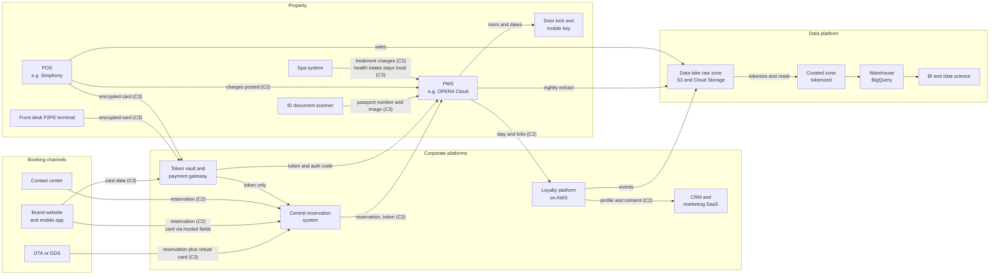

# Hospitality data landscape
{: .no_toc }

**Phase 0: Mobilize.** Maps the organization's data domains and systems across property, corporate, SaaS, and cloud environments so that Phase 1 discovery knows where to look.
{: .fs-5 .fw-300 }

## On this page
{: .no_toc .text-delta }

1. TOC
{:toc}

---

## Purpose of the landscape

The landscape is the hypothesis that Phase 1 tests. It is assembled from architecture diagrams, the CMDB, cloud account lists, PCI scoping documents, and interviews with system owners. It will be incomplete and partly wrong. Its value is that it gives discovery tooling a starting list of systems, tells the program which domains are likely to hold C3 data, and shows where data crosses environment and ownership boundaries.

The landscape is organized three ways:

1. **By data domain**: the business area that owns the data. Domains match the `data-domain` tag values.
2. **By system**: the applications and platforms that store or process the data, with their hosting environment.
3. **By flow**: how data moves through a guest journey from booking to analytics.

## Data domains

| Domain (`data-domain`) | What it contains | Typical tier range | Typical labels | Primary regimes |
|---|---|---|---|---|
| `guest` | Guest profiles, contact details, stay history, preferences, reservations, identity documents, special requests, accessibility and dietary needs | C2 to C3 | `Confidential\Guest-PII`, `Restricted\Guest-Identity`, `Restricted\Special-Category` | GDPR, UK GDPR, CCPA, PIPL, LGPD, DPDP |
| `payment` | PAN, tokens, authorization records, chargebacks, folio payment details | C3 (PAN), C2 (tokens and truncated PAN) | `Restricted\PCI`, `Confidential\Guest-PII` | PCI DSS, state breach laws |
| `loyalty` | Member accounts, points balances and transactions, tier status, partner earn and burn, marketing consent | C2 | `Confidential\Guest-PII` | GDPR, CCPA, PIPL, LGPD |
| `employee` | HR records, payroll, bank details, national ID numbers, background checks, health and leave data, work permits | C2 to C3 | `Confidential\Employee`, `Restricted\Special-Category` | GDPR, labor laws, state breach laws |
| `finance` | General ledger, owner and franchisee statements, contracts, M&A materials, forecasts | C1 to C3 | `Confidential\Business`, `Restricted\Secrets` for deal data where designated | SOX where applicable, contracts |
| `operations` | Room inventory, housekeeping, maintenance, revenue management, procurement | C1 to C2 | `Internal`, `Confidential\Business` | Contracts |
| `property-iot` | Door lock audit trails, key card encoding, building management telemetry, CCTV footage, Wi-Fi session logs | C1 to C3 | `Internal`, `Confidential\Guest-PII`, `Restricted\Special-Category` for biometric use | GDPR (CCTV and location), local surveillance laws |
| `security` | Credentials, secrets, cryptographic keys, security logs, vulnerability data | C2 to C3 | `Restricted\Secrets`, `Confidential\Business` | PCI DSS 3.6 and 3.7, SOC 2 |

## Systems catalog

The catalog lists representative systems with their hosting environment, the kind of data they hold, and the typical tier. Product names are examples of the category, not a statement of what the organization runs.

### Guest-facing and distribution

| System | Function | Environment | Structured or unstructured | Key data | Typical tier |
|---|---|---|---|---|---|
| Brand website and booking engine | Search, book, manage stays | AWS (containers, managed database), CDN | Structured | Guest contact, reservation, hosted payment field tokens | C2 (C3 only if PAN enters the environment, which the design avoids) |
| Guest mobile app back end | Account, check-in, digital key, chat | AWS | Structured plus media | Profile, stay, device identifiers, digital key credentials, chat transcripts | C2, C3 for key material |
| Central reservation system (CRS) | Inventory and reservation master across brands | SaaS or vendor-hosted | Structured | Reservations, guest contact, sometimes guaranteed-card details | C2, C3 where card guarantees are held |
| GDS and OTA connectivity | Distribution to travel agents and online travel agencies | Vendor channel manager, API gateways | Structured messages | Reservation feeds, virtual cards from OTAs | C2, C3 for virtual card numbers |
| Contact center platform | Reservations and service calls | SaaS | Structured plus call recordings | Call recordings (can contain PAN if not paused), CRM notes | C2, C3 for recordings containing PAN |
| CRM and marketing platform | Segmentation, campaigns, consent | SaaS | Structured | Contact data, preferences, consent records | C2 |
| Loyalty platform | Member accounts and points | AWS | Structured | Member profile, points ledger, partner transactions | C2 |

### Property systems

| System | Function | Environment | Structured or unstructured | Key data | Typical tier |
|---|---|---|---|---|---|
| Property management system (PMS), for example Oracle OPERA Cloud | Reservations, check-in, folios, housekeeping | SaaS or OCI-hosted; legacy on-prem at some properties | Structured plus attachments | Guest profile, stay, folio, ID document details and scans where captured | C2, C3 for ID data |
| Point of sale (POS), for example Oracle Simphony | Food and beverage, retail | SaaS with on-prem workstations | Structured | Check detail, tokens; clear PAN must never be present with P2PE | C2, C3 at terminal boundary |
| P2PE payment terminals and payment gateway | Card-present acceptance | Property network, processor cloud | Structured | Encrypted card data (decrypted only by the P2PE provider) | C3 (out of scope for the organization when P2PE is validated) |
| Door lock and key encoding system | Room access | On-prem server at property, some vendor cloud | Structured | Key card audit trails, room assignments, mobile key credentials | C2, C3 for encoding keys |
| Building management and IoT | HVAC, energy, occupancy sensors | On-prem controllers, vendor cloud | Structured telemetry | Occupancy data linkable to rooms | C1 to C2 |
| CCTV and video management | Security monitoring | On-prem recorders, some cloud video platforms | Unstructured media | Video of guests and staff | C2, C3 where facial recognition is used |
| Guest Wi-Fi | Internet access with portal login | On-prem controllers, managed service provider | Structured logs | Name and room number at login, device MAC, session logs | C2 |
| Spa and wellness system | Bookings and treatments | SaaS or on-prem | Structured plus scanned forms | Health questionnaires, allergies, treatment notes | C3 (special category) |
| Events and group sales | Group blocks, rooming lists, banquet orders | SaaS plus Excel files | Mixed | Attendee lists, dietary and accessibility needs, passport details for some group types | C2, C3 for special category and ID data |
| Property file server | Local documents | On-prem Windows server | Unstructured | Scanned registration cards, incident reports, HR paperwork | C2 to C3 |

### Corporate and back office

| System | Function | Environment | Structured or unstructured | Key data | Typical tier |
|---|---|---|---|---|---|
| HR and payroll | Employee lifecycle and pay | SaaS plus on-prem legacy in some regions | Structured plus documents | National IDs, bank accounts, salaries, health and leave, right-to-work documents | C2 to C3 |
| Finance and ERP | Ledger, payables, owner reporting | OCI (Oracle databases), SaaS | Structured | Vendor bank details, owner statements, financial forecasts | C2, C3 for bank accounts |
| Revenue management system | Pricing and forecasting | SaaS | Structured | Aggregated demand data, sometimes guest-level history | C1 to C2 |
| Microsoft 365 (Exchange Online, SharePoint Online, OneDrive, Teams) | Collaboration | SaaS | Unstructured | Everything that is exported or emailed: guest lists, contracts, HR files, passport scans | C1 to C3 |
| Corporate file shares and NAS | Legacy documents | Corporate data center | Unstructured | Finance and HR archives, legal files | C1 to C3 |
| Identity platform (Entra ID, Active Directory) | Workforce identity | Azure, corporate data center | Structured | Credentials, group memberships | C3 for credentials |
| Secrets and key management | Keys, certificates, secrets | AWS KMS, Azure Key Vault and Managed HSM, Cloud KMS, OCI Vault, on-prem HSMs | Structured | Key material and secrets | C3 |

### Data and analytics platforms

| System | Function | Environment | Structured or unstructured | Key data | Typical tier |
|---|---|---|---|---|---|
| Enterprise data lake | Raw and curated zones | Amazon S3 and Google Cloud Storage | Both | Replicated guest, loyalty, POS, and operational data | C1 to C3 (raw zone often C3 until tokenized) |
| Enterprise data warehouse | Reporting and analytics | Google BigQuery | Structured | Curated guest, stay, revenue, loyalty datasets | C2 |
| Data science workspace | Models for personalization and forecasting | Databricks or Vertex AI (examples) | Both | Feature tables, extracts | C2 |
| Operational database for Oracle workloads | Finance and integration databases | OCI (Autonomous Database, Base Database Service) | Structured | Finance, vendor, owner data | C2 to C3 |
| Log and SIEM platform | Security monitoring | SaaS SIEM plus cloud-native logs | Semi-structured | Logs that can accidentally contain PII, tokens, or PAN | C2 |
| Backup platform | Backups for on-prem and cloud | Backup appliances, cloud vaults | Unstructured copies | Copies of everything above | Inherits the highest tier of the source |

## Where data lives, by environment

This view drives which discovery tool and which key service applies. See [Data asset inventory and discovery]() for tooling per environment.

| Environment | Main structured stores | Main unstructured stores | Native discovery | Native key service |
|---|---|---|---|---|
| Property on-premises | Local PMS or POS databases (legacy), door lock databases, spa systems | Property file servers, CCTV recorders, scanned forms, USB media | Microsoft Purview information protection scanner, File Classification Infrastructure, third-party scanners | Local disk encryption; central HSM or KMIP server for integrated systems |
| Corporate data center | SQL Server, Oracle Database, legacy HR and finance | File shares, NAS, tape and disk backups | Purview Data Map self-hosted integration runtime, Purview information protection scanner, Varonis, BigID | On-prem HSMs, Oracle Key Vault, CipherTrust Manager or equivalent |
| SaaS | CRM, HR, PMS, POS, CRS data models | Microsoft 365, contact center recordings | Purview for Microsoft 365; vendor APIs; CASB and SaaS security posture tools | Vendor-managed; Customer Key for Microsoft 365; vendor BYOK where offered |
| AWS | Amazon RDS, Aurora, DynamoDB, Redshift | Amazon S3, EBS snapshots, CloudWatch Logs | Amazon Macie (S3 only), AWS Glue sensitive data detection, third-party scanners | AWS KMS, CloudHSM custom key store, external key store (XKS) |
| Azure | Azure SQL, Cosmos DB, Synapse | Blob Storage, Azure Files, Log Analytics | Purview Data Map and data security posture tooling | Key Vault (Standard and Premium), Managed HSM |
| Google Cloud | BigQuery, Cloud SQL, Spanner, Firestore | Cloud Storage, Cloud Logging | Sensitive Data Protection discovery (BigQuery, Cloud SQL, Cloud Storage) | Cloud KMS, Cloud HSM, Cloud EKM, Autokey |
| OCI | Autonomous Database, Base Database Service, MySQL HeatWave | Object Storage, File Storage, Logging | Data Safe sensitive data discovery (Oracle databases) | OCI Vault, virtual private vault, Dedicated KMS, External KMS |

{: .verify }
Discovery coverage of each native tool changes frequently, for example which database engines Purview Data Map or Sensitive Data Protection discovery supports. Confirm current coverage in provider documentation when planning.

## Guest journey data flow

The diagram follows one guest from booking through checkout and into analytics. It shows the main systems, where data crosses boundaries, and where the highest-tier data appears.

### Walking through the flow

| Step | What happens | Data and tier | Protection point |
|---|---|---|---|
| 1. Booking via OTA or GDS | The OTA sends a reservation to the CRS through a channel manager, often with a virtual card number for payment | Guest name, dates, contact (C2); virtual card (C3) | Tokenize the virtual card at the CRS edge; TLS 1.2+ on the channel connection |
| 2. Direct booking | The website or app collects the booking; card entry uses hosted payment fields served by the gateway, so card data never touches the organization's servers | Contact and reservation (C2) | Hosted fields keep the booking engine out of PCI storage scope; payment page script controls under PCI DSS 6.4.3 and 11.6.1 still apply |
| 3. Contact center booking | Agents take reservations by phone | Contact and reservation (C2); PAN if spoken (C3) | DTMF masking or pause-and-resume so recordings never contain PAN |
| 4. Reservation to PMS | The CRS pushes the reservation to the property PMS | Reservation and token (C2) | Tokens only; no PAN in the PMS |
| 5. Check-in with ID scan | Front desk scans a passport or national ID where local law requires it | Passport number, nationality, date of birth, image (C3) | Field-level encryption of the document number and image; retention limited to the legal requirement; `Restricted\Guest-Identity` label |
| 6. Card-present authorization | Guest taps or inserts a card on a P2PE terminal | Encrypted card data (C3) | P2PE: the property network and PMS never see clear PAN |
| 7. Room key | PMS instructs the lock system; the mobile app may receive a digital key | Room assignment (C2); key credential (C3) | Key credentials protected by HSM-backed keys; short-lived credentials |
| 8. Restaurant and spa | POS charges post to the folio; spa collects health intake forms | Charges (C2); health data (C3) | P2PE at POS; spa forms labeled `Restricted\Special-Category` and encrypted |
| 9. Loyalty accrual | Stay and spend flow from the PMS to the loyalty platform | Member ID, stay, spend (C2) | CMK per domain; masking for support staff |
| 10. Marketing | Loyalty and CRM exchange profile and consent data | Contact, preferences, consent (C2) | Consent enforcement; minimized attributes |
| 11. Analytics ingestion | Nightly extracts and event streams land in the raw zone | Mixed, often C3 until transformed | Raw zone treated as C3; tokenization and masking before the curated zone |
| 12. Warehouse and BI | Analysts query curated data | C2 with tokenized identifiers | Column-level policy tags and dynamic masking |

### Boundary crossings to watch

The highest risk sits where data crosses an ownership or environment boundary:

- **OTA to CRS**: external party; the channel carries virtual cards.
- **Franchised property to corporate platforms**: the property network is not operated by the organization, but brand-mandated systems connect to the CRS, loyalty, and data lake.
- **Property to cloud**: legacy interfaces may use older TLS versions or VPNs with weak configurations.
- **Region to region**: China and EU guest data flowing into global loyalty and analytics platforms.
- **Production to non-production**: extracts copied to test environments.
- **Organization to processors**: marketing agencies, survey providers, and payment processors.

Each crossing appears in the cross-border and third-party registers described on [Data ownership, flows, and lineage]().

## Structured versus unstructured

The site divides protection into two tracks because the control mechanisms differ.

| Aspect | Structured data (Phase 3) | Unstructured data (Phase 4) |
|---|---|---|
| Examples | Guest profile tables, reservations, points ledger, payroll | Passport scans, contracts, rooming lists, emails, CCTV, logs, backups |
| Where classification lives | Column tags, policy tags, database sensitivity classifications, resource tags | Sensitivity labels embedded in file metadata, container labels, object tags |
| Main at-rest controls | TDE or storage encryption with CMK, field-level encryption, tokenization, FPE, masking | Storage encryption with CMK, persistent label-based encryption, crypto-shredding for backups |
| Main egress controls | Query-level access control, masking, row-level security | DLP, CASB, sharing restrictions |
| Discovery method | Schema scanning and column sampling | Content inspection of files and objects, OCR for images |
| Typical failure mode | Over-broad read access to transparently decrypted data | Copies proliferating outside the protected location |

## Known gaps in the landscape

The following are expected to be incomplete at the end of Phase 0 and are explicit Phase 1 discovery targets:

- Spreadsheets and exports in Microsoft 365 created from PMS and CRM reports.
- S3 and Cloud Storage buckets created by projects outside the platform teams.
- Legacy on-prem PMS databases at properties that have not migrated to a cloud PMS.
- Contact center recordings that pre-date PAN pause controls.
- Application logs that capture request bodies.
- Franchisee-hosted systems that receive brand data feeds.
- Shadow SaaS used by sales and events teams.

## Key takeaways for engineering teams

- The raw zone of the data lake inherits the highest tier of anything it ingests; treat it as C3 until tokenization and masking are applied.
- Design payment flows so that clear PAN never reaches the organization's own systems: hosted fields, P2PE, and tokens.
- Passport and ID data enters at the front desk and in group sales; treat both as C3 with field-level protection and short retention.
- Boundary crossings (franchise, OTA, region, non-production) are where controls most often fail; design them explicitly.
- Backups and logs inherit the classification of their sources and need the same key discipline.

## Related pages

- [Data asset inventory and discovery]()
- [Data classification scheme]()
- [Data ownership, flows, and lineage]()
- [Payment card data and PCI DSS]()
- [Data lakes and analytics platforms]()
