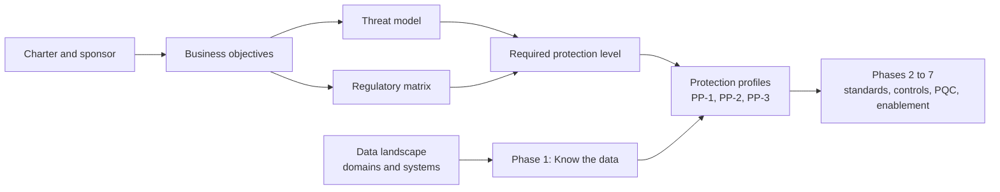

# Start here
{: .no_toc }

**Phase 0: Mobilize.** Establishes the scenario, the business objectives, the threat and regulatory drivers, and the data landscape that every later phase depends on.
{: .fs-5 .fw-300 }

## On this page
{: .no_toc .text-delta }

1. TOC
{:toc}

---

## Objective of this section

This section is the entry point for the reference architecture. It describes a global hospitality organization that operates owned, managed, and franchised properties, runs guest-facing and back-office systems on-premises at properties and in corporate data centers, and consumes AWS, Microsoft Azure, Google Cloud, and Oracle Cloud Infrastructure (OCI). The organization must protect guest, payment, loyalty, and employee data across all of those environments, satisfy PCI DSS v4.0.1 and privacy laws in every region where it operates, and prepare its cryptography for the transition to post-quantum algorithms.

Phase 0 (Mobilize) produces the program charter and the shared vocabulary. It answers four questions before any control is designed:

1. What is the organization trying to achieve, and how will success be measured?
2. What threats and regulations drive the required level of protection?
3. What data exists, in which systems, and in which environments?
4. How is the rest of this site organized, and which parts apply to which reader?

The answers are deliberately concrete. Later pages select controls by data classification, protection profile, and environment, and those selections are only defensible if the objectives and drivers are written down first.

## Entry criteria

| Criterion | Evidence |
|---|---|
| Executive sponsor named (CISO or CIO) with authority across corporate IT, property technology, and the cloud platform teams | Signed charter or steering committee minutes |
| Budget line for discovery tooling, key management, and engineering time | Approved funding request |
| Access to existing inventories: CMDB, cloud account and subscription lists, PCI scope documentation, records of processing | Read access granted to the architecture team |
| Privacy, legal, and internal audit representatives identified | Named contacts in the RACI |

## Exit criteria

| Criterion | Evidence |
|---|---|
| Business objectives agreed with success measures and owners | [Business objectives]() approved by the steering committee |
| Threat model and regulatory matrix agreed with legal and privacy | [Threats and regulatory drivers]() reviewed and signed off |
| First-pass data landscape and systems catalog | [Hospitality data landscape]() populated for all data domains |
| Protection profiles (PP-1, PP-2, PP-3) accepted as the Good/Better/Best model | Architecture review board decision record |
| Phase 1 plan and resourcing approved | [Phased roadmap]() baselined |

## Deliverables

- Program charter with scope (all property types, all four clouds, corporate data centers, SaaS).
- Objectives register with success measures and the objectives-to-phase traceability matrix.
- Threat model for hospitality data and the regulatory obligations matrix.
- Data domain catalog and systems catalog, used as the seed for the Phase 1 inventory.
- Current-state assessment: which systems already use customer-managed keys, where PAN is stored, which TLS versions are in use, and which properties are franchised.

## How Phase 0 feeds the program

The threat model and the regulatory matrix set how much protection each class of data needs. The data landscape tells Phase 1 where to look. Phase 1 then converts that into an inventory, a classification, and machine-readable labels, which select a protection profile for every data store.

## Pages in this section

| Page | What it covers |
|---|---|
| [Overview and how to use this site]() | The scenario, the role of the cloud security architect, how phases and Good/Better/Best profiles work, and reading paths by audience |
| [Business objectives]() | Fourteen objectives with problem statements, outcomes, success measures, owning phases, and a traceability matrix |
| [Threats and regulatory drivers]() | Threat model for hospitality data and the regulatory obligations matrix, including encryption safe harbors |
| [Hospitality data landscape]() | Data domains, systems catalog by environment, and the guest journey data flow |

{: .note }
Timing statements on this site reflect the state of standards and cloud services as of mid-2026. Items whose status may have changed are marked with a verify callout.

## Key takeaways for engineering teams

- Every control decision later on this site traces back to an objective, a threat, or a regulation recorded in this section.
- The four-tier classification (C0 to C3) and the three protection profiles (PP-1 to PP-3) are the shared vocabulary for all design reviews.
- The data landscape is a starting hypothesis; Phase 1 discovery replaces it with evidence.
- Franchised properties change the shared-responsibility boundary and must be named explicitly in scope.

## Related pages

- [Phased roadmap]()
- [Phase 1: Know the data]()
- [Data classification scheme]()
- [Operating model and RACI]()
