# Business objectives
{: .no_toc }

**Phase 0: Mobilize.** Breaks the program into fourteen objectives, each with a problem statement, a desired outcome, measurable success criteria, and a traceable owner in the phase plan.
{: .fs-5 .fw-300 }

## On this page
{: .no_toc .text-delta }

1. TOC
{:toc}

---

## How the objectives are used

The objectives are the contract between the program and its sponsors. Each objective:

- States the **problem** in business terms, as the organization experiences it today.
- States the **desired outcome** as an end state, not as an activity.
- Lists **success measures** that can be collected from tooling, not from self-assessment.
- Names the **primary phase** that delivers it and the **owning pages** on this site that describe the design.

Design reviews use the objectives to test proposals. A proposal that does not advance an objective, or that conflicts with one, needs a written justification. The [Metrics and KPIs]() page turns the success measures into a reporting set.

{: .note }
Target values below are illustrative starting points for a program of this size. The steering committee sets actual targets after the Phase 0 current-state assessment. None of the numbers are benchmarks.

```mermaid
flowchart LR
    subgraph Foundation
        O1["O1 Know where<br/>sensitive data is"]
        O2["O2 Classify and label<br/>for automatic control"]
    end
    subgraph Crypto_and_keys["Crypto and keys"]
        O3["O3 One crypto standard"]
        O4["O4 Enterprise key management"]
        O13["O13 Resilience"]
    end
    subgraph Protect["Protect data"]
        O5["O5 Structured data"]
        O6["O6 Unstructured data"]
        O7["O7 Payment scope reduction"]
        O9["O9 Transit and in use"]
    end
    subgraph Obligations
        O8["O8 Privacy and residency"]
        O12["O12 Franchise and third-party sharing"]
    end
    subgraph Future
        O10["O10 PQC readiness<br/>and crypto agility"]
    end
    subgraph Operate
        O11["O11 Enable engineering"]
        O14["O14 Measurable assurance"]
    end
    Foundation --> Crypto_and_keys
    Foundation --> Protect
    Crypto_and_keys --> Protect
    Crypto_and_keys --> Future
    Protect --> Obligations
    Operate --> Foundation
```

## O1. Know where sensitive data is

**Problem.** Guest, payment, and employee data exists in systems that no central team tracks: property file servers, exported spreadsheets in OneDrive, S3 buckets created by a marketing agency, BigQuery datasets copied from production, and franchisee-hosted interfaces. The CMDB lists servers and applications but not the data inside them. When a regulator or a guest asks where their data is, the organization cannot answer with confidence.

**Desired outcome.** A continuously updated data asset inventory covering every data store in on-premises data centers, properties, AWS, Azure, Google Cloud, OCI, and sanctioned SaaS, with an owner, a classification, and a residency for each store. Automated discovery finds new stores and new sensitive data within days, not at the next annual audit.

| Success measure | Illustrative target |
|---|---|
| Percentage of cloud accounts, subscriptions, projects, and compartments enrolled in automated discovery | 100% by month 9 |
| Percentage of data stores in the inventory with a named owner | 95% |
| Median time from creation of a new data store to its appearance in the inventory | 7 days or less |
| Number of unknown stores containing C3 data found per quarter | Trending down after month 12 |

**Primary phase:** 1. **Owning pages:** [Data asset inventory and discovery](), [Hospitality data landscape]().

## O2. Classify and label so controls are applied automatically

**Problem.** Classification exists as a policy document. Engineers do not know which tier applies to a loyalty profile or a spa intake form, and even when they do, nothing in the platform reads the classification. Controls are chosen per project, so similar data gets very different protection.

**Desired outcome.** Every data store and every sensitive document carries a machine-readable classification (resource tag, column tag, sensitivity label) that policy as code, key selection, DLP, and masking read directly. Protection follows the label rather than the judgment of each team.

| Success measure | Illustrative target |
|---|---|
| Percentage of cloud data resources carrying a valid `data-classification` tag | 98% |
| Percentage of new resources blocked or remediated for a missing or invalid tag | 100% enforced by policy |
| Percentage of Microsoft 365 documents containing sensitive information types that carry a sensitivity label | 90% |
| Percentage of C2 and C3 columns in the warehouse carrying a column-level tag or policy tag | 95% |

**Primary phase:** 1. **Owning pages:** [Data classification scheme](), [Labeling, tagging, and metadata](), [Label-to-control mapping]().

## O3. One cryptographic standard

**Problem.** Teams choose algorithms and modes independently. The estate includes AES-CBC without authentication, SHA-1 signatures on internal certificates, TLS 1.0 on some property interfaces, hard-coded keys in integration code, and custom tokenization logic. Auditors ask for the approved cipher list and there is no single answer.

**Desired outcome.** A single enterprise cryptographic standard defines approved, deprecated, and prohibited algorithms, key lengths, modes, protocols, and libraries, including a post-quantum section. The standard is enforced in code review, CI, and platform policy, and exceptions are time-bound.

| Success measure | Illustrative target |
|---|---|
| Standard published and approved | Month 6 |
| Percentage of external TLS endpoints meeting the standard (TLS 1.2+ with approved suites) | 100% |
| Number of prohibited algorithm uses detected by code and network scanning | Trending to zero |
| Open exceptions older than their expiry date | Zero |

**Primary phase:** 2. **Owning pages:** [Cryptographic standards](), [Cryptographic inventory (CBOM)]().

## O4. Enterprise key management with separation of duties

**Problem.** Keys are managed separately in each cloud and on-premises, with inconsistent naming, rotation, and access. In several accounts the same administrators can create keys, change key policy, and read the data the keys protect. There is no enterprise view of which key protects which data.

**Desired outcome.** An enterprise key management architecture with a defined key hierarchy, customer-managed keys per data domain and environment, HSM backing for C2 and C3 keys, automated rotation, and enforced separation between key administrators and key users. Every key is tagged and mapped to the data it protects.

| Success measure | Illustrative target |
|---|---|
| Percentage of C2 and C3 data stores encrypted with a customer-managed key | 100% |
| Percentage of customer-managed keys with rotation enabled or a documented cryptoperiod | 100% |
| Number of principals holding both key administration and data decryption rights | Zero outside break-glass |
| Percentage of keys carrying `data-domain` and `data-classification` tags | 100% |

**Primary phase:** 2. **Owning pages:** [Key management architecture](), [Hardware security modules](), [Key custody: BYOK, HYOK, and external keys]().

## O5. Protect structured data

**Problem.** Databases and warehouses holding guest profiles, reservations, loyalty accounts, and HR records rely on platform default encryption. Any user with database read access, or any copy of a backup, exposes the data in clear text. Production data is copied into development and test environments.

**Desired outcome.** Structured data stores meet the profile set by their classification: TDE or storage encryption with customer-managed keys for C2, and field-level encryption or tokenization for C3 elements before they leave the application. Non-privileged users see masked values. Non-production environments use masked or synthetic data.

| Success measure | Illustrative target |
|---|---|
| Percentage of C2 databases using TDE or storage encryption with a customer-managed key | 100% |
| Percentage of C3 columns protected by field-level encryption or tokenization | 100% for PAN and passport numbers by month 18 |
| Non-production databases containing unmasked C2 or C3 data | Zero |
| Percentage of analyst roles receiving masked values for C2 and C3 columns | 100% |

**Primary phase:** 3. **Owning pages:** [Structured data protection patterns](), [Tokenization, FPE, and masking](), [Cloud databases](), [On-prem databases]().

## O6. Protect unstructured data

**Problem.** Passport scans, group rooming lists, HR files, contracts, and event attendee spreadsheets live in file shares, SharePoint, email attachments, object storage, and backups. Once a file leaves its original location, no protection travels with it.

**Desired outcome.** Sensitive files carry sensitivity labels. C3 files are protected with persistent encryption that travels with the file. DLP detects and blocks C3 content leaving through email, web, endpoints, and SaaS. Object storage, backups, and logs are encrypted with customer-managed keys and scrubbed of sensitive data where possible.

| Success measure | Illustrative target |
|---|---|
| Percentage of files containing C3 sensitive information types that carry a `Restricted` label with encryption | 90% by month 24 |
| DLP policies for C3 data in block mode across email, endpoint, and SharePoint | 100% by month 18 |
| Open-access shares or public buckets containing C2 or C3 data | Zero |
| Application log sources verified free of PAN and passport numbers | 100% |

**Primary phase:** 4. **Owning pages:** [Unstructured data protection patterns](), [Microsoft 365 and collaboration](), [DLP and CASB enforcement]().

## O7. Payment scope reduction

**Problem.** Card data enters through many channels: brand website, OTAs, call centers, front desk terminals, restaurant POS, spa, and group billing. Some channels store PAN in the PMS for incidentals and no-show charges. PCI scope extends into systems that do not need card data, which raises assessment cost and breach impact.

**Desired outcome.** No system outside a small, defined cardholder data environment stores or processes clear-text PAN. Property terminals use validated P2PE, the booking engine uses hosted payment fields, and downstream systems use tokens. Sensitive authentication data is never stored after authorization.

| Success measure | Illustrative target |
|---|---|
| Number of systems in PCI scope | Reduced against the Phase 0 baseline, target set after assessment |
| Percentage of property card-present terminals using P2PE | 100% for owned and managed properties |
| Stores of clear-text PAN found by discovery outside the CDE | Zero |
| Channels using tokens rather than PAN downstream of authorization | 100% |

**Primary phase:** 3. **Owning pages:** [Payment card data and PCI DSS](), [Tokenization, FPE, and masking]().

## O8. Privacy and residency compliance

**Problem.** Guest data from the EU, UK, China, Brazil, India, and US states is processed centrally. Cross-border transfers are not consistently documented. Some regions require local storage of certain data, and encryption is often the factor that decides whether a breach triggers notification to individuals.

**Desired outcome.** Every data store records its residency, every cross-border flow is registered with its transfer mechanism, keys for residency-constrained data are held in-region, and encryption is applied in a way that supports safe harbor positions under breach notification laws.

| Success measure | Illustrative target |
|---|---|
| Percentage of data stores carrying a `data-residency` tag | 100% |
| Cross-border flows with a documented transfer mechanism | 100% |
| Residency-constrained data encrypted with keys held in the same region | 100% |
| Records of processing entries linked to inventory data stores | 100% |

**Primary phase:** 1 (discovery and records), then 2 and 3 (keys and controls). **Owning pages:** [Threats and regulatory drivers](), [Data ownership, flows, and lineage](), [Compliance mapping]().

## O9. Protect data in transit and in use

**Problem.** Internal service traffic, property-to-cloud interfaces, and some partner connections use TLS 1.0 or 1.1, or no encryption on private networks. Data is decrypted in memory on shared infrastructure, and some analytics on C3 data runs on general-purpose clusters.

**Desired outcome.** TLS 1.2 or higher everywhere with TLS 1.3 preferred, mTLS for service-to-service traffic handling C3 data, a certificate lifecycle that copes with shortening validity periods, and confidential computing for defined C3 processing workloads where it is feasible.

| Success measure | Illustrative target |
|---|---|
| Percentage of endpoints negotiating TLS 1.2 or higher | 100% |
| Percentage of endpoints negotiating TLS 1.3 | Increasing quarter over quarter |
| Service-to-service paths carrying C3 data using mTLS | 100% |
| Certificates renewed automatically | 95% by the time 100-day public certificate validity applies |

**Primary phase:** 5. **Owning pages:** [Encryption in transit](), [Data in use and confidential computing](), [Certificates and PKI]().

## O10. PQC readiness and crypto agility

**Problem.** Key exchange and signatures across the estate depend on RSA and elliptic curve algorithms that a cryptographically relevant quantum computer would break. Guest identity data and loyalty histories have long shelf lives, so traffic captured today could be decrypted later. Many systems hard-code algorithms and cannot change them without a rebuild.

**Desired outcome.** A cryptographic inventory identifies every quantum-vulnerable use. Hybrid post-quantum key exchange is enabled first on external and high-value paths, then signatures on long-lived roots of trust. Systems are built to be crypto-agile so algorithms change through configuration. Completion aligns with the 2035 horizon set by NIST IR 8547 (draft), CNSA 2.0, the EU roadmap, and UK NCSC guidance.

| Success measure | Illustrative target |
|---|---|
| Percentage of cryptographic assets in the CBOM with quantum-vulnerability status recorded | 100% by month 12 |
| Percentage of external TLS endpoints offering hybrid PQ key exchange | Increasing, with targets per year |
| Percentage of new systems passing a crypto-agility check at design review | 100% |
| Vendor contracts with PQC roadmap commitments | All critical vendors by month 24 |

**Primary phase:** 6, with the inventory in Phase 1. **Owning pages:** [Cryptographic inventory (CBOM)](), [PQC migration program](), [Crypto agility and hybrid designs]().

## O11. Enable engineering teams

**Problem.** Engineering teams receive requirements such as "encrypt sensitive data" without the patterns, modules, or review process to implement them. Security reviews happen late and produce rework. Each team solves key management and tokenization again.

**Desired outcome.** Paved roads: approved Terraform modules, SDK wrappers, and reference architectures that meet PP-1, PP-2, and PP-3 by default. A design review process that happens early and gives answers in days. Self-service key provisioning keyed on tags. Decision trees that let engineers select the right control without escalation.

| Success measure | Illustrative target |
|---|---|
| Percentage of new data stores provisioned through a paved-road module | 80% by month 18 |
| Median design review turnaround | 5 business days or less |
| Design reviews resulting in rework after build | Trending down |
| Engineering satisfaction with security guidance (survey) | Improving each half-year |

**Primary phase:** 7. **Owning pages:** [Security design review process](), [Encryption decision trees](), [Reference architectures](), [Guardrails and policy as code]().

## O12. Franchise and third-party data sharing

**Problem.** Franchisees, management-agreement owners, OTAs, payment processors, marketing agencies, and technology vendors all receive or process guest data. The organization cannot see how franchisees store data, and extracts are shared by email or unmanaged file transfer.

**Desired outcome.** Brand standards and contracts define minimum controls for franchise and third-party environments. Data shared externally is minimized, labeled, encrypted, and transferred through controlled channels. Third parties with access to C3 data are assessed and monitored.

| Success measure | Illustrative target |
|---|---|
| Franchise agreements including data protection and encryption requirements | 100% of new and renewed agreements |
| External data transfers through approved managed channels | 100% for C2 and C3 |
| Third parties handling C3 data with a current security assessment | 100% |
| Guest data shared with franchisees limited to the defined minimum dataset | Verified annually |

**Primary phase:** 1 (flows and ownership), then 4 and 7. **Owning pages:** [Data ownership, flows, and lineage](), [DLP and CASB enforcement]().

## O13. Resilience: key availability and disaster recovery

**Problem.** Encryption with customer-managed keys moves the availability risk to the key. A deleted key, a disabled external key store, or an HSM outage can make data unrecoverable or take a property's check-in systems down. Current DR plans do not cover keys.

**Desired outcome.** Keys are backed up or replicated according to documented recovery objectives, deletion is protected by waiting periods and multi-party approval, external key dependencies have tested failure modes, and DR tests include key recovery.

| Success measure | Illustrative target |
|---|---|
| Percentage of C2 and C3 keys with documented recovery procedure and replication or backup | 100% |
| Key recovery included in DR tests | At least annually for every critical application |
| Unplanned outages caused by key unavailability | Zero, with every incident reviewed |
| Key deletions executed without the required approvals | Zero |

**Primary phase:** 2. **Owning pages:** [Key management architecture](), [Key custody: BYOK, HYOK, and external keys](), [On-prem and multi-cloud key management]().

## O14. Measurable assurance

**Problem.** Leadership and auditors receive point-in-time attestations. There is no continuous evidence that controls are in place, and gaps surface during audits or incidents.

**Desired outcome.** Controls produce evidence automatically: policy compliance states, key usage logs, DLP events, discovery results, and CBOM snapshots feed a reporting set that shows coverage by classification tier, environment, and business unit.

| Success measure | Illustrative target |
|---|---|
| Percentage of KPIs collected automatically | 90% |
| Coverage dashboards available by tier, environment, and region | Month 12 |
| Audit requests satisfied from existing evidence without manual collection | Increasing each audit cycle |
| Mean time to detect a policy drift on a C3 store | Hours, not weeks |

**Primary phase:** 7. **Owning pages:** [Metrics and KPIs](), [Monitoring and detection](), [Compliance mapping]().

## Objectives-to-phase traceability matrix

"P" marks the primary delivering phase. "S" marks a phase that contributes supporting work.

| Objective | Ph 0 | Ph 1 | Ph 2 | Ph 3 | Ph 4 | Ph 5 | Ph 6 | Ph 7 |
|---|---|---|---|---|---|---|---|---|
| O1 Know where sensitive data is | S | P | | | | | | S |
| O2 Classify and label | S | P | | S | S | | | S |
| O3 One crypto standard | | S | P | | | S | S | S |
| O4 Enterprise key management | | | P | S | S | | S | S |
| O5 Protect structured data | | S | S | P | | | | S |
| O6 Protect unstructured data | | S | S | | P | | | S |
| O7 Payment scope reduction | | S | S | P | S | S | | |
| O8 Privacy and residency | S | P | S | S | S | S | | S |
| O9 Transit and in use | | | S | | | P | S | |
| O10 PQC readiness | | S | S | | | S | P | S |
| O11 Enable engineering | | | S | S | S | S | S | P |
| O12 Franchise and third-party sharing | S | P | | | S | S | | S |
| O13 Resilience | | | P | S | S | | | S |
| O14 Measurable assurance | S | S | | | | | | P |

## Objectives-to-driver mapping

This table links each objective to the threats and regulations on [Threats and regulatory drivers]().

| Objective | Main threats addressed | Main regulatory drivers |
|---|---|---|
| O1 | Shadow data exposure, cloud misconfiguration | GDPR Art. 30, PCI DSS scoping, ISO 27001 A.5.9 |
| O2 | Insider misuse, accidental disclosure | ISO 27001 A.5.12 and A.5.13 |
| O3 | Weak crypto exploitation, HNDL | PCI DSS 12.3.3, ISO 27001 A.8.24 |
| O4 | Key compromise, privileged misuse | PCI DSS 3.6 and 3.7, SOC 2 CC6.1 |
| O5 | Database exfiltration, backup theft | GDPR Art. 32, PCI DSS 3.5.1 |
| O6 | Ransomware exfiltration, email leakage | GDPR Art. 32 and 34, state breach laws |
| O7 | POS malware, card skimming | PCI DSS v4.0.1 |
| O8 | Unlawful transfer, regulatory action | GDPR Chapter V, PIPL, LGPD, DPDP Act |
| O9 | Interception, memory scraping | PCI DSS 4.2.1 |
| O10 | HNDL, future signature forgery | NIST IR 8547 (draft), CNSA 2.0, EU and UK roadmaps |
| O11 | Misconfiguration from inconsistent builds | ISO 27001 A.8.25 to A.8.28 |
| O12 | Third-party and franchise compromise | GDPR Art. 28, PCI DSS 12.8 |
| O13 | Ransomware against key infrastructure, operator error | ISO 27001 A.8.13 and A.5.30 |
| O14 | Undetected control drift | SOC 2, ISO 27001 clause 9 |

## Key takeaways for engineering teams

- Each objective has measurable success criteria; design proposals should state which objectives they advance.
- O1 and O2 are foundations: without inventory and labels, O5 through O8 cannot be verified.
- O13 is the counterweight to O4 and O10: stronger key control increases the consequences of losing a key, so availability design is part of every key decision.
- Paved roads (O11) are how the other objectives scale; a control that is not in a module will be implemented inconsistently.
- Evidence (O14) should come from tooling, so build controls that emit it.

## Related pages

- [Overview and how to use this site]()
- [Threats and regulatory drivers]()
- [Phased roadmap]()
- [Metrics and KPIs]()
