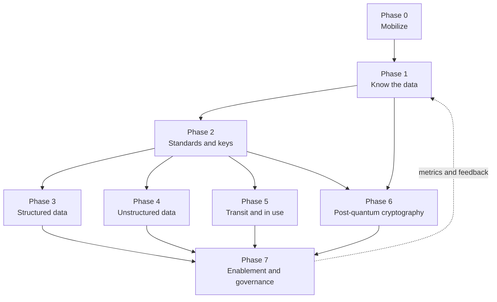

# Overview and how to use this site
{: .no_toc }

**Phase 0: Mobilize.** Describes the scenario, the problems the cloud security architect is accountable for, and how to navigate the phases and protection profiles on this site.
{: .fs-5 .fw-300 }

## On this page
{: .no_toc .text-delta }

1. TOC
{:toc}

---

## The scenario

The organization is a global hospitality company. It operates hotels and resorts under several brands in the Americas, Europe, the Middle East and Africa, and Asia Pacific, including mainland China. Properties fall into three ownership models:

| Model | Who owns the building | Who operates it | Who runs property technology | Data protection implication |
|---|---|---|---|---|
| Owned | The organization | The organization | Corporate IT and property IT | Full control; the organization is controller for guest data and owns every system |
| Managed | A third-party owner | The organization under a management agreement | Mostly corporate standards, some owner-funded systems | The organization operates systems on behalf of an owner; contracts define data ownership and who pays for controls |
| Franchised | A franchisee | The franchisee | Franchisee, using brand-mandated platforms (PMS, POS, loyalty integration) | Shared responsibility; the organization can mandate standards through the franchise agreement but does not operate the environment |

The technology estate spans:

- **Property on-premises:** property management system (PMS) interfaces, point of sale (POS) terminals and workstations, P2PE payment terminals, door lock and key encoders, building management systems, CCTV recorders, guest Wi-Fi controllers, spa and wellness systems, and local file servers.
- **Corporate data centers:** legacy finance and HR systems, file shares, Oracle and SQL Server databases, an on-premises HSM estate, and Active Directory.
- **SaaS:** Microsoft 365, CRM, HR and payroll, a cloud PMS (for example Oracle OPERA Cloud), a cloud POS (for example Oracle Simphony), and a central reservation system (CRS).
- **IaaS and PaaS:** AWS hosts the guest mobile app back end, digital key services, and the loyalty platform. Azure hosts corporate applications and identity integration with Entra ID. Google Cloud hosts the enterprise analytics platform on BigQuery. OCI hosts Oracle database workloads and integrations with Oracle hospitality applications.

Guest data flows between all of these. A single stay generates a booking through an online travel agency (OTA) or the brand website, a CRS record, a PMS profile, a passport scan at check-in in many countries, card authorization through a payment gateway, POS transactions in restaurants, loyalty point accrual, marketing consent updates in the CRM, and analytics records in the data lake. The [Hospitality data landscape]() page maps this in detail.

## What the Senior Manager, Cloud Security Architect role solves

The role owns the architecture for data protection and cryptography across the estate. It does not operate every control. It defines the standards, selects the patterns, and guides engineering teams so that the controls they build are consistent, auditable, and proportionate to the data.

| Problem | What the architect delivers | Where on this site |
|---|---|---|
| Sensitive data is spread across property systems, four clouds, and SaaS, and nobody has a complete list | A data asset inventory and discovery program with tooling per environment | [Data asset inventory and discovery]() |
| Teams apply encryption inconsistently: some use provider-managed keys for passport scans, some use custom crypto | A classification scheme, a label taxonomy, and a label-to-control mapping that selects controls automatically | [Label-to-control mapping]() |
| Each cloud has its own key service and there is no enterprise key hierarchy or separation of duties | A key management architecture across AWS KMS, Azure Key Vault and Managed HSM, Cloud KMS, and OCI Vault, with on-premises HSMs | [Key management architecture]() |
| Payment card data expands PCI scope into analytics and property systems | Tokenization, P2PE, and scope reduction patterns | [Payment card data and PCI DSS]() |
| Passport scans and HR files sit in shares, mailboxes, and buckets | Label-based persistent encryption and DLP | [Unstructured data protection patterns]() |
| RSA and ECC will be broken by a cryptographically relevant quantum computer, and long-lived guest data captured today may be decrypted later | A post-quantum migration program starting with hybrid key exchange | [PQC migration program]() |
| Engineering teams need fast, clear answers, not a policy document | Design review, decision trees, reference architectures, and paved-road modules | [Phase 7: Engineering enablement]() |

The architect's day-to-day work is translation: a regulation or risk becomes a requirement, the requirement becomes a control per environment, and the control becomes a Terraform module, a policy definition, or a design pattern that engineering teams can adopt without re-deriving it.

## How the site is organized

The site follows the program phases. Each phase is a section with a parent page that states its objective, entry and exit criteria, and deliverables.

| Phase | Name | Indicative timing | Section |
|---|---|---|---|
| 0 | Mobilize | Months 0 to 3 | [Start here]() |
| 1 | Know the data | Months 1 to 9 | [Phase 1: Know the data]() |
| 2 | Standards and keys | Months 3 to 12 | [Phase 2: Standards and keys]() |
| 3 | Structured data | Months 6 to 24 | [Phase 3: Structured data]() |
| 4 | Unstructured data | Months 6 to 24 | [Phase 4: Unstructured data]() |
| 5 | Transit and in use | Months 9 to 24 | [Phase 5: Transit and in use]() |
| 6 | Post-quantum cryptography | Month 6 onward, to 2035 | [Phase 6: Post-quantum cryptography]() |
| 7 | Engineering enablement and governance | Continuous | [Phase 7: Engineering enablement]() and [Govern and measure]() |

Two further sections cut across phases:

- [Cloud provider playbooks]() collect the per-provider detail (AWS, Azure, Google Cloud, OCI, and on-premises) in one place for platform teams.
- [Reference]() holds the glossary and sources.

The phases overlap. Phase 1 discovery runs while Phase 2 standards are written, and Phase 3 and Phase 4 run in parallel once keys and standards exist. The [Phased roadmap]() shows the dependencies.

## How to read Good, Better, Best

Every control on this site is expressed as one of three protection profiles. The profile is selected by the data classification tier, not by the preference of the team building the system.

| Profile | Good/Better/Best | Applies to | Core controls |
|---|---|---|---|
| PP-1 Baseline | Good | C0 Public, C1 Internal | Provider-managed keys, platform default encryption at rest, TLS 1.2+, standard IAM, audit logging |
| PP-2 Enhanced | Better | C2 Confidential | Customer-managed keys in cloud KMS (HSM-backed where offered), per-domain and per-environment keys, automated rotation, key admin versus key user separation, TDE with CMK, dynamic masking for non-privileged roles, DLP in monitor-then-block, TLS 1.2+ preferring 1.3, hybrid PQ TLS where supported, quarterly access reviews |
| PP-3 Maximum | Best | C3 Restricted | PP-2 plus application-layer or field-level encryption or tokenization before data leaves the application, single-tenant HSM or customer-held or external keys where justified, persistent label-based file encryption, DLP block, mTLS, confidential computing where feasible, just-in-time access, crypto-shredding, PQC priority for long-lived data |

Read the profiles as follows:

- **Profiles are cumulative.** PP-2 includes everything in PP-1. PP-3 includes everything in PP-2.
- **The tier sets the minimum.** A C2 data store must meet PP-2. A team may choose PP-3 controls for a C2 store when there is a reason, but it may not choose PP-1.
- **Best is not always right.** External or customer-held keys add availability risk, latency, and cost. Field-level encryption breaks search, sorting, and joins unless the application is designed for it. Confidential computing constrains instance types and debugging. Each page states these trade-offs so that PP-3 is applied where it reduces material risk, not by default.
- **Profiles are per data store, not per application.** An application that stores C3 passport numbers and C1 room inventory can apply PP-3 to the identity table and PP-2 to the rest of the database, provided the boundary is enforced.

On content pages, callouts mark the tier of each option:

{: .good }
PP-1 Baseline. The minimum acceptable control for C0 and C1 data.

{: .better }
PP-2 Enhanced. The required control for C2 data, and the default target for most guest and employee data.

{: .best }
PP-3 Maximum. The required control for C3 data such as PAN, passport numbers, biometrics, and keys.

{: .verify }
Marks a statement about a cloud feature, standard, or date whose status may have changed after mid-2026. Confirm against the provider or standards body before relying on it.

## The shared vocabulary

Three pieces of the model appear on nearly every page. They are defined once in Phase 1 and reused without change.

| Element | Values | Defined on |
|---|---|---|
| Classification tier | C0 Public, C1 Internal, C2 Confidential, C3 Restricted | [Data classification scheme]() |
| Sensitivity label | `Public`, `Internal`, `Confidential\Guest-PII`, `Confidential\Employee`, `Confidential\Business`, `Restricted\PCI`, `Restricted\Guest-Identity`, `Restricted\Special-Category`, `Restricted\Secrets` | [Data classification scheme]() |
| Resource tags | `data-classification`, `protection-profile`, `data-domain`, `regulatory-scope`, `data-residency`, `data-owner`, `retention-class` | [Labeling, tagging, and metadata]() |

The tags are designed to work unchanged as AWS tags, Azure tags, Google Cloud labels, and OCI defined tags. All keys and values are lowercase with hyphens and underscores only, because Google Cloud labels impose the tightest character constraints.

## Reading paths by audience

Not every reader needs every page. The paths below are ordered.

### Executives and sponsors

Goal: understand the risk, the investment, the sequence, and how progress will be measured.

1. [Business objectives]()
2. [Threats and regulatory drivers]()
3. [Phased roadmap]()
4. [The quantum threat]()
5. [Metrics and KPIs]()
6. [Risks and anti-patterns]()

### Security and enterprise architects

Goal: understand the model, the standards, and the design decisions, and be able to defend them in review.

1. [Hospitality data landscape]()
2. [Data classification scheme]() and [Label-to-control mapping]()
3. [Cryptographic standards]() and [Key management architecture]()
4. [Key custody: BYOK, HYOK, and external keys]()
5. [Structured data protection patterns]() and [Unstructured data protection patterns]()
6. [Crypto agility and hybrid designs]()
7. [Reference architectures]()

### Cloud and platform engineers

Goal: build the controls with real configuration and pass design review the first time.

1. [Labeling, tagging, and metadata]()
2. [Cross-cloud terminology]() and the playbook for the relevant provider
3. [Encryption decision trees]()
4. [Guardrails and policy as code]()
5. [Code and tooling lab]() and [Hands-on PQC lab]()
6. [Engineering cheat sheet]()

### Governance, risk, compliance, and privacy

Goal: map controls to obligations and produce evidence.

1. [Threats and regulatory drivers]()
2. [Data ownership, flows, and lineage]()
3. [Payment card data and PCI DSS]()
4. [Cryptographic inventory (CBOM)]()
5. [Compliance mapping]()
6. [Operating model and RACI]()

## Code and examples

Runnable code lives in the repository under `code/` and is linked from the relevant pages. It is excluded from the site build.

| Directory | Contents |
|---|---|
| [code/discovery](https://github.com/steven-smith-itnet/data-protection-pqc-security-architecture/tree/main/code/discovery) | PII and PCI discovery scanner with Luhn and IBAN checks that recommends a label and profile |
| [code/classification](https://github.com/steven-smith-itnet/data-protection-pqc-security-architecture/tree/main/code/classification) | Machine-readable label-to-control policy and a resolver |
| [code/envelope](https://github.com/steven-smith-itnet/data-protection-pqc-security-architecture/tree/main/code/envelope) | Envelope encryption with AES-256-GCM and KMS adapters |
| [code/cbom](https://github.com/steven-smith-itnet/data-protection-pqc-security-architecture/tree/main/code/cbom) | TLS and certificate scanner that emits a CycloneDX CBOM |
| [code/pqc-lab](https://github.com/steven-smith-itnet/data-protection-pqc-security-architecture/tree/main/code/pqc-lab) | OpenSSL 3.5 ML-KEM, ML-DSA, SLH-DSA, and hybrid TLS scripts |

Command examples on content pages use real CLI syntax for the AWS CLI, Azure CLI, gcloud, and the OCI CLI. Account IDs, tenancy OCIDs, and resource names are placeholders.

## Conventions and limits

- The organization is fictional and generic. No real hotel company is described.
- Product names are used to show that a control is implementable, not as endorsements. Where several products solve the same problem, the site lists them as alternatives.
- Cloud features change often. Statements are current as of mid-2026 and features whose status may have changed carry a verify callout.
- Regulatory summaries are for architecture planning and are not legal advice. Legal and privacy teams own the interpretation.

## Key takeaways for engineering teams

- The classification tier of the data, not team preference, selects the protection profile, and the profile selects the controls.
- PP-3 controls carry real costs in availability, performance, and functionality; apply them where the data is C3 or where a documented risk justifies them.
- Use the shared tag schema exactly as defined; automation and policy as code depend on the exact keys and values.
- Start with the reading path for your role, and use the cloud playbooks for provider-specific detail.
- Treat verify callouts as a prompt to check current provider documentation before implementation.

## Related pages

- [Business objectives]()
- [Phased roadmap]()
- [Label-to-control mapping]()
- [Glossary]()
