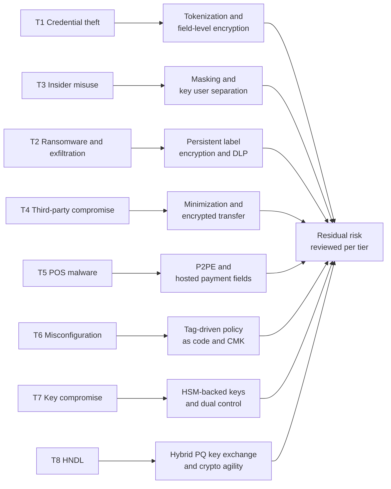
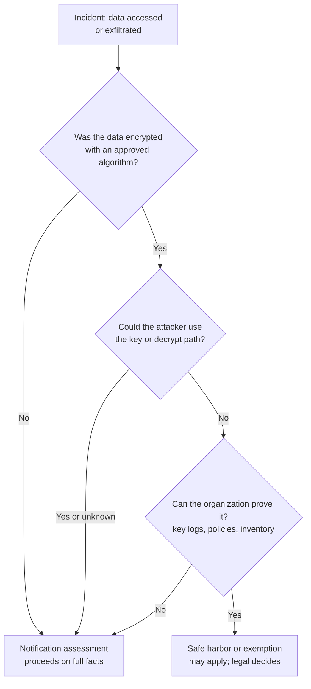

# Threats and regulatory drivers
{: .no_toc }

**Phase 0: Mobilize.** Defines the threats that the data protection controls must defeat and the regulatory obligations that set the minimum level of protection in each region.
{: .fs-5 .fw-300 }

## On this page
{: .no_toc .text-delta }

1. TOC
{:toc}

---

## Why hospitality data is a target

Hospitality organizations hold a combination of data that is valuable to attackers and hard to protect:

- **High volume of payment cards** across many channels: web booking, call centers, front desk, restaurants, bars, spas, and events.
- **Identity documents.** Many countries require hotels to record guest identity details, and some require passport or ID scans, so passport numbers and images are routinely collected at check-in.
- **Travel patterns and preferences** for high-profile guests, which have intelligence value beyond fraud.
- **Loyalty points**, which behave like a currency and are targeted through account takeover.
- **A distributed estate**: thousands of properties with local IT, seasonal staff, shared workstations, and franchisee-operated networks.
- **Many integrations**: OTAs, GDS, CRS, payment gateways, marketing platforms, and property IoT, each an access path.

The threat model below focuses on threats that data protection controls (encryption, key management, tokenization, labeling, DLP, and cryptographic agility) can reduce. Identity, endpoint, and network controls matter as much, but are covered here only where they interact with data protection.

## Threat model

The model uses a simple structure: threat, typical path in a hospitality estate, what data is exposed, and which data protection controls reduce the impact. It is aligned in spirit with STRIDE's information disclosure and tampering categories and with MITRE ATT&CK tactics for collection and exfiltration.

| ID | Threat | Typical path | Data at risk | Data protection controls that reduce impact | Profile |
|---|---|---|---|---|---|
| T1 | Credential theft and account takeover | Phishing of property staff, password spraying of SaaS and cloud consoles, session token theft, loyalty account credential stuffing | Anything the stolen identity can read; loyalty balances | Field-level encryption and tokenization so that database access does not yield clear text; dynamic masking; key user separation so that console access does not imply decrypt; just-in-time access for C3 | PP-2, PP-3 |
| T2 | Ransomware with data exfiltration | Initial access to a property or corporate network, lateral movement, bulk copy to attacker storage, then encryption of systems | File shares, databases, backups, HR files, passport scans | Persistent label-based encryption so exfiltrated files are unreadable; CMK encryption of backups; immutable backups; DLP on egress; key infrastructure isolated from the domain | PP-2, PP-3 |
| T3 | Insider misuse | Front desk or call center staff looking up high-profile guests, bulk export of guest lists by departing sales staff, administrators reading data | Guest profiles, stay history, group lists | Masking for non-privileged roles, label-based DLP, separation of key administration from data access, access reviews, audit logs of decrypt operations | PP-2, PP-3 |
| T4 | Third-party and franchise compromise | Compromise of a franchisee network, a marketing agency, a PMS integration partner, or an OTA connector with standing credentials | Reservation feeds, loyalty data, guest extracts | Data minimization in shared extracts, tokenized identifiers, encryption of transfers, scoped API credentials, contractual minimum controls | PP-2, PP-3 |
| T5 | POS malware and card skimming | RAM-scraping malware on POS workstations, compromised payment pages (web skimming), physical skimmers on terminals | PAN, track data | P2PE so the POS never sees clear-text PAN, hosted payment fields, tokenization, PCI DSS 6.4.3 and 11.6.1 script integrity controls on payment pages | PP-3 |
| T6 | Cloud misconfiguration | Public buckets, overly broad IAM, unencrypted snapshots shared across accounts, test databases exposed to the internet | Any data in the affected store | CMK with key policy as a second authorization layer, tag-driven policy as code, discovery of shadow data, organization-level guardrails blocking public access | PP-2 |
| T7 | Key compromise or key misuse | Keys hard-coded in source code, exported keys in configuration files, over-permissive key policies, compromised HSM administrator | All data protected by the key | HSM-backed non-exportable keys, envelope encryption with per-domain KEKs, secrets management, dual control for key operations, key usage monitoring | PP-2, PP-3 |
| T8 | Harvest now, decrypt later (HNDL) | Adversary records encrypted traffic or copies encrypted archives today and decrypts them once a cryptographically relevant quantum computer exists | Long-lived data: passport data, loyalty histories, HR records, M&A data | Hybrid post-quantum key exchange on transport, AES-256 at rest, crypto-agile designs, retention limits so data does not outlive its purpose | PP-3 for long-lived data |
| T9 | Guest-facing application abuse | API scraping of the booking or loyalty API, insecure direct object references in the mobile app | Reservation details, profiles | Object-level authorization, tokenized identifiers in URLs, rate limiting; data protection controls here are secondary to application security | PP-2 |
| T10 | Property IoT and physical access | Compromised door lock or building management controllers, theft of property servers or backup media | Key card encoding data, local PMS caches | Disk encryption for property servers and removable media, network segmentation, PKI for device identity | PP-2 |

{: .note }
The threat list deliberately does not reference specific public breaches. The patterns above are well documented across the industry and are sufficient to justify the controls.

### Threat to control flow

### What encryption does and does not solve

Encryption is only as strong as the separation between the people who can use the key and the people who can reach the ciphertext. The table below is used in design reviews to avoid overclaiming.

| Scenario | Platform encryption with provider-managed key (PP-1) | Customer-managed key with separated key policy (PP-2) | Field-level encryption or tokenization (PP-3) |
|---|---|---|---|
| Stolen physical disk or decommissioned media | Protected | Protected | Protected |
| Leaked snapshot or backup shared to another account | Often readable if the provider key is usable by the recipient path | Protected if the recipient lacks key permissions | Protected |
| Compromised database administrator account | Not protected | Not protected (the database decrypts transparently) | Protected (the database holds ciphertext or tokens) |
| Compromised application service account | Not protected | Not protected | Not protected for data the application is authorized to decrypt; limited by per-field key scope |
| Cloud provider operator access | Relies on provider controls | Relies on provider controls plus key audit logs | Stronger; external or customer-held keys add further separation |
| Harvest now, decrypt later on the network | Depends on transport encryption, not at-rest encryption | Same | Same; needs hybrid PQ TLS |

The central point: transparent encryption (TDE, disk, storage service encryption) protects against loss of media and some cloud-plane exposures, but not against anyone who can query the running system. PP-3 controls exist because C3 data needs protection that survives compromise of the database or storage tier.

## Regulatory matrix

The organization operates in many jurisdictions. The matrix summarizes the provisions that most directly affect encryption, key management, classification, and breach response. It is for architecture planning and is not legal advice; the legal and privacy teams own interpretation.

| Regime | Scope for the organization | Encryption and security provisions | Breach notification and encryption effect | Architecture implication |
|---|---|---|---|---|
| **PCI DSS v4.0.1** (PCI SSC, published June 2024; future-dated requirements effective March 31, 2025) | All channels that store, process, or transmit cardholder data, including franchised properties under brand-mandated platforms | 3.3 no SAD after authorization; 3.4.1 PAN masked on display (BIN and last four maximum); 3.5.1 PAN unreadable wherever stored; 3.5.1.1 keyed cryptographic hashes; 3.5.1.2 disk-level encryption alone only for removable media; 3.6 and 3.7 key management; 4.2.1 strong cryptography over open, public networks; 4.2.1.1 inventory of trusted keys and certificates; 12.3.3 annual review of cipher suites and protocols | Card brand rules and contracts govern notification, not PCI DSS itself | Tokenization and P2PE to shrink scope; CMK and HSM for the CDE; crypto inventory feeding 12.3.3 |
| **EU GDPR** (Regulation (EU) 2016/679) | Guests and employees in the EU, and offering services to people in the EU | Art. 5(1)(f) integrity and confidentiality; Art. 25 data protection by design; Art. 32(1)(a) names pseudonymisation and encryption as appropriate measures | Art. 33 notification to the supervisory authority within 72 hours unless the breach is unlikely to result in risk; Art. 34(3)(a) communication to data subjects is not required where the data was rendered unintelligible to unauthorized persons, such as by encryption | Encryption with keys the attacker could not reach supports the Art. 34 exemption; key separation must be demonstrable |
| **UK GDPR** and Data Protection Act 2018 | Guests and employees in the UK | Equivalent Art. 32 provisions | Equivalent Art. 33 and 34 provisions; the ICO is the regulator | Same design as EU GDPR; UK is a separate `data-residency` value |
| **GDPR Chapter V** (Art. 44 to 49) and UK equivalents | Transfers outside the EU or UK, for example to US-hosted analytics | Transfers need adequacy, standard contractual clauses, or another mechanism; supervisory authorities treat encryption with keys held outside the importing country as a possible supplementary measure | Not a notification provision | Cross-border flow register; keys held in-region for data where encryption is relied on as a supplementary measure |
| **CCPA as amended by CPRA** (California) | California residents: guests, loyalty members, employees | Duty to implement reasonable security procedures (Cal. Civ. Code 1798.81.5 and 1798.100(e)) | Private right of action under 1798.150 applies to breaches of nonencrypted and nonredacted personal information caused by failure to maintain reasonable security | Encryption materially reduces litigation exposure; `ccpa` regulatory scope tag |
| **US state breach notification laws** | All US states, plus DC and territories | Most define "personal information" to include name plus SSN, driver's license, account or card number with access code, and often passport and biometric data | Most state laws exempt encrypted data from notification unless the key was also acquired | Keep keys separate from data and log key access to support the exemption |
| **China PIPL** (Personal Information Protection Law, effective November 1, 2021) | Guests and employees at properties in mainland China | Art. 51 requires security measures including encryption and de-identification | Art. 57 requires remedial measures and notification to authorities and individuals; notification to individuals can be waived where measures effectively avoid harm | Local storage and in-region keys for China data; `pipl` scope and `cn` residency tags |
| **PIPL cross-border transfer** (Art. 38 to 40; CAC security assessment, standard contract, or certification; Provisions on Promoting and Regulating Cross-Border Data Flows, March 2024) | Transfer of guest data from China to global systems such as the CRS, loyalty, or analytics | Transfer mechanism depends on volume and data type thresholds; separate consent for transfers | Not a notification provision | Minimize data leaving China; register flows; design China-resident processing where thresholds apply |
| **Brazil LGPD** (Lei 13.709/2018) | Guests and employees in Brazil | Art. 46 requires technical and administrative security measures | Art. 48 requires communication to the ANPD and data subjects of incidents that may cause relevant risk or damage; the ANPD considers whether data was rendered unintelligible | `lgpd` scope tag; encryption and key separation evidence retained for ANPD assessment |
| **India DPDP Act 2023** | Guests and employees in India | Section 8(5) requires reasonable security safeguards to prevent breaches | Section 8(6) requires intimation of personal data breaches to the Data Protection Board and each affected Data Principal | Encryption, masking, and access control as the baseline safeguard set |
| **SOC 2** (AICPA Trust Services Criteria) | Services provided to business customers and franchisees; often requested of the organization's platforms | CC6.1 logical access including encryption and key management; CC6.7 restricts transmission and movement of information | Not a legal notification regime | Key management and encryption evidence feed CC6 testing |
| **ISO/IEC 27001:2022** Annex A | Organization-wide ISMS | A.8.24 use of cryptography, including key management; A.5.12 classification of information; A.5.13 labelling of information; A.8.11 data masking; A.8.12 data leakage prevention; A.5.34 privacy and protection of PII | Incident management controls A.5.24 to A.5.28 | Classification and labeling are named controls, not optional extras |

{: .verify }
India's Digital Personal Data Protection Rules were notified in late 2025 with phased commencement, and they describe reasonable security safeguards that include encryption, obfuscation, or masking, together with breach reporting timelines. Confirm the final text, commencement dates, and timelines with legal counsel before relying on them.

{: .verify }
The ANPD adopted an incident communication regulation in 2024 that sets a deadline for notifying incidents counted in business days. Confirm the current text and deadline with Brazilian counsel.

{: .verify }
China's cross-border data rules were revised in March 2024 to relax certain thresholds and exemptions. Thresholds and exemptions are subject to further change; confirm with counsel before designing data localization boundaries.

### How encryption changes breach outcomes

Several regimes reduce notification obligations or liability when data is encrypted. The conditions are consistent in principle:

1. The encryption must be **strong** (an approved algorithm with adequate key length, correctly implemented).
2. The **key must not have been compromised** with the data. Keys stored on the same server as the data, or accessible to the same compromised identity, undermine the position.
3. The organization must be able to **prove** points 1 and 2 after the event, which requires key access logs, key policy history, and an inventory of which key protected which data.

This is why the architecture puts heavy weight on separation of duties, key usage logging, and the inventory link between keys and data stores. Platform encryption where the same compromised administrator can transparently read the data does not reliably support a safe harbor position.

### Emerging drivers for post-quantum cryptography

The following are not data protection laws but set expectations that auditors and regulators increasingly reference.

| Driver | Summary | Relevance |
|---|---|---|
| NIST FIPS 203, 204, 205 (published August 13, 2024) | ML-KEM, ML-DSA, and SLH-DSA standards | The approved algorithms for the migration |
| NIST IR 8547 (initial public draft, November 2024) | Quantum-vulnerable algorithms at 112-bit security deprecated after 2030; RSA and ECC-based algorithms disallowed after 2035 | Sets the planning horizon |
| NSA CNSA 2.0 (September 2022) | ML-KEM-1024, ML-DSA-87, AES-256, SHA-384 or SHA-512, LMS and XMSS for firmware; national security systems transition by 2035 | Reference point for high-assurance choices |
| EU coordinated implementation roadmap (June 2025) | Member states begin transitioning by end of 2026, high-risk use cases by end of 2030, as many systems as feasible by 2035 | EU operations and suppliers |
| UK NCSC (March 2025) | Discovery and planning by 2028, high-priority migration by 2031, complete by 2035 | UK operations |
| PCI DSS 12.3.3 | Annual review of cipher suites and protocols with a plan for anticipated changes in cryptographic vulnerabilities | The direct PCI hook for PQC planning |

See [PQC standards and timelines]() for detail.

## From drivers to requirements

The threat model and matrix translate into a small set of architecture requirements that appear throughout the site:

| Requirement | Derived from | Implemented by |
|---|---|---|
| R1. Every data store carries a classification and residency tag | GDPR Art. 30, ISO A.5.12 and A.5.13, T6 | [Labeling, tagging, and metadata]() |
| R2. C2 and C3 stores use customer-managed keys with separated key administration | GDPR Art. 32 and 34, state safe harbors, T1, T3, T7 | [Key management architecture]() |
| R3. C3 elements are encrypted or tokenized in the application before storage | PCI DSS 3.5.1, T1, T2, T5 | [Tokenization, FPE, and masking]() |
| R4. Key access is logged and retained for incident reconstruction | Safe harbor proof, SOC 2 CC6 | [Monitoring and detection]() |
| R5. Residency-constrained data is encrypted with in-region keys | PIPL, GDPR Chapter V | [Key custody: BYOK, HYOK, and external keys]() |
| R6. Cryptography is inventoried and reviewed annually | PCI DSS 12.3.3 and 4.2.1.1, T8 | [Cryptographic inventory (CBOM)]() |
| R7. External and long-lived-data paths adopt hybrid PQ key exchange | T8, NIST IR 8547 (draft) | [PQC migration program]() |
| R8. C3 files carry persistent encryption and are blocked from uncontrolled egress | T2, T3, T4 | [DLP and CASB enforcement]() |

## Key takeaways for engineering teams

- Transparent encryption protects media and some cloud-plane exposures, not data reachable through the running application or database; C3 data needs controls that survive that compromise.
- Breach safe harbors depend on keys being separated from data and on being able to prove it, so log key usage and keep the key-to-data mapping current.
- PCI DSS 12.3.3 and 4.2.1.1 make the cryptographic inventory an audit requirement, not only a PQC task.
- Residency obligations (PIPL, GDPR transfers) are enforced partly through key location; tag data stores with `data-residency` and select keys in the same region.
- Harvest now, decrypt later puts long-lived C3 data first in line for hybrid post-quantum key exchange.

## Related pages

- [Business objectives]()
- [Hospitality data landscape]()
- [Compliance mapping]()
- [Payment card data and PCI DSS]()
- [The quantum threat]()

## Sources

- PCI Security Standards Council, PCI DSS v4.0.1: <https://www.pcisecuritystandards.org/document_library/>
- GDPR full text (EUR-Lex): <https://eur-lex.europa.eu/eli/reg/2016/679/oj>
- UK ICO guide to the UK GDPR: <https://ico.org.uk/for-organisations/uk-gdpr-guidance-and-resources/>
- California Civil Code 1798.150 (CCPA): <https://leginfo.legislature.ca.gov/>
- NIST FIPS 203, 204, 205: <https://csrc.nist.gov/projects/post-quantum-cryptography>
- NIST IR 8547 (draft): <https://csrc.nist.gov/pubs/ir/8547/ipd>
- ISO/IEC 27001:2022: <https://www.iso.org/standard/27001>
- AICPA Trust Services Criteria: <https://www.aicpa-cima.com/>
