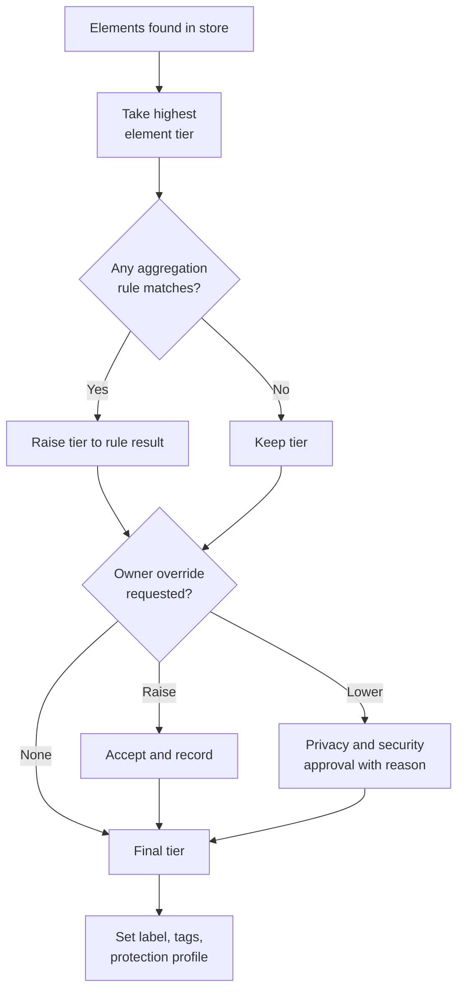

# Data classification scheme
{: .no_toc }

**Phase 1: Know the data.** Defines the four classification tiers, the label taxonomy, and the catalog of hospitality data elements so that every data store and document can be assigned a tier consistently.
{: .fs-5 .fw-300 }

## On this page
{: .no_toc .text-delta }

1. TOC
{:toc}

---

## Design principles

The scheme is deliberately small. Four tiers are enough to drive three protection profiles, and a small scheme is applied more consistently than a large one. The design rests on six principles:

1. **Classify by impact of disclosure or misuse**, not by the system the data lives in.
2. **One tier per data element**, recorded in a catalog, so two teams classify the same element the same way.
3. **The store takes the highest tier of anything in it**, subject to the aggregation rule, which can only raise the tier.
4. **Labels are sub-categories of tiers.** The tier selects the protection profile. The label adds context (PCI, identity, special category, secrets) that selects specific controls within the profile, such as tokenization for PAN or DKE for secrets.
5. **Default to Confidential.** Unclassified data is treated as C2 until an owner classifies it.
6. **Classification is owned by the data owner**, advised by discovery tooling and the privacy team.

## The four tiers

| Tier | Label family | Definition | Impact of unauthorized disclosure | Protection profile |
|---|---|---|---|---|
| C0 | Public | Approved for public release | None | PP-1 Baseline (integrity and availability still matter) |
| C1 | Internal | For employees and authorized contractors; not approved for public release | Minor: embarrassment, limited operational impact | PP-1 Baseline |
| C2 | Confidential | Personal data, commercially sensitive data, and data whose disclosure would harm guests, employees, or the organization | Significant: regulatory notification likely, reputational damage, contractual breach, harm to individuals | PP-2 Enhanced |
| C3 | Restricted | Data whose disclosure causes severe harm, enables fraud or identity theft, is special category data, or compromises security controls | Severe: payment fraud, identity theft, physical risk, regulatory penalties, loss of PCI compliance, compromise of other data | PP-3 Maximum |

### Tier examples in hospitality

| Tier | Examples |
|---|---|
| C0 Public | Published rates, property descriptions, amenity lists, press releases, published sustainability reports |
| C1 Internal | Internal procedures and runbooks, non-sensitive operational metrics, org charts, training materials, internal newsletters |
| C2 Confidential | Guest name, email, phone, postal address, stay history, preferences, loyalty profile and points balance, reservation details, employee HR records (non-sensitive), contracts, revenue management data, owner and franchisee financial statements |
| C3 Restricted | Payment card data (PAN; SAD must never be stored after authorization), passport and national ID numbers and scans, biometrics, bank accounts, health, accessibility, and allergy data, precise geolocation, children's data, credentials, secrets, cryptographic keys, M&A data |

## Sensitivity label taxonomy

The label names follow the Microsoft Purview parent and sublabel convention and are reused as the canonical taxonomy in every system, including cloud tags (as `data-classification`) and column-level tags.

| Label | Tier | Scope | Selects these specific controls within the profile |
|---|---|---|---|
| `Public` | C0 | Content approved for publication | No encryption requirement beyond PP-1; integrity controls for web content |
| `Internal` | C1 | Default for internal business content without personal or sensitive data | PP-1; external sharing warnings |
| `Confidential\Guest-PII` | C2 | Guest and loyalty personal data | PP-2; masking for non-privileged roles; DLP monitor then block for bulk exports |
| `Confidential\Employee` | C2 | Non-sensitive HR data | PP-2; access restricted to HR roles |
| `Confidential\Business` | C2 | Contracts, financials, revenue data, owner statements | PP-2; external sharing restricted to named domains |
| `Restricted\PCI` | C3 | PAN and any cardholder data | PP-3; tokenization or strong cryptography per PCI DSS 3.5.1; CDE segmentation; never in logs |
| `Restricted\Guest-Identity` | C3 | Passport, national ID, driver's license numbers and images, biometrics | PP-3; field-level encryption; strict retention; label encryption on files |
| `Restricted\Special-Category` | C3 | Health, accessibility, allergy, religious and dietary indicators tied to identity, children's data, precise geolocation, employee health and background checks | PP-3; field-level encryption; access by purpose; label encryption |
| `Restricted\Secrets` | C3 | Credentials, API keys, private keys, key material, M&A and board data designated by legal | PP-3; secrets manager or HSM only; DKE or HYOK for designated documents |

{: .note }
Some dietary preferences (for example "vegetarian") are low risk on their own, but allergy information and dietary indicators that reveal religion or health are special category data under GDPR Art. 9. The catalog below separates them.

## Data element catalog

The catalog is the single source for element-level decisions. Discovery tools map their detections to these element IDs, and column tags use the same names.

| ID | Data element | Tier | Label | Regimes | Examples and notes |
|---|---|---|---|---|---|
| E01 | Published rate and availability | C0 | `Public` | None | Rates shown on the brand website |
| E02 | Property description and amenities | C0 | `Public` | None | Marketing copy, photos |
| E03 | Internal procedure or runbook | C1 | `Internal` | None | Housekeeping SOPs |
| E04 | Aggregated occupancy and operational metrics | C1 | `Internal` | None | Occupancy by property by night, no guest detail |
| E05 | Guest full name | C2 | `Confidential\Guest-PII` | GDPR, CCPA, PIPL, LGPD, DPDP | Reservation name |
| E06 | Guest email address | C2 | `Confidential\Guest-PII` | GDPR, CCPA, PIPL, LGPD, DPDP | Also a login identifier |
| E07 | Guest phone number | C2 | `Confidential\Guest-PII` | GDPR, CCPA, PIPL, LGPD, DPDP | |
| E08 | Guest postal address | C2 | `Confidential\Guest-PII` | GDPR, CCPA, PIPL, LGPD, DPDP | Billing address |
| E09 | Date of birth | C2 | `Confidential\Guest-PII` | GDPR, CCPA, PIPL, LGPD, DPDP | Raises to C3 when combined with ID number (aggregation) |
| E10 | Reservation details | C2 | `Confidential\Guest-PII` | GDPR, CCPA, PIPL | Dates, room type, rate code, confirmation number |
| E11 | Stay history | C2 | `Confidential\Guest-PII` | GDPR, CCPA, PIPL | Properties, dates, spend |
| E12 | Guest preferences (non-sensitive) | C2 | `Confidential\Guest-PII` | GDPR, CCPA | Pillow type, floor preference |
| E13 | Loyalty member ID | C2 | `Confidential\Guest-PII` | GDPR, CCPA | Pseudonymous identifier but linkable |
| E14 | Loyalty points balance and transactions | C2 | `Confidential\Guest-PII` | GDPR, CCPA | Value-bearing; account takeover target |
| E15 | Marketing consent records | C2 | `Confidential\Guest-PII` | GDPR, CCPA, PIPL | Evidence of consent must be retained |
| E16 | Device identifiers and app telemetry | C2 | `Confidential\Guest-PII` | GDPR, CCPA | Mobile advertising ID, device ID |
| E17 | Guest Wi-Fi session logs | C2 | `Confidential\Guest-PII` | GDPR, local telecom retention laws | Name or room plus MAC address |
| E18 | Door lock audit trail | C2 | `Confidential\Guest-PII` | GDPR | Room entry times linked to a stay |
| E19 | CCTV footage | C2 | `Confidential\Guest-PII` | GDPR, local surveillance laws | Raises to C3 where used for biometric identification |
| E20 | Contact center recording (no PAN) | C2 | `Confidential\Guest-PII` | GDPR, call recording consent laws | With PAN present it is E23 |
| E21 | Primary account number (PAN) | C3 | `Restricted\PCI` | PCI DSS, state breach laws | Must be unreadable wherever stored (PCI DSS 3.5.1) |
| E22 | Sensitive authentication data (CVV2, full track, PIN block) | C3 | `Restricted\PCI` | PCI DSS 3.3 | Must never be stored after authorization; discovery of SAD is an incident |
| E23 | Contact center recording containing PAN | C3 | `Restricted\PCI` | PCI DSS | Remediate: pause-and-resume or DTMF masking |
| E24 | Virtual card number from OTA | C3 | `Restricted\PCI` | PCI DSS | Treat as PAN |
| E25 | Payment token (non-reversible outside vault) | C2 | `Confidential\Guest-PII` | PCI DSS scope depends on token type | Out of PCI storage scope when properly implemented; still linkable personal data |
| E26 | Truncated PAN (BIN and last four) | C2 | `Confidential\Guest-PII` | PCI DSS 3.4.1 display rules | Never store truncated and hashed forms of the same PAN together |
| E27 | Passport number | C3 | `Restricted\Guest-Identity` | GDPR, PIPL, LGPD, DPDP, breach laws | Collected at check-in where law requires |
| E28 | Passport or national ID scan (image) | C3 | `Restricted\Guest-Identity` | GDPR, PIPL, LGPD, DPDP, breach laws | Also contains photo, nationality, DOB |
| E29 | National ID or tax number | C3 | `Restricted\Guest-Identity` | Breach laws, GDPR Art. 87 | SSN, Aadhaar, CPF, and similar |
| E30 | Driver's license number | C3 | `Restricted\Guest-Identity` | Breach laws | Car rental and valet |
| E31 | Biometric template | C3 | `Restricted\Guest-Identity` | GDPR Art. 9, state biometric laws, PIPL sensitive PI | Facial recognition check-in, employee time clocks |
| E32 | Health, accessibility, and allergy data | C3 | `Restricted\Special-Category` | GDPR Art. 9, PIPL sensitive PI, LGPD sensitive data | Spa intake, accessible room requirements, allergy notes |
| E33 | Religious or dietary indicator revealing belief or health | C3 | `Restricted\Special-Category` | GDPR Art. 9 | Halal, kosher, gluten-free for medical reasons |
| E34 | Children's data | C3 | `Restricted\Special-Category` | GDPR Art. 8, COPPA, PIPL, DPDP | Names and ages of minors in a booking, kids' club registration |
| E35 | Precise geolocation | C3 | `Restricted\Special-Category` | CPRA sensitive PI, PIPL | Mobile app location, in-property positioning |
| E36 | Employee HR record (non-sensitive) | C2 | `Confidential\Employee` | GDPR, labor laws | Job title, manager, work location |
| E37 | Employee salary and compensation | C2 | `Confidential\Employee` | GDPR, labor laws | Raise to C3 when combined with bank details |
| E38 | Bank account number or IBAN | C3 | `Restricted\Guest-Identity` | Breach laws, GDPR | Payroll, vendor payments, owner remittances |
| E39 | Employee health, leave, and background check | C3 | `Restricted\Special-Category` | GDPR Art. 9 and 10 | Occupational health, criminal record checks |
| E40 | Right-to-work and immigration documents | C3 | `Restricted\Guest-Identity` | GDPR, immigration law | Employee passport and visa copies |
| E41 | Contracts and commercial terms | C2 | `Confidential\Business` | Contracts | Management agreements, franchise agreements, vendor contracts |
| E42 | Revenue management and pricing strategy | C2 | `Confidential\Business` | Competition law sensitivity | Forecasts, rate strategies |
| E43 | Owner and franchisee financial statements | C2 | `Confidential\Business` | Contracts | Property P&L |
| E44 | M&A and board materials | C3 | `Restricted\Secrets` | Securities law, contracts | Designated by legal |
| E45 | Passwords, API keys, tokens, connection strings | C3 | `Restricted\Secrets` | PCI DSS 8.3, SOC 2 | Only in secrets managers |
| E46 | Cryptographic keys and HSM credentials | C3 | `Restricted\Secrets` | PCI DSS 3.6 and 3.7 | Never outside KMS, HSM, or approved key wrapping |
| E47 | Digital key credentials for room access | C3 | `Restricted\Secrets` | Physical security | Mobile key material |
| E48 | Security logs with personal data | C2 | `Confidential\Business` | GDPR | Raise to C3 if logs contain E21 to E35 (logs must be cleaned) |

{: .note }
Bank account numbers use the `Restricted\Guest-Identity` label here because the taxonomy has no separate financial sublabel. They are not GDPR Article 9 special category data, so `Restricted\Special-Category` is not used for them. The discovery scanner in `code/discovery` applies the same mapping. If the organization later adds a `Restricted\Financial` sublabel, E38 moves to it with no change of tier.

## Handling rules per tier

The handling rules translate the tier into required behavior for people and systems. The detailed technical controls by environment are on [Label-to-control mapping]().

| Rule area | C0 Public | C1 Internal | C2 Confidential | C3 Restricted |
|---|---|---|---|---|
| Who may access | Anyone | Employees and contractors | Named roles with business need | Named individuals or service identities with documented purpose; just-in-time for humans |
| Encryption at rest | Platform default | Platform default | Customer-managed key, HSM-backed where offered | Customer-managed key plus field-level encryption, tokenization, or persistent file encryption |
| Encryption in transit | TLS 1.2+ | TLS 1.2+ | TLS 1.2+, prefer 1.3 | TLS 1.2+, prefer 1.3; mTLS service-to-service; hybrid PQ key exchange prioritized |
| Storage locations | Any approved | Approved corporate systems | Approved systems registered in the inventory | Approved systems designated for C3, tagged `restricted` |
| External sharing | Allowed | With manager approval | Approved recipients under contract; encrypted transfer | Only through designated secure channels with data owner approval; DLP blocks otherwise |
| Email | Allowed | Allowed internally | Label required; external recipients warned | Label with encryption required; external send blocked unless approved |
| Printing | Allowed | Allowed | Allowed with care | Discouraged; watermarking where supported; secure print release |
| Removable media | Allowed | Discouraged | Encrypted media only | Prohibited except approved encrypted devices |
| Non-production use | Allowed | Allowed | Masked or synthetic only | Masked or synthetic only; never production copies |
| Logging | Allowed | Allowed | Minimized; no bulk personal data in logs | Must not appear in logs; detect and purge |
| Retention | Per records schedule | Per records schedule | Per records schedule with deletion automation | Shortest legally required; deletion or crypto-shredding verified |
| Disposal | Standard | Standard | Secure deletion per NIST SP 800-88 | Cryptographic erase or physical destruction per SP 800-88 |
| Access review | Not required | Annual | Quarterly | Quarterly, plus review of every privileged grant |

## Aggregation rule

Combinations of elements can be more sensitive than any element on its own. The aggregation rule raises the tier of a store, table, or document when specified combinations are present. It never lowers a tier.

| Combination | Resulting tier | Reason |
|---|---|---|
| Name plus date of birth plus passport or national ID number | C3 | Enables identity fraud |
| Name plus bank account number | C3 | Enables payment fraud |
| Name plus stay history of a person identified as high-profile (VIP flag) | C3 | Physical safety and intelligence value |
| Name plus room number plus current stay dates | C3 while the guest is in-house, C2 after checkout | Physical safety |
| Loyalty member ID plus email plus password hash | C3 | Account takeover |
| Large volume of C2 guest records in a single extract (threshold set by the privacy team, for example more than 10,000 records) | C3 handling for the extract | Breach impact scales with volume |
| Employee name plus salary plus performance rating | C3 | Harm to individuals and employee relations |
| C1 operational data plus guest identifiers at row level | C2 | Becomes personal data |

The discovery scanner and the label-to-control resolver implement a subset of these combinations as rules. Volume thresholds are applied by DLP policies (instance counts) rather than by static classification.

## Declassification and reclassification

Tiers change. Common hospitality cases:

| Trigger | Change | Process |
|---|---|---|
| Press release published | C2 or C3 draft becomes C0 | Communications owner approves; label changed to `Public` |
| Tokenization of PAN in a dataset | C3 dataset becomes C2 | Verified by discovery scan showing no PAN; token vault remains C3 |
| Pseudonymization or aggregation for analytics | C2 dataset becomes C1 if re-identification risk is assessed as remote | Privacy team assessment; keys or lookup tables that allow re-identification remain C2 or C3 |
| Guest checks out | Name plus room number drops from C3 to C2 | Automatic in PMS reporting views |
| M&A deal announced | C3 materials may become C2 or C0 | Legal approves |
| Retention period ends | Data is deleted, not declassified | Deletion or crypto-shredding |

Rules:

- **Downgrading requires the data owner's approval** and, for any change from C3, the privacy or security team's approval. The change and the reason are recorded in the inventory.
- **Sensitivity label downgrades in Microsoft 365 require justification** (a Purview label policy setting), which creates an audit trail.
- **Pseudonymized data is still personal data** under GDPR while the organization holds the means to re-identify; it rarely drops below C2.
- **Tokens are only C2 if the vault and detokenization path are protected at C3** and the tokens cannot be reversed without the vault.

## Who classifies

| Role | Responsibility |
|---|---|
| Data owner (business leader for the domain) | Accountable for the tier of each data store and element in the domain; approves downgrades |
| Data steward | Maintains the catalog entries, reviews discovery findings, proposes classifications |
| Data custodian (platform or application team) | Applies tags and labels as classified; keeps them in place through changes |
| Privacy office | Advises on personal data and special category determinations; approves C3 downgrades |
| Security architecture | Owns the scheme, the label taxonomy, and the label-to-control mapping |
| Every employee | Labels documents they create; Purview default labels and auto-labeling assist |

More detail on these roles and the RACI is on [Data ownership, flows, and lineage]().

## Default-to-Confidential rule

Any data store, dataset, or document without a confirmed classification is treated as **C2 Confidential** and receives PP-2 controls until classified. The rule is enforced in several places:

- **Cloud provisioning:** Terraform modules default `data-classification` to `confidential` when no value is passed, and policy denies resources with no tag at all, so a store cannot be created without either an explicit value or the safe default.
- **Microsoft 365:** the default sensitivity label for new documents and emails in corporate sites is `Internal`, and the default for sites and teams that handle guest data is `Confidential\Guest-PII`.
- **Discovery:** a store with unknown content inherits C2 until the first scan completes; a scan finding C3 elements raises it automatically.
- **Exceptions:** there are none for "it is only test data". Test data is either synthetic (and tagged accordingly by its owner) or it is production-derived and treated as C2 or higher.

Why C2 and not C3: defaulting everything to C3 would impose field-level encryption and label encryption on data that does not need it, which breaks functionality and trains teams to request exceptions. C2 gives a strong baseline (CMK, masking, monitored DLP) without those costs, and discovery raises the tier where C3 data is found.

## Key takeaways for engineering teams

- Look up the element in the catalog before designing storage; do not assign tiers per project.
- The store takes the highest tier of anything in it, and aggregation rules can raise it further.
- Unclassified means Confidential: modules default to `confidential`, and policy denies resources without a tag.
- Tokenization and masking can lower the tier of a downstream dataset only after discovery verifies that the sensitive elements are gone.
- Labels carry control-relevant context: `Restricted\PCI` and `Restricted\Guest-Identity` are both C3, but they select different specific controls.

## Related pages

- [Labeling, tagging, and metadata]()
- [Label-to-control mapping]()
- [Data asset inventory and discovery]()
- [Tokenization, FPE, and masking]()
- [Payment card data and PCI DSS]()
