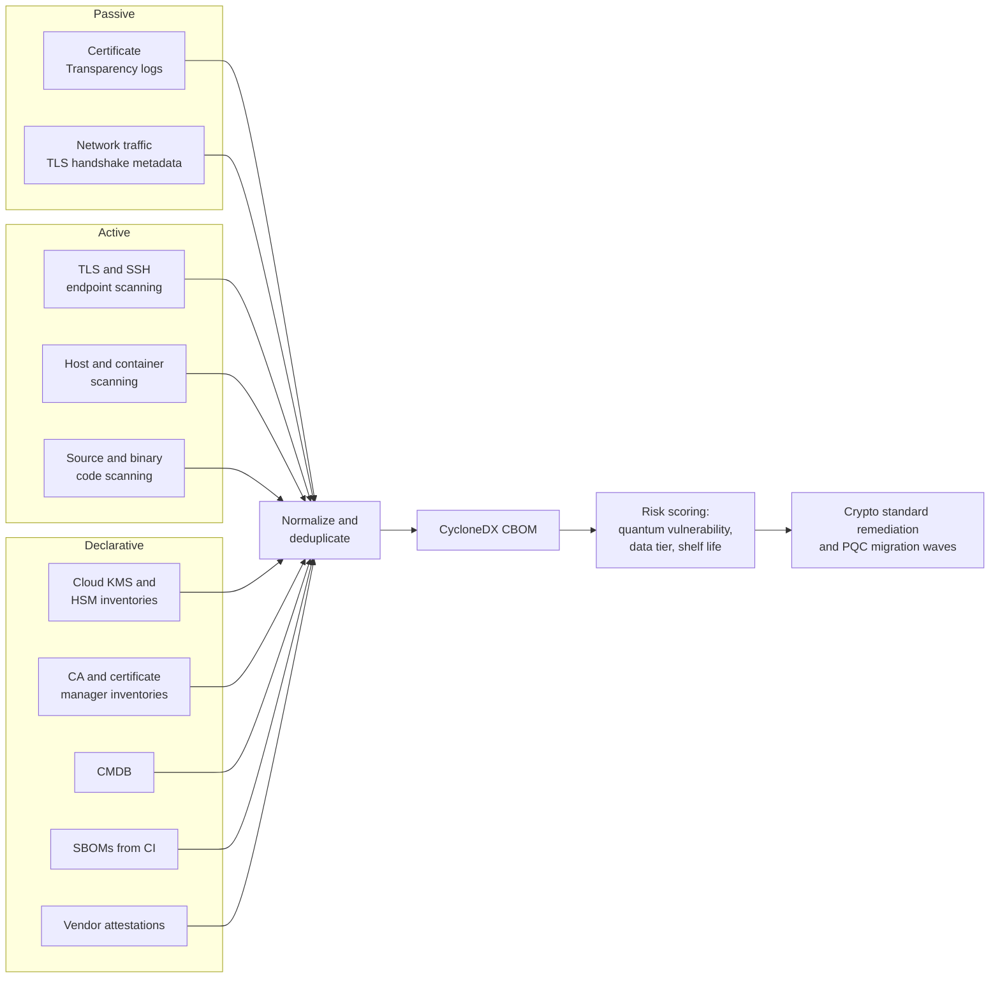

# Cryptographic inventory (CBOM)
{: .no_toc }

**Phase 1: Know the data.** Builds an inventory of every algorithm, protocol, certificate, key, and cryptographic library in use, recorded as a CycloneDX cryptography bill of materials, so that key management and post-quantum migration can be planned from evidence.
{: .fs-5 .fw-300 }

## On this page
{: .no_toc .text-delta }

1. TOC
{:toc}

---

## Why the crypto inventory is a Phase 1 prerequisite

The data inventory tells the organization what needs protecting. The cryptographic inventory tells it what is doing the protecting, and how well. Three later workstreams depend on it:

| Workstream | What it needs from the inventory |
|---|---|
| [Cryptographic standards]() (Phase 2) | Which deprecated or prohibited algorithms and protocols are in use, and where, so the standard can set realistic remediation dates |
| [Key management architecture]() (Phase 2) | Which keys exist, where they are stored, who can use them, and which are outside any managed key service |
| [PQC migration program]() (Phase 6) | Every use of RSA, Diffie-Hellman, and elliptic curve cryptography, with the data it protects and its expected lifetime, to prioritize migration |

It also satisfies audit requirements directly:

- **PCI DSS v4.0.1 requirement 12.3.3:** cryptographic cipher suites and protocols in use are documented and reviewed at least once every 12 months, including a plan to respond to anticipated changes in cryptographic vulnerabilities. The inventory is the documentation, and the PQC migration plan is the response plan.
- **PCI DSS v4.0.1 requirement 4.2.1.1:** an inventory of the entity's trusted keys and certificates used to protect PAN during transmission is maintained.
- **US OMB M-23-02** requires federal agencies to inventory cryptographic systems. It does not apply to the organization, but it has shaped vendor tooling and expectations, and similar expectations appear in the EU and UK PQC roadmaps.

The UK NCSC timeline places discovery and planning first (by 2028), and the EU roadmap expects member states to begin transitioning by the end of 2026. Both start with an inventory.

## What to inventory

A cryptographic asset is anything that performs, configures, or depends on cryptography. The inventory records seven categories.

| Category | Examples in the organization | Attributes to record | Quantum relevance |
|---|---|---|---|
| Algorithms and parameters | AES-256-GCM, AES-128-CBC, RSA-2048, ECDSA P-256, X25519, SHA-1, SHA-256, HMAC-SHA256, 3DES in legacy payment interfaces | Algorithm, mode, key length or curve, primitive (block cipher, signature, KEM, hash, MAC), where used | RSA, DH, ECDH, ECDSA, EdDSA broken by Shor's algorithm; symmetric and hash sizes reviewed for Grover |
| Protocols | TLS 1.0 to 1.3, SSH, IPsec (site-to-site VPNs to properties), SFTP, S/MIME, Kerberos, 802.1X on guest and staff Wi-Fi | Version, cipher suites, key exchange groups, signature algorithms, endpoint | Key exchange in TLS, SSH, and IKE is the HNDL priority |
| Certificates | Public TLS certificates, internal PKI certificates, code signing, S/MIME, device certificates for door locks and IoT, mTLS client certificates | Subject, issuer, serial, validity, key algorithm and size, signature algorithm, where deployed, owner | Signature and key algorithms; CA roots are long-lived and high priority |
| Keys | Cloud KMS keys, HSM keys, TDE master keys, SSH keys, API signing keys, JWT signing keys, PGP keys for file transfer | Key ID, type, algorithm, size, store (KMS, HSM, file), protection level, rotation, owner, what it protects | Asymmetric keys are quantum-vulnerable; symmetric keys need adequate length |
| Libraries and providers | OpenSSL, BoringSSL, AWS-LC, s2n-tls, Java JCA providers, .NET, Bouncy Castle, SymCrypt, Go crypto, libsodium, vendor SDKs | Name, version, FIPS validation status, where linked | Library versions determine PQC support |
| Hardware | HSMs (cloud and on-prem), POS and P2PE terminals, TPMs, smart cards, door lock encoders | Model, firmware, validation (FIPS 140-3 level), algorithms supported, upgrade path | Firmware signing and HSM PQC support |
| Hard-coded and embedded crypto | Algorithm names and key sizes fixed in application code, configuration files, stored procedures, and vendor appliances | File, line, algorithm, whether it is configurable | Hard-coded crypto is the largest obstacle to crypto agility |

For each asset, the inventory also records the **data it protects** (by linking to the data inventory record and its classification) and the **data shelf life** (how long the protected data must remain confidential). These two fields drive PQC prioritization using Mosca's inequality: if the data shelf life (X) plus migration time (Y) is greater than the time to a cryptographically relevant quantum computer (Z), the asset needs action now.

## Sources of cryptographic information

No single tool sees all cryptography. The inventory combines passive, active, and declarative sources.



### Certificate Transparency logs

Every publicly trusted TLS certificate is logged in Certificate Transparency (CT) logs. Querying CT for the organization's domains finds certificates issued by any CA, including those requested by agencies or franchisees for brand domains.

```bash
# Query crt.sh for certificates under a domain (JSON output)
curl -s "https://crt.sh/?q=%25.example-hotels.com&output=json" \
  | jq -r '.[] | [.not_before, .not_after, .issuer_name, .common_name] | @tsv' \
  | sort -u
```

### Network endpoint scanning

Active scanning connects to each endpoint and records the negotiated and supported protocols, cipher suites, key exchange groups, and certificate chain.

```bash
# sslyze: full scan with JSON output
sslyze --json_out=booking.json booking.example-hotels.com:443

# testssl.sh: protocols, ciphers, and vulnerabilities with JSON output
./testssl.sh --jsonfile-pretty booking-testssl.json https://booking.example-hotels.com

# nmap: enumerate TLS cipher suites across a property subnet
nmap -p 443,8443 --script ssl-enum-ciphers 10.42.0.0/24 -oX property-042-tls.xml
```

To check whether an endpoint supports hybrid post-quantum key exchange, OpenSSL 3.5 can offer only the hybrid group and report what was negotiated:

```bash
openssl s_client -connect booking.example-hotels.com:443 \
  -groups X25519MLKEM768 -tls1_3 -brief < /dev/null
```

A successful handshake that reports `X25519MLKEM768` as the negotiated group shows hybrid support. A handshake failure with only that group offered shows the server does not support it. The [Hands-on PQC lab]() shows captured output.

{: .note }
Scanning of property networks, especially franchised properties, must be coordinated with the network owner. Scanning third-party endpoints without permission is not part of the program.

### Cloud KMS and HSM inventories

Cloud key services are the most accurate source for managed keys. The commands below list keys and their algorithms.

```bash
# AWS: list keys and describe algorithm, usage, origin, and key store
for k in $(aws kms list-keys --query 'Keys[].KeyId' --output text); do
  aws kms describe-key --key-id "$k" \
    --query 'KeyMetadata.[KeyId,KeySpec,KeyUsage,Origin,KeyManager,CustomKeyStoreId,KeyState]' \
    --output text
done

# AWS: certificates in ACM with key algorithm
aws acm list-certificates --includes keyTypes=RSA_2048,EC_prime256v1,RSA_4096,EC_secp384r1 \
  --query 'CertificateSummaryList[].[DomainName,KeyAlgorithm,NotAfter]' --output table
```

```bash
# Azure: keys and certificates in a Key Vault
az keyvault key list --vault-name kv-guest-prod-eu \
  --query "[].{name:name, kid:kid, enabled:attributes.enabled}" -o table
az keyvault key show --vault-name kv-guest-prod-eu --name tde-guest \
  --query "{kty:key.kty, curve:key.crv, ops:key.keyOps}"
az keyvault certificate list --vault-name kv-guest-prod-eu -o table

# Azure Managed HSM
az keyvault key list --hsm-name mhsm-eu-prod -o table
```

```bash
# Google Cloud: all Cloud KMS keys in the organization through Cloud Asset Inventory
gcloud asset search-all-resources \
  --scope=organizations/123456789012 \
  --asset-types='cloudkms.googleapis.com/CryptoKey' \
  --format='table(name, location, labels)'

# Algorithm and protection level for keys in a key ring
gcloud kms keys list --location=europe --keyring=guest-prod \
  --format='table(name, purpose, versionTemplate.algorithm, versionTemplate.protectionLevel, rotationPeriod)'
```

```bash
# OCI: keys in a vault (management endpoint is vault-specific)
oci kms management key list \
  --compartment-id ocid1.compartment.oc1..aaaa... \
  --endpoint https://<vault-management-endpoint>
```

On-premises HSMs and key managers (for example Thales Luna, Entrust nShield, Oracle Key Vault, CipherTrust Manager) provide their own inventory exports or APIs. Include TDE master keys held in database wallets or keystores, which often sit outside any central key manager.

### Code and binary scanning

Code scanning finds cryptography that no network scan or KMS inventory sees: hard-coded algorithms, keys in code, and library usage.

| Technique | Finds | Tools (examples) |
|---|---|---|
| Static analysis rules for crypto APIs | Calls to `Cipher.getInstance("AES/ECB/...")`, `RSA.generate(1024)`, `hashlib.md5`, custom crypto | Semgrep rules, CodeQL queries, commercial SAST |
| Secret scanning | Keys, certificates, and tokens committed to repositories | GitHub secret scanning, Gitleaks, TruffleHog |
| Dependency analysis (SBOM) | Cryptographic libraries and versions | Syft, CycloneDX generators, SCA tools |
| Binary analysis | Crypto in vendor appliances and compiled components | Specialized PQC discovery tools |

A simple Semgrep rule that flags use of RSA key generation in Python, so that each use is recorded and reviewed:

```yaml
rules:
  - id: crypto-inventory-rsa-keygen
    languages: [python]
    severity: INFO
    message: "RSA key generation found; record in CBOM (quantum-vulnerable)."
    pattern-either:
      - pattern: cryptography.hazmat.primitives.asymmetric.rsa.generate_private_key(...)
      - pattern: Crypto.PublicKey.RSA.generate(...)
```

### CMDB, SBOM, and vendor attestations

- **CMDB:** hardware models (HSMs, POS terminals, door lock encoders), appliance versions, and owners.
- **SBOM:** the CycloneDX SBOM from CI lists library versions; the CBOM extends it with cryptographic detail.
- **Vendor attestations:** for SaaS and appliances where the organization cannot scan, a questionnaire asks which algorithms, protocols, and key sizes are used, whether customer-managed keys are supported, and the vendor's PQC roadmap. This becomes a contract requirement for critical vendors.

## The CycloneDX CBOM format

CycloneDX 1.6 (ratified as ECMA-424) added cryptographic assets as a component type, producing a cryptography bill of materials (CBOM). Using a standard format lets output from several tools be merged, compared over time, and shared with auditors and vendors.

Key structures:

| CBOM element | Purpose |
|---|---|
| Component with `type: cryptographic-asset` | One cryptographic asset |
| `cryptoProperties.assetType` | `algorithm`, `certificate`, `protocol`, or `related-crypto-material` (keys, secrets, tokens) |
| `algorithmProperties` | Primitive, parameter set, mode, crypto functions, NIST quantum security level |
| `certificateProperties` | Subject, issuer, validity, references to signature and key algorithms |
| `protocolProperties` | Type (for example TLS), version, cipher suites |
| `relatedCryptoMaterialProperties` | Key type, size, state, references to algorithm |
| `oid` | Object identifier of the algorithm |
| `dependencies` | Which application or service uses which cryptographic asset |

A trimmed CBOM for the booking API endpoint, showing a TLS 1.3 protocol with a hybrid ML-KEM group, the server certificate, and the algorithms referenced:

```json
{
  "bomFormat": "CycloneDX",
  "specVersion": "1.6",
  "serialNumber": "urn:uuid:3e671687-395b-41f5-a30f-a58921a69b79",
  "version": 1,
  "metadata": {
    "timestamp": "2026-09-20T02:00:00Z",
    "component": {
      "type": "application",
      "bom-ref": "app:booking-api",
      "name": "booking-api"
    },
    "properties": [
      { "name": "org:data-classification", "value": "confidential" },
      { "name": "org:data-domain", "value": "guest" },
      { "name": "org:data-shelf-life-years", "value": "7" }
    ]
  },
  "components": [
    {
      "type": "cryptographic-asset",
      "bom-ref": "crypto:protocol:tls13:booking",
      "name": "TLSv1.3",
      "cryptoProperties": {
        "assetType": "protocol",
        "protocolProperties": {
          "type": "tls",
          "version": "1.3",
          "cipherSuites": [
            {
              "name": "TLS_AES_256_GCM_SHA384",
              "algorithms": ["crypto:algo:aes-256-gcm", "crypto:algo:sha384"],
              "identifiers": ["0x13", "0x02"]
            }
          ]
        }
      },
      "properties": [
        { "name": "org:negotiated-group", "value": "X25519MLKEM768" },
        { "name": "org:endpoint", "value": "booking.example-hotels.com:443" }
      ]
    },
    {
      "type": "cryptographic-asset",
      "bom-ref": "crypto:algo:aes-256-gcm",
      "name": "AES-256-GCM",
      "cryptoProperties": {
        "assetType": "algorithm",
        "algorithmProperties": {
          "primitive": "ae",
          "parameterSetIdentifier": "256",
          "mode": "gcm",
          "cryptoFunctions": ["encrypt", "decrypt"],
          "nistQuantumSecurityLevel": 5
        },
        "oid": "2.16.840.1.101.3.4.1.46"
      }
    },
    {
      "type": "cryptographic-asset",
      "bom-ref": "crypto:algo:sha384",
      "name": "SHA-384",
      "cryptoProperties": {
        "assetType": "algorithm",
        "algorithmProperties": {
          "primitive": "hash",
          "cryptoFunctions": ["digest"],
          "nistQuantumSecurityLevel": 4
        },
        "oid": "2.16.840.1.101.3.4.2.2"
      }
    },
    {
      "type": "cryptographic-asset",
      "bom-ref": "crypto:algo:ml-kem-768",
      "name": "ML-KEM-768",
      "cryptoProperties": {
        "assetType": "algorithm",
        "algorithmProperties": {
          "primitive": "kem",
          "parameterSetIdentifier": "768",
          "cryptoFunctions": ["keygen", "encapsulate", "decapsulate"],
          "nistQuantumSecurityLevel": 3
        },
        "oid": "2.16.840.1.101.3.4.4.2"
      }
    },
    {
      "type": "cryptographic-asset",
      "bom-ref": "crypto:algo:ecdsa-p256-sha256",
      "name": "ECDSA-P256-SHA256",
      "cryptoProperties": {
        "assetType": "algorithm",
        "algorithmProperties": {
          "primitive": "signature",
          "curve": "secp256r1",
          "cryptoFunctions": ["sign", "verify"],
          "nistQuantumSecurityLevel": 0
        },
        "oid": "1.2.840.10045.4.3.2"
      }
    },
    {
      "type": "cryptographic-asset",
      "bom-ref": "crypto:cert:booking",
      "name": "booking.example-hotels.com",
      "cryptoProperties": {
        "assetType": "certificate",
        "certificateProperties": {
          "subjectName": "CN=booking.example-hotels.com",
          "issuerName": "CN=Example Public CA R3",
          "notValidBefore": "2026-07-01T00:00:00Z",
          "notValidAfter": "2027-01-17T00:00:00Z",
          "signatureAlgorithmRef": "crypto:algo:ecdsa-p256-sha256",
          "subjectPublicKeyRef": "crypto:key:booking-p256",
          "certificateFormat": "X.509",
          "certificateExtension": "crt"
        }
      }
    },
    {
      "type": "cryptographic-asset",
      "bom-ref": "crypto:key:booking-p256",
      "name": "booking TLS public key",
      "cryptoProperties": {
        "assetType": "related-crypto-material",
        "relatedCryptoMaterialProperties": {
          "type": "public-key",
          "algorithmRef": "crypto:algo:ecdsa-p256-sha256",
          "size": 256
        }
      }
    }
  ],
  "dependencies": [
    {
      "ref": "app:booking-api",
      "dependsOn": ["crypto:protocol:tls13:booking", "crypto:cert:booking"]
    },
    {
      "ref": "crypto:protocol:tls13:booking",
      "dependsOn": ["crypto:algo:aes-256-gcm", "crypto:algo:sha384", "crypto:algo:ml-kem-768"]
    }
  ]
}
```

Notes on the example:

- `nistQuantumSecurityLevel` of 0 marks a quantum-vulnerable algorithm (ECDSA). Levels 1 to 5 follow the NIST PQC security categories (level 5 is comparable to AES-256 key search, level 3 to AES-192). This is the field that drives PQC prioritization reports.
- The `org:` properties link the CBOM to the data inventory (classification, domain, shelf life). CycloneDX allows custom properties; the organization reserves the `org:` prefix.
- The certificate validity shown (200 days) is consistent with the CA/Browser Forum ballot SC-081 maximum for public TLS certificates issued from March 15, 2026.
- The hybrid key exchange appears as a negotiated group property plus the ML-KEM algorithm component. The X25519 half of the hybrid group would also be recorded as an algorithm component in a complete CBOM.

{: .verify }
CycloneDX field names and enumerations for cryptographic assets are defined in the CycloneDX 1.6 specification and may be extended in later versions. Validate generated CBOMs against the published JSON schema for the version in use.

The repository includes a scanner that connects to TLS endpoints, reads the negotiated protocol, cipher suite, group, and certificate chain, and emits a CycloneDX CBOM in this shape. See [code/cbom on GitHub](https://github.com/steven-smith-itnet/data-protection-pqc-security-architecture/tree/main/code/cbom).

## Tooling categories

| Category | What it does | Examples (verify current product names and capabilities) |
|---|---|---|
| Open-source TLS scanners | Scan endpoints for protocols, ciphers, certificates | sslyze, testssl.sh, nmap `ssl-enum-ciphers` |
| Open-source CBOM generators | Produce CycloneDX CBOMs from code or scans | IBM's open-source CBOMkit tools; CycloneDX tooling |
| Certificate lifecycle management (CLM) | Discover, inventory, and automate renewal of certificates across CAs; increasingly adds key and crypto discovery | Keyfactor, CyberArk (which acquired Venafi), DigiCert Trust Lifecycle Manager, AppViewX, Sectigo |
| Cryptographic discovery and posture | Discover crypto in network traffic, hosts, code, and binaries; score quantum risk; produce CBOM | IBM Quantum Safe Explorer and related IBM Quantum Safe tools, SandboxAQ AQtive Guard, Keyfactor AgileSec (from the InfoSec Global acquisition), and others |
| Cloud-native inventories | Keys, certificates, and configuration within one cloud | AWS KMS and ACM APIs, Azure Key Vault and Resource Graph, Cloud KMS and Cloud Asset Inventory, OCI Vault and Search |
| SAST and secret scanning | Find crypto API use and embedded secrets in code | Semgrep, CodeQL, GitHub secret scanning, Gitleaks |

{: .verify }
The PQC discovery market is consolidating quickly. Vendor names, acquisitions (for example Venafi into CyberArk, InfoSec Global into Keyfactor), and product capabilities should be verified during procurement. Product names here indicate categories, not recommendations.

### Good, Better, Best for the crypto inventory

| Level | Scope | Method | Output |
|---|---|---|---|
| Good | External TLS endpoints, PCI-scoped systems, cloud KMS keys, public certificates | Open-source scanners, CT logs, cloud CLI exports merged by script | CBOM for external and PCI scope; annual 12.3.3 review |
| Better | All TLS and SSH endpoints including internal and property networks; internal PKI; all managed keys; SBOM-driven library inventory | CLM platform plus scheduled scanning plus CI SBOMs | Organization-wide CBOM refreshed monthly; quantum-vulnerability dashboard |
| Best | Adds code and binary analysis, hard-coded crypto, vendor attestations, network traffic observation, and linkage to data shelf life | Dedicated crypto discovery platform integrated with CLM, CMDB, and data inventory | Continuously updated CBOM with risk scores that drive PQC migration waves automatically |

{: .good }
Good is achievable in the first three months and satisfies the documentation part of PCI DSS 12.3.3 and 4.2.1.1 for the CDE.

{: .better }
Better is the target by month 9 and is the minimum needed to plan the PQC program with confidence.

{: .best }
Best adds the hidden cryptography that causes migration surprises. Trade-off: dedicated discovery platforms are costly and binary analysis produces findings that need expert triage.

## Risk scoring and prioritization

Each asset in the CBOM receives a priority for remediation or PQC migration based on four factors:

| Factor | Values | Source |
|---|---|---|
| Quantum vulnerability | Vulnerable (RSA, DH, ECC), reduced margin (AES-128, SHA-256 in some uses), resistant (ML-KEM, ML-DSA, SLH-DSA, AES-256) | CBOM algorithm fields |
| Classical weakness | Prohibited (SHA-1 signatures, 3DES, TLS 1.0 and 1.1, RSA below 2048) | Crypto standard |
| Data tier protected | C0 to C3 | Linked data inventory record |
| Data shelf life | Years the data must stay confidential | Retention class and data owner |
| Exposure | External, partner, internal, isolated | Endpoint location |

The simplest usable rule: classical weaknesses are fixed first (they are exploitable today); then quantum-vulnerable key exchange on external paths that protects C2 or C3 data with a shelf life longer than about five years; then long-lived signatures (CA roots, code and firmware signing); then everything else by tier.

## PCI DSS tie-in

| Requirement | What the assessor expects | How the CBOM satisfies it |
|---|---|---|
| 4.2.1 | Strong cryptography and security protocols protect PAN over open, public networks; certificates are valid and not expired | Protocol and cipher suite records for every CDE-facing endpoint; certificate validity dates |
| 4.2.1.1 | An inventory of trusted keys and certificates used to protect PAN in transmission | Filtered CBOM view of certificates and keys on CDE transmission paths |
| 3.6 and 3.7 | Key management procedures and documentation for keys protecting stored account data | Key records with store, custodian, cryptoperiod, and rotation, linked to key management procedures |
| 12.3.3 | Cipher suites and protocols documented and reviewed at least once every 12 months, with a plan for anticipated changes in cryptographic vulnerabilities | Annual review of the CBOM with sign-off; the PQC migration plan as the documented response plan |

A small, repeatable evidence pack for the annual 12.3.3 review:

1. CBOM snapshot for CDE and connected systems, with generation date.
2. Summary table of protocols and cipher suites in use and their status against the crypto standard.
3. List of deviations with remediation dates.
4. The current PQC migration plan and the review date.
5. Sign-off by the security architecture lead and the PCI program owner.

## Operating the inventory

| Activity | Frequency | Owner |
|---|---|---|
| External endpoint scan and CT log review | Weekly | Security engineering |
| Internal and property endpoint scan | Monthly | Security engineering with property IT |
| Cloud KMS and certificate export | Daily | Platform teams (automated) |
| SBOM and code scanning | Every build | Engineering teams (CI) |
| Vendor attestation refresh | Annually and at contract renewal | Vendor management |
| CBOM consolidation and dashboard update | Monthly | Security architecture |
| PCI DSS 12.3.3 review | At least every 12 months | Security architecture and PCI program owner |

## Key takeaways for engineering teams

- Record every use of cryptography, including hard-coded algorithms and keys outside managed services; these are the hardest to migrate.
- Generate CycloneDX SBOMs in CI; the CBOM builds on them, and library versions determine PQC readiness.
- Link each cryptographic asset to the data it protects and that data's shelf life; that link drives PQC priority.
- Fix classical weaknesses first, then quantum-vulnerable key exchange on external paths carrying long-lived C2 and C3 data.
- The CBOM is PCI evidence for 4.2.1.1 and 12.3.3; keep it current and under version control.

## Related pages

- [Cryptographic standards]()
- [Certificates and PKI]()
- [The quantum threat]()
- [PQC migration program]()
- [Hands-on PQC lab]()
- [Payment card data and PCI DSS]()

## Sources

- CycloneDX CBOM guide and specification: <https://cyclonedx.org/capabilities/cbom/>
- ECMA-424 (CycloneDX): <https://ecma-international.org/publications-and-standards/standards/ecma-424/>
- PCI DSS v4.0.1: <https://www.pcisecuritystandards.org/document_library/>
- OMB M-23-02: <https://www.whitehouse.gov/wp-content/uploads/2022/11/M-23-02-M-Memo-on-Migrating-to-Post-Quantum-Cryptography.pdf>
- NIST IR 8547 (draft): <https://csrc.nist.gov/pubs/ir/8547/ipd>
- UK NCSC PQC migration timelines: <https://www.ncsc.gov.uk/guidance/pqc-migration-timelines>
- sslyze: <https://github.com/nabla-c0d3/sslyze>
- testssl.sh: <https://github.com/testssl/testssl.sh>
