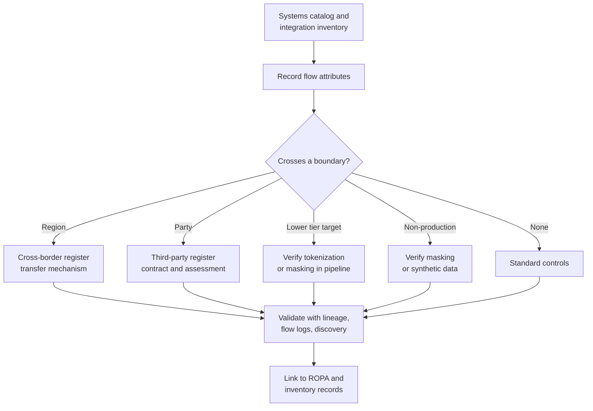
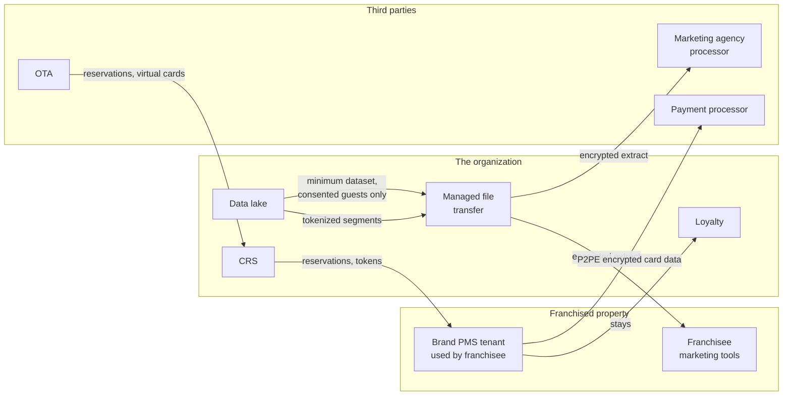

# Data ownership, flows, and lineage
{: .no_toc }

**Phase 1: Know the data.** Assigns accountability for each data domain and store, maps how data moves between systems, regions, and parties, and records that information in forms that privacy, security, and engineering can all use.
{: .fs-5 .fw-300 }

## On this page
{: .no_toc .text-delta }

1. TOC
{:toc}

---

## Why ownership and flows are prerequisites

Classification tells the organization how sensitive a data store is. Ownership tells it who decides. Flows tell it where the data goes next. Without all three, the following questions have no reliable answer:

- Who approves a request to copy guest data into a new analytics project?
- Which key protects the loyalty data after it is replicated to another region?
- Does passport data from the EU leave the EU, and under which transfer mechanism?
- Which franchisees receive guest profile data, and what do they do with it?
- If a processor is breached, which data sets and which guests are affected?

Encryption does not help if data flows to a place where the key is also available, or to a party that decrypts it and stores it in clear. Flow mapping is how the organization finds those points.

## Roles

The organization uses three roles for every data domain and data store, plus supporting roles.

| Role | Who | Accountable for | Not accountable for |
|---|---|---|---|
| **Data owner** | A business leader for the domain (for example, the VP of Guest Experience for `guest`, the VP of Loyalty for `loyalty`, the CHRO for `employee`) | Classification decisions, approving access and sharing, approving downgrades, accepting residual risk, retention decisions within legal limits | Operating the technology |
| **Data steward** | A named person or team within the business domain with data expertise | Maintaining catalog entries and definitions, reviewing discovery findings, maintaining flow maps and lineage for the domain, first-line data quality | Final approval of risk |
| **Data custodian** | The platform or application team operating the system (for example, `data-platform-gcp`, `cloud-platform-aws`, property IT) | Implementing the controls required by the profile: keys, encryption, tags, masking, backups, access provisioning | Deciding classification or sharing |
| Key custodian | Named individuals in the key management team | Key ceremonies, HSM administration, dual control for manual key operations (PCI DSS 3.6 and 3.7) | Accessing the data |
| Privacy office (and DPO where required) | Privacy team | Records of processing, DPIAs, transfer assessments, advice on lawful basis and special category data | Technical implementation |
| Security architecture | Architect and team | Classification scheme, label-to-control mapping, key architecture, patterns, design review | Business decisions about data use |
| Internal audit | Audit | Independent assurance | Design |

{: .note }
Ownership is assigned at the domain level first (eight domains, eight owners), then delegated to store-level owners through the `data-owner` tag. A store without a store-level owner inherits the domain owner, who then has an incentive to delegate.

## RACI

R = Responsible, A = Accountable, C = Consulted, I = Informed.

| Activity | Data owner | Data steward | Data custodian | Privacy office | Security architecture | Key custodian | Legal |
|---|---|---|---|---|---|---|---|
| Classify a data store | A | R | C | C | C | | |
| Approve downgrade from C3 | A | R | I | C | C | | C |
| Apply tags and labels to resources | I | C | A/R | | C | | |
| Select protection profile controls | I | C | R | | A | | |
| Approve access to C3 data | A | R | R (provisioning) | I | C | | |
| Create or rotate a domain key | I | | R | | C | A | |
| Manual key operation (split knowledge, dual control) | | | | | I | A/R | |
| Maintain flow map for the domain | A | R | C | C | I | | |
| Record of processing entry | C | R | C | A | I | | C |
| Cross-border transfer approval | A | R | C | R | C | | A (mechanism) |
| Share data with a franchisee or third party | A | R | R (transfer) | C | C | | C (contract) |
| Respond to discovery finding of C3 data outside approved stores | A | R | R | I | C | | |
| Exception to protection profile | A (risk acceptance) | C | R (request) | C | R (assessment) | | |
| Data subject access or deletion request | C | R | R | A | I | | C |
| Incident involving the domain's data | C | C | R | R | R | C | A (notification decisions with privacy) |

The operating model page expands this across the whole program; see [Operating model and RACI]().

## Data flow mapping method

Flow mapping is done per domain, in five steps. Each step produces something that is recorded in the catalog, not only a diagram.

### Step 1: Start from the systems catalog and interfaces

Use the systems catalog from [Hospitality data landscape]() and the integration inventory (API gateway configurations, ETL job definitions, message topics, SFTP jobs, database links). Every interface is a candidate flow.

### Step 2: Record each flow with a standard set of attributes

| Attribute | Example |
|---|---|
| Flow ID | `FLOW-GUEST-017` |
| Source system and store | PMS (OPERA Cloud), EU tenant |
| Target system and store | Loyalty platform, AWS `eu-west-1`, Aurora cluster `loyalty-prod` |
| Data elements | E05 name, E06 email, E10 reservation, E11 stay history, E13 member ID |
| Highest tier | C2 |
| Mechanism | Vendor integration API over HTTPS, event-driven |
| Transport protection | TLS 1.2, mutual authentication with client certificate |
| Frequency and volume | Real time; about 50,000 records per day (estimate) |
| Crosses region | No |
| Crosses legal entity or party | No (both operated by the organization) |
| Purpose and lawful basis | Loyalty program membership (contract) |
| Target retention | `r3y` |
| Owner | `loyalty-platform` |
| ROPA reference | `ROPA-LOY-002` |

### Step 3: Mark boundary crossings

For each flow, record whether it crosses:

- an **environment** boundary (on-prem to cloud, cloud to cloud),
- a **region** boundary (for residency and transfer rules),
- a **party** boundary (franchisee, processor, partner, OTA),
- a **classification** boundary (data moving to a store tagged at a lower tier, which should only happen after tokenization or masking), or
- a **lifecycle** boundary (production to non-production).

Boundary crossings get extra scrutiny because that is where keys, access models, and legal obligations change.

### Step 4: Validate with evidence

Diagrams drawn from interviews are often wrong. Validate using:

- Lineage captured by tools (next section).
- Network flow logs (VPC Flow Logs, NSG flow logs, VPC flow logs in Google Cloud, OCI VCN flow logs) to confirm which systems actually talk to each other.
- Egress and SFTP logs for file transfers to third parties.
- Discovery findings: sensitive data found in a store that has no recorded inbound flow means there is an unrecorded flow.

### Step 5: Link to controls and review

Each flow is linked to the controls that protect it (key used at the target, transport configuration, masking or tokenization in the pipeline) and reviewed annually or when the source or target changes.



## Lineage tools

Lineage tools capture flows automatically from pipeline and query execution. They do not replace flow mapping for interfaces outside the data platform (such as SaaS-to-SaaS integrations or SFTP), but they cover the data platform with far more accuracy than manual diagrams.

| Tool | Platform coverage | How lineage is captured | Organization use |
|---|---|---|---|
| Microsoft Purview (Data Map and Unified Catalog lineage) | Azure Data Factory, Synapse pipelines, Azure SQL, Power BI, and other sources; custom lineage through the Apache Atlas-compatible API | Automatic from supported services; manual or API for others | Corporate applications on Azure and Power BI reports |
| Google Cloud Dataplex data lineage (Data Lineage API) | BigQuery jobs, Dataflow, Cloud Data Fusion, Dataproc, Cloud Composer; custom lineage through the API including OpenLineage events | Automatic when the Data Lineage API is enabled in the project | The BigQuery warehouse: tracks which curated tables derive from raw extracts |
| Databricks Unity Catalog lineage | Tables, columns, notebooks, jobs, dashboards within Databricks | Automatic, column-level, for workloads that use Unity Catalog | Data science workspace |
| AWS: Amazon DataZone and SageMaker Unified Studio lineage (OpenLineage compatible); AWS Glue job metadata | Glue and other sources via OpenLineage events | Emitted by pipelines | Data lake ingestion pipelines |
| OpenLineage (open standard) | Spark, Airflow, dbt, Flink and others through integrations | Pipeline emits events to a lineage backend | Common format across clouds |
| Third-party catalogs (for example Collibra, Alation, Atlan) | Broad connectors | Mixed | Optional enterprise catalog |

{: .verify }
AWS lineage capabilities are delivered through Amazon DataZone and SageMaker Unified Studio, and names and coverage have changed recently. Confirm current AWS lineage coverage before relying on it.

Enabling lineage in Google Cloud:

```bash
gcloud services enable datalineage.googleapis.com --project=guest-analytics-prod
```

Reading lineage for a BigQuery table through the Data Lineage API (search links whose target is the curated profiles table):

```bash
curl -X POST \
  -H "Authorization: Bearer $(gcloud auth print-access-token)" \
  -H "Content-Type: application/json" \
  "https://datalineage.googleapis.com/v1/projects/guest-analytics-prod/locations/eu:searchLinks" \
  -d '{"target": {"fullyQualifiedName": "bigquery:guest-analytics-prod.guest_curated.profiles"}}'
```

Querying Unity Catalog lineage system tables in Databricks:

```sql
SELECT source_table_full_name, target_table_full_name, entity_type, event_time
FROM system.access.table_lineage
WHERE target_table_full_name = 'main.guest.profiles'
ORDER BY event_time DESC
LIMIT 50;
```

### Using lineage for protection

Lineage is not only a governance artifact. The organization uses it for three protection checks:

1. **Classification propagation.** If a column tagged `restricted` flows into a target column, the target inherits the tag unless the pipeline step is a registered tokenization or masking transform. A daily job compares lineage edges with column tags and raises findings.
2. **Impact analysis for key events.** If a key is compromised or scheduled for crypto-shredding, lineage shows every downstream store that holds derived copies.
3. **Breach scoping.** Lineage narrows which datasets and which guests are affected by a compromise of an upstream system.

## Records of processing (GDPR Art. 30)

GDPR Art. 30 requires controllers to maintain a record of processing activities (ROPA) with, among other things, the purposes, categories of data subjects and personal data, categories of recipients, transfers to third countries with safeguards, retention periods where possible, and a general description of technical and organizational security measures. UK GDPR has the same requirement, and other regimes have similar expectations.

The organization links the ROPA to the inventory rather than maintaining them separately:

| ROPA field (Art. 30(1)) | Source in this architecture |
|---|---|
| Name and contact of controller and DPO | Legal entity register |
| Purposes of processing | Flow record purpose and lawful basis |
| Categories of data subjects and personal data | Data elements in the inventory records linked to the activity |
| Categories of recipients | Third-party register |
| Transfers to third countries and safeguards | Cross-border register |
| Envisaged time limits for erasure | `retention-class` tag on the linked stores |
| General description of security measures | Protection profile of the linked stores (PP-2 or PP-3) and the label-to-control mapping |

This gives the privacy office an accurate "technical and organizational measures" description derived from the actual profile, rather than generic text.

## Cross-border flow register

The cross-border register lists every flow that moves personal data between legal jurisdictions. It is derived from flow records with the region boundary flag, and extended with legal information.

| Field | Example |
|---|---|
| Register ID | `XB-2026-031` |
| Flow ID | `FLOW-LOY-009` |
| Exporting jurisdiction and entity | China, the organization's China operating entity |
| Importing jurisdiction and entity | United States, global loyalty platform entity |
| Data categories and tier | Loyalty profile (C2), stay history (C2) |
| Volume class | Per the thresholds used by the applicable transfer rule |
| Transfer mechanism | For PIPL: CAC standard contract, certification, or security assessment as applicable; for GDPR: adequacy, SCCs, or other Art. 46 mechanism |
| Supplementary measures | Encryption in transit (TLS 1.2+), CMK at rest, tokenized identifiers where feasible; for data where encryption is relied on as a supplementary measure, keys held by the exporting-region entity |
| Separate consent obtained (PIPL) | Yes, recorded in consent platform |
| Transfer impact assessment reference | `TIA-2026-014` |
| Review date | Annual |

Design rules for cross-border flows:

- **Minimize before transfer.** Send only the attributes needed by the importing system. Global loyalty does not need passport numbers.
- **Tokenize identifiers** where the importing system only needs to link records.
- **Keep keys in-region** for data whose residency is constrained, so that the importing region stores ciphertext it cannot decrypt without an in-region service. This is a design pattern, not a legal conclusion; legal decides whether it is sufficient.
- **Tag the data**: `data-residency` records where the data must live; a flow to a store with a different residency is a finding unless it is in the register.

## Franchise and third-party sharing

Franchised and managed properties are the most complex sharing relationship. The organization provides brand systems (PMS, POS, loyalty integration, CRS) and receives data from properties it does not operate. Owners and franchisees may also act as independent controllers for some data.

### Sharing models

| Model | Example | Roles (to be confirmed by legal) | Data protection approach |
|---|---|---|---|
| Brand platform used by franchisee | Franchised property uses the brand cloud PMS | Organization operates the platform; franchisee uses it for its guests; roles defined in the franchise agreement | Platform controls apply; franchisee user access governed by brand IAM; franchisee exports restricted by DLP and export controls |
| Data extract to franchisee | Monthly guest list for the property's own marketing | Franchisee receives data; may be independent controller | Minimum dataset; consent-aware; encrypted transfer through managed file transfer; contractual controls |
| Owner reporting | Property P&L and aggregate guest statistics to owners of managed properties | Organization as operator reporting to owner | C2 `Confidential\Business`; aggregated, no guest-level data unless contractually required |
| Processor | Marketing agency, survey platform, contact center outsourcer | Processor under Art. 28 contract | Security schedule in contract; assessment; tokenized or minimized data |
| Distribution partner | OTA, GDS | Independent controllers in most cases | Reservation data exchanged under distribution agreements; virtual cards handled as C3 |
| Payment processor and P2PE provider | Gateway, acquirer | Service provider under PCI DSS | PCI responsibility matrix (PCI DSS 12.8 and 12.9) |

### Minimum controls required of franchisees and third parties with C2 or C3 access

| Control | Requirement |
|---|---|
| Contract | Data protection and security schedule; breach notification to the organization within a defined time; audit rights |
| Minimum dataset | Defined per sharing purpose and enforced in the extract job |
| Transfer | Managed file transfer or API with TLS 1.2+ and strong authentication; no email attachments for C2 bulk data or any C3 data |
| At rest | Encryption at rest; for C3, encryption with keys the third party controls separately from data access |
| Access | Named accounts, MFA, quarterly review |
| Onward sharing | Prohibited without approval |
| Return or deletion | At contract end, with written confirmation |
| Assessment | Security assessment before onboarding and annually for C3 access; SOC 2 or ISO 27001 reports accepted as input |
| PCI | Attestation of compliance for any party that stores, processes, or transmits card data on the organization's behalf |



### Third-party register

Every party that receives C2 or C3 data is recorded:

| Field | Example |
|---|---|
| Party | Marketing agency (processor) |
| Relationship | Processor under Art. 28 agreement |
| Flows | `FLOW-MKT-004`, `FLOW-MKT-005` |
| Data categories and highest tier | Contact data, segment membership (C2) |
| Contract reference and security schedule | `CTR-2025-118` |
| Last assessment and result | 2026-03, satisfactory with two findings |
| Certifications | SOC 2 Type II, ISO 27001 |
| Offboarding plan | Deletion certificate within 30 days of termination |

## Maintaining the records

| Record | Update trigger | Review cadence |
|---|---|---|
| Ownership (domain and store) | Organizational change; new store | Quarterly attestation by domain owners |
| Flow records | New integration (design review gate); change to source or target | Annual |
| Lineage | Automatic | Continuous; drift checks daily |
| ROPA | New processing activity; linked from design review | Annual, per privacy office |
| Cross-border register | New cross-region flow; legal change | Annual and on legal change |
| Third-party register | Onboarding and offboarding | Annual assessment for C3 access |

Design review is the main control point. A design that introduces a new flow must include the flow record, and a design that sends data across a region or party boundary must reference a cross-border or third-party register entry before approval. See [Security design review process]().

## Key takeaways for engineering teams

- Every data store needs a `data-owner` tag with a real team slug; unowned stores default to the domain owner and generate findings.
- Record each new interface as a flow at design time, with its boundary crossings; region and party crossings need register entries before go-live.
- Enable lineage capture (Dataplex lineage, Unity Catalog, Purview, OpenLineage) in data pipelines; lineage is used to propagate classification and scope incidents.
- Minimize and tokenize before data crosses a region or party boundary; keep keys in-region for residency-constrained data.
- Franchisee and third-party access to C2 and C3 data requires a contract schedule, a minimum dataset, and managed transfer, never email attachments.

## Related pages

- [Hospitality data landscape]()
- [Data asset inventory and discovery]()
- [Threats and regulatory drivers]()
- [Operating model and RACI]()
- [Compliance mapping]()
- [Retention, deletion, and crypto-shredding]()

## Sources

- GDPR Art. 28, 30, 44 to 49 (EUR-Lex): <https://eur-lex.europa.eu/eli/reg/2016/679/oj>
- EDPB Recommendations 01/2020 on supplementary measures: <https://www.edpb.europa.eu/>
- Google Cloud Data Lineage: <https://cloud.google.com/dataplex/docs/about-data-lineage>
- Databricks Unity Catalog lineage: <https://docs.databricks.com/en/data-governance/unity-catalog/data-lineage.html>
- Microsoft Purview lineage: <https://learn.microsoft.com/purview/>
- OpenLineage: <https://openlineage.io/>
