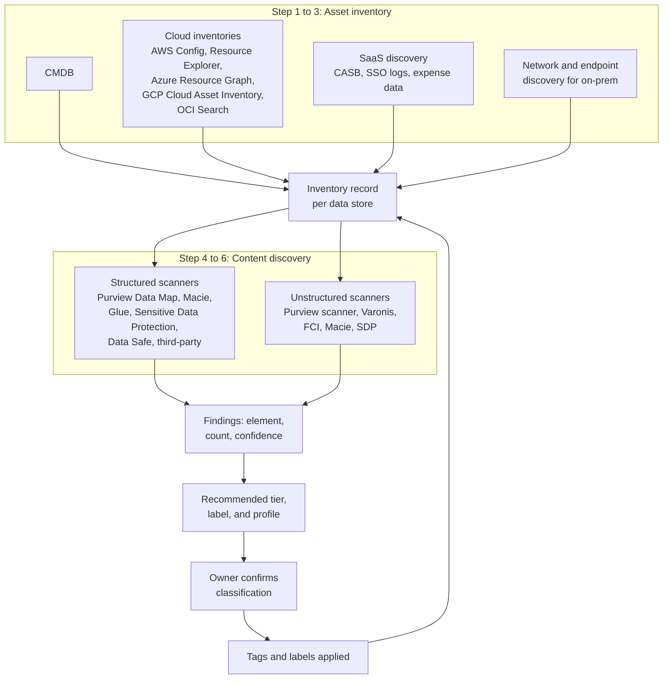

# Data asset inventory and discovery
{: .no_toc }

**Phase 1: Know the data.** Builds a complete, continuously updated inventory of data stores and uses content discovery to find where sensitive data actually is.
{: .fs-5 .fw-300 }

## On this page
{: .no_toc .text-delta }

1. TOC
{:toc}

---

## Two different questions

The inventory program answers two questions that are often confused:

1. **What data stores exist?** This is an asset inventory problem. It is answered from CMDBs, cloud resource inventories, and SaaS discovery, and it produces a list of databases, buckets, file shares, SaaS tenants, and so on.
2. **What sensitive data is in each store?** This is a content discovery problem. It is answered by scanning schemas, sampling rows, and inspecting files, and it produces findings such as "column `guest_profile.passport_no` contains passport numbers" or "share `\\prop-fs01\frontdesk` contains 4,200 files with card numbers".

Asset inventory without content discovery produces a list of stores with guessed classifications. Content discovery without asset inventory misses every store the scanner was never pointed at. The program needs both, joined by a common inventory record.



## Step 1: Establish the inventory sources

| Source | What it gives | Gaps |
|---|---|---|
| CMDB (for example ServiceNow) | Applications, servers, databases registered through change management; business owners | Rarely lists buckets, SaaS, or data inside stores; stale for cloud |
| AWS Config and AWS Resource Explorer | All supported resources across accounts and regions, with tags and configuration | Needs organization-wide aggregation; does not look inside data |
| Azure Resource Graph | All Azure resources across subscriptions with tags and properties, queryable with KQL | Management plane only |
| Google Cloud Asset Inventory | All resources and IAM policies across the organization, with labels and tags; exportable to BigQuery | Management plane only |
| OCI Search | Resources across compartments with defined and freeform tags | Management plane only |
| SaaS discovery | CASB or SaaS security posture management, identity provider app catalog, firewall and proxy logs, expense and procurement records | Shadow SaaS paid by credit card needs finance data |
| On-prem discovery | Network scans, Active Directory computer objects, database listener discovery, file server share enumeration | Property networks may be franchisee-operated |
| Records of processing (GDPR Art. 30) | Business processes and the systems they use | Often lists applications, not stores |
| PCI scoping documentation | Systems in the CDE and connected-to systems | Only the payment domain |

**Step 1 output:** a source list with a named feed owner for each, and read access for the inventory pipeline.

## Step 2: Enumerate cloud data stores

The following commands produce the raw list of data stores in each cloud. They run on a schedule and write to the inventory.

### AWS

AWS Config with an organization aggregator gives an organization-wide query surface. The advanced query uses a SQL-like syntax.

```bash
# Query all S3 buckets, RDS instances, and DynamoDB tables across the organization aggregator
aws configservice select-aggregate-resource-config \
  --configuration-aggregator-name org-aggregator \
  --expression "SELECT accountId, awsRegion, resourceType, resourceId, tags
                WHERE resourceType IN ('AWS::S3::Bucket','AWS::RDS::DBInstance',
                                       'AWS::DynamoDB::Table','AWS::Redshift::Cluster')"
```

AWS Resource Explorer supports tag-based searches across regions once an aggregator index exists. It is useful for finding stores that are missing required tags.

```bash
# Find resources already tagged restricted
aws resource-explorer-2 search \
  --query-string "tag:data-classification=restricted"

# Find S3 buckets with no data-classification tag
aws resource-explorer-2 search \
  --query-string "resourcetype:s3:bucket -tag.key:data-classification"
```

{: .verify }
Resource Explorer query syntax supports `tag:`, `tag.key:`, `resourcetype:`, and negation with a leading hyphen. Confirm operator support in the current Resource Explorer query syntax reference before using these filters in automation.

### Azure

Azure Resource Graph queries run across all subscriptions the caller can read. The `az graph` command requires the `resource-graph` extension.

```bash
az extension add --name resource-graph

az graph query -q "
Resources
| where type in~ ('microsoft.storage/storageaccounts',
                  'microsoft.sql/servers/databases',
                  'microsoft.documentdb/databaseaccounts',
                  'microsoft.synapse/workspaces')
| project subscriptionId, resourceGroup, name, type, location,
          classification = tostring(tags['data-classification']),
          owner = tostring(tags['data-owner'])
| order by type asc" --first 1000
```

The same Resource Graph query language (KQL) finds untagged stores:

```kusto
Resources
| where type =~ 'microsoft.storage/storageaccounts'
| where isnull(tags['data-classification']) or tags['data-classification'] == ''
| project subscriptionId, resourceGroup, name, location
```

### Google Cloud

Cloud Asset Inventory searches across an organization, folder, or project scope. The `--query` filter supports label matching.

```bash
# All data stores in the organization
gcloud asset search-all-resources \
  --scope=organizations/123456789012 \
  --asset-types='storage.googleapis.com/Bucket,bigquery.googleapis.com/Dataset,sqladmin.googleapis.com/Instance,spanner.googleapis.com/Instance' \
  --format='table(name, assetType, location, labels)'

# Buckets labeled restricted
gcloud asset search-all-resources \
  --scope=organizations/123456789012 \
  --asset-types='storage.googleapis.com/Bucket' \
  --query='labels.data-classification:restricted'
```

For a full snapshot, export Cloud Asset Inventory to BigQuery and query it alongside discovery results:

```bash
gcloud asset export \
  --organization=123456789012 \
  --content-type=resource \
  --bigquery-table=projects/sec-inventory/datasets/cai/tables/resources \
  --output-bigquery-force
```

### Oracle Cloud Infrastructure

OCI Search uses a structured query language over resource types and tags.

```bash
# All Autonomous Databases and buckets in the tenancy
oci search resource structured-search \
  --query-text "query autonomousdatabase, bucket resources"

# Resources carrying the defined tag data-governance.data-classification = restricted
oci search resource structured-search \
  --query-text "query all resources where (definedTags.namespace = 'data-governance' && definedTags.key = 'data-classification' && definedTags.value = 'restricted')"
```

**Step 2 output:** a list of every cloud data store with account, region, type, and current tags, refreshed at least daily.

## Step 3: Discover SaaS and shadow data

SaaS and shadow data are where the landscape is most wrong. Methods:

| Method | Finds | Tooling examples |
|---|---|---|
| CASB cloud discovery from proxy and firewall logs | SaaS applications in use, including unsanctioned | Microsoft Defender for Cloud Apps, Netskope, Zscaler, and similar |
| Identity provider application catalog | SaaS integrated with SSO and OAuth grants to third-party apps | Entra ID enterprise applications and consent grants, Okta |
| SaaS security posture management | Configuration and sharing exposure in sanctioned SaaS | Various SSPM products |
| Procurement and expense records | Subscriptions bought outside IT | Finance systems |
| Cloud-to-cloud copy detection | Snapshots and exports shared to external accounts | AWS Config rules, Resource Graph, Asset Inventory IAM policy analysis |
| Non-production scanning | Production extracts in dev and test | The same content scanners pointed at non-production accounts |

Shadow data inside sanctioned platforms is the larger problem in practice: CSV exports in OneDrive, analyst copies of production tables in personal BigQuery datasets, database snapshots copied to sandbox accounts, and application logs capturing request bodies. Content discovery (Steps 4 and 5) is the only reliable way to find these.

## Step 4: Discover sensitive data in structured stores

Structured discovery connects to a database or warehouse, reads the schema, samples rows, and applies classifiers (regular expressions, checksums such as Luhn for PAN, keyword proximity, and machine learning models) to each column.

### Structured discovery tooling by environment

| Environment | Native tooling | Coverage notes | Third-party options |
|---|---|---|---|
| AWS | AWS Glue sensitive data detection (in Glue ETL jobs and Glue Studio); Amazon Macie for S3 only | Macie does not scan RDS or DynamoDB directly; export or snapshot to S3 is a common workaround | BigID, Cyera, Securiti, Varonis |
| Azure | Microsoft Purview Data Map scanning with classification rules for Azure SQL, Synapse, Cosmos DB, and storage | Supports many sources through managed or self-hosted integration runtimes | BigID, Cyera, Securiti, Varonis |
| Google Cloud | Sensitive Data Protection (formerly Cloud DLP) discovery for BigQuery, Cloud SQL, and Cloud Storage | Discovery profiles data at table or column level and can tag resources | BigID, Cyera, Securiti |
| OCI | Oracle Data Safe sensitive data discovery for Oracle databases (Autonomous and Base Database Service, and on-prem Oracle via connectivity) | Oracle Database only; builds sensitive data models used by Data Safe masking | BigID, Securiti |
| On-prem databases | Purview Data Map with self-hosted integration runtime (SQL Server, Oracle, and others); SQL Server data discovery and classification; Data Safe for on-prem Oracle | Requires network path and credentials to each instance | BigID, Varonis, Securiti |
| SaaS data models | Vendor reporting APIs; third-party connectors | Coverage varies by vendor | BigID, Securiti, Cyera |

{: .verify }
Supported sources for Purview Data Map, Sensitive Data Protection discovery, and Data Safe change frequently. Confirm current source lists and whether each is generally available before committing to a design.

### AWS: Glue sensitive data detection

AWS Glue provides a Detect PII (sensitive data detection) transform in Glue Studio and ETL jobs. It identifies entity types such as credit card numbers, passport numbers, and email addresses in columns or cell-by-cell, and can either report detections or redact them as data moves through the pipeline. It is best used in the ingestion pipelines that feed the data lake so that detections are produced where the data enters, rather than as a separate scan. Because it runs inside ETL, it costs Glue compute rather than a per-byte scanning fee.

### Google Cloud: Sensitive Data Protection discovery

Sensitive Data Protection discovery is configured once at organization or folder level and then profiles every BigQuery table, Cloud SQL instance, and Cloud Storage bucket in scope continuously. Profiles record the information types found per column and a data risk and sensitivity score, and can publish findings to Security Command Center, export profiles to BigQuery, and apply tags to resources.

A discovery configuration is created through the API. The request below is a minimal example for BigQuery at organization level.

```bash
curl -X POST \
  -H "Authorization: Bearer $(gcloud auth print-access-token)" \
  -H "Content-Type: application/json" \
  "https://dlp.googleapis.com/v2/organizations/123456789012/locations/us/discoveryConfigs" \
  -d '{
    "discoveryConfig": {
      "displayName": "org-bigquery-discovery",
      "orgConfig": {
        "location": { "organizationId": "123456789012" },
        "projectId": "sec-dlp-host"
      },
      "targets": [
        { "bigQueryTarget": { "filter": { "otherTables": {} } } }
      ],
      "actions": [
        { "exportData": { "profileTable": {
            "projectId": "sec-dlp-host",
            "datasetId": "dlp_profiles",
            "tableId": "bq_profiles" } } }
      ],
      "status": "RUNNING"
    }
  }'
```

{: .verify }
Field names and available actions in the discovery configuration API (including the action that tags resources based on sensitivity) evolve. Validate the request against the current `discoveryConfigs` REST reference.

### OCI: Data Safe sensitive data discovery

Data Safe connects to a registered target database and builds a sensitive data model: a list of columns and the sensitive types found in them (for example passport number, credit card number, email). The sensitive data model is then reused by Data Safe data masking to produce safe non-production copies. Discovery can be scheduled so that new columns are picked up. The OCI Console and the `oci data-safe` CLI command group both expose sensitive data model operations; the console is the simplest starting point.

### Azure and on-prem: Purview Data Map

Purview Data Map registers sources (Azure SQL, Synapse, storage accounts, and on-prem SQL Server and Oracle through a self-hosted integration runtime), runs scans with a scan rule set that selects system and custom classifications, and records classifications on columns and files in the Data Map. Classifications can then be viewed in the Unified Catalog and used to recommend sensitivity labels for schematized assets.

A custom classification rule for a loyalty member number, for example, uses a regular expression plus column-name patterns, with a minimum match threshold so that a column is only classified when a set percentage of sampled values match.

### SQL Server: built-in discovery

SQL Server 2019 and later, and Azure SQL, include data discovery and classification that recommends classifications by column name and stores them in the database. The stored classifications are queryable:

```sql
SELECT
    SCHEMA_NAME(o.schema_id) AS schema_name,
    o.name AS table_name,
    c.name AS column_name,
    sc.label,
    sc.information_type,
    sc.rank_desc
FROM sys.sensitivity_classifications AS sc
JOIN sys.objects AS o ON sc.major_id = o.object_id
JOIN sys.columns AS c ON sc.major_id = c.object_id AND sc.minor_id = c.column_id
ORDER BY schema_name, table_name, column_name;
```

The syntax to add classifications is covered on [Labeling, tagging, and metadata]().

## Step 5: Discover sensitive data in unstructured stores

Unstructured discovery reads file content, including Office documents, PDFs, and, with OCR, images such as passport scans.

| Environment | Native tooling | What it does | Third-party options |
|---|---|---|---|
| On-prem file shares | Microsoft Purview information protection scanner | Crawls SMB shares and on-prem SharePoint, detects sensitive information types, can apply sensitivity labels | Varonis, BigID, Cyera, Securiti |
| On-prem file shares (Windows Server) | File Classification Infrastructure (FCI) in File Server Resource Manager | Classifies files by content or location into properties, which can trigger file management tasks | Varonis |
| Microsoft 365 | Purview content explorer, activity explorer, auto-labeling, DLP | Detects sensitive information types across Exchange, SharePoint, OneDrive, Teams | Varonis, Cyera |
| AWS S3 | Amazon Macie automated sensitive data discovery and classification jobs | Samples and inspects objects, reports findings to Security Hub and EventBridge | BigID, Cyera, Varonis, Securiti |
| Azure Blob and Files | Purview Data Map scanning | Classifies files in storage accounts | BigID, Cyera, Varonis |
| Google Cloud Storage | Sensitive Data Protection discovery and inspection jobs | Profiles buckets and inspects objects | BigID, Cyera |
| OCI Object Storage | No direct native equivalent to Macie as of mid-2026 | Use third-party scanners or copy samples to a scanned location | BigID, Securiti |

{: .verify }
OCI native content discovery for Object Storage is limited as of mid-2026. Confirm whether new OCI data security services cover Object Storage before selecting a third-party tool.

### Amazon Macie

Macie offers two modes. Automated sensitive data discovery samples objects across all buckets in the organization continuously and maintains a sensitivity score per bucket. Classification jobs run targeted, deeper inspections of specific buckets, either once or on a schedule.

```bash
# Enable Macie in the delegated administrator account
aws macie2 enable-macie

# Enable automated sensitive data discovery for the organization
aws macie2 update-automated-discovery-configuration --status ENABLED

# Targeted one-time job on the data lake raw zone bucket
aws macie2 create-classification-job \
  --job-type ONE_TIME \
  --name "raw-zone-guest-extracts" \
  --s3-job-definition '{
    "bucketDefinitions": [
      { "accountId": "111122223333",
        "buckets": ["dl-raw-guest-eu-west-1"] }
    ]
  }' \
  --managed-data-identifier-selector ALL \
  --sampling-percentage 100

# Review findings of a given severity
aws macie2 list-findings \
  --finding-criteria '{"criterion":{"severity.description":{"eq":["High"]}}}'
```

Custom data identifiers extend Macie to organization-specific patterns, such as a loyalty member number format:

```bash
aws macie2 create-custom-data-identifier \
  --name "loyalty-member-number" \
  --regex "\bLM[0-9]{10}\b" \
  --keywords "member" "loyalty" "account" \
  --maximum-match-distance 50
```

### Purview information protection scanner (on-prem)

The scanner is installed on a Windows server near the file shares, uses a SQL Server database for configuration, and is managed from the Purview portal through a content scan job. The PowerShell module provides installation and control.

```powershell
# Install the scanner service, pointing at its configuration database and cluster
Install-Scanner -SqlServerInstance "SQL01\SCANNER" -Cluster "EMEA-Properties"

# Authenticate the scanner service account to Purview
Set-Authentication -AppId "<app-id>" -AppSecret "<secret>" -TenantId "<tenant-id>" `
  -DelegatedUser scanner-svc@example.com

# Start a scan and check status
Start-Scan
Get-ScanStatus
```

The first runs should be in discovery-only mode (report, do not label) to size the problem and tune sensitive information types before any labels are applied. Content scan job settings in the portal control whether the scanner enforces labels.

### File Classification Infrastructure (Windows Server)

FCI is useful where the Purview scanner is not deployed, for example small property file servers. It classifies files into properties that other tools can read.

```powershell
# Define a classification property with the four tiers
New-FsrmClassificationPropertyDefinition -Name "DataClassification" -Type SingleChoice `
  -PossibleValue @(
    (New-FsrmClassificationPropertyValue -Name "Public"),
    (New-FsrmClassificationPropertyValue -Name "Internal"),
    (New-FsrmClassificationPropertyValue -Name "Confidential"),
    (New-FsrmClassificationPropertyValue -Name "Restricted")
  )

# Content rule: files containing passport-like strings near keywords become Restricted
New-FsrmClassificationRule -Name "Passport numbers" -Property "DataClassification" `
  -PropertyValue "Restricted" -Namespace @("D:\Shares\FrontDesk") `
  -ClassificationMechanism "Content Classifier" `
  -ContentRegularExpression @("(?i)passport.{0,40}[A-Z0-9]{8,9}") `
  -ReevaluateProperty Overwrite
```

FCI regular expressions are less precise than Purview sensitive information types, which combine patterns, checksums, and keyword proximity. Treat FCI as Good-level discovery.

## Step 6: Validate, tune, and hand off

Discovery findings are recommendations. Before a store is tagged:

1. **Tune false positives.** Nine-digit numbers match many patterns. Require checksums (Luhn for PAN, mod-97 for IBAN), keyword proximity, and minimum counts.
2. **Tune false negatives.** Add custom identifiers for organization-specific formats: loyalty numbers, reservation confirmation numbers, employee IDs.
3. **Sample-verify.** A data steward reviews a sample of findings per store for C3 detections.
4. **Owner confirmation.** The data owner confirms or overrides the recommended tier. Overrides downward require a reason.
5. **Tag and label.** Apply tags and labels (see [Labeling, tagging, and metadata]()).
6. **Remediate.** Findings in the wrong place, such as PAN outside the CDE, become tickets: delete, tokenize, or move.

The repository includes a reference discovery scanner that demonstrates the classifier logic: regular expressions plus Luhn validation for PAN, IBAN mod-97 validation, passport and email patterns, and a recommended label and protection profile per finding. See [code/discovery on GitHub](https://github.com/steven-smith-itnet/data-protection-pqc-security-architecture/tree/main/code/discovery). It is a teaching aid for how classifiers reduce false positives, not a replacement for the products above.

A simplified version of the PAN check shows why checksums matter:

```python
import re

PAN_RE = re.compile(r"\b(?:\d[ -]?){13,19}\b")

def luhn_valid(number: str) -> bool:
    digits = [int(d) for d in number if d.isdigit()]
    checksum = 0
    for i, d in enumerate(reversed(digits)):
        if i % 2 == 1:
            d *= 2
            if d > 9:
                d -= 9
        checksum += d
    return checksum % 10 == 0

def find_pans(text: str) -> list[str]:
    hits = []
    for m in PAN_RE.finditer(text):
        candidate = re.sub(r"[ -]", "", m.group())
        if 13 <= len(candidate) <= 19 and luhn_valid(candidate):
            hits.append(candidate[:6] + "*" * (len(candidate) - 10) + candidate[-4:])
    return hits
```

The masked output (BIN and last four) follows PCI DSS 3.4.1 so that the discovery report does not itself become a PAN store.

## Discovery maturity: Good, Better, Best

| Dimension | Good | Better | Best |
|---|---|---|---|
| Asset coverage | Cloud inventories and CMDB merged monthly | Daily automated merge across all four clouds and major SaaS | Near-real-time via event streams (Config, Event Grid, Asset Inventory feeds, OCI Events) |
| Structured discovery | Annual scans of known production databases | Continuous native discovery (Macie, SDP, Purview, Data Safe) on all production stores | Continuous discovery on all environments including non-production, with column-level results feeding tags automatically |
| Unstructured discovery | Scans of known shares and M365 via built-in reports | Purview scanner and Macie across all corporate stores; auto-labeling in simulation | Full coverage including property file servers, backups sampled, OCR for images, auto-labeling enforced |
| Classifier quality | Default patterns | Checksums, keyword proximity, custom identifiers | Exact data match (EDM) against known guest and employee identifiers; trainable classifiers for documents such as contracts |
| Integration | Findings in spreadsheets | Findings in a catalog with owners and tickets | Findings drive tags, keys, masking, and DLP automatically through the label-to-control policy |
| Evidence | Point-in-time report | Monthly coverage dashboard | Continuous KPIs by tier, region, and domain |

{: .good }
Good: merge CMDB and cloud inventories, run native discovery on production data stores in the highest-risk domains, and track findings manually. Low cost, fast to start, but misses shadow data and non-production.

{: .better }
Better: continuous native discovery everywhere it is available, a third-party scanner for gaps (on-prem, OCI Object Storage, SaaS), and findings flowing to owners through a catalog. This is the target for month 9.

{: .best }
Best: add exact data match, OCR, and non-production coverage, and let confirmed findings set tags automatically. Trade-off: higher licensing and compute cost, and automatic tagging needs strong tuning to avoid mislabeling at scale.

## Inventory record schema

Every data store has one inventory record. The record is the join point between discovery, classification, ownership, keys, and evidence.

| Field | Type | Example | Source |
|---|---|---|---|
| `store_id` | String, unique | `aws:111122223333:eu-west-1:s3:dl-raw-guest-eu-west-1` | Generated |
| `store_type` | Enum | `object-bucket`, `relational-db`, `warehouse-dataset`, `file-share`, `saas-tenant`, `mailbox`, `log-group`, `backup-vault` | Cloud inventory |
| `environment` | Enum | `on-prem-dc`, `on-prem-property`, `saas`, `aws`, `azure`, `gcp`, `oci` | Cloud inventory |
| `location` | String | `eu-west-1`, `property:LON123` | Cloud inventory |
| `lifecycle` | Enum | `prod`, `non-prod`, `dr`, `archive` | Tags or CMDB |
| `application` | String | `loyalty-platform` | CMDB |
| `data_domain` | Enum (tag values) | `guest` | Owner |
| `data_elements` | List | `email`, `passport_number`, `pan` | Discovery findings |
| `classification` | Enum | `restricted` | Highest confirmed element tier, with aggregation rule |
| `sensitivity_label` | Enum (label names) | `Restricted\Guest-Identity` | Classification |
| `protection_profile` | Enum | `pp3` | Derived from classification |
| `regulatory_scope` | String | `pci_gdpr` | Discovery plus residency |
| `data_residency` | Enum | `eu` | Location plus owner |
| `data_owner` | Team slug | `guest-platform` | Owner |
| `data_steward` | Person or team | `guest-data-stewards` | Owner |
| `custodian` | Team slug | `cloud-platform-aws` | Platform |
| `retention_class` | Enum | `r3y` | Records schedule |
| `encryption_at_rest` | Structured | `{type: sse-kms, key_id: arn:..., key_type: customer-managed}` | Cloud configuration |
| `ownership_model` | Enum | `owned`, `managed`, `franchised`, `third-party` | Owner |
| `discovery_last_scan` | Timestamp | `2026-09-14T02:10:00Z` | Discovery tool |
| `discovery_tool` | String | `macie` | Discovery tool |
| `compliance_state` | Enum | `compliant`, `drift`, `exception` | Policy engine |
| `exception_id` | String | `EXC-2026-044` | Exception register |
| `ropa_ref` | String | `ROPA-GUEST-012` | Privacy |

A record in YAML form, as stored in the catalog export:

```yaml
store_id: "gcp:guest-analytics-prod:bigquery:guest_curated"
store_type: warehouse-dataset
environment: gcp
location: EU
lifecycle: prod
application: enterprise-warehouse
data_domain: guest
data_elements: [guest_name, email, phone, stay_history, loyalty_member_id]
classification: confidential
sensitivity_label: "Confidential\\Guest-PII"
protection_profile: pp2
regulatory_scope: gdpr
data_residency: eu
data_owner: guest-platform
data_steward: guest-data-stewards
custodian: data-platform-gcp
retention_class: r3y
encryption_at_rest:
  type: cmek
  key_id: "projects/kms-guest-eu/locations/europe/keyRings/guest-prod/cryptoKeys/bq-guest-curated"
  key_protection: hsm
ownership_model: owned
discovery_last_scan: "2026-09-20T01:00:00Z"
discovery_tool: sensitive-data-protection
compliance_state: compliant
ropa_ref: ROPA-GUEST-004
```

## Operating the inventory

| Activity | Frequency | Owner |
|---|---|---|
| Cloud inventory merge | Daily | Security engineering |
| Native discovery (automated modes) | Continuous | Platform teams per cloud |
| Targeted scans of new stores | Within 7 days of creation | Security engineering |
| Owner confirmation of new C2 and C3 findings | Within 14 days | Data owners |
| Untagged resource remediation | Policy deny for new resources; 30 days for existing | Resource owners |
| Coverage report to steering committee | Monthly | Architecture |
| Full re-scan of on-prem and property shares | Quarterly | Property IT and security engineering |

{: .warning }
Discovery tools read personal data. Restrict access to findings, store only masked samples, apply the same key and access controls to discovery results as to the source data, and document the scanning in records of processing.

## Key takeaways for engineering teams

- Every new data store must be discoverable: enroll accounts, subscriptions, projects, and compartments before workloads land, not after.
- Macie scans S3 only; RDS, DynamoDB, and other AWS stores need Glue sensitive data detection, snapshots to S3, or third-party tooling.
- Use checksums and keyword proximity in classifiers; pattern-only rules generate noise that owners will ignore.
- The inventory record is the join point for tags, keys, owners, and evidence; populate `encryption_at_rest` and `data_owner` as part of provisioning.
- Discovery findings are recommendations; the data owner confirms the tier, and downward overrides need a recorded reason.

## Related pages

- [Data classification scheme]()
- [Labeling, tagging, and metadata]()
- [Data ownership, flows, and lineage]()
- [Code and tooling lab]()
- [Cloud provider playbooks]()

## Sources

- Amazon Macie documentation: <https://docs.aws.amazon.com/macie/>
- AWS Glue sensitive data detection: <https://docs.aws.amazon.com/glue/latest/dg/detect-PII.html>
- AWS Config advanced queries: <https://docs.aws.amazon.com/config/latest/developerguide/querying-AWS-resources.html>
- Azure Resource Graph: <https://learn.microsoft.com/azure/governance/resource-graph/>
- Microsoft Purview Data Map: <https://learn.microsoft.com/purview/>
- Google Cloud Sensitive Data Protection discovery: <https://cloud.google.com/sensitive-data-protection/docs/data-profiles>
- Google Cloud Asset Inventory: <https://cloud.google.com/asset-inventory/docs>
- OCI Search query language: <https://docs.oracle.com/iaas/Content/Search/Concepts/querysyntax.htm>
- Oracle Data Safe: <https://docs.oracle.com/iaas/data-safe/>
