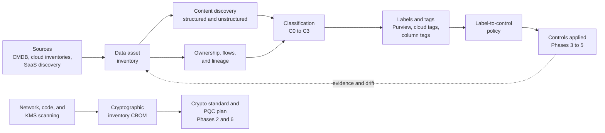

# Phase 1: Know the data
{: .no_toc }

**Phase 1: Know the data.** Finds, classifies, labels, and assigns ownership to the organization's data and cryptography so that controls can be selected and enforced automatically.
{: .fs-5 .fw-300 }

## On this page
{: .no_toc .text-delta }

1. TOC
{:toc}

---

## Why prerequisites come first

A control can only be applied correctly to data that has been found and labeled. Encryption with a customer-managed key, tokenization of passport numbers, or a DLP block rule each depends on knowing three things about the data store or file it protects: what it contains, how sensitive that content is, and who is accountable for it. Without that, the organization either over-protects everything, which is expensive and breaks functionality, or under-protects the data that matters, which is where breaches occur.

The same logic applies to cryptography. The organization cannot plan a post-quantum migration, meet PCI DSS 12.3.3, or rotate a compromised key quickly without an inventory of where each algorithm, certificate, and key is used.

Phase 1 therefore produces two inventories and one mechanism:

- A **data asset inventory**: every data store, its contents, classification, owner, and residency.
- A **cryptographic inventory (CBOM)**: every algorithm, protocol, certificate, key, and library in use.
- A **label-to-control mechanism**: classification expressed as machine-readable labels and tags that policy as code, key selection, masking, and DLP read directly.

Phase 1 starts in month 1 and runs to month 9 for the first full pass. Discovery then continues permanently as a background process.

## Objective

By the end of Phase 1, every data store in scope has a classification tier, a protection profile, a data domain, a residency, and an owner, recorded both in the inventory and as tags or labels on the resource itself. Every cryptographic asset on external and PCI-scoped paths is recorded in a CycloneDX CBOM with its quantum-vulnerability status.

## Entry criteria

| Criterion | Evidence |
|---|---|
| Phase 0 objectives, threat model, and data landscape approved | Steering committee decision |
| Classification scheme draft available for consultation | Draft of [Data classification scheme]() |
| Read access for discovery tooling to all cloud organizations, subscriptions, and SaaS tenants | Service principals and roles provisioned |
| Data owners identified at the domain level | Named domain owners for guest, payment, loyalty, employee, finance, operations, property-iot, security |
| Privacy approval for content scanning (scanners read personal data) | DPIA or equivalent assessment for the discovery program |

## Exit criteria

| Criterion | Evidence |
|---|---|
| 100% of cloud accounts, subscriptions, projects, and compartments enrolled in discovery | Discovery tool coverage report |
| 95% of data stores have an owner, tier, and residency | Inventory completeness report |
| Tag policies enforced at organization level in all four clouds | AWS tag policies and SCPs, Azure Policy, GCP organization policy and tags, OCI tag defaults and policies deployed |
| Sensitivity labels published in Microsoft Purview and auto-labeling running in simulation or enforcement | Purview label and auto-labeling policy reports |
| Label-to-control policy published in machine-readable form | Policy file in [code/classification](https://github.com/steven-smith-itnet/data-protection-pqc-security-architecture/tree/main/code/classification) approved |
| Records of processing linked to inventory entries | ROPA cross-reference complete |
| CBOM covering all external TLS endpoints, PCI-scoped systems, and cloud KMS keys | CBOM file under version control |

## Deliverables

| Deliverable | Format | Consumer |
|---|---|---|
| Data asset inventory | Records in the data catalog, exported to the CMDB | Architecture, privacy, audit |
| Discovery findings and remediation backlog | Tickets per owner | Data owners, platform teams |
| Classification standard and data element catalog | Policy document plus machine-readable catalog | All teams |
| Label taxonomy and tagging standard | Purview labels, tag policies, column tag taxonomies | Platform and data teams |
| Label-to-control policy | YAML policy and resolver | Policy as code, paved-road modules |
| Ownership RACI, data flow maps, cross-border register | Catalog entries and diagrams | Privacy, legal, architecture |
| Cryptographic inventory | CycloneDX CBOM JSON plus summary dashboard | Crypto standards (Phase 2), PQC (Phase 6), PCI assessor |

## How Phase 1 works

The two tracks run in parallel. The data track drives control selection for Phases 3 to 5. The crypto track drives the standard and key management design in Phase 2 and the migration plan in Phase 6.

## Sequencing within the phase

| Months | Work |
|---|---|
| 1 to 2 | Enroll cloud inventories; build the first inventory from CMDB and cloud resource lists; publish the classification draft; start TLS endpoint and certificate scanning |
| 2 to 4 | Deploy structured discovery (Macie, Sensitive Data Protection, Purview Data Map, Data Safe) to the highest-risk domains: payment, guest, employee; publish labels in Purview in simulation |
| 3 to 6 | Enforce tag policies in audit mode, then deny mode; deploy on-prem file scanning at corporate data centers and a pilot group of properties; build the CBOM for PCI-scoped systems |
| 5 to 9 | Extend discovery to all properties and SaaS; move auto-labeling to enforcement for C3 sensitive information types; complete ownership and flow maps; publish the label-to-control policy; baseline metrics |

## Pages in this phase

| Page | What it covers |
|---|---|
| [Data asset inventory and discovery]() | Inventory sources, discovery tooling per environment with commands, maturity levels, and the inventory record schema |
| [Data classification scheme]() | The four tiers, the data element catalog, handling rules, aggregation, declassification, and default rules |
| [Labeling, tagging, and metadata]() | Purview labels, cloud tags and labels, tag enforcement, column-level tags, and object metadata with syntax |
| [Label-to-control mapping]() | The tier by state by environment control matrix and how enforcement is automated |
| [Data ownership, flows, and lineage]() | Owner, steward, custodian, RACI, flow mapping, lineage tools, records of processing, cross-border and third-party registers |
| [Cryptographic inventory (CBOM)]() | What to inventory, sources, CycloneDX CBOM format, tooling, and PCI DSS hooks |

## Key takeaways for engineering teams

- Do not choose controls before the data is classified; the tier selects the profile and the profile selects the controls.
- Tags and labels are the interface between governance and automation; they must be present, valid, and enforced at creation time.
- Discovery is continuous, not a one-time project; new stores appear every week.
- The cryptographic inventory is a Phase 1 deliverable because both key management and PQC depend on it.

## Related pages

- [Hospitality data landscape]()
- [Phased roadmap]()
- [Phase 2: Standards and keys]()
- [Guardrails and policy as code]()
