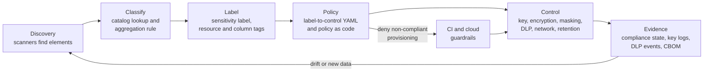
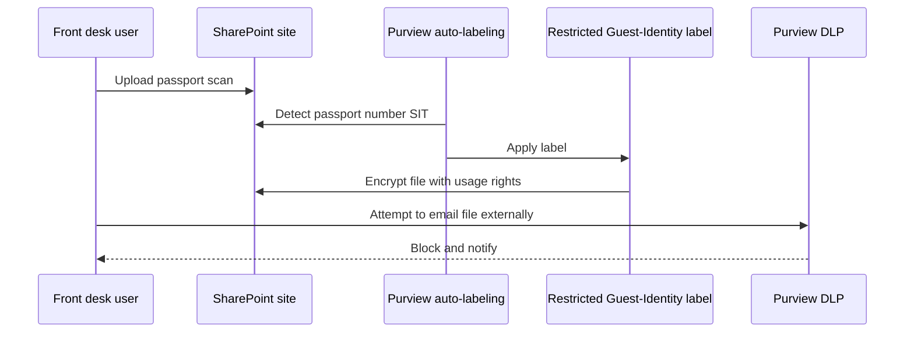

# Label-to-control mapping
{: .no_toc }

**Phase 1: Know the data.** Defines which controls each classification tier requires in each data state and environment, and how labels trigger those controls automatically.
{: .fs-5 .fw-300 }

## On this page
{: .no_toc .text-delta }

1. TOC
{:toc}

---

## The core idea

Classification only has value if it changes what happens to the data. The label-to-control mapping is a lookup:

**(classification tier, label, data state, environment) → required controls**

The tier selects the protection profile (PP-1, PP-2, or PP-3). The label adds specific requirements within the profile. The data state (at rest, in transit, in use, in backups, in logs, in non-production) and the environment (on-prem, AWS, Azure, Google Cloud, OCI) select the concrete implementation.

The mapping is published in two forms: the human-readable matrices on this page, and a machine-readable YAML policy that tooling reads. The YAML is the source of truth; these tables are generated from the same decisions.



## Profile summary

| Profile | Tier | Keys | Encryption depth | Access | Egress | Transport | Lifecycle |
|---|---|---|---|---|---|---|---|
| PP-1 Baseline | C0, C1 | Provider-managed | Platform default at rest | Standard IAM | None beyond standard | TLS 1.2+ | Records schedule |
| PP-2 Enhanced | C2 | Customer-managed in cloud KMS, HSM-backed where offered; per domain and environment; automated rotation | Platform encryption with CMK; TDE with CMK | Key admin and key user separated; dynamic masking for non-privileged; quarterly reviews | DLP monitor then block | TLS 1.2+, prefer 1.3; hybrid PQ where supported | Automated deletion |
| PP-3 Maximum | C3 | PP-2 plus single-tenant HSM or customer-held or external keys where justified | PP-2 plus field-level encryption, tokenization, or persistent label encryption before data leaves the application | Just-in-time; named purpose | DLP block | mTLS; hybrid PQ prioritized | Crypto-shredding; shortest retention |

## Matrix 1: tier by data state

This matrix states the required control outcome for each tier and state, independent of environment.

| State | C0 Public (PP-1) | C1 Internal (PP-1) | C2 Confidential (PP-2) | C3 Restricted (PP-3) |
|---|---|---|---|---|
| **At rest** | Platform default encryption | Platform default encryption | Storage or TDE encryption with a customer-managed key per domain and environment, HSM-backed where offered; automated rotation | PP-2 plus field-level encryption, tokenization, or FPE for C3 elements in the application; persistent label encryption for files; dedicated or external key custody where justified |
| **In transit** | TLS 1.2+ (integrity for public content) | TLS 1.2+ | TLS 1.2+ preferring 1.3; hybrid PQ key exchange where supported; no plaintext protocols on any network | PP-2 plus mTLS for service-to-service; hybrid PQ key exchange prioritized on external and long-lived-data paths; PAN over public networks per PCI DSS 4.2.1 |
| **In use** | No requirement | No requirement | Dynamic masking for non-privileged roles; least privilege; no clear-text display beyond need | PP-2 plus just-in-time human access; decrypt only in the service that needs the value; confidential computing where feasible for bulk processing; PAN display masked per PCI DSS 3.4.1 |
| **In backups** | Platform default | Platform default | Backups encrypted with a CMK distinct from the production key, in a separate account or vault; immutability for ransomware resilience | PP-2 plus backups contain only ciphertext or tokens for C3 elements; crypto-shredding supports deletion inside backups |
| **In logs** | Allowed | Allowed | Minimize; no bulk personal data; log stores encrypted with CMK; access restricted | Must not appear in logs; application-level redaction; discovery scanning of log stores; detection of PAN and passport patterns triggers an incident |
| **In non-production** | Allowed | Allowed | Masked or synthetic only; no production copies without masking | Synthetic or irreversibly masked only; never production C3 values; tokens from a separate non-production vault |

## Matrix 2: C2 Confidential (PP-2) by environment

| State | On-prem | AWS | Azure | Google Cloud | OCI |
|---|---|---|---|---|---|
| At rest: databases | SQL Server TDE or Oracle TDE with keys in an HSM or Oracle Key Vault through EKM or KMIP | RDS, Aurora, DynamoDB, Redshift with a customer managed KMS key | Azure SQL TDE with customer-managed key in Key Vault Premium or Managed HSM; Cosmos DB CMK | Cloud SQL, Spanner, BigQuery with CMEK (Cloud KMS, protection level HSM) | Autonomous Database and Base Database Service TDE with customer-managed keys in OCI Vault |
| At rest: objects and files | File server volume encryption (BitLocker) plus Purview labels | S3 SSE-KMS with customer managed key and S3 Bucket Keys | Storage account CMK (Key Vault or Managed HSM); encryption scopes per container where needed | Cloud Storage CMEK | Object Storage with a Vault master encryption key |
| Keys | HSM-backed; KMIP for storage and databases | Customer managed KMS key per domain per environment; key policy separates administrators and users | Key Vault Premium (HSM-backed) or Managed HSM; RBAC separates Crypto Officer and Crypto User | Cloud KMS key per domain per environment, protection level HSM; IAM separates `cloudkms.admin` and `cryptoKeyEncrypterDecrypter` | Vault keys HSM-protected; policies separate `manage keys` and `use keys` |
| In transit | TLS 1.2+ with internal PKI | TLS on endpoints; ACM certificates; security policies requiring TLS 1.2+ on load balancers | TLS minimum version 1.2 on storage, SQL, App Service; Front Door and Application Gateway TLS policies | SSL policies on load balancers with minimum TLS 1.2; Cloud SQL require SSL | Load balancer cipher suites and TLS 1.2+; database TLS |
| In use | Dynamic data masking in SQL Server; Oracle Data Redaction | Redshift dynamic data masking; application masking | Azure SQL dynamic data masking | BigQuery dynamic data masking with policy tags | Oracle Data Redaction |
| Backups | Backup software encryption with keys in HSM | AWS Backup vault with a separate customer managed key; vault lock | Azure Backup with CMK; immutable vaults | Backup and DR service with CMEK; bucket retention locks | OCI backups encrypted with Vault keys; retention rules |
| Logs | SIEM with encrypted storage; PII minimization | CloudWatch Logs with KMS key | Log Analytics with CMK (dedicated cluster) | Cloud Logging CMEK for log buckets | Logging with Vault keys where supported |
| Non-production | Masked copies (SQL Server or Oracle masking tools) | Masking in pipelines; Glue sensitive data detection redaction | Masking in pipelines | Sensitive Data Protection de-identification | Data Safe data masking |
| DLP | Purview endpoint DLP, network DLP | Macie findings to EventBridge; CASB | Purview DLP | Sensitive Data Protection; CASB | CASB and third-party DLP |

{: .verify }
CMK support varies by service and sometimes by region or tier (for example, Log Analytics CMK requires a dedicated cluster, and some managed services support only provider-managed keys). Confirm CMK support for each service during design review.

## Matrix 3: C3 Restricted (PP-3) by environment

PP-3 includes everything in Matrix 2 plus the controls below.

| State | On-prem | AWS | Azure | Google Cloud | OCI |
|---|---|---|---|---|---|
| At rest: application layer | Field-level encryption through a vendor tokenization or encryption platform (for example Thales CipherTrust, Protegrity, OpenText Voltage) or HashiCorp Vault Transit and Transform | AWS Encryption SDK or AWS Database Encryption SDK (with beacons for searchable fields); tokenization service | Always Encrypted (with secure enclaves where queries need it); application envelope encryption with Key Vault keys | BigQuery AEAD functions with keys wrapped by Cloud KMS; Sensitive Data Protection de-identification (deterministic encryption, FPE) | Application envelope encryption with Vault keys; Oracle Data Redaction plus column encryption |
| Key custody | Dedicated HSMs with dual control; KMIP | CloudHSM custom key store, or external key store (XKS) where justified | Managed HSM (single-tenant); Azure Cloud HSM where needed (verify status) | Cloud HSM; Cloud EKM with Key Access Justifications where justified | Dedicated KMS or External KMS where justified; virtual private vault |
| Files | Purview labels with encryption; DKE for `Restricted\Secrets` | S3 with DSSE-KMS where dual-layer is required; object tags; labels applied before upload | Purview labels with encryption on files in storage | Labels applied before upload; Workspace client-side encryption for Google Workspace content | Labels applied before upload |
| In transit | mTLS; hybrid PQ on external paths | mTLS on API Gateway and ALB; PQ TLS to AWS KMS and Secrets Manager endpoints | mTLS on Application Gateway and API Management | mTLS through Certificate Authority Service and service mesh | mTLS through API Gateway and load balancer configuration |
| In use | Just-in-time access (PAM); separate decrypt service | Nitro Enclaves for decrypt-and-process workloads | Confidential VMs (AMD SEV-SNP, Intel TDX); confidential containers | Confidential VMs, Confidential Space | Confidential computing instances where available (verify) |
| Backups | Only ciphertext or tokens for C3 fields; crypto-shredding | Same; per-subject keys where required | Same | Same | Same |
| Logs | Redaction in logging libraries; scanning of log stores | CloudWatch Logs data protection policies to mask sensitive data | Log redaction in application; Purview scanning of exported logs | Sensitive Data Protection inspection of log sinks | Application redaction |
| Non-production | Synthetic data only | Synthetic data or separate non-production token vault | Same | Same | Same |
| DLP | Block | Block | Block | Block | Block |

{: .warning }
PP-3 has costs. External and customer-held keys (XKS, Cloud EKM, OCI External KMS, DKE) put the organization's key infrastructure in the availability path of every decrypt; an outage of the external key manager stops the application. Field-level encryption breaks range queries, sorting, joins, and full-text search unless the design uses deterministic encryption, beacons, tokens, or enclaves, each of which has its own trade-offs. PP-3 is required for C3 data, but the specific PP-3 mechanism should be chosen per system in design review.

## Matrix 4: label-specific controls

Within a profile, the label adds specific requirements.

| Label | Additional required controls | Rationale |
|---|---|---|
| `Restricted\PCI` | Tokenization or strong cryptography for PAN (PCI DSS 3.5.1); keyed hashes if hashing is used (3.5.1.1); no SAD after authorization (3.3); CDE segmentation; key management per 3.6 and 3.7; annual crypto review (12.3.3) | PCI DSS requirements are explicit |
| `Restricted\Guest-Identity` | Field-level encryption of document numbers; encrypted image storage in a dedicated bucket or container; retention limited to legal requirement per country; access limited to front desk verification and legal roles | Identity fraud risk; local law defines retention |
| `Restricted\Special-Category` | Field-level encryption; purpose-based access (for example spa staff only); explicit consent tracking where the legal basis is consent | GDPR Art. 9 and PIPL sensitive personal information |
| `Restricted\Secrets` | Only in secrets managers or HSMs; never in code, tickets, email, or logs; DKE for designated documents; rotation on exposure | Compromise enables access to other data |
| `Confidential\Guest-PII` | Masking for support and analytics roles; consent-aware processing | Volume of records |
| `Confidential\Employee` | Access limited to HR roles and the employee's management chain | Employment law and employee trust |
| `Confidential\Business` | External sharing restricted to approved domains | Commercial sensitivity |

## How enforcement happens automatically

The mapping is only effective if it is enforced without depending on every team remembering it. Five mechanisms turn labels into controls.

### 1. Policy as code keyed on tags

Guardrails read the `data-classification` and `protection-profile` tags and deny or flag configurations that do not meet the profile.

| Environment | Mechanism | Example rule |
|---|---|---|
| AWS | SCPs, AWS Config rules, CloudFormation Guard or OPA in CI | Deny `s3:PutObject` without SSE-KMS on buckets tagged `restricted` |
| Azure | Azure Policy with deny and deployIfNotExists | Deny storage accounts tagged `confidential` or `restricted` without CMK |
| Google Cloud | Organization policy constraints (for example restricting non-CMEK services), custom constraints, OPA in CI | Require CMEK for resources in folders designated for C2 and C3 |
| OCI | IAM policies with tag conditions, Security Zones, OPA in CI | Security Zones require Vault keys for buckets and block volumes in the zone |
| All | OPA and Conftest against Terraform plans | Fail the plan if a `restricted` resource lacks a CMK or a `pp3` profile tag |

An OPA policy (Rego v1 syntax) evaluated against a Terraform plan in CI:

```rego
package terraform.label_to_control

import rego.v1

protected_tiers := {"confidential", "restricted"}

s3_buckets contains rc if {
    some rc in input.resource_changes
    rc.type == "aws_s3_bucket"
    some action in rc.change.actions
    action in {"create", "update"}
}

sse_configs contains rc if {
    some rc in input.resource_changes
    rc.type == "aws_s3_bucket_server_side_encryption_configuration"
}

deny contains msg if {
    some b in s3_buckets
    tier := b.change.after.tags["data-classification"]
    tier in protected_tiers
    not bucket_has_kms(b.change.after.bucket)
    msg := sprintf("%s is tagged %s but has no SSE-KMS configuration with a customer managed key", [b.address, tier])
}

deny contains msg if {
    some b in s3_buckets
    b.change.after.tags["data-classification"] == "restricted"
    b.change.after.tags["protection-profile"] != "pp3"
    msg := sprintf("%s is restricted and must carry protection-profile=pp3", [b.address])
}

deny contains msg if {
    some b in s3_buckets
    not b.change.after.tags["data-classification"]
    msg := sprintf("%s has no data-classification tag", [b.address])
}

bucket_has_kms(name) if {
    some s in sse_configs
    s.change.after.bucket == name
    some r in s.change.after.rule
    some d in r.apply_server_side_encryption_by_default
    d.sse_algorithm in {"aws:kms", "aws:kms:dsse"}
    d.kms_master_key_id != ""
}
```

{: .note }
In a Terraform plan, attributes that reference other resources may be unknown until apply (for example a bucket name derived from a random suffix). Production policies handle unknown values through `after_unknown` or by evaluating the configuration section of the plan. The full policy set is on [Guardrails and policy as code]().

### 2. CMK selection keyed on data domain and residency

Paved-road Terraform modules select the key from tags rather than asking the caller for a key ID. The module looks up the key alias or key ring named for the domain, environment, and region.

| Tag inputs | Key naming convention | AWS | Azure | Google Cloud | OCI |
|---|---|---|---|---|---|
| `data-domain=guest`, env `prod`, `data-residency=eu` | `guest-prod-eu` | Alias `alias/guest-prod-eu` in `eu-west-1` | Key `guest-prod-eu` in Managed HSM `mhsm-eu-prod` | Key ring `guest-prod` in `europe`, key `guest-prod-eu` | Vault `guest-prod-eu`, key `guest-prod-eu` |
| `data-domain=payment`, env `prod`, `data-residency=us` | `payment-prod-us` | Alias in CloudHSM custom key store | Managed HSM key | Cloud HSM key | Dedicated KMS or Vault HSM key |

```hcl
variable "tags" {
  type = map(string)
  validation {
    condition     = contains(["public", "internal", "confidential", "restricted"], lookup(var.tags, "data-classification", "confidential"))
    error_message = "data-classification must be one of public, internal, confidential, restricted."
  }
}

locals {
  classification = lookup(var.tags, "data-classification", "confidential")
  needs_cmk      = contains(["confidential", "restricted"], local.classification)
  key_alias      = "alias/${var.tags["data-domain"]}-${var.environment}-${var.tags["data-residency"]}"
  effective_tags = merge(var.tags, { "data-classification" = local.classification })
}

data "aws_kms_alias" "domain" {
  count = local.needs_cmk ? 1 : 0
  name  = local.key_alias
}

resource "aws_s3_bucket" "this" {
  bucket = var.bucket_name
  tags   = local.effective_tags
}

resource "aws_s3_bucket_server_side_encryption_configuration" "this" {
  bucket = aws_s3_bucket.this.id
  rule {
    apply_server_side_encryption_by_default {
      sse_algorithm     = local.needs_cmk ? "aws:kms" : "AES256"
      kms_master_key_id = local.needs_cmk ? data.aws_kms_alias.domain[0].target_key_arn : null
    }
    bucket_key_enabled = local.needs_cmk
  }
}
```

The module defaults a missing classification to `confidential` and therefore to a CMK, which implements the default-to-Confidential rule. Full modules are in [code/terraform on GitHub](https://github.com/steven-smith-itnet/data-protection-pqc-security-architecture/tree/main/code/terraform).

### 3. Auto-labeling triggering encryption

For documents and email, the label is the control. When Purview auto-labeling applies `Restricted\Guest-Identity` to a scanned passport in SharePoint, the label's encryption settings protect the file, and the protection persists when the file is downloaded or emailed. No separate encryption step is needed.



### 4. DLP rules keyed on labels

DLP policies use the label as a condition in addition to content inspection. This is more reliable than content inspection alone because encrypted files cannot always be inspected, but their label is readable.

| Label condition | Channel | Action |
|---|---|---|
| `Restricted\*` | Email to external recipients | Block unless recipient domain is on the approved list for the data owner |
| `Restricted\*` | Upload to unsanctioned cloud apps (endpoint and CASB) | Block |
| `Restricted\*` | Copy to USB | Block |
| `Confidential\*` | Email to external recipients | Warn with override and justification (monitor mode first) |
| `Confidential\Guest-PII` with more than a set number of records | Any external channel | Block (aggregation rule) |

Details are on [DLP and CASB enforcement]().

### 5. Masking and access keyed on column tags

Column tags (BigQuery policy tags, Snowflake tags, Unity Catalog tags, LF-tags) apply masking and access rules automatically to any column carrying the tag, as shown on [Labeling, tagging, and metadata](). A new column with a `restricted` tag is masked for all roles except those explicitly granted, with no change to the masking policy itself.

## The machine-readable policy

The label-to-control policy is maintained as YAML in [code/classification on GitHub](https://github.com/steven-smith-itnet/data-protection-pqc-security-architecture/tree/main/code/classification), with a resolver that takes a set of tags or detected elements and returns the tier, profile, and required controls. The excerpt below shows the shape of the policy; the repository holds the maintained version, and field names there take precedence.

```yaml
# Illustrative excerpt of the label-to-control policy
version: 1
default_classification: confidential

tiers:
  public:       { profile: pp1 }
  internal:     { profile: pp1 }
  confidential: { profile: pp2 }
  restricted:   { profile: pp3 }

profiles:
  pp1:
    at_rest:     { key_type: provider-managed }
    in_transit:  { min_tls: "1.2" }
    logging:     { audit: required }
  pp2:
    inherits: pp1
    at_rest:     { key_type: customer-managed, hsm_backed: preferred, rotation: automatic, key_scope: domain-environment }
    in_transit:  { min_tls: "1.2", prefer_tls: "1.3", hybrid_pq: where-supported }
    in_use:      { masking: non-privileged-roles }
    access:      { separation: key-admin-vs-key-user, review: quarterly }
    dlp:         { mode: monitor-then-block }
    non_prod:    { data: masked-or-synthetic }
  pp3:
    inherits: pp2
    at_rest:     { application_layer: [field-level-encryption, tokenization, fpe], key_custody: [single-tenant-hsm, external-where-justified] }
    in_transit:  { mtls: required, hybrid_pq: prioritized }
    in_use:      { human_access: just-in-time, confidential_computing: where-feasible }
    dlp:         { mode: block }
    lifecycle:   { crypto_shredding: required }
    non_prod:    { data: synthetic-only }
    logs:        { sensitive_values: prohibited }

labels:
  "Restricted\\PCI":
    tier: restricted
    add: [pci-dss-3.5.1-unreadable, no-sad-after-auth, cde-segmentation, crypto-review-12.3.3]
  "Restricted\\Guest-Identity":
    tier: restricted
    add: [field-level-encryption-document-number, retention-per-country]
  "Restricted\\Special-Category":
    tier: restricted
    add: [purpose-based-access]
  "Restricted\\Secrets":
    tier: restricted
    add: [secrets-manager-only, dke-for-documents]

aggregation:
  - when_all: [guest_name, date_of_birth, passport_number]
    raise_to: restricted
  - when_all: [guest_name, bank_account]
    raise_to: restricted
```

A resolver call, conceptually:

```text
input:  tags = {data-classification: internal}, detected = [guest_name, email, passport_number]
output: tier = restricted (element passport_number is C3; tag is below detected tier)
        profile = pp3
        finding = TAG_BELOW_DETECTED_TIER
        controls = [customer-managed-key, field-level-encryption, mtls, dlp-block, ...]
```

The same resolver runs in three places: in CI against infrastructure plans, in the daily drift job that compares discovery results with tags, and in the design review tool that tells engineers which controls a proposed store requires.

## Exceptions

Some systems cannot meet the profile. A legacy property PMS may not support TDE, or a SaaS vendor may not support customer-managed keys. Exceptions are handled consistently:

| Step | Requirement |
|---|---|
| Request | Data owner submits the gap, the compensating controls, and a remediation date |
| Assess | Security architecture assesses residual risk against the threat model |
| Approve | C2 exceptions by the security architecture lead; C3 exceptions by the CISO and the data owner's executive |
| Record | Exception ID recorded in the inventory record and as a tag (`exception-id`) where supported |
| Expire | Maximum 12 months; policy engines treat expired exceptions as non-compliant |

## Key takeaways for engineering teams

- The tier sets the profile; the label adds specific controls; the state and environment select the implementation. Look up all four before designing.
- Use the paved-road modules: they select keys from tags and default missing classifications to `confidential`.
- Policy as code runs in CI and in the cloud; a `restricted` resource without a CMK and `pp3` tag will fail the plan.
- PP-3 mechanisms have functional and availability costs; pick the specific mechanism in design review, not by default.
- For documents, the label is the control: auto-labeling applies encryption and DLP reads the label even when content cannot be inspected.

## Related pages

- [Data classification scheme]()
- [Labeling, tagging, and metadata]()
- [Guardrails and policy as code]()
- [Encryption decision trees]()
- [Key management architecture]()
- [Structured data protection patterns]()
- [Unstructured data protection patterns]()
