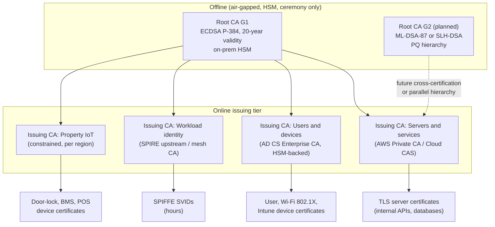
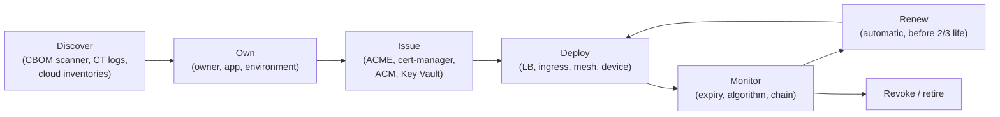

# Certificates and PKI
{: .no_toc }

**Phase 2: Standards and keys.** This page defines how the organization issues, tracks, renews, and eventually migrates to post-quantum algorithms the certificates that authenticate its websites, APIs, services, devices, and signed code.
{: .fs-5 .fw-300 }

## On this page
{: .no_toc .text-delta }

1. TOC
{:toc}

---

## Why PKI is on the critical path

Certificates are where encryption in transit, workload identity, code signing, and PQC migration meet. The organization has certificates on public booking sites and the guest mobile app API, internal APIs between the CRS and PMS, service mesh sidecars, VPN concentrators, Wi-Fi RADIUS servers, door-lock and building management controllers at properties, POS terminals, and developer code-signing pipelines.

Three pressures make certificate management a Phase 2 priority:

1. **Public TLS lifetimes are shrinking.** CA/Browser Forum ballot SC-081 reduces maximum validity in steps to 47 days by 2029. Manual renewal will not scale.
2. **Expired certificates cause outages.** Certificate expiry is one of the most common causes of self-inflicted outages, and at a hotel it can stop check-in, key encoding, or card authorization.
3. **PQC migration of signatures goes through the PKI.** Moving to ML-DSA requires new CA hierarchies, new trust anchors distributed to every client, and a certificate inventory that says where every certificate is.

## Internal PKI design



| Design choice | Decision | Reason |
|---|---|---|
| Root CA | Offline, HSM-protected, activated only in ceremonies (see [Hardware security modules]()) | Compromise of an online root would require replacing every trust store |
| Root algorithm | ECDSA P-384 for G1; separate PQ root (G2) planned | P-384 is the strongest widely supported classical option; PQ roots cannot yet be distributed to all clients |
| Tiers | Two-tier (root to issuing) | Three tiers add complexity without benefit at this scale |
| Issuing CAs by purpose | Servers, users and devices, workload identity, property IoT | Different lifetimes, templates, and revocation needs; limits blast radius |
| Name constraints | Issuing CAs constrained to organization domains (`.example.internal`, `.example.com`) where clients support it | Limits misuse of a compromised issuing CA |
| Issuing CA validity | 5 to 7 years | Balance between ceremony frequency and exposure |
| End-entity validity (internal) | 90 days servers; 1 year user/device; 24 hours or less workloads | Automation makes short lifetimes practical |
| Revocation | CRL for all CAs; OCSP for user/device CA; short-lived certificates instead of revocation for workloads | OCSP has limited value where lifetimes are hours |

## Cloud certificate authorities

| Service | What it provides | Organization use | Notes |
|---|---|---|---|
| **AWS Private CA** | Managed private CAs (root or subordinate) with keys in AWS-managed HSMs; general-purpose and short-lived certificate modes | Issuing CA for servers and services in AWS; subordinate to the offline root | Integrates with ACM for private certificates on ALB, NLB, CloudFront; EKS via cert-manager aws-privateca-issuer. PQC (ML-DSA) CA support announced (verify). |
| **AWS Certificate Manager (ACM)** | Public certificates (Amazon-issued) and private certificates from AWS Private CA; managed renewal on integrated services | Public certificates on AWS load balancers and CloudFront | Public ACM certificates can be exported only in specific newer modes (verify) |
| **Google Cloud Certificate Authority Service (CAS)** | Managed private CAs in Enterprise and DevOps tiers; CA pools; keys in Cloud KMS/Cloud HSM | Issuing CA for Google Cloud workloads, GKE mesh | DevOps tier for high-volume short-lived certificates without revocation tracking |
| **Google Certificate Manager** | Public and private certificate deployment to Google load balancers | Public certificates on GCP load balancers | |
| **Azure Key Vault certificates** | Certificate lifecycle (create, import, renew) with integrated public CAs (DigiCert, GlobalSign) and self-signed or unknown-issuer workflows | Certificates for Azure App Service, Application Gateway, Front Door | Key Vault is a certificate store and renewal orchestrator, not a private CA |
| **Microsoft AD CS** | On-prem Windows enterprise CA with templates and auto-enrollment | User, device, Wi-Fi 802.1X, and Intune certificates; HSM-backed via vendor KSP | Mature but a frequent attack target (misconfigured templates, relay attacks); must be hardened |
| **Microsoft Cloud PKI (Intune)** | Cloud-hosted CA for Intune-managed devices | Candidate replacement for AD CS device issuance (verify licensing) | |
| **OCI Certificates** | Private CAs and certificate management in OCI | Issuing CA for OCI workloads | Keys in OCI Vault |

{: .warning }
AD CS misconfigurations (for example, templates that let the requester supply the subject name for client authentication) are a well-documented privilege escalation path to domain administrator. Audit templates with tools such as Certify or Locksmith, restrict enrollment rights, and treat the AD CS server as a tier 0 asset.

### Issuing a subordinate CA from the offline root: AWS Private CA

```bash
# 1. Create the subordinate CA in AWS Private CA (keys generated in AWS-managed HSMs)
aws acm-pca create-certificate-authority \
  --certificate-authority-type SUBORDINATE \
  --certificate-authority-configuration '{
      "KeyAlgorithm": "EC_secp384r1",
      "SigningAlgorithm": "SHA384WITHECDSA",
      "Subject": { "Country": "US", "Organization": "Example Hospitality",
                   "CommonName": "Example Hospitality Server Issuing CA 01" } }' \
  --revocation-configuration '{"CrlConfiguration":{"Enabled":true,"ExpirationInDays":7,
      "S3BucketName":"example-pki-crl-prod"}}' \
  --tags Key=data-classification,Value=restricted Key=data-domain,Value=security

# 2. Export the CSR, carry it to the offline root ceremony, sign it there
aws acm-pca get-certificate-authority-csr \
  --certificate-authority-arn "$CA_ARN" --output text > server-ica-01.csr

# 3. Import the signed certificate and chain back into AWS Private CA
aws acm-pca import-certificate-authority-certificate \
  --certificate-authority-arn "$CA_ARN" \
  --certificate fileb://server-ica-01.pem \
  --certificate-chain fileb://root-g1.pem
```

### Google Cloud CAS subordinate pool

```bash
gcloud privateca pools create server-pool-euw1 \
  --location=europe-west1 --tier=enterprise

gcloud privateca subordinates create server-ica-euw1-01 \
  --pool=server-pool-euw1 --location=europe-west1 \
  --create-csr --csr-output-file=server-ica-euw1-01.csr \
  --key-algorithm=ec-p384-sha384 \
  --subject="CN=Example Hospitality Server Issuing CA EUW1 01, O=Example Hospitality"
```

After the root ceremony signs the CSR, activate the subordinate with `gcloud privateca subordinates activate` and the signed certificate chain.

## Certificate lifecycle management



| Stage | Requirement | Tooling |
|---|---|---|
| Discover | Every certificate in use is found, including those on property devices and third-party SaaS custom domains | CBOM scanner in [code/cbom](https://github.com/steven-smith-itnet/data-protection-pqc-security-architecture/tree/main/code/cbom); Certificate Transparency monitoring for public domains; ACM, Key Vault, and Certificate Manager inventories; commercial CLM (for example Venafi/CyberArk, Keyfactor, AppViewX, DigiCert Trust Lifecycle Manager) where scale requires |
| Own | Each certificate has an owner team and application ID | Tags on cloud certificates; CLM metadata |
| Issue | Only through approved CAs and automated protocols; wildcard certificates restricted | ACME, cert-manager, ACM, Key Vault policies, AD CS auto-enrollment |
| Deploy | Private keys generated on the endpoint or in KMS/HSM; never emailed or stored in tickets | cert-manager, ACM integration, Key Vault references |
| Monitor | Alert at 30, 14, and 7 days before expiry for anything not auto-renewing | CLM, Prometheus `x509-certificate-exporter`, cloud-native expiry events (ACM EventBridge, Key Vault Event Grid `CertificateNearExpiry`) |
| Renew | Automatic, triggered at about two-thirds of lifetime or on ACME Renewal Information (ARI) guidance | ACME clients with ARI support |
| Revoke / retire | Revoke on key compromise or decommission; remove from inventory | CA APIs |

PCI DSS v4.0.1 requirement 4.2.1.1 requires an inventory of the organization's trusted keys and certificates used to protect PAN in transmission. The certificate inventory above is the evidence.

## ACME automation

ACME (RFC 8555) is the default issuance protocol for server certificates, both public (for example, Let's Encrypt, or commercial CAs that offer ACME endpoints) and internal (AWS Private CA via cert-manager issuers, Google CAS, step-ca, HashiCorp Vault PKI ACME).

A cert-manager configuration for an internal ACME CA and a public one on Kubernetes:

```yaml
apiVersion: cert-manager.io/v1
kind: ClusterIssuer
metadata:
  name: public-acme
spec:
  acme:
    server: https://acme-v02.api.letsencrypt.org/directory
    email: pki-team@example.com
    privateKeySecretRef:
      name: public-acme-account-key
    solvers:
      - dns01:
          route53:
            region: us-east-1
---
apiVersion: cert-manager.io/v1
kind: Certificate
metadata:
  name: booking-api
  namespace: guest-booking
spec:
  secretName: booking-api-tls
  duration: 2160h      # 90 days (internal policy; public CAs set their own maximum)
  renewBefore: 720h    # renew 30 days before expiry
  privateKey:
    algorithm: ECDSA
    size: 384
    rotationPolicy: Always
  dnsNames:
    - api.booking.example.com
  issuerRef:
    name: public-acme
    kind: ClusterIssuer
```

`rotationPolicy: Always` generates a new private key at every renewal, so a leaked key has a bounded life.

{: .note }
ACME Renewal Information (ARI) lets a CA tell clients when to renew, which matters when a CA must revoke certificates en masse. Prefer ACME clients that support ARI. The ARI specification was published as an IETF RFC in 2025 (verify number).

## Public certificate validity reduction

CA/Browser Forum ballot SC-081 (2025) reduces the maximum validity of publicly trusted TLS certificates in three steps:

| Effective date | Maximum validity |
|---|---|
| Before March 15, 2026 | 398 days |
| From March 15, 2026 | 200 days |
| From March 15, 2027 | 100 days |
| From March 15, 2029 | 47 days |

The ballot also shortens how long domain-validation results can be reused, which means the organization's DNS or HTTP validation must also be automated, not just the certificate installation.

Implications for the organization:

- Every public certificate must be renewable without a human. Certificates installed manually on appliances (WAFs, older load balancers, property Wi-Fi captive portals, franchise-operated booking microsites) are the main risk.
- Organization Validation and Extended Validation certificates still require organization vetting, but the certificate itself renews on the shorter cycle.
- Internal private CAs are not bound by SC-081, but the organization applies a 90-day default to internal server certificates so that the same automation is exercised internally.

## mTLS and workload identity (SPIFFE/SPIRE)

For east-west traffic between services, the organization uses short-lived X.509 certificates as workload identities rather than long-lived shared secrets or IP allow-lists.

| Component | Role |
|---|---|
| SPIFFE ID | Workload identity URI, for example `spiffe://example.internal/ns/guest-booking/sa/booking-api` |
| SVID | X.509 certificate (or JWT) carrying the SPIFFE ID in the URI SAN; lifetime typically 1 hour |
| SPIRE server | Issues SVIDs after attesting workloads; can chain to the workload identity issuing CA via an upstream authority plugin (AWS Private CA, Vault, cert-manager, disk) |
| SPIRE agent | Runs on each node; attests workloads (Kubernetes service account, AWS instance identity, etc.) and delivers SVIDs through the Workload API |
| Service mesh | Istio and Linkerd issue mesh certificates from their own CA or an external one; Istio can integrate with SPIRE |

```text
# Example SPIRE registration entry (spire-server CLI)
spire-server entry create \
  -parentID spiffe://example.internal/spire/agent/k8s_psat/prod-euw1/node \
  -spiffeID spiffe://example.internal/ns/guest-booking/sa/booking-api \
  -selector k8s:ns:guest-booking \
  -selector k8s:sa:booking-api \
  -x509SVIDTTL 3600
```

{: .verify }
SPIRE CLI flag names have changed between releases (for example, TTL flags). Confirm against the installed SPIRE version.

Encryption and mTLS configuration for the mesh are covered in [Encryption in transit]().

## Certificate inventory

The certificate inventory is part of the cryptographic inventory (CBOM) and records, for each certificate:

| Field | Example |
|---|---|
| Subject and SANs | `CN=api.booking.example.com` |
| Issuer and chain | Let's Encrypt E-series intermediate / ISRG Root X2 |
| Public key algorithm and size | ECDSA P-384 |
| Signature algorithm | `ecdsa-with-SHA384` |
| Validity | notBefore / notAfter |
| Location | ALB `arn:aws:elasticloadbalancing:...`, Kubernetes secret `guest-booking/booking-api-tls` |
| Owner | `guest-platform` |
| Renewal method | ACME (cert-manager), ACM managed, manual |
| PCI scope | Yes/No (4.2.1.1) |
| PQC migration wave | Wave 2 (see [PQC migration program]()) |

A quick check of an endpoint's certificate and algorithm:

```bash
openssl s_client -connect api.booking.example.com:443 -servername api.booking.example.com </dev/null 2>/dev/null \
  | openssl x509 -noout -subject -issuer -enddate -text \
  | grep -E "Subject:|Issuer:|Not After|Public Key Algorithm|Signature Algorithm|NIST CURVE|Public-Key:" | sort -u
```

## PQC implications for certificates

The TLS key exchange can move to hybrid ML-KEM without changing certificates, which is why the organization migrates key exchange first. Certificates are harder.

| Issue | Detail |
|---|---|
| Size | An ML-DSA-65 public key is 1,952 bytes and a signature is 3,309 bytes, compared with 97 bytes and about 104 bytes for ECDSA P-384. A chain of leaf plus intermediate, each signed with ML-DSA, adds roughly 10 KB to a TLS handshake. SLH-DSA-SHA2-128s signatures are 7,856 bytes. |
| Constrained devices | Door-lock controllers, POS terminals, and IoT devices may lack memory or bandwidth for PQ chains |
| Client trust | Browsers and operating systems do not yet trust PQ roots for public TLS; public web PKI migration depends on root program decisions |
| Standards | IETF LAMPS has specified X.509 algorithm identifiers for ML-DSA and ML-KEM, and is working on composite (hybrid) signatures that combine ML-DSA with RSA or ECDSA in one certificate (verify RFC numbers and status) |
| Alternatives under discussion | Merkle Tree Certificates and other approaches to reduce handshake size are being explored for the web PKI (verify status) |
| HSM support | Root and issuing CA keys require HSM firmware with validated ML-DSA or SLH-DSA (see [Hardware security modules]()) |

{: .verify }
Composite and hybrid certificate specifications, and cloud CA support for ML-DSA issuance (for example in AWS Private CA and Google CAS), were changing through 2025 and 2026. Confirm status before committing to a format.

The organization's PKI plan for PQC:

1. **Now:** inventory all certificates and chains; ensure all issuance is automated; ensure every relying party can accept a new trust anchor by configuration.
2. **Build a parallel PQ hierarchy** for internal use (G2 root with ML-DSA-87 or SLH-DSA, issuing CA with ML-DSA-65) in a lab, and test clients, mesh, and devices.
3. **Code signing and firmware** move early because signatures on firmware must remain trustworthy for the device's life; use LMS/XMSS or ML-DSA as supported.
4. **Internal TLS** moves when libraries and meshes support PQ certificates end to end.
5. **Public TLS** follows the browser root programs.

See [Crypto agility and hybrid designs]() and [Hands-on PQC lab]() for ML-DSA certificate generation with OpenSSL 3.5.

## Good, better, best

| Level | Approach | Trade-offs |
|---|---|---|
| **Good** | Public certificates via ACM, Key Vault, or Certificate Manager with managed renewal; internal certificates from AD CS with auto-enrollment; spreadsheet or CLM inventory | Manual installs remain; limited visibility of property devices |
| **Better** | Offline root with cloud issuing CAs; ACME for all server certificates; cert-manager on Kubernetes; automated inventory feeding CBOM; 90-day internal lifetimes | Requires CA operations team and ceremony discipline; AD CS hardening effort |
| **Best** | Better, plus SPIFFE workload identities with hour-scale lifetimes, mTLS enforced across services, name-constrained issuing CAs, a tested PQ parallel hierarchy, and ARI-enabled renewal | Mesh and SPIRE operational overhead; PQ certificate sizes affect constrained devices; client support for PQ chains still maturing |

## Key takeaways for engineering teams

- Every certificate must renew automatically. Public certificates reach 200-day validity from March 15, 2026, and 47 days by 2029.
- Request certificates through ACME, cert-manager, ACM, or Key Vault. Do not generate keys on laptops or send them in tickets.
- Service-to-service authentication uses short-lived workload certificates, not shared secrets.
- Tag and register every certificate with an owner. Unowned certificates are revoked at the next review.
- Do not pin to specific CA certificates or key algorithms in code; trust anchors will change for PQC.

## Related pages

- [Encryption in transit]()
- [Hardware security modules]()
- [Cryptographic inventory (CBOM)]()
- [PQC migration program]()
- [Crypto agility and hybrid designs]()

## Sources

- CA/Browser Forum ballots (SC-081, Server Certificate Working Group): <https://cabforum.org/>
- RFC 8555 (ACME): <https://www.rfc-editor.org/rfc/rfc8555>
- AWS Private CA: <https://docs.aws.amazon.com/privateca/latest/userguide/PcaWelcome.html>
- Google Cloud Certificate Authority Service: <https://cloud.google.com/certificate-authority-service/docs>
- Azure Key Vault certificates: <https://learn.microsoft.com/azure/key-vault/certificates/about-certificates>
- SPIFFE and SPIRE: <https://spiffe.io/docs/latest/>
- cert-manager: <https://cert-manager.io/docs/>
- IETF LAMPS working group: <https://datatracker.ietf.org/wg/lamps/about/>
