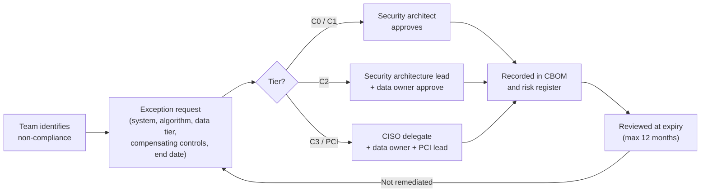

# Cryptographic standards
{: .no_toc }

**Phase 2: Standards and keys.** This page is the enterprise cryptographic standard: it tells engineering teams which algorithms, key sizes, protocols, and modules they may use, and what to do when they cannot comply.
{: .fs-5 .fw-300 }

## On this page
{: .no_toc .text-delta }

1. TOC
{:toc}

---

## Purpose and scope

This standard applies to every system that encrypts, signs, hashes, or authenticates data belonging to the organization: owned, managed, and franchised properties where the organization supplies the technology, corporate systems, cloud workloads in AWS, Azure, Google Cloud, and Oracle Cloud Infrastructure (OCI), and third-party services that process C2 or C3 data on the organization's behalf.

It is written for engineers, not cryptographers. Each table says what to use, and the notes explain why. When a library or managed service makes a choice for you (for example, the TLS stack in a cloud load balancer), the requirement is that you select a configuration that satisfies this standard, not that you implement anything yourself.

{: .important }
Engineering teams must not implement cryptographic primitives. Use a vetted library (AWS-LC, BoringSSL, OpenSSL 3.x, SymCrypt, Bouncy Castle, Go crypto, libsodium, Tink) or a managed service. Hand-written AES modes, padding schemes, or random number generators are prohibited regardless of test coverage.

### Status definitions

| Status | Meaning | New systems | Existing systems |
|---|---|---|---|
| **Approved** | Default choice; meets all protection profiles | Use | Continue |
| **Approved with conditions** | Allowed only under the stated condition (for example, not in FIPS-required contexts, or storage only) | Use if condition met | Continue if condition met |
| **Deprecated** | Allowed for existing systems with a migration plan; no new use | Do not use | Migrate by the date stated |
| **Prohibited** | Must not be used for any protective purpose | Do not use | Remediate immediately or file an exception |

The standard is reviewed at least every 12 months. That review satisfies PCI DSS v4.0.1 requirement 12.3.3, which requires documenting and reviewing cipher suites and protocols in use at least once every 12 months, including a plan to respond to anticipated changes in cryptographic vulnerabilities. The PQC migration plan in [PQC migration program]() is that response plan.

## Symmetric encryption

| Algorithm and mode | Status | Use | Notes |
|---|---|---|---|
| AES-256-GCM | **Approved (default)** | General-purpose authenticated encryption: envelope DEKs, field-level encryption, file encryption | 96-bit nonce; 128-bit tag; see nonce rules below |
| AES-128-GCM | Approved with conditions | TLS cipher suites negotiated by the protocol stack; C0 and C1 data | Not for new stored-data designs at C2 or C3; use AES-256 for Grover margin |
| AES-256-GCM-SIV (RFC 8452) | Approved with conditions | Where nonce uniqueness cannot be guaranteed (for example, high-volume distributed encryption with random nonces) | Not a NIST-approved mode; not permitted where a FIPS 140-3 validated module is required |
| ChaCha20-Poly1305 | Approved with conditions | TLS on mobile clients and devices without AES hardware acceleration; guest mobile app | Not NIST-approved; not permitted in FIPS-required profiles |
| AES-256-XTS | Approved with conditions | Storage and disk encryption only (block devices, self-encrypting drives, full-volume encryption) | Provides confidentiality, not integrity; never for messages or fields |
| AES-256-CBC with HMAC-SHA-256 (encrypt-then-MAC) | Deprecated | Legacy file formats and integrations only | Migrate to AES-GCM by the next major release |
| AES-CBC without MAC | Prohibited | None | Padding-oracle risk |
| AES-ECB | Prohibited | None (except as an internal building block inside a vetted library or key wrap) | Reveals patterns in plaintext |
| AES-KW / AES-KWP (SP 800-38F) | Approved | Key wrapping (KEK wraps DEK) | Used by most KMS and HSM import flows |
| 3DES / TDEA | Prohibited | None, except payment HSM TR-31 legacy key blocks under an exception | NIST disallowed TDEA for encryption after 2023 |
| RC4, DES, Blowfish | Prohibited | None | |

### Why AES-256 and not AES-128

Grover's algorithm gives a quadratic speed-up against brute-force key search, which roughly halves the effective security of a symmetric key. AES-128 would fall to about 64-bit quantum security in theory, while AES-256 retains about 128 bits. Practical Grover attacks are far more expensive than the theory suggests, but AES-256 costs almost nothing extra on modern CPUs with AES-NI or ARMv8 crypto extensions, and it aligns with NSA CNSA 2.0. The organization therefore standardizes on AES-256 for stored data at every tier and accepts AES-128 only inside negotiated TLS sessions.

### Nonce and IV rules

Nonce misuse is the most common real-world failure in AES-GCM deployments. A repeated nonce under the same key leaks the XOR of the two plaintexts and allows forgery of authentication tags.

| Rule | Requirement |
|---|---|
| GCM nonce length | 96 bits (12 bytes). Other lengths are prohibited. |
| Random nonces | Generated by the CSPRNG. Limit each key to 2^32 encryptions with random nonces, per NIST SP 800-38D. For DEK-per-object envelope encryption this limit is never approached. |
| Counter nonces | Allowed when a single writer owns the key and the counter is persisted atomically. Counters must never reset on restart. |
| Nonce storage | Store the nonce alongside the ciphertext (it is not secret). |
| Key reuse across services | A DEK is used by one service instance or one object. Shared long-lived DEKs across many writers are prohibited. |
| CBC IVs (legacy only) | Unpredictable, generated by the CSPRNG per message. |
| Associated data | Bind context (tenant ID, record ID, column name, classification) as GCM additional authenticated data or KMS encryption context, so ciphertext cannot be swapped between records. |

## Hashing

| Algorithm | Status | Use | Notes |
|---|---|---|---|
| SHA-256 | **Approved** | Integrity, fingerprints, content addressing | |
| SHA-384 | **Approved** | Signatures with P-384; CNSA 2.0 alignment | |
| SHA-512 | **Approved** | High-assurance integrity; Ed25519 internals | |
| SHA3-256 / SHA3-384 / SHA3-512 | **Approved** | Alternative when a non-SHA-2 construction is required; used inside ML-KEM and ML-DSA | |
| SHAKE128 / SHAKE256 | Approved with conditions | Only as specified inside a standardized algorithm (for example ML-DSA, SLH-DSA) | |
| SHA-224, SHA-512/224, SHA-512/256 | Approved with conditions | Only where a protocol requires them | |
| SHA-1 | Prohibited for signatures and new designs; deprecated for HMAC in legacy protocols | Legacy HMAC-SHA1 in older VPN and SNMP configurations | NIST has announced SHA-1 retirement by the end of 2030 |
| MD5 | Prohibited | None (non-security checksums only, and must not be labeled as integrity protection) | |

{: .warning }
Unkeyed hashes of low-entropy values (card numbers, phone numbers, passport numbers, email addresses) are not a protection mechanism. The input space is small enough to enumerate. PCI DSS v4.0.1 requirement 3.5.1.1 requires keyed cryptographic hashes when hashing is used to render PAN unreadable. Use HMAC-SHA-256 with a KMS-managed key, as described in [Tokenization, FPE, and masking]().

## Message authentication codes

| Algorithm | Status | Use |
|---|---|---|
| HMAC-SHA-256 | **Approved (default)** | Webhook signatures, API request signing, keyed surrogates for PAN and identifiers, blind indexes |
| HMAC-SHA-384 / HMAC-SHA-512 | Approved | CNSA-aligned contexts |
| KMAC128 / KMAC256 | Approved | Where SHA-3 family is preferred |
| AES-CMAC | Approved | Payment and HSM contexts |
| GMAC (standalone) | Approved with conditions | Only through a vetted library; same nonce rules as GCM |
| HMAC-SHA1 | Deprecated | Existing integrations only |
| HMAC-MD5 | Prohibited | |

HMAC keys are at least 256 bits, generated in the KMS or HSM, and scoped per purpose. A key used for PAN surrogates must not also sign webhooks.

## Key derivation and password hashing

| Function | Status | Use | Parameters |
|---|---|---|---|
| HKDF-SHA-256 / HKDF-SHA-384 (RFC 5869, SP 800-56C) | **Approved** | Deriving subkeys from a shared secret or master key | Unique `info` per purpose; salt where available |
| SP 800-108 KDF in counter mode (HMAC or KMAC) | Approved | HSM and KMS-internal derivation | |
| Argon2id (RFC 9106) | **Approved (default for passwords)** | Guest and employee password storage in applications the organization builds | Minimum m = 19 MiB, t = 2, p = 1 (OWASP minimum); target m = 64 MiB, t = 3, p = 1 where latency allows; 16-byte random salt |
| scrypt | Approved with conditions | Existing systems | N = 2^17, r = 8, p = 1 minimum |
| bcrypt | Deprecated | Existing systems only | Cost 12 minimum; note 72-byte input limit |
| PBKDF2-HMAC-SHA-256 | Approved with conditions | Password hashing only where a FIPS 140-3 validated module is required (Argon2id is not NIST-approved) | 600,000 iterations minimum (OWASP guidance); 128-bit salt minimum per SP 800-132 |
| PBKDF2-HMAC-SHA-512 | Approved with conditions | As above | 210,000 iterations minimum |
| Unsalted or single-pass hashes of passwords | Prohibited | | |

{: .note }
Guest authentication should use the identity platform (a CIAM service) rather than application-managed passwords. These parameters apply where an application must store password verifiers directly. Iteration counts and memory costs are reviewed annually because hardware improves.

## Asymmetric algorithms today

These algorithms are quantum-vulnerable. Shor's algorithm breaks RSA, finite-field Diffie-Hellman, ECDH, ECDSA, and EdDSA. They remain approved for now because nothing else is universally deployable, but every new system must be able to move to the PQC targets in the next section without redesign. See [Crypto agility and hybrid designs]().

| Algorithm | Status | Use | Sunset |
|---|---|---|---|
| RSA-3072 and RSA-4096 (PSS for signatures, OAEP for encryption) | **Approved** | Signatures, key transport where ECC is unavailable, KMS asymmetric keys | Disallowed after 2035 (NIST IR 8547 draft) |
| RSA-2048 | Deprecated | Existing certificates and integrations only | Deprecated after 2030, disallowed after 2035 (NIST IR 8547 draft) |
| RSA PKCS#1 v1.5 encryption | Prohibited for new use | Legacy only under exception | Bleichenbacher-class attacks |
| RSA PKCS#1 v1.5 signatures | Approved with conditions | X.509 certificate chains where PSS is not supported | |
| RSA below 2048 | Prohibited | | |
| ECDSA P-256 | Approved | TLS server certificates, code signing | P-256 is at the 112 to 128-bit level; deprecated after 2030 per NIST IR 8547 draft treatment of 112-bit algorithms (verify final text), disallowed after 2035 |
| ECDSA P-384 | **Approved (preferred ECC)** | CA certificates, high-value signing | Disallowed after 2035 |
| ECDSA P-521 | Approved with conditions | Only where a partner requires it | Disallowed after 2035 |
| Ed25519 (FIPS 186-5) | Approved | SSH keys, internal signing, service identities | Disallowed after 2035 |
| X25519 | Approved | TLS and SSH key exchange, as part of hybrid X25519MLKEM768 | FIPS status depends on the validated module; verify before use in FIPS-required profiles |
| ECDH P-256 / P-384 | Approved | TLS key exchange | Disallowed after 2035 |
| Finite-field DH (2048-bit groups) | Deprecated | Legacy VPN only | Move to ECDH or hybrid PQ |
| DSA | Prohibited for new signatures | FIPS 186-5 no longer approves DSA for signature generation | |

{: .verify }
NIST IR 8547 was an initial public draft (November 2024) at the time this standard was written. Its dates (112-bit quantum-vulnerable algorithms deprecated after 2030; all RSA and ECC quantum-vulnerable algorithms disallowed after 2035) are used here as planning dates. Confirm against the final publication before quoting them as requirements.

## Post-quantum target algorithms

NIST published FIPS 203 (ML-KEM), FIPS 204 (ML-DSA), and FIPS 205 (SLH-DSA) on August 13, 2024. These are the organization's target algorithms. Detailed timelines are in [PQC standards and timelines]().

| Algorithm | Status | Use | Size notes |
|---|---|---|---|
| X25519MLKEM768 (hybrid, TLS codepoint 0x11EC) | **Approved (preferred TLS key exchange)** | All TLS 1.3 endpoints that support it | ML-KEM-768 public key 1,184 bytes, ciphertext 1,088 bytes, plus X25519 share |
| SecP256r1MLKEM768 / X448MLKEM1024 (hybrid) | Approved | Where a FIPS-approved classical component is needed alongside ML-KEM | |
| ML-KEM-768 (FIPS 203) | **Approved** | Default KEM for standalone PQ key establishment | |
| ML-KEM-1024 | Approved | CNSA 2.0 alignment; long-lived C3 data | |
| ML-KEM-512 | Approved with conditions | Constrained devices only | |
| ML-DSA-65 (FIPS 204) | **Approved (default PQ signature)** | Code signing, document signing, issuing CA certificates when ecosystem supports it | Public key 1,952 bytes; signature 3,309 bytes |
| ML-DSA-87 | Approved | CNSA 2.0 alignment, root and high-value signing | Signature 4,627 bytes |
| ML-DSA-44 | Approved with conditions | High-volume, short-lived signatures | Signature 2,420 bytes |
| SLH-DSA (FIPS 205), e.g. SLH-DSA-SHA2-128s or 192s/256s parameter sets | Approved | Offline root CAs and long-lived roots of trust where signing volume is low | SLH-DSA-SHA2-128s signature 7,856 bytes; slow signing |
| LMS / XMSS (SP 800-208) | Approved with conditions | Firmware and boot image signing only, with HSM-enforced state management | Stateful: reusing a one-time key breaks security |
| FN-DSA (Falcon, FIPS 206) | Not yet approved | Track only | Draft; verify status |
| HQC | Not yet approved | Track only as a backup KEM | Selected March 2025; draft expected about a year later, final around 2027 (verify) |

### Why hybrid first

Harvest now, decrypt later is the driver. An adversary who records TLS traffic carrying guest identity documents today can decrypt it later if the key exchange is broken. Key exchange is therefore migrated first, and hybrid mode (classical plus ML-KEM) is used so that a flaw in either component alone does not expose the session. Signatures move second, because forging a signature requires a quantum computer at the time of the attack, except for long-lived roots of trust (CA roots, firmware, code signing) where the signing key must remain trustworthy for a decade or more.

## Protocols

### TLS

| Protocol | Status | Conditions |
|---|---|---|
| TLS 1.3 | **Approved (preferred)** | Enable X25519MLKEM768 where the stack supports it |
| TLS 1.2 | Approved with conditions | Only with the cipher suites listed below; ECDHE only; no renegotiation; extended master secret |
| TLS 1.1, TLS 1.0, SSL 3.0, SSL 2.0 | Prohibited | PCI DSS treats early TLS as not strong cryptography |
| DTLS 1.2 / 1.3 | Approved with conditions | Real-time media and IoT where a vendor requires it |

**TLS 1.3 cipher suites (all approved):** `TLS_AES_256_GCM_SHA384`, `TLS_AES_128_GCM_SHA256`, `TLS_CHACHA20_POLY1305_SHA256` (not in FIPS profiles).

**TLS 1.2 cipher suites (approved list, in preference order):**

| Cipher suite | FIPS profile |
|---|---|
| `TLS_ECDHE_ECDSA_WITH_AES_256_GCM_SHA384` | Yes |
| `TLS_ECDHE_RSA_WITH_AES_256_GCM_SHA384` | Yes |
| `TLS_ECDHE_ECDSA_WITH_AES_128_GCM_SHA256` | Yes |
| `TLS_ECDHE_RSA_WITH_AES_128_GCM_SHA256` | Yes |
| `TLS_ECDHE_ECDSA_WITH_CHACHA20_POLY1305_SHA256` | No |
| `TLS_ECDHE_RSA_WITH_CHACHA20_POLY1305_SHA256` | No |

Everything else is prohibited in TLS 1.2, including all static-RSA key exchange suites (no forward secrecy), all CBC suites, and all suites with RC4, 3DES, NULL, EXPORT, or anonymous key exchange. Detailed configuration for load balancers and servers is in [Encryption in transit]().

### SSH

| Element | Approved values |
|---|---|
| Key exchange | `mlkem768x25519-sha256` (preferred where OpenSSH 9.9 or later is on both sides), `sntrup761x25519-sha512@openssh.com`, `curve25519-sha256`, `ecdh-sha2-nistp384` |
| Host and user keys | Ed25519, ECDSA P-384, RSA-3072+ (`rsa-sha2-512`, `rsa-sha2-256`) |
| Ciphers | `aes256-gcm@openssh.com`, `aes128-gcm@openssh.com`, `chacha20-poly1305@openssh.com` (non-FIPS) |
| MACs (non-AEAD ciphers only) | `hmac-sha2-256-etm@openssh.com`, `hmac-sha2-512-etm@openssh.com` |
| Prohibited | `ssh-rsa` (SHA-1), `diffie-hellman-group1-sha1`, `diffie-hellman-group14-sha1`, CBC ciphers, `hmac-sha1` |

A reference `sshd_config` fragment for bastion and property jump hosts:

```text
KexAlgorithms mlkem768x25519-sha256,sntrup761x25519-sha512@openssh.com,curve25519-sha256
HostKeyAlgorithms ssh-ed25519,rsa-sha2-512
Ciphers aes256-gcm@openssh.com,aes128-gcm@openssh.com,chacha20-poly1305@openssh.com
MACs hmac-sha2-512-etm@openssh.com,hmac-sha2-256-etm@openssh.com
PubkeyAcceptedAlgorithms ssh-ed25519,rsa-sha2-512
```

{: .verify }
`mlkem768x25519-sha256` was added in OpenSSH 9.9 and became the default key exchange in OpenSSH 10.0. Confirm the OpenSSH version on managed images before deploying this list; an sshd that does not recognize an algorithm name will refuse to start.

### Other protocols

| Protocol | Requirement |
|---|---|
| IPsec / IKEv2 | AES-256-GCM, PRF SHA-384, DH group 20 (P-384) or 19 (P-256) minimum; IKEv1 prohibited for new tunnels. Track RFC 9370 multiple key exchanges for hybrid PQ IKEv2 support per vendor. |
| MACsec | GCM-AES-256 or GCM-AES-XPN-256 cipher suites |
| Wi-Fi | WPA3-Enterprise (192-bit mode for corporate), WPA3-Personal or Enhanced Open (OWE) for guest; WPA2-TKIP and WEP prohibited |
| S/MIME and PGP | AES-256, RSA-3072+ or ECC P-384; SHA-1 signatures prohibited |
| JOSE / JWT | ES256, ES384, PS256, EdDSA for signatures; `none` and HS256 with shared secrets across trust boundaries prohibited; A256GCM for JWE content encryption |

## Randomness

| Requirement | Detail |
|---|---|
| Source | Operating system CSPRNG (`getrandom()` on Linux, `BCryptGenRandom` on Windows), the language's cryptographic API (`secrets` in Python, `crypto/rand` in Go, `SecureRandom` in Java), a KMS `GenerateRandom`-type API, or an HSM |
| Prohibited | `rand()`, `Math.random()`, Python `random`, `java.util.Random`, timestamps, or process IDs for any security purpose |
| Key generation | Keys for C2 and C3 data are generated inside the KMS or HSM, not in application memory, except DEKs generated by a KMS data-key API or an envelope library |
| Containers and VMs | Do not clone VM images that have already seeded long-term keys; generate host keys and secrets at first boot |

## FIPS 140-3 validated module requirement

FIPS 140-3 is the current validation program. FIPS 140-2 certificates move to the historical list on September 21, 2026. After that date, a module listed only under FIPS 140-2 should not be cited as evidence of validated cryptography for new procurements. Existing deployments are recorded in the CBOM with a migration date.

| Protection profile | Module requirement |
|---|---|
| PP-1 Baseline (C0, C1) | Vetted library required; FIPS validation not required |
| PP-2 Enhanced (C2) | Key storage in a FIPS 140-3 validated KMS or HSM (Level 2 or higher for the key store). Application libraries should run in FIPS mode where the platform offers it (for example, FIPS endpoints in AWS, FIPS-enabled node images). |
| PP-3 Maximum (C3) | Keys in a FIPS 140-3 Level 3 HSM (cloud KMS HSM tier, single-tenant cloud HSM, or on-prem HSM). Application-layer encryption uses a FIPS 140-3 validated module (for example AWS-LC FIPS, OpenSSL 3.x FIPS provider, SymCrypt, BoringCrypto) where one is available for the runtime. |
| PCI (Restricted\PCI) | PP-3 plus PCI PTS HSM or FIPS 140-3 Level 3 for payment keys; payment HSM for PIN and card-verification keys |

{: .note }
Being "FIPS validated" is a property of a specific module version on a specific operational environment, not of an algorithm. Record the certificate number from the NIST Cryptographic Module Validation Program (CMVP) for each module in the CBOM. A library built from source without the validated build process is not the validated module.

## Key lengths per classification

| Purpose | C0 Public | C1 Internal | C2 Confidential | C3 Restricted |
|---|---|---|---|---|
| Symmetric data encryption | AES-256 (provider default) | AES-256 (provider default) | AES-256, CMK | AES-256, CMK in HSM; application-layer where required |
| HMAC / keyed hash | 256-bit key | 256-bit key | 256-bit key | 256-bit key, HSM-resident |
| Signatures (classical) | ECDSA P-256 / RSA-2048 (existing) | ECDSA P-256 / RSA-3072 | ECDSA P-384 / RSA-3072 | ECDSA P-384 / RSA-4096; PQ plan required |
| Signatures (PQ target) | ML-DSA-44/65 | ML-DSA-65 | ML-DSA-65 | ML-DSA-87; SLH-DSA for roots |
| Key exchange | ECDHE P-256 / X25519 | X25519MLKEM768 where supported | X25519MLKEM768 where supported | X25519MLKEM768 required where supported; ML-KEM-1024 for long-lived archives |

## Cryptoperiods

A cryptoperiod is the time a key is authorized for use. The values below are organization policy set within the ranges recommended by NIST SP 800-57 Part 1 Rev. 5. NIST distinguishes the originator-usage period (when a key may apply protection, such as encrypting) from the recipient-usage period (when it may process already-protected data, such as decrypting). Cloud KMS rotation implements the originator period: new key versions encrypt, old versions remain available to decrypt.

| Key type | SP 800-57 guidance (summary) | Organization policy |
|---|---|---|
| Symmetric data encryption key (DEK) | Originator-usage up to about 2 years; recipient-usage up to 3 years beyond that | Per-object or per-record DEKs generated on demand; long-lived DEKs rotated at most yearly |
| Symmetric key-wrapping key (KEK, cloud CMK) | Up to about 2 years | Automatic rotation every 365 days for C2; every 90 to 180 days for C3 where the service supports it |
| Symmetric authentication / HMAC key | Up to about 2 years | 1 year; tokenization and surrogate keys follow the tokenization re-key plan |
| Private signature key | 1 to 3 years | Code signing and issuing CA: aligned with certificate validity; end-entity TLS: automated renewal |
| Root CA private key | Longer, bounded by certificate validity and algorithm strength | Offline; 10 to 20 years validity; PQ replacement plan by 2030 |
| Private key-transport / key-agreement key (static) | Up to about 2 years | 1 to 2 years; ephemeral preferred |
| TLS ephemeral keys | Single session | Single session (ECDHE / hybrid ML-KEM) |
| Payment keys (BDK, ZMK, PEK) | Per PCI PIN and card-brand rules | Per payment HSM runbook, reviewed with the QSA |

{: .note }
These summaries are approximate. Use SP 800-57 Part 1 Rev. 5, Section 5.3 and Table 1, as the authority when justifying a cryptoperiod to an assessor.

## Implementation guidance per platform

| Platform | How to meet the standard |
|---|---|
| AWS | Symmetric CMKs are AES-256-GCM internally; use `SYMMETRIC_DEFAULT`. Use FIPS endpoints (`kms-fips.<region>.amazonaws.com`) where PP-3 requires. Use AWS Encryption SDK or AWS Database Encryption SDK with the default algorithm suite (AES-256-GCM with HKDF and ECDSA P-384 signing). |
| Azure | Key Vault Premium or Managed HSM for C2/C3; RSA-3072+ or EC P-384 keys; TLS minimum 1.2 on every PaaS resource via Azure Policy. |
| Google Cloud | Cloud KMS `GOOGLE_SYMMETRIC_ENCRYPTION` (AES-256-GCM) with `HSM` protection level for C3; Tink for application-layer AEAD (`AES256_GCM` key template). |
| OCI | Vault master encryption keys in HSM protection mode for C2/C3; AES-256. |
| On-prem | OpenSSL 3.x with the FIPS provider for PP-3, Windows CNG with SymCrypt, Java with a FIPS-validated JCE provider. |

A quick way for engineers to confirm what a TLS endpoint negotiates:

```bash
# TLS 1.3 with hybrid PQ key exchange (OpenSSL 3.5+)
openssl s_client -connect api.example.internal:443 -tls1_3 -groups X25519MLKEM768 </dev/null 2>/dev/null \
  | grep -E "Protocol|Cipher|Negotiated TLS1.3 group"

# Confirm that TLS 1.1 is refused
openssl s_client -connect api.example.internal:443 -tls1_1 </dev/null
```

## Exception process

No standard covers every property system. PMS interfaces, older POS terminals, door-lock controllers, and building management systems often cannot be upgraded on the organization's schedule. The exception process exists to make those gaps visible and time-bound, not to approve them silently.



| Field | Requirement |
|---|---|
| System and owner | CBOM asset ID, application owner, data owner |
| Deviation | Exact algorithm, protocol, or key size, and the approved alternative |
| Data in scope | Classification tier and labels |
| Reason | Technical constraint, vendor dependency, cost |
| Compensating controls | For example: network segmentation, TLS-terminating proxy in front of the legacy system, shortened cryptoperiod, additional monitoring |
| Expiry | Maximum 12 months; renewals require evidence of a remediation plan |
| PQC impact | Whether the deviation blocks PQC migration |

Prohibited algorithms protecting C3 data cannot be excepted without CISO approval, and exceptions touching cardholder data are shared with the QSA as part of the annual assessment.

## Key takeaways for engineering teams

- Default to AES-256-GCM with 96-bit random nonces and a fresh DEK per object or record; bind context as additional authenticated data.
- TLS 1.3 is the target, with X25519MLKEM768 wherever the stack supports it; TLS 1.2 only with the six listed ECDHE AEAD suites.
- Never hash low-entropy identifiers without a key. Use HMAC-SHA-256 with a KMS-managed key.
- C3 keys live in a FIPS 140-3 Level 3 HSM. Record CMVP certificate numbers; FIPS 140-2 certificates go historical on September 21, 2026.
- Build every new system so the signature and key-exchange algorithms can be swapped by configuration. RSA and ECC are on a clock that ends in 2035.
- If you cannot comply, file an exception with an end date. Unrecorded deviations are findings.

## Related pages

- [Key management architecture]()
- [Hardware security modules]()
- [Certificates and PKI]()
- [Encryption in transit]()
- [PQC standards and timelines]()
- [Cryptographic inventory (CBOM)]()

## Sources

- NIST FIPS 203, 204, 205: <https://csrc.nist.gov/pubs/fips/203/final>, <https://csrc.nist.gov/pubs/fips/204/final>, <https://csrc.nist.gov/pubs/fips/205/final>
- NIST SP 800-57 Part 1 Rev. 5: <https://csrc.nist.gov/pubs/sp/800/57/pt1/r5/final>
- NIST SP 800-38D (GCM): <https://csrc.nist.gov/pubs/sp/800/38/d/final>
- NIST SP 800-132 (PBKDF): <https://csrc.nist.gov/pubs/sp/800/132/final>
- NIST SP 800-208 (LMS/XMSS): <https://csrc.nist.gov/pubs/sp/800/208/final>
- NIST IR 8547 (draft): <https://csrc.nist.gov/pubs/ir/8547/ipd>
- NIST CMVP: <https://csrc.nist.gov/projects/cryptographic-module-validation-program>
- OWASP Password Storage Cheat Sheet: <https://cheatsheetseries.owasp.org/cheatsheets/Password_Storage_Cheat_Sheet.html>
- RFC 8446 (TLS 1.3), RFC 8452 (AES-GCM-SIV), RFC 9106 (Argon2)
