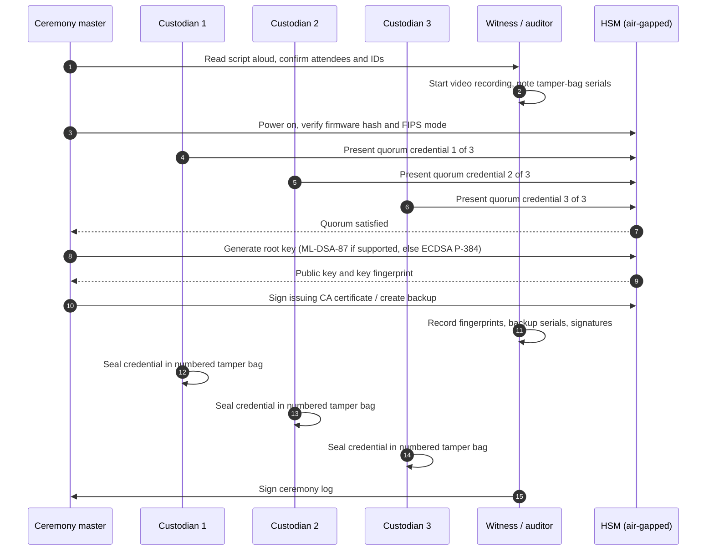

# Hardware security modules
{: .no_toc }

**Phase 2: Standards and keys.** This page explains where the organization needs dedicated HSMs rather than multi-tenant cloud KMS, which products fit each need, and how HSMs are operated through ceremonies, quorum controls, and HA/DR.
{: .fs-5 .fw-300 }

## On this page
{: .no_toc .text-delta }

1. TOC
{:toc}

---

## When an HSM is required

Every major cloud KMS is itself backed by HSMs. Engineering teams using AWS KMS, Key Vault Premium, Cloud KMS with `HSM` protection level, or OCI Vault in HSM mode are already using HSM-protected keys without operating HSMs. A dedicated or single-tenant HSM is needed only when one of the following is true:

| Driver | Example in the organization | Why multi-tenant KMS is not enough |
|---|---|---|
| Payment cryptography | PIN translation, card verification values, P2PE key injection, DUKPT base derivation keys | Needs payment-specific functions and PCI PIN / PCI PTS HSM compliance |
| Offline root of trust | Internal PKI root CA, code-signing roots | The key must be kept offline and activated only in ceremonies |
| Custody or contract | Corporate client or regulator requires single-tenant HSM under organization control | Multi-tenant KMS is operated by the provider |
| External keys (HYOK) | Key manager behind AWS XKS or Cloud EKM | The external manager needs its own HSMs |
| Application-direct PKCS#11 / JCE | Legacy apps, TDE for on-prem Oracle and SQL Server, document signing | Needs a standard HSM API rather than a cloud KMS API |
| Throughput | Very high-volume signing or tokenization | Cloud KMS request quotas may be a constraint |

## FIPS 140-3 security levels

FIPS 140-3 is the current validation program for cryptographic modules, and FIPS 140-2 certificates move to the historical list on September 21, 2026. Procurement from 2026 onward requires FIPS 140-3 certificates.

| Level | Physical security | Identity and roles | Typical products | Organization use |
|---|---|---|---|---|
| Level 1 | No specific physical protection | No authentication required | Software libraries (OpenSSL FIPS provider, AWS-LC FIPS) | PP-1 and PP-2 application-layer libraries |
| Level 2 | Tamper evidence (seals, coatings) | Role-based authentication | Some cloud KMS front ends, TPMs, some network appliances | PP-2 key storage |
| Level 3 | Tamper resistance and response (zeroization on intrusion) | Identity-based authentication; separation of plaintext key interfaces | Network HSMs (Luna, nShield, Utimaco), cloud HSM services | PP-3 and PCI keys |
| Level 4 | Complete envelope protection against environmental attacks | Multi-factor identity authentication | Specialized HSMs | Not required by the organization |

{: .note }
Validation is specific to a hardware model, firmware version, and configuration mode. Running a Level 3 HSM in a non-FIPS mode, or with firmware that is not on the certificate, is not Level 3. Record the certificate number and mode in the CBOM.

## Cloud HSM options

| Service | Tenancy | Interfaces | Typical organization use | Notes |
|---|---|---|---|---|
| **AWS CloudHSM** | Single-tenant HSMs in the customer VPC, managed as a cluster | PKCS#11, JCE, OpenSSL Dynamic Engine / provider, KSP/CNG | KMS custom key store for C3 keys; on-cloud PKI issuing CA; TDE for Oracle on EC2 | FIPS 140-3 Level 3 on current hardware type (verify instance type and certificate) |
| **AWS KMS (HSM-backed)** | Multi-tenant | KMS API | Default CMK for C2 and C3 | FIPS 140-3 validated HSMs (per AWS) |
| **Azure Key Vault Managed HSM** | Single-tenant pool, customer-held security domain | Key Vault keys REST API, PKCS#11 not provided | C3 CMKs for Azure services, BYOK for M365 Customer Key | FIPS 140-3 Level 3 |
| **Azure Cloud HSM** | Single-tenant HSM cluster, customer-administered | PKCS#11, JCE, OpenSSL, CNG/KSP | Lift-and-shift of on-prem HSM applications, AD CS keys, TLS offload | Successor to Azure Dedicated HSM (verify GA status and regions) |
| **Azure Payment HSM** | Single-tenant Thales payShield devices | payShield host command API | Payment key management for a payment service provider role | Bare-metal payShield; customer-operated |
| **Google Cloud HSM** | Multi-tenant, used through Cloud KMS `HSM` protection level | Cloud KMS API, PKCS#11 library for Cloud KMS (kmsp11) | Default C3 keys in Google Cloud | FIPS 140-2 Level 3 validated historically; confirm FIPS 140-3 certificate (verify). A single-tenant Cloud HSM option was announced (verify status). |
| **OCI Vault (HSM mode)** | Multi-tenant or virtual private vault | OCI KMS API | C2 and C3 keys in OCI | Virtual private vault gives isolated partition |
| **OCI Dedicated KMS** | Single-tenant HSM partitions | PKCS#11 | C3 and custody-driven workloads in OCI; Oracle Database TDE | Customer manages users and keys in the partition |
| **AWS Payment Cryptography** | Managed service | AWS API for payment functions (PIN translation, CVV, MAC, key import/export with TR-31/TR-34) | Payment functions without operating payment HSMs | PCI PIN and PCI P2PE aligned per AWS (verify attestations) |

{: .verify }
Cloud HSM product names, hardware generations, FIPS certificates, and preview/GA status changed through 2024 to 2026 (for example, Azure Dedicated HSM to Azure Cloud HSM, new CloudHSM instance types, and a single-tenant Google Cloud HSM offering). Confirm current status before specifying a product in a design.

## On-prem HSM options

| Vendor and product | Form factors | Interfaces | Notes for the organization |
|---|---|---|---|
| **Thales Luna Network HSM 7** (and Luna PCIe, Luna Backup HSM) | Network appliance, PCIe card, USB backup | PKCS#11, JCE, CNG/KSP, OpenSSL, REST | Partitions per application; PED-based or password authentication; integrates with CipherTrust Manager |
| **Entrust nShield 5** (nShield Connect, Solo, Edge) | Network appliance, PCIe, USB | PKCS#11, JCE, CNG, OpenSSL; CodeSafe for custom code in the HSM | Security World model: keys stored as encrypted blobs on hosts, HSMs share a world key; smart-card quorums |
| **Utimaco SecurityServer / CryptoServer** | Network appliance, PCIe | PKCS#11, JCE, CNG, CXI | Also a payment HSM line (Atalla AT1000, acquired from Micro Focus in 2020; verify) |
| **Marvell LiquidSecurity** | PCIe adapter and appliance | PKCS#11, JCE, OpenSSL | Widely used as the hardware inside cloud HSM services; direct enterprise availability varies (verify) |
| **Thales payShield 10K** | Network appliance | payShield host commands | Payment HSM; PCI PTS HSM approved |
| **Futurex** (Vectera, CryptoHub) | Appliance and hosted | PKCS#11, Excrypt, REST | General-purpose and payment |

Most properties do not need HSMs on site. HSMs live in the organization's two primary data centers (or colocation facilities) and in the cloud; property systems reach them through the key manager or payment gateway.

## Payment HSMs

Payment HSMs are a different product category. They implement payment-specific commands (PIN block translation, DUKPT, CVV/CVC generation and verification, EMV cryptogram verification, key exchange with TR-31 key blocks and TR-34 remote key loading) and are certified under PCI PTS HSM.

The organization's payment design (see [Payment card data and PCI DSS]()) pushes most payment cryptography to the payment gateway and P2PE solution provider. The organization only needs its own payment HSM capacity if it acts as a payment service provider for its properties, performs its own P2PE key injection, or decrypts P2PE traffic itself. If it does:

| Option | Operated by | Fit |
|---|---|---|
| On-prem Thales payShield 10K pair per data center | Organization | Full control; highest effort; needs PCI PIN-trained custodians |
| Azure Payment HSM | Organization on Microsoft-hosted payShield | Same control as on-prem without facility ownership |
| AWS Payment Cryptography | AWS | Lowest operational effort; organization manages keys through APIs; check supported functions |

## Programming interfaces

| Interface | Standard body | Used by | Organization guidance |
|---|---|---|---|
| **PKCS#11** (Cryptoki) | OASIS | Most HSMs, OpenSSL (via provider), Java (SunPKCS11), databases, web servers | Default integration for on-prem and single-tenant cloud HSMs. PKCS#11 3.2 adds PQC mechanisms (verify vendor support). |
| **KMIP** | OASIS | Storage arrays, backup software, databases (MongoDB, some TDE implementations), VMware vSphere encryption, key managers | Use for storage and database key lifecycle with an enterprise key manager, not for application crypto |
| **JCE / JCA** | Java | Java applications (including many PMS and payment middleware components) | Vendor JCE provider; configure in `java.security` |
| **CNG / KSP** | Microsoft | Windows, AD CS, IIS, SQL Server EKM | Vendor KSP for AD CS CA keys and SQL Server EKM |
| **Cloud KMS APIs** | Provider | Cloud services and SDKs | Preferred for cloud-native applications; HSM is abstracted |
| **Vendor REST APIs** | Vendor | Automation | Useful for ceremonies and monitoring; not portable |

An example of using an HSM through PKCS#11 with OpenSSL 3 and the `pkcs11-provider`:

```bash
# List objects in the HSM partition (OpenSC pkcs11-tool; module path is vendor-specific)
pkcs11-tool --module /usr/lib/libCryptoki2_64.so --login --list-objects

# Generate a CSR whose private key never leaves the HSM (pkcs11-provider for OpenSSL 3)
export PKCS11_PROVIDER_MODULE=/usr/lib/libCryptoki2_64.so
openssl req -new \
  -provider pkcs11 -provider default \
  -key "pkcs11:token=issuing-ca-01;object=issuing-ca-01-key;type=private" \
  -subj "/CN=Example Hospitality Issuing CA 01/O=Example Hospitality" \
  -out issuing-ca-01.csr
```

## Key ceremonies and M of N quorum

A key ceremony is a scripted, witnessed, recorded procedure for generating, importing, backing up, or using high-value keys. The organization performs ceremonies for:

- HSM initialization and security domain creation (Managed HSM, CloudHSM, on-prem).
- Offline root CA key generation and each root signing event (issuing CA certificates, CRLs).
- BYOK key generation and export for import to cloud KMS.
- Payment key loading (zone master keys, BDKs) using split components.
- Recovery from backup.

### Quorum mechanisms by product

| Product | Quorum mechanism |
|---|---|
| Thales Luna | PED keys (Security Officer, Partition Security Officer, Crypto Officer, Domain) with M of N splitting |
| Entrust nShield | Administrator Card Set (ACS) and Operator Card Sets (OCS) with K of N quorum |
| AWS CloudHSM | Quorum authentication (M of N) for crypto officer operations |
| Azure Managed HSM | Security domain encrypted to N RSA public keys; M required to recover |
| Payment HSMs | Split key components (typically 2 or 3) held by separate custodians, combined inside the HSM |

Example Azure Managed HSM activation, which creates the security domain protected by a 3-of-5 quorum:

```bash
# Each custodian generates an RSA key pair on their own workstation; public certs are collected
for i in 1 2 3 4 5; do
  openssl req -newkey rsa:3072 -nodes -keyout sd_custodian_${i}.key -x509 -days 365 \
    -subj "/CN=MHSM SD custodian ${i}" -out sd_custodian_${i}.cer
done

# Download (activate) the security domain, requiring 3 of 5 keys to recover
az keyvault security-domain download \
  --hsm-name mhsm-restricted-prod-weu \
  --sd-wrapping-keys sd_custodian_1.cer sd_custodian_2.cer sd_custodian_3.cer \
                     sd_custodian_4.cer sd_custodian_5.cer \
  --sd-quorum 3 \
  --security-domain-file mhsm-restricted-prod-weu-SD.json
```

{: .warning }
In a real ceremony each custodian generates their private key on separate hardware, and the private keys are stored offline in separate locations (for example, encrypted USB tokens in two safes). The loop above is for a lab. If fewer than M private keys survive, the security domain cannot be recovered after a disaster.

### Ceremony structure



| Ceremony artifact | Retention |
|---|---|
| Signed script with step-by-step checkboxes | Life of the key plus 7 years (`r7y` beyond destruction) |
| Attendance log with identity verification | Same |
| Video recording | Same, stored in immutable storage |
| Tamper-evident bag serial numbers and storage locations | Same, reconciled at each subsequent ceremony |
| Key fingerprints and certificate hashes | Published internally; included in CBOM |

## High availability and disaster recovery

| Product | HA mechanism | DR mechanism | Organization pattern |
|---|---|---|---|
| AWS CloudHSM | Cluster of HSMs across Availability Zones; client load-balances | Automatic backups; copy backups to another Region | Minimum two HSMs in two AZs for production; three for custom key stores |
| Azure Managed HSM | Pool of HSM partitions within region | Security domain backup plus full backup to storage; multi-region replication (verify) | Security domain held by 5 custodians, quorum 3 |
| Azure Cloud HSM | Cluster across availability zones (verify) | Backup and restore (verify) | Pending GA confirmation |
| Thales Luna | HA groups across appliances | Luna Backup HSM; cloning to DR site partitions | Two appliances per data center, HA group across both data centers |
| Entrust nShield | Multiple HSMs in the same Security World | Security World files and ACS backup | Security World shared across both data centers; ACS 3 of 5 |
| Payment HSMs | Pairs behind load balancer | Keys re-loaded from components at DR site, or pre-loaded | Pre-loaded DR pair; annual DR test |

Capacity planning should use peak rather than average load: hotel operations produce predictable peaks at check-in and checkout windows, night audit runs, and month-end finance processing.

## PQC readiness questions for HSM vendors

HSMs are long-lived assets (typically 5 to 7 years) and often sit at the root of trust. An HSM bought in 2026 without a PQC path may still be in service when RSA and ECC are disallowed. Ask vendors these questions during procurement and renewal, and record the answers in the vendor register (see [Vendor and cloud PQC readiness]()).

| Area | Question |
|---|---|
| Algorithms | Which of ML-KEM (512/768/1024), ML-DSA (44/65/87), SLH-DSA, LMS, and XMSS are available today, in which firmware version? |
| Validation | Are the PQC algorithms included in a FIPS 140-3 validated configuration (CAVP algorithm certificates and a CMVP certificate), or only in a non-validated mode? |
| Firmware path | Can existing hardware be upgraded by firmware, or is new hardware required? What is the end-of-support date for the current model? |
| Stateful signatures | For LMS/XMSS, how does the HSM prevent one-time key reuse, including across backup, restore, and cloning? |
| Interfaces | Are PQC mechanisms exposed through PKCS#11 (which version), JCE, CNG, and KMIP? |
| Hybrid support | Does the HSM support hybrid or composite signatures and hybrid key exchange for TLS offload? |
| Performance | What are the signing and verification rates for ML-DSA-65 and ML-DSA-87, and key generation rate for ML-KEM-768? |
| Key and object sizes | Are there limits on object sizes that ML-DSA or SLH-DSA keys and signatures exceed? |
| Backup and cloning | Can PQC keys be backed up and cloned with the same mechanisms as classical keys? |
| Roadmap | What is the committed date for CNSA 2.0 algorithm availability in validated mode? |

{: .verify }
Several HSM vendors announced PQC-capable firmware between 2024 and 2026. Confirm exact firmware versions and validation status with each vendor; do not rely on marketing announcements alone.

## Good, better, best

| Level | HSM approach | Fit | Trade-offs |
|---|---|---|---|
| **Good** | Cloud KMS with HSM-backed keys (multi-tenant) | C2 and most C3 in cloud | No hardware to run; provider operates HSMs; limited to KMS APIs |
| **Better** | Cloud KMS HSM tier plus a single-tenant cloud HSM for specific needs (custom key store, PKI, TDE) | C3, PCI vault keys, cloud issuing CAs | Organization operates users, quorum, and capacity; cluster sizing and patching |
| **Best** | Single-tenant cloud HSM plus on-prem HSMs for offline roots and external key service, with formal ceremonies | Offline root CA, HYOK, payment, code signing | Highest cost and staffing; formal ceremonies; long procurement and refresh cycles; PQC firmware dependency |

## Key takeaways for engineering teams

- You probably do not need a dedicated HSM. Cloud KMS keys are already HSM-protected; ask the cryptographic operations team before designing around a dedicated HSM.
- If you integrate with an HSM directly, use PKCS#11, JCE, or CNG through the vendor library; do not hardcode partition passwords in configuration, use the secrets platform.
- HSM quorum and ceremonies are scheduled weeks in advance. Plan root and issuing CA work accordingly.
- Any HSM purchase or renewal must include written answers to the PQC readiness questions.
- FIPS 140-2 certificates go historical on September 21, 2026. New designs cite FIPS 140-3 certificates.

## Related pages

- [Cryptographic standards]()
- [Key custody: BYOK, HYOK, and external keys]()
- [Certificates and PKI]()
- [Payment card data and PCI DSS]()
- [On-prem and multi-cloud key management]()
- [Vendor and cloud PQC readiness]()

## Sources

- NIST FIPS 140-3 and CMVP: <https://csrc.nist.gov/projects/cryptographic-module-validation-program>
- AWS CloudHSM: <https://docs.aws.amazon.com/cloudhsm/latest/userguide/introduction.html>
- AWS Payment Cryptography: <https://docs.aws.amazon.com/payment-cryptography/>
- Azure Managed HSM: <https://learn.microsoft.com/azure/key-vault/managed-hsm/overview>
- Azure Cloud HSM: <https://learn.microsoft.com/azure/cloud-hsm/>
- Azure Payment HSM: <https://learn.microsoft.com/azure/payment-hsm/overview>
- Google Cloud HSM: <https://cloud.google.com/kms/docs/hsm>
- OCI Vault and Dedicated KMS: <https://docs.oracle.com/iaas/Content/KeyManagement/home.htm>
- OASIS PKCS#11 and KMIP: <https://www.oasis-open.org/committees/pkcs11/>, <https://www.oasis-open.org/committees/kmip/>
