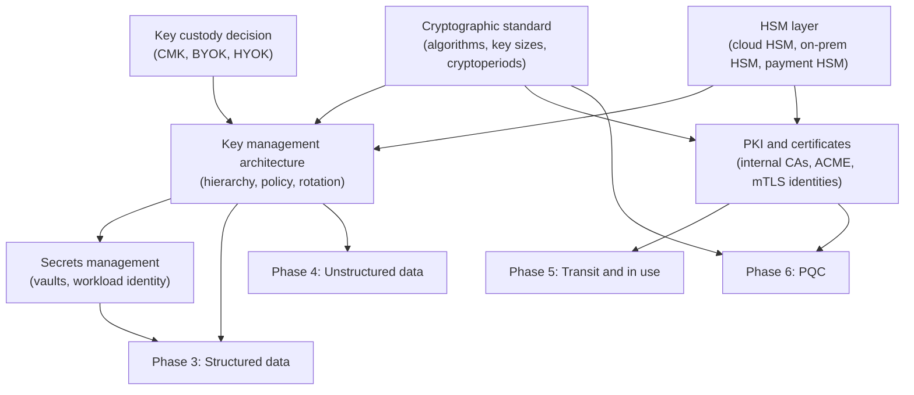

# Phase 2: Standards and keys
{: .no_toc }

**Phase 2: Standards and keys.** This phase decides which algorithms are allowed, where keys live, who controls them, and how certificates and secrets are issued, so that Phases 3 to 6 build on one foundation instead of many.
{: .fs-5 .fw-300 }

## On this page
{: .no_toc .text-delta }

1. TOC
{:toc}

---

## Objective

Phase 1 answers "what data do we have and how sensitive is it". Phase 2 answers "with what, and under whose control, do we protect it". Without Phase 2, each engineering team selects its own algorithms, creates keys in whatever account it happens to be deploying into, grants itself both administrative and usage rights, and stores database passwords in pipeline variables. The result is encryption that exists on paper but cannot be audited, rotated, or migrated to post-quantum algorithms.

The objective of Phase 2 is to publish a small number of binding standards and a key management platform that make the correct choice the default choice:

- A cryptographic standard that engineering can apply without a cryptographer in the room.
- A key hierarchy and naming convention that maps directly to the protection profiles (PP-1, PP-2, PP-3) and the tag schema from Phase 1.
- A custody decision per data tier: provider-managed, customer-managed, imported (BYOK), or externally held (HYOK).
- HSM capacity sized for PCI, PKI, and PP-3 workloads.
- An internal PKI and certificate lifecycle process ready for shorter public certificate lifetimes and PQC.
- A secrets platform that removes static credentials from code, pipelines, and configuration files.

Indicative timing is months 3 to 12, overlapping with Phase 1. The crypto standard and key naming convention should be published early (by month 4 or 5) because Phase 3 and Phase 4 pilots start in month 6.

## How the pieces fit

The cryptographic standard is the root document. Every other artifact in this phase cites it: the key management architecture refers to its cryptoperiods, the PKI design uses its signature algorithms, and the PQC migration in Phase 6 is expressed as changes to its approved-algorithm tables.

## Entry criteria

| Criterion | Evidence |
|---|---|
| Classification scheme approved | C0 to C3 tiers and label taxonomy published (Phase 1) |
| Protection profiles agreed | PP-1, PP-2, PP-3 control sets accepted by security leadership and data owners |
| Initial cryptographic inventory | First CBOM pass from [Cryptographic inventory (CBOM)]() showing current algorithms, TLS versions, and key locations |
| Cloud landing zone ownership known | Account, subscription, project, and compartment structure documented with owners |
| Budget line for HSM and PKI | Funding for single-tenant HSM where PP-3 requires it, and for certificate lifecycle tooling |

## Exit criteria

| Criterion | Evidence |
|---|---|
| Cryptographic standard published | Version 1.0 approved, with exception process running |
| Key management platform live | Key naming convention enforced by policy; key admin and key user roles separated in all four clouds |
| Custody decisions recorded | One decision per data domain and region, signed by the data owner |
| HSM capacity available | Cloud HSM or dedicated HSM provisioned for PCI and PP-3; key ceremony performed and recorded |
| PKI operational | Offline root and issuing CAs live; ACME or equivalent automation for internal TLS; certificate inventory feeding the CBOM |
| Secrets platform adopted | New workloads use workload identity federation; static-credential count tracked as a metric |

## Deliverables

| Deliverable | Owner | Consumed by |
|---|---|---|
| Enterprise cryptographic standard (v1.0) | Security architecture | All engineering teams, procurement, audit |
| Key management architecture and naming convention | Security architecture with cloud platform team | Platform engineering, application teams |
| Key custody decision record per domain and region | Security architecture with data owners and legal | Privacy office, regulators on request |
| HSM design, ceremony scripts, and ceremony records | Cryptographic operations | PCI assessors, internal audit |
| PKI certificate policy and certification practice statement | PKI team | Platform, network, identity teams |
| Secrets management standard and paved-road templates | Platform engineering | Application teams |
| Terraform modules for keys tagged with the Phase 1 schema | Platform engineering | Application teams (see [Guardrails and policy as code]()) |

## Pages in this phase

| Page | What it covers |
|---|---|
| [Cryptographic standards]() | Approved, conditional, deprecated, and prohibited algorithms; FIPS module requirements; cryptoperiods; exception process |
| [Key management architecture]() | Key hierarchy, envelope encryption, naming, key policy model, rotation, lifecycle states, and example policies for AWS, Azure, and Google Cloud |
| [Key custody: BYOK, HYOK, and external keys]() | Provider-managed versus customer-managed versus imported versus external keys, sovereignty, and a decision matrix by tier and regulation |
| [Hardware security modules]() | FIPS 140-3 levels, cloud and on-prem HSM options, payment HSMs, interfaces, key ceremonies, HA/DR, and PQC readiness questions |
| [Certificates and PKI]() | Internal PKI design, cloud CAs, ACME automation, the CA/Browser Forum validity reduction, SPIFFE identities, and PQC effects on certificates |
| [Secrets management]() | Cloud secret stores, HashiCorp Vault, rotation, workload identity federation, secret scanning, and Kubernetes secrets encryption |

## Trade-offs to decide during this phase

{: .important }
"Best" is not always right. Single-tenant HSMs and external key managers raise cost and add an availability dependency the organization must operate itself. A key that cannot be reached is, for the workload, the same as a key that has been destroyed. Custody decisions should be made per data tier and regulation, not applied across the estate.

- **Standardize versus accommodate.** A short approved list is easier to enforce and to migrate to PQC, but legacy PMS, POS, and property IoT systems will need documented exceptions.
- **Central versus federated key administration.** A central cryptographic operations team gives consistent controls; federated administration per business unit scales better. The recommended model is central policy and naming with federated key user rights.
- **Cloud-native versus third-party key manager.** Native KMS services integrate with every managed service; a third-party manager (for example Thales CipherTrust, Fortanix DSM, or Entrust KeyControl) gives one policy plane across clouds and on-prem at the cost of another platform to run. See [On-prem and multi-cloud key management]().

## Key takeaways for engineering teams

- The cryptographic standard is binding. Use the approved tables; anything else needs a recorded exception with an expiry date.
- Every key is created through the platform module with the Phase 1 tags. Hand-created keys are flagged by policy.
- The team that administers a key does not use it, and the team that uses it cannot delete it.
- Static credentials are a finding. Use workload identity federation and a secrets store.
- Certificate lifetimes are shrinking. Anything that cannot renew automatically will fail.

## Related pages

- [Cryptographic inventory (CBOM)]()
- [Label-to-control mapping]()
- [Phase 6: Post-quantum cryptography]()
- [Cross-cloud terminology]()
- [Phased roadmap]()
