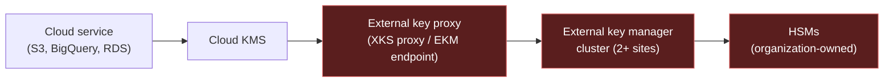
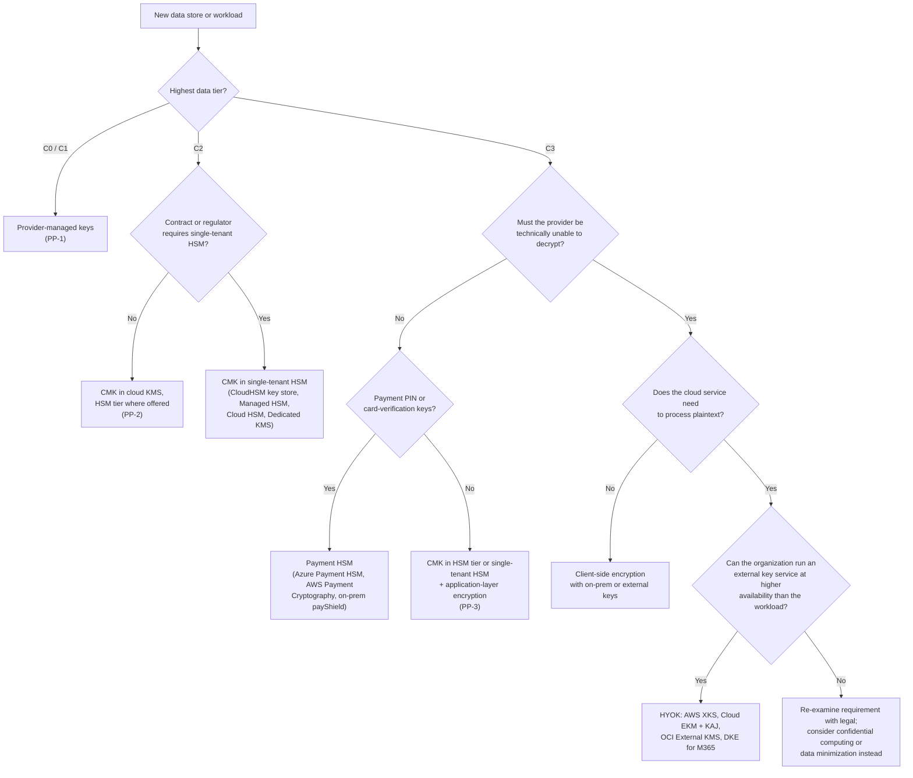

# Key custody: BYOK, HYOK, and external keys
{: .no_toc }

**Phase 2: Standards and keys.** This page decides who physically and legally holds the keys for each data tier and region, and what the organization gives up in availability and cost for each additional degree of control.
{: .fs-5 .fw-300 }

## On this page
{: .no_toc .text-delta }

1. TOC
{:toc}

---

## The custody question

Key management (see [Key management architecture]()) decides who may *use* a key. Custody decides who *holds* it: whose hardware generates and stores the root material, whose operators could in principle access it, and whose legal jurisdiction applies to it.

Custody matters for three reasons in a global hospitality organization:

1. **Regulators and data protection authorities** ask whether a cloud provider could be compelled to hand over guest data. After the Schrems II judgment (2020), EU transfer impact assessments often cite encryption with keys the provider cannot access as a supplementary measure.
2. **PCI DSS v4.0.1** requirements 3.6 and 3.7 require documented key custodians and controls over key storage, and the organization's QSA will ask where the keys protecting PAN are held.
3. **Contractual commitments** to corporate clients, franchise owners, and partners sometimes specify customer-held keys.

Custody does not replace access control. A key the organization holds itself still protects nothing if the application that uses it is compromised. Most breaches of guest data happen through legitimate application paths, not through cloud provider insiders. The additional custody options on this page address a narrower threat: provider-side access, compelled disclosure, and sovereignty.

## Custody models

| Model | Who generates the key | Where it is stored | Can the provider technically use it? | Can the organization revoke provider access? |
|---|---|---|---|---|
| **Provider-managed** (AWS owned/AWS managed keys, Microsoft-managed keys, Google default encryption, Oracle-managed keys) | Provider | Provider KMS | Yes, under provider controls | No |
| **Customer-managed key (CMK / CMEK)** | Provider KMS on the organization's request | Provider KMS or provider HSM | The KMS service uses it when authorized by the customer's policy; provider operator access is prevented by HSM and procedural controls | Yes: disable key or remove service permissions (data becomes unreadable) |
| **Bring your own key (BYOK / import)** | Organization's HSM | Copy imported into provider KMS; original retained on-prem | Same as CMK once imported | Yes: delete imported material (and re-import later from the original) |
| **Hold your own key (HYOK / external key)** | Organization's HSM or third-party key manager | Outside the provider, in the organization's HSM | Provider services request each wrap/unwrap from the external manager; the key never enters the provider | Yes: deny requests at the external manager, immediately and with no provider involvement |
| **Client-side encryption** | Organization | Organization | No: the provider only sees ciphertext | Not applicable; the provider never has the key |

{: .note }
BYOK is often described as giving more control than CMK. In practice, once imported, BYOK key material is used exactly like a CMK and is protected by the same provider HSMs. The benefits of BYOK are narrower: the organization generates the material with its own entropy source, retains an original for escrow, and can set an expiry. The cost is that the organization is now responsible for that original, and automatic rotation is typically not available for imported material.

## Provider offerings

| Capability | AWS | Azure | Google Cloud | OCI |
|---|---|---|---|---|
| Provider-managed | AWS owned keys, AWS managed keys (`aws/s3`, `aws/rds`) | Microsoft-managed keys (platform default) | Google default encryption | Oracle-managed keys |
| CMK in multi-tenant KMS | AWS KMS customer managed keys (HSM-backed, FIPS 140-3 validated per AWS) | Key Vault Standard (software) and Premium (HSM-backed) | Cloud KMS `SOFTWARE` and `HSM` protection levels | OCI Vault keys, software or HSM protection mode |
| CMK in single-tenant HSM | AWS KMS custom key store backed by CloudHSM | Azure Key Vault Managed HSM (single-tenant, FIPS 140-3 Level 3) | Cloud HSM single-tenant option (verify availability) | OCI Dedicated KMS (single-tenant HSM partitions) |
| BYOK / import | `ImportKeyMaterial` with RSA-OAEP or RSA-AES wrapping | BYOK to Premium vault or Managed HSM using the vendor-specific transfer blob | `gcloud kms keys versions import` with import jobs | Import key into Vault (RSA-OAEP wrapped) |
| HYOK / external key | AWS KMS External Key Store (XKS) via an XKS proxy to an external HSM | Double Key Encryption (DKE) for Microsoft 365 labeled content only; no general external key store for Azure services (verify) | Cloud External Key Manager (Cloud EKM) via internet or VPC | OCI External KMS (keys in a third-party HSM outside OCI) |
| Provider-access transparency | AWS CloudTrail for KMS calls; Nitro System design documentation | Customer Lockbox for Microsoft support access | Access Transparency and Key Access Justifications | Oracle operator access controls (verify offering name) |

{: .verify }
External key options change frequently. Confirm current availability, supported services, and partner list for AWS XKS, Google Cloud EKM, and OCI External KMS before committing a design. For Azure, confirm whether any general-purpose external key capability has been introduced beyond DKE for Microsoft 365 and Managed HSM.

### AWS KMS External Key Store (XKS)

An XKS key is an AWS KMS key whose material lives in an external key manager (for example, Thales CipherTrust Manager, Fortanix DSM, Entrust KeyControl, or another vendor with an XKS proxy). AWS services call KMS as normal; KMS calls the organization's XKS proxy over HTTPS with SigV4 authentication; the proxy asks the external HSM to encrypt or decrypt.

Design points:

- AWS KMS double-encrypts: data is encrypted with the external key and with KMS key material inside AWS. Both must be available.
- The external key manager is in the data path for every KMS operation that uses the key. Latency and availability of that path become the availability of every S3 bucket, EBS volume, or RDS instance using the key.
- AWS documentation states that the customer is responsible for the availability, durability, and latency of the external key manager, and sets a timeout within which the proxy must respond (verify the current value).
- Connectivity can be over the public endpoint or through VPC endpoint service connectivity for the proxy.

### Google Cloud External Key Manager (Cloud EKM)

Cloud EKM keys are Cloud KMS keys with protection level `EXTERNAL` (over the internet) or `EXTERNAL_VPC` (over a VPC network). The external key manager is a supported partner product. Combined with **Key Access Justifications (KAJ)**, every request from Google to the external manager carries a justification code (for example, customer-initiated access, Google-initiated support, or Google-initiated system operation), and the external manager's policy can deny requests based on the reason.

```bash
# Create an EKM connection-backed key (sketch; exact flags depend on EKM mode, verify in current docs)
gcloud kms keys create guest-eu-ekm \
  --keyring=guest-prod --location=europe-west3 \
  --purpose=encryption \
  --protection-level=external-vpc \
  --default-algorithm=external-symmetric-encryption \
  --crypto-key-backend="projects/guest-keys-prod/locations/europe-west3/ekmConnections/ekm-eu" \
  --skip-initial-version-creation
```

{: .verify }
Flag names for EKM key creation vary by EKM management mode (manual versus coordinated). Treat the command above as an outline and confirm against the current `gcloud kms keys create` reference.

### Azure: Managed HSM and Double Key Encryption

Azure's strongest custody option for Azure services is a key in **Managed HSM**, a single-tenant, FIPS 140-3 Level 3 HSM pool where the organization holds the security domain (the HSM's backup and recovery material, protected by a quorum of RSA keys the organization generates during activation). Microsoft states that it cannot access keys in a Managed HSM whose security domain the customer controls.

**Double Key Encryption (DKE)** is specific to Microsoft Purview sensitivity labels for Microsoft 365 content. Content is encrypted with two keys: one held by Microsoft and one held by the organization in its own DKE key service. Microsoft cannot decrypt DKE-protected content. The cost is significant: DKE content cannot be indexed by Microsoft Search, eDiscovery, DLP content inspection, or Copilot, and co-authoring is limited. DKE is reserved for a small set of `Restricted\` documents such as M&A material. See [Microsoft 365 and collaboration]().

### OCI External KMS

OCI External KMS lets OCI Vault keys reference key material held in a third-party HSM or key manager outside OCI (for example, Thales CipherTrust). OCI services that support Vault CMKs call through to the external manager. The availability considerations are the same as for XKS and Cloud EKM. For Oracle Database workloads on-prem and in OCI, **Oracle Key Vault** can hold TDE master keys independently of OCI Vault.

## Availability risk of external keys

HYOK moves the root of availability out of the cloud provider and into the organization's own infrastructure. The organization has to operate that infrastructure at least as reliably as the most critical workload that depends on it.



Every red component above is operated by the organization. A failure in any of them makes all dependent cloud data unreadable until restored.

| Risk | Consequence | Mitigation |
|---|---|---|
| External key manager outage | Cloud services fail to read or write encrypted data; some services cache data keys briefly, others fail immediately | Active-active key manager cluster in at least two locations, each close to the consuming cloud region; tested failover |
| Network path failure | Same as outage | Private connectivity (Direct Connect, Cloud Interconnect) plus internet fallback where allowed |
| Latency | Timeouts cause request failures under load | Place proxies in the same metro as the cloud region; load test at peak (for example, check-in peaks and end-of-day audit batch runs) |
| Operator error revoking access | Self-inflicted outage | Dual control on external-key policy changes; staged rollout |
| Loss of external key | Permanent data loss | HSM backups in two sites; documented recovery ceremony |
| Cost | HSMs, licenses, staff, and 24x7 on-call | Limit HYOK to data sets where regulation or contract requires it |

{: .warning }
An external key that cannot be reached is operationally the same as a destroyed key. Do not place PMS, CRS, or payment authorization paths on external keys unless the external key service is engineered and staffed to a higher availability target than the application itself.

## Sovereignty considerations

### European Union and United Kingdom

- **GDPR Chapter V transfers.** For EU guest data processed by a US-headquartered provider, encryption where the provider does not hold the key is a recognized supplementary measure in the European Data Protection Board's recommendations. CMK in the provider's KMS does not satisfy that on its own, because the provider operates the KMS. HYOK or client-side encryption does, for data that does not need to be processed in the clear in the cloud.
- **EU-US Data Privacy Framework.** Adopted in July 2023, it reduces reliance on supplementary measures for certified providers, but its durability has been challenged. The organization's position is to treat HYOK as an option for C3 EU data rather than to depend on it for C2.
- **Provider sovereign offerings.** AWS European Sovereign Cloud, Microsoft Cloud for Sovereignty and the EU Data Boundary, Google's sovereign cloud offerings with local partners, and Oracle EU Sovereign Cloud each offer different combinations of EU-resident operations, EU personnel, and external key options.

{: .verify }
Sovereign cloud offerings, their launch status, operating entities, and supported services were changing through 2025 and 2026. Confirm status before relying on any of them.

### China

- The **Personal Information Protection Law (PIPL)**, the **Data Security Law**, and the **Cybersecurity Law** impose data localization for certain data and security assessments or standard contracts for cross-border transfers of personal information.
- Cloud regions in mainland China are operated by local partners (for example, AWS China Regions are operated by Sinnet in Beijing and NWCD in Ningxia; Microsoft Azure in China is operated by 21Vianet). These are separate partitions with separate accounts, KMS instances, and IAM.
- China's **Cryptography Law** (effective 2020) and related rules on commercial cryptography may require use of national algorithms (SM2, SM3, SM4) and certified products for certain systems.

The practical design: China-resident data uses keys in the China partition, tagged `data-residency=cn`, with no multi-region replication outside China, and no dependency on key managers outside China.

{: .verify }
The applicability of commercial cryptography requirements (SM-series algorithms, certified products) to a foreign-invested hospitality company's systems depends on system classification under the Multi-Level Protection Scheme. Obtain local legal advice before designing China key custody.

### Other jurisdictions

| Jurisdiction | Relevant rule | Custody implication |
|---|---|---|
| Brazil | LGPD | CMK with regional keys is generally sufficient; no specific custody requirement |
| India | DPDP Act 2023 | Cross-border transfer restrictions by government notification; monitor rules |
| Gulf states (for example Saudi Arabia, UAE) | National data residency and cloud frameworks | In-country regions and in-country keys for government-related or regulated data |
| United States | CCPA/CPRA and state laws | CMK sufficient for C2; no custody mandate |

## Decision matrix by data tier and regulation

| Data | Tier | Default custody | Escalate to | When |
|---|---|---|---|---|
| Published rates, marketing content | C0 | Provider-managed | - | Never |
| Internal procedures, operational metrics | C1 | Provider-managed | CMK | If shared across domains and access needs auditing |
| Guest profiles, stay history, loyalty | C2 | CMK in cloud KMS (HSM tier where offered), per domain-env-region | Single-tenant HSM | Contractual requirement from corporate clients |
| Employee HR (non-sensitive) | C2 | CMK | - | - |
| Cardholder data (PAN) | C3 PCI | Tokenization or P2PE to remove PAN from most systems; CMK in HSM tier or single-tenant HSM for the vault | Payment HSM | PIN, card-verification, and issuer-style keys |
| Passport and ID scans (`Restricted\Guest-Identity`) | C3 | CMK in HSM tier plus application-layer encryption; per-subject DEKs for erasure | HYOK / EKM | EU data where the transfer impact assessment requires provider-inaccessible keys |
| Health, accessibility, allergy (`Restricted\Special-Category`) | C3 | Application-layer encryption, CMK in HSM tier | HYOK | Regulator or contract requires |
| Secrets and keys (`Restricted\Secrets`) | C3 | Secrets manager with CMK; HSM for root keys | On-prem HSM | Offline root CAs, code signing |
| M&A and board material | C3 | Purview label with encryption | DKE | Deal team requests provider-inaccessible protection |
| China-resident guest data | C2/C3 | CMK in China partition | - | Always local |

## Decision flowchart



## Operating HYOK responsibly

If HYOK is chosen, the following are required before production:

| Control | Requirement |
|---|---|
| Availability target | External key service SLO documented and at least equal to the dependent workload's SLO |
| Topology | At least two sites, each with HSMs, in the same legal jurisdiction as the data |
| Monitoring | Synthetic encrypt/decrypt probe every minute from each consuming region; alerts to on-call |
| Runbooks | Tested procedures for proxy failover, HSM replacement, certificate renewal on the proxy endpoint, and key recovery from backup |
| Change control | Dual control for external-key policy changes, including KAJ rules |
| Exit plan | Documented procedure to migrate data to a CMK if the external arrangement ends |
| Testing | Annual game day that disables the external path and measures impact |

## Good, better, best

| Level | Custody | Suitable for | Trade-offs |
|---|---|---|---|
| **Good** | Provider-managed keys | C0, C1 | Lowest cost and effort; no control over access or rotation; no crypto-shredding |
| **Better** | CMK in cloud KMS (HSM tier), BYOK where escrow is required | C2 and most C3 | Organization controls policy, rotation, deletion; provider still operates the HSMs |
| **Best** | Single-tenant HSM, HYOK, or client-side encryption with organization-held keys | Selected C3 and regulated EU data | Highest control; highest cost; the organization becomes responsible for key availability; some cloud features (search, analytics, AI indexing) stop working on protected data |

## Key takeaways for engineering teams

- CMK in the cloud KMS HSM tier is the default for C2 and most C3. You do not need to ask for it; the platform module provides it.
- BYOK does not add much control after import. Use it when the organization needs to escrow the original key material, not as a default.
- HYOK makes the organization responsible for availability. A workload using XKS, Cloud EKM, or External KMS goes down when the external key service goes down.
- China-resident data uses keys in the China partition and never depends on key services outside China.
- Custody decisions are recorded per domain and region, signed by the data owner, and revisited annually.

## Related pages

- [Key management architecture]()
- [Hardware security modules]()
- [On-prem and multi-cloud key management]()
- [Threats and regulatory drivers]()
- [Data in use and confidential computing]()
- [Microsoft 365 and collaboration]()

## Sources

- AWS KMS external key stores: <https://docs.aws.amazon.com/kms/latest/developerguide/keystore-external.html>
- AWS KMS importing key material: <https://docs.aws.amazon.com/kms/latest/developerguide/importing-keys.html>
- Google Cloud EKM: <https://cloud.google.com/kms/docs/ekm>
- Google Cloud Key Access Justifications: <https://cloud.google.com/assured-workloads/key-access-justifications/docs/overview>
- Azure Managed HSM security domain: <https://learn.microsoft.com/azure/key-vault/managed-hsm/security-domain>
- Microsoft Purview Double Key Encryption: <https://learn.microsoft.com/purview/double-key-encryption>
- OCI Vault and External KMS: <https://docs.oracle.com/iaas/Content/KeyManagement/home.htm>
- EDPB Recommendations 01/2020 on supplementary measures: <https://www.edpb.europa.eu/our-work-tools/our-documents/recommendations/recommendations-012020-measures-supplement-transfer_en>
