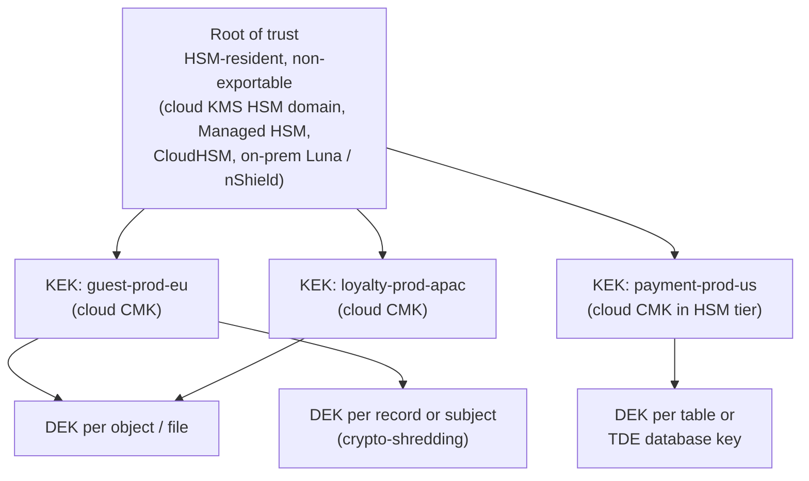
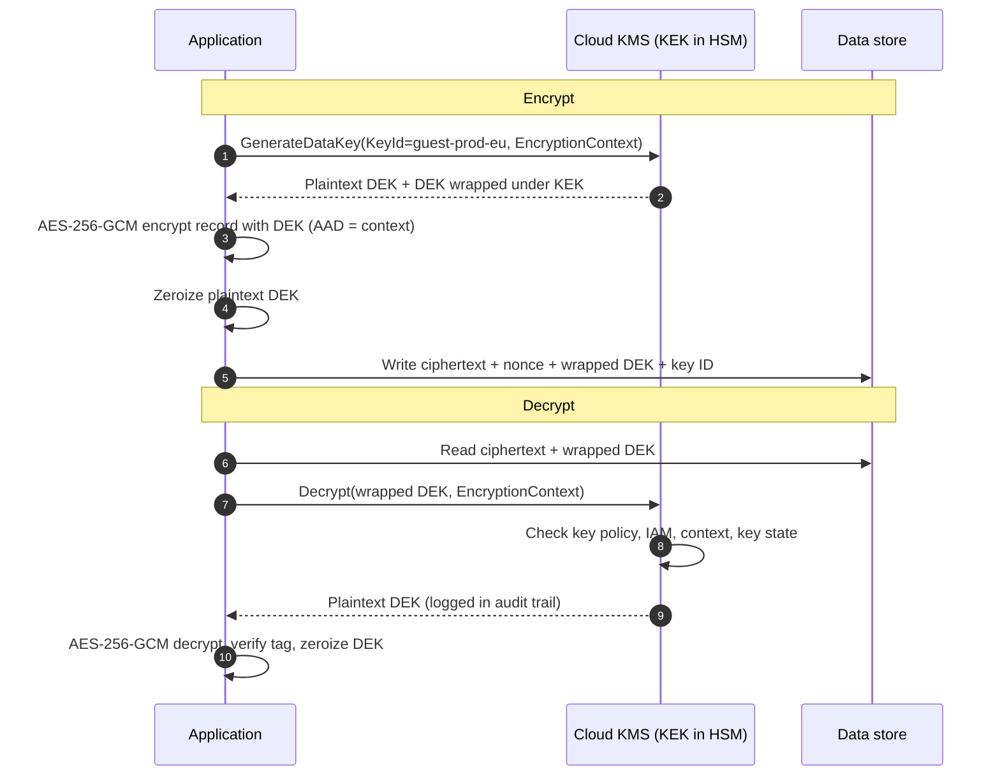
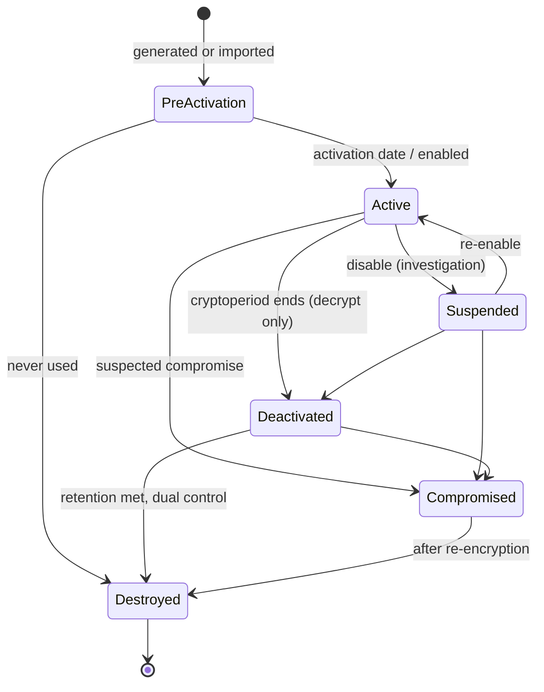

# Key management architecture
{: .no_toc }

**Phase 2: Standards and keys.** This page defines how keys are structured, named, controlled, rotated, and destroyed across on-prem and four clouds, so that encryption is auditable and a single compromised role cannot both use and administer a key.
{: .fs-5 .fw-300 }

## On this page
{: .no_toc .text-delta }

1. TOC
{:toc}

---

## Why key management is the control

Encryption at rest in every major cloud is on by default. For C0 and C1 data that is sufficient. For C2 and C3 data, the question an assessor or regulator asks is not "is it encrypted" but "who can cause it to be decrypted, and how would you know". Those answers live entirely in the key management design: which principal can call `Decrypt`, which can change the key policy, which can schedule deletion, and whether every call is logged.

This page describes the architecture the organization applies in AWS KMS, Azure Key Vault and Managed HSM, Google Cloud KMS, OCI Vault, and on-prem key managers. Custody options (who holds the root) are covered in [Key custody: BYOK, HYOK, and external keys](); HSM specifics are in [Hardware security modules]().

## Key hierarchy

The organization uses a three-level hierarchy. Each level protects the one below it, and only the bottom level touches data.



| Level | What it is | Where it lives | Who can touch it |
|---|---|---|---|
| Root | The provider's HSM domain key, a single-tenant HSM partition key, or an on-prem HSM master key | Inside the HSM boundary; never exported in plaintext | Provider operators (multi-tenant KMS) or the organization's key custodians (single-tenant or on-prem HSM) through a ceremony |
| KEK (key-encryption key) | The customer-managed key (AWS KMS key, Key Vault key, Cloud KMS CryptoKey, OCI master encryption key). Never leaves the KMS. | Cloud KMS or HSM | Key administrators manage policy; workloads call wrap/unwrap through IAM |
| DEK (data-encryption key) | AES-256 key that encrypts the data. Stored only in wrapped form next to the data. | Plaintext only in memory during use; wrapped copy stored with ciphertext | The service or application doing the encryption |

Why three levels: KMS APIs are rate-limited and add latency, and they cap the plaintext size they will encrypt directly (4 KB for AWS KMS `Encrypt`, for example). Encrypting bulk data locally with a DEK and sending only the 32-byte DEK to the KMS keeps performance acceptable while the KEK never leaves the HSM boundary. It also means rotating the KEK does not require re-encrypting terabytes of data, only (optionally) re-wrapping DEKs.

## Envelope encryption

Every cloud's server-side encryption (S3 SSE-KMS, EBS, Azure Storage with CMK, BigQuery CMEK, OCI Block Volume) is envelope encryption performed by the storage service. The same pattern is used for application-layer encryption of C3 fields, through the AWS Encryption SDK, AWS Database Encryption SDK, Tink, or the organization's reference library in [code/envelope](https://github.com/steven-smith-itnet/data-protection-pqc-security-architecture/tree/main/code/envelope).



Design rules:

- **Bind context.** Pass an encryption context (AWS), additional authenticated data (Tink, Azure client libraries), or equivalent containing at least `data-domain`, the record or object identifier, and the tenant or property ID. A ciphertext moved to another record then fails to decrypt, and the context appears in the audit log.
- **Cache DEKs carefully.** Data-key caching reduces KMS calls but widens the window in which a plaintext DEK is in memory. Allowed for C2 with a maximum age of 5 minutes and a maximum message count; not allowed for C3 unless a performance exception is approved.
- **Store the key ID, not just the wrapped key.** Needed for rotation, for multi-region decrypt, and for crypto-shredding.

A minimal AWS CLI walk-through that engineers can run in a sandbox account:

```bash
# Generate a DEK under the KEK, with encryption context
aws kms generate-data-key \
  --key-id alias/guest-prod-euw1-app-kek \
  --key-spec AES_256 \
  --encryption-context data-domain=guest,record-type=profile \
  --query '{Plaintext:Plaintext,CiphertextBlob:CiphertextBlob}' \
  --output json > dek.json

# Later: unwrap the DEK. The same context must be supplied or the call fails.
aws kms decrypt \
  --ciphertext-blob fileb://<(jq -r .CiphertextBlob dek.json | base64 -d) \
  --encryption-context data-domain=guest,record-type=profile \
  --query Plaintext --output text
```

## Key design: per domain, per environment, per region

One key per application is too many to govern; one key per account is too coarse to limit blast radius. The organization's unit of key separation is **data domain × environment × region**, with further splitting where a single domain contains both C2 and C3 data or where a workload has materially different access patterns.

| Dimension | Why it separates keys |
|---|---|
| Data domain (`guest`, `payment`, `loyalty`, `employee`, `finance`, `operations`, `property-iot`, `security`) | Different owners, different regulators, different access populations |
| Environment (`prod`, `nonprod`) | Non-production must never be able to decrypt production data. Masked or synthetic data only in non-prod (see [Tokenization, FPE, and masking]()). |
| Region / residency (`us`, `eu`, `uk`, `cn`, `apac`, `latam`, `mea`) | Data residency and sovereignty: an EU key that can only be used in EU regions enforces GDPR transfer decisions technically |
| Purpose (`storage`, `db`, `app`, `backup`, `logs`, `sign`, `hmac`) | Different services and different rotation behavior; separates signing from encryption |
| Tier (C2 versus C3) | C3 keys use HSM protection, stricter policies, and shorter cryptoperiods |

### Naming convention

```text
<domain>-<env>-<region-code>-<purpose>[-<qualifier>]

guest-prod-euw1-db          # guest domain, production, eu-west-1, database TDE/CMEK
payment-prod-use1-app-pan   # payment domain, production, us-east-1, app-layer PAN encryption
loyalty-nonprod-apse1-storage
security-prod-global-sign-codesign
```

| Cloud | Where the name goes | Tags / labels |
|---|---|---|
| AWS KMS | Alias: `alias/guest-prod-euw1-db` | Tags `data-classification`, `protection-profile`, `data-domain`, `regulatory-scope`, `data-residency`, `data-owner`, `retention-class` |
| Azure Key Vault / Managed HSM | Vault per domain-env-region (`kv-guest-prod-weu`); key name is the purpose (`db`, `app`) | Azure tags with the same schema |
| Google Cloud KMS | Key ring per domain-env (`guest-prod`) in the regional location; CryptoKey is the purpose | GCP labels with the same schema (lowercase constraint already satisfied) |
| OCI Vault | Vault per domain-env-region; master encryption key named by purpose | Defined tags in a `data-protection` namespace |

The tag schema is the same as in [Labeling, tagging, and metadata](). Policy as code (see [Guardrails and policy as code]()) denies key creation without the tags and checks that a `restricted` key has an HSM protection level.

## Key policy model and separation of duties

Three roles, three sets of permissions, and no principal holds more than one in production.

| Role | Can do | Cannot do | Typical holder |
|---|---|---|---|
| **Key administrator** | Create keys, set and change key policy, enable/disable, configure rotation, tag, schedule deletion (subject to dual control) | Encrypt, decrypt, generate data keys, sign | Cryptographic operations team, via a privileged access workflow |
| **Key user** | Encrypt, decrypt, re-encrypt, generate data keys, sign/verify, create grants for AWS services | Change policy, disable, delete, rotate | Workload identities (roles, managed identities, service accounts), storage and database services |
| **Key auditor** | Read key metadata, key policy, rotation status, and audit logs | Any cryptographic operation or change | Security operations, internal audit, PCI assessors (read-only) |

Why separate them: an administrator who can also decrypt can grant themselves access and read data with no second person involved. A workload that can change policy can remove the controls that restrict it. PCI DSS v4.0.1 requirements 3.6 and 3.7 expect this separation, and it is the core of the PP-2 control set.

### Dual control

Some operations are destructive or policy-changing enough to require two people:

| Operation | Dual-control mechanism |
|---|---|
| Schedule key deletion | Approval workflow in the privileged access tool (for example, a just-in-time role elevation requiring a second approver) plus the provider's waiting period; SCP or Azure Policy denies deletion outside that role |
| Change key policy on C3 keys | Pull request to the Terraform repository requiring two approvals from the cryptographic operations CODEOWNERS; direct console changes blocked by SCP/deny assignments |
| Import key material (BYOK) | Ceremony with two custodians holding separate components or smart cards (see [Hardware security modules]()) |
| HSM administrative operations | M of N quorum enforced by the HSM itself |
| Disabling a production key | Two-person approval; alert to SOC on every `DisableKey` or equivalent |

### AWS KMS key policy example

The key policy below is for a C3 application-layer key. It gives the account root the ability to delegate to IAM (required, otherwise the key can become unmanageable), gives a key-admin role management rights without cryptographic use, gives the workload role use rights only through a specific service and with a mandatory encryption context, and denies deletion outside the break-glass role.

```json
{
  "Version": "2012-10-17",
  "Id": "payment-prod-use1-app-pan",
  "Statement": [
    {
      "Sid": "EnableIAMPolicies",
      "Effect": "Allow",
      "Principal": { "AWS": "arn:aws:iam::111122223333:root" },
      "Action": "kms:*",
      "Resource": "*"
    },
    {
      "Sid": "KeyAdministrators",
      "Effect": "Allow",
      "Principal": { "AWS": "arn:aws:iam::111122223333:role/crypto-ops-key-admin" },
      "Action": [
        "kms:Create*", "kms:Describe*", "kms:Enable*", "kms:List*", "kms:Put*",
        "kms:Update*", "kms:Revoke*", "kms:Disable*", "kms:Get*",
        "kms:TagResource", "kms:UntagResource", "kms:RotateKeyOnDemand"
      ],
      "Resource": "*"
    },
    {
      "Sid": "KeyUsersViaServiceWithContext",
      "Effect": "Allow",
      "Principal": { "AWS": "arn:aws:iam::111122223333:role/payment-tokenizer-prod" },
      "Action": [ "kms:Encrypt", "kms:Decrypt", "kms:GenerateDataKey", "kms:ReEncrypt*" ],
      "Resource": "*",
      "Condition": {
        "StringEquals": { "kms:EncryptionContext:data-domain": "payment" },
        "ForAllValues:StringEquals": { "kms:EncryptionContextKeys": [ "data-domain", "record-id" ] }
      }
    },
    {
      "Sid": "KeyAuditors",
      "Effect": "Allow",
      "Principal": { "AWS": "arn:aws:iam::111122223333:role/security-audit-readonly" },
      "Action": [ "kms:Describe*", "kms:Get*", "kms:List*" ],
      "Resource": "*"
    },
    {
      "Sid": "DenyDeletionExceptBreakGlass",
      "Effect": "Deny",
      "Principal": "*",
      "Action": [ "kms:ScheduleKeyDeletion", "kms:PutKeyPolicy" ],
      "Resource": "*",
      "Condition": {
        "ArnNotLike": { "aws:PrincipalArn": "arn:aws:iam::111122223333:role/crypto-ops-breakglass" }
      }
    }
  ]
}
```

Notes on this policy:

- Administrators do not have `kms:Decrypt`, `kms:Encrypt`, or `kms:GenerateDataKey*`. They also do not have `kms:ScheduleKeyDeletion` or `kms:PutKeyPolicy` in practice, because the deny statement overrides the allow for everyone except break-glass.
- The first statement delegates to IAM in the account. Pair it with an SCP that denies `kms:Decrypt` on `payment-*` keys to any principal not tagged for the payment domain, so that an over-broad IAM policy elsewhere in the account cannot open the key.
- For keys used by AWS services on the workload's behalf (for example RDS), add a `kms:ViaService` condition such as `rds.us-east-1.amazonaws.com` and allow `kms:CreateGrant` with `kms:GrantIsForAWSResource` set to `true`.

### Azure Key Vault RBAC role assignments

Use the Azure RBAC permission model on Key Vault (not legacy access policies) so assignments are visible in one place and can be governed by Privileged Identity Management. The built-in roles map cleanly to the three-role model.

| Organization role | Azure built-in role | Scope |
|---|---|---|
| Key administrator | Key Vault Crypto Officer | Vault (eligible through PIM, not permanent) |
| Key user (application) | Key Vault Crypto User | Individual key |
| Key user (Azure service wrapping a DEK, e.g. Storage or SQL TDE) | Key Vault Crypto Service Encryption User | Individual key |
| Key auditor | Key Vault Reader | Vault |

```bash
KV_ID=$(az keyvault show --name kv-guest-prod-weu --query id -o tsv)

# Key user: the application's managed identity may use only the 'app' key
APP_MI=$(az identity show -g rg-guest-prod-weu -n mi-guest-profile-api --query principalId -o tsv)
az role assignment create \
  --role "Key Vault Crypto User" \
  --assignee-object-id "$APP_MI" \
  --assignee-principal-type ServicePrincipal \
  --scope "$KV_ID/keys/app"

# Service key user: storage account identity wraps its DEKs with the 'storage' key
SA_MI=$(az storage account show -g rg-guest-prod-weu -n stguestprodweu --query identity.principalId -o tsv)
az role assignment create \
  --role "Key Vault Crypto Service Encryption User" \
  --assignee-object-id "$SA_MI" \
  --assignee-principal-type ServicePrincipal \
  --scope "$KV_ID/keys/storage"

# Auditor: read-only on the vault
az role assignment create \
  --role "Key Vault Reader" \
  --assignee-object-id "$(az ad group show -g sg-security-audit --query id -o tsv)" \
  --assignee-principal-type Group \
  --scope "$KV_ID"
```

The key administrator role (Key Vault Crypto Officer) is assigned as a PIM-eligible assignment with approval, so it is active only for the duration of an approved change. Managed HSM uses its own local RBAC with roles such as Managed HSM Crypto Officer and Managed HSM Crypto User, assigned with `az keyvault role assignment create --hsm-name ...`.

### Google Cloud KMS IAM bindings

Bind roles at the individual CryptoKey level where possible, and at the key ring level only for administrators.

| Organization role | Google Cloud role | Resource |
|---|---|---|
| Key administrator | `roles/cloudkms.admin` | Key ring |
| Key user | `roles/cloudkms.cryptoKeyEncrypterDecrypter` (or `.cryptoKeyEncrypter` / `.cryptoKeyDecrypter` where a service only needs one direction) | CryptoKey |
| Key auditor | `roles/cloudkms.viewer` | Key ring |

```bash
# Key user: the Cloud Run service account for the guest profile API
gcloud kms keys add-iam-policy-binding app \
  --keyring=guest-prod \
  --location=europe-west1 \
  --member="serviceAccount:guest-profile-api@guest-prod-euw1.iam.gserviceaccount.com" \
  --role="roles/cloudkms.cryptoKeyEncrypterDecrypter"

# CMEK for BigQuery: grant the BigQuery service agent use of the 'db' key
PROJECT_NUMBER=$(gcloud projects describe guest-prod-euw1 --format='value(projectNumber)')
gcloud kms keys add-iam-policy-binding db \
  --keyring=guest-prod \
  --location=europe-west1 \
  --member="serviceAccount:bq-${PROJECT_NUMBER}@bigquery-encryption.iam.gserviceaccount.com" \
  --role="roles/cloudkms.cryptoKeyEncrypterDecrypter"

# Auditor at key ring level
gcloud kms keyrings add-iam-policy-binding guest-prod \
  --location=europe-west1 \
  --member="group:security-audit@example.com" \
  --role="roles/cloudkms.viewer"
```

Place key rings in a dedicated key project per domain and environment, separate from the workload projects, so that project owners in workload projects do not inherit `cloudkms.admin`. Google Cloud's Autokey feature can create CMEK keys on demand in a designated key project; if used, confirm that its per-resource key granularity and naming meet this convention.

## Rotation: what it actually does

"Rotation" means different things across providers. None of the native KMS rotations re-encrypt existing data. They create new key material (a new version) for future encryption, and keep old versions available for decryption.

| Provider | Automatic rotation | On-demand rotation | What happens | Re-encryption of data |
|---|---|---|---|---|
| AWS KMS | Symmetric customer managed keys; configurable period (90 to 2,560 days) | `aws kms rotate-key-on-demand` | New backing key material; key ID and ARN unchanged; all previous material retained for decrypt | No. Ciphertexts identify the material used. Imported-material and XKS keys cannot use automatic rotation. |
| Azure Key Vault / Managed HSM | Rotation policy per key (`az keyvault key rotation-policy update`) with expiry and rotate-before-expiry triggers | `az keyvault key rotate` | New key version; services configured with a versionless key URI pick up the new version | No. Services such as Storage re-wrap their account key with the new version; data itself is not re-encrypted. |
| Google Cloud KMS | `--rotation-period` and `--next-rotation-time` on symmetric keys | Create a new version and set it primary | New CryptoKeyVersion becomes primary; old versions stay enabled until disabled or destroyed | No. Disabling or destroying an old version makes data encrypted with it unreadable, so re-encrypt first. |
| OCI Vault | Rotation schedule for master encryption keys (verify current support per vault type) | `oci kms management key rotate` | New key version; previous versions retained for decrypt | No |
| On-prem HSM / key manager | Product-specific | Product-specific | Usually new key version or new key with re-wrap job | Depends on product; TDE master-key rotation typically re-wraps DEKs only |

{: .verify }
AWS KMS configurable rotation periods and `RotateKeyOnDemand` were introduced in 2024. Confirm the current range and the limit on on-demand rotations per key in the AWS KMS documentation. Confirm OCI Vault automatic rotation availability for the vault type in use.

```bash
# AWS: enable yearly automatic rotation on a C2 key, 180 days on a C3 key
aws kms enable-key-rotation --key-id alias/guest-prod-euw1-db --rotation-period-in-days 365
aws kms enable-key-rotation --key-id alias/payment-prod-use1-app-pan --rotation-period-in-days 180

# Google Cloud: create an HSM-protected key with 90-day rotation
gcloud kms keys create app \
  --keyring=payment-prod --location=us-east1 \
  --purpose=encryption --protection-level=hsm \
  --rotation-period=90d --next-rotation-time="2026-12-31T00:00:00Z" \
  --labels=data-classification=restricted,protection-profile=pp3,data-domain=payment
```

```json
{
  "lifetimeActions": [
    { "trigger": { "timeAfterCreate": "P335D" }, "action": { "type": "Rotate" } },
    { "trigger": { "timeBeforeExpiry": "P30D" }, "action": { "type": "Notify" } }
  ],
  "attributes": { "expiryTime": "P1Y" }
}
```

The JSON above is an Azure Key Vault rotation policy applied with `az keyvault key rotation-policy update --vault-name kv-guest-prod-weu --name db --value policy.json`.

When data genuinely needs re-encryption (for example, after a suspected key compromise, not routine rotation), it is a data migration project: read with the old version, write with the new, then disable the old version once no ciphertext references it. For envelope-encrypted data only the wrapped DEKs need re-wrapping (`kms:ReEncrypt` in AWS does this without exposing plaintext to the caller).

## Key lifecycle states

NIST SP 800-57 Part 1 Rev. 5 defines key states. The organization maps them to provider states so that runbooks use one vocabulary.



| SP 800-57 state | Meaning | AWS KMS | Azure Key Vault | Google Cloud KMS | OCI Vault |
|---|---|---|---|---|---|
| Pre-activation | Exists, not yet used | `PendingImport` (imported material) / `Creating` | Key with future `nbf` (not-before) | Version `PENDING_GENERATION` / `PENDING_IMPORT` | `CREATING` |
| Active | Apply and process protection | `Enabled` | Enabled, within `nbf`/`exp` | Primary version `ENABLED` | `ENABLED` |
| Suspended | Temporarily unusable | `Disabled` | Enabled = false | Version `DISABLED` | `DISABLED` |
| Deactivated | Process only (decrypt/verify) | Previous rotated material (automatic) | Older versions | Non-primary `ENABLED` versions | Older versions |
| Compromised | Must not be trusted to protect | Runbook state; disable and re-encrypt | Runbook state | Runbook state | Runbook state |
| Destroyed | Material erased | `PendingDeletion` then deleted | Soft-deleted, then purged | `DESTROY_SCHEDULED` then `DESTROYED` | `PENDING_DELETION` then `DELETED` |

Most providers do not have native "deactivated" or "compromised" states, so the organization tracks them with a `key-state` tag and in the key inventory.

## Deletion safeguards

Deleting a KEK makes all data under it permanently unrecoverable. That is useful for crypto-shredding (see [Retention, deletion, and crypto-shredding]()) and catastrophic when done by mistake or by an attacker. Security researchers have documented cloud ransomware techniques that abuse key management, such as re-encrypting objects under attacker-controlled keys or scheduling deletion of the victim's keys.

| Provider | Safeguard | Organization setting |
|---|---|---|
| AWS KMS | Mandatory waiting period of 7 to 30 days; `CancelKeyDeletion` during that time | 30 days for all production keys; SCP denies `kms:ScheduleKeyDeletion` except break-glass; EventBridge rule alerts on `ScheduleKeyDeletion` and `DisableKey` |
| Azure Key Vault / Managed HSM | Soft delete (7 to 90 days retention) and purge protection | Purge protection enabled on every vault (cannot be disabled once on); 90-day retention; Azure Policy denies vaults without it |
| Google Cloud KMS | Scheduled destruction of versions; default 30 days, configurable at key creation (verify current range) | 30 days minimum for production; organization policy constraint on minimum destroy-scheduled duration where available |
| OCI Vault | Scheduled deletion 7 to 30 days | 30 days |

{: .warning }
The waiting period is only a safeguard if someone is watching. Route key-deletion and key-disable events to the SOC with a high-severity rule, and confirm the on-call runbook includes the cancel command for each cloud.

## Multi-region keys and disaster recovery

| Provider | Multi-region capability | Guidance |
|---|---|---|
| AWS KMS | Multi-Region keys (`mrk-` key ID prefix): a primary and replicas share key material and key ID, so ciphertext encrypted in one Region can be decrypted in another | Use only where DR or active-active requires it (for example, DynamoDB global tables with client-side encryption). Replicate only to Regions within the same residency zone (EU to EU). Each replica has its own key policy. |
| Azure Key Vault | Vault contents are replicated to the paired region for provider-managed failover (read-only during failover); Managed HSM supports multi-region replication (verify) | Treat vault-per-region as the default; use Managed HSM replication for C3 active-active |
| Google Cloud KMS | Key rings in multi-region (`europe`, `us`) or `global` locations | Use regional locations by default; multi-region `europe` for EU workloads that need regional failover inside the EU |
| OCI Vault | Cross-region vault replication for virtual private vaults (verify) | Replicate only within the residency zone |

Multi-region keys widen blast radius: a compromised replica decrypts data in every Region. Limit them to the workloads that need them and record the decision.

## Backup and escrow

- **Cloud KMS keys** are generated non-exportable. The provider's durability model is the backup. Do not attempt to export them.
- **Imported (BYOK) key material** must be retained securely by the organization, because it can be re-imported if the cloud copy is deleted or expires. Escrow it in the on-prem HSM, wrapped, with split-knowledge access.
- **Single-tenant HSMs** (CloudHSM, Azure Cloud HSM, on-prem) need explicit backups: CloudHSM backups are automatic and encrypted; on-prem HSMs use vendor backup devices or Security World files that must be stored in two sites.
- **Application-held keys** (for example, HMAC keys for tokenization exported to an application cache) are prohibited for C3; they must be HSM-resident.

## Key usage logging

| Provider | Log source | What to alert on |
|---|---|---|
| AWS KMS | CloudTrail management events (every KMS API call, including `Decrypt`, is logged) | `ScheduleKeyDeletion`, `DisableKey`, `PutKeyPolicy`, `CreateGrant` to unexpected principals, `Decrypt` volume anomalies, `ImportKeyMaterial`, `KMSInvalidStateException` spikes |
| Azure Key Vault | Diagnostic setting `AuditEvent` to Log Analytics | `KeyDelete`, `KeyPurge`, `VaultPatch` (network or RBAC changes), unusual `KeyDecrypt`/`KeyUnwrap` callers |
| Google Cloud KMS | Cloud Audit Logs: Admin Activity (always on), Data Access (must be enabled for KMS) | `DestroyCryptoKeyVersion`, `SetIamPolicy`, `Decrypt` from new principals |
| OCI Vault | OCI Audit service | `ScheduleKeyDeletion`, `DisableKey`, policy changes |

An example KQL query for Azure Key Vault that flags a new identity decrypting with a C3 key:

```kusto
AzureDiagnostics
| where ResourceProvider == "MICROSOFT.KEYVAULT"
| where OperationName in ("KeyDecrypt", "KeyUnwrap")
| where id_s has "/keys/app"
| summarize FirstSeen = min(TimeGenerated), Calls = count() by identity_claim_oid_g, Resource
| where FirstSeen > ago(1d)
```

Enable Google Cloud KMS Data Access audit logs explicitly; they are off by default and without them `Decrypt` calls are not recorded. Detection content is expanded in [Monitoring and detection]().

## Blast-radius analysis

For each key, the architect answers four questions during design review. The answers go into the key inventory.

| Question | Example answer for `guest-prod-euw1-db` |
|---|---|
| What data becomes readable if this key's user role is compromised? | All guest profile tables in the EU production database cluster |
| What data becomes unreadable if this key is deleted or unreachable? | Same, plus EU guest backups encrypted with the same key |
| Which principals can use it, directly or through grants? | RDS service via grant; `guest-profile-api` role; no humans |
| Which principals can change who can use it? | Break-glass role only (dual control) |

If the first answer covers more than one data domain or more than one residency zone, the key is too broad and should be split.

## Good, better, best

| Level | Profile | Key management approach | Trade-offs |
|---|---|---|---|
| **Good** | PP-1 (C0, C1) | Provider-managed or AWS managed keys; platform default encryption; standard IAM; audit logging on | No control over key policy or rotation timing; cannot crypto-shred; acceptable because data is low sensitivity |
| **Better** | PP-2 (C2) | Customer-managed keys per domain, environment, and region; HSM-backed tier where offered; automatic rotation; admin/user/auditor separation; deletion safeguards and alerts; tags enforced by policy | Cost per key and per API call; teams must handle KMS throttling and permissions; misconfigured key policy can lock out a service |
| **Best** | PP-3 (C3) | PP-2 plus HSM protection level or single-tenant HSM; application-layer envelope encryption with context binding; dual control for policy change and deletion; per-subject or per-tenant DEKs for crypto-shredding; external keys only where regulation justifies | Higher latency and cost; operational burden for ceremonies and HSM capacity; external keys add an availability dependency the organization owns |

## Key takeaways for engineering teams

- Keys are split by data domain, environment, and region. Non-production can never decrypt production data.
- Create keys only through the platform Terraform module; name and tag them according to the convention, or policy will deny creation.
- Your workload identity is a key user. It cannot change the key policy, and administrators cannot decrypt your data.
- Rotation does not re-encrypt data. Never disable or destroy an old key version until nothing references it.
- Always pass an encryption context or AAD with at least the domain and record ID.
- Key deletion and disable events page the SOC. Expect a call if you trigger one.

## Related pages

- [Cryptographic standards]()
- [Key custody: BYOK, HYOK, and external keys]()
- [Hardware security modules]()
- [Cross-cloud terminology]()
- [AWS](), [Microsoft Azure](), [Google Cloud](), [Oracle Cloud Infrastructure]()
- [Guardrails and policy as code]()

## Sources

- NIST SP 800-57 Part 1 Rev. 5: <https://csrc.nist.gov/pubs/sp/800/57/pt1/r5/final>
- AWS KMS key policies: <https://docs.aws.amazon.com/kms/latest/developerguide/key-policies.html>
- AWS KMS key rotation: <https://docs.aws.amazon.com/kms/latest/developerguide/rotate-keys.html>
- Azure Key Vault RBAC: <https://learn.microsoft.com/azure/key-vault/general/rbac-guide>
- Azure Key Vault key rotation: <https://learn.microsoft.com/azure/key-vault/keys/how-to-configure-key-rotation>
- Google Cloud KMS rotation: <https://cloud.google.com/kms/docs/key-rotation>
- Google Cloud KMS IAM: <https://cloud.google.com/kms/docs/reference/permissions-and-roles>
- OCI Vault: <https://docs.oracle.com/iaas/Content/KeyManagement/home.htm>
