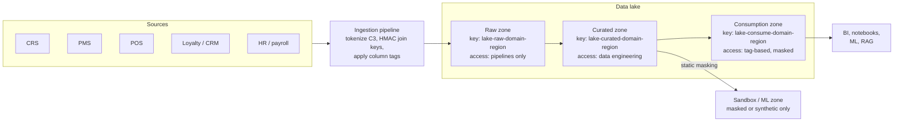
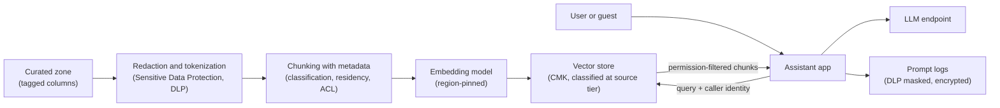

# Data lakes and analytics platforms
{: .no_toc }

**Phase 3: Structured data.** This page shows how the organization keeps the data lake and warehouse from becoming the single largest copy of guest, loyalty, and employee data with the weakest controls.
{: .fs-5 .fw-300 }

## On this page
{: .no_toc .text-delta }

1. TOC
{:toc}

---

## Why analytics platforms need their own controls

Every operational system feeds the data lake: reservations from the CRS, stays and folios from the PMS, transactions from POS, loyalty activity, CRM interactions, web and app analytics, HR, and finance. The lake is therefore the one place where a single query can join a guest's identity, stay history, spending, preferences, and location. Analytics platforms also have the broadest user base (analysts, data scientists, revenue managers, marketing, external agencies) and the most copies (extracts, notebooks, BI caches, ML feature stores, vector indexes).

Three principles govern the design:

1. **Protect before landing.** C3 fields (PAN, passport numbers, health data) are tokenized, encrypted, or dropped in the ingestion pipeline. The raw zone never contains PAN. See [Tokenization, FPE, and masking]().
2. **Classification travels with the data.** Column-level tags from Phase 1 (`data-classification`, `data-domain`, `regulatory-scope`, `data-residency`) are applied in the catalog and drive masking and access policy automatically, so a new column tagged `restricted` is masked without a new ticket.
3. **Access is decided by tag, not by table grant.** Tag-based access control scales to thousands of tables; per-table grants do not.

## Data lake zones and per-zone keys



| Zone | Content | Encryption key | Who can read | Retention |
|---|---|---|---|---|
| Landing or raw | Source-aligned data after C3 tokenization; may contain C2 identifiers | CMK per domain and region, e.g. `lake-raw-guest-eu` | Ingestion and curation pipeline roles only; no human interactive access except break-glass | Short (for example `r90d`) |
| Curated | Cleaned, conformed, deduplicated; HMAC surrogates for joins | CMK per domain and region, e.g. `lake-curated-guest-eu` | Data engineering roles; tag-based for others | Per data domain retention class |
| Consumption | Data products, aggregates, marts | CMK per domain and region | Tag-based access with masking and row filters | Per data product |
| Sandbox and ML | Masked, pseudonymized, or synthetic | Separate CMK | Data scientists | Short, auto-expire |

Per-zone, per-domain keys give three benefits: a compromise of a consumption-zone role does not grant decrypt on raw data even if a bucket policy is misconfigured (KMS is a second authorization check); keys can be scheduled for deletion per domain and region for crypto-shredding of an entire dataset; and key usage logs show which roles read which zone.

## AWS: S3, Lake Formation, Glue, Athena, and Redshift

### Storage and catalog encryption

Each zone is a separate S3 bucket (or prefix set) with SSE-KMS using the zone key and S3 Bucket Keys enabled to reduce KMS request costs. The bucket policy denies `PutObject` requests that do not specify the expected key. See [Cloud object storage]() for bucket-level controls.

```bash
aws s3api put-bucket-encryption --bucket dl-curated-guest-eu \
  --server-side-encryption-configuration '{
    "Rules": [{
      "ApplyServerSideEncryptionByDefault": {
        "SSEAlgorithm": "aws:kms",
        "KMSMasterKeyID": "arn:aws:kms:eu-west-1:111122223333:alias/lake-curated-guest-eu"
      },
      "BucketKeyEnabled": true
    }]
  }'

# Encrypt the Glue Data Catalog and connection passwords
aws glue put-data-catalog-encryption-settings --data-catalog-encryption-settings '{
  "EncryptionAtRest": {
    "CatalogEncryptionMode": "SSE-KMS",
    "SseAwsKmsKeyId": "arn:aws:kms:eu-west-1:111122223333:alias/lake-catalog-eu"
  },
  "ConnectionPasswordEncryption": {
    "ReturnConnectionPasswordEncrypted": true,
    "AwsKmsKeyId": "arn:aws:kms:eu-west-1:111122223333:alias/lake-catalog-eu"
  }
}'

# Athena workgroup that forces encrypted query results
aws athena create-work-group --name analysts-eu \
  --configuration 'ResultConfiguration={OutputLocation=s3://dl-athena-results-eu/analysts/,EncryptionConfiguration={EncryptionOption=SSE_KMS,KmsKey=arn:aws:kms:eu-west-1:111122223333:alias/lake-consume-guest-eu}},EnforceWorkGroupConfiguration=true,PublishCloudWatchMetricsEnabled=true'
```

Athena query results are a frequently missed copy: they contain the full output of every query. Enforcing the workgroup configuration stops users from overriding the output location or encryption. Glue jobs, crawlers, and development endpoints use a Glue security configuration that sets S3, CloudWatch Logs, and job bookmark encryption.

### Lake Formation LF-tags

Lake Formation tag-based access control (LF-TBAC) grants permissions on LF-tag expressions rather than on individual tables. The organization mirrors the resource tag schema as LF-tags.

```bash
# Define LF-tags
aws lakeformation create-lf-tag --tag-key data-classification \
  --tag-values public internal confidential restricted
aws lakeformation create-lf-tag --tag-key data-domain \
  --tag-values guest payment loyalty employee finance operations

# Tag a table and override one column to restricted
aws lakeformation add-lf-tags-to-resource \
  --resource '{"Table": {"DatabaseName": "guest_curated", "Name": "stays"}}' \
  --lf-tags TagKey=data-classification,TagValues=confidential TagKey=data-domain,TagValues=guest

aws lakeformation add-lf-tags-to-resource \
  --resource '{"TableWithColumns": {"DatabaseName": "guest_curated", "Name": "stays", "ColumnNames": ["passport_token", "dietary_notes_ct"]}}' \
  --lf-tags TagKey=data-classification,TagValues=restricted

# Grant analysts SELECT on anything guest-domain that is internal or confidential
aws lakeformation grant-permissions \
  --principal DataLakePrincipalIdentifier=arn:aws:iam::111122223333:role/analyst-guest-eu \
  --permissions SELECT \
  --resource '{"LFTagPolicy": {"ResourceType": "TABLE", "Expression": [
      {"TagKey": "data-domain", "TagValues": ["guest"]},
      {"TagKey": "data-classification", "TagValues": ["internal", "confidential"]}]}}'
```

Because the `restricted` columns carry a tag value that the analyst's grant does not include, those columns are excluded from the analyst's view in Athena, Redshift Spectrum, and EMR when Lake Formation permissions are enforced. Lake Formation data filters add row-level and cell-level filtering (for example, EU analysts see EU properties only).

### Redshift masking and row-level security

```sql
-- Dynamic data masking
CREATE MASKING POLICY mask_email
WITH (email VARCHAR(320))
USING ('***@' || SPLIT_PART(email, '@', 2));

ATTACH MASKING POLICY mask_email
ON guest.profile(email)
TO ROLE analyst_role
PRIORITY 10;

-- Row-level security
-- Lookup table maps database users to permitted regions
CREATE RLS POLICY rls_region
WITH (property_region VARCHAR(8))
USING (property_region IN (
    SELECT region FROM security.user_region_map WHERE user_name = current_user));

ATTACH RLS POLICY rls_region ON guest.stays TO ROLE analyst_role;
ALTER TABLE guest.stays ROW LEVEL SECURITY ON;
```

{: .verify }
Confirm Redshift masking and RLS policy syntax, and the rules for lookup tables referenced in RLS predicates (the lookup table itself must be protected from the users the policy restricts), against current documentation for the deployed version.

## Azure: Synapse, Fabric, and Azure Databricks

| Service | Encryption | Access and masking | Notes |
|---|---|---|---|
| ADLS Gen2 (lake storage) | Storage service encryption with CMK in Key Vault; encryption scopes per container or blob for per-zone keys; optional infrastructure encryption | POSIX ACLs and RBAC; Purview scans and labels | Encryption scopes allow different keys in one account |
| Azure Synapse Analytics | Workspace-level double encryption with CMK; dedicated SQL pools support TDE | Dynamic data masking, column-level security, row-level security in dedicated SQL pools | Workspace CMK is chosen at creation |
| Microsoft Fabric | Microsoft-managed encryption at rest; customer-managed keys at workspace level | OneLake security roles, SQL analytics endpoint RLS, column-level security, and DDM; Purview sensitivity labels on Fabric items | Label inheritance to Power BI exports |
| Azure Databricks | CMK for managed services (notebooks, secrets, queries), CMK for workspace storage and managed disks | Unity Catalog (see below) | Requires Premium tier |

{: .verify }
Fabric customer-managed key support and OneLake security (data access roles) reached general availability at different times in 2025 and 2026. Confirm current status, scope (workspace or capacity), and supported item types before committing a design.

Synapse dedicated SQL pool masking uses the same T-SQL syntax as SQL Server:

```sql
ALTER TABLE dbo.GuestProfile ALTER COLUMN Email ADD MASKED WITH (FUNCTION = 'email()');
GRANT UNMASK TO [guest-data-stewards];

CREATE SCHEMA security;
GO
CREATE FUNCTION security.fn_region_predicate(@Region AS VARCHAR(8))
    RETURNS TABLE
WITH SCHEMABINDING
AS
    RETURN SELECT 1 AS allowed
    WHERE @Region IN (SELECT m.Region FROM security.UserRegionMap AS m
                      WHERE m.UserName = USER_NAME())
       OR IS_MEMBER('global-analysts') = 1;
GO
CREATE SECURITY POLICY security.RegionFilter
    ADD FILTER PREDICATE security.fn_region_predicate(PropertyRegion) ON dbo.Stays
    WITH (STATE = ON);
```

## Google Cloud: BigQuery and Dataplex

### CMEK

```bash
# Dataset default key: new tables inherit it
bq --location=EU mk --dataset \
  --default_kms_key=projects/dp-keys-eu/locations/eu/keyRings/lake/cryptoKeys/bq-guest-curated \
  --label=data-classification:confidential --label=data-domain:guest \
  guest-analytics-eu:guest_curated

# Table-level key
bq mk --table \
  --destination_kms_key=projects/dp-keys-eu/locations/eu/keyRings/lake/cryptoKeys/bq-guest-curated \
  guest-analytics-eu:guest_curated.stays ./schemas/stays.json
```

The BigQuery service account for the project needs `roles/cloudkms.cryptoKeyEncrypterDecrypter` on the key. BigQuery also supports a project or organization default CMEK, and the `gcp.restrictNonCmekServices` organization policy can require CMEK for BigQuery.

### Column-level security and dynamic masking with policy tags

Policy tags from a Data Catalog taxonomy are attached to columns in the table schema. Users need Fine-Grained Reader on a policy tag to read the column in cleartext; users with Masked Reader on a data policy attached to the tag see masked values; users with neither get an access denied error for that column. The Terraform for the taxonomy and data policy is on the [tokenization and masking page](#bigquery-data-masking).

Row-level security:

```sql
CREATE ROW ACCESS POLICY eu_properties_only
ON `guest-analytics-eu.guest_curated.stays`
GRANT TO ('group:analysts-eu@example.com')
FILTER USING (property_region = 'EU');
```

### AEAD encryption functions with KMS-wrapped keysets

BigQuery AEAD functions encrypt individual values inside SQL using Tink keysets. A keyset wrapped by a Cloud KMS key (`KEYS.KEYSET_CHAIN`) means the cleartext keyset never appears in the query or the table; only users with decrypt permission on the KMS key can use it. This enables per-field encryption in the warehouse and crypto-shredding by deleting a per-guest or per-tenant keyset.

```sql
-- One-time: create a wrapped keyset (done by a key administrator, output stored in a restricted table)
-- The wrapped keyset is produced with the bq CLI or Tink tooling using the KMS key below.

DECLARE kms_key STRING DEFAULT
  'gcp-kms://projects/dp-keys-eu/locations/eu/keyRings/lake/cryptoKeys/bq-aead-guest';

-- Encrypt passport tokens into a restricted table (randomized AEAD)
INSERT INTO `guest-analytics-eu.guest_restricted.identity` (guest_sk, passport_ct)
SELECT
  guest_sk,
  AEAD.ENCRYPT(
    KEYS.KEYSET_CHAIN(kms_key, (SELECT wrapped_keyset FROM `guest-analytics-eu.keys.wrapped` WHERE name = 'identity')),
    passport_number,
    guest_sk)                                      -- additional data binds ciphertext to the row
FROM `guest-analytics-eu.guest_raw.identity_staging`;

-- Deterministic encryption for an equality-joinable email column
SELECT
  DETERMINISTIC_ENCRYPT(
    KEYS.KEYSET_CHAIN(kms_key, (SELECT wrapped_keyset FROM `guest-analytics-eu.keys.wrapped` WHERE name = 'email_daead')),
    LOWER(TRIM(email)),
    'guest-email') AS email_det
FROM `guest-analytics-eu.guest_raw.profile_staging`;

-- Decrypt (only principals with cloudkms.cryptoKeyDecrypter on the KMS key succeed)
SELECT guest_sk,
  AEAD.DECRYPT_STRING(
    KEYS.KEYSET_CHAIN(kms_key, (SELECT wrapped_keyset FROM `guest-analytics-eu.keys.wrapped` WHERE name = 'identity')),
    passport_ct, guest_sk) AS passport_number
FROM `guest-analytics-eu.guest_restricted.identity`;
```

The `email_daead` keyset uses the `DETERMINISTIC_AEAD_AES_SIV_CMAC_256` key type; the `identity` keyset uses `AEAD_AES_GCM_256`.

{: .verify }
Some BigQuery functions that accept `KEYS.KEYSET_CHAIN` require the key argument to be a literal or query parameter rather than a scripting variable. Test the pattern and use query parameters if needed.

### Dataplex

Dataplex (now presented as part of BigQuery universal catalog, verify naming) provides lakes, zones, and assets across Cloud Storage and BigQuery, data profiling and data quality scans, and integration with Sensitive Data Protection discovery. The organization uses Sensitive Data Protection discovery profiles to find unclassified C2 and C3 columns and applies the matching policy tags and labels automatically through a pipeline.

## Snowflake

### Tri-Secret Secure

Snowflake encrypts all data with a hierarchical key model managed by Snowflake. Tri-Secret Secure (Business Critical edition and above) combines a Snowflake-maintained key with a customer-managed key in the cloud provider's KMS (AWS KMS, Azure Key Vault, or Google Cloud KMS) to form a composite master key. Revoking the customer-managed key makes the account's data unreadable. This is a PP-3 "customer-controlled kill switch" option with the corresponding availability risk.

### Tag-based masking

Tag-based masking assigns masking policies to tags. Any column carrying the tag is masked automatically; one policy per data type can be set on a tag.

```sql
USE ROLE governance_admin;

CREATE TAG IF NOT EXISTS governance.tags.data_classification
  ALLOWED_VALUES 'public', 'internal', 'confidential', 'restricted';

CREATE OR REPLACE MASKING POLICY governance.policies.mask_string_by_class
  AS (val STRING) RETURNS STRING ->
  CASE
    WHEN SYSTEM$GET_TAG_ON_CURRENT_COLUMN('governance.tags.data_classification') IN ('public', 'internal')
      THEN val
    WHEN SYSTEM$GET_TAG_ON_CURRENT_COLUMN('governance.tags.data_classification') = 'confidential'
         AND IS_ROLE_IN_SESSION('CONFIDENTIAL_READER')
      THEN val
    WHEN SYSTEM$GET_TAG_ON_CURRENT_COLUMN('governance.tags.data_classification') = 'restricted'
         AND IS_ROLE_IN_SESSION('RESTRICTED_READER')
      THEN val
    ELSE '***MASKED***'
  END;

ALTER TAG governance.tags.data_classification
  SET MASKING POLICY governance.policies.mask_string_by_class;

-- Apply tags to columns (usually automated from the catalog or Snowflake classification)
ALTER TABLE guest.curated.profile MODIFY COLUMN email
  SET TAG governance.tags.data_classification = 'confidential';
ALTER TABLE guest.curated.identity MODIFY COLUMN passport_token
  SET TAG governance.tags.data_classification = 'restricted';
```

Snowflake's automatic sensitive data classification can suggest semantic and privacy categories that are then mapped to the organization's tag values.

### Row access policies

```sql
CREATE OR REPLACE ROW ACCESS POLICY governance.policies.property_region_rap
  AS (property_region VARCHAR) RETURNS BOOLEAN ->
  IS_ROLE_IN_SESSION('GLOBAL_ANALYST')
  OR EXISTS (
    SELECT 1 FROM governance.entitlements.region_access e
    WHERE e.role_name = CURRENT_ROLE()
      AND e.property_region = property_region
  );

ALTER TABLE guest.curated.stays
  ADD ROW ACCESS POLICY governance.policies.property_region_rap ON (property_region);
```

### External tokenization

External tokenization lets a masking policy call an external function that detokenizes through a tokenization provider (for example, Protegrity or another partner). Data is stored tokenized in Snowflake; authorized roles see detokenized values at query time; everyone else sees tokens. This keeps cleartext C3 values out of Snowflake storage entirely.

```sql
CREATE OR REPLACE MASKING POLICY governance.policies.detokenize_passport
  AS (val STRING) RETURNS STRING ->
  CASE
    WHEN IS_ROLE_IN_SESSION('ID_VERIFICATION_SVC') THEN governance.ext.detokenize(val)
    ELSE val   -- token remains visible, cleartext does not
  END;
```

`governance.ext.detokenize` is an external function backed by an API integration to the tokenization service, which enforces its own authorization and logs every call.

## Databricks Unity Catalog

Unity Catalog provides column masks and row filters defined as SQL user-defined functions, plus tags and (as of 2025) attribute-based access control policies.

```sql
-- Column mask
CREATE OR REPLACE FUNCTION governance.policies.mask_email(email STRING)
RETURN CASE
  WHEN is_account_group_member('guest-pii-readers') THEN email
  ELSE concat('***@', split_part(email, '@', 2))
END;

ALTER TABLE guest.curated.profile
  ALTER COLUMN email SET MASK governance.policies.mask_email;

-- Row filter
CREATE OR REPLACE FUNCTION governance.policies.region_filter(property_region STRING)
RETURN is_account_group_member('global-analysts')
    OR (is_account_group_member('analysts-eu') AND property_region = 'EU')
    OR (is_account_group_member('analysts-us') AND property_region = 'US');

ALTER TABLE guest.curated.stays
  SET ROW FILTER governance.policies.region_filter ON (property_region);

-- Governed tags for classification
ALTER TABLE guest.curated.profile
  ALTER COLUMN email SET TAGS ('data-classification' = 'confidential');
```

Encryption: customer-managed keys for managed services (notebook source, secrets, SQL query history) and for workspace storage (the workspace root storage and cluster managed disks), configured per workspace on AWS, Azure, and Google Cloud. Unity Catalog managed tables live in cloud storage encrypted with the organization's CMK.

{: .verify }
Unity Catalog ABAC policies (policies attached to governed tags that apply masks and filters across many tables) were in preview during 2025. Confirm GA status and syntax before replacing per-table masks with ABAC policies.

## Platform comparison

| Capability | AWS (Lake Formation, Redshift) | Azure (Synapse, Fabric) | BigQuery | Snowflake | Databricks |
|---|---|---|---|---|---|
| CMK at rest | S3 SSE-KMS, Redshift KMS | Storage CMK, Synapse CMK, Fabric CMK (verify) | CMEK per dataset or table | Tri-Secret Secure | CMK for managed services and storage |
| Tag-driven access | LF-tags | Purview-based policies (limited), OneLake roles | Policy tags | Tags with tag-based masking | Governed tags, ABAC (verify) |
| Dynamic masking | Redshift DDM; Lake Formation column exclusion | DDM (SQL pools, Fabric SQL endpoint) | Data masking via data policies | Masking policies | Column masks |
| Row filtering | Lake Formation data filters, Redshift RLS | RLS | Row access policies | Row access policies | Row filters |
| In-warehouse encryption functions | No AEAD-style functions with KMS-wrapped keys; use application-layer encryption or partner UDFs | No KMS-integrated equivalent; use application-layer encryption | AEAD and deterministic functions with KMS-wrapped keysets | `ENCRYPT` and `DECRYPT` functions with passphrase (limited) | `aes_encrypt` and `aes_decrypt` functions |
| External tokenization | Partner UDFs (Lambda) | Partner integration | Remote functions | External tokenization | Partner UDFs |

## Non-production data

Non-production environments are the most common place for C2 and C3 data to escape. The organization's rule: **no unmasked production C2 or C3 data outside production**, with exceptions only for time-bound incident investigation in a controlled production-equivalent environment.

| Approach | When to use | Tools and techniques |
|---|---|---|
| Static masking during refresh | Functional and integration testing that needs realistic, referentially consistent data | Deterministic substitution, FPE, HMAC-based surrogate keys, date shifting; test data management platforms (for example Delphix, Informatica TDM, Tonic.ai), OCI Data Safe masking for Oracle, PostgreSQL Anonymizer |
| Subsetting plus masking | Large databases where a full copy is expensive | Referentially intact subset of properties or date ranges, then masked |
| Synthetic data | Development, demos, vendor testing, ML prototyping | Rule-based generators and statistical or model-based synthesizers; validate for memorization and re-identification risk |
| Zero-copy masked views | Analytics sandboxes | Masking policies applied to shared views rather than physical copies |

Controls: refresh pipelines run in production-trusted accounts, masking is verified by the discovery scanner before data is released to the target environment, and non-production uses separate keys so a production key compromise is not required to access test data and vice versa.

## ML training data and LLM and RAG pipelines

Machine learning and generative AI create new copies of sensitive data that traditional controls do not see: feature stores, training datasets, fine-tuning corpora, embedding vectors, vector indexes, prompt logs, and model outputs. For a hotel organization, typical use cases are demand forecasting, personalization, guest service chatbots, and staff assistants that answer questions from policy documents and guest history.

| Risk | Example | Control |
|---|---|---|
| Training data contains direct identifiers | Personalization model trained on raw guest profiles | Train on HMAC surrogates and tokenized fields; exclude C3 columns by tag; document the dataset in the inventory with its classification |
| Model memorization | Fine-tuned LLM reproduces a guest's email or allergy note | Do not fine-tune on C3 data; deduplicate and redact training text with Sensitive Data Protection or equivalent; evaluate with extraction tests |
| Embeddings carry sensitive content | Vector index built from CRM case notes containing passport numbers | Redact or tokenize before chunking and embedding; classify the vector store at the highest tier of its source; encrypt with the domain CMK |
| RAG retrieval bypasses access control | Chatbot retrieves another guest's reservation | Enforce document-level and row-level permissions at retrieval time using the caller's identity; filter by metadata tags (`data-classification`, `data-residency`) in the vector query |
| Prompt and response logs | Guest pastes a card number into the chatbot | Pre-prompt DLP to detect and mask PAN and IDs; log retention per `retention-class`; logs encrypted and access-restricted |
| Cross-border transfer | EU guest data sent to a model endpoint in another region | Region-pinned model endpoints; `data-residency` tag checked in the pipeline |
| Right to erasure | Guest requests deletion; data remains in embeddings and training sets | Maintain lineage from source records to chunks and datasets; delete and re-index; avoid training on data subject to erasure where possible |



## Good, Better, Best for analytics platforms

| Level | Controls |
|---|---|
| Good | Zones in separate buckets or containers with CMK; catalog encryption; enforced encrypted query results; C3 tokenized or dropped at ingestion; table-level grants; audit logs to SIEM |
| Better | Per-zone, per-domain, per-region keys; tag-based access (LF-tags, policy tags, Snowflake tags, Unity Catalog tags) driven by Phase 1 classification; dynamic masking and row filters; masked non-production; HMAC surrogates for cross-domain joins |
| Best | In-warehouse field encryption with KMS-wrapped keysets (BigQuery AEAD) or external tokenization (Snowflake, Databricks) so cleartext C3 never lands; Tri-Secret Secure or equivalent customer-held key for the warehouse where justified; lineage-driven erasure; RAG pipelines with retrieval-time authorization and pre-embedding redaction |

Trade-offs: tag-based policies depend on tagging quality, so discovery and tagging must be continuous; in-warehouse encryption and external tokenization add latency and cost to queries that need cleartext; customer-held warehouse keys make the platform's availability depend on the organization's key service.

## Key takeaways for engineering teams

- Tokenize or drop C3 fields in the ingestion pipeline; the raw zone is not an exception.
- Use per-zone, per-domain keys so KMS acts as a second authorization check and datasets can be crypto-shredded.
- Drive masking and access from classification tags (LF-tags, policy tags, Snowflake tags, Unity Catalog tags), not from per-table grants.
- Athena results, BI extracts, notebooks, feature stores, and vector indexes are copies of sensitive data and must inherit the source classification.
- For RAG, redact before embedding and enforce the caller's permissions at retrieval time.

## Related pages

- [Tokenization, FPE, and masking]()
- [Cloud databases]()
- [Labeling, tagging, and metadata]()
- [Data ownership, flows, and lineage]()
- [Cloud object storage]()
- [Data in use and confidential computing]()
- [Reference architectures]()

## Sources

- AWS Lake Formation tag-based access control: <https://docs.aws.amazon.com/lake-formation/latest/dg/tag-based-access-control.html>
- Amazon Redshift dynamic data masking: <https://docs.aws.amazon.com/redshift/latest/dg/t_ddm.html>
- Amazon Athena encryption at rest: <https://docs.aws.amazon.com/athena/latest/ug/encryption.html>
- BigQuery column-level security and data masking: <https://cloud.google.com/bigquery/docs/column-level-security-intro>
- BigQuery AEAD encryption concepts: <https://cloud.google.com/bigquery/docs/aead-encryption-concepts>
- Snowflake tag-based masking policies: <https://docs.snowflake.com/en/user-guide/tag-based-masking-policies>
- Snowflake Tri-Secret Secure: <https://docs.snowflake.com/en/user-guide/security-encryption-tss>
- Databricks Unity Catalog row filters and column masks: <https://docs.databricks.com/en/tables/row-and-column-filters.html>
- Azure Synapse security white paper: <https://learn.microsoft.com/azure/synapse-analytics/guidance/security-white-paper-introduction>
