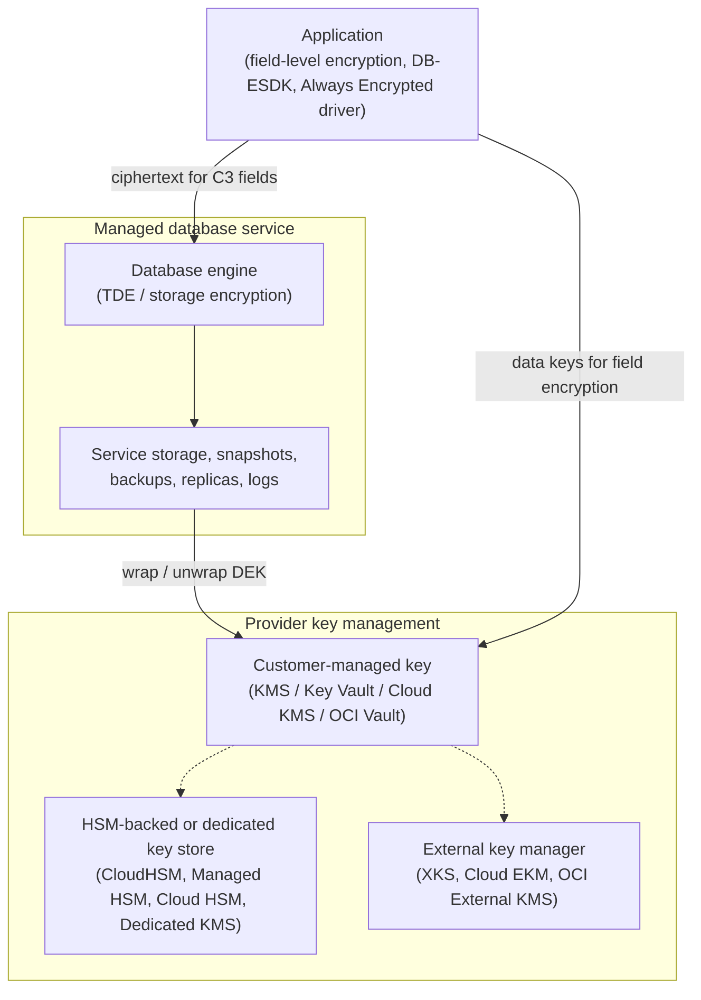

# Cloud databases
{: .no_toc }

**Phase 3: Structured data.** This page shows how the organization applies PP-2 and PP-3 to managed database services on each cloud, including the constraints that must be designed in on day one because they cannot be changed later.
{: .fs-5 .fw-300 }

## On this page
{: .no_toc .text-delta }

1. TOC
{:toc}

---

## What the cloud changes

Managed databases encrypt storage by default on all four providers. The decision is therefore not "encrypt or not" but:

1. **Whose key.** Provider-owned key (PP-1), customer-managed key in the provider KMS (PP-2), or HSM-backed, single-tenant, or external key (PP-3). See [Key custody: BYOK, HYOK, and external keys]().
2. **When the choice is made.** Several services fix the encryption key at creation. Retrofitting a CMK means creating a new instance and migrating data, which for a CRS or loyalty database means a planned outage or a replication-based cutover.
3. **What sits above storage encryption.** The same limits as on-prem apply: storage encryption and TDE do not protect against a database user with `SELECT`, a compromised application credential, or SQL injection. C3 fields need application-layer or client-side encryption, or tokenization.



## Day-one decisions checklist

| Decision | Why it cannot wait | Services affected |
|---|---|---|
| CMK or provider key | Cannot switch an unencrypted or provider-key instance to CMK in place | RDS, Aurora, DocumentDB, Cloud SQL, AlloyDB, Spanner, Azure Database for PostgreSQL and MySQL Flexible Server |
| Key region and residency | Cross-region replicas and backups need keys in the destination region | All |
| Key store type (default, HSM, external) | Moving from a standard key to an external key requires re-encryption or new resources | All |
| Field-level encryption for C3 | Adding client-side encryption later requires a data migration and application change | All |
| Tags from the schema | Guardrails and Terraform modules select keys from `data-classification` and `data-domain` | All |

## Amazon Web Services

### RDS and Aurora

RDS and Aurora encrypt the DB instance or cluster storage, automated backups, snapshots, read replicas, and logs with a KMS key. The choice is made at creation: the AWS managed key `aws/rds` (PP-1) or a customer managed KMS key (PP-2 and PP-3).

```bash
aws rds create-db-instance \
  --db-instance-identifier guest-profile-prod \
  --engine postgres \
  --db-instance-class db.r6g.xlarge \
  --allocated-storage 200 \
  --master-username dbadmin \
  --manage-master-user-password \
  --master-user-secret-kms-key-id alias/secrets-guest-prod-eu \
  --storage-encrypted \
  --kms-key-id alias/db-guest-prod-eu \
  --tags Key=data-classification,Value=confidential Key=protection-profile,Value=pp2 \
         Key=data-domain,Value=guest Key=data-residency,Value=eu
```

**Encrypting an existing unencrypted instance.** RDS does not support enabling encryption on an existing unencrypted DB instance in place. The supported path is snapshot, encrypted copy, and restore:

```bash
# 1. Snapshot the unencrypted instance
aws rds create-db-snapshot \
  --db-instance-identifier legacy-loyalty \
  --db-snapshot-identifier legacy-loyalty-pre-encrypt

# 2. Copy the snapshot with a customer managed key (this produces an encrypted snapshot)
aws rds copy-db-snapshot \
  --source-db-snapshot-identifier legacy-loyalty-pre-encrypt \
  --target-db-snapshot-identifier legacy-loyalty-encrypted \
  --kms-key-id alias/db-loyalty-prod-eu

# 3. Restore a new, encrypted instance from the encrypted snapshot
aws rds restore-db-instance-from-db-snapshot \
  --db-instance-identifier loyalty-prod \
  --db-snapshot-identifier legacy-loyalty-encrypted
```

The same snapshot-copy approach is used to **change the KMS key** of an encrypted instance (for example, moving from `aws/rds` to a customer managed key). To reduce downtime for large databases, AWS DMS or native logical replication can keep the new instance in sync until cutover. For Aurora, restoring a cluster snapshot with `aws rds restore-db-cluster-from-snapshot --kms-key-id` creates a new encrypted cluster.

Terraform (label-driven key selection is implemented in [code/terraform/aws](https://github.com/steven-smith-itnet/data-protection-pqc-security-architecture/tree/main/code/terraform/aws)):

```hcl
resource "aws_rds_cluster" "reservations" {
  cluster_identifier              = "reservations-prod"
  engine                          = "aurora-postgresql"
  master_username                 = "dbadmin"
  manage_master_user_password     = true
  master_user_secret_kms_key_id   = aws_kms_key.secrets_guest.arn
  storage_encrypted               = true
  kms_key_id                      = aws_kms_key.db_guest.arn
  performance_insights_kms_key_id = aws_kms_key.db_guest.arn
  enabled_cloudwatch_logs_exports = ["postgresql"]
  deletion_protection             = true

  tags = {
    data-classification = "confidential"
    protection-profile  = "pp2"
    data-domain         = "guest"
    regulatory-scope    = "gdpr"
    data-residency      = "eu"
    data-owner          = "reservations-platform"
  }
}
```

Performance Insights and exported logs can contain query text, including literal values, so they use the same domain key and the same access restrictions as the database.

### DynamoDB

DynamoDB always encrypts tables at rest. Options per table: AWS owned key (default, no customer visibility), AWS managed key (`aws/dynamodb`), or customer managed key. Unlike RDS, the table's encryption key type can be changed on an existing table.

```bash
aws dynamodb create-table \
  --table-name digital-key-sessions \
  --attribute-definitions AttributeName=pk,AttributeType=S AttributeName=sk,AttributeType=S \
  --key-schema AttributeName=pk,KeyType=HASH AttributeName=sk,KeyType=RANGE \
  --billing-mode PAY_PER_REQUEST \
  --sse-specification Enabled=true,SSEType=KMS,KMSMasterKeyId=alias/db-guest-prod-eu \
  --tags Key=data-classification,Value=restricted Key=protection-profile,Value=pp3

# Switch an existing table to a customer managed key
aws dynamodb update-table \
  --table-name loyalty-member-cache \
  --sse-specification Enabled=true,SSEType=KMS,KMSMasterKeyId=alias/db-loyalty-prod-eu
```

### AWS Database Encryption SDK

The AWS Database Encryption SDK performs client-side, attribute-level encryption and signing for DynamoDB items. Each attribute is assigned an action: `ENCRYPT_AND_SIGN`, `SIGN_ONLY`, `SIGN_AND_INCLUDE_IN_ENCRYPTION_CONTEXT`, or `DO_NOTHING`. Items are signed so tampering with unencrypted attributes is detected.

Searchable encryption is provided by **beacons**: truncated HMAC tags of plaintext values stored alongside the ciphertext and usable in queries and global secondary indexes. Standard beacons cover a single field; compound beacons combine parts of several fields (for example, property code and a date). The beacon length is chosen to create deliberate collisions, which limits what an observer learns from the index at the cost of some false positives that the SDK filters.

Key management uses keyrings. The **AWS KMS Hierarchical keyring** caches branch keys derived from a KMS key and stored in a DynamoDB key store table, which reduces KMS calls for high-volume workloads such as digital key sessions. For multi-tenant designs, the branch key can be selected per tenant (for example, per franchise owner) to give key-per-tenant separation.

| Attribute | Action | Beacon |
|---|---|---|
| `pk` (guest surrogate ID) | `SIGN_ONLY` | None (not sensitive) |
| `passport_number` | `ENCRYPT_AND_SIGN` | Standard beacon, length tuned for the table size |
| `email` | `ENCRYPT_AND_SIGN` | Standard beacon for lookup |
| `property_code` | `SIGN_AND_INCLUDE_IN_ENCRYPTION_CONTEXT` | Part of a compound beacon |
| `ttl` | `DO_NOTHING` | None |

{: .verify }
Language support for the AWS Database Encryption SDK (Java, .NET, Rust, Python, Go) and for searchable encryption varies by release. Confirm current support in the developer guide before selecting a runtime.

### Amazon Redshift

Redshift encrypts provisioned clusters and Serverless namespaces with a KMS key. Unlike RDS, an existing provisioned cluster can be modified to use encryption or a different key, and Redshift migrates the data.

```bash
aws redshift create-cluster \
  --cluster-identifier edw-prod \
  --node-type ra3.4xlarge --number-of-nodes 4 \
  --master-username admin --manage-master-password \
  --encrypted --kms-key-id alias/dw-analytics-prod-eu

aws redshift-serverless create-namespace \
  --namespace-name analytics-eu \
  --kms-key-id alias/dw-analytics-prod-eu
```

Redshift dynamic data masking and row-level security are covered in [Data lakes and analytics platforms]().

### Amazon DocumentDB

DocumentDB encrypts clusters with a KMS key chosen at creation (`--storage-encrypted --kms-key-id` on `aws docdb create-db-cluster`). An unencrypted cluster cannot be encrypted in place; the migration path is snapshot and restore into an encrypted cluster, or `mongodump` and `mongorestore`. DocumentDB does not provide MongoDB Queryable Encryption, so C3 fields use application-layer encryption (for example, the AWS Encryption SDK) with blind indexes.

{: .verify }
Confirm whether DocumentDB supports restoring an unencrypted snapshot into an encrypted cluster in the target region, and whether client-side field-level encryption features have been added, before finalizing the migration runbook.

## Microsoft Azure

### Azure SQL Database and Azure SQL Managed Instance

TDE is enabled by default with a service-managed key. PP-2 and PP-3 use TDE with a customer-managed key (the TDE protector) in Key Vault Premium or Managed HSM. The server's managed identity needs `get`, `wrapKey`, and `unwrapKey` permissions (or the Key Vault Crypto Service Encryption User role), and the vault must have soft-delete and purge protection enabled.

```bash
# Assign a system identity to the logical server
az sql server update -g rg-guest-prod-weu -n sql-guest-prod-weu --assign-identity

# Grant the identity access to the key (RBAC model)
az role assignment create \
  --assignee-object-id "$(az sql server show -g rg-guest-prod-weu -n sql-guest-prod-weu --query identity.principalId -o tsv)" \
  --assignee-principal-type ServicePrincipal \
  --role "Key Vault Crypto Service Encryption User" \
  --scope "$(az keyvault show --name kv-dp-guest-weu --query id -o tsv)/keys/tde-guest"

# Add the key to the server and set it as the TDE protector
KID=$(az keyvault key show --vault-name kv-dp-guest-weu --name tde-guest --query key.kid -o tsv)
az sql server key create -g rg-guest-prod-weu -s sql-guest-prod-weu --kid "$KID"
az sql server tde-key set -g rg-guest-prod-weu -s sql-guest-prod-weu \
  --server-key-type AzureKeyVault --kid "$KID" --auto-rotation-enabled true
```

For Managed Instance the equivalent is `az sql mi key create` and `az sql mi tde-key set`. Terraform:

```hcl
resource "azurerm_mssql_server" "guest" {
  name                = "sql-guest-prod-weu"
  resource_group_name = azurerm_resource_group.guest.name
  location            = "westeurope"
  version             = "12.0"
  minimum_tls_version = "1.2"
  azuread_administrator {
    login_username              = "sql-guest-admins"
    object_id                   = var.sql_admin_group_object_id
    azuread_authentication_only = true
  }
  identity { type = "SystemAssigned" }
  tags = {
    data-classification = "confidential"
    protection-profile  = "pp2"
    data-domain         = "guest"
    data-residency      = "eu"
  }
}

resource "azurerm_mssql_server_transparent_data_encryption" "guest" {
  server_id             = azurerm_mssql_server.guest.id
  key_vault_key_id      = azurerm_key_vault_key.tde_guest.id
  auto_rotation_enabled = true
}
```

If the TDE protector becomes inaccessible, Azure SQL marks affected databases inaccessible after a grace period. That is the intended revocation behavior, and it is also the availability risk of CMK: monitoring on Key Vault availability and key access failures is mandatory.

Azure SQL also supports **Always Encrypted** (including VBS secure enclaves) with the column master key in Key Vault or Managed HSM, **dynamic data masking**, and **Microsoft Purview** scanning and classification. See [On-prem databases]() for Always Encrypted syntax, which is identical.

{: .verify }
Azure SQL Database supports database-level customer-managed keys (a different key per database on the same logical server). Confirm the current feature status and region availability before using it for key-per-tenant designs.

### Azure Cosmos DB

Cosmos DB encrypts data with service-managed keys by default. A customer-managed key adds a second layer of encryption with a Key Vault key. Historically CMK had to be chosen at account creation; enabling CMK on existing accounts has since been introduced.

```bash
az cosmosdb create \
  -g rg-app-prod-weu -n cosmos-guest-app-weu \
  --locations regionName=westeurope failoverPriority=0 isZoneRedundant=true \
  --key-uri "https://kv-dp-guest-weu.vault.azure.net/keys/cosmos-guest" \
  --assign-identity "/subscriptions/<sub>/resourceGroups/rg-app-prod-weu/providers/Microsoft.ManagedIdentity/userAssignedIdentities/uai-cosmos-guest" \
  --default-identity "UserAssignedIdentity=/subscriptions/<sub>/resourceGroups/rg-app-prod-weu/providers/Microsoft.ManagedIdentity/userAssignedIdentities/uai-cosmos-guest"
```

{: .verify }
Enabling CMK on an existing Cosmos DB account and the supported API types for it have changed over time. Confirm current support, and note that the key URI is supplied without a version so rotation is picked up.

Cosmos DB also offers **Always Encrypted for Cosmos DB** in its SDKs for client-side encryption of properties, with deterministic encryption for equality filters. It is appropriate for C3 fields in the guest mobile app back end.

### Azure Database for PostgreSQL Flexible Server (and MySQL Flexible Server)

Data encryption with a customer-managed key requires a user-assigned managed identity and must be configured **when the server is created**. It cannot be switched from service-managed to customer-managed later; the path is point-in-time restore or migration into a new server configured with CMK.

```hcl
resource "azurerm_user_assigned_identity" "pg" {
  name                = "uai-pg-loyalty-weu"
  resource_group_name = azurerm_resource_group.loyalty.name
  location            = "westeurope"
}

resource "azurerm_postgresql_flexible_server" "loyalty" {
  name                          = "pg-loyalty-prod-weu"
  resource_group_name           = azurerm_resource_group.loyalty.name
  location                      = "westeurope"
  version                       = "16"
  sku_name                      = "GP_Standard_D4ds_v5"
  storage_mb                    = 262144
  public_network_access_enabled = false
  delegated_subnet_id           = azurerm_subnet.pg.id
  private_dns_zone_id           = azurerm_private_dns_zone.pg.id

  authentication {
    active_directory_auth_enabled = true
    password_auth_enabled         = false
  }

  identity {
    type         = "UserAssigned"
    identity_ids = [azurerm_user_assigned_identity.pg.id]
  }

  customer_managed_key {
    key_vault_key_id                  = azurerm_key_vault_key.pg_loyalty.id
    primary_user_assigned_identity_id = azurerm_user_assigned_identity.pg.id
  }

  tags = {
    data-classification = "confidential"
    protection-profile  = "pp2"
    data-domain         = "loyalty"
  }
}
```

For geo-redundant backups with CMK, a second identity and key in the paired region are required.

## Google Cloud

Google Cloud encrypts all data at rest by default. Customer-managed encryption keys (CMEK) in Cloud KMS, with protection level `SOFTWARE`, `HSM` (Cloud HSM), or `EXTERNAL` (Cloud EKM), are configured per resource. **Cloud KMS Autokey** can create keys automatically per resource type and project, following a key-per-resource pattern, which reduces the chance of teams creating resources without CMEK.

Each service uses a service agent that needs `roles/cloudkms.cryptoKeyEncrypterDecrypter` on the key. Organization policy constraints `constraints/gcp.restrictNonCmekServices` and `constraints/gcp.restrictCmekCryptoKeyProjects` enforce CMEK and restrict which key projects may be used (see [Guardrails and policy as code]()).

### Cloud SQL

CMEK is set at instance creation and cannot be added later.

```bash
# Create the Cloud SQL service agent and grant it the key
gcloud beta services identity create --service=sqladmin.googleapis.com --project=guest-prod-eu

gcloud kms keys add-iam-policy-binding db-guest \
  --keyring=guest --location=europe-west1 --project=dp-keys-eu \
  --member="serviceAccount:service-<PROJECT_NUMBER>@gcp-sa-cloud-sql.iam.gserviceaccount.com" \
  --role=roles/cloudkms.cryptoKeyEncrypterDecrypter

gcloud sql instances create guest-profile-prod \
  --project=guest-prod-eu --region=europe-west1 \
  --database-version=POSTGRES_16 --tier=db-custom-4-16384 \
  --disk-encryption-key=projects/dp-keys-eu/locations/europe-west1/keyRings/guest/cryptoKeys/db-guest \
  --no-assign-ip --network=projects/guest-prod-eu/global/networks/prod \
  --labels=data-classification=confidential,protection-profile=pp2,data-domain=guest,data-residency=eu
```

Terraform uses `encryption_key_name` on `google_sql_database_instance`. Backups and replicas use the key of the instance; cross-region replicas need a key in the replica's region.

### AlloyDB

```bash
gcloud alloydb clusters create reservations-prod \
  --region=europe-west1 --project=guest-prod-eu \
  --network=projects/guest-prod-eu/global/networks/prod \
  --password="$(gcloud secrets versions access latest --secret=alloydb-init)" \
  --kms-key=db-guest --kms-keyring=guest \
  --kms-location=europe-west1 --kms-project=dp-keys-eu
```

```hcl
resource "google_alloydb_cluster" "reservations" {
  cluster_id = "reservations-prod"
  location   = "europe-west1"
  network_config { network = google_compute_network.prod.id }
  encryption_config {
    kms_key_name = google_kms_crypto_key.db_guest.id
  }
  automated_backup_policy {
    enabled = true
    encryption_config { kms_key_name = google_kms_crypto_key.db_guest.id }
  }
  labels = { data-classification = "confidential", protection-profile = "pp2" }
}
```

### Spanner

CMEK is set per database at creation. Multi-region Spanner instances require a key in each replica region, supplied as a list of keys.

```bash
gcloud spanner databases create loyalty \
  --instance=loyalty-prod \
  --kms-key=projects/dp-keys-eu/locations/europe-west1/keyRings/loyalty/cryptoKeys/spanner-loyalty
```

```hcl
resource "google_spanner_database" "loyalty" {
  instance = google_spanner_instance.loyalty.name
  name     = "loyalty"
  encryption_config {
    kms_key_name = google_kms_crypto_key.spanner_loyalty.id
  }
  deletion_protection = true
}
```

{: .verify }
For multi-region Spanner configurations, the flag and Terraform field for multiple keys (`--kms-keys` and `kms_key_names`) should be confirmed against current documentation.

### Firestore

{: .verify }
Firestore CMEK support was introduced in 2024 and 2025 and is configured at database creation (`gcloud firestore databases create ... --kms-key-name=...`). Confirm the current GA status, supported locations, and flag names before use.

### BigQuery

BigQuery CMEK, policy tags, masking, and AEAD functions are covered in [Data lakes and analytics platforms]().

## Oracle Cloud Infrastructure

OCI encrypts database storage by default with Oracle-managed keys. Customer-managed keys are held in OCI Vault (HSM-protected keys recommended), in a virtual private vault for isolation, in OCI Dedicated KMS (single-tenant HSM partitions), or in OCI External KMS (keys in a third-party HSM outside OCI).

### Autonomous Database

Autonomous Database supports switching the TDE master key between Oracle-managed and customer-managed (OCI Vault) keys on an existing database, which re-wraps the TDE master key rather than re-encrypting all data.

```bash
oci db autonomous-database update \
  --autonomous-database-id ocid1.autonomousdatabase.oc1.eu-frankfurt-1.<id> \
  --kms-key-id ocid1.key.oc1.eu-frankfurt-1.<vault>.<key> \
  --vault-id ocid1.vault.oc1.eu-frankfurt-1.<vault>
```

```hcl
resource "oci_database_autonomous_database" "revenue" {
  compartment_id           = var.compartment_id
  db_name                  = "REVMGMT"
  display_name             = "revenue-management-prod"
  compute_model            = "ECPU"
  compute_count            = 4
  data_storage_size_in_tbs = 1
  db_workload              = "DW"
  kms_key_id               = oci_kms_key.db_revenue.id
  vault_id                 = oci_kms_vault.dp_eu.id
  is_mtls_connection_required = true
  freeform_tags = {
    "data-classification" = "confidential"
    "protection-profile"  = "pp2"
    "data-domain"         = "finance"
  }
}
```

A policy must allow the database resource principal or dynamic group to use the key, for example `Allow dynamic-group adb-prod to use keys in compartment dp-keys where target.key.id = '<key-ocid>'`.

{: .verify }
Exact IAM policy statements and whether a dynamic group or service principal is required differ between Autonomous Database on shared and dedicated Exadata infrastructure. Confirm against current OCI documentation.

### Base Database Service and Exadata Database Service

Oracle Database on OCI Base Database Service and Exadata Database Service uses TDE for all tablespaces. The TDE master key can be managed by Oracle or by the customer in OCI Vault, selected when the database is created or changed later from the console or API. The same Oracle Database features from the [on-prem page]() apply: Data Redaction, Database Vault, and Oracle Key Vault as an alternative key store where the organization wants one on-prem key manager across OCI and data centers.

### Data Safe

OCI Data Safe provides sensitive data discovery, data masking for non-production copies, user and privilege assessment, security configuration assessment, and activity auditing for Oracle databases on OCI and on-prem. The organization uses Data Safe masking formats (for example, shuffle, substitution, and format-preserving randomization) to produce masked copies of revenue management and ERP databases for testing.

## Cross-provider comparison

| Capability | AWS | Azure | Google Cloud | OCI |
|---|---|---|---|---|
| Default at-rest encryption | DynamoDB always; RDS, Aurora, and DocumentDB only if requested at creation (console default is on) | Yes (TDE on by default for Azure SQL) | Yes | Yes |
| CMK in provider KMS | KMS customer managed key | Key Vault (Premium for HSM) | Cloud KMS CMEK | OCI Vault |
| Single-tenant HSM key store | CloudHSM custom key store | Managed HSM | Cloud HSM (multi-tenant); single-tenant Cloud HSM announced (verify) | Dedicated KMS |
| External key manager | XKS | Managed HSM with BYOK import (no general HYOK for databases) | Cloud EKM | External KMS |
| CMK retrofit on relational service | No: snapshot copy and restore (RDS, Aurora) | Azure SQL: yes (change TDE protector). PostgreSQL and MySQL Flexible: no | No: new instance (Cloud SQL, AlloyDB, Spanner) | Autonomous Database: yes |
| Client-side field encryption | AWS Database Encryption SDK (DynamoDB), AWS Encryption SDK | Always Encrypted (SQL, Cosmos DB SDK) | Tink, BigQuery AEAD functions | Application-layer; Oracle Database features |
| Searchable client-side encryption | Beacons (DB-ESDK) | Deterministic, enclaves | Deterministic AEAD (AES-SIV) | Application-layer blind index |
| Native dynamic masking | Redshift DDM | Azure SQL DDM | BigQuery data masking | Data Redaction, Data Safe (static) |
| Enforcement guardrail | SCP or RCP plus AWS Config rules | Azure Policy | Org policy CMEK constraints | Security Zones and IAM policies |

{: .verify }
The single-tenant HSM row for Google Cloud is simplified: Cloud HSM keys are FIPS 140-validated HSM keys in Google-operated clusters; single-tenant Cloud HSM has been announced. Confirm the current offering before quoting it.

## Good, Better, Best for cloud databases

| Level | Profile | Controls |
|---|---|---|
| Good | PP-1 / minimum for C2 | Provider-default encryption; TLS enforced; IAM or Entra authentication; audit logs to SIEM; automated backups encrypted; deletion protection |
| Better | PP-2 | Customer-managed key per domain and environment set at creation; key administration separated from database administration; automatic key rotation; guardrails blocking creation without CMK; dynamic masking for non-privileged roles; private networking only |
| Best | PP-3 | Plus HSM-backed or dedicated key stores (CloudHSM key store, Managed HSM, Cloud HSM, Dedicated KMS); application-layer or client-side encryption for C3 fields (DB-ESDK, Always Encrypted, Tink, AEAD) with searchable schemes where justified; external keys (XKS, Cloud EKM, External KMS) only where sovereignty requirements justify the availability risk; just-in-time database access; crypto-shredding for per-tenant or per-subject keys |

Trade-offs to record: external key managers add a hard runtime dependency (if the external key is unreachable, the database becomes unavailable); CMK retrofits require migrations; client-side encryption removes server-side search on protected fields.

## Key takeaways for engineering teams

- Decide the key at creation: RDS, Aurora, Cloud SQL, AlloyDB, Spanner, and Azure PostgreSQL and MySQL Flexible Server cannot switch to a CMK in place.
- An unencrypted RDS instance is encrypted by snapshot, encrypted copy with the new KMS key, and restore; plan the cutover.
- CMK revocation is a real kill switch: monitor key availability and access failures, because a disabled key takes the database offline.
- Storage encryption and TDE do not protect against query-level access; use DB-ESDK, Always Encrypted, Tink or AEAD functions, or tokenization for C3 fields.
- Enforce CMK through guardrails (SCPs, Azure Policy, GCP org policy, OCI Security Zones) rather than relying on design review alone.

## Related pages

- [Structured data protection patterns]()
- [On-prem databases]()
- [Key custody: BYOK, HYOK, and external keys]()
- [AWS]()
- [Microsoft Azure]()
- [Google Cloud]()
- [Oracle Cloud Infrastructure]()
- [Guardrails and policy as code]()

## Sources

- Amazon RDS encryption: <https://docs.aws.amazon.com/AmazonRDS/latest/UserGuide/Overview.Encryption.html>
- DynamoDB encryption at rest: <https://docs.aws.amazon.com/amazondynamodb/latest/developerguide/EncryptionAtRest.html>
- AWS Database Encryption SDK: <https://docs.aws.amazon.com/database-encryption-sdk/latest/devguide/>
- Amazon Redshift database encryption: <https://docs.aws.amazon.com/redshift/latest/mgmt/working-with-db-encryption.html>
- Azure SQL TDE with customer-managed key: <https://learn.microsoft.com/azure/azure-sql/database/transparent-data-encryption-byok-overview>
- Azure Cosmos DB customer-managed keys: <https://learn.microsoft.com/azure/cosmos-db/how-to-setup-customer-managed-keys>
- Azure Database for PostgreSQL data encryption: <https://learn.microsoft.com/azure/postgresql/flexible-server/concepts-data-encryption>
- Cloud SQL CMEK: <https://cloud.google.com/sql/docs/postgres/cmek>
- AlloyDB CMEK: <https://cloud.google.com/alloydb/docs/cmek>
- Spanner CMEK: <https://cloud.google.com/spanner/docs/cmek>
- OCI Autonomous Database encryption keys: <https://docs.oracle.com/en/cloud/paas/autonomous-database/>
- OCI Data Safe: <https://docs.oracle.com/en/cloud/paas/data-safe/>
