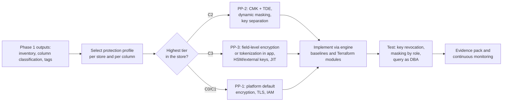

# Phase 3: Structured data
{: .no_toc }

**Phase 3: Structured data (months 6 to 24).** This phase applies the protection profiles to every database, warehouse, and data lake that holds guest, payment, loyalty, and employee records.
{: .fs-5 .fw-300 }

## On this page
{: .no_toc .text-delta }

1. TOC
{:toc}

---

## Objective

Structured data holds the organization's highest-volume sensitive records: reservations in the CRS, stays and folios in the PMS, payment tokens, loyalty profiles, HR and payroll, and the data lake and warehouse that copy all of it. A single query can return millions of guest rows, so this phase carries the largest share of the program's risk reduction.

The objective of Phase 3 is that every structured data store holding C2 or C3 data is protected according to its protection profile, and that the protection is proven with evidence rather than asserted:

- **PP-1 Baseline (Good)** for C0 and C1: platform default encryption at rest, TLS, standard IAM, audit logging.
- **PP-2 Enhanced (Better)** for C2: TDE or storage encryption with customer-managed keys (CMK), per-domain and per-environment keys, key admin and key user separation, dynamic masking for non-privileged roles.
- **PP-3 Maximum (Best)** for C3: PP-2 plus field-level encryption or tokenization applied in the application before the value reaches the database, HSM-backed or external keys where justified, just-in-time access, and crypto-shredding.

The central architectural point of this phase: **storage-layer encryption (disk, volume, TDE) protects against stolen media and snapshots, not against anyone who can run a query.** Controls that protect against privileged insiders, compromised application credentials, and SQL injection must sit higher in the stack: field-level encryption, tokenization, masking, and access policy. The [structured data protection patterns]() page sets out this layer model in detail.

## Entry criteria

| Criterion | Source | Why it matters |
|---|---|---|
| Structured data stores are inventoried with owner, platform, and location | [Data asset inventory and discovery]() | Control selection is per store; a store not in the inventory will not be protected |
| Columns holding C2 and C3 data are discovered and classified | [Data classification scheme]() | Field-level controls are chosen per column, not per database |
| Tags `data-classification`, `protection-profile`, `data-domain`, `regulatory-scope` applied | [Labeling, tagging, and metadata]() | Guardrails and Terraform modules read these tags to enforce the profile |
| Label-to-control mapping approved | [Label-to-control mapping]() | Defines what "protected" means for each tier |
| Key hierarchy, KMS/HSM platform, and key naming standard in place | [Key management architecture]() | CMK, TDE, and field-level encryption all depend on keys existing first |
| Approved algorithms and modes published | [Cryptographic standards]() | Prevents teams inventing their own field encryption schemes |

## Exit criteria

- 100 percent of C3 structured stores meet PP-3, or have a time-bound, risk-accepted exception.
- 100 percent of C2 structured stores use CMK encryption at rest with separated key administration.
- No primary account number (PAN) is stored outside the tokenization vault or payment service provider; the PMS, POS back office, CRS, and data lake hold tokens only.
- Dynamic masking or column-level access policy is active on all C2 and C3 columns exposed to analysts, support staff, or reporting tools.
- Non-production environments contain no unmasked C2 or C3 production data.
- Evidence (configuration exports, key policies, test results) is stored for each store and mapped to PCI DSS v4.0.1, GDPR, and internal standards.

## Deliverables

| Deliverable | Owner | Description |
|---|---|---|
| Structured data protection standard | Security architecture | Layer model, Good/Better/Best per tier, approved patterns |
| Tokenization service | Platform engineering | Central vault or vaultless tokenization and FPE service with detokenization access control |
| PCI scope reduction design | Payments and security architecture | P2PE, gateway tokenization, network tokens, hosted fields; PMS stores tokens only |
| Per-engine hardening baselines | Database engineering | SQL Server, Oracle, PostgreSQL, MySQL, Db2, MongoDB configuration and key integration |
| Cloud database modules | Cloud platform | Terraform modules for RDS, Aurora, DynamoDB, Azure SQL, Cosmos DB, Cloud SQL, AlloyDB, Spanner, Autonomous Database that read the classification tag and set CMK |
| Analytics governance policies | Data platform | Masking policies, row access policies, per-zone keys, tag-based access in Snowflake, BigQuery, Databricks, Lake Formation |
| Non-production data policy | Data platform and QA | Masked or synthetic data only outside production |
| Evidence pack | GRC | Per-store proof of control operation |

## How the phase flows

## Sequencing within the phase

Phase 3 runs from month 6 to month 24 and is sequenced by risk and dependency, not by platform:

| Wave | Months | Scope | Rationale |
|---|---|---|---|
| 3a | 6 to 10 | Payment data: remove PAN from PMS, POS back office, CRS, data lake; tokenization service live | PCI DSS v4.0.1 requirements are mandatory and scope reduction lowers audit cost |
| 3b | 8 to 14 | Guest identity (passport and ID numbers, scans metadata), special-category data (health, accessibility, allergies) | C3 data with GDPR Article 9 and local ID-retention obligations |
| 3c | 9 to 18 | CMK and TDE for all C2 stores: CRM, loyalty, reservations, HR | Broad coverage using largely configuration changes |
| 3d | 12 to 24 | Analytics: data lake zones, warehouse masking, non-production masking, ML and RAG pipelines | Depends on tokens and keys from earlier waves |

## Child pages

| Page | What it covers |
|---|---|
| [Structured data protection patterns]() | The encryption layer stack, threat-versus-layer matrix, searchable encryption, key granularity, and a step-by-step procedure to protect a new table |
| [Tokenization, FPE, and masking]() | Vault and vaultless tokenization, FF1 format-preserving encryption, static and dynamic masking, HMAC join keys, products and SQL examples |
| [Payment card data and PCI DSS]() | Hospitality card flows, PCI DSS v4.0.1 Requirements 3, 4, and 12.3.3, scope reduction architecture, payment HSMs |
| [On-prem databases]() | SQL Server, Oracle, PostgreSQL, MySQL, Db2, MongoDB, and third-party encryption with real syntax |
| [Cloud databases]() | AWS, Azure, Google Cloud, and OCI managed databases with CLI and Terraform |
| [Data lakes and analytics platforms]() | Lake zones, Lake Formation, BigQuery, Snowflake, Databricks, Synapse and Fabric, non-production data, ML and RAG pipelines |

## Key takeaways for engineering teams

- TDE and disk encryption are necessary but only address stolen media, snapshots, and backups; they do nothing against a DBA, a stolen application credential, or SQL injection.
- C3 fields are encrypted or tokenized in the application before they reach the database; the database never sees cleartext PAN or passport numbers.
- Every stronger layer costs something: field-level encryption breaks range queries, sorting, and most joins. Choose deterministic encryption, blind indexes, or HMAC surrogates deliberately.
- Payment data goes first because PCI DSS scope reduction pays for itself and the requirements are already in force.
- Controls are selected per column from the classification tags; a store inherits the profile of its most sensitive column.

## Related pages

- [Phased roadmap]()
- [Label-to-control mapping]()
- [Key management architecture]()
- [Phase 4: Unstructured data]()
- [Encryption decision trees]()
