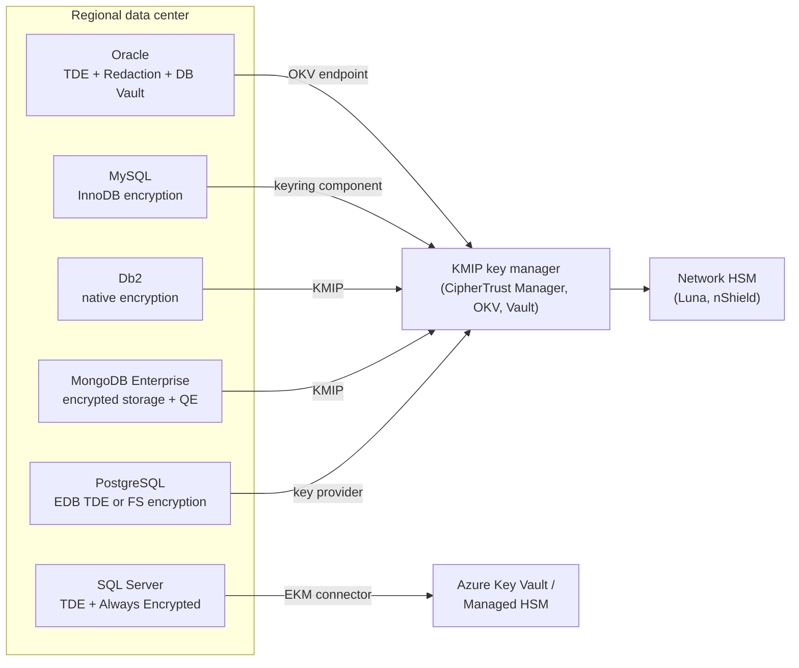

# On-prem databases
{: .no_toc }

**Phase 3: Structured data.** This page gives database engineering teams the exact configuration to protect self-managed databases, with keys held in HSMs or a central key manager rather than on the database server.
{: .fs-5 .fw-300 }

## On this page
{: .no_toc .text-delta }

1. TOC
{:toc}

---

## Scope and common principles

The organization still runs self-managed databases in regional data centers and on IaaS virtual machines: SQL Server for finance, HR, and legacy property applications; Oracle for ERP and revenue management; PostgreSQL and MySQL for internally built services; Db2 for a small number of mainframe-adjacent finance workloads; and MongoDB for mobile app back ends. The same principles apply to each engine:

1. **Master keys live outside the database server.** TDE master keys are held in an HSM, a KMIP key manager, or a cloud KMS through a connector. A wallet file or keyring file on the same host as the datafiles is acceptable only as a Good-level interim state.
2. **Backups are encrypted independently** and the keys needed to restore them are recoverable in a disaster recovery site.
3. **C3 columns are protected above the engine** (application-layer or client-side encryption, or tokenization), because TDE does not stop DBAs or SQL injection. See [Structured data protection patterns]().
4. **Privileged access is separated.** Database administrators administer; security administrators manage keys and policies; neither can do both.
5. **Classification is recorded in the engine** where the engine supports it, so tools and auditors can see it.



## Microsoft SQL Server

### TDE with an EKM provider

SQL Server TDE encrypts data and log files with a database encryption key (DEK). The DEK is protected by a server certificate in `master` (Good) or by an asymmetric key held in an external key manager through Extensible Key Management (EKM) (Better and Best). EKM providers exist for Azure Key Vault (the SQL Server Connector for Microsoft Azure Key Vault) and for HSM and key manager vendors (Thales Luna, Entrust nShield, CipherTrust Manager, Fortanix, and others).

Configuration with the Azure Key Vault connector (Key Vault Premium or Managed HSM, RSA key already created, soft-delete and purge protection enabled):

```sql
-- 1. Enable EKM
USE master;
EXEC sp_configure 'show advanced options', 1; RECONFIGURE;
EXEC sp_configure 'EKM provider enabled', 1; RECONFIGURE;

-- 2. Register the provider (path from the connector installation)
CREATE CRYPTOGRAPHIC PROVIDER AzureKeyVault_EKM
FROM FILE = 'C:\Program Files\SQL Server Connector for Microsoft Azure Key Vault\Microsoft.AzureKeyVaultService.EKM.dll';

-- 3. Credential used by the sysadmin to set up keys
--    IDENTITY is the vault name; SECRET is the Entra app client ID (no hyphens) followed by the client secret
CREATE CREDENTIAL sysadmin_ekm_cred
WITH IDENTITY = 'kv-dp-sql-eu-prod',
     SECRET   = '<clientIdWithoutHyphens><clientSecret>'
FOR CRYPTOGRAPHIC PROVIDER AzureKeyVault_EKM;

ALTER LOGIN [CORP\sql-crypto-admins] ADD CREDENTIAL sysadmin_ekm_cred;

-- 4. Open the key that exists in Key Vault
CREATE ASYMMETRIC KEY TDE_KEK_GUEST
FROM PROVIDER AzureKeyVault_EKM
WITH PROVIDER_KEY_NAME = 'tde-kek-guest-prod',
     CREATION_DISPOSITION = OPEN_EXISTING;

-- 5. Login mapped to the key, with its own credential, used by the engine to unwrap the DEK
CREATE CREDENTIAL tde_ekm_cred
WITH IDENTITY = 'kv-dp-sql-eu-prod',
     SECRET   = '<clientIdWithoutHyphens><clientSecret>'
FOR CRYPTOGRAPHIC PROVIDER AzureKeyVault_EKM;

CREATE LOGIN TDE_Login_Guest FROM ASYMMETRIC KEY TDE_KEK_GUEST;
ALTER LOGIN TDE_Login_Guest ADD CREDENTIAL tde_ekm_cred;

-- 6. Enable TDE on the database
USE GuestProfile;
CREATE DATABASE ENCRYPTION KEY
WITH ALGORITHM = AES_256
ENCRYPTION BY SERVER ASYMMETRIC KEY TDE_KEK_GUEST;

ALTER DATABASE GuestProfile SET ENCRYPTION ON;

-- 7. Verify
SELECT DB_NAME(database_id) AS db, encryption_state, key_algorithm, key_length,
       encryptor_type, percent_complete
FROM sys.dm_database_encryption_keys;
```

`encryption_state = 3` means encrypted. `tempdb` is encrypted automatically once any user database uses TDE.

{: .important }
Losing access to the EKM key makes the database, its backups, and its log shipping or availability group replicas unrecoverable. Every replica must be able to reach the key, the key must be backed up per the [key management architecture](), and a restore test to the DR site is part of the evidence.

### Backup encryption

TDE-encrypted databases produce encrypted backups. For databases without TDE, or to use a separate key for backups, native backup encryption is used:

```sql
USE master;
CREATE CERTIFICATE BackupCert_2026
    WITH SUBJECT = 'Backup encryption certificate 2026';
-- Back up the certificate and private key to a protected location immediately
BACKUP CERTIFICATE BackupCert_2026
    TO FILE = 'E:\keys\BackupCert_2026.cer'
    WITH PRIVATE KEY (FILE = 'E:\keys\BackupCert_2026.pvk',
                      ENCRYPTION BY PASSWORD = '<from-secrets-manager>');

BACKUP DATABASE HRPayroll
TO DISK = 'F:\backup\HRPayroll_full.bak'
WITH COMPRESSION,
     ENCRYPTION (ALGORITHM = AES_256, SERVER CERTIFICATE = BackupCert_2026),
     CHECKSUM;
```

Backup encryption can also use an asymmetric key from an EKM provider (`SERVER ASYMMETRIC KEY`), which keeps the backup key in the HSM.

### Always Encrypted and secure enclaves

Always Encrypted is client-side encryption performed by the SQL Server client driver. The column master key (CMK) is held in Azure Key Vault, Managed HSM, the Windows certificate store, or an HSM through a CNG or CSP provider; the column encryption key (CEK) is stored in the database encrypted by the CMK. The engine never sees the CMK or plaintext.

Key provisioning is normally done with the SqlServer PowerShell module or SSMS, because generating the encrypted CEK value requires client-side access to the CMK:

```powershell
Import-Module SqlServer
Connect-AzAccount

$cmkSettings = New-SqlAzureKeyVaultColumnMasterKeySettings `
    -KeyURL "https://kv-dp-sql-eu-prod.vault.azure.net/keys/ae-cmk-guest/<version>"

$db = Get-SqlDatabase -ServerInstance "sqlprod01.corp.example" -Name "GuestProfile"

New-SqlColumnMasterKey -Name "CMK_Guest" -InputObject $db `
    -ColumnMasterKeySettings $cmkSettings

New-SqlColumnEncryptionKey -Name "CEK_GuestIdentity" -InputObject $db `
    -ColumnMasterKeyName "CMK_Guest"
```

Encrypting an existing column is done with `Set-SqlColumnEncryption` or the SSMS wizard, which moves data through the client. New tables declare encryption in DDL:

```sql
CREATE TABLE dbo.GuestIdentity (
    GuestId        UNIQUEIDENTIFIER NOT NULL PRIMARY KEY,
    PassportNumber VARCHAR(20) COLLATE Latin1_General_BIN2
        ENCRYPTED WITH (COLUMN_ENCRYPTION_KEY = CEK_GuestIdentity,
                        ENCRYPTION_TYPE = DETERMINISTIC,
                        ALGORITHM = 'AEAD_AES_256_CBC_HMAC_SHA_256') NOT NULL,
    IssuingCountry CHAR(2) NOT NULL
);
```

Applications enable decryption with `Column Encryption Setting=Enabled` in the connection string and must have permission to use the CMK in Key Vault (`get`, `unwrapKey`, `verify`). DBAs connect without it and see ciphertext.

**Secure enclaves.** With Always Encrypted with secure enclaves (SQL Server 2019 and later, Azure SQL Database), the engine can perform pattern matching (`LIKE`), range comparisons, sorting, and in-place encryption inside an attested enclave, on columns using enclave-enabled keys and randomized encryption. The CMK is created with `ENCLAVE_COMPUTATIONS` enabled, and the client connection specifies an attestation protocol. Virtualization-based security (VBS) enclaves are the usual choice on SQL Server; Azure SQL Database supports VBS enclaves and Intel SGX enclaves on DC-series hardware.

{: .verify }
Enclave types and attestation options have changed across releases (Host Guardian Service, Microsoft Azure Attestation, and VBS enclaves without attestation in Azure SQL). Confirm the supported combination for the deployed SQL Server version before designing around enclaves.

### Sensitivity classification

```sql
ADD SENSITIVITY CLASSIFICATION TO
    dbo.GuestIdentity.PassportNumber
WITH (LABEL = 'Restricted\Guest-Identity',
      INFORMATION_TYPE = 'National ID',
      RANK = CRITICAL);

ADD SENSITIVITY CLASSIFICATION TO
    dbo.Guest.Email, dbo.Guest.Phone
WITH (LABEL = 'Confidential\Guest-PII',
      INFORMATION_TYPE = 'Contact Info',
      RANK = MEDIUM);

SELECT SCHEMA_NAME(o.schema_id) AS schema_name, o.name AS table_name,
       c.name AS column_name, sc.label, sc.information_type, sc.rank_desc
FROM sys.sensitivity_classifications AS sc
JOIN sys.objects AS o ON sc.major_id = o.object_id
JOIN sys.columns AS c ON sc.major_id = c.object_id AND sc.minor_id = c.column_id;
```

Classifications appear in SQL audit records (`data_sensitivity_information`), so the SIEM can alert on bulk access to `Restricted` columns. Microsoft Purview can scan SQL Server and apply the same labels.

### SQL Server Good, Better, Best

| Level | Controls |
|---|---|
| Good | TDE with server certificate backed up offline; backup encryption; sensitivity classification; SQL audit to SIEM; TLS enforced (`Force Encryption`) |
| Better | TDE with EKM to Key Vault Premium, Managed HSM, or on-prem HSM; dynamic data masking for reporting roles; separation of key administration from DBAs; masked non-production refreshes |
| Best | Always Encrypted (with enclaves where rich queries are needed) or application-layer encryption for C3 columns; CMK in Managed HSM or on-prem HSM; just-in-time DBA access; ledger tables for tamper evidence where required |

## Oracle Database

### TDE keystore setup (software keystore, 19c and later style)

```sql
-- As SYSDBA; WALLET_ROOT is a static parameter (restart required)
ALTER SYSTEM SET WALLET_ROOT = '/u01/app/oracle/admin/ORCL/wallet' SCOPE = SPFILE;
-- after restart:
ALTER SYSTEM SET TDE_CONFIGURATION = 'KEYSTORE_CONFIGURATION=FILE' SCOPE = BOTH;

ADMINISTER KEY MANAGEMENT CREATE KEYSTORE IDENTIFIED BY "<keystore-password>";
ADMINISTER KEY MANAGEMENT SET KEYSTORE OPEN IDENTIFIED BY "<keystore-password>" CONTAINER = ALL;
ADMINISTER KEY MANAGEMENT SET KEY IDENTIFIED BY "<keystore-password>" WITH BACKUP CONTAINER = ALL;

-- Auto-login keystore only if operationally required; it weakens separation
-- ADMINISTER KEY MANAGEMENT CREATE AUTO_LOGIN KEYSTORE FROM KEYSTORE IDENTIFIED BY "<keystore-password>";

SELECT wrl_type, status, wallet_type, con_id FROM v$encryption_wallet;
```

### Tablespace and column encryption

```sql
-- New encrypted tablespace
CREATE TABLESPACE guest_data
  DATAFILE '+DATA' SIZE 10G AUTOEXTEND ON
  ENCRYPTION USING 'AES256' ENCRYPT;

-- Online conversion of an existing tablespace (12.2 and later)
ALTER TABLESPACE users ENCRYPTION ONLINE USING 'AES256' ENCRYPT;

-- Encrypt all new tablespaces by default
ALTER SYSTEM SET ENCRYPT_NEW_TABLESPACES = 'ALWAYS' SCOPE = BOTH;

-- Column encryption for a legacy table that cannot move tablespace
ALTER TABLE rm.guest_documents
  MODIFY (passport_no ENCRYPT USING 'AES256' NO SALT);

SELECT tablespace_name, encrypted FROM dba_tablespaces;
SELECT owner, table_name, column_name, encryption_alg, salt FROM dba_encrypted_columns;
```

`NO SALT` is required to index an encrypted column; it makes equal values produce equal ciphertexts. Tablespace encryption is preferred over column encryption because it supports all index types and has lower overhead.

### Oracle Key Vault

Oracle Key Vault (OKV) is Oracle's on-prem key manager for TDE master keys, wallets, and Java keystores, with KMIP support. Moving from a file wallet to OKV:

```sql
ALTER SYSTEM SET TDE_CONFIGURATION = 'KEYSTORE_CONFIGURATION=OKV|FILE' SCOPE = BOTH;
-- After enrolling the endpoint with okvutil and uploading or migrating keys:
ADMINISTER KEY MANAGEMENT SET KEYSTORE OPEN IDENTIFIED BY "<okv-endpoint-password>" CONTAINER = ALL;
ADMINISTER KEY MANAGEMENT SET ENCRYPTION KEY IDENTIFIED BY "<okv-endpoint-password>"
  MIGRATE USING "<file-keystore-password>" WITH BACKUP;
```

`OKV|FILE` keeps the file wallet as a secondary for older keys during migration. OKV clusters provide multi-site availability.

{: .verify }
The exact migration sequence (reverse migration, `FILE|OKV` versus `OKV|FILE`, and endpoint enrollment steps) varies by Oracle Database and OKV release. Follow the OKV administrator's guide for the deployed versions.

### Oracle Data Redaction

Data Redaction masks query results at run time for users who do not meet a policy expression:

```sql
BEGIN
  DBMS_REDACT.ADD_POLICY(
    object_schema       => 'PMS',
    object_name         => 'GUEST_PAYMENT',
    column_name         => 'CARD_DISPLAY',
    policy_name         => 'redact_card_display',
    function_type       => DBMS_REDACT.PARTIAL,
    function_parameters => DBMS_REDACT.REDACT_CCN16_F12,
    expression          => 'SYS_CONTEXT(''SYS_SESSION_ROLES'',''PAYMENT_SUPERVISOR'') = ''FALSE''');
END;
/

BEGIN
  DBMS_REDACT.ALTER_POLICY(
    object_schema => 'PMS',
    object_name   => 'GUEST_PAYMENT',
    policy_name   => 'redact_card_display',
    action        => DBMS_REDACT.ADD_COLUMN,
    column_name   => 'GUEST_EMAIL',
    function_type => DBMS_REDACT.REGEXP,
    regexp_pattern      => DBMS_REDACT.RE_PATTERN_EMAIL_ADDRESS,
    regexp_replace_string => DBMS_REDACT.RE_REDACT_EMAIL_NAME,
    regexp_position     => DBMS_REDACT.RE_BEGINNING,
    regexp_occurrence   => DBMS_REDACT.RE_ALL);
END;
/
```

The `CARD_DISPLAY` column here holds a masked or token value; PAN itself is not stored (see [Payment card data and PCI DSS]()). Users with the `EXEMPT REDACTION POLICY` privilege bypass redaction; that privilege is restricted and audited.

### Oracle Database Vault

Database Vault prevents highly privileged accounts (including DBAs with `SELECT ANY TABLE`) from accessing application data, using realms and command rules:

```sql
BEGIN
  DBMS_MACADM.CREATE_REALM(
    realm_name    => 'Guest Identity Realm',
    description   => 'Protects guest identity and document data',
    enabled       => DBMS_MACUTL.G_YES,
    audit_options => DBMS_MACUTL.G_REALM_AUDIT_FAIL,
    realm_type    => 1);  -- mandatory realm: object owner also needs authorization

  DBMS_MACADM.ADD_OBJECT_TO_REALM(
    realm_name   => 'Guest Identity Realm',
    object_owner => 'PMS',
    object_name  => '%',
    object_type  => 'TABLE');

  DBMS_MACADM.ADD_AUTH_TO_REALM(
    realm_name => 'Guest Identity Realm',
    grantee    => 'PMS_APP');
END;
/
```

Database Vault is the Oracle control that addresses the "DBA sees everything" gap that TDE leaves open. It requires careful testing because it can block patching and backup jobs if realms are misconfigured.

### Oracle Good, Better, Best

| Level | Controls |
|---|---|
| Good | TDE tablespace encryption with a password-protected file keystore stored separately from datafiles and backed up; `ENCRYPT_NEW_TABLESPACES = ALWAYS`; RMAN backup encryption; unified auditing |
| Better | TDE master key in Oracle Key Vault or an HSM (PKCS#11); Data Redaction for non-privileged roles; separation of duties between DBA and key administrator; Data Masking and Subsetting for non-production |
| Best | Database Vault realms on C3 schemas; application-layer encryption or tokenization for C3 fields; OKV cluster with HSM root of trust; just-in-time privileged access |

## PostgreSQL

Community PostgreSQL does not include transparent data encryption as of mid-2026. Options:

| Option | Layer | What it protects | Trade-offs |
|---|---|---|---|
| Filesystem or volume encryption (LUKS, BitLocker, cloud disk encryption, CipherTrust Transparent Encryption) | 2 or 3 | Stolen disks and files; with CTE, OS users other than `postgres` | Does not protect against database users or DBAs; simplest to deploy |
| EDB Postgres Advanced Server or EDB Postgres Extended TDE | 4 | Data files, WAL, temporary files | Commercial distribution; enabled at cluster initialization; key wrapped by an external KMS or key manager via a wrap command |
| Percona `pg_tde` extension | 4 (per table access method) | Encrypted tables and WAL | Requires Percona's distribution with the necessary server patches; key providers include HashiCorp Vault and KMIP servers |
| `pgcrypto` | 6 | Individual values | Key passes through SQL; appears in logs and `pg_stat_statements` unless care is taken; no transparent indexing |
| Application-layer encryption | 7 | Values, from DBAs and SQL injection | Preferred for C3 |

{: .verify }
Percona `pg_tde` reached general availability for Percona Distribution for PostgreSQL 17 in 2025, and its key provider functions and table access method names have changed between releases. Confirm current syntax and support status for the target major version. EDB TDE availability also depends on the EDB product and version.

`pgcrypto` example (legacy use only; parameters are bound, not concatenated, and the key is fetched by the application from the secrets manager):

```sql
CREATE EXTENSION IF NOT EXISTS pgcrypto;

-- Encrypt on insert; $1 = plaintext, $2 = key supplied by the application
INSERT INTO hr.employee_bank (employee_id, iban_ct)
VALUES ($3, pgp_sym_encrypt($1, $2, 'cipher-algo=aes256'));

-- Blind index with HMAC for lookup
UPDATE hr.employee_bank
SET iban_bidx = encode(hmac($1, $4, 'sha256'), 'hex')
WHERE employee_id = $3;

-- Decrypt
SELECT pgp_sym_decrypt(iban_ct, $2) FROM hr.employee_bank WHERE employee_id = $3;
```

Set `log_statement = 'none'` or `'ddl'` and ensure `log_min_error_statement` does not capture parameter values for these sessions, and exclude the database from `auto_explain` parameter logging. Because the key still passes through the server, `pgcrypto` is a Good-level control, not a PP-3 control.

### PostgreSQL Good, Better, Best

| Level | Controls |
|---|---|
| Good | Volume or filesystem encryption with keys in a key manager; encrypted backups (pgBackRest `repo1-cipher-type=aes-256-cbc` with passphrase from secrets manager); TLS with `hostssl` only in `pg_hba.conf`; `pgaudit` |
| Better | TDE via EDB or Percona `pg_tde` with keys in Vault or KMIP; CipherTrust Transparent Encryption with process allow-lists; row-level security for regional data; masked non-production (for example with the PostgreSQL Anonymizer extension) |
| Best | Application-layer encryption or tokenization for C3 fields with blind indexes; separate roles for schema owner, application, and DBA; just-in-time superuser access |

## MySQL

MySQL InnoDB supports data-at-rest encryption for file-per-table tablespaces, general tablespaces, the system tablespace, redo logs, undo logs, and binary logs. Keys are held in a keyring component or plugin.

```ini
# my.cnf (MySQL 8.0 and 8.4)
[mysqld]
default_table_encryption = ON
table_encryption_privilege_check = ON
innodb_redo_log_encrypt = ON
innodb_undo_log_encrypt = ON
binlog_encryption = ON
```

Keyring configuration uses a component manifest (`mysqld.my`) and a component configuration file. Community edition provides `component_keyring_file`; MySQL Enterprise Edition adds components for encrypted files, KMIP servers, Oracle Cloud Infrastructure Vault, AWS KMS, and HashiCorp Vault.

{: .verify }
The set of keyring components and their names differs between MySQL 8.0, 8.4, and 9.x and between Community and Enterprise editions; some legacy keyring plugins were removed in 8.4. Confirm against the MySQL reference manual for the deployed version.

```sql
-- Encrypt an existing table
ALTER TABLE loyalty.member_profile ENCRYPTION = 'Y';

-- Encrypted general tablespace
CREATE TABLESPACE ts_guest ADD DATAFILE 'ts_guest.ibd' ENCRYPTION = 'Y';

-- Rotate the InnoDB master key (re-wraps tablespace keys; does not re-encrypt data)
ALTER INSTANCE ROTATE INNODB MASTER KEY;

-- Verify
SELECT TABLE_SCHEMA, TABLE_NAME, CREATE_OPTIONS
FROM INFORMATION_SCHEMA.TABLES
WHERE CREATE_OPTIONS LIKE '%ENCRYPTION%';

SELECT COMPONENT_ID, COMPONENT_URN FROM mysql.component;
SELECT * FROM performance_schema.keyring_component_status;
```

### MySQL Good, Better, Best

| Level | Controls |
|---|---|
| Good | `default_table_encryption=ON` with redo, undo, and binlog encryption; `component_keyring_file` on a separate protected volume; encrypted backups; `require_secure_transport=ON` |
| Better | Enterprise keyring component to a KMIP key manager or cloud KMS; annual master key rotation; audit plugin to SIEM; masked non-production (MySQL Enterprise Data Masking or static masking tools) |
| Best | Application-layer encryption or tokenization for C3 fields; keys in HSM-backed key manager; privileged access through just-in-time elevation |

## IBM Db2

Db2 native encryption encrypts the database, logs, and backups with a data encryption key, wrapped by a master key held in a keystore: a local PKCS#12 file, a KMIP server, or a PKCS#11 HSM.

```bash
# Configure a KMIP keystore at the instance level
# kmip.cfg contains the KMIP server host, port, client certificate, and CA details
db2 update dbm cfg using KEYSTORE_TYPE KMIP KEYSTORE_LOCATION /db2home/db2inst1/keystore/kmip.cfg

# Create an encrypted database
db2 "CREATE DATABASE FINDB ENCRYPT CIPHER AES KEY LENGTH 256"

# Rotate the master key for a database (connect first)
db2 connect to FINDB
db2 "CALL SYSPROC.ADMIN_ROTATE_MASTER_KEY(NULL)"

# Verify encryption status
db2 "SELECT * FROM TABLE(SYSPROC.ADMIN_GET_ENCRYPTION_INFO())"
```

Converting an existing unencrypted Db2 database requires a backup and restore into an encrypted database (`RESTORE DATABASE ... ENCRYPT`). Backups can use a separate encryption library through the `ENCRLIB` and `ENCROPTS` options.

| Level | Controls |
|---|---|
| Good | Native encryption with PKCS#12 keystore stored separately, stash file protected; encrypted backups |
| Better | KMIP keystore to CipherTrust Manager or equivalent backed by HSM; row and column access control (RCAC) masks for non-privileged users |
| Best | Application-layer encryption or tokenization for C3 fields; separation of SECADM and DBADM authorities |

## MongoDB

### Encrypted storage engine with KMIP

MongoDB Enterprise and MongoDB Atlas support encryption at rest in the WiredTiger storage engine. On self-managed Enterprise deployments, the master key is held in a KMIP server:

```yaml
# mongod.conf (MongoDB Enterprise)
security:
  enableEncryption: true
  kmip:
    serverName: kmip.corp.example
    port: 5696
    serverCAFile: /etc/mongodb/kmip-ca.pem
    clientCertificateFile: /etc/mongodb/kmip-client.pem
```

Master key rotation is performed by restarting each member with `kmip.rotateMasterKey: true` in a rolling fashion. Enabling encryption on an existing replica set requires an initial sync of each member into the encrypted storage engine.

### Client-Side Field Level Encryption and Queryable Encryption

| Feature | Query support | Status |
|---|---|---|
| Client-Side Field Level Encryption (CSFLE) | Equality on deterministically encrypted fields | GA since MongoDB 4.2 |
| Queryable Encryption, equality | Equality on randomized encryption through structured encryption | GA since MongoDB 7.0 |
| Queryable Encryption, range | Range queries (`$gt`, `$lt`) | GA in MongoDB 8.0 |
| Queryable Encryption, prefix, suffix, substring | String search | Preview in later releases (verify) |

Queryable Encryption collection definition with a KMIP or cloud KMS master key (Node.js driver example):

```javascript
const encryptedFieldsMap = {
  "guest.identity": {
    fields: [
      { path: "passportNumber", bsonType: "string", queries: { queryType: "equality" } },
      { path: "dateOfBirth", bsonType: "date",
        queries: { queryType: "range", min: new Date("1900-01-01"), max: new Date("2030-12-31") } },
      { path: "dietaryNotes", bsonType: "string" }   // encrypted, not queryable
    ]
  }
};

const autoEncryption = {
  keyVaultNamespace: "encryption.__keyVault",
  kmsProviders: { kmip: { endpoint: "kmip.corp.example:5696" } },
  tlsOptions: { kmip: { tlsCAFile: "/etc/app/kmip-ca.pem",
                        tlsCertificateKeyFile: "/etc/app/kmip-client.pem" } },
  encryptedFieldsMap
};
```

The driver encrypts and decrypts; the server stores ciphertext and query tokens. Encrypted fields must be defined when the collection is created. Storage and write overhead is significant for queryable fields, so only fields that must be queried are marked queryable.

{: .verify }
Range query parameters (`min`, `max`, `sparsity`, `trimFactor`, `precision`) and supported driver versions changed between the 7.x preview and the 8.0 GA release. Confirm against current MongoDB documentation.

| Level | Controls |
|---|---|
| Good | Encrypted storage engine with keyfile (interim only) or Atlas encryption at rest; TLS; auditing |
| Better | Encrypted storage engine with KMIP to HSM-backed key manager; role-based field redaction with `$redact` or views for non-privileged users |
| Best | Queryable Encryption or CSFLE for C3 fields with KMIP or cloud KMS master keys; separate key vault collection access controls |

## Third-party encryption and key management

| Product | Layer | Engines | What it adds |
|---|---|---|---|
| Thales CipherTrust Transparent Encryption (CTE) | 3 (file system agent) | Any engine on Linux or Windows | Encrypts datafiles, logs, and backups with keys from CipherTrust Manager; access policies by user, process, and path; audit of file access; live data transformation for initial encryption without downtime (licensed feature) |
| Thales CipherTrust TDE key management | 4 (key management for native TDE) | SQL Server (EKM), Oracle (PKCS#11 or KMIP), MySQL, Db2, MongoDB (KMIP) | Central custody of TDE master keys, backed by Luna HSM, separation from DBAs |
| Protegrity | 7 and 9 | Oracle, SQL Server, Teradata, Db2, PostgreSQL, and warehouses through user-defined functions and proxies | Tokenization, FPE, and policy-based unprotect by role |
| Entrust KeyControl | 4 key management | KMIP-capable databases, VMware | Key management and KMIP server |
| Fortanix Data Security Manager | 4 key management, 7 | SQL Server EKM, Oracle, KMIP | HSM-backed SaaS or on-prem key management, tokenization |
| HashiCorp Vault Enterprise | 4 key management (KMIP secrets engine), 7 (Transit), 9 (Transform) | MySQL, MongoDB, and others via KMIP | Application encryption as a service; tokenization |

A central KMIP key manager is the recommended pattern for on-prem databases so that TDE master keys for all engines are managed, rotated, and audited in one place and anchored in an HSM. See [On-prem and multi-cloud key management]().

## Summary comparison

| Engine | Native TDE | External key options | Column or client-side | Dynamic masking or redaction | DBA isolation |
|---|---|---|---|---|---|
| SQL Server | Yes | EKM (Azure Key Vault connector, HSM vendors) | Always Encrypted (with enclaves) | Dynamic data masking | Always Encrypted; separation of duties roles in SQL Server 2022 |
| Oracle | Yes (tablespace and column) | OKV, PKCS#11 HSM, OCI Vault | Application-layer | Data Redaction | Database Vault |
| PostgreSQL | No (community); EDB and Percona options | Vendor-specific | pgcrypto, application-layer | Views, row-level security, extensions | Application-layer encryption |
| MySQL | Yes (InnoDB) | Keyring components (Enterprise: KMIP, cloud KMS, Vault) | Application-layer | Enterprise Data Masking | Application-layer encryption |
| Db2 | Yes (native encryption) | KMIP, PKCS#11 | Application-layer | RCAC masks | SECADM separation |
| MongoDB | Yes (Enterprise) | KMIP | CSFLE, Queryable Encryption | Views, `$redact` | Queryable Encryption |

## Key takeaways for engineering teams

- Put TDE master keys in an HSM or central KMIP key manager, never only in a wallet or keyring file on the database host.
- TDE protects files and backups; use Always Encrypted, Queryable Encryption, Database Vault, or application-layer encryption to keep DBAs away from C3 values.
- Community PostgreSQL has no native TDE; use volume or filesystem encryption plus application-layer encryption, or a commercial TDE distribution.
- Test restore from encrypted backups at the DR site, including key availability, before declaring an engine compliant.
- Use the per-engine Good, Better, Best tables as the baseline for design reviews and hardening standards.

## Related pages

- [Structured data protection patterns]()
- [Cloud databases]()
- [Hardware security modules]()
- [On-prem and multi-cloud key management]()
- [Key management architecture]()

## Sources

- SQL Server TDE with Azure Key Vault (EKM): <https://learn.microsoft.com/sql/relational-databases/security/encryption/setup-steps-for-extensible-key-management-using-the-azure-key-vault>
- SQL Server Always Encrypted with secure enclaves: <https://learn.microsoft.com/sql/relational-databases/security/encryption/always-encrypted-enclaves>
- SQL Server data discovery and classification: <https://learn.microsoft.com/sql/relational-databases/security/sql-data-discovery-and-classification>
- Oracle Advanced Security (TDE, Data Redaction): <https://docs.oracle.com/en/database/oracle/oracle-database/19/asoag/>
- Oracle Database Vault: <https://docs.oracle.com/en/database/oracle/oracle-database/19/dvadm/>
- MySQL InnoDB data-at-rest encryption: <https://dev.mysql.com/doc/refman/8.4/en/innodb-data-encryption.html>
- Db2 native encryption: <https://www.ibm.com/docs/en/db2/11.5?topic=encryption-db2-native>
- MongoDB encryption at rest and Queryable Encryption: <https://www.mongodb.com/docs/manual/core/security-encryption-at-rest/>
- Percona pg_tde: <https://docs.percona.com/pg-tde/>
