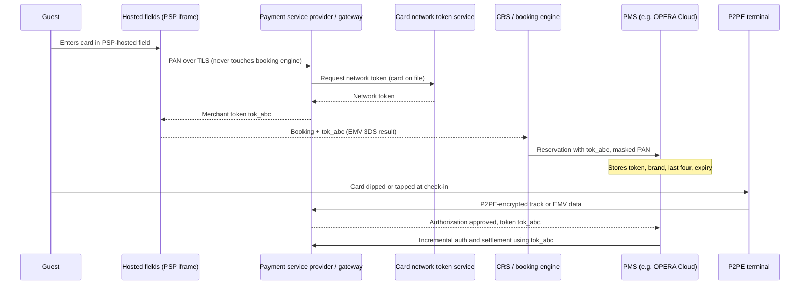
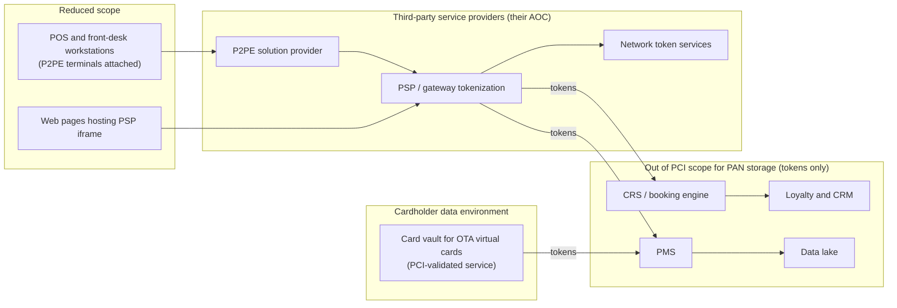

# Payment card data and PCI DSS
{: .no_toc }

**Phase 3: Structured data.** This page shows how the organization removes cardholder data from hotel systems so that the PMS, POS back office, CRS, and data lake hold tokens only, and how the remaining PCI DSS v4.0.1 obligations are met.
{: .fs-5 .fw-300 }

## On this page
{: .no_toc .text-delta }

1. TOC
{:toc}

---

## Why hospitality payment flows are hard

Hotels handle cards in more ways than almost any other merchant type. A single stay can involve a card-not-present booking through an online travel agency (OTA), a card-present pre-authorization at check-in, incremental authorizations for incidentals, a restaurant charge through the POS posted to the folio, a spa charge, a final settlement at checkout, and occasionally a no-show or late-cancellation charge days later. Each of those touches a different system, and historically each system stored the card number "because it might be needed later."

The architectural goal is simple to state: **the primary account number (PAN) is captured by a PCI-validated component (P2PE terminal, hosted payment field, or payment service provider), exchanged for a token immediately, and never enters the organization's systems in cleartext.** Everything below explains how that is achieved for each flow and what remains in scope.

## Hospitality card flows

| Flow | Channel | Where PAN enters | Target design | What the organization stores |
|---|---|---|---|---|
| Card present at front desk | P2PE terminal at property | Terminal (encrypted at read) | P2PE terminal integrated with PMS through a semi-integrated or cloud-based connection; gateway returns token | Gateway token, masked PAN (BIN and last four), card brand, expiry, authorization code |
| Card present at restaurant, bar, spa | POS with P2PE terminal | Terminal | Same gateway; POS posts charge to room folio by reference, not by card | Token and folio posting reference |
| Card not present, direct web or app booking | Booking engine, mobile app | Browser or app | Hosted fields or iframe from the payment service provider; EMV 3DS for authentication; tokenize before the booking request reaches the CRS | Token only in CRS and PMS |
| Card not present, call center | Voice agent | Caller reads card number | DTMF masking or IVR payment capture so agents never hear or type PAN | Token only |
| OTA and GDS bookings | Channel manager | OTA or GDS message contains guest card or an OTA virtual card | Channel manager or PCI-validated card vault receives the card and tokenizes before delivery to CRS and PMS | Token only; virtual card details retrieved just in time from the vault for charging |
| Pre-authorization and incidentals | Front desk | Card present or on file | Authorization for room and tax plus incidental estimate; incremental authorizations against the token | Token and authorization identifiers |
| Card on file for loyalty members | Loyalty profile, app wallet | App or web | Network token (Visa Token Service, Mastercard MDES) via the payment service provider; stored credential framework indicators for merchant-initiated transactions | Network token reference from the provider; masked PAN for display |
| No-show and late cancellation | Back office | Token from reservation | Merchant-initiated transaction using the stored token and the original consent | Token and consent evidence |
| Refunds and chargebacks | Finance | Token | Refund against original transaction reference | Token and transaction reference |

### Tokenized payment flow



## PCI DSS v4.0.1 walk-through: Requirement 3

PCI DSS v4.0.1 was published in June 2024. Its future-dated requirements became effective on March 31, 2025, so as of mid-2026 all requirements below are in force.

| Requirement | What it requires | How the organization meets it | Evidence |
|---|---|---|---|
| 3.1 and 3.2 | Processes and data retention for account data; keep storage to a minimum | Card data retention standard: tokens retained for the life of the reservation plus chargeback window; no PAN stored | Retention standard; data discovery scan results |
| 3.3 | Sensitive authentication data (SAD: full track data, card verification code, PIN and PIN block) not retained after authorization, even if encrypted | P2PE terminals and hosted fields prevent SAD reaching organization systems; CVV never requested outside hosted fields; call recordings pause during payment capture | P2PE solution listing; PSP attestation; discovery scans of logs and call recordings |
| 3.4.1 | PAN masked when displayed, showing at most BIN and last four, unless a legitimate business need to see more | PMS, POS, and CRS display only last four (and brand); no role sees full PAN because PAN is not present | Screenshots per role; configuration of PMS payment display |
| 3.4.2 | Technical controls to prevent copy or relocation of PAN when using remote-access technologies | Remote-access tools (VDI, support tools) block clipboard and file transfer on systems in the cardholder data environment (CDE) | Remote access configuration |
| 3.5.1 | PAN rendered unreadable anywhere it is stored: one-way hashes of the entire PAN, truncation, index tokens, or strong cryptography with associated key management | Tokens from the PSP (index tokens) replace PAN; where a PCI-validated vault holds PAN (OTA virtual cards), it uses strong cryptography with HSM keys | Data flow diagram; vault attestation; discovery scans |
| 3.5.1.1 | Hashes used to render PAN unreadable are keyed cryptographic hashes of the entire PAN with key management | Where fraud analytics need a PAN fingerprint, an HMAC-SHA-256 with a key in the HSM is used, never plain SHA-256 | Code review; key inventory entry |
| 3.5.1.2 | Disk-level or partition-level encryption used to render PAN unreadable only on removable media; otherwise must be combined with another mechanism | TDE and volume encryption are not claimed as the PAN control; they are supplementary | Control narrative |
| 3.6 | Cryptographic keys used to protect stored account data are secured: least custodians, key-encrypting keys at least as strong as data-encrypting keys, stored separately, in the fewest locations | Vault and payment keys in HSMs (on-prem Luna or payShield, AWS Payment Cryptography, Azure Payment HSM, or the PSP's HSMs) | Key management procedures; HSM configuration |
| 3.7 | Key management procedures: generation, distribution, storage, cryptoperiods, retirement and replacement, split knowledge and dual control for manual cleartext key operations, prevention of unauthorized substitution, custodian acknowledgment | Documented key lifecycle; key ceremonies with at least two custodians holding separate components; custodian acknowledgment forms | Key ceremony records; custodian forms; cryptoperiod register |

{: .verify }
Requirement numbers 3.3, 3.4.1, 3.5.1, 3.5.1.1, 3.5.1.2, 3.6, 3.7, 4.2.1, 4.2.1.1, and 12.3.3 are taken from the program's facts sheet. Other sub-requirement numbers cited on this page (3.4.2, 3.6.1.2, 4.2.2, 6.4.3, 11.6.1, 12.8.5, 12.9) should be confirmed against the published PCI DSS v4.0.1 text before they are quoted in audit material.

### What "tokens only" means for each system

| System | Allowed to store | Not allowed to store |
|---|---|---|
| PMS | Gateway token, brand, last four, expiry, authorization codes, cardholder name | PAN, SAD, full track, CVV |
| POS back office | Transaction reference, last four, brand | PAN, SAD |
| CRS and booking engine | Token from hosted fields, 3DS result indicators | PAN, CVV, 3DS authentication values beyond what the PSP returns for the transaction |
| Loyalty and CRM | Network token reference or PSP customer identifier, last four for display | PAN |
| Data lake and warehouse | Token or HMAC fingerprint, brand, BIN range where approved | PAN, SAD |
| Logs and SIEM | Token, last four | PAN (discovery scanner alerts on Luhn-valid 13 to 19 digit strings) |

The discovery scanner in [code/discovery](https://github.com/steven-smith-itnet/data-protection-pqc-security-architecture/tree/main/code/discovery) runs Luhn validation to find PAN leaking into logs, tickets, and data lake zones. Tokens are deliberately Luhn-invalid so they do not produce false positives.

## PCI DSS v4.0.1 walk-through: Requirement 4

| Requirement | What it requires | How the organization meets it |
|---|---|---|
| 4.2.1 | Strong cryptography and security protocols protect PAN during transmission over open, public networks; certificates valid and not expired or revoked | TLS 1.2 minimum, TLS 1.3 preferred, for hosted fields, PSP APIs, channel manager feeds, and terminal-to-gateway connections; P2PE adds encryption of card data from the terminal's point of interaction |
| 4.2.1.1 | An inventory of the organization's trusted keys and certificates used to protect PAN in transmission is maintained | Certificate and key inventory from the CBOM process ([Cryptographic inventory (CBOM)]()), filtered to CDE endpoints |
| 4.2.2 | PAN secured with strong cryptography when sent via end-user messaging technologies | Policy prohibits PAN in email, chat, and SMS; DLP blocks Luhn-valid numbers in Microsoft 365 (see [DLP and CASB enforcement]()) |

Public TLS certificate lifetimes are shrinking under CA/Browser Forum ballot SC-081 (200 days from March 15, 2026, 100 days from March 15, 2027, 47 days from March 15, 2029). Payment endpoints must use automated certificate renewal to stay compliant with 4.2.1's "valid and not expired" condition. See [Certificates and PKI]().

## Requirement 12.3.3: the PCI hook for crypto inventory and PQC

Requirement 12.3.3 requires that cryptographic cipher suites and protocols in use are documented and reviewed at least once every 12 months, including a plan to respond to anticipated changes in cryptographic vulnerabilities.

This requirement is the organization's regulatory anchor for two programs:

- **Cryptographic inventory.** The CBOM scanner ([code/cbom](https://github.com/steven-smith-itnet/data-protection-pqc-security-architecture/tree/main/code/cbom)) produces the documented list of protocols and cipher suites for CDE endpoints each quarter.
- **Post-quantum planning.** "Anticipated changes in cryptographic vulnerabilities" includes the deprecation of RSA and ECC under NIST IR 8547 (quantum-vulnerable algorithms at 112-bit security deprecated after 2030, disallowed after 2035). The annual 12.3.3 review records the PQC migration status of payment endpoints. See [PQC migration program]().

| 12.3.3 artifact | Content | Owner | Frequency |
|---|---|---|---|
| Protocol and cipher inventory | Every CDE endpoint, TLS version, cipher suites, key exchange groups, certificate algorithm and key size | Security architecture | Quarterly scan, annual sign-off |
| Vulnerability response plan | Triggers (new attack, NIST deprecation, vendor end of support), decision authority, target timelines | Security architecture and payments | Annual |
| PQC status | Hybrid PQ TLS readiness of PSP, terminals, HSMs; vendor roadmaps | Security architecture | Annual |

## Scope reduction architecture



| Technique | What it removes from scope | Residual obligations | Notes |
|---|---|---|---|
| P2PE terminals (PCI-listed solution) | Card data is encrypted in the terminal's secure reader; property networks and POS workstations never see cleartext | Terminal inventory, tamper inspections, P2PE instruction manual compliance | Eligible merchants may use the SAQ P2PE; larger merchants still benefit in a ROC |
| Gateway tokenization | PAN storage in PMS, POS back office, CRS | Protect tokens against misuse (they can initiate charges with the merchant's credentials) | Token is merchant-scoped at the PSP |
| Network tokens | PAN storage for card on file; also improves authorization rates and lifecycle updates when cards are reissued | PSP integration; stored credential indicators | Issued by card networks through the PSP |
| Hosted fields and iframes | PAN entry on web and app pages | Page script integrity and change detection on the hosting page (PCI DSS v4.0.1 requirements for payment page scripts, 6.4.3 and 11.6.1) | The hosting page is still in scope for script controls |
| EMV 3DS | Does not reduce scope; shifts fraud liability for authenticated card-not-present transactions | 3DS data handled by the PSP | Required by Strong Customer Authentication rules in the EEA and UK for many transactions |
| DTMF masking in call centers | PAN in agent desktops and call recordings | Telephony vendor attestation | Agents see payment status only |

{: .note }
Tokens are not PAN, but a gateway token that can be charged is a payment credential. Access to APIs that can charge a token is limited to the PMS, POS, and billing services, and bulk charge activity is monitored.

## Key management for PCI

PCI DSS keys fall into two categories that are managed differently:

| Key type | Examples | Where held | Management standard |
|---|---|---|---|
| Keys protecting stored account data | Card vault data keys, HMAC keys for PAN fingerprints | General-purpose HSM or KMS (Luna, CloudHSM, Managed HSM, Cloud HSM) | PCI DSS 3.6 and 3.7 |
| Payment keys | Terminal keys (BDK for DUKPT), PIN encryption keys, card verification keys, zone master keys | Payment HSM (Thales payShield, AWS Payment Cryptography, Azure Payment HSM) | PCI PIN Security and PCI P2PE standards; held by the PSP or P2PE provider in most hotel models |

In most hotel architectures the organization does not operate payment HSMs: the P2PE provider and PSP hold terminal and PIN keys. The organization holds keys only for its own card vault (if it runs one for OTA virtual cards) and for HMAC fingerprints.

### Split knowledge and dual control

Where manual cleartext key operations are unavoidable (loading a KEK into an HSM from components, restoring an HSM backup), PCI DSS 3.7 requires split knowledge and dual control:

- **Split knowledge:** no single person knows or holds the complete key. The key is split into at least two components (typically XOR components, or M of N smart cards on HSMs such as Luna with quorum or payShield with smart-card authorization).
- **Dual control:** at least two authorized people must act together to perform the operation; no single person can perform it alone.
- **Custodian acknowledgment:** each key custodian signs a form acknowledging responsibilities (PCI DSS 3.6.1.2 and related requirements).
- **Key ceremony records:** date, participants, components, check values (KCV), witness signatures, stored in the GRC evidence repository.

Cloud KMS operations that never expose cleartext keys (generate in HSM, wrap and unwrap inside HSM) do not require manual split knowledge, but administrative separation still applies: key administrators cannot use keys, and key users cannot change key policy.

### AWS Payment Cryptography and Azure Payment HSM

| Service | Model | Typical use | Notes |
|---|---|---|---|
| AWS Payment Cryptography | Managed, API-based payment cryptography service; control plane for key management and data plane for operations such as PIN translation, card verification value generation and verification, MAC, and data encryption | Organizations or PSPs building payment processing on AWS; card vaults needing payment-specific key types | Keys are managed as payment key types with key usage attributes (TR-31 style key blocks); AWS operates the HSMs |
| Azure Payment HSM | Dedicated Thales payShield 10K devices provisioned into the customer's Azure virtual network | Payment processors and issuers migrating on-prem payShield workloads | Customer manages the HSM with Thales payShield Manager; single-tenant |

Example: listing payment keys and their usage with the AWS CLI:

```bash
aws payment-cryptography list-keys --region eu-west-1
aws payment-cryptography get-key --key-identifier alias/card-vault-dek --region eu-west-1
```

{: .verify }
Confirm current regional availability, PCI attestations, and supported operations for AWS Payment Cryptography and Azure Payment HSM in the regions where the organization operates before designing around them.

## Franchise shared responsibility

Franchised and owner-managed properties make PCI responsibility contractual as well as technical. The brand typically provides the PMS, CRS, and loyalty platform; the franchisee often chooses and operates its own merchant account, terminals, and local POS.

| Component | Brand (the organization) | Franchisee or owner | Provider |
|---|---|---|---|
| CRS, booking engine, loyalty | Owns PCI compliance; tokens only | None | PSP for hosted fields |
| Cloud PMS (brand-mandated) | Owns platform security, token storage, payment integration | Users, workstations, local access | PMS vendor AOC |
| P2PE terminals | Defines approved solutions list | Operates terminals, tamper checks, merchant account | P2PE provider |
| Local POS | Publishes standard | Operates and validates (SAQ or ROC) | POS vendor |
| Property network | Publishes segmentation standard | Operates | Managed network provider |
| OTA virtual card retrieval | Provides card vault integration | Uses brand tooling | Vault provider |

A responsibility matrix (in the style of PCI DSS Requirement 12.8.5 and 12.9) is maintained for each provider and each franchise agreement type. Standards for franchisees are published as part of brand standards and verified through annual attestations.

## Good, Better, Best

| Level | Design | Residual risk |
|---|---|---|
| Good | Gateway tokenization for all channels; PMS and CRS store tokens only; TDE with CMK on any system that stores tokens; masking of last four; quarterly PAN discovery scans | Terminals not P2PE, so property networks remain in scope; card-on-file uses gateway tokens only |
| Better | Plus PCI-listed P2PE terminals at all properties, hosted fields for all web and app channels, DTMF masking in call centers, network tokens for loyalty card on file, EMV 3DS | OTA virtual cards still require a card vault; token misuse must be monitored |
| Best | Plus PCI-validated third-party vault for OTA virtual cards with just-in-time retrieval, HMAC fingerprints in HSM for fraud analytics, automated 12.3.3 cipher inventory from CBOM, hybrid PQ TLS on PSP connections where supported, continuous PAN discovery in logs and data lake | Dependency on PSP and vault availability; contractual reliance on provider attestations |

## Key takeaways for engineering teams

- PAN is captured by a PCI-validated component and exchanged for a token immediately; the PMS, CRS, POS back office, loyalty, and data lake store tokens only.
- TDE and disk encryption do not satisfy Requirement 3.5.1 on their own; tokens and keyed hashes do.
- SAD is never stored after authorization; P2PE and hosted fields keep it out of the organization's systems entirely.
- Requirement 12.3.3 is the compliance hook for the annual cipher and protocol review and for PQC planning.
- Franchise agreements define who owns terminals, merchant accounts, and networks; the responsibility matrix is part of the design, not an afterthought.

## Related pages

- [Tokenization, FPE, and masking]()
- [Hardware security modules]()
- [Cryptographic inventory (CBOM)]()
- [Encryption in transit]()
- [Compliance mapping]()

## Sources

- PCI Security Standards Council document library (PCI DSS v4.0.1, P2PE): <https://www.pcisecuritystandards.org/document_library/>
- PCI SSC, tokenization guidelines information supplement: <https://www.pcisecuritystandards.org/>
- AWS Payment Cryptography: <https://docs.aws.amazon.com/payment-cryptography/>
- Azure Payment HSM: <https://learn.microsoft.com/azure/payment-hsm/overview>
- EMVCo, EMV 3-D Secure: <https://www.emvco.com/emv-technologies/3-d-secure/>
