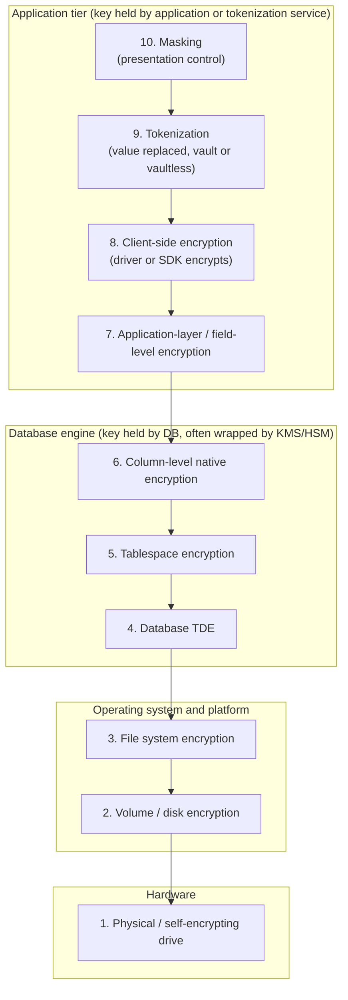

# Structured data protection patterns
{: .no_toc }

**Phase 3: Structured data.** This page defines which encryption and data-protection layer solves which threat, so engineering teams can pick the right control for each column instead of assuming "encrypted at rest" is enough.
{: .fs-5 .fw-300 }

## On this page
{: .no_toc .text-delta }

1. TOC
{:toc}

---

## Why a layer model is needed

"The database is encrypted" is one of the most common and least informative statements in a design review. It can mean a self-encrypting drive in a data center, an EBS volume with the default AWS managed key, SQL Server TDE, Always Encrypted on three columns, or tokens produced by a payment gateway. These controls defend against very different threats. A database with TDE enabled will return every guest's passport number in cleartext to any user who can run `SELECT`, including an attacker exploiting SQL injection in the booking engine.

The rule the organization applies: **a control protects data only against actors who sit below the layer where decryption happens.** If decryption happens in the storage engine, anyone who can query the engine sees cleartext. If decryption happens in the application, the DBA and anyone with a database credential see ciphertext. If the value is replaced by a token and the real value lives in a separate vault, even the application sees only tokens unless it is explicitly authorized to detokenize.

## The encryption layer stack

The layers below are ordered from the lowest (closest to hardware) to the highest (closest to the business user). Each one is described by where the cleartext exists and who holds the key.

### Layer 1: physical and self-encrypting drives (SED)

**What it is.** The drive encrypts every block with a media encryption key held in the drive controller. The key is unlocked at power-on by an authentication key (TCG Opal or Enterprise), usually supplied by the storage array or a key manager over KMIP.

**Where cleartext exists.** Everywhere above the drive controller: in the array, the host, the OS, the database.

**What it mitigates.** Loss or theft of individual drives, drives returned under RMA, and improper disposal. Supports cryptographic erase per NIST SP 800-88 Rev. 1 by destroying the media key.

**What it does not mitigate.** Anything that happens while the system is running. A compromised host, a stolen backup, a DBA, or an attacker with SQL access all see cleartext.

**Where it is used.** On-prem storage arrays and servers in regional data centers and larger properties. In public cloud, the provider operates equivalent controls and the customer has no visibility or key control at this layer.

### Layer 2: volume and disk encryption

**What it is.** The host or hypervisor encrypts a block device: BitLocker on Windows, LUKS/dm-crypt on Linux, VMware VM Encryption, AWS EBS encryption, Azure managed disk server-side encryption (with optional encryption at host), Google Cloud persistent disk encryption, and OCI block volume encryption.

**Where cleartext exists.** In the running OS and everything above it.

**What it mitigates.** Theft of disks, disk images, and cloud snapshots (where the snapshot is encrypted with a key the attacker cannot use). With CMK, it also enables revocation: disabling the key makes the volume unusable.

**What it does not mitigate.** An attacker with OS access, a DBA, SQL injection, application compromise, or anyone reading query results.

### Layer 3: file system encryption

**What it is.** Per-file or per-directory encryption in the OS or an agent: Linux fscrypt, Windows EFS, and third-party agents such as Thales CipherTrust Transparent Encryption (CTE), which adds process- and user-based access policy (for example, only the `oracle` OS user running the database binary may read the datafiles in cleartext).

**Where cleartext exists.** For native file system encryption: for any process running as a user with access. For CTE-style agents with access policies: only for the allowed processes and users.

**What it mitigates.** Everything layer 2 mitigates, plus OS administrators and other OS users who are not in the allow policy (with an agent such as CTE). It also produces file-access audit logs.

**What it does not mitigate.** The database process itself is allowed, so anyone who can query the database still sees cleartext.

### Layer 4: database transparent data encryption (TDE)

**What it is.** The database engine encrypts data files, log files, and (engine-dependent) backups and tempdb with a database encryption key (DEK). The DEK is wrapped by a master key held in a certificate, wallet, keystore, EKM provider, or cloud KMS. Available in SQL Server, Azure SQL, Oracle, Db2 (native encryption), MySQL InnoDB, MongoDB Enterprise, EDB Postgres, and all major cloud managed databases.

**Where cleartext exists.** In the database buffer pool and in every query result.

**What it mitigates.** Theft of data files, log files, and backup files; copying of datafiles by an OS administrator; restoring a stolen backup on another server (the backup is useless without the master key). With CMK in a KMS or HSM, the organization can revoke access.

**What it does not mitigate.** A DBA or any user with `SELECT`. SQL injection. A compromised application service account. Data exported by a reporting tool. Data in replicas that use a different, weaker configuration.

{: .important }
TDE is a PP-2 control. It does not protect against a DBA or SQL injection, and it is never sufficient on its own for C3 data. PCI DSS v4.0.1 Requirement 3.5.1.2 makes a related point for disk-level and partition-level encryption: on its own it is acceptable only for removable media.

### Layer 5: tablespace encryption

**What it is.** A variant of TDE that encrypts only selected tablespaces or tables, for example Oracle TDE tablespace encryption or MySQL InnoDB file-per-table encryption. Useful when an older or large system cannot tolerate encrypting everything at once, or when data is segregated by tablespace.

**Threat profile.** Identical to TDE for the objects covered. The risk is misplacement: a C3 table created in an unencrypted tablespace. Oracle's `ENCRYPT_NEW_TABLESPACES` and MySQL's `default_table_encryption` reduce that risk.

### Layer 6: column-level native encryption

**What it is.** The engine encrypts specific columns: Oracle TDE column encryption, SQL Server cell-level encryption with `ENCRYPTBYKEY`, and PostgreSQL `pgcrypto` functions.

**Where cleartext exists.** In the engine during query execution. For TDE column encryption, decryption is automatic for any user with `SELECT`. For `ENCRYPTBYKEY` and `pgcrypto`, the user must open the key or pass it in SQL, so the key is visible to the engine and often appears in logs or query history.

**What it mitigates.** Datafile theft for those columns, and for key-in-session schemes, users who do not have access to the key. It does not reliably protect against a DBA, who can usually observe or obtain the key material.

**Assessment.** Useful for legacy systems that cannot be changed. For new designs, application-layer encryption (layer 7) or client-side encryption (layer 8) is preferred because the key never enters the database.

### Layer 7: application-layer or field-level encryption

**What it is.** The application encrypts a field with a data key obtained from KMS (envelope encryption, see the [envelope encryption code](https://github.com/steven-smith-itnet/data-protection-pqc-security-architecture/tree/main/code/envelope)) before writing it to the database. The database stores ciphertext and never sees the key.

**Where cleartext exists.** Only in the application process memory and in any system the application passes the value to.

**What it mitigates.** DBAs, database backups, replicas, read-only reporting users, SQL injection that reads the column (the attacker gets ciphertext), cloud provider operators at the database layer, and data exported by database tools.

**What it does not mitigate.** Compromise of the application itself (it holds decrypt permission), and misuse by application users who are authorized to see the field. SQL injection that causes the application to decrypt and return the value in a response is still possible if the application decrypts everything it reads.

**Cost.** The database cannot index, search, sort, aggregate, or join on the cleartext. See [Searchable encryption options](#searchable-encryption-options).

### Layer 8: client-side encryption in the driver or SDK

**What it is.** Encryption that is performed by a database driver or SDK rather than hand-written application code, with metadata in the database describing which columns are encrypted: SQL Server and Azure SQL Always Encrypted, MongoDB Client-Side Field Level Encryption (CSFLE) and Queryable Encryption, and the AWS Database Encryption SDK for DynamoDB.

**Threat profile.** Equivalent to layer 7, with two advantages: the implementation is maintained by the vendor, and the metadata makes it harder for a developer to forget to encrypt a field. Some implementations support limited queries on ciphertext (equality through deterministic encryption; richer operations through secure enclaves or structured encryption schemes).

### Layer 9: tokenization

**What it is.** The sensitive value is replaced with a surrogate token. In vault tokenization, the mapping lives in a separate, hardened vault. In vaultless tokenization, the token is derived cryptographically (usually FPE). See [Tokenization, FPE, and masking]().

**What it mitigates.** Everything layer 7 mitigates, and it removes the protected system from scope: a PMS that stores only payment tokens is not storing PAN. The application itself can be denied detokenization rights.

**What it does not mitigate.** Compromise of the vault or of a service authorized to detokenize. A token that is usable for payment (a merchant-scoped gateway token) is still a credential that must be protected from misuse, even though it is not PAN.

### Layer 10: masking

**What it is.** A presentation control that changes what a user sees. Dynamic masking rewrites query results based on the caller's role (SQL Server dynamic data masking, Oracle Data Redaction, Snowflake masking policies, BigQuery data masking, Databricks column masks). Static masking permanently replaces values in a copy of the data (for test and analytics environments).

**What it mitigates.** Over-exposure to users who need the row but not the value: front-desk staff seeing last four digits of a card, analysts seeing hashed emails, support agents seeing partial phone numbers.

**What it does not mitigate.** Anyone who can bypass the policy (object owners, `UNMASK` holders, users of other access paths such as backups or exports), and inference attacks. SQL Server documents that dynamic data masking can be circumvented by users with ad hoc query rights using predicate inference. Dynamic masking is an access control convenience, not encryption.

## Threat-versus-layer matrix

The matrix below is the core reference for design reviews. "Yes" means the layer, correctly implemented, prevents the actor from obtaining cleartext. "Partial" means it helps under stated conditions. "No" means the actor sees cleartext.

| Threat or actor | 1 SED | 2 Volume | 3 FS / CTE | 4 TDE | 5 Tablespace | 6 Column native | 7 App-layer FLE | 8 Client-side (AE, CSFLE, DB-ESDK) | 9 Tokenization | 10 Dynamic masking |
|---|---|---|---|---|---|---|---|---|---|---|
| Stolen or disposed physical drive | Yes | Yes | Yes | Yes | Yes (covered objects) | Yes (columns) | Yes | Yes | Yes | No |
| Stolen disk image or cloud snapshot | No | Yes, with CMK | Yes | Yes | Yes | Yes | Yes | Yes | Yes | No |
| Stolen database backup file | No | No | Partial (if backup lands on protected path) | Yes (if backup encrypted by TDE or backup encryption) | Yes | Yes | Yes | Yes | Yes | No |
| OS administrator reading data files | No | No | Yes (with process allow-list) | Yes | Yes | Yes | Yes | Yes | Yes | No |
| OS administrator dumping DB process memory | No | No | No | No | No | Partial | Partial (only values the DB never held) | Yes (DB never holds cleartext) | Yes | No |
| DBA or sysadmin role running SELECT | No | No | No | No | No | Partial (key-in-session schemes only) | Yes | Yes | Yes | Partial (DBAs usually exempt) |
| SQL injection reading tables directly | No | No | No | No | No | Partial | Yes | Yes | Yes | Partial (depends on app role) |
| Compromised application service account | No | No | No | No | No | No | No (app can decrypt) | No (app can decrypt) | Yes, if the app lacks detokenize rights | Partial |
| Analyst or reporting user over-exposure | No | No | No | No | No | Partial | Yes | Yes | Yes | Yes |
| Cloud provider operator at storage layer | Partial | Yes, with CMK or external key | Yes | Yes, with CMK | Yes | Yes | Yes | Yes | Yes | No |
| Replica or read-only copy in weaker environment | No | Partial | Partial | Partial (copy may not be encrypted) | Partial | Yes | Yes | Yes | Yes | No (policy may not follow) |
| Non-production copy made from production | No | No | No | No | No | Partial | Yes (if keys differ per environment) | Yes | Yes | No |
| Crypto-shredding for erasure requests | Drive only | Volume only | Partial | Database only | Tablespace only | Column only | Yes (per-subject or per-tenant keys) | Partial | Yes (delete mapping) | No |

Reading the matrix: layers 1 to 5 protect **media**; layers 6 to 9 protect **values**; layer 10 protects **views**. A PP-3 design needs at least one layer from the "values" group, plus the media protection from PP-2.

## Good, Better, Best per classification tier

| Tier | Profile | Good (minimum) | Better | Best |
|---|---|---|---|---|
| C0 Public | PP-1 | Platform default encryption, TLS 1.2+ | Same | Same; no additional controls warranted |
| C1 Internal | PP-1 | Provider-managed keys, TDE or storage encryption on by default, IAM, audit logs | CMK where the store also holds C2 data | Not warranted |
| C2 Confidential | PP-2 | TDE or storage encryption with CMK per domain and environment; key admin and key user separated; audit logging | Plus dynamic masking for non-privileged roles, row-level policies for regional data, quarterly access reviews, masked non-production | Plus deterministic encryption or blind index on direct identifiers (email, phone) in analytics copies; HMAC surrogate keys for joins |
| C3 Restricted | PP-3 | PP-2 plus field-level encryption or tokenization in the application; separate key per field type; no cleartext in logs | Plus HSM-backed keys (CloudHSM, Managed HSM, Cloud HSM, OCI dedicated), just-in-time DBA access, detokenization restricted to named services, database activity monitoring | Plus external or customer-held keys where justified (XKS, Cloud EKM, OCI External KMS), per-subject keys and crypto-shredding, confidential computing for decrypt services |

Trade-offs to state in every design: the "Best" column increases availability risk (an external key manager outage stops the database), cost, and query limitations. A C3 store that must answer range queries on the protected field is a design smell; revisit the requirement before choosing enclaves or weaker schemes.

## Detail pages

| Page | Contents |
|:--|:--|
| [Search, joins, and key granularity]() | Performance, search, join, and index implications; searchable encryption options; key granularity |
| [Protect a new table, step by step]() | Six-step procedure from column classification to evidence; common anti-patterns |

## Key takeaways for engineering teams

- Identify where decryption happens: any actor above that point sees cleartext. TDE decrypts inside the engine, so DBAs and SQL injection see cleartext.
- For C3 columns, encrypt or tokenize in the application or driver so the database stores only ciphertext or tokens.
- Choose searchable schemes deliberately: blind indexes and deterministic encryption leak equality; avoid order-preserving schemes.
- Separate keys by domain, environment, and purpose; never reuse the HMAC index key for encryption.
- Follow the six-step table procedure and keep the evidence; the test "query as DBA" is the fastest way to find a gap.

## Related pages

- [Tokenization, FPE, and masking]()
- [On-prem databases]()
- [Cloud databases]()
- [Key management architecture]()
- [Retention, deletion, and crypto-shredding]()
- [Encryption decision trees]()

## Sources

- NIST SP 800-38D (GCM): <https://csrc.nist.gov/pubs/sp/800/38/d/final>
- NIST SP 800-88 Rev. 1: <https://csrc.nist.gov/pubs/sp/800/88/r1/final>
- Microsoft, Always Encrypted: <https://learn.microsoft.com/sql/relational-databases/security/encryption/always-encrypted-database-engine>
- Microsoft, Dynamic data masking: <https://learn.microsoft.com/sql/relational-databases/security/dynamic-data-masking>
- AWS Database Encryption SDK, searchable encryption: <https://docs.aws.amazon.com/database-encryption-sdk/latest/devguide/searchable-encryption.html>
- MongoDB Queryable Encryption: <https://www.mongodb.com/docs/manual/core/queryable-encryption/>
