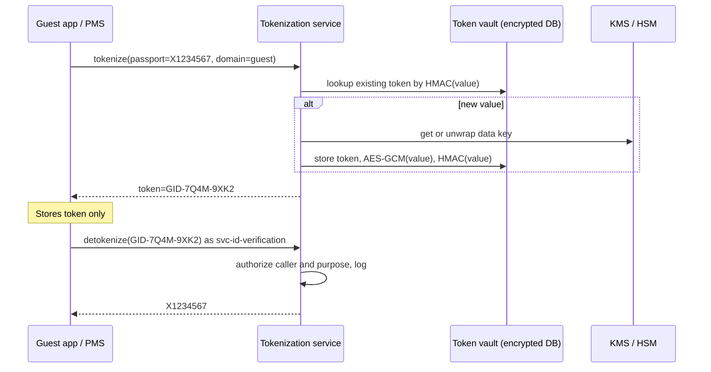
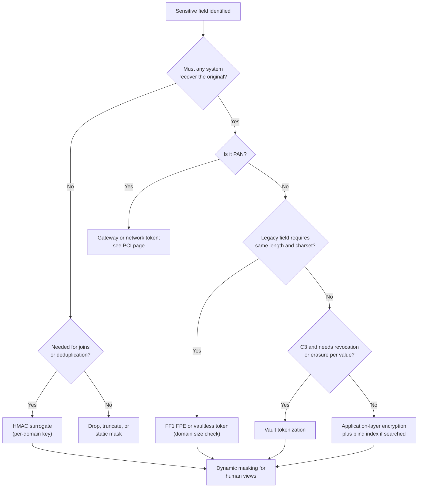

# Tokenization, FPE, and masking
{: .no_toc }

**Phase 3: Structured data.** This page explains how the organization replaces or hides sensitive values while keeping systems working, and which technique fits which use case.
{: .fs-5 .fw-300 }

## On this page
{: .no_toc .text-delta }

1. TOC
{:toc}

---

## The four techniques and what they are for

Tokenization, format-preserving encryption (FPE), masking, and keyed hashing are often discussed as if they were interchangeable. They are not. Each answers a different question.

| Technique | Reversible? | Keeps format? | Supports equality joins? | Primary purpose | Typical hospitality use |
|---|---|---|---|---|---|
| Vault tokenization | Yes, by lookup in the vault | Optional | Yes, if deterministic | Remove the real value from systems; scope reduction | Card numbers (at the gateway), passport numbers, bank accounts |
| Vaultless tokenization / FPE | Yes, with the key | Yes | Yes (deterministic by design) | Replace value in legacy schemas that validate length and character set | Loyalty numbers, national ID numbers in legacy PMS fields, account numbers in test data |
| Keyed hashing (HMAC) | No | No (unless encoded) | Yes | Join and deduplicate without revealing the value | Guest email as join key across CRM, loyalty, and data lake |
| Static masking | No | Usually | Only if masking is deterministic | Produce safe copies for test, development, training, and vendors | Non-production refresh of PMS and CRM databases |
| Dynamic masking | Not applicable (original unchanged) | Yes | Yes (on original) | Limit what a user sees at query time | Front desk sees last four digits; analysts see masked email |

Two design principles apply throughout:

1. **Tokenize or encrypt as early as possible**, at the point of capture (the payment terminal, web form, or API gateway), so downstream systems never see the real value.
2. **Detokenize as late as possible, as rarely as possible, and only in named services**. Every detokenization is an access to C3 data and is logged.

## Vault tokenization

In vault tokenization, a tokenization service generates a token (random or format-preserving) and stores the mapping `token -> encrypted value` in a hardened data store. The vault encrypts stored values with keys held in an HSM or KMS.



**Strengths.** Tokens have no mathematical relationship to the value, so a stolen token table without the vault reveals nothing. Tokens can be revoked individually. Scope reduction is strong: PCI DSS assessors accept systems that store only tokens as out of scope for PAN storage when the tokens cannot be converted back without the vault.

**Weaknesses.** The vault is a high-value, high-availability dependency. It must be replicated across regions for a global hotel operation, which creates residency questions (a vault in the EU holding US guest data, or the reverse). Every tokenize and detokenize call adds latency. Vault size grows with the number of unique values.

**Design decisions:**

| Decision | Options | Recommendation |
|---|---|---|
| Deterministic or random tokens | Deterministic (same value gives same token) or random per call | Deterministic within a domain, so joins and deduplication work; random for one-time use tokens |
| Token format | Random alphanumeric, prefixed, or format-preserving | Prefixed (`GID-`, `LOY-`) for non-payment data so tokens are recognizable in logs; format-preserving only when a legacy field requires it |
| Vault deployment | Central, regional, or per residency zone | One vault per residency zone (`eu`, `us`, `apac`, `cn`); tokens carry a region marker |
| Token scope | Global or per domain | Per domain; a loyalty token cannot be detokenized with payment permissions |

## Vaultless tokenization and format-preserving encryption

Vaultless tokenization derives the token cryptographically from the value and a secret key, usually with FPE, so no mapping table is needed. Anyone with the key and the algorithm can reverse it; there is no vault to scale or replicate, and tokens are consistent across regions that share the key.

### NIST SP 800-38G and FF1

NIST SP 800-38G specifies format-preserving encryption modes built on AES. FF1 is the recommended mode. FF1 encrypts a string over a given radix (for example radix 10 for digits) into another string of the same length and radix, using a tweak that acts like a public diversifier.

{: .verify }
FF3 was found to have weaknesses and was revised to FF3-1 in SP 800-38G Rev. 1 (draft). As of mid-2026 the 2025 draft revision of SP 800-38G withdraws FF3-1 and raises the minimum domain size. Treat FF3-1 as not approved for new designs and confirm the final text of the revision before relying on specific domain-size numbers.

Practical constraints of FPE:

- **Small domains are weak.** A 4-digit field has only 10,000 possible values; an attacker who can encrypt chosen inputs, or who knows the distribution, can build a complete table. NIST sets a minimum domain size and the draft revision raises it. Do not FPE short fields such as CVV, PIN, or 4-digit room numbers.
- **Preserve only what is needed.** For card numbers, a common pattern keeps the BIN (first six or eight digits) and last four in clear and encrypts the middle digits. That leaves a small domain in the middle, which is one reason PCI tokens are usually produced by the gateway or a vault rather than by in-house FPE.
- **Use tweaks.** A tweak per domain (for example `loyalty` versus `employee`) ensures the same number in two domains produces different ciphertexts.
- **Luhn validity.** Some systems validate the Luhn check digit. FPE output is not Luhn-valid by default; products can generate Luhn-valid or deliberately Luhn-invalid tokens. The organization prefers **Luhn-invalid** tokens for anything resembling a PAN so tokens cannot be confused with real cards by discovery tools or downstream systems.

### Vault versus vaultless

| Factor | Vault | Vaultless (FPE) |
|---|---|---|
| Reversal requires | Access to vault and its keys | The key |
| Compromise impact | Token table alone useless | Key compromise reverses all tokens in that domain |
| Latency | Network call and database lookup | CPU only (can be local library) |
| Multi-region | Replication and residency issues | Key distribution only |
| Revocation of one token | Delete mapping | Not possible without key change |
| Right to erasure | Delete mapping: tokens become meaningless | Requires key rotation or crypto-shredding by domain |
| PCI scope | Well understood | Accepted when key management meets Requirement 3.6 and 3.7 |
| Best fit | PAN, passport, bank accounts, C3 | Legacy field constraints, test data, C2 identifiers |

## Keyed hashing for joins

Analytics, fraud, and marketing teams need to join guest records across the CRS, PMS, loyalty, CRM, and web analytics without seeing the underlying email or phone number. A keyed hash (HMAC) of a normalized value gives a stable join key that cannot be reversed or brute-forced by anyone who lacks the key.

Why keyed and not plain SHA-256: email addresses and phone numbers have small, guessable spaces. An unkeyed SHA-256 of an email can be reversed by hashing a list of known emails. PCI DSS v4.0.1 Requirement 3.5.1.1 makes the same point for PAN: hashes used to render PAN unreadable must be keyed cryptographic hashes.

### Python example: HMAC surrogate tokens

The full implementation with tests is in [code/tokenization](https://github.com/steven-smith-itnet/data-protection-pqc-security-architecture/tree/main/code/tokenization). The core idea:

```python
import hmac
import hashlib
import unicodedata


def normalize_email(value: str) -> str:
    """Normalize so that equivalent emails produce the same surrogate."""
    value = unicodedata.normalize("NFKC", value).strip().lower()
    return value


def normalize_phone(value: str) -> str:
    """Keep digits and a leading plus sign only (E.164 style)."""
    value = value.strip()
    digits = "".join(ch for ch in value if ch.isdigit())
    return "+" + digits if value.startswith("+") else digits


def surrogate(value: str, key: bytes, domain: str, prefix: str) -> str:
    """Deterministic, non-reversible surrogate for joins.

    The domain string is bound into the MAC so the same email yields
    different surrogates in the 'guest' and 'employee' domains.
    """
    msg = domain.encode("utf-8") + b"\x00" + value.encode("utf-8")
    mac = hmac.new(key, msg, hashlib.sha256).hexdigest()
    return f"{prefix}_{mac[:32]}"


if __name__ == "__main__":
    # In production the key comes from the secrets manager or is derived from a KMS
    # data key; it is never hard-coded. This literal is for demonstration only.
    demo_key = bytes.fromhex("6b" * 32)
    email = "  Maria.Silva@Example.com "
    token = surrogate(normalize_email(email), demo_key, domain="guest", prefix="gem")
    print(token)  # stable across systems that share the guest-domain HMAC key
```

Operating rules:

- The HMAC key is a C3 secret held in the secrets manager or derived from a KMS key; it is scoped per domain and per residency region where cross-region correlation is not permitted.
- Key rotation changes every surrogate. Rotation is planned as a re-keying job that maintains old and new surrogates side by side for a transition period, identified by a key version column.
- Truncating to 128 bits (32 hex characters) is sufficient for uniqueness at the organization's scale.

## Static and dynamic masking

| Aspect | Static masking | Dynamic masking |
|---|---|---|
| Where applied | On a copy of the data, once | At query time, per request |
| Original data | Replaced in the copy | Unchanged in the store |
| Reversible | No | Not applicable |
| Protects against | Anyone with access to the copy | Users without unmask rights, within the policy's reach |
| Bypass risk | Low, if masking is complete | Owners, admins, exports, inference queries |
| Consistency | Must be deterministic across tables to keep referential integrity | Automatic |
| Typical use | Test, development, training, vendor data sharing | Production reporting, support tools, analyst access |

Static masking techniques include substitution from realistic dictionaries, deterministic FPE or HMAC-based substitution to preserve joins, shuffling within a column, date shifting, generalization (age bands instead of birth dates), and nulling. Referential integrity is the hardest requirement: if the guest email is the join key between CRM and loyalty tables, both must be masked with the same deterministic function.

### Dynamic masking in SQL Server and Azure SQL

```sql
-- Mask existing columns
ALTER TABLE dbo.Guest ALTER COLUMN Email
    ADD MASKED WITH (FUNCTION = 'email()');
ALTER TABLE dbo.Guest ALTER COLUMN Phone
    ADD MASKED WITH (FUNCTION = 'partial(0,"XXX-XXX-",4)');
ALTER TABLE dbo.Guest ALTER COLUMN DateOfBirth
    ADD MASKED WITH (FUNCTION = 'default()');
ALTER TABLE dbo.Guest ALTER COLUMN LoyaltyPoints
    ADD MASKED WITH (FUNCTION = 'random(1, 100)');

-- Roles
CREATE ROLE FrontDesk;
CREATE ROLE GuestServicesLead;
GRANT SELECT ON dbo.Guest TO FrontDesk;
GRANT SELECT ON dbo.Guest TO GuestServicesLead;

-- SQL Server 2022 and Azure SQL support granular UNMASK at column level
GRANT UNMASK ON dbo.Guest(Email) TO GuestServicesLead;

-- Inspect masked columns
SELECT t.name AS table_name, c.name AS column_name, c.masking_function
FROM sys.masked_columns AS c
JOIN sys.tables AS t ON c.object_id = t.object_id;
```

{: .warning }
Microsoft documents that dynamic data masking does not prevent a user with ad hoc query rights from inferring values with predicates such as `WHERE Salary > 99999`. Use it to reduce casual exposure, not as a C3 control.

### Snowflake masking policy

```sql
USE ROLE governance_admin;

CREATE OR REPLACE MASKING POLICY governance.policies.mask_email
  AS (val STRING) RETURNS STRING ->
  CASE
    WHEN IS_ROLE_IN_SESSION('GUEST_PII_READER') THEN val
    WHEN IS_ROLE_IN_SESSION('ANALYST') THEN
      SHA2(CONCAT(LOWER(TRIM(val)), '|guest'), 256)   -- consistent pseudonym for joins
    ELSE REGEXP_REPLACE(val, '.+@', '*****@')
  END;

ALTER TABLE guest.core.guest_profile
  MODIFY COLUMN email SET MASKING POLICY governance.policies.mask_email;
```

The `ANALYST` branch uses a salted but unkeyed hash for readability. For C3 or high-value identifiers the organization replaces this with a keyed surrogate produced upstream by the tokenization service, because an unkeyed hash of an email can be reversed by dictionary. Tag-based masking, which attaches policies to classification tags rather than columns, is covered in [Data lakes and analytics platforms]().

### BigQuery data masking

BigQuery data masking works through policy tags in a Data Catalog taxonomy. A data policy of type data masking is attached to a policy tag, and users with the Masked Reader role on that data policy see masked values while users with Fine-Grained Reader on the policy tag see cleartext.

```hcl
resource "google_data_catalog_taxonomy" "classification" {
  region                 = "eu"
  display_name           = "data-classification"
  activated_policy_types = ["FINE_GRAINED_ACCESS_CONTROL"]
}

resource "google_data_catalog_policy_tag" "guest_pii" {
  taxonomy     = google_data_catalog_taxonomy.classification.id
  display_name = "confidential-guest-pii"
}

resource "google_bigquery_datapolicy_data_policy" "mask_guest_pii" {
  location         = "eu"
  data_policy_id   = "mask_guest_pii_sha256"
  policy_tag       = google_data_catalog_policy_tag.guest_pii.name
  data_policy_type = "DATA_MASKING_POLICY"
  data_masking_policy {
    predefined_expression = "SHA256"
  }
}
```

Predefined masking rules include SHA-256 hashing, default value, nullify, and partial rules such as last four characters and email masking; custom masking routines are also supported. The SHA-256 rule is an unkeyed hash, so the same dictionary caveat applies.

{: .verify }
The list of predefined BigQuery masking expressions has grown over time. Confirm the current set in the BigQuery documentation before standardizing on one.

## Pseudonymization and anonymization under GDPR

The distinction matters because anonymized data falls outside GDPR, while pseudonymized data remains personal data.

| Concept | GDPR basis | Meaning | Examples in the organization | Still personal data? |
|---|---|---|---|---|
| Pseudonymization | Article 4(5) | Processing so data can no longer be attributed to a specific person without additional information, which is kept separately and protected by technical and organizational measures | Tokens, HMAC surrogates, FPE values, encrypted fields | Yes, for any party that can reasonably re-identify, including the organization holding the key |
| Anonymization | Recital 26 | Data that does not relate to an identifiable person, taking into account all means reasonably likely to be used | Aggregated occupancy by property and month; k-anonymized stay statistics with small cells suppressed | No, if re-identification is not reasonably likely |

Consequences for design:

- Tokenized or hashed guest data in the data lake is still personal data. Residency, retention, access control, and data subject rights still apply.
- Pseudonymization is explicitly listed in Article 32 as an appropriate security measure and in Article 25 as a data protection by design measure, so it reduces risk and supports DPIAs even though it does not remove GDPR applicability.
- Claims of anonymization require a documented re-identification risk assessment, not just removal of names.

{: .verify }
The EDPB adopted Guidelines 01/2025 on pseudonymisation for public consultation in January 2025, and EU case law in 2025 addressed whether pseudonymized data is personal data from the recipient's perspective. Check the final guidelines and current case law before relying on a recipient-relative interpretation for data sharing with franchisees or vendors.

## Detokenization access control

Detokenization is where tokenization programs usually fail: every team asks for detokenize rights "just in case", and within a year the vault is as exposed as the original database.

Controls the organization requires:

| Control | Implementation |
|---|---|
| Named services only | Detokenize permission granted to workload identities (service accounts, IAM roles), never to human users or shared accounts |
| Purpose binding | Each detokenize call includes a purpose code (`id-verification`, `chargeback`, `regulatory-report`); the vault policy allows specific purposes per caller |
| Partial reveal | Where full value is not needed, the vault returns a masked form (last four) instead of full detokenization |
| Rate limits and anomaly detection | Per-caller limits; alerts on bulk detokenization |
| Break-glass | Human detokenization only through just-in-time elevation with approval and session recording |
| Logging | Every detokenize event logged with caller, purpose, token, and result to the SIEM (see [Monitoring and detection]()) |
| Separation | Vault administrators cannot detokenize; application owners cannot change vault policy |

## Products and platform options

| Product | Type | Tokenization | FPE | Masking | Notes |
|---|---|---|---|---|---|
| HashiCorp Vault Transform secrets engine | Self-managed or HCP | Yes (vault tokenization with external or internal store) | Yes (FF3-1 in documentation; confirm mode) | Yes (masking transformation) | Requires Vault Enterprise with the Advanced Data Protection module |
| Protegrity | Commercial data protection platform | Vault and vaultless | Yes | Yes | Broad connector set for databases, warehouses, and Snowflake/Databricks external functions |
| OpenText Voltage SecureData | Commercial | Vaultless (Secure Stateless Tokenization) | Yes (FF1) | Yes | Long history in payments and hospitality |
| Thales CipherTrust Tokenization | Commercial | Vault and vaultless | Yes | Dynamic masking on detokenization | Integrates with CipherTrust Manager key management |
| Google Cloud Sensitive Data Protection | Cloud service | Deterministic encryption with surrogate info types | Yes (FPE-FFX) | Yes (character masking, redaction, bucketing, date shifting) | De-identification API; keys can be KMS-wrapped |
| AWS | Cloud | No general-purpose tokenization service | No | Redshift dynamic masking, Lake Formation column filters | For payments, use AWS Payment Cryptography or partner tokenization (gateway or marketplace products) |
| Azure | Cloud | No general-purpose tokenization service | No | Azure SQL dynamic data masking, Synapse DDM, Purview-driven policies | Payment workloads use Azure Payment HSM or partner services |

{: .verify }
HashiCorp documentation for the Transform secrets engine has described FF3-1 as its FPE mode. Given the NIST draft revision withdrawing FF3-1, confirm the supported modes and the vendor's roadmap before using Vault FPE for new C3 data. Vault tokenization mode (non-FPE) is not affected.

### HashiCorp Vault Transform example

```bash
vault secrets enable transform

# Role that applications use
vault write transform/role/guest-identity transformations=passport-token

# Vault tokenization transformation (convergent = deterministic tokens for joins)
vault write transform/transformations/tokenization/passport-token \
    allowed_roles=guest-identity \
    convergent=true \
    max_ttl=0

# Tokenize
vault write transform/encode/guest-identity \
    transformation=passport-token value="X1234567"

# Detokenize: granted only to the id-verification service policy
vault write transform/decode/guest-identity \
    transformation=passport-token value="<token>"
```

{: .verify }
Parameter names for the tokenization transformation (for example `convergent`, `stores`, `mapping_mode`) differ between Vault versions. Validate against the documentation for the deployed version.

### Google Cloud Sensitive Data Protection de-identification

Request body for `projects.locations.content.deidentify` with deterministic encryption for email and FPE for a loyalty number, using a KMS-wrapped key:

```json
{
  "deidentifyConfig": {
    "recordTransformations": {
      "fieldTransformations": [
        {
          "fields": [{ "name": "email" }],
          "primitiveTransformation": {
            "cryptoDeterministicConfig": {
              "cryptoKey": {
                "kmsWrapped": {
                  "wrappedKey": "<base64-wrapped-aes-256-key>",
                  "cryptoKeyName": "projects/dp-keys-eu/locations/europe-west1/keyRings/guest/cryptoKeys/sdp-deid"
                }
              },
              "surrogateInfoType": { "name": "GUEST_EMAIL_TOKEN" }
            }
          }
        },
        {
          "fields": [{ "name": "loyalty_number" }],
          "primitiveTransformation": {
            "cryptoReplaceFfxFpeConfig": {
              "cryptoKey": {
                "kmsWrapped": {
                  "wrappedKey": "<base64-wrapped-aes-256-key>",
                  "cryptoKeyName": "projects/dp-keys-eu/locations/europe-west1/keyRings/guest/cryptoKeys/sdp-deid"
                }
              },
              "commonAlphabet": "NUMERIC"
            }
          }
        }
      ]
    }
  },
  "item": {
    "table": {
      "headers": [{ "name": "email" }, { "name": "loyalty_number" }],
      "rows": [
        { "values": [{ "stringValue": "maria.silva@example.com" }, { "stringValue": "4410982231" }] }
      ]
    }
  }
}
```

The same configuration can be saved as a de-identification template and applied by Dataflow or by Sensitive Data Protection inspection jobs that write de-identified copies of BigQuery tables.

## Choosing a technique



## Key takeaways for engineering teams

- Tokenize at capture and detokenize rarely; detokenization rights are granted to named services with purpose codes, never to people by default.
- Use FF1 for FPE; do not adopt FF3-1 for new designs, and do not FPE small domains such as CVV or four-digit fields.
- Use keyed hashes (HMAC) with per-domain keys for join keys; unkeyed SHA-256 of emails or PAN is reversible by dictionary.
- Tokenized and hashed data is pseudonymized, so it remains personal data under GDPR.
- Dynamic masking reduces casual exposure but is bypassable; it complements encryption or tokenization for C3 data and does not replace it.

## Related pages

- [Structured data protection patterns]()
- [Payment card data and PCI DSS]()
- [Data lakes and analytics platforms]()
- [Cryptographic standards]()
- [Code and tooling lab]()

## Sources

- NIST SP 800-38G, format-preserving encryption: <https://csrc.nist.gov/pubs/sp/800/38/g/final>
- GDPR text (Regulation (EU) 2016/679): <https://eur-lex.europa.eu/eli/reg/2016/679/oj>
- EDPB Guidelines 01/2025 on pseudonymisation: <https://www.edpb.europa.eu/>
- HashiCorp Vault Transform secrets engine: <https://developer.hashicorp.com/vault/docs/secrets/transform>
- Google Cloud Sensitive Data Protection, pseudonymization: <https://cloud.google.com/sensitive-data-protection/docs/pseudonymization>
- Snowflake masking policies: <https://docs.snowflake.com/en/user-guide/security-column-ddm-intro>
- BigQuery data masking: <https://cloud.google.com/bigquery/docs/column-data-masking-intro>
- SQL Server dynamic data masking: <https://learn.microsoft.com/sql/relational-databases/security/dynamic-data-masking>
