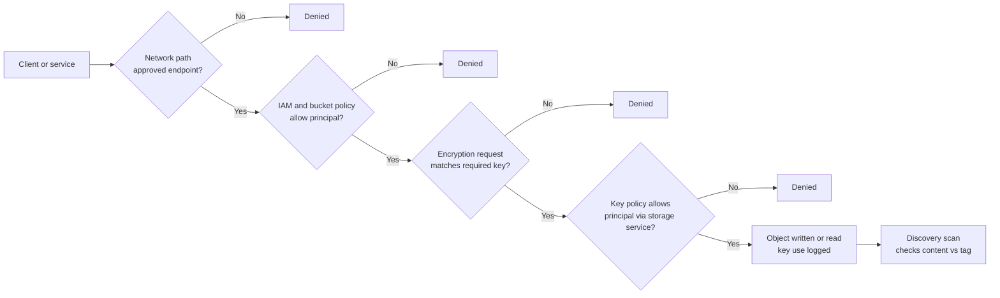

# Cloud object storage
{: .no_toc }

**Phase 4: Unstructured data.** Defines how buckets and blob containers holding each classification tier are encrypted, keyed, fenced from public and cross-network access, scanned for sensitive content, and made immutable where required, across all four cloud providers.
{: .fs-5 .fw-300 }

## On this page
{: .no_toc .text-delta }

1. TOC
{:toc}

---

## What object storage holds in the organization

Object storage is the landing zone for most unstructured data that is produced by systems rather than people:

| Content | Producer | Tier | Domain tag |
|---|---|---|---|
| Guest document uploads (ID images from mobile check-in) | Guest mobile app backend | C3 | `guest` |
| PMS and CRS nightly extracts | Integration platform | C2 | `guest` |
| Data lake raw zone (reservations, stays, folios) | Ingestion pipelines | C2, some C3 | `guest`, `payment` |
| Call recordings | Contact center platform export | C2 or C3 | `guest` |
| CCTV archive exports | Video management system | C2 | `property-iot` |
| Application and access logs | Log pipeline | C1 to C2 | `security` |
| Database backups and exports | Backup services | Inherits source tier | Source domain |
| Marketing assets, property photos | Content management | C0 | `operations` |

Two properties of object storage drive the design. First, a single misconfigured policy can make a bucket readable by the internet, so preventive guardrails matter more than detection. Second, object storage is often read by many services (analytics, ML, partners), so key and network policies must allow those paths explicitly and deny everything else.

The control stack below applies to every write and read of a C3 object, regardless of provider. Each gate is independent, so a mistake in one (for example an over-broad IAM policy) is caught by another (the key policy).



## Mapping protection profiles to object storage

| Control | PP-1 Baseline (C0, C1) | PP-2 Enhanced (C2) | PP-3 Maximum (C3) |
|---|---|---|---|
| Encryption at rest | Provider default (SSE-S3, Microsoft-managed, Google default, Oracle-managed) | Customer-managed key per data domain and environment | CMK in HSM-backed or single-tenant HSM key store; client-side or application-layer encryption for the most sensitive objects; external keys only where justified |
| Public access | Blocked at account or organization level | Blocked | Blocked |
| Network path | Public endpoint with IAM | Private endpoint or VPC endpoint preferred | Private endpoint or VPC endpoint only; bucket policy denies other paths |
| Access model | IAM roles, no ACLs | Uniform/bucket-level access; access points per consumer | Per-consumer access points with least privilege; no human read access by default |
| Discovery | Periodic sampling | Automated discovery scans | Continuous discovery plus alerting on new C3 in non-C3 buckets |
| Immutability and versioning | Versioning where useful | Versioning, lifecycle to delete | Versioning, object lock or immutability policy where retention is legally required |
| Logging | Management events | Data access events for writes | Data access events for reads and writes |

Tags from the resource tag schema (`data-classification`, `protection-profile`, `data-domain`, `regulatory-scope`, `data-residency`, `data-owner`, `retention-class`) are mandatory on every bucket and container, and guardrails in [Guardrails and policy as code]() evaluate them.

## AWS S3

### Encryption options

| Option | Key location | What it adds | Cost and limits | Use |
|---|---|---|---|---|
| **SSE-S3** | S3-managed keys | Default for all new objects since January 2023 | No additional charge | PP-1 |
| **SSE-KMS** | KMS key (AWS managed `aws/s3` or customer managed) | Key policy as a second authorization layer; CloudTrail record of key use; key disable as a kill switch | KMS request charges; request rate limits | PP-2, PP-3 with customer managed key |
| **SSE-KMS with S3 Bucket Keys** | Customer managed KMS key, with a bucket-level data key | Cuts KMS request volume by using a short-lived bucket-level key | Reduces KMS cost substantially; CloudTrail shows fewer, bucket-level events | Default for SSE-KMS buckets |
| **DSSE-KMS** | Customer managed KMS key | Two independent layers of AES-256 encryption applied server-side | Higher cost than SSE-KMS; Bucket Keys not supported | Only where a policy explicitly requires dual-layer encryption |
| **SSE-C** | Customer supplies the key with each request; S3 does not store it | Provider never holds the key at rest | Key management entirely on the customer; lost key means lost data; every request must carry the key | Rarely; the organization prefers client-side encryption with the AWS Encryption SDK |

{: .verify }
AWS has announced changes to make SSE-C blocked by default for new general purpose buckets, with a bucket-level setting to control which encryption types are allowed. Confirm the current behavior and API as of mid-2026 before relying on the bucket policy statement below as the only SSE-C control.

For C3 objects, the customer managed KMS key is created in a key store that matches the custody decision in [Key custody: BYOK, HYOK, and external keys](): the default HSM-backed KMS key store for most C3, a CloudHSM custom key store or external key store (XKS) only where single-tenant or customer-held keys are justified.

### Default encryption with a customer managed key and Bucket Keys

```bash
KEY_ARN="arn:aws:kms:us-east-1:111122223333:key/1234abcd-12ab-34cd-56ef-1234567890ab"
BUCKET="org-guest-docs-prod-use1"

aws s3api put-bucket-encryption --bucket "$BUCKET" \
  --server-side-encryption-configuration "{
    \"Rules\": [{
      \"ApplyServerSideEncryptionByDefault\": {
        \"SSEAlgorithm\": \"aws:kms\",
        \"KMSMasterKeyID\": \"$KEY_ARN\"
      },
      \"BucketKeyEnabled\": true
    }]
  }"

aws s3api put-public-access-block --bucket "$BUCKET" \
  --public-access-block-configuration BlockPublicAcls=true,IgnorePublicAcls=true,BlockPublicPolicy=true,RestrictPublicBuckets=true

aws s3api put-bucket-ownership-controls --bucket "$BUCKET" \
  --ownership-controls 'Rules=[{ObjectOwnership=BucketOwnerEnforced}]'

aws s3api put-bucket-versioning --bucket "$BUCKET" --versioning-configuration Status=Enabled

aws s3api put-bucket-tagging --bucket "$BUCKET" --tagging 'TagSet=[
  {Key=data-classification,Value=restricted},
  {Key=protection-profile,Value=pp3},
  {Key=data-domain,Value=guest},
  {Key=regulatory-scope,Value=gdpr_ccpa},
  {Key=data-residency,Value=us},
  {Key=data-owner,Value=guest-platform},
  {Key=retention-class,Value=r1y}]'
```

Block Public Access is also set at the account level (`aws s3control put-public-access-block --account-id ...`) and enforced across the organization with a service control policy that denies changes to it.

### Bucket policy: deny unencrypted, wrong-key, and insecure requests

Default encryption means an object uploaded without encryption headers is still encrypted with the bucket's default key. The bucket policy closes the remaining gaps: a client that explicitly asks for SSE-S3, a client that names a different KMS key, a client that asks for `aws:kms` without a key ID (which causes S3 to use the AWS managed `aws/s3` key rather than the bucket default), SSE-C, plaintext HTTP, old TLS, and access from outside the approved VPC endpoint.

```json
{
  "Version": "2012-10-17",
  "Statement": [
    {
      "Sid": "DenyInsecureTransport",
      "Effect": "Deny",
      "Principal": "*",
      "Action": "s3:*",
      "Resource": [
        "arn:aws:s3:::org-guest-docs-prod-use1",
        "arn:aws:s3:::org-guest-docs-prod-use1/*"
      ],
      "Condition": { "Bool": { "aws:SecureTransport": "false" } }
    },
    {
      "Sid": "DenyOldTls",
      "Effect": "Deny",
      "Principal": "*",
      "Action": "s3:*",
      "Resource": [
        "arn:aws:s3:::org-guest-docs-prod-use1",
        "arn:aws:s3:::org-guest-docs-prod-use1/*"
      ],
      "Condition": { "NumericLessThan": { "s3:TlsVersion": "1.2" } }
    },
    {
      "Sid": "DenyNonKmsEncryptionHeader",
      "Effect": "Deny",
      "Principal": "*",
      "Action": "s3:PutObject",
      "Resource": "arn:aws:s3:::org-guest-docs-prod-use1/*",
      "Condition": {
        "StringNotEqualsIfExists": { "s3:x-amz-server-side-encryption": "aws:kms" }
      }
    },
    {
      "Sid": "DenyKmsWithoutExplicitKey",
      "Effect": "Deny",
      "Principal": "*",
      "Action": "s3:PutObject",
      "Resource": "arn:aws:s3:::org-guest-docs-prod-use1/*",
      "Condition": {
        "StringEquals": { "s3:x-amz-server-side-encryption": "aws:kms" },
        "Null": { "s3:x-amz-server-side-encryption-aws-kms-key-id": "true" }
      }
    },
    {
      "Sid": "DenyWrongKmsKey",
      "Effect": "Deny",
      "Principal": "*",
      "Action": "s3:PutObject",
      "Resource": "arn:aws:s3:::org-guest-docs-prod-use1/*",
      "Condition": {
        "StringNotEqualsIfExists": {
          "s3:x-amz-server-side-encryption-aws-kms-key-id": "arn:aws:kms:us-east-1:111122223333:key/1234abcd-12ab-34cd-56ef-1234567890ab"
        }
      }
    },
    {
      "Sid": "DenySSEC",
      "Effect": "Deny",
      "Principal": "*",
      "Action": "s3:PutObject",
      "Resource": "arn:aws:s3:::org-guest-docs-prod-use1/*",
      "Condition": {
        "Null": { "s3:x-amz-server-side-encryption-customer-algorithm": "false" }
      }
    },
    {
      "Sid": "DenyOutsideVpcEndpointExceptBreakGlass",
      "Effect": "Deny",
      "Principal": "*",
      "Action": "s3:*",
      "Resource": [
        "arn:aws:s3:::org-guest-docs-prod-use1",
        "arn:aws:s3:::org-guest-docs-prod-use1/*"
      ],
      "Condition": {
        "StringNotEquals": { "aws:SourceVpce": "vpce-0a1b2c3d4e5f67890" },
        "ArnNotLike": { "aws:PrincipalArn": "arn:aws:iam::111122223333:role/s3-breakglass-admin" },
        "Bool": { "aws:PrincipalIsAWSService": "false" }
      }
    }
  ]
}
```

Design notes:

- The key ID condition compares against the value the client sends. Clients must send the full key ARN; a key ID or alias sent by a client would be denied. Publish this in the paved-road SDK configuration.
- `DenyNonKmsEncryptionHeader` uses `IfExists`, so uploads with no header still succeed and receive the bucket default key.
- The VPC endpoint statement is the strongest control and the one most likely to break things (console access, AWS services that read the bucket). The break-glass role and the `aws:PrincipalIsAWSService` exception must be tested with every consumer before enforcement.

### The KMS key policy is the second gate

A principal needs both S3 permissions and KMS permissions (`kms:Decrypt` to read, `kms:GenerateDataKey` to write) to use an SSE-KMS object. The key policy restricts use to calls made through S3 in the right account, using `kms:ViaService` and `kms:CallerAccount`:

```json
{
  "Sid": "AllowUseViaS3OnlyForGuestPlatformRoles",
  "Effect": "Allow",
  "Principal": { "AWS": [
    "arn:aws:iam::111122223333:role/guest-docs-writer",
    "arn:aws:iam::111122223333:role/guest-docs-reader"
  ]},
  "Action": [ "kms:Decrypt", "kms:GenerateDataKey" ],
  "Resource": "*",
  "Condition": {
    "StringEquals": {
      "kms:ViaService": "s3.us-east-1.amazonaws.com",
      "kms:CallerAccount": "111122223333"
    }
  }
}
```

This means a principal with an overly broad S3 policy still cannot read C3 objects unless the key policy also allows it, and a stolen credential cannot use the key directly outside S3. Key administration (create, rotate, disable, schedule deletion) is granted to a separate key administrator role, following [Key management architecture]().

### S3 Access Points and VPC endpoint policies

Access points give each consumer its own hostname and policy, which avoids an ever-growing bucket policy. The bucket policy delegates to access points owned by the account, and each access point is restricted to a VPC:

```bash
aws s3control create-access-point --account-id 111122223333 \
  --name guest-docs-etl --bucket org-guest-docs-prod-use1 \
  --vpc-configuration VpcId=vpc-0123456789abcdef0
```

The VPC endpoint policy works in the other direction: it limits which buckets workloads in the VPC can reach, which prevents exfiltration to an attacker-owned bucket through the endpoint:

```json
{
  "Version": "2012-10-17",
  "Statement": [
    {
      "Sid": "OnlyOrgBuckets",
      "Effect": "Allow",
      "Principal": "*",
      "Action": "s3:*",
      "Resource": "*",
      "Condition": { "StringEquals": { "aws:ResourceOrgID": "o-exampleorgid" } }
    }
  ]
}
```

### Discovery with Amazon Macie

Macie inventories buckets (encryption, public access, sharing) and scans objects for sensitive data using managed and custom data identifiers. The organization enables automated sensitive data discovery across all accounts from the delegated administrator account and runs targeted classification jobs on buckets tagged `data-classification` of `internal` or `public`, because C3 found there is a misclassification.

```bash
aws macie2 enable-macie
aws macie2 update-automated-discovery-configuration --status ENABLED

# Custom identifier for the loyalty member number
aws macie2 create-custom-data-identifier \
  --name loyalty-member-number \
  --regex '(?<!\d)\d{10}(?!\d)' \
  --keywords loyalty "member number" "rewards number" \
  --maximum-match-distance 50

# One-time job against a specific bucket
aws macie2 create-classification-job \
  --job-type ONE_TIME \
  --name scan-lake-raw-2026-09 \
  --s3-job-definition '{"bucketDefinitions":[{"accountId":"111122223333","buckets":["org-lake-raw-prod-use1"]}]}'
```

Macie findings go to EventBridge and Security Hub, then to the SIEM. A finding of passport numbers in a bucket not tagged `restricted` raises a ticket to the bucket's `data-owner`.

{: .note }
Macie custom data identifiers support regex, keywords, and ignore words, but not arbitrary checksum validation. Expect more false positives for the loyalty number than in Purview; tune with keywords and minimum occurrence thresholds.

### Object Lock

Object Lock provides write-once-read-many retention. Compliance mode cannot be shortened or removed by any user, including the root user, until the retention expires; governance mode can be bypassed by principals with a specific permission. It is used for backup copies and records with legal retention periods, not for general guest data (where the obligation is usually to delete, not to keep).

```bash
aws s3api create-bucket --bucket org-backup-lock-prod-use2 --region us-east-2 \
  --create-bucket-configuration LocationConstraint=us-east-2 \
  --object-lock-enabled-for-bucket

aws s3api put-object-lock-configuration --bucket org-backup-lock-prod-use2 \
  --object-lock-configuration '{"ObjectLockEnabled":"Enabled","Rule":{"DefaultRetention":{"Mode":"COMPLIANCE","Days":35}}}'
```

{: .warning }
Compliance-mode Object Lock conflicts with erasure requests and crypto-shredding if applied to personal data with long periods. Keep compliance-mode periods short (backup windows) and record the legal basis. See [Retention, deletion, and crypto-shredding]().

### Terraform module (AWS)

```hcl
locals {
  tags = {
    "data-classification" = "restricted"
    "protection-profile"  = "pp3"
    "data-domain"         = "guest"
    "regulatory-scope"    = "gdpr_ccpa"
    "data-residency"      = "us"
    "data-owner"          = "guest-platform"
    "retention-class"     = "r1y"
  }
}

resource "aws_kms_key" "guest_docs" {
  description             = "CMK for guest document uploads (C3)"
  enable_key_rotation     = true
  rotation_period_in_days = 365
  deletion_window_in_days = 30
  policy                  = data.aws_iam_policy_document.guest_docs_key.json
  tags                    = local.tags
}

resource "aws_kms_alias" "guest_docs" {
  name          = "alias/guest-docs-prod"
  target_key_id = aws_kms_key.guest_docs.key_id
}

resource "aws_s3_bucket" "guest_docs" {
  bucket = "org-guest-docs-prod-use1"
  tags   = local.tags
}

resource "aws_s3_bucket_server_side_encryption_configuration" "guest_docs" {
  bucket = aws_s3_bucket.guest_docs.id
  rule {
    apply_server_side_encryption_by_default {
      sse_algorithm     = "aws:kms"
      kms_master_key_id = aws_kms_key.guest_docs.arn
    }
    bucket_key_enabled = true
  }
}

resource "aws_s3_bucket_public_access_block" "guest_docs" {
  bucket                  = aws_s3_bucket.guest_docs.id
  block_public_acls       = true
  ignore_public_acls      = true
  block_public_policy     = true
  restrict_public_buckets = true
}

resource "aws_s3_bucket_ownership_controls" "guest_docs" {
  bucket = aws_s3_bucket.guest_docs.id
  rule {
    object_ownership = "BucketOwnerEnforced"
  }
}

resource "aws_s3_bucket_versioning" "guest_docs" {
  bucket = aws_s3_bucket.guest_docs.id
  versioning_configuration {
    status = "Enabled"
  }
}

resource "aws_s3_bucket_policy" "guest_docs" {
  bucket = aws_s3_bucket.guest_docs.id
  policy = data.aws_iam_policy_document.guest_docs_bucket.json
}
```

The full label-driven module, including the policy documents, is in the repository under [code/terraform/aws](https://github.com/steven-smith-itnet/data-protection-pqc-security-architecture/tree/main/code/terraform/aws).

## Azure Blob Storage

### Encryption options

| Option | Key location | Scope | Use |
|---|---|---|---|
| Microsoft-managed keys | Microsoft | Storage account | PP-1 |
| Customer-managed key in Key Vault (Premium, HSM-backed) | Customer's Key Vault | Storage account default | PP-2 |
| Customer-managed key in Managed HSM | Single-tenant FIPS 140-3 Level 3 HSM pool | Storage account default | PP-3 where single-tenant key custody is justified |
| **Encryption scopes** | Microsoft-managed or CMK, per scope | Container or individual blob | Separate keys for different data domains in one account; crypto-shredding a scope |
| **Infrastructure encryption** | Microsoft-managed, second layer | Account or encryption scope, set at creation | Double encryption where required by policy |
| Customer-provided key | Supplied per request | Blob | Rarely; similar trade-offs to SSE-C |

Azure Storage always encrypts data at rest with AES-256. Infrastructure encryption adds a second layer with a different algorithm mode and key at the infrastructure level; it must be enabled when the account or scope is created.

### Storage account with CMK and hardened access

```bash
RG=rg-guest-data-prod-eus
SA=stguestdocsprodeus
UAMI_ID=$(az identity show -g $RG -n id-st-guestdocs --query id -o tsv)
UAMI_PRINCIPAL=$(az identity show -g $RG -n id-st-guestdocs --query principalId -o tsv)
KV_ID=$(az keyvault show -n kv-guest-prod-eus --query id -o tsv)

# Give the identity permission to wrap and unwrap with keys in the vault (RBAC model)
az role assignment create --assignee-object-id $UAMI_PRINCIPAL --assignee-principal-type ServicePrincipal \
  --role "Key Vault Crypto Service Encryption User" --scope $KV_ID

az storage account create -n $SA -g $RG -l eastus \
  --sku Standard_ZRS --kind StorageV2 \
  --min-tls-version TLS1_2 --https-only true \
  --allow-blob-public-access false \
  --allow-shared-key-access false \
  --public-network-access Disabled \
  --require-infrastructure-encryption true \
  --identity-type UserAssigned --user-identity-id $UAMI_ID \
  --encryption-key-source Microsoft.Keyvault \
  --encryption-key-vault https://kv-guest-prod-eus.vault.azure.net \
  --encryption-key-name cmk-guest-docs \
  --key-vault-user-identity-id $UAMI_ID \
  --tags data-classification=restricted protection-profile=pp3 data-domain=guest \
         regulatory-scope=gdpr data-residency=us data-owner=guest-platform retention-class=r1y
```

Omitting `--encryption-key-version` makes the account track the latest key version, so automatic key rotation in Key Vault takes effect without an update to the account. The vault must have soft delete and purge protection enabled; otherwise CMK configuration fails.

{: .note }
`--allow-shared-key-access false` forces Microsoft Entra ID authorization and disables account keys and account-key-signed SAS tokens. This removes the most common path for long-lived, unaudited access to blob data. Test consumers first: some older tools require shared key access.

### Encryption scopes for per-domain keys

Encryption scopes let one storage account hold containers encrypted with different keys, and a container can be forced to use its scope:

```bash
az storage account encryption-scope create --account-name $SA -g $RG \
  -n scope-guest-identity -s Microsoft.KeyVault \
  -u https://kv-guest-prod-eus.vault.azure.net/keys/cmk-guest-identity

az storage container create --account-name $SA --auth-mode login \
  -n passport-uploads \
  --default-encryption-scope scope-guest-identity \
  --prevent-encryption-scope-override true
```

Disabling the scope's key makes all blobs in the scope unreadable, which gives a per-domain crypto-shred and kill switch without affecting other containers.

### Immutability

Azure supports time-based retention policies and legal holds at the container level, and version-level immutability. A locked time-based policy cannot be shortened or removed.

```bash
az storage container immutability-policy create --account-name $SA -g $RG \
  --container-name backup-archive --period 35

# Lock after validation; requires the policy ETag
ETAG=$(az storage container immutability-policy show --account-name $SA -g $RG \
  --container-name backup-archive --query etag -o tsv)
az storage container immutability-policy lock --account-name $SA -g $RG \
  --container-name backup-archive --if-match "$ETAG"
```

### Private endpoints and discovery

```bash
az network private-endpoint create -g $RG -n pe-$SA-blob \
  --vnet-name vnet-data-prod-eus --subnet snet-private-endpoints \
  --private-connection-resource-id $(az storage account show -n $SA -g $RG --query id -o tsv) \
  --group-id blob --connection-name pec-$SA-blob
```

Private DNS zone `privatelink.blob.core.windows.net` is linked to the hub network so clients resolve the private address.

For discovery, the Microsoft Purview Data Map scans Blob Storage and ADLS Gen2 with the same classifications used elsewhere in Purview and can apply sensitivity labels to assets in the Data Map. Microsoft Defender for Storage adds malware scanning and threat detection that takes data sensitivity into account.

{: .verify }
Purview Data Map scanning, labeling of Azure assets, and Defender for Storage sensitive data threat detection have changed packaging and pricing since 2024. Confirm current capabilities as of mid-2026.

### Terraform (Azure)

```hcl
resource "azurerm_storage_account" "guest_docs" {
  name                              = "stguestdocsprodeus"
  resource_group_name               = azurerm_resource_group.guest.name
  location                          = "eastus"
  account_tier                      = "Standard"
  account_replication_type          = "ZRS"
  account_kind                      = "StorageV2"
  min_tls_version                   = "TLS1_2"
  https_traffic_only_enabled        = true
  allow_nested_items_to_be_public   = false
  shared_access_key_enabled         = false
  public_network_access_enabled     = false
  infrastructure_encryption_enabled = true

  identity {
    type         = "UserAssigned"
    identity_ids = [azurerm_user_assigned_identity.st_guest_docs.id]
  }

  customer_managed_key {
    key_vault_key_id          = azurerm_key_vault_key.guest_docs.versionless_id
    user_assigned_identity_id = azurerm_user_assigned_identity.st_guest_docs.id
  }

  blob_properties {
    versioning_enabled = true
    delete_retention_policy {
      days = 30
    }
  }

  tags = local.tags
}

resource "azurerm_storage_encryption_scope" "guest_identity" {
  name                               = "scope-guest-identity"
  storage_account_id                 = azurerm_storage_account.guest_docs.id
  source                             = "Microsoft.KeyVault"
  key_vault_key_id                   = azurerm_key_vault_key.guest_identity.versionless_id
  infrastructure_encryption_required = true
}
```

{: .verify }
Argument names differ between AzureRM provider major versions (for example `https_traffic_only_enabled` in v4 replaced `enable_https_traffic_only`). Pin the provider version and check the registry documentation for that version.

## Google Cloud Storage

### Encryption options

| Option | Key location | Use |
|---|---|---|
| Google default encryption | Google-managed | PP-1 |
| **CMEK** (Cloud KMS, software or HSM protection level) | Customer's Cloud KMS key ring in the same location as the bucket | PP-2 (software or HSM), PP-3 (HSM) |
| CMEK with **Cloud EKM** | Key held in an external key manager outside Google | PP-3 only where customer-held keys are justified; availability depends on the external manager |
| **Autokey** | Cloud KMS keys created on demand by a key handle, in a dedicated key project | Consistent per-resource CMEK without manual key creation |
| **CSEK** | Customer supplies AES-256 key per request | Rarely; operationally heavy |

### Bucket with CMEK, uniform access, and public access prevention

```bash
PROJECT=guest-data-prod
KEY=projects/kms-prod/locations/us-central1/keyRings/guest/cryptoKeys/guest-docs

# Authorize the Cloud Storage service agent of the project to use the key
gcloud storage service-agent --project=$PROJECT --authorize-cmek=$KEY

gcloud storage buckets create gs://org-guest-docs-prod-usc1 \
  --project=$PROJECT --location=us-central1 \
  --default-encryption-key=$KEY \
  --uniform-bucket-level-access \
  --public-access-prevention

gcloud storage buckets update gs://org-guest-docs-prod-usc1 \
  --update-labels=data-classification=restricted,protection-profile=pp3,data-domain=guest,regulatory-scope=gdpr,data-residency=us,data-owner=guest-platform,retention-class=r1y
```

A CSEK upload, shown for completeness, supplies the base64 key on the command line or in configuration; losing it makes the object unrecoverable:

```bash
gcloud storage cp ./scan.pdf gs://org-legacy-csek-bucket/ --encryption-key="$(cat csek.b64)"
```

### Organization policy constraints

Organization policies enforce the settings rather than relying on every team to set them:

| Constraint | Effect |
|---|---|
| `constraints/storage.publicAccessPrevention` | Enforces public access prevention on buckets |
| `constraints/storage.uniformBucketLevelAccess` | Requires uniform bucket-level access (no object ACLs) |
| `constraints/gcp.restrictNonCmekServices` | Denies creation of resources in listed services without CMEK |
| `constraints/gcp.restrictCmekCryptoKeyProjects` | Restricts which projects may supply CMEK keys (the central KMS projects) |

These are applied to the folders holding C2 and C3 projects. See [Guardrails and policy as code]().

### Autokey

Autokey lets a developer request a CMEK key for a new resource through a key handle; Cloud KMS creates the key in a designated key project with a consistent naming and rotation policy. This removes the main reason teams skip CMEK: the friction of creating keys and granting the service agent.

{: .verify }
Autokey became generally available in 2024 and its supported resource types and configuration commands (`gcloud kms autokey-config`, `gcloud kms key-handles`) have expanded since. Confirm supported services and syntax as of mid-2026.

### Retention lock and discovery

A bucket retention policy prevents deletion or overwrite of objects until they reach the retention period. Locking the policy is irreversible:

```bash
gcloud storage buckets update gs://org-backup-archive-usc1 --retention-period=35d
gcloud storage buckets update gs://org-backup-archive-usc1 --lock-retention-period
```

Sensitive Data Protection (formerly Cloud DLP) discovery profiles Cloud Storage buckets across an organization or folder, reporting data risk and sensitivity per bucket, and can inspect objects with built-in and custom infoTypes. Custom infoTypes support regex and dictionaries; the organization defines the loyalty member number and passport patterns once and reuses them in discovery and inspection jobs. Discovery results can be exported to BigQuery and Security Command Center.

### Terraform (Google Cloud)

```hcl
resource "google_kms_crypto_key" "guest_docs" {
  name            = "guest-docs"
  key_ring        = google_kms_key_ring.guest.id
  rotation_period = "7776000s" # 90 days
  version_template {
    algorithm        = "GOOGLE_SYMMETRIC_ENCRYPTION"
    protection_level = "HSM"
  }
  labels = local.labels
}

data "google_storage_project_service_account" "gcs" {
  project = "guest-data-prod"
}

resource "google_kms_crypto_key_iam_member" "gcs_uses_key" {
  crypto_key_id = google_kms_crypto_key.guest_docs.id
  role          = "roles/cloudkms.cryptoKeyEncrypterDecrypter"
  member        = "serviceAccount:${data.google_storage_project_service_account.gcs.email_address}"
}

resource "google_storage_bucket" "guest_docs" {
  name                        = "org-guest-docs-prod-usc1"
  project                     = "guest-data-prod"
  location                    = "US-CENTRAL1"
  uniform_bucket_level_access = true
  public_access_prevention    = "enforced"

  encryption {
    default_kms_key_name = google_kms_crypto_key.guest_docs.id
  }

  versioning {
    enabled = true
  }

  labels     = local.labels
  depends_on = [google_kms_crypto_key_iam_member.gcs_uses_key]
}
```

## OCI Object Storage

### Encryption options

| Option | Key location | Use |
|---|---|---|
| Oracle-managed keys | Oracle | PP-1 |
| Customer-managed key in OCI Vault | Vault key, HSM-protected or software-protected; virtual private vault for isolation | PP-2 (HSM-protected), PP-3 (virtual private vault) |
| OCI Dedicated KMS | Single-tenant HSM partitions | PP-3 where single-tenant custody is justified |
| OCI External KMS | Key held in a third-party HSM outside OCI | PP-3 where customer-held keys are justified |
| SSE-C | Customer supplies the key per request | Rarely |

{: .verify }
Confirm which OCI key store types (Vault, Dedicated KMS, External KMS) are supported as the master encryption key for Object Storage buckets in each region as of mid-2026.

The Object Storage service must be authorized to use the key through an IAM policy, and the bucket references the key's OCID:

```text
Allow service objectstorage-us-ashburn-1 to use keys in compartment guest-data
  where target.key.id = 'ocid1.key.oc1.iad.exampleaaaa'
```

```bash
oci os bucket create \
  --compartment-id ocid1.compartment.oc1..exampleguestdata \
  --name guest-docs-prod-iad \
  --kms-key-id ocid1.key.oc1.iad.exampleaaaa \
  --public-access-type NoPublicAccess \
  --versioning Enabled

# Retention rule for backup archive buckets
oci os retention-rule create --bucket-name backup-archive-iad \
  --display-name backup-35d --time-amount 35 --time-unit DAYS
```

SSE-C uploads supply a base64-encoded AES-256 key file with the object request (the CLI has an option for an encryption key file on `oci os object put` and `get`).

{: .verify }
Confirm the exact OCI CLI option name for SSE-C key files for the CLI version in use.

### Terraform (OCI)

```hcl
resource "oci_objectstorage_bucket" "guest_docs" {
  compartment_id = var.guest_data_compartment_id
  namespace      = data.oci_objectstorage_namespace.ns.namespace
  name           = "guest-docs-prod-iad"
  kms_key_id     = oci_kms_key.guest_docs.id
  access_type    = "NoPublicAccess"
  versioning     = "Enabled"

  freeform_tags = {
    "data-classification" = "restricted"
    "protection-profile"  = "pp3"
    "data-domain"         = "guest"
    "data-owner"          = "guest-platform"
    "retention-class"     = "r1y"
  }
}
```

Discovery of sensitive data in OCI object storage relies on third-party tools (for example BigID, Cyera, or Varonis for cloud) or on moving samples through a discovery pipeline; Data Safe focuses on databases.

## Cross-provider comparison

| Capability | AWS S3 | Azure Blob | Google Cloud Storage | OCI Object Storage |
|---|---|---|---|---|
| Default encryption | SSE-S3 (AES-256) | Microsoft-managed (AES-256) | Google default (AES-256) | Oracle-managed (AES-256) |
| Customer-managed key | SSE-KMS | CMK in Key Vault or Managed HSM | CMEK in Cloud KMS | Vault key |
| Single-tenant HSM key | CloudHSM custom key store | Managed HSM | Cloud HSM (multi-tenant HSM) with single-tenant options to verify | Dedicated KMS |
| Customer-held external key | XKS | Not native for Storage (verify) | Cloud EKM | External KMS |
| Per-request customer key | SSE-C | Customer-provided key | CSEK | SSE-C |
| Double encryption | DSSE-KMS | Infrastructure encryption | Not a separate option (verify) | Not a separate option (verify) |
| Multiple keys in one bucket/account | Per-object KMS key header | Encryption scopes | Per-object CMEK | Per-object SSE-C only |
| Public access guardrail | Block Public Access (account and bucket) | `allowBlobPublicAccess` false, Azure Policy | Public access prevention, org policy | `NoPublicAccess`, IAM policy |
| Network restriction | VPC endpoints, `aws:SourceVpce` | Private endpoints, firewall | VPC Service Controls, Private Service Connect | Service gateway, private endpoints |
| WORM | Object Lock (governance, compliance) | Immutability policies, legal hold | Retention policy and lock, object holds | Retention rules |
| Native sensitive data discovery | Macie | Purview Data Map, Defender for Storage | Sensitive Data Protection | Third-party |

Cells marked verify reflect uncertainty about current feature availability, not a known gap.

## Good, Better, Best summary

{: .good }
**Good.** Provider default encryption, public access blocked at the organization level, no ACLs, TLS 1.2 minimum, tags on every bucket, management audit logs on.

{: .better }
**Better.** Customer-managed key per data domain and environment with automated rotation and separated key administration; bucket policies that require the right key and deny insecure transport; private or VPC endpoints; automated discovery scans with findings routed to owners.

{: .best }
**Best.** HSM-backed or single-tenant keys; network-restricted access only through endpoints; per-consumer access points; client-side or application-layer encryption for C3 objects before upload (for example using the envelope pattern in [code/envelope](https://github.com/steven-smith-itnet/data-protection-pqc-security-architecture/tree/main/code/envelope)); external keys only with a documented availability plan.

Trade-offs: CMK adds KMS cost and a dependency on the key being enabled (a disabled key is an outage); VPC endpoint restrictions break console and service access unless planned; client-side encryption removes the provider's ability to scan and index content, including discovery tools.

## Key takeaways for engineering teams

- Default encryption is on everywhere; the decisions that matter are which key, who can use it, and from which network path.
- Enforce with preventive guardrails (Block Public Access, org policies, bucket policies requiring the right key) rather than relying on detection.
- The key policy is a second authorization layer. Scope key use to the storage service and to named roles so that broad storage permissions do not imply access to C3 content.
- Use per-domain keys or encryption scopes so a single key can be disabled or destroyed for one data domain without affecting others.
- Run discovery against buckets tagged as low sensitivity; that is where misclassified C3 data is found.

## Related pages

- [AWS]()
- [Microsoft Azure]()
- [Google Cloud]()
- [Oracle Cloud Infrastructure]()
- [Key management architecture]()
- [Data lakes and analytics platforms]()
- [Guardrails and policy as code]()

## Sources

- AWS, Protecting data with server-side encryption: https://docs.aws.amazon.com/AmazonS3/latest/userguide/serv-side-encryption.html
- AWS, Reducing the cost of SSE-KMS with Amazon S3 Bucket Keys: https://docs.aws.amazon.com/AmazonS3/latest/userguide/bucket-key.html
- AWS, Amazon Macie User Guide: https://docs.aws.amazon.com/macie/latest/user/what-is-macie.html
- Microsoft Learn, Customer-managed keys for Azure Storage encryption: https://learn.microsoft.com/azure/storage/common/customer-managed-keys-overview
- Microsoft Learn, Encryption scopes for Blob storage: https://learn.microsoft.com/azure/storage/blobs/encryption-scope-overview
- Google Cloud, Customer-managed encryption keys for Cloud Storage: https://cloud.google.com/storage/docs/encryption/customer-managed-keys
- Google Cloud, Sensitive Data Protection discovery: https://cloud.google.com/sensitive-data-protection/docs/data-profiles
- Oracle, Object Storage encryption: https://docs.oracle.com/iaas/Content/Object/Tasks/encryption.htm
