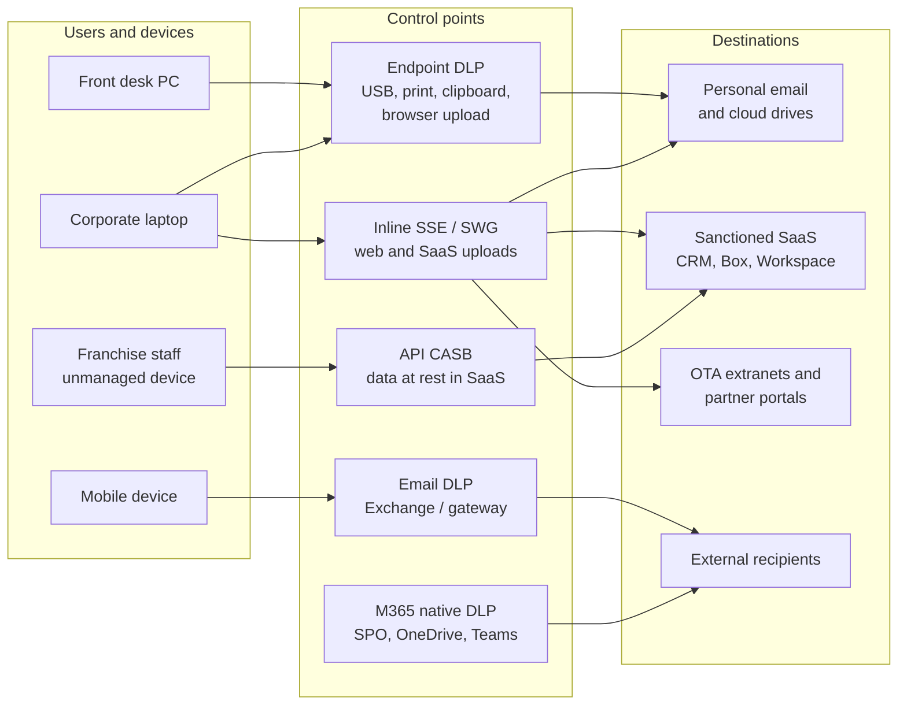
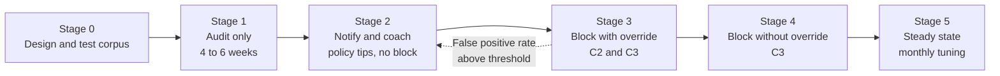
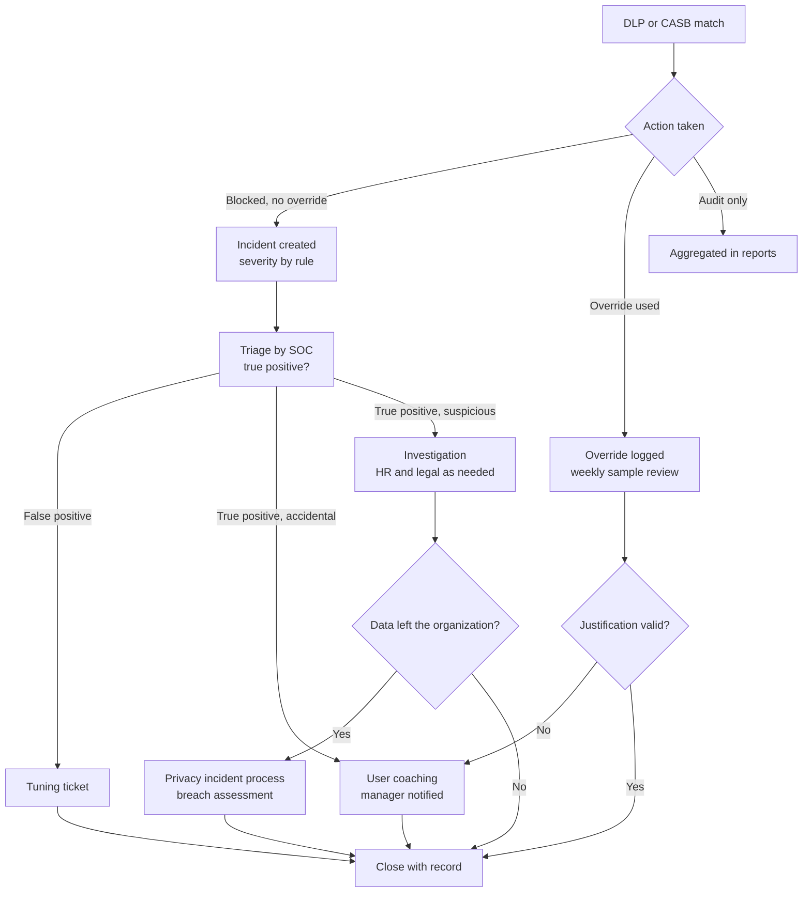

# DLP and CASB enforcement
{: .no_toc }

**Phase 4: Unstructured data.** Turns labels and classifiers into enforcement at every egress channel, and rolls enforcement out in a way that the business can absorb.
{: .fs-5 .fw-300 }

## On this page
{: .no_toc .text-delta }

1. TOC
{:toc}

---

## What DLP and CASB are for in this architecture

Labels and encryption decide how content is protected. DLP and CASB decide where content may go. In the protection profiles, DLP runs in monitor-then-block for C2 (PP-2) and in block for C3 (PP-3).

| Capability | Question it answers | Examples of enforcement |
|---|---|---|
| **DLP** (data loss prevention) | Does this content, moving through this channel to this destination, violate policy? | Block an email with a rooming list to a personal address; block upload of a `Restricted\Guest-Identity` file to a personal cloud drive; block copy to USB |
| **CASB** (cloud access security broker) | Which cloud apps are in use, are they sanctioned, and what is happening to data inside them? | Discover shadow IT; block uploads to unsanctioned apps; find and remove public links in sanctioned apps; detect mass downloads |
| **SSE / SWG** (security service edge, secure web gateway) | Is this web or cloud traffic allowed, and does it carry sensitive content? | Inline inspection of uploads, tenant restrictions, instance awareness (corporate versus personal tenant of the same app) |

The three overlap in modern products. The organization designs by channel and control point, then maps each to the product that implements it.

## Channels and control points



| Channel | Control point | Primary product category | Sees encrypted content? |
|---|---|---|---|
| Email | Exchange Online DLP, secure email gateway | Purview DLP; email security platforms | Yes for label-encrypted mail within M365; gateways need decryption rights for protected messages |
| SharePoint, OneDrive, Teams | Native M365 DLP | Purview DLP | Yes when label integration is enabled |
| Endpoint (USB, print, clipboard, local apps, browser uploads) | Endpoint agent | Purview Endpoint DLP; endpoint DLP from SSE vendors | Reads label metadata; content inspection on the device |
| Web and SaaS uploads | Inline proxy (forward proxy, cloud SWG) | Netskope, Zscaler, Palo Alto Networks Prisma Access, others | Requires TLS inspection; cannot inspect label-encrypted content without rights, but can read the label |
| Data at rest in sanctioned SaaS | API connector | API CASB from SSE vendors; Microsoft Defender for Cloud Apps | Depends on app and vendor |
| Google Workspace | Native Workspace DLP | Google Workspace DLP | Not for CSE-encrypted content |
| Network egress (non-web) | Network DLP or firewall with DLP | Legacy network DLP, NGFW DLP features | Only unencrypted traffic, which is now rare |

{: .note }
Network DLP that inspects cleartext traffic has limited value now that almost all egress is TLS. The organization relies on endpoint, inline SSE with TLS inspection for managed devices, email, and API controls, and treats classic network DLP as legacy.

## Vendor landscape

The organization's reference design uses Microsoft Purview for M365, email, and endpoint DLP, and an SSE platform for inline web and SaaS control and API CASB for non-Microsoft SaaS. Capabilities differ by vendor and licensing tier; the table is a general characterization, not a feature comparison.

| Product family | Typical strengths | Considerations |
|---|---|---|
| Microsoft Purview DLP and Defender for Cloud Apps | Native to M365, uses the same labels, SITs, EDM, and trainable classifiers; endpoint DLP on Windows and macOS without a separate agent on Windows | Coverage of non-Microsoft web destinations depends on browser and endpoint integration; inline controls for third-party SaaS rely on Conditional Access App Control |
| Netskope | Inline SSE with detailed cloud app and instance awareness; API CASB; DLP engine with EDM and ML classifiers | Must align its classifiers with Purview SITs to avoid two different definitions of "passport" |
| Zscaler | Large inline SSE footprint; DLP on inline traffic, endpoint DLP, API CASB | Same alignment requirement; TLS inspection exemptions need governance |
| Palo Alto Networks (Prisma Access, enterprise DLP) | DLP across SSE and NGFW with a shared engine | Same alignment requirement |
| Google Workspace DLP | Native to Drive, Gmail, and Chat; can apply Drive labels | Limited to Workspace; no Luhn-style custom validation for custom detectors |

{: .verify }
DLP and SSE vendors change feature names, bundling, and label integration frequently. Validate claims about reading Microsoft sensitivity labels, EDM support, and endpoint coverage in a proof of concept with the organization's own test corpus.

### Consistency across engines

When two engines inspect the same data, they must reach the same verdict. The organization maintains one set of detection definitions (in source control) and implements them in each engine:

| Definition | Purview | SSE platform | Google Workspace |
|---|---|---|---|
| Payment card number | Built-in credit card SIT | Built-in card detector with Luhn | Predefined credit card detector |
| Passport numbers | Built-in passport SITs per country | Built-in passport identifiers | Predefined passport detectors |
| Loyalty member number | Custom SIT with checksum validator | Custom regex identifier with keywords | Custom regex detector with keywords |
| Guest list | EDM on guest profile table | EDM or fingerprinting feature if available | Not available; rely on volume thresholds |
| Labels | Native | Reads label metadata from file properties | Drive labels mapped manually |

## CASB: API versus inline

| Aspect | API CASB | Inline CASB (proxy) |
|---|---|---|
| How it works | Connects to the SaaS provider's API with admin consent; reads files, sharing settings, and activity logs | Traffic passes through a forward or reverse proxy that inspects and controls sessions in real time |
| Timing | Near real time to periodic, after the event | Real time, before the upload or download completes |
| Coverage | Data at rest, including content created before deployment, and activity from any device | Only traffic that passes through the proxy (managed devices, or reverse proxy for SSO-integrated apps) |
| Unmanaged devices | Sees the result (file shared, file downloaded) | Reverse proxy can control sessions on unmanaged devices for SSO apps |
| Typical actions | Remove public links, quarantine files, apply labels, alert | Block upload or download, coach the user, require justification, block personal instances |
| Best for | Sanctioned apps: finding overshared files, cleaning up legacy data, franchise and partner activity | Unsanctioned apps and personal instances, real-time prevention on managed devices |

The organization uses both: API CASB for every sanctioned SaaS application that holds C2 or C3 data, and inline controls on managed devices for all web traffic.

## Policy design keyed on labels and SITs

Policies are organized as a matrix of classification versus destination. The label is the primary condition; SITs and EDM catch content that is unlabeled or mislabeled.

| Content condition | Internal destination | Approved partner domain or sanctioned app | External email (other domains) | Personal email or cloud storage | Removable media and print |
|---|---|---|---|---|---|
| `Public`, `Internal` | Allow | Allow | Allow | Allow | Allow |
| `Confidential\*` label | Allow | Allow, audit | Warn with override and justification | Block with override (justification logged) | Warn |
| Guest list EDM match (10 or more rows) | Allow | Allow, audit | Block with override | Block | Block with override |
| `Restricted\*` label | Allow (encrypted) | Allow only if the partner is in the label rights | Block | Block | Block |
| Passport SIT, high confidence, any count | Allow | Allow, audit | Block | Block | Block |
| Card number SIT, high confidence | Audit and alert (should not exist) | Block | Block | Block | Block |
| Credential SITs | Alert | Block | Block | Block | Block |

The same matrix is kept as data so that policies in each engine can be generated or checked against it:

```yaml
# dlp-policy-matrix.yaml (organization-defined format, stored with the label-to-control policy)
version: 1
destinations: [internal, partner, external_email, personal, removable]
rules:
  - id: restricted-label
    condition: { label_prefix: "Restricted\\" }
    actions: { internal: allow, partner: allow_if_in_rights, external_email: block,
               personal: block, removable: block }
    severity: high
  - id: confidential-label
    condition: { label_prefix: "Confidential\\" }
    actions: { internal: allow, partner: audit, external_email: warn_override,
               personal: block_override, removable: warn }
    severity: medium
  - id: guest-list-edm
    condition: { edm: guestprofiles, min_rows: 10 }
    actions: { internal: allow, partner: audit, external_email: block_override,
               personal: block, removable: block_override }
    severity: high
  - id: passport-sit
    condition: { sit: passport_any, confidence: high, min_count: 1 }
    actions: { internal: allow, partner: audit, external_email: block,
               personal: block, removable: block }
    severity: high
```

The classification resolver in [code/classification](https://github.com/steven-smith-itnet/data-protection-pqc-security-architecture/tree/main/code/classification) holds the label-to-control mapping that this matrix extends.

### Design rules

1. **Label first, content second.** Label conditions are precise and cheap. Content conditions catch the unlabeled remainder and verify labels.
2. **Use volume thresholds.** One email address in a message is normal business; five hundred is a guest list. Thresholds are the most effective false-positive control.
3. **Define "partner" explicitly.** A maintained list of approved partner domains (payment processors, key tour operators, auditors, the payroll provider) and sanctioned app instances. Everything else is external.
4. **Override only where the business needs it.** Overrides with justification are allowed for C2; not for C3. Every override is logged and sampled weekly.
5. **Coach before blocking.** Policy tips and inline coaching messages explain what was detected and what to do instead ("Use the secure group portal to send rooming lists").
6. **Exclude service accounts carefully.** Integrations that legitimately move data are excluded by identity, not by disabling the rule, and each exclusion has an owner and expiry date.

## Monitor-to-block rollout



| Stage | Mode | Exit criteria |
|---|---|---|
| 0 | Policies built against a test corpus of real (sanitized) rooming lists, passport scans, contracts, and negative samples | Detection works on the corpus; negative samples do not match |
| 1 | Audit only (`TestWithoutNotifications` in Purview; monitor mode in SSE) | Match volumes and top users known; false-positive rate measured on a sample reviewed by data owners |
| 2 | Notify (`TestWithNotifications`; coaching pages) | Users receive tips; service desk has scripts; business processes that trigger matches identified and given an approved path |
| 3 | Block with override for C2 and C3 | Override rate and justifications reviewed; false-positive rate below the agreed threshold |
| 4 | Block without override for C3 | No approved business process depends on an override |
| 5 | Steady state | Monthly tuning, quarterly policy review |

In Purview, the stage change is a mode change on the policy and an action change on the rules:

```powershell
# Stage 2: notify
Set-DlpCompliancePolicy -Identity "DLP - Guest identity external sharing" -Mode "TestWithNotifications"

# Stage 3 and 4: enforce
Set-DlpCompliancePolicy -Identity "DLP - Guest identity external sharing" -Mode "Enable"
Set-DlpComplianceRule -Identity "Block passports to external - files" -BlockAccess $true
```

{: .important }
Set the false-positive threshold before Stage 1 and have the data owners agree to it. Without an agreed number, the decision to move to block becomes a negotiation every time.

## Tuning false positives

| Symptom | Likely cause | Tuning action |
|---|---|---|
| Booking confirmation emails match passport SITs | Confirmation numbers resemble passport formats | Raise confidence to high; add supporting keyword requirement; exclude the confirmation number pattern |
| Loyalty SIT matches phone numbers | Ten-digit phone numbers | Checksum validator (Purview); keyword proximity (other engines) |
| Card SIT matches test cards in engineering docs | Well-known test PANs | Exclude known test card numbers; scope engineering sites differently |
| Every Excel export from revenue management matches guest EDM | Legitimate internal report | Allow internal; the rule only needs to act on external destinations |
| Partner emails blocked | Partner domain missing from approved list | Update the partner domain list through the change process |
| Scanned PDFs never match | Content is an image | Enable OCR where available, or rely on labels applied at capture |
| High override rate from one department | A business process without an approved path | Build the approved path (secure portal, sanctioned share), then remove the override |

Tuning is tracked in a change log with the rule, the change, the reason, and the measured effect, so auditors and future engineers can see why a threshold is what it is.

## Incident workflow



| Step | Owner | Time target | Record |
|---|---|---|---|
| Triage high-severity incidents | Security operations | Same business day | Verdict, evidence |
| Coach user | Line manager with security awareness team | Within 5 business days | Coaching record |
| Investigate suspicious activity | Security operations with HR and legal | Per incident severity | Investigation file |
| Breach assessment | Privacy office | Within regulatory timelines (for example GDPR's 72-hour supervisory authority notification where required) | Breach register |
| Tuning | Information protection engineering | Monthly | Tuning change log |

DLP incident evidence can contain the sensitive content itself. Access to incident details, including the matched content, is restricted to named investigators, and evidence storage follows the tier of the content.

Reporting in the SIEM uses the alert tables from the DLP platform. For Purview DLP alerts surfaced in Microsoft Defender XDR advanced hunting, a starting query:

```kql
AlertInfo
| where Timestamp > ago(30d)
| where ServiceSource == "Microsoft Data Loss Prevention"
| join kind=inner (AlertEvidence | where EntityType == "User" | project AlertId, AccountUpn) on AlertId
| summarize Alerts = dcount(AlertId), Rules = make_set(Title, 20) by AccountUpn, Severity
| order by Alerts desc
| take 50
```

{: .verify }
Table names, the `ServiceSource` value for DLP alerts, and entity columns depend on the Defender XDR and Sentinel connector configuration. Validate the query in the tenant before using it for metrics.

## Hospitality exfiltration scenarios

### Scenario 1: guest list export to personal email

A sales coordinator leaving for a competitor exports the group and event client list from the CRM to Excel and emails it to a personal address.

| Layer | Control | Outcome |
|---|---|---|
| Source | CRM export permissions limited by role; export events logged | Export is possible for this role, and logged |
| Label | Client-side auto-labeling recommends `Confidential\Guest-PII` on the workbook | Label applied or recommended |
| Email DLP | EDM guest list match (10 or more rows) to a personal domain | Blocked; incident created |
| Endpoint DLP | Upload of the file to a personal webmail in a browser | Blocked |
| Inline SSE | Personal instance of a cloud drive | Upload blocked by instance awareness |
| Detection | Insider risk indicators: resignation date from HR plus export volume | Investigation opened |

### Scenario 2: OTA extranet downloads

Revenue and reservations staff log into online travel agency extranets to download reservation reports that include guest names, contact details, and sometimes virtual card details for OTA-collected bookings.

| Risk | Control |
|---|---|
| Reports saved to local downloads and shared drives | Endpoint DLP detects card and guest data in downloaded files; Known Folder Move keeps downloads in governed OneDrive; auto-labeling applies |
| Virtual card numbers visible in the extranet and in reports | Treat as PCI data: access only from designated workstations; card details retrieved through the payment integration where the OTA offers it, rather than viewed and re-keyed |
| Shared extranet credentials | Named accounts with MFA on the extranet where the OTA supports it; credentials in the password manager, not in spreadsheets |
| Reports uploaded to unsanctioned tools | Inline SSE blocks uploads of labeled or EDM-matching files to unsanctioned destinations |

{: .note }
OTA extranets are third-party systems. The organization cannot apply DLP inside them; it controls what happens after data is downloaded and which devices may access them.

### Scenario 3: franchise staff

Franchised hotels are operated by independent companies. Their staff may use brand systems (PMS, CRS, loyalty tools, brand M365 tenant for some functions) from devices the organization does not manage.

| Risk | Control |
|---|---|
| Unmanaged devices downloading guest data from brand systems | Conditional Access: browser-only access from unmanaged devices, downloads blocked (session controls through reverse proxy CASB or app-native settings) |
| Franchise staff sharing brand files with the franchisee's own systems | Container labels restrict external sharing on franchise collaboration sites; label encryption on `Restricted\*` content means copies are unusable outside the rights |
| Guest data in the franchisee's own email or file systems | Contractual data protection obligations; brand standards requiring DLP and encryption; periodic assessments. The organization cannot enforce technical DLP in the franchisee's tenant |
| Staff turnover at franchise properties | Access provisioned from franchise HR feeds with short-lived accounts; access reviews by the franchise general manager |

### Scenario 4: rooming list from a tour operator

A tour operator emails a rooming list with passport numbers to a property's shared mailbox. The property forwards it to the front office team and to a local ground handler.

| Step | Control |
|---|---|
| Inbound email | Service-side auto-labeling applies `Restricted\Guest-Identity` to the attachment based on passport SIT volume |
| Forward internally | Allowed; label encryption applies to the forwarded copy |
| Forward to ground handler | Blocked unless the ground handler's domain is in the label rights and on the approved partner list; policy tip explains the approved method |
| Retention | Shared mailbox retention deletes the message after the guest registration retention period |

### Scenario 5: bulk download from SharePoint before departure

| Signal | Control |
|---|---|
| Mass download from C2 and C3 sites | Defender for Cloud Apps or SSE anomaly policies alert on unusual download volume |
| Sync to an unmanaged device | Conditional Access blocks sync from unmanaged devices |
| Copy to USB | Endpoint DLP blocks `Restricted\*` and warns on `Confidential\*` |

## Metrics

| Metric | Target direction | Source |
|---|---|---|
| Percentage of DLP rules in block mode for C3 | Up, to 100% | Policy configuration export |
| False-positive rate per rule (sampled) | Down, below agreed threshold | Triage verdicts |
| Override rate and share of overrides with valid justification | Override rate down; valid share up | Override logs and weekly samples |
| High-severity true-positive incidents per month | Down over time as processes are fixed | Incident records |
| Sanctioned apps with API CASB coverage | Up, to all apps holding C2 or C3 | CASB configuration |
| Unsanctioned app upload blocks by category | Trend monitored | SSE reports |
| Mean time to triage high-severity incidents | Down | SOC metrics |

Metrics definitions and reporting cadence are in [Metrics and KPIs]().

## Good, Better, Best summary

{: .good }
**Good.** Purview DLP in audit for email, SharePoint, OneDrive, and Teams using built-in SITs; blocked auto-forwarding to external domains; basic cloud app discovery from firewall or proxy logs.

{: .better }
**Better.** Label-keyed policies with EDM and custom SITs; endpoint DLP on all managed devices; inline SSE with TLS inspection and instance awareness; API CASB on sanctioned SaaS; block with override for C2; incident workflow and tuning log running.

{: .best }
**Best.** Block without override for C3 across all channels; session controls for unmanaged and franchise devices; consistent detection definitions across Purview and the SSE platform tested against a shared corpus; insider risk signals combined with DLP; metrics reviewed monthly with data owners.

Trade-offs: TLS inspection has privacy, legal, and application compatibility implications and needs a governed exemption list; block-mode DLP stops legitimate business when the approved path does not exist yet; running two DLP engines doubles tuning effort unless definitions are shared.

## Key takeaways for engineering teams

- Organize policy by classification and destination. The label is the primary condition; SITs, EDM, and volume thresholds catch what labels miss.
- Use API CASB for data at rest in sanctioned apps and inline controls for real-time prevention; neither alone covers unmanaged devices and personal instances.
- Roll out in stages from audit to block with agreed false-positive thresholds. Build the approved business path before removing the override.
- Keep one set of detection definitions and implement it in every engine, tested against a shared corpus, so that different tools reach the same verdict.
- For franchise and OTA scenarios, the organization controls access and what happens after download, not the third party's environment. Design for that boundary.

## Related pages

- [Microsoft 365 and collaboration]()
- [Unstructured data protection patterns]()
- [Label-to-control mapping]()
- [Monitoring and detection]()
- [Metrics and KPIs]()
- [Risks and anti-patterns]()

## Sources

- Microsoft Learn, Learn about data loss prevention: https://learn.microsoft.com/purview/dlp-learn-about-dlp
- Microsoft Learn, Learn about Endpoint data loss prevention: https://learn.microsoft.com/purview/endpoint-dlp-learn-about
- Microsoft Learn, Microsoft Defender for Cloud Apps overview: https://learn.microsoft.com/defender-cloud-apps/what-is-defender-for-cloud-apps
- Google Workspace Admin Help, Use Workspace DLP to prevent data loss: https://support.google.com/a/answer/9646351
- Netskope documentation: https://docs.netskope.com/
- Zscaler documentation: https://help.zscaler.com/
- Palo Alto Networks, Enterprise DLP documentation: https://docs.paloaltonetworks.com/enterprise-dlp
