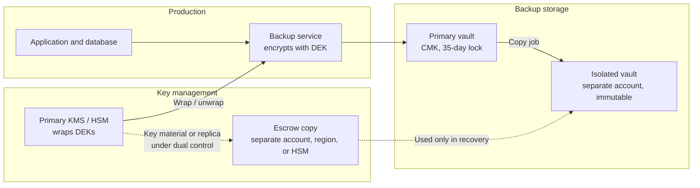

# Email, backups, logs, and media
{: .no_toc }

**Phase 4: Unstructured data.** Covers the secondary data stores that often hold more sensitive data than the systems of record, and are less governed: mail, backups, logs, recordings, and the devices at the front desk.
{: .fs-5 .fw-300 }

## On this page
{: .no_toc .text-delta }

1. TOC
{:toc}

---

## Why these stores need their own design

Every protected system produces copies. A PMS with field-level encryption still sends confirmation emails, is backed up nightly, writes application logs, and is operated from front-desk PCs next to a phone system that records calls. If those copies are not protected to the same tier, the controls on the primary system are bypassed.

| Store | Typical sensitive content | Failure mode seen in the industry |
|---|---|---|
| Email | Rooming lists, passport scans, card authorization forms, HR letters | Forwarding to personal accounts; misaddressed email; plaintext transport to partners |
| Backups | Full copies of every C2 and C3 system | Unencrypted or provider-keyed backups; backups deleted or encrypted by ransomware; keys lost so backups cannot be restored |
| Logs | Guest emails, names, reservation IDs, tokens, occasionally PAN and passwords in request bodies | Debug logging in production; logs shipped to third-party tools with long retention |
| CCTV | Images of guests and staff, license plates | Indefinite retention; exports on USB drives; weak NVR credentials |
| Call recordings | Voice, reservation details, card numbers read aloud | PAN captured in recordings, bringing the recording platform into PCI scope |
| ID images | Passport and ID scans | Local folders on front-desk PCs, email to local authorities |
| Endpoints and mobile | Cached files, downloads, screenshots | Unencrypted devices, shared logins, personal phones with corporate email |

## Email

### Transport security

Transport encryption protects mail between servers. Opportunistic STARTTLS is common but can be downgraded by an active attacker. Two standards make TLS enforceable for inbound mail to the organization's domains:

| Mechanism | How it works | Requirement | Organization's use |
|---|---|---|---|
| **MTA-STS** (RFC 8461) | The domain publishes a policy over HTTPS that tells sending servers to require TLS with a valid certificate for the listed MX hosts | HTTPS policy host and DNS TXT record | Enabled for all primary domains in `enforce` mode after a `testing` period |
| **TLS-RPT** (RFC 8460) | Sending servers report TLS failures to an address the domain publishes | DNS TXT record | Enabled with MTA-STS; reports reviewed weekly during rollout |
| **DANE for SMTP** (RFC 7672) | TLSA records, protected by DNSSEC, pin the MX certificate or public key | DNSSEC-signed zone | Enabled where the DNS provider and mail platform support DNSSEC signing |

MTA-STS policy file served at `https://mta-sts.contoso-hospitality.example/.well-known/mta-sts.txt`:

```text
version: STSv1
mode: enforce
mx: contoso-hospitality-example.mail.protection.outlook.com
max_age: 604800
```

DNS records:

```text
_mta-sts.contoso-hospitality.example.  IN TXT "v=STSv1; id=20260915T000000"
_smtp._tls.contoso-hospitality.example. IN TXT "v=TLSRPTv1; rua=mailto:tls-reports@contoso-hospitality.example"
```

A DANE TLSA record for an MX host that publishes the SHA-256 hash of the server's public key (usage 3, selector 1, matching type 1):

```text
_25._tcp.mx1.contoso-hospitality.example. IN TLSA 3 1 1 8cb0fc6c527506a053f4f14c8464bebbd6dede2738d11468dd953d7d6a3021f1
```

{: .verify }
Exchange Online supports outbound DANE validation and has added inbound SMTP DANE with DNSSEC for accepted domains (configured with Exchange Online PowerShell cmdlets for DNSSEC and SMTP DANE). Confirm current availability and the exact procedure as of mid-2026, because enabling inbound DANE changes the MX record format.

Outbound, the organization configures enforced TLS connectors to partners that exchange C2 data regularly (payment processors, key tour operators, the payroll provider), so that mail to those domains fails rather than falls back to plaintext. Transport TLS versions follow [Encryption in transit]().

### Message-level protection

Transport TLS protects mail hop by hop; the message is plaintext on every server it passes through and in every mailbox it lands in. Message-level encryption protects the content itself.

| Option | How it works | Strengths | Limitations | Use |
|---|---|---|---|---|
| Sensitivity label on email with encryption | The label applies Azure Rights Management encryption with rights (for example Do Not Forward) | Consistent with file labels; rights enforced for internal and Entra-authenticated external recipients; attachments inherit | External recipients without Microsoft accounts use a one-time passcode portal | `Restricted\*` email |
| **Purview Message Encryption** (Encrypt-Only, Do Not Forward, or custom branded templates) | Transport rule or user action encrypts the message; external recipients read it in Outlook or a web portal | Works for any recipient; can be applied automatically by rules | Recipient experience depends on their mail client | Automatic encryption of C2 email leaving the organization when SITs match |
| **S/MIME** | Certificate-based signing and encryption per user | Standards-based, end-to-end, works with other organizations' PKI | Certificate lifecycle for every user; key recovery for encrypted mail; poor mobile support in some clients | Limited: legal and finance teams exchanging with counterparties that require it |

An Exchange Online mail flow rule that encrypts outbound mail containing passport numbers:

```powershell
Connect-ExchangeOnline -UserPrincipalName admin@contoso-hospitality.example

New-TransportRule -Name "Encrypt external mail with passport numbers" `
  -SentToScope "NotInOrganization" `
  -MessageContainsDataClassifications @(@{Name="EU Passport Number"; MinCount="1"}) `
  -ApplyRightsProtectionTemplate "Encrypt" `
  -SetAuditSeverity "Medium"
```

{: .note }
Mail flow rules and DLP policies overlap. The organization uses DLP policies for detect, block, and notify decisions, and mail flow rules only for encryption actions that DLP does not provide. Keeping both sets small and documented avoids conflicting outcomes.

### Mailbox content at rest

Exchange Online encrypts mailboxes at rest with service encryption, optionally with Customer Key (see [Microsoft 365 and collaboration]()). Retention policies delete property mailbox content that has no business need after the retention period. Shared property mailboxes (for example `frontdesk.property123@`) are the highest-risk mailboxes: they receive passport scans from guests and forwarding requests from travel agents. They get:

- A retention policy that deletes items older than the minimum required period.
- Auto-labeling for `Restricted\Guest-Identity` on inbound attachments that match passport SITs.
- Delegated access limited to named front office staff, reviewed quarterly.
- Blocked auto-forwarding to external domains (outbound spam policy setting), which is set tenant-wide.

## Backups

### Requirements

Backups of C2 and C3 systems must meet four requirements, which pull in different directions:

| Requirement | Why | Tension |
|---|---|---|
| Encrypted with keys the organization controls | Backups are complete copies of sensitive systems | Keys must survive the loss of the primary environment |
| Immutable for a defined window | Ransomware operators target backups first | Immutability conflicts with erasure requests and crypto-shredding |
| Isolated from production credentials | A compromised domain admin or cloud admin must not be able to delete backups | Isolation makes operations and restores harder |
| Restorable | A backup that cannot be decrypted is not a backup | Every key and passphrase must be escrowed and tested |

### Key escrow so backups remain restorable



Rules the organization applies:

1. **Backup data keys are wrapped by a KMS or HSM key**, never by a passphrase typed into the backup console alone. Backup software that integrates with an external key manager over KMIP uses the same key management platform as other on-prem systems.
2. **The wrapping key for the isolated copy must be available when the primary environment is not.** In the cloud, that means a key in the isolated account or region (multi-region keys, or a separate key with the copy re-encrypted on arrival). On-prem, it means the key manager cluster has a node or backup outside the primary data center.
3. **Passphrases and recovery keys that do exist are escrowed** in the secrets vault and in a sealed offline copy under dual control, following [Key management architecture]().
4. **Restore drills decrypt real backups** from the isolated copy at least twice a year, using only the escrowed keys. A drill that uses the production key does not test escrow.
5. **Key deletion is coordinated with backup retention.** Scheduling deletion of a KMS key destroys every backup encrypted under it. That is the intended crypto-shredding behavior at end of retention and a disaster if done early.

### AWS Backup

```bash
# Vault encrypted with a customer managed key in the backup account
aws backup create-backup-vault \
  --backup-vault-name vault-guest-prod \
  --encryption-key-arn arn:aws:kms:us-east-1:222233334444:key/abcd1234-5678-90ab-cdef-111122223333 \
  --backup-vault-tags data-classification=restricted,data-domain=guest,retention-class=r1y

# Vault Lock: minimum and maximum retention; after the grace period the lock becomes immutable (compliance mode)
aws backup put-backup-vault-lock-configuration \
  --backup-vault-name vault-guest-prod \
  --min-retention-days 35 \
  --max-retention-days 400 \
  --changeable-for-days 3
```

Omitting `--changeable-for-days` creates the lock in governance mode, which privileged users can remove; with it, the lock becomes unchangeable once the grace period ends. The organization copies backups cross-account into a backup account in a separate AWS Organizations OU with restrictive SCPs. AWS Backup also offers logically air-gapped vaults, which store backups in a service-owned account and can be shared to a recovery account.

{: .verify }
Encryption options for logically air-gapped vaults (AWS-owned key versus customer managed key) have changed since launch. Confirm current key options and cross-account restore procedure as of mid-2026.

### Azure Backup

Recovery Services vaults and Backup vaults encrypt backup data with Microsoft-managed keys by default and can use a customer-managed key in Key Vault through the vault's managed identity. Immutable vaults prevent operations that would reduce retention or delete recovery points, and can be locked so that immutability cannot be disabled. Multi-user authorization, using Resource Guard in a separate subscription or tenant, requires a second party to approve critical operations such as disabling soft delete.

```bash
az backup vault encryption update -g rg-backup-prod -n rsv-guest-prod \
  --encryption-key-id https://kv-backup-prod.vault.azure.net/keys/cmk-backup \
  --mi-user-assigned /subscriptions/<sub>/resourceGroups/rg-backup-prod/providers/Microsoft.ManagedIdentity/userAssignedIdentities/id-rsv-guest
```

{: .verify }
Confirm the current `az backup vault` parameters for CMK, immutability state, and soft delete for the vault type in use (Recovery Services vault or Backup vault). CMK for Recovery Services vaults must generally be configured before items are protected.

### Google Cloud Backup and DR

Google Cloud Backup and DR Service stores backups in backup vaults that enforce a minimum retention period, which privileged project users cannot shorten, providing immutability and isolation from the source project. Google Cloud also supports CMEK for many backup targets.

{: .verify }
Backup vault features and CMEK support for Backup and DR Service have expanded since 2024. Confirm which workloads support backup vaults and CMEK as of mid-2026.

### On-prem backup software

Enterprise backup platforms commonly support AES-256 encryption at the job or storage level, integration with external key managers over KMIP, immutable storage targets (hardened repositories, object lock on S3-compatible storage), and multi-person approval for destructive operations. The organization requires:

- Encryption enabled on every job holding C2 or C3 data, with keys held in the enterprise key manager rather than the backup server.
- At least one immutable copy outside the production Active Directory domain.
- Backup server administration from a separate administrative identity tier.

### Backups and erasure

Immutable backups cannot honor an individual erasure request. The accepted approach, documented in the privacy notice and records of processing, is that erased records are suppressed on restore (a deletion log is replayed after any restore) and backups expire on their normal retention. Per-subject crypto-shredding in the application layer extends to backups automatically, because backups hold ciphertext encrypted under the subject key; see [Retention, deletion, and crypto-shredding]().

## Logs

### The problem

Logs are the most common unplanned store of guest PII. Typical sources:

- API gateways and web servers logging full request URLs with email addresses or reservation IDs in query strings.
- Application debug logs that serialize the whole guest object.
- Payment integration logs capturing request bodies (a PCI DSS violation if PAN or SAD is present).
- Error tracking tools capturing local variables.
- Logs forwarded to third-party observability platforms with their own retention and access model.

### Controls, in order of preference

| Control | Where | Effectiveness |
|---|---|---|
| **Do not log it**: structured logging with explicit allowlisted fields | Application code, logging library | Highest. Guest identifiers logged as tokens or keyed hashes, not values |
| **Redact at source**: logging filter that masks patterns before the record is emitted | Application runtime | High, but pattern-based |
| **Redact in pipeline**: collector or log shipper masks fields and patterns | OpenTelemetry Collector, Fluent Bit, Vector, Cribl | Good backstop; data has already left the application |
| **Mask at the sink**: platform data protection policies | CloudWatch Logs data protection, SIEM masking | Backstop only; data is stored before masking in some designs |
| **Restrict and encrypt the sink** | CMK on log storage, RBAC, retention | Always required, but does not remove the data |

### Redaction at source (Python example)

```python
import logging
import re

EMAIL = re.compile(r"[A-Za-z0-9._%+-]+@[A-Za-z0-9.-]+\.[A-Za-z]{2,}")
PAN_CANDIDATE = re.compile(r"\b(?:\d[ -]?){13,19}\b")

def luhn_ok(digits: str) -> bool:
    total, alt = 0, False
    for ch in reversed(digits):
        d = int(ch)
        if alt:
            d *= 2
            if d > 9:
                d -= 9
        total += d
        alt = not alt
    return total % 10 == 0

def _mask_pan(match: re.Match) -> str:
    digits = re.sub(r"\D", "", match.group(0))
    if 13 <= len(digits) <= 19 and luhn_ok(digits):
        return "[PAN-REDACTED]"
    return match.group(0)

class RedactingFilter(logging.Filter):
    def filter(self, record: logging.LogRecord) -> bool:
        msg = record.getMessage()
        msg = EMAIL.sub("[EMAIL-REDACTED]", msg)
        msg = PAN_CANDIDATE.sub(_mask_pan, msg)
        record.msg, record.args = msg, None
        return True

logger = logging.getLogger("guest-api")
handler = logging.StreamHandler()
handler.addFilter(RedactingFilter())
logger.addHandler(handler)
logger.setLevel(logging.INFO)

logger.info("Booking confirmed for %s card %s", "ana@example.com", "4111 1111 1111 1111")
# Booking confirmed for [EMAIL-REDACTED] card [PAN-REDACTED]
```

The Luhn check keeps order numbers and timestamps from being masked unnecessarily. The same logic is used by the discovery scanner in [code/discovery](https://github.com/steven-smith-itnet/data-protection-pqc-security-architecture/tree/main/code/discovery).

### Redaction in the pipeline (OpenTelemetry Collector)

```yaml
processors:
  transform/redact_pii:
    error_mode: ignore
    log_statements:
      - context: log
        statements:
          - replace_pattern(body, "[A-Za-z0-9._%+-]+@[A-Za-z0-9.-]+\\.[A-Za-z]{2,}", "[EMAIL-REDACTED]")
          - replace_pattern(body, "\\b(?:\\d[ -]?){13,19}\\b", "[NUMBER-REDACTED]")
          - delete_key(attributes, "guest.passport_number")
          - delete_key(attributes, "http.request.header.authorization")

service:
  pipelines:
    logs:
      receivers: [otlp]
      processors: [transform/redact_pii, batch]
      exporters: [otlphttp/siem]
```

{: .verify }
OTTL context and path names (for example `body` versus `log.body`) have changed between OpenTelemetry Collector Contrib releases. Validate the configuration against the collector version in use. Pipeline redaction cannot run a Luhn check, so it masks all long digit runs; that is acceptable as a backstop.

### Masking at the sink and encrypting log storage

AWS CloudWatch Logs supports data protection policies that detect and mask managed data identifiers in log groups, and log groups can be encrypted with a customer managed KMS key:

```bash
aws logs associate-kms-key --log-group-name /app/guest-api \
  --kms-key-id arn:aws:kms:us-east-1:111122223333:key/logs-key-id

aws logs put-data-protection-policy --log-group-identifier /app/guest-api \
  --policy-document '{
    "Name": "guest-api-data-protection",
    "Version": "2021-06-01",
    "Statement": [
      {
        "Sid": "audit",
        "DataIdentifier": [
          "arn:aws:dataprotection::aws:data-identifier/EmailAddress",
          "arn:aws:dataprotection::aws:data-identifier/CreditCardNumber"
        ],
        "Operation": { "Audit": { "FindingsDestination": {} } }
      },
      {
        "Sid": "redact",
        "DataIdentifier": [
          "arn:aws:dataprotection::aws:data-identifier/EmailAddress",
          "arn:aws:dataprotection::aws:data-identifier/CreditCardNumber"
        ],
        "Operation": { "Deidentify": { "MaskConfig": {} } }
      }
    ]
  }'
```

The KMS key policy must allow the CloudWatch Logs service principal for the region to use the key.

| Platform | Log storage encryption with customer key |
|---|---|
| AWS CloudWatch Logs | KMS key per log group |
| Azure Monitor Log Analytics and Microsoft Sentinel | Customer-managed key through a dedicated cluster |
| Google Cloud Logging | CMEK for log buckets (configured per organization, folder, or bucket) |
| OCI Logging | Verify current CMK support for log storage |
| Third-party SIEM or observability SaaS | Vendor-dependent; assess in vendor review, including retention and support staff access |

SIEM data is C2 at minimum because it contains identities, IP addresses, and fragments of guest activity. Access to raw events is restricted to security operations; detection engineering uses masked views where the platform allows.

## Media

### CCTV

CCTV at properties covers lobbies, car parks, corridors, back-of-house, and cash offices. Footage is personal data under GDPR and similar laws, and local rules often set maximum retention and signage requirements.

| Control | Standard |
|---|---|
| Retention | Short default retention set per country by legal and privacy teams (commonly days to weeks, not months); longer only for footage preserved for a specific incident |
| Storage encryption | NVR and VMS storage encrypted; cloud video services with CMK where offered |
| Access | Named accounts on the VMS; viewing limited to security staff; access logged |
| Export | Exports only through the VMS export function with watermarking, logged against an incident number; exports stored in a `Confidential\Guest-PII` labeled location, not on USB drives |
| Device security | Default passwords changed, firmware maintained, cameras on a segmented network (see property IoT) |
| Disposal | NVR disks sanitized or cryptographically erased per NIST SP 800-88 Rev. 1 |

### Call recordings

Contact center and property reservation calls are recorded for quality and dispute handling. The critical issue is payment card data read aloud by the guest. If PAN or the card security code is captured in a recording, the recording system, its storage, and everyone who can access it are in PCI DSS scope, and storing the security code after authorization violates requirement 3.3.

| Approach | How it works | PCI scope effect | Trade-offs |
|---|---|---|---|
| Manual pause-and-resume | Agent pauses recording before card capture | Weak: depends on agents; failures are common | Cheapest; requires monitoring of compliance |
| Automated pause-and-resume | Recording pauses automatically when the agent opens the payment screen | Better: removes agent error, but the agent still hears the card number | Integration with the payment application needed |
| **DTMF masking / suppression** | Guest keys the card number on the phone keypad; tones are masked so the agent and recording do not receive them; digits go directly to the payment processor | Best: the agent desktop and recording platform can be kept out of scope for card data | Requires a DTMF payment service integrated with telephony and the payment gateway |
| Pay-by-link | Agent sends a secure payment link by SMS or email | Removes card data from the call entirely | Guest must complete payment on their device |

The organization's standard is DTMF suppression or pay-by-link for all reservation centers, and automated pause-and-resume as an interim control at properties. Recording storage uses CMK and a retention class of `r1y` or shorter unless a dispute is open. Discovery scans on recording transcripts (where speech analytics produce text) check for PAN patterns as a control test. See [Payment card data and PCI DSS]().

### Images of identity documents

Many countries require hotels to record guest identity documents, which makes passport data unavoidable at check-in. The protection design:

1. **Capture into the system of record.** ID scanners and mobile check-in upload directly to the PMS or a dedicated identity service, where the document number is field-level encrypted and the image is stored in a C3 bucket with CMK.
2. **Transmit to authorities through the integration**, not by email, where the local authority provides an electronic interface.
3. **Minimize.** Store only the fields required by local law; where only verification is needed, record that verification happened rather than retaining the image.
4. **Retain only as required**, with automated deletion based on the property's country.
5. **Detect leakage.** Endpoint and M365 discovery look for image files in scan folders and passport SITs in mailboxes, feeding the remediation workflow.

## Endpoints and mobile devices

### Full disk encryption

| Platform | Control | Key escrow |
|---|---|---|
| Windows | BitLocker with TPM, XTS-AES 256, enforced through Intune or Group Policy | Recovery keys escrowed to Microsoft Entra ID or Active Directory |
| macOS | FileVault enforced through MDM | Personal recovery key escrowed to MDM |
| iOS and iPadOS | Data protection is on when a passcode is set; MDM enforces passcode | Not applicable |
| Android | File-based encryption is on by default on supported devices; MDM enforces screen lock | Not applicable |

```powershell
# Check and remediate BitLocker on a front-desk PC (normally done by Intune policy)
Get-BitLockerVolume -MountPoint "C:" | Select-Object VolumeStatus, EncryptionMethod, ProtectionStatus
Enable-BitLocker -MountPoint "C:" -EncryptionMethod XtsAes256 -UsedSpaceOnly -TpmProtector
Add-BitLockerKeyProtector -MountPoint "C:" -RecoveryPasswordProtector
$rp = (Get-BitLockerVolume -MountPoint "C:").KeyProtector | Where-Object KeyProtectorType -eq "RecoveryPassword"
BackupToAAD-BitLockerKeyProtector -MountPoint "C:" -KeyProtectorId $rp.KeyProtectorId
```

### Front desk devices

Front desk PCs and tablets are shared, physically exposed, and used by many staff. The configuration:

- Enrolled in MDM (Intune or equivalent) as corporate-owned shared devices.
- Named sign-in, with fast user switching or badge tap; no generic accounts with file or email access.
- Local storage restricted: downloads redirected to OneDrive with Known Folder Move, scan folders removed, USB write blocked except approved encrypted drives.
- Endpoint DLP policies enforced (block copy of `Restricted\*` to USB, personal cloud sites, and unsanctioned printers).
- Screen lock after short inactivity; privacy screens where guests can see the display.
- Tablets used for mobile check-in in kiosk or single-app mode.

### Mobile devices and app protection

Managers and sales staff use phones for email, Teams, and OneDrive, often personal devices. Intune app protection policies (mobile application management without device enrollment) protect corporate data inside managed apps:

| Setting | Value | Why |
|---|---|---|
| Restrict cut, copy, paste to other apps | Policy-managed apps only | Stops pasting guest data into personal messaging apps |
| Save copies of org data | Block, except to OneDrive and SharePoint | Keeps files in governed stores |
| Encrypt org data | Require | Protects data in the app sandbox |
| PIN for access | Require | Protects against device sharing |
| Screen capture | Block on Android (iOS restrictions are more limited) | Reduces screenshots of guest lists |
| Offline grace period | Wipe org data after a set number of days offline | Removes data from lost devices |
| Conditional launch | Block jailbroken or rooted devices; minimum OS version | Maintains baseline device integrity |

Conditional Access requires an app protection policy before email and SharePoint can be accessed from mobile devices.

## Good, Better, Best summary

{: .good }
**Good.** TLS for mail with MTA-STS in testing; backups encrypted by the backup platform; log storage encrypted; CCTV and recording retention defined; full disk encryption on all endpoints.

{: .better }
**Better.** MTA-STS enforce and TLS-RPT; message encryption for external C2; backups with CMK, a locked immutable copy, and escrowed keys tested in drills; redaction in the log pipeline and CMK on log storage; automated pause-and-resume on recordings; MDM and app protection on all mobile access.

{: .best }
**Best.** DANE where supported; label encryption on `Restricted\*` mail; isolated backup account or air-gapped vault with separately held keys; structured logging with tokenized identifiers so no C3 reaches logs by design; DTMF suppression or pay-by-link; ID images captured directly into the system of record with no local copies.

Trade-offs: locked immutable backups cannot be shortened, which must be reconciled with erasure obligations; DANE requires DNSSEC operations maturity; aggressive log redaction reduces the usefulness of logs for troubleshooting, so engineering teams need tokenized identifiers that support correlation without exposing values.

## Key takeaways for engineering teams

- Protect copies to the same tier as the source. Backups, logs, and recordings of a C3 system are C3.
- Backups must be encrypted, immutable for a window, isolated, and restorable. Escrow keys separately and prove restorability with the escrowed key, not the production key.
- The best log control is not logging sensitive values. Use allowlisted structured fields and tokens; treat pipeline and sink masking as backstops.
- Keep card numbers out of call recordings with DTMF suppression or pay-by-link rather than trying to secure recordings that contain PAN.
- Front desk devices are shared and exposed. Named sign-in, blocked local storage, and endpoint DLP matter more there than anywhere else.

## Related pages

- [Unstructured data protection patterns]()
- [Cloud object storage]()
- [Encryption in transit]()
- [Retention, deletion, and crypto-shredding]()
- [Payment card data and PCI DSS]()
- [Monitoring and detection]()

## Sources

- RFC 8461, SMTP MTA Strict Transport Security (MTA-STS): https://www.rfc-editor.org/rfc/rfc8461
- RFC 8460, SMTP TLS Reporting: https://www.rfc-editor.org/rfc/rfc8460
- RFC 7672, SMTP Security via Opportunistic DANE TLS: https://www.rfc-editor.org/rfc/rfc7672
- Microsoft Learn, Email encryption in Microsoft 365: https://learn.microsoft.com/purview/email-encryption
- AWS, AWS Backup Vault Lock: https://docs.aws.amazon.com/aws-backup/latest/devguide/vault-lock.html
- AWS, CloudWatch Logs data protection: https://docs.aws.amazon.com/AmazonCloudWatch/latest/logs/mask-sensitive-log-data.html
- Microsoft Learn, Intune app protection policies: https://learn.microsoft.com/intune/intune-service/apps/app-protection-policy
- PCI Security Standards Council, Information Supplement: Protecting Telephone-Based Payment Card Data: https://www.pcisecuritystandards.org/document_library/
- NIST SP 800-88 Rev. 1: https://csrc.nist.gov/pubs/sp/800/88/r1/final
