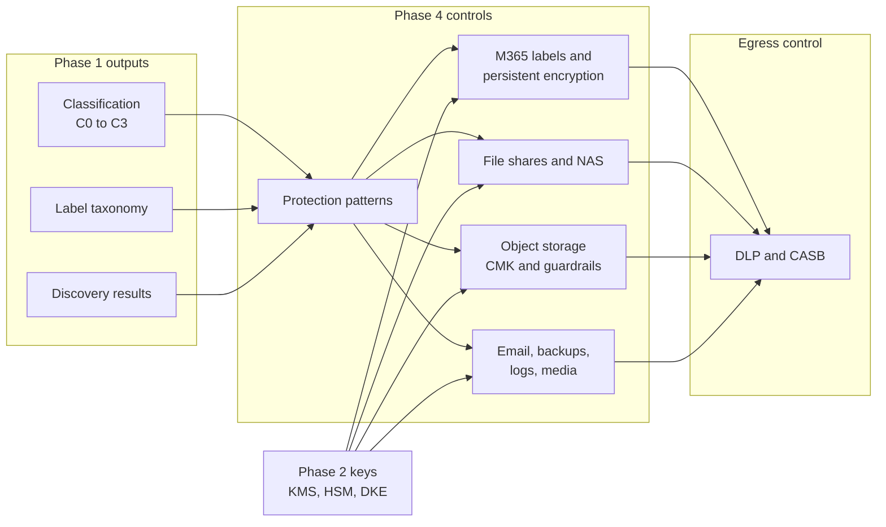

# Phase 4: Unstructured data
{: .no_toc }

**Phase 4: Unstructured data (months 6 to 24).** Protect files, collaboration content, object storage, email, backups, logs, and media so that protection follows the classification of the content, not only the system it happens to be stored in.
{: .fs-5 .fw-300 }

## On this page
{: .no_toc .text-delta }

1. TOC
{:toc}

---

## Objective

Unstructured data is where most sensitive hospitality data ends up outside its system of record. A guest record is protected inside the property management system (PMS), but the same guest appears in a group rooming list exported to Excel, in a scanned passport attached to an email, in a banquet event order on a file share, and in a call recording. Each copy leaves the controls of the source application behind.

Phase 4 closes that gap. It applies the four-tier classification scheme (C0 Public to C3 Restricted) and the canonical sensitivity labels from Phase 1 to files and messages, and maps each label to a protection profile:

| Tier | Label examples | Profile | What that means for a file |
|---|---|---|---|
| C0, C1 | `Public`, `Internal` | PP-1 Baseline | Platform default encryption at rest, TLS in transit, standard permissions, audit logging |
| C2 | `Confidential\Guest-PII`, `Confidential\Employee`, `Confidential\Business` | PP-2 Enhanced | Customer-managed keys on the storage platform, label applied and visible, DLP in monitor-then-block, sharing restricted to the organization and approved partners |
| C3 | `Restricted\PCI`, `Restricted\Guest-Identity`, `Restricted\Special-Category`, `Restricted\Secrets` | PP-3 Maximum | PP-2 plus persistent label-based encryption that travels with the file, DLP block, no external sharing without an approved exception, Double Key Encryption only where justified |

The phase is complete when C2 and C3 content is discoverable, labeled, stored on platforms that meet its profile, and covered by DLP policies that block the exfiltration paths the organization has observed.

## Why this is a separate phase

Structured data protection (Phase 3) works because the application controls every read path. Unstructured data has no such choke point: a file can be copied, forwarded, synced, printed, or uploaded to a personal cloud drive by anyone who can open it. The controls therefore shift from "protect the container" to "protect the content", which requires three capabilities that storage encryption alone does not provide:

1. **Content awareness.** Discovery and classification that can find a passport number inside a PDF, not only a column named `passport_no`.
2. **Persistent protection.** Encryption and usage rights bound to the file, so a copy that leaves the approved location is still protected.
3. **Egress control.** DLP and CASB enforcement at endpoints, email, web, and cloud applications, keyed on labels and sensitive information types.

## Entry criteria

| Criterion | Source |
|---|---|
| Classification scheme and label taxonomy approved | [Data classification scheme]() |
| Label-to-control mapping published | [Label-to-control mapping]() |
| Initial discovery results for M365, file shares, and object storage | [Data asset inventory and discovery]() |
| Key management architecture and custody decisions (which domains need CMK, HSM, or DKE) | [Key management architecture](), [Key custody]() |
| Data owners named for guest, employee, payment, and finance domains | [Data ownership, flows, and lineage]() |

## Exit criteria

- Sensitivity labels published to all information workers, with a default label and mandatory labeling for email and Office files.
- Auto-labeling policies in enforcement for at least passport numbers, payment card numbers, and the loyalty member number custom sensitive information type.
- All C3 file locations (on-prem shares, SharePoint sites, buckets) identified, owned, and either remediated or on a dated remediation plan.
- All cloud object storage holding C2 or C3 data encrypted with customer-managed keys, public access blocked by policy, and scanned by the provider's discovery service.
- Backups of C2 and C3 systems encrypted, with at least one immutable copy and documented key escrow for restores.
- DLP policies for email, SharePoint, OneDrive, Teams, endpoints, and sanctioned cloud apps in block mode for C3 and in block-with-override for C2.
- Metrics reporting live for labeled coverage, DLP incidents, and overshared content.

## Deliverables

| Deliverable | Owner | Format |
|---|---|---|
| Unstructured data protection standard | Security architecture | Standard document with Good/Better/Best per label |
| Sensitivity label and label policy configuration | Information protection engineering | Purview configuration, exported as PowerShell |
| Custom sensitive information types and EDM schema | Information protection engineering | XML rule packages, EDM schema |
| Storage guardrails for buckets and blob containers | Cloud platform engineering | Terraform modules and policy as code |
| File share remediation runbook | Infrastructure and data owners | Runbook with before/after ACL evidence |
| DLP and CASB policy set with tuning log | Security operations | Policy export and change log |
| Backup and log protection standard | Infrastructure and SRE | Standard document and configuration baselines |

## How the pieces fit

## Pages in this section

| Page | What it covers |
|---|---|
| [Unstructured data protection patterns]() | Storage-bound versus persistent encryption, rights management, the hospitality unstructured estate, discovery-to-protection workflow, Good/Better/Best |
| [Microsoft 365 and collaboration]() | Purview sensitivity labels with encryption, container labels, auto-labeling, custom SITs, EDM, Customer Key and DKE, DLP, Copilot oversharing controls, Google Workspace, Box, Dropbox |
| [On-prem file shares and NAS]() | Windows file servers, Purview scanner, NetApp, PowerScale, Pure Storage, CipherTrust Transparent Encryption, Varonis, property servers, least-privilege migration |
| [Cloud object storage]() | S3, Azure Blob, Google Cloud Storage, OCI Object Storage: encryption options, bucket policies, discovery, immutability, Terraform |
| [Email, backups, logs, and media]() | Email transport security and message encryption, backup encryption and key escrow, PII in logs, CCTV and call recordings, endpoint and mobile |
| [DLP and CASB enforcement]() | DLP across channels, CASB API versus inline, label-keyed policy design, monitor-to-block rollout, tuning, incident workflow, hospitality exfiltration scenarios |

## Sequencing note

Within the phase, labels are published and auto-labeling runs in simulation first (months 6 to 9), object storage guardrails follow in parallel, encryption on `Restricted\*` labels and DLP monitor mode come next, and DLP block mode, backup immutability, and log redaction close the phase once tuning evidence exists. Dates are in the [Phased roadmap]().

{: .important }
Do not turn on label encryption before the co-authoring, eDiscovery, search, and partner-sharing implications are tested. Encryption applied at scale to content the business cannot then open is the most common way this phase loses sponsorship.

## Key takeaways for engineering teams

- Storage encryption protects against lost disks and provider-side access; it does nothing once an authorized user copies the file. C3 content needs protection bound to the file.
- The label is the control plane. Every storage, encryption, and DLP decision in this phase is keyed on the canonical label or on the resource tag `data-classification`.
- Roll out in the order label, observe, encrypt, block. Each step produces the evidence needed to tune the next.
- Treat backups, logs, and media as first-class data stores: they often hold more C3 data than the primary systems and are less well governed.

## Related pages

- [Labeling, tagging, and metadata]()
- [Label-to-control mapping]()
- [Phase 3: Structured data]()
- [Retention, deletion, and crypto-shredding]()
- [Phased roadmap]()
