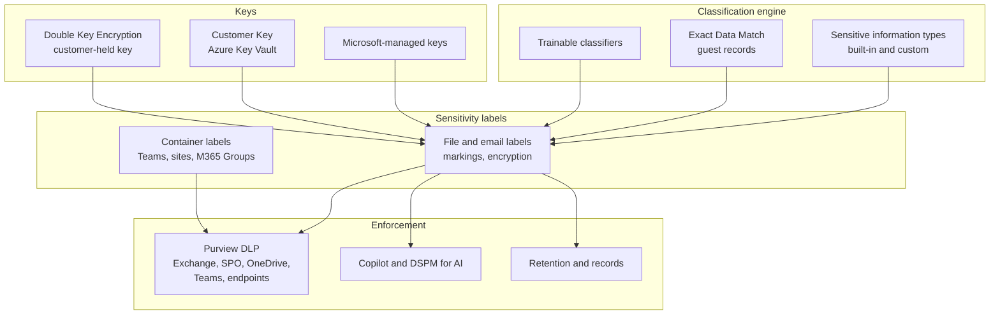
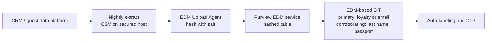

# Microsoft 365 and collaboration
{: .no_toc }

**Phase 4: Unstructured data.** Configures Microsoft Purview so the canonical label taxonomy drives encryption, sharing limits, and DLP across Exchange, SharePoint, OneDrive, Teams, endpoints, and Copilot, with equivalents for other collaboration platforms.
{: .fs-5 .fw-300 }

## On this page
{: .no_toc .text-delta }

1. TOC
{:toc}

---

## Why Microsoft 365 is the center of gravity

For the organization, Microsoft 365 holds most of the unstructured C2 and C3 content: rooming lists in Excel, contracts in SharePoint, passport scans forwarded by email, HR files in OneDrive, and guest details pasted into Teams chats. It also provides the most complete native toolset for classification, persistent encryption, and DLP, which makes it the reference implementation for the label taxonomy. Other platforms are mapped to it.

{: .verify }
Microsoft renames Purview features and moves them between licensing tiers frequently. Feature names and behaviors on this page are as of mid-2026. Confirm licensing (for example Microsoft 365 E5 or E5 Compliance for service-side auto-labeling, EDM, and Endpoint DLP) against current Microsoft documentation before design sign-off.

## Architecture overview



## Label taxonomy in Purview

The canonical labels from [Data classification scheme]() are implemented as parent labels with sublabels. Users see the parent in the ribbon and choose a sublabel.

| Label | Scope | Encryption | Visual marking | Container behavior | Auto-label conditions |
|---|---|---|---|---|---|
| `Public` | Files, email | None | None | Not used for containers | None |
| `Internal` | Files, email, containers | None | Footer "Internal" | Private or public teams, external sharing limited to existing guests | Default label |
| `Confidential\Business` | Files, email | None (optional for external contracts) | Footer | Not used for containers | Trainable classifiers for contracts |
| `Confidential\Guest-PII` | Files, email, containers | None by default; encrypted variant for external sharing | Header and footer | Private teams, guests allowed from approved domains | Guest EDM match, email addresses with names at volume |
| `Confidential\Employee` | Files, email, containers | None by default | Header and footer | Private, no guests | HR trainable classifiers, employee ID SIT |
| `Restricted\PCI` | Files, email | Yes, named groups only | Header, footer, watermark | Not used; PCI content should not be in M365 | Credit card number SIT at high confidence |
| `Restricted\Guest-Identity` | Files, email, containers | Yes, organization and named partner domains | Header, footer, watermark | Private, no guests, unmanaged devices web-only | Passport SITs, custom national ID SITs, EDM passport column |
| `Restricted\Special-Category` | Files, email, containers | Yes, named groups | Header, footer, watermark | Private, no guests | Health terms classifier, spa intake custom SIT |
| `Restricted\Secrets` | Files, email | Yes, named groups, no offline access | Header, watermark | Not used | Credential SITs (keys, connection strings) |

{: .note }
`Restricted\PCI` exists so that card data found in M365 is contained and visible while it is removed. The target state is that PAN is not stored in Microsoft 365 at all; see [Payment card data and PCI DSS]().

## Sensitivity labels with encryption

A label that applies encryption uses one of two permission models.

| Model | How it works | Use in the organization |
|---|---|---|
| **Assign permissions now** (admin-defined) | The label lists users, groups, or domains and the rights each receives. Every file with the label gets the same permissions. | All `Restricted\*` labels. Rights are granted to Entra groups managed by the data owner. |
| **Let users assign permissions** (user-defined) | For email, the user chooses Do Not Forward or Encrypt-Only. For Office files, the user is prompted to specify people and rights when applying the label. | A `Confidential\Guest-PII` sublabel variant for ad hoc sharing with an external event planner. Used sparingly because permissions are not centrally known. |

Settings that matter for design:

- **Usage rights.** Co-Author (view, edit, copy, print, and so on), Reviewer, Viewer, or custom rights such as `VIEW`, `EDIT`, `PRINT`, `EXTRACT`, `FORWARD`, `REPLY`, `OBJMODEL`. Withholding `EXTRACT` (copy) also affects whether some services and assistants can use the content.
- **Content expiration** and **offline access** (the number of days a use license is valid without reconnecting).
- **Double Key Encryption** is selected per label and requires a deployed DKE key service.

### Creating the labels with Security & Compliance PowerShell

The organization maintains labels as code. The following creates the `Restricted` parent and the `Guest-Identity` sublabel with admin-defined permissions. `Connect-IPPSSession` is from the ExchangeOnlineManagement module.

```powershell
Connect-IPPSSession -UserPrincipalName admin@contoso-hospitality.example

# Parent label (no protection itself; groups the sublabels)
New-Label -Name "Restricted" `
  -DisplayName "Restricted" `
  -Tooltip "Highest sensitivity. Payment card, identity documents, special-category data, secrets." `
  -ContentType "File, Email"

# Sublabel with encryption, markings, and admin-defined rights
New-Label -Name "Restricted-Guest-Identity" `
  -DisplayName "Guest-Identity" `
  -ParentId "Restricted" `
  -Tooltip "Passport, national ID, and visa data for guests. Encrypted. Internal and approved partner access only." `
  -ContentType "File, Email" `
  -EncryptionEnabled $true `
  -EncryptionProtectionType "Template" `
  -EncryptionRightsDefinitions "grp-guest-identity-readers@contoso-hospitality.example:VIEW,VIEWRIGHTSDATA,DOCEDIT,EDIT,PRINT,REPLY,REPLYALL,FORWARD,OBJMODEL;grp-guest-identity-owners@contoso-hospitality.example:OWNER" `
  -EncryptionContentExpiredOnDateInDaysOrNever "Never" `
  -EncryptionOfflineAccessDays 3 `
  -ApplyContentMarkingHeaderEnabled $true `
  -ApplyContentMarkingHeaderText "RESTRICTED - GUEST IDENTITY" `
  -ApplyContentMarkingFooterEnabled $true `
  -ApplyContentMarkingFooterText "Do not forward outside approved recipients" `
  -ApplyWaterMarkingEnabled $true `
  -ApplyWaterMarkingText "RESTRICTED"
```

Notes on the example:

- The readers group is deliberately not granted `EXTRACT` (copy) or `EXPORT`. Test the effect on the specific workflows (for example copying a passport number into the police reporting portal) before rollout. If the workflow requires copy, grant it and rely on DLP for the egress.
- Admin-defined permissions to a group mean access is managed by group membership, which the data owner reviews quarterly. A partner domain can be added as `partnerdomain.example:VIEW`.
- `-EncryptionProtectionType "UserDefined"` together with `-EncryptionPromptUser $true` or `-EncryptionDoNotForward $true` creates user-defined variants. Confirm current parameter behavior with `Get-Help New-Label -Detailed` in the tenant before scripting.

Updating an existing label (for example tightening offline access) uses `Set-Label`:

```powershell
Set-Label -Identity "Restricted-Guest-Identity" -EncryptionOfflineAccessDays 1
Get-Label -Identity "Restricted-Guest-Identity" | Format-List Name,DisplayName,EncryptionEnabled,EncryptionRightsDefinitions
```

Labels are published with a label policy, which also sets the default label and mandatory labeling:

```powershell
New-LabelPolicy -Name "Global information workers" `
  -Labels "Public","Internal","Confidential","Confidential-Guest-PII","Confidential-Employee","Confidential-Business","Restricted","Restricted-Guest-Identity","Restricted-Special-Category","Restricted-Secrets","Restricted-PCI" `
  -ExchangeLocation "All"
```

{: .verify }
Default label, mandatory labeling, and downgrade justification are set as label policy settings. They are straightforward in the Purview portal; in PowerShell some are exposed through `-AdvancedSettings` keys whose names have changed over time. Configure them in the portal or confirm key names in current documentation before scripting them.

### Co-authoring with encrypted files

Historically, encrypted Office files could not be co-authored and did not work in Office for the web. Two tenant-level settings change this:

```powershell
# SharePoint Online Management Shell: let SharePoint and OneDrive process labeled/encrypted Office files and PDFs
Set-SPOTenant -EnableAIPIntegration $true

# Security & Compliance PowerShell: enable co-authoring for files encrypted with sensitivity labels
Set-PolicyConfig -EnableLabelCoauth:$true
```

With sensitivity labels enabled for SharePoint and OneDrive, the service can decrypt labeled files for search, eDiscovery, DLP, and web viewing. Without it, encrypted files are opaque to those services.

{: .warning }
Enabling co-authoring for encrypted files changes the metadata format that Office apps use to store label information. Older Office clients that do not support the new format may not read labels correctly. Confirm client minimum versions across properties, including shared front-desk PCs, before enabling.

## Container labels: Teams, SharePoint sites, and Microsoft 365 Groups

Container labels do not encrypt the files inside. They set the container's privacy, guest access, external sharing, and unmanaged-device access. This is how the organization makes an HR or group-sales team safe by default.

Enabling container labels is a two-step tenant change: enable the Entra group setting `EnableMIPLabels`, then synchronize labels:

```powershell
# After EnableMIPLabels is set to True in the Entra ID group settings
Connect-IPPSSession
Execute-AzureAdLabelSync
```

A container-scoped label (or container settings on an existing label) is then configured:

```powershell
Set-Label -Identity "Restricted-Guest-Identity" `
  -ContentType "File, Email, Site, UnifiedGroup" `
  -SiteAndGroupProtectionEnabled $true `
  -SiteAndGroupProtectionPrivacy "Private" `
  -SiteAndGroupProtectionAllowAccessToGuestUsers $false `
  -SiteExternalSharingControlType "Disabled"
```

| Container label | Privacy | Guests | External sharing | Unmanaged devices | Typical containers |
|---|---|---|---|---|---|
| `Internal` | Public or private | Existing guests only | Existing external users | Full access | Department teams |
| `Confidential\Guest-PII` | Private | Approved partner domains | New and existing guests (authenticated) | Web-only | Group sales and events teams, CRM operations |
| `Confidential\Employee` | Private | None | Disabled | Web-only | HR business partner teams |
| `Restricted\Guest-Identity` | Private | None | Disabled | Blocked | Front office compliance, police reporting |
| `Restricted\Special-Category` | Private | None | Disabled | Blocked | Spa and wellness, occupational health |

### Default sensitivity label for document libraries

A SharePoint document library can have a default sensitivity label. New or edited files that are unlabeled receive that label when uploaded or saved. The organization sets the default library label to match the container label on C2 and C3 sites so that files dropped into the HR library are labeled `Confidential\Employee` without user action.

{: .note }
A default library label does not replace a higher label that a file already has. It is a floor for unlabeled content, not an override.

## Classification: sensitive information types, EDM, and trainable classifiers

### Built-in sensitive information types

Purview includes built-in SITs for credit card numbers, many national passport and ID formats, bank account numbers, and credentials. The organization enables the SITs for the countries it operates in and tunes confidence levels and instance counts per policy.

### Custom SIT: loyalty member number

The loyalty member number is C2 on its own and identifies a guest. It is a ten-digit number whose final digit is a weighted modulus check digit (this example uses an illustrative scheme; the real algorithm is owned by the loyalty platform team). A custom SIT with a checksum validator removes most false positives from random ten-digit numbers such as phone numbers.

Custom SITs can be created in the Purview portal (regex, keywords, supporting elements, and validators) or uploaded as an XML rule package. The rule package form is kept in source control:

```xml
<?xml version="1.0" encoding="utf-16"?>
<RulePackage xmlns="http://schemas.microsoft.com/office/2011/mce">
  <RulePack id="4b5e0b3a-2f1c-4d8e-9a6b-1f2d3c4b5a60">
    <Version major="1" minor="0" build="0" revision="0"/>
    <Publisher id="9c8d7e6f-5a4b-4c3d-8e2f-1a0b9c8d7e6f"/>
    <Details defaultLangCode="en-us">
      <LocalizedDetails langcode="en-us">
        <PublisherName>Information Protection Engineering</PublisherName>
        <Name>Hospitality custom SITs</Name>
        <Description>Loyalty member number and related identifiers</Description>
      </LocalizedDetails>
    </Details>
  </RulePack>
  <Rules>
    <Entity id="d1a2b3c4-e5f6-4a7b-8c9d-0e1f2a3b4c5d" patternsProximity="300" recommendedConfidence="85">
      <Pattern confidenceLevel="85">
        <IdMatch idRef="Regex_loyalty_number"/>
        <Match idRef="Keyword_loyalty"/>
      </Pattern>
      <Pattern confidenceLevel="75">
        <IdMatch idRef="Regex_loyalty_number"/>
      </Pattern>
    </Entity>
    <Regex id="Regex_loyalty_number" validators="Validator_loyalty_checksum">(?&lt;!\d)\d{10}(?!\d)</Regex>
    <Validators id="Validator_loyalty_checksum">
      <Validator type="Checksum">
        <Param name="Weights">3, 1, 3, 1, 3, 1, 3, 1, 3</Param>
        <Param name="Mod">10</Param>
        <Param name="CheckDigit">last</Param>
      </Validator>
    </Validators>
    <Keyword id="Keyword_loyalty">
      <Group matchStyle="word">
        <Term>loyalty</Term>
        <Term>member number</Term>
        <Term>membership no</Term>
        <Term>rewards number</Term>
      </Group>
    </Keyword>
    <LocalizedStrings>
      <Resource idRef="d1a2b3c4-e5f6-4a7b-8c9d-0e1f2a3b4c5d">
        <Name default="true" langcode="en-us">Loyalty Member Number</Name>
        <Description default="true" langcode="en-us">Ten-digit loyalty member number with check digit</Description>
      </Resource>
    </LocalizedStrings>
  </Rules>
</RulePackage>
```

```powershell
New-DlpSensitiveInformationTypeRulePackage -FileData ([System.IO.File]::ReadAllBytes("C:\ip\hospitality-sits.xml"))

# Test detection against sample text before using it in any policy
Test-DataClassification -TextToClassify "Guest loyalty member number 4417203958 upgraded to Gold" |
  Select-Object -ExpandProperty ClassificationResults
```

{: .verify }
The validator element names and parameters (`Checksum`, `Weights`, `Mod`, `CheckDigit`) follow Microsoft's published custom SIT schema as understood at the time of writing. Validate the rule package against the current schema documentation and test with `Test-DataClassification` using both valid and invalid numbers. A weighted modulus validator is not the same as the Luhn algorithm; if the loyalty number uses Luhn, use the Luhn validator available for custom SITs instead.

### Passport and identity documents

Built-in passport SITs cover many countries (for example U.S./U.K. passport number, EU passport number, and individual country types). Passport numbers are short alphanumeric strings, so detection depends heavily on supporting keywords and proximity. Tuning approach:

| Setting | Recommendation | Reason |
|---|---|---|
| Confidence level | High for auto-labeling and DLP block; medium for monitoring | Low-confidence passport matches are frequently booking references |
| Instance count | 1 or more for email to external; 5 or more for auto-labeling files at rest | Single matches in large files are noisy |
| Supporting keywords | Add "passport", "document number", "nationality", "date of expiry" in local languages used at properties | Improves precision |
| Machine-readable zone | Consider a custom SIT for the passport MRZ line pattern in scanned PDFs processed by OCR | Scans often contain the MRZ even when the number field is not recognized |

{: .verify }
Purview supports optical character recognition (OCR) for images in some locations as a separately billed capability. Confirm which locations (SharePoint, OneDrive, Exchange, Teams, endpoints) are supported for OCR as of mid-2026 before relying on it to find passport scans saved as JPEG.

### Exact Data Match for guest records

EDM classifies content by matching against actual values from a source table, rather than patterns. For the organization, the source is a nightly extract of guest profiles from the CRM with columns such as loyalty number, email, last name, and passport number (for the subset of properties that must hold it). The values are hashed with a salt before upload; Microsoft receives hashes, not cleartext.



The EDM upload agent workflow, run on a hardened host in the guest data domain:

```powershell
# One-time: authorize the agent and save the schema defined in the portal
.\EdmUploadAgent.exe /Authorize
.\EdmUploadAgent.exe /SaveSchema /DataStoreName guestprofiles /OutputDir C:\edm\schema

# Nightly: hash locally, then upload hashes only
.\EdmUploadAgent.exe /CreateHash /DataFile C:\edm\data\guestprofiles.csv /HashLocation C:\edm\hash /Schema C:\edm\schema\guestprofiles.xml
.\EdmUploadAgent.exe /UploadHash /DataStoreName guestprofiles /HashFile C:\edm\hash\guestprofiles.EdmHash

# Check upload status
.\EdmUploadAgent.exe /GetSession /DataStoreName guestprofiles
```

{: .verify }
EDM Upload Agent switches have changed between agent versions. Confirm the exact switch names against `EdmUploadAgent.exe /?` for the deployed version.

Design rules for EDM:

- The extract is itself C3 while it exists. It lives on a dedicated host with BitLocker, no interactive users, and is deleted after hashing.
- Choose a primary element that is distinctive (loyalty number, email) and use last name and passport number as corroborating evidence. A last name alone is not a useful primary element.
- EDM is the most precise way to detect "a list of our guests", which built-in SITs cannot do. It is the preferred condition for blocking external email of guest lists.

### Trainable classifiers

Trainable classifiers recognize document types rather than values: contracts, resumes, HR documents, financial statements. The organization uses built-in classifiers for HR and legal content and trains a custom classifier on banquet event orders and group contracts from seed documents supplied by the events team. Trainable classifiers are used for labeling `Confidential\Business` and `Confidential\Employee`, and only in combination with SITs for `Restricted\*` labels.

## Auto-labeling policies

Service-side auto-labeling labels files at rest in SharePoint and OneDrive and email in transit. It starts in simulation.

```powershell
New-AutoSensitivityLabelPolicy -Name "AL - Guest identity documents" `
  -ApplySensitivityLabel "Restricted-Guest-Identity" `
  -SharePointLocation "All" `
  -OneDriveLocation "All" `
  -ExchangeLocation "All" `
  -Mode "TestWithoutNotifications"

New-AutoSensitivityLabelRule -Policy "AL - Guest identity documents" `
  -Name "Passport numbers high confidence - SPO" `
  -Workload "SharePoint" `
  -ContentContainsSensitiveInformation @{Name="EU Passport Number"; minCount="5"; minConfidence="85"}

New-AutoSensitivityLabelRule -Policy "AL - Guest identity documents" `
  -Name "Passport numbers high confidence - ODB" `
  -Workload "OneDriveForBusiness" `
  -ContentContainsSensitiveInformation @{Name="EU Passport Number"; minCount="5"; minConfidence="85"}

New-AutoSensitivityLabelRule -Policy "AL - Guest identity documents" `
  -Name "Passport numbers - Exchange" `
  -Workload "Exchange" `
  -ContentContainsSensitiveInformation @{Name="EU Passport Number"; minCount="1"; minConfidence="85"}
```

After reviewing simulation results in the portal (matched items, false positives sampled by the data owner), the policy is moved to enforcement:

```powershell
Set-AutoSensitivityLabelPolicy -Identity "AL - Guest identity documents" -Mode "Enable"
```

{: .note }
Service-side auto-labeling processes a limited number of files per tenant per day and does not relabel files that already have a higher-priority or manually applied label. Plan the historical backlog as a multi-week effort and prioritize sites identified by discovery.

## Key options: Microsoft-managed keys, Customer Key, and DKE

| Option | What the customer controls | Protects against | Service impact | When the organization uses it |
|---|---|---|---|---|
| Microsoft-managed keys | Nothing about the keys | Physical and infrastructure threats | None | PP-1 and most PP-2 content |
| **Customer Key** | Root keys in the customer's Azure Key Vault (two keys, in two vaults, in different regions) wrapping the data encryption policy keys for Exchange, SharePoint, OneDrive, Teams, and other workloads | Provides a customer-controlled exit: revoking keys starts a data purge path at the end of a contract; key use is logged in the customer's vault | Full service functionality retained (search, eDiscovery, Copilot), since Microsoft services can still use the keys | Tenant-level or workload-level control for regulated regions where a customer-controlled key is required by policy |
| **Label encryption** (Azure RMS, Microsoft-managed or BYOK tenant key) | Which users and rights can open each file | Redistribution; persists outside the tenant | Services decrypt when integration is enabled | All `Restricted\*` labels |
| **Double Key Encryption (DKE)** | A second key held in a customer-operated DKE service; both keys are needed to open content | Microsoft being able to decrypt the content at all | Content is opaque to Microsoft services: no service-side search, eDiscovery content, DLP content inspection, or Copilot processing of the protected content; limited app support | A small, named set: M&A documents and similar board-level material. Not for guest data. |

Customer Key is configured with data encryption policies. The multi-workload policy uses a cmdlet such as `New-M365DataAtRestEncryptionPolicy` with the two Key Vault key URIs, and Exchange mailbox and SharePoint policies have their own cmdlets. The Azure side requires soft delete and purge protection on both vaults and the prescribed key permissions for the Microsoft 365 service principals.

{: .verify }
Customer Key onboarding requires a request process and specific Key Vault configuration. Follow the current Microsoft "Set up Customer Key" documentation for the exact cmdlets and permissions rather than this summary.

{: .warning }
DKE is the Best option only for content where the benefit of excluding Microsoft outweighs losing search, DLP, and AI features and taking on the availability of the DKE key service. For guest PII the organization chooses standard label encryption, because DLP and eDiscovery visibility are more valuable than excluding the provider. This decision is recorded in [Key custody: BYOK, HYOK, and external keys]().

## Purview DLP across workloads

DLP policies are keyed on labels and SITs and scoped to locations: Exchange email, SharePoint sites, OneDrive accounts, Teams chat and channel messages, and devices (Endpoint DLP). The full enforcement strategy is on [DLP and CASB enforcement](); this section shows the M365 configuration.

```powershell
New-DlpCompliancePolicy -Name "DLP - Guest identity external sharing" `
  -Comment "Restricted\Guest-Identity and passport SITs must not leave the organization" `
  -ExchangeLocation "All" `
  -SharePointLocation "All" `
  -OneDriveLocation "All" `
  -TeamsLocation "All" `
  -EndpointDlpLocation "All" `
  -Mode "TestWithNotifications"

# Rule 1: passport numbers at volume shared externally from SPO/ODB/Teams: block
New-DlpComplianceRule -Name "Block passports to external - files" `
  -Policy "DLP - Guest identity external sharing" `
  -ContentContainsSensitiveInformation @{Name="EU Passport Number"; minCount="1"; minConfidence="85"} `
  -AccessScope "NotInOrganization" `
  -BlockAccess $true `
  -BlockAccessScope "NotInOrganization" `
  -NotifyUser "Owner","LastModifier" `
  -GenerateIncidentReport "SiteAdmin" `
  -IncidentReportContent "All" `
  -ReportSeverityLevel "High"
```

A separate rule for email typically uses `-SentToScope "NotInOrganization"` and an action such as blocking the message with a policy tip and override for business justification (for C2), or blocking without override (for C3).

Label-based conditions use the `-ContentContainsSensitiveInformation` parameter with a group that lists labels by type `Sensitivity`:

```powershell
$labelCondition = @{
  operator = "Or"
  groups = @(
    @{
      operator = "Or"
      name     = "Restricted labels"
      labels   = @(
        @{ name = "<GUID of Restricted-Guest-Identity>"; type = "Sensitivity" },
        @{ name = "<GUID of Restricted-Special-Category>"; type = "Sensitivity" }
      )
    }
  )
}

New-DlpComplianceRule -Name "Block Restricted labels to external email" `
  -Policy "DLP - Guest identity external sharing" `
  -ContentContainsSensitiveInformation $labelCondition `
  -SentToScope "NotInOrganization" `
  -BlockAccess $true `
  -ReportSeverityLevel "High"
```

{: .verify }
The nested hashtable format for label conditions in `New-DlpComplianceRule` is documented but easy to get wrong. Build the rule once in the portal, export it with `Get-DlpComplianceRule | Format-List`, and use the exported structure as the template for code.

Policy mode moves from `TestWithNotifications` to `Enable` after the tuning window described on the DLP page:

```powershell
Set-DlpCompliancePolicy -Identity "DLP - Guest identity external sharing" -Mode "Enable"
```

## Microsoft 365 Copilot and oversharing

Copilot answers from content the user can already access. It does not create new access, but it makes existing oversharing much easier to exploit: a user who could technically open an overshared rooming list but would never have found it can now get it summarized in response to a question. The organization treats Copilot readiness as an oversharing remediation project.

| Control | What it does | Status and notes |
|---|---|---|
| Label encryption and usage rights | Copilot respects label encryption. Content where the user lacks the rights Copilot needs (for example `EXTRACT` or `VIEW`) is not used in responses | Core control for `Restricted\*` content |
| DLP policy for Microsoft 365 Copilot | Excludes items with specified sensitivity labels from Copilot processing and responses | Verify: location and capabilities have evolved since 2024; confirm current scope |
| Data Security Posture Management (DSPM) for AI | Reports sensitive data in AI interactions, oversharing assessments for SharePoint sites, recommended policies | Name and packaging have changed; verify current name and licensing |
| SharePoint Advanced Management | Data access governance reports (sites with "Everyone except external users", anyone links), restricted access control for sites, restricted content discovery | Use to find and fix overshared sites before Copilot rollout |
| Container labels and site privacy | Private sites and teams limit who is in the permission set Copilot sees | Applied through container labels above |
| Retention and deletion | Reduces stale content available to Copilot | Aligned to `retention-class` tags |

{: .verify }
Copilot and DSPM for AI controls change frequently. As of mid-2026, confirm with Microsoft documentation which controls are generally available, which require additional licensing, and whether they apply to Copilot Chat, Microsoft 365 Copilot, and agents built on it.

Sequence for Copilot readiness:

1. Run oversharing reports: sites shared with "Everyone except external users", anyone links, sites with no owner.
2. Fix the top C2 and C3 sites first: apply container labels, remove broad groups, set a default library label.
3. Restrict discovery of sites that cannot be fixed immediately.
4. Enable the Copilot DLP exclusion for `Restricted\*` labels.
5. Monitor Copilot interactions that touch sensitive content in DSPM for AI and feed findings back into step 2.

## Google Workspace equivalent

Some franchised properties and acquired brands use Google Workspace. The label taxonomy maps as follows.

| Microsoft 365 capability | Google Workspace equivalent | Notes |
|---|---|---|
| Sensitivity labels | Drive labels (classification labels with fields) | Labels can be applied manually, by default, or by DLP rules |
| Auto-labeling | DLP rules that apply Drive labels | Rules use predefined and custom detectors |
| SITs and custom SITs | Predefined detectors, custom regex and word-list detectors | Regex detectors can implement the loyalty number pattern; checksum support is limited, so expect more false positives |
| Label encryption | Client-side encryption (CSE) | Content is encrypted in the browser or client with keys from a customer-operated key service and an identity provider; Google cannot decrypt |
| DLP | Workspace DLP for Drive, Gmail, and Chat | Block external sharing, warn, audit |
| Customer Key | CSE with an external key service | CSE is closer to DKE than to Customer Key: Google services lose visibility into encrypted content |

{: .verify }
Google Workspace CSE availability depends on edition (Enterprise Plus and certain Education editions historically) and supported apps (Docs, Sheets, Slides, Drive files, Gmail, Calendar, Meet). Confirm edition and app coverage as of mid-2026.

The trade-off mirrors DKE: CSE protects against the provider but removes server-side search and DLP inspection of encrypted content. The organization uses CSE only for the Workspace equivalent of `Restricted\Special-Category` and relies on Drive labels plus DLP for C2.

## Box and Dropbox

Some business units use Box or Dropbox for external collaboration with owners and partners.

| Capability | Box | Dropbox |
|---|---|---|
| Classification labels | Native classification labels, can apply sharing restrictions | Classification features vary by plan |
| Customer-managed keys | Box KeySafe, with keys in a cloud KMS or HSM | Varies by plan; verify |
| DLP and threat detection | Box Shield | Varies by plan |
| M365 label integration | Some integration with Microsoft sensitivity labels | Verify |
| CASB coverage | API-based CASB connectors from major vendors | API-based CASB connectors from major vendors |

{: .verify }
Box and Dropbox feature names and plan tiers change. Treat this table as a starting checklist and confirm with the vendors during design review.

The organization's rule is that C3 content is not stored in Box or Dropbox. C2 content may be, provided the tenant is sanctioned, covered by API CASB, and uses customer-managed keys where the plan supports them.

## Key takeaways for engineering teams

- Keep labels as code. Create and change labels, label policies, auto-labeling policies, and DLP policies through Security & Compliance PowerShell in source control, and validate syntax against the tenant before merging.
- Enable SharePoint and OneDrive label integration and co-authoring for encrypted files before encrypting at scale, or search, DLP, and web access break.
- Use EDM for "a list of our guests" and custom SITs with validators for loyalty numbers; built-in SITs alone produce too many false positives for blocking.
- Reserve DKE and Google CSE for a small, named set of content. For guest data, standard label encryption keeps DLP, eDiscovery, and Copilot controls working.
- Treat Copilot rollout as an oversharing cleanup project with container labels and label-based exclusion, not as a separate AI control.

## Related pages

- [Unstructured data protection patterns]()
- [DLP and CASB enforcement]()
- [Labeling, tagging, and metadata]()
- [Key custody: BYOK, HYOK, and external keys]()
- [Microsoft Azure]()
- [Guardrails and policy as code]()

## Sources

- Microsoft Learn, Restrict access to content by using sensitivity labels to apply encryption: https://learn.microsoft.com/purview/encryption-sensitivity-labels
- Microsoft Learn, Use sensitivity labels to protect content in Microsoft Teams, Microsoft 365 Groups, and SharePoint sites: https://learn.microsoft.com/purview/sensitivity-labels-teams-groups-sites
- Microsoft Learn, Enable co-authoring for files encrypted with sensitivity labels: https://learn.microsoft.com/purview/sensitivity-labels-coauthoring
- Microsoft Learn, Create a custom sensitive information type using PowerShell: https://learn.microsoft.com/purview/sit-create-a-custom-sensitive-information-type-in-scc-powershell
- Microsoft Learn, Learn about exact data match based sensitive information types: https://learn.microsoft.com/purview/sit-learn-about-exact-data-match-based-sits
- Microsoft Learn, Double Key Encryption: https://learn.microsoft.com/purview/double-key-encryption
- Microsoft Learn, Service encryption with Customer Key: https://learn.microsoft.com/purview/customer-key-overview
- Microsoft Learn, New-DlpComplianceRule: https://learn.microsoft.com/powershell/module/exchange/new-dlpcompliancerule
- Google Workspace Admin Help, About client-side encryption: https://support.google.com/a/answer/10741897
