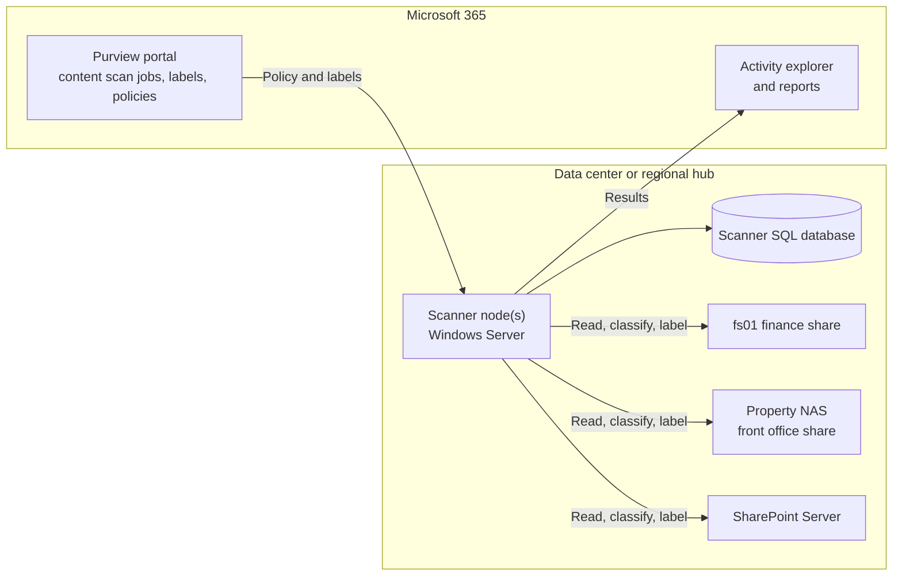
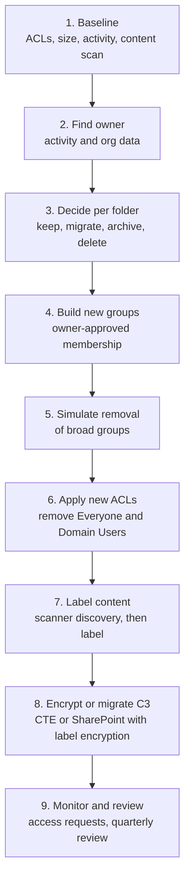

# On-prem file shares and NAS
{: .no_toc }

**Phase 4: Unstructured data.** Brings on-premises file shares, NAS platforms, and hotel back-office servers up to the protection profile of the data they hold, and gives engineering teams a step-by-step method to move an open share to a least-privilege, labeled state.
{: .fs-5 .fw-300 }

## On this page
{: .no_toc .text-delta }

1. TOC
{:toc}

---

## The on-prem file estate in a hospitality organization

On-prem file storage exists at three levels, each with different risks:

| Level | Typical platform | Content | Main risks |
|---|---|---|---|
| Corporate and regional data centers | NetApp ONTAP, Dell PowerScale (Isilon), Pure Storage FlashArray/FlashBlade, Windows file server clusters | Finance, HR, legal, marketing, historical PMS exports, departmental shares | Decades of accumulated data, "Everyone" and "Domain Users" permissions, no owners |
| Properties (owned and managed hotels) | A small Windows server or NAS in the back office, sometimes a single virtual host running several roles | Front office folders, scanned IDs, group rooming lists, night audit reports, CCTV exports, HR onboarding forms | Physical access by many staff, shared local accounts, weak patching, no local IT staff |
| Endpoints and removable media | Back-office PCs, front-desk PCs, USB drives | Local copies of exports and scans | Theft, loss, uncontrolled copy |

Franchised properties are outside the organization's direct control. The brand standard sets minimum requirements (full disk encryption, no local storage of ID scans outside the PMS, supported OS versions), and compliance is checked through franchise assessments rather than technical enforcement.

## Windows file servers

### Volume encryption: BitLocker

BitLocker encrypts whole volumes with AES (XTS-AES 128 or 256). On file servers it protects against theft of disks or of the whole server (a real risk for property back offices) and simplifies disposal. It does not restrict what an authenticated user or administrator can read through the share.

```powershell
# Encrypt the data volume on a property file server with XTS-AES 256 and a recovery password
Enable-BitLocker -MountPoint "D:" -EncryptionMethod XtsAes256 -UsedSpaceOnly -RecoveryPasswordProtector

# Add automatic unlock for data volumes once the OS volume is protected
Enable-BitLockerAutoUnlock -MountPoint "D:"

# Back up the recovery password to Active Directory (requires the GPO for AD backup)
$kp = (Get-BitLockerVolume -MountPoint "D:").KeyProtector | Where-Object KeyProtectorType -eq "RecoveryPassword"
Backup-BitLockerKeyProtector -MountPoint "D:" -KeyProtectorId $kp.KeyProtectorId

Get-BitLockerVolume | Select-Object MountPoint, VolumeStatus, EncryptionMethod, ProtectionStatus
```

{: .note }
Recovery password escrow is mandatory. A property server whose recovery key is lost after a motherboard replacement is a data loss event. Escrow to Active Directory or Microsoft Entra ID, and include the check in the build validation.

### EFS and why it is not the answer

Encrypting File System (EFS) encrypts individual files with keys tied to the user's certificate. The organization does not use it for shared data:

- Access by multiple users requires adding each user's certificate to each file, which does not scale on shared folders.
- Recovery depends on data recovery agent certificates, which are commonly misconfigured or lost.
- Files are decrypted when copied to non-NTFS destinations or sent over the network in many scenarios, so protection does not travel.
- Administrators with the recovery agent key can read everything, which does not address the privileged-user threat.

EFS may remain in use on individual workstations for legacy reasons; it is not a control the architecture relies on.

### File Classification Infrastructure

File Server Resource Manager (FSRM) includes File Classification Infrastructure (FCI), which classifies files by content or location and runs file management tasks. It is still available in Windows Server but receives little development, and its rights management action depended on the older Rights Management connector model. The organization uses FCI only for location-based tagging on legacy servers during migration, for example tagging all files under `D:\FrontOffice\IDScans` as confidential so that expiration tasks can remove old files.

```powershell
# Define a classification property and a location-based rule
New-FsrmClassificationPropertyDefinition -Name "DataClassification" -Type SingleChoice `
  -PossibleValue @(
    (New-FsrmClassificationPropertyValue -Name "restricted"),
    (New-FsrmClassificationPropertyValue -Name "confidential"),
    (New-FsrmClassificationPropertyValue -Name "internal")
  )

New-FsrmClassificationRule -Name "ID scans are restricted" -Property "DataClassification" `
  -PropertyValue "restricted" -Namespace @("D:\FrontOffice\IDScans") `
  -ClassificationMechanism "Folder Classifier" -ReevaluateProperty Overwrite
```

For content-based classification and labeling, the Purview information protection scanner is the preferred tool.

### Purview information protection scanner

The scanner runs on a Windows server on-premises, crawls SMB shares, NFS shares, and SharePoint Server libraries, inspects content using the same SITs and labels as Microsoft 365, and can apply sensitivity labels (including encryption) to files at rest.



Deployment steps:

1. Create a scanner cluster and content scan job in the Purview portal. Define the repositories (UNC paths), the SITs to detect, and whether to apply labels.
2. Provision the scanner service account with read access (discovery mode) or read/write access (labeling mode) to the repositories. Do not grant it domain admin.
3. Install the unified labeling client or information protection client on the scanner server and run the install cmdlets:

```powershell
# Install the scanner service against its SQL database and cluster
Install-Scanner -SqlServerInstance "SQL01\SCANNER" -Cluster "EMEA-Scanner"

# Authenticate the scanner to Microsoft Entra ID using an app registration
Set-Authentication -AppId "<app-id>" -AppSecret "<secret-from-vault>" -TenantId "<tenant-id>" -DelegatedUser "svc-aipscanner@contoso-hospitality.example"

# Run and monitor a scan
Start-Scan
Get-ScanStatus
```

4. Run in **discovery only** first. Review results by repository with the data owner.
5. Enable labeling for specific repositories after owner approval, starting with automatic labeling of `Restricted\Guest-Identity` content in front office folders.

{: .warning }
Applying encryption labels to files on a file share changes how every consumer opens those files. Line-of-business applications that read files directly from the share (for example a night audit script that parses Excel exports) will fail on encrypted files. Inventory file consumers before enabling labeling with encryption on any share.

{: .verify }
Cmdlet names and the scanner installation model (profile versus cluster) have changed between client generations. Confirm against the current Microsoft Purview information protection scanner documentation for the client version deployed.

### SharePoint Server (on-premises)

Remaining SharePoint Server farms are in scope for the scanner (labeling files in libraries) and for migration. SharePoint Server does not support container labels or service-side auto-labeling as SharePoint Online does. The plan is to migrate C2 and C3 libraries to SharePoint Online, where the full label and DLP stack applies, and to archive or delete the rest.

## NAS platforms

### NetApp ONTAP: NVE, NAE, and key managers

ONTAP offers software encryption at the volume level (NetApp Volume Encryption, NVE) and the aggregate level (NetApp Aggregate Encryption, NAE, which preserves storage efficiency across volumes in the aggregate). Keys are held by the Onboard Key Manager or by an external key manager over KMIP.

| Key manager option | Where keys live | Separation of duties | Recommended for |
|---|---|---|---|
| Onboard Key Manager (OKM) | On the cluster, protected by a cluster passphrase | Storage admin controls both data and keys | Good: property-level or small regional systems |
| External KMIP key manager | Thales CipherTrust Manager, Entrust KeyControl, Fortanix DSM, or similar, often HSM-backed | Key admins are separate from storage admins; keys can be revoked centrally | Better and Best: data center systems holding C2 and C3 |

```text
# Onboard key manager (interactive passphrase prompt)
cluster1::> security key-manager onboard enable

# External key manager for an SVM, with KMIP over mutual TLS
cluster1::> security key-manager external enable -vserver svm_finance
           -key-servers kmip1.corp.example:5696,kmip2.corp.example:5696
           -client-cert svm_finance_kmip_client -server-ca-certs kmip_root_ca

# Create an encrypted volume, or convert an existing one
cluster1::> volume create -vserver svm_finance -volume hr_share -aggregate aggr1 -size 2TB -encrypt true
cluster1::> volume encryption conversion start -vserver svm_finance -volume legacy_share

# Verify
cluster1::> volume show -vserver svm_finance -fields is-encrypted,encryption-type
```

{: .verify }
ONTAP command syntax and field names vary by release (for example the `-key-servers` form versus older `security key-manager external add-servers`). Confirm against the ONTAP documentation for the deployed version.

NetApp also supports self-encrypting drives (NSE). Combining NSE with NVE gives two independent layers, which some regulated environments require; for the organization, NVE or NAE with an external key manager is sufficient for C2 and C3 at rest.

### Dell PowerScale

PowerScale (OneFS) uses self-encrypting drives for data-at-rest encryption. Keys are held by the cluster's internal key manager by default; recent OneFS releases support an external key manager over KMIP. Because encryption is at the drive level, it protects against drive removal and simplifies disposal (cryptographic erase), but not against access through the file protocols. SMB and NFS permissions, access zones, and auditing still carry the access control burden.

{: .verify }
External KMIP key manager support in OneFS depends on version and SED type. Confirm the minimum OneFS version with Dell.

### Pure Storage

Pure Storage FlashArray and FlashBlade encrypt data at rest by default with AES-256, with keys managed internally by the array. External key manager support via KMIP is available for some products and releases. As with other array-level encryption, this is storage-bound protection: the array administrator and any authorized file protocol client see cleartext.

{: .verify }
Confirm Pure Storage KMIP support and supported key managers for the specific product line and Purity release.

### Platform comparison

| Capability | NetApp ONTAP | Dell PowerScale | Pure Storage | Windows file server |
|---|---|---|---|---|
| At-rest encryption mechanism | Software (NVE, NAE) and/or SED (NSE) | SED | Always-on array encryption | BitLocker |
| Granularity | Volume or aggregate | Drive | Array | Volume |
| External KMIP key manager | Yes | Version-dependent (verify) | Product-dependent (verify) | Not applicable (TPM and recovery keys; escrow to AD or Entra) |
| Separation of key admin and storage admin | With external KM | With external KM | With external KM | Limited |
| Protects against privileged file access | No | No | No | No |
| Crypto-shred of a single dataset | Yes, per volume key | No (drive level) | No | Per volume |

The last two rows are the reason the Best profile adds a file-level control for C3 data.

## Thales CipherTrust Transparent Encryption

CipherTrust Transparent Encryption (CTE) installs an agent on Windows or Linux hosts that encrypts files within protected directories (guard points) and enforces access policy at the file system layer. Keys and policies are managed centrally in CipherTrust Manager.

What makes it different from volume encryption is the policy model. Each security rule combines:

| Element | Example |
|---|---|
| User set | `svc-opera-interface`, `grp-finance-ap` |
| Process set | `/opt/app/bin/nightaudit`, `C:\Program Files\Backup\agent.exe` |
| Resource set | `/data/exports/*.csv` |
| Action | read, write, directory listing, key operation |
| Effect | permit, deny, audit, apply key (cleartext), no key (ciphertext only) |

An example policy for a Linux host that receives PMS exports:

| Order | User | Process | Action | Effect | Why |
|---|---|---|---|---|---|
| 1 | `svc-etl` | `/opt/etl/bin/loader` | read, write | permit, apply key, audit | The ETL job reads cleartext |
| 2 | `svc-backup` | backup agent binary | read | permit, no key | Backup copies ciphertext only |
| 3 | `root` | any | directory listing | permit, audit | Admins can manage files but not read content |
| 4 | any | any | any | deny, audit | Default deny |

Rule 2 is the important one for backups: the backup system stores encrypted files, so backup media and backup administrators never see cleartext. Restores return the files to a guard point where the policy applies.

Rule 3 addresses the privileged-user threat that volume encryption cannot. A domain admin or root user can list, move, and delete files but gets ciphertext if they read them.

**Live Data Transformation (LDT)** is a CTE option that encrypts existing data and rotates keys in the background while applications keep using the files, rather than requiring downtime for an initial encryption pass or a rekey. It is the preferred approach for large existing shares.

{: .verify }
CTE feature names, licensing (LDT is licensed separately), and supported platforms should be confirmed with Thales for the versions in scope.

### When CTE is the right choice

| Use CTE | Do not use CTE |
|---|---|
| C3 data on servers that must stay on-prem (for example ID scan archives required by local law, legacy HR archives) | Data that can move to SharePoint Online with label encryption |
| Application servers that write sensitive files that admins should not read | Small property servers without the operations capacity to run an agent and policy lifecycle |
| Environments where PCI DSS requires more than disk encryption for stored PAN files (requirement 3.5.1.2) | Shares with many unknown consumers where default deny would break the business |

## Varonis and data access governance

Encryption does not fix permissions. Most on-prem file risk comes from shares where "Everyone", "Authenticated Users", or "Domain Users" have access, where ownership is unknown, and where nobody has touched most of the data in years. Data access governance tools such as Varonis (and alternatives with similar capabilities) address this by:

- Mapping effective permissions across NTFS, share, and group nesting.
- Recording file access activity to show who actually uses each folder.
- Classifying content with their own rules or by reading Purview labels.
- Recommending permission removals based on unused access, and simulating the effect.
- Identifying likely data owners from activity.
- Alerting on anomalous access, such as a user touching thousands of files in a short period (a ransomware and exfiltration indicator).

The organization uses a data access governance tool for all data center shares. Property servers are covered through the migration plan below rather than instrumented individually.

## Property-level servers and back-office PCs

Hotel back offices have specific problems:

- Shared logins on front desk and back-office PCs, which make access logs meaningless.
- ID scanners that save images to a local folder by default.
- Night audit reports exported to a shared folder every night for years.
- A single server under a desk in a room that housekeeping and engineering can access.

Controls, in priority order:

| Control | Profile | Details |
|---|---|---|
| Eliminate local storage of ID scans | PP-3 | Configure ID scanner integration to write directly to the PMS; remove the local save folder; schedule a script to detect and report files in known scan folders |
| Full disk encryption on every device | PP-1 | BitLocker with TPM and escrowed recovery keys; FileVault on any Macs |
| Named accounts | PP-2 | Replace shared logins with named accounts and fast user switching or tap-to-login; shared accounts only for kiosk mode without file access |
| Move shares to the cloud | PP-2 | Property shares migrate to SharePoint Online sites with container labels by property and department |
| Retention on remaining local folders | PP-2 | Scheduled deletion of night audit exports older than the retention class |
| Physical security | PP-1 | Locked comms room, server in a locked rack, cameras |

A simple detection script that property support runs through endpoint management, reporting files in known risky locations:

```powershell
$paths = @("C:\ScanData", "D:\FrontOffice\IDScans", "$env:PUBLIC\Documents\Scans")
$cutoff = (Get-Date).AddDays(-1)
foreach ($p in $paths) {
  if (Test-Path $p) {
    Get-ChildItem -Path $p -Recurse -File -Include *.jpg,*.jpeg,*.png,*.pdf,*.tif |
      Where-Object { $_.LastWriteTime -lt $cutoff } |
      Select-Object FullName, Length, LastWriteTime
  }
}
```

## Removable media

USB drives are still used at properties to move files to auditors, to local authorities, and between systems. The controls are:

- **Endpoint DLP** (Purview Endpoint DLP or equivalent) blocks copying of `Restricted\*` labeled files and files containing passport or card SITs to removable media, with an override-and-justify option for C2 only.
- **Device control** allows only organization-issued encrypted USB drives (by vendor and product ID, or by BitLocker To Go requirement) and blocks write to others.
- **BitLocker To Go** policy requires encryption before write access to removable drives.

PCI DSS v4.0.1 requirement 3.5.1.2 accepts disk-level or partition-level encryption alone only for removable media; on non-removable storage it must be combined with another mechanism that renders PAN unreadable. This is one reason BitLocker on a file server does not by itself satisfy PCI for files containing PAN.

## Migrating an open file share to least privilege and labeled state

The following runbook is used for every share with broad access or unknown ownership. It is written for Windows SMB shares; the same steps apply to NAS shares with the platform's tools.



**Step 1: Baseline.** Capture current permissions, size, file age, and access activity. Save the ACL export as evidence and for rollback.

```powershell
# Export NTFS ACLs for rollback and evidence
icacls "D:\Shares\SalesEvents" /save "C:\Evidence\SalesEvents-acl-2026-09-30.txt" /t /c

# Report top-level folders where broad groups have access
$broad = "Everyone","NT AUTHORITY\Authenticated Users","CONTOSO\Domain Users","BUILTIN\Users"
Get-ChildItem "D:\Shares\SalesEvents" -Directory | ForEach-Object {
  $acl = Get-Acl $_.FullName
  $acl.Access | Where-Object { $broad -contains $_.IdentityReference.Value } |
    Select-Object @{n="Folder";e={$_.Path}}, IdentityReference, FileSystemRights, IsInherited
}

# Share-level permissions
Get-SmbShareAccess -Name "SalesEvents"
```

**Step 2: Find the owner.** Use access activity from the data access governance tool to find the most active users, then confirm the owner with their manager. Record the owner using the `data-owner` convention (team slug).

**Step 3: Decide per folder.** Folders untouched for more than the retention period are archived or deleted after owner sign-off. Folders with active use are kept or migrated.

**Step 4: Build new groups.** Create resource groups per folder and access level (for example `fs-salesevents-rw`, `fs-salesevents-ro`), with membership approved by the owner. Prefer groups based on HR attributes where possible so joiners and leavers are handled automatically.

**Step 5: Simulate.** Use the governance tool's simulation, or activity data, to identify which active users would lose access when broad groups are removed. Add them to the new groups if the owner approves.

**Step 6: Apply new ACLs.** Add the new groups first, then remove broad groups. Keep changes during a maintenance window with the ACL backup ready.

```powershell
$path = "D:\Shares\SalesEvents"
icacls $path /grant "CONTOSO\fs-salesevents-rw:(OI)(CI)M" /c
icacls $path /grant "CONTOSO\fs-salesevents-ro:(OI)(CI)RX" /c
icacls $path /remove:g "Everyone" "CONTOSO\Domain Users" "NT AUTHORITY\Authenticated Users" /t /c

# Share permission: authenticated access only, NTFS does the fine-grained control
Revoke-SmbShareAccess -Name "SalesEvents" -AccountName "Everyone" -Force
Grant-SmbShareAccess -Name "SalesEvents" -AccountName "CONTOSO\fs-salesevents-rw" -AccessRight Change -Force
Grant-SmbShareAccess -Name "SalesEvents" -AccountName "CONTOSO\fs-salesevents-ro" -AccessRight Read -Force

# Enable access-based enumeration so users only see folders they can open
Set-SmbShare -Name "SalesEvents" -FolderEnumerationMode AccessBased -Force
```

Rollback, if needed, restores the saved ACLs from the parent directory of the saved paths:

```powershell
icacls "D:\Shares" /restore "C:\Evidence\SalesEvents-acl-2026-09-30.txt" /c
```

**Step 7: Label.** Run the Purview scanner in discovery mode on the share, review results with the owner, then enable labeling. C2 content receives `Confidential\*` labels without encryption; C3 content receives `Restricted\*` labels.

**Step 8: Encrypt or migrate C3.** C3 content either moves to a SharePoint Online site with a matching container label and default library label, or, if it must stay on-prem, is placed under a CTE guard point.

**Step 9: Monitor and review.** Access requests go to the owner through the standard request workflow. Quarterly access reviews confirm group membership. Alerts on mass access or permission changes go to the SOC.

| Evidence produced | Used for |
|---|---|
| ACL export before and after | Audit, rollback |
| Owner sign-off per folder | Accountability |
| Scanner discovery report | Classification evidence |
| Labeling results | Coverage metrics |
| Access review records | PCI, SOX, and privacy audits |

## Good, Better, Best summary

{: .good }
**Good.** Volume or array encryption on all file storage with keys escrowed, BitLocker on property servers and PCs, no "Everyone" access on shares, audit logging enabled.

{: .better }
**Better.** External KMIP key manager for data center NAS, with key administration separated from storage administration. Scanner-based labeling. Data access governance monitoring and quarterly owner reviews. Property shares migrated to SharePoint Online.

{: .best }
**Best.** C3 data either migrated to label-encrypted storage in SharePoint Online or protected by transparent file encryption with process and user rules that deny privileged users and backup processes access to cleartext. Endpoint DLP on removable media. Per-dataset keys to allow crypto-shredding of retired archives.

Trade-offs: external key managers are a new dependency for storage availability (a KMIP outage can prevent volumes from mounting after a reboot); CTE requires agent lifecycle management and careful policy testing; migration to the cloud changes how line-of-business scripts access files.

## Key takeaways for engineering teams

- Volume, array, and drive encryption protect against lost hardware. They do not restrict what an administrator or share user can read; permissions and file-level controls do that.
- Fix permissions before encrypting. An encrypted share open to "Domain Users" is still open to every employee.
- Use an external KMIP key manager for data center NAS holding C2 and C3 data so key administration is separated from storage administration.
- For C3 data that must stay on-prem, transparent file encryption with process and user rules is the control that stops privileged users and backup operators seeing cleartext.
- At properties, eliminate local storage of ID scans and exports rather than trying to secure hundreds of small servers.

## Related pages

- [Unstructured data protection patterns]()
- [Microsoft 365 and collaboration]()
- [On-prem and multi-cloud key management]()
- [Hardware security modules]()
- [Payment card data and PCI DSS]()
- [Retention, deletion, and crypto-shredding]()

## Sources

- Microsoft Learn, BitLocker overview: https://learn.microsoft.com/windows/security/operating-system-security/data-protection/bitlocker/
- Microsoft Learn, Microsoft Purview information protection scanner: https://learn.microsoft.com/purview/deploy-scanner
- NetApp documentation, ONTAP encryption: https://docs.netapp.com/us-en/ontap/encryption-at-rest/index.html
- Thales, CipherTrust Transparent Encryption: https://cpl.thalesgroup.com/encryption/transparent-encryption
- PCI Security Standards Council, PCI DSS v4.0.1: https://www.pcisecuritystandards.org/document_library/
