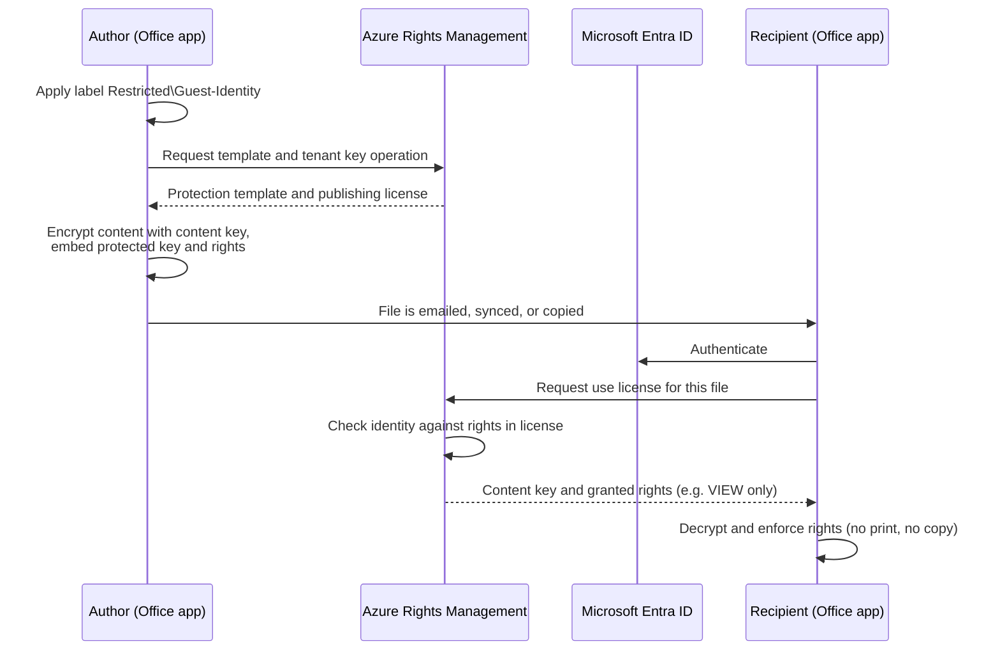
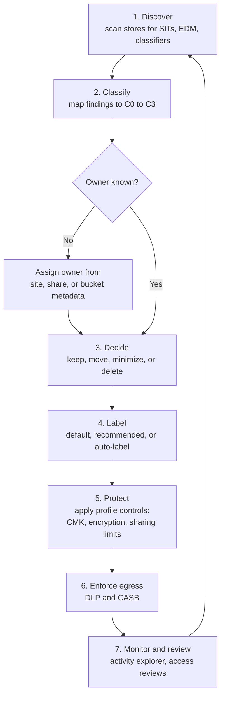
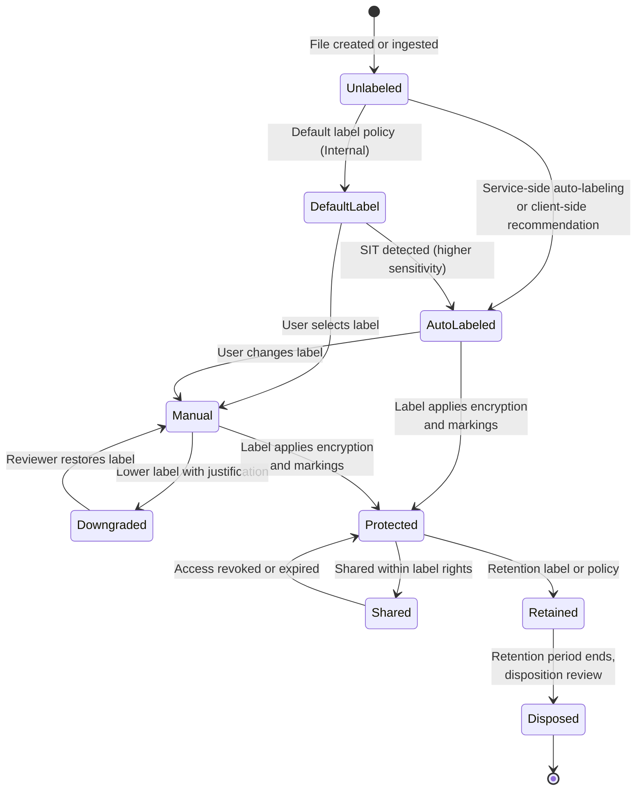

# Unstructured data protection patterns
{: .no_toc }

**Phase 4: Unstructured data.** Defines the reusable patterns for protecting files and messages, and shows which pattern each type of hospitality content needs and why.
{: .fs-5 .fw-300 }

## On this page
{: .no_toc .text-delta }

1. TOC
{:toc}

---

## The core distinction: where the protection lives

Every unstructured data control answers one question: **when the file leaves its current location, does the protection go with it?**

| Pattern | Where encryption is bound | Protects against | Does not protect against | Examples |
|---|---|---|---|---|
| **Storage-bound encryption** | The disk, volume, share, bucket, or service | Lost or stolen media, decommissioned disks, provider operators without key access, some classes of backend compromise | Any authorized user or process that reads the file and copies it elsewhere | BitLocker, NetApp NVE, S3 SSE-KMS, Azure Storage CMK, SharePoint service encryption, Customer Key |
| **Transparent file encryption with access policy** | The file system on a specific host, with a policy agent deciding who and which process may see cleartext | Privileged OS users (root, domain admins) and unapproved processes reading files; backup operators seeing cleartext | Copies made by an approved user through an approved process | Thales CipherTrust Transparent Encryption |
| **Persistent (data-centric) encryption** | The file itself, with the key released by a rights service only to authorized identities | Copies forwarded by email, uploaded to personal cloud storage, left on USB media, or synced to an unmanaged device | Screen capture, photographs of screens, a user with legitimate rights who re-types content | Purview sensitivity labels with encryption (Azure Rights Management), Google Workspace client-side encryption (in scope of Workspace), third-party digital rights management |
| **Rights management (usage rights)** | Part of persistent encryption: rights such as view, edit, print, copy, forward, export | Printing, copying, and forwarding by users who may view but should not redistribute | A determined insider with view rights; rights are enforced by compliant client applications, not by physics | Purview usage rights (VIEW, EDIT, PRINT, EXTRACT, FORWARD), Do Not Forward for email |

Storage-bound encryption is necessary for every tier and is the whole answer for C0 and C1. It is not sufficient for C3 content that users routinely copy and send, because the risk for that content is not a stolen disk; it is a legitimate user sending a legitimate copy to the wrong place.

{: .note }
Storage-bound and persistent encryption are layered, not alternatives. A labeled and encrypted passport scan stored in SharePoint is encrypted twice: once by the SharePoint service (with Microsoft-managed keys or Customer Key) and once inside the file by the rights management service.

### How persistent encryption works

With Purview sensitivity labels that apply encryption, the protected file carries an encrypted content key and a publishing license that lists the authorized users or groups and their usage rights. When a user opens the file, the client application requests a use license from the Azure Rights Management service. The service authenticates the user against Microsoft Entra ID, checks the rights in the publishing license, and returns the content key only if the user is authorized. The client then enforces the usage rights (for example, blocking print or copy).

Consequences that engineering teams must design around:

- **Every open is an authorization decision.** Access can be revoked or expire after the file has left the organization. It also means offline access is limited by the use-license validity period, which the label configures.
- **Services need rights too.** Search indexing, eDiscovery, DLP inspection, malware scanning, and AI assistants must be able to decrypt content. In Microsoft 365, SharePoint and OneDrive can process labeled and encrypted Office files when sensitivity labels for SharePoint and OneDrive are enabled. A third-party system that cannot obtain a use license sees only ciphertext.
- **Not every format is supported.** Office files and PDFs have native support. Other file types can be protected in a generic wrapper (`.pfile`) that only compatible viewers can open. Images such as JPEG passport scans are better converted to PDF before labeling if they must be opened in common tools.

{: .warning }
Persistent encryption is strong against accidental redistribution and weak against a determined insider who has view rights. Its purpose is to make the default path safe and to keep protection on copies that leave, not to stop screen photographs.

## The hospitality unstructured estate

The following table is the working inventory the organization uses to decide which pattern each content type needs. It is drawn from the discovery work in [Data asset inventory and discovery]().

| Content | Where it is created and stored | Typical sensitive elements | Tier and label | Primary pattern |
|---|---|---|---|---|
| Passport and ID scans at front desk | ID scanner software, PMS attachments, shared folders on property PCs, email when forwarded to police or immigration reporting | Passport number, nationality, date of birth, photo | C3, `Restricted\Guest-Identity` | Keep in PMS where possible; files outside PMS get persistent encryption and short retention |
| Group rooming lists | Excel sent by event planners and tour operators; stored in email, OneDrive, sales shared drives | Names, arrival dates, sometimes passport numbers, dietary and accessibility needs | C2 `Confidential\Guest-PII`, or C3 when ID numbers or accessibility data are present | Auto-label, DLP on external sharing, persistent encryption for C3 versions |
| Event and group contracts | Sales and catering systems, SharePoint, email | Commercial terms, contact details, sometimes card authorization forms | C2 `Confidential\Business`; C3 `Restricted\PCI` if a card authorization form is attached | Label; card authorization forms must be removed and replaced with a payment link |
| Credit card authorization forms | Faxes, email attachments, scanned PDFs at properties | PAN, expiry, sometimes CVV (which must never be retained) | C3 `Restricted\PCI` | Eliminate: replace with hosted payment pages or pay-by-link; discover and purge legacy copies |
| CCTV footage | Property video management systems and NVRs, sometimes cloud video services | Images of guests and staff, license plates | C2, `Confidential\Guest-PII` | Storage-bound encryption, strict retention, access logging, export under case control |
| Call recordings | Contact center platforms, property PBX | Voice, names, reservation details, payment card data if not suppressed | C2; C3 if card data is captured | Pause-and-resume or DTMF masking to keep PAN out; storage CMK; retention |
| HR files | HR system exports, manager folders, property HR offices | Employee IDs, salaries, disciplinary records, health and right-to-work documents | C2 `Confidential\Employee`; C3 `Restricted\Special-Category` for health data | Container label on HR sites; persistent encryption for special-category files |
| PMS and CRS exports | Reports saved to desktops and shares, emailed to revenue management | Guest lists with contact details and stay history, sometimes partial card data | C2 `Confidential\Guest-PII` | Reduce exports; auto-label; endpoint DLP on copy to USB and personal cloud |
| Email attachments | Exchange Online, property mailboxes, shared mailboxes | All of the above | Inherits the attachment's label | DLP, message encryption, label inheritance from attachment |
| Chat and meeting content | Teams chats, channel files, meeting recordings and transcripts | Ad hoc guest details, screenshots of PMS screens | Varies | Container labels on teams, DLP for Teams, retention policies |
| Spa and wellness intake forms | Paper scanned to PDF, spa software attachments | Health conditions, allergies, pregnancy | C3 `Restricted\Special-Category` | Persistent encryption, restricted sites, short retention |
| Finance and M&A documents | SharePoint, data rooms, email | Deal terms, valuations | C3 (M&A) or C2 | Persistent encryption; DKE only where justified |

{: .tip }
The most effective control for several of these items is elimination rather than encryption. Card authorization forms should not exist once pay-by-link is available; see [Payment card data and PCI DSS](). Passport scans should be captured into the PMS and not saved to a local folder at all.

## Threats each pattern addresses

| Threat | Storage encryption with provider keys (PP-1) | Storage encryption with CMK (PP-2) | Transparent file encryption with access policy | Persistent encryption with usage rights (PP-3) | DLP and CASB |
|---|---|---|---|---|---|
| Stolen laptop or back-office PC | Yes (with full disk encryption) | Yes | Yes | Yes | No |
| Decommissioned disk or NAS not sanitized | Yes | Yes, plus cryptographic erase by key destruction | Yes | Yes | No |
| Cloud provider operator access | Partial | Stronger: key use is logged and can be revoked | Not applicable | Stronger: the file content key is controlled by the rights service | No |
| Domain admin or root browsing file shares | No | No | Yes | Yes | No |
| Ransomware reading and exfiltrating files as the user | No | No | Partial (process-based rules can block unknown executables) | Partial: exfiltrated copies remain encrypted | Partial: egress detection |
| User emails a guest list to a personal address | No | No | No | Yes: recipient cannot open | Yes: block or warn |
| User uploads files to an unsanctioned cloud drive | No | No | No | Yes | Yes (inline CASB or endpoint DLP) |
| Oversharing via an "anyone" link | No | No | No | Yes | Yes (API CASB, SharePoint sharing controls) |
| AI assistant surfaces content to users who should not see it | No | No | No | Yes when the label withholds the right the assistant needs | Partial (DLP for AI) |
| Partner or franchisee retains data after contract ends | No | No | No | Yes: revoke or let access expire | No |

The table shows why the Best profile for C3 combines persistent encryption with DLP: persistent encryption protects copies after they leave, and DLP prevents many of those copies from leaving in the first place.

## Good, Better, Best for unstructured data

{: .good }
**Good (PP-1, C0 and C1).** Platform default encryption at rest with provider-managed keys on every store, full disk encryption on every endpoint, TLS in transit, standard permissions with no anonymous or "Everyone" access, audit logging on. Labels are applied (default label `Internal`) so the content is visible to DLP, but no encryption is attached to the label.

{: .better }
**Better (PP-2, C2).** Customer-managed keys on storage platforms that hold C2 data (SharePoint and Exchange through Customer Key where justified, buckets and blob containers with CMK, NAS with external key manager). Label applied automatically or by default and shown in a visual marking. Container labels restrict external sharing on teams and sites. DLP in monitor-then-block. Quarterly access reviews on the locations. Persistent encryption is optional at this tier and used selectively, for example for contracts shared with third parties.

{: .best }
**Best (PP-3, C3).** Everything in Better, plus a label that applies persistent encryption with usage rights scoped to named groups, DLP block for external sharing and for uploads to unsanctioned destinations, endpoint DLP on removable media and print, short retention with automated deletion, and access logging reviewed by the data owner. Double Key Encryption or a customer-held key is reserved for the small set of content where the organization must be able to show that the cloud provider cannot decrypt it.

### Trade-offs of the Best tier

| Trade-off | Impact | Mitigation |
|---|---|---|
| Services cannot inspect content they cannot decrypt | Search, eDiscovery, DLP, and third-party scanners lose visibility, fully so with DKE | Use service-side decryptable encryption (standard label encryption) for most C3; reserve DKE for a small, named set |
| Partners cannot open files | Tour operators, law firms, and auditors may not have compatible clients or Entra identities | Define partner access patterns: guest accounts, specific domains in the label, or a secure portal instead of email |
| Co-authoring and web apps | Some features do not work on encrypted files, or only work when co-authoring for encrypted files is enabled | Enable co-authoring for encrypted files, test critical workflows before rollout |
| Availability of key services | If the rights service or an external key is unavailable, protected content cannot be opened | Keep DKE and external keys to a minimum; document break-glass procedures |
| Support load | Users contact the service desk when they cannot open a file | Clear label tooltips, justification prompts on downgrade, a self-service request path |

## The discovery-to-protection workflow

Protection is applied in a repeatable workflow that runs continuously, not as a one-time project.

| Step | What happens | Tools | Output |
|---|---|---|---|
| Discover | Scan content for sensitive information types (SITs), exact data match, and trainable classifiers | Purview content explorer and on-demand classification, Purview information protection scanner, Macie, Sensitive Data Protection, Varonis, BigID, Cyera | Findings per location with counts and confidence |
| Classify | Apply the rules in [Data classification scheme]() to decide tier | Classification rules, owner review for ambiguous results | Proposed tier per location and per file |
| Assign owner | Identify the accountable data owner from site owners, share ACLs, bucket tags (`data-owner`), or HR data | Varonis ownership reports, SharePoint admin reports, tag inventory | Named owner |
| Decide | Owner decides whether to keep, relocate to an approved store, minimize (redact or truncate), or delete | Retention policies, disposition review | Remediation ticket |
| Label | Default labels, recommended labels, and auto-labeling apply the canonical label | Purview labels, Google Drive labels, tags on storage resources | Labeled content |
| Protect | Apply controls from [Label-to-control mapping]() | Label encryption, container settings, CMK, bucket policies | Protected content |
| Enforce egress | DLP and CASB policies keyed on labels and SITs | Purview DLP, CASB, SWG, email gateway | Blocks, warnings, incidents |
| Monitor | Review label changes, downgrades, access to C3, and DLP incident trends | Activity explorer, audit log, SIEM | Metrics and tuning actions |

## Label lifecycle

Labels are not static. A file is created, labeled, possibly relabeled (upgraded or downgraded with justification), shared, and eventually disposed of. The lifecycle below is the model the organization implements in Purview and mirrors in other platforms.

Rules the organization applies to the lifecycle:

1. **Default label.** Documents and email default to `Internal`. This gives DLP a starting point and makes unlabeled content the exception.
2. **Mandatory labeling.** Users must select a label before saving an Office document or sending an email. Mandatory labeling is introduced after default labeling, not at the same time, to avoid a spike in support calls.
3. **Automatic upgrade only.** Auto-labeling may raise a label (for example `Internal` to `Restricted\Guest-Identity`). It does not lower a label that a user or another policy applied. In Purview, service-side auto-labeling does not overwrite a manually applied label; this is the reason client-side recommendations are also configured.
4. **Downgrade requires justification.** Lowering a label or removing encryption prompts for a reason, which is logged and reviewed.
5. **Retention follows the label tier.** `Restricted\Guest-Identity` content outside the PMS is kept for the minimum period required by local guest registration law, then deleted. Retention classes map to the `retention-class` tag values (`r90d`, `r1y`, and so on).

## Auto-labeling

Auto-labeling is the only way to get label coverage on historical content at scale. It comes in two forms, and the organization uses both.

| Aspect | Client-side (in Office apps) | Service-side (in SharePoint, OneDrive, Exchange) |
|---|---|---|
| When it runs | While the user edits a file or composes an email | In the background on files at rest and on email in transit |
| Scope | New and edited content only | Existing files at rest in SharePoint and OneDrive, and email being sent |
| User interaction | Can recommend (user accepts) or apply automatically | None; users are not prompted |
| Simulation | No simulation mode | Simulation mode shows matches before enforcement |
| Overwrites manual label | No | No |
| Best use | Train users and label new content correctly at creation | Label the historical backlog and email in transit |

The detection logic is shared: sensitive information types, exact data match classifiers, and trainable classifiers. The details and custom SIT examples (loyalty number, passport) are on [Microsoft 365 and collaboration]().

{: .tip }
Start service-side auto-labeling in simulation with high-confidence conditions only, for example a passport SIT at high confidence with at least five instances. A rooming list with fifty passport numbers is almost certainly C3; a single nine-digit number near the word "passport" is often a false positive.

## Pattern selection by location

| Location | Good | Better | Best |
|---|---|---|---|
| SharePoint, OneDrive, Teams | Microsoft-managed service encryption, default label | Customer Key (where justified), container labels, DLP monitor then block | Label encryption for C3, DLP block, DKE only where justified |
| Windows file servers | BitLocker on volumes, least-privilege NTFS ACLs | Purview scanner labeling, Varonis monitoring | CipherTrust Transparent Encryption or migration to SharePoint with label encryption |
| NAS (NetApp, PowerScale, Pure) | Platform encryption with onboard keys | External KMIP key manager, separation of storage admin and key admin | Transparent encryption with process and user policy; C3 data moved off shared NAS |
| Cloud object storage | Provider default encryption, Block Public Access | CMK per data domain, bucket policies requiring the right key, discovery scans | Application-layer or client-side encryption before upload, external or single-tenant HSM keys where justified |
| Email | TLS, default label | MTA-STS and TLS reporting, DLP, message encryption for external C2 | Label encryption with Do Not Forward or specific recipients for C3 |
| Backups | Backup software encryption | CMK per backup vault, immutable copy | Logically air-gapped copy, escrowed keys tested in restore drills |
| Logs | Storage encryption | Redaction at source for known PII fields | Structured logging with tokenized identifiers, no C3 in logs by design |
| Media (CCTV, recordings) | Storage encryption on NVR and recorders | Retention limits, access logging | PAN suppression at capture, CMK on cloud recording stores |

## Key takeaways for engineering teams

- Choose the pattern by asking whether protection must survive a copy. If yes (C3 and much of C2), storage encryption alone is not enough.
- Persistent encryption requires every service that processes the content to hold rights. Plan for search, eDiscovery, DLP, backup, and AI features before enabling it.
- Eliminate before encrypting. Card authorization forms and locally saved passport scans should be designed out of the process.
- Auto-labeling in simulation is the main tool for finding historical C3 content; use high-confidence conditions first and widen with tuning evidence.
- Every Best-tier control has an availability or usability cost. Apply it to C3 content and document why when it is used elsewhere.

## Related pages

- [Microsoft 365 and collaboration]()
- [On-prem file shares and NAS]()
- [Cloud object storage]()
- [DLP and CASB enforcement]()
- [Labeling, tagging, and metadata]()
- [Key custody: BYOK, HYOK, and external keys]()

## Sources

- Microsoft Learn, Learn about sensitivity labels: https://learn.microsoft.com/purview/sensitivity-labels
- Microsoft Learn, Azure Rights Management encryption: https://learn.microsoft.com/purview/rights-management
- Microsoft Learn, Apply a sensitivity label to content automatically: https://learn.microsoft.com/purview/apply-sensitivity-label-automatically
- NIST SP 800-88 Rev. 1, Guidelines for Media Sanitization: https://csrc.nist.gov/pubs/sp/800/88/r1/final
