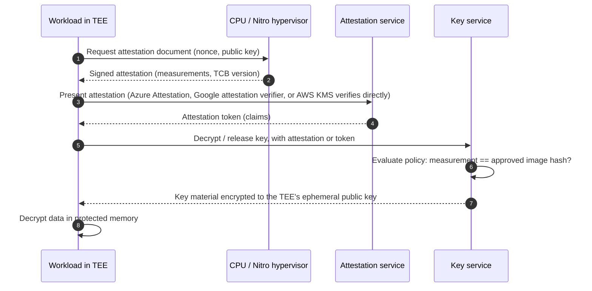
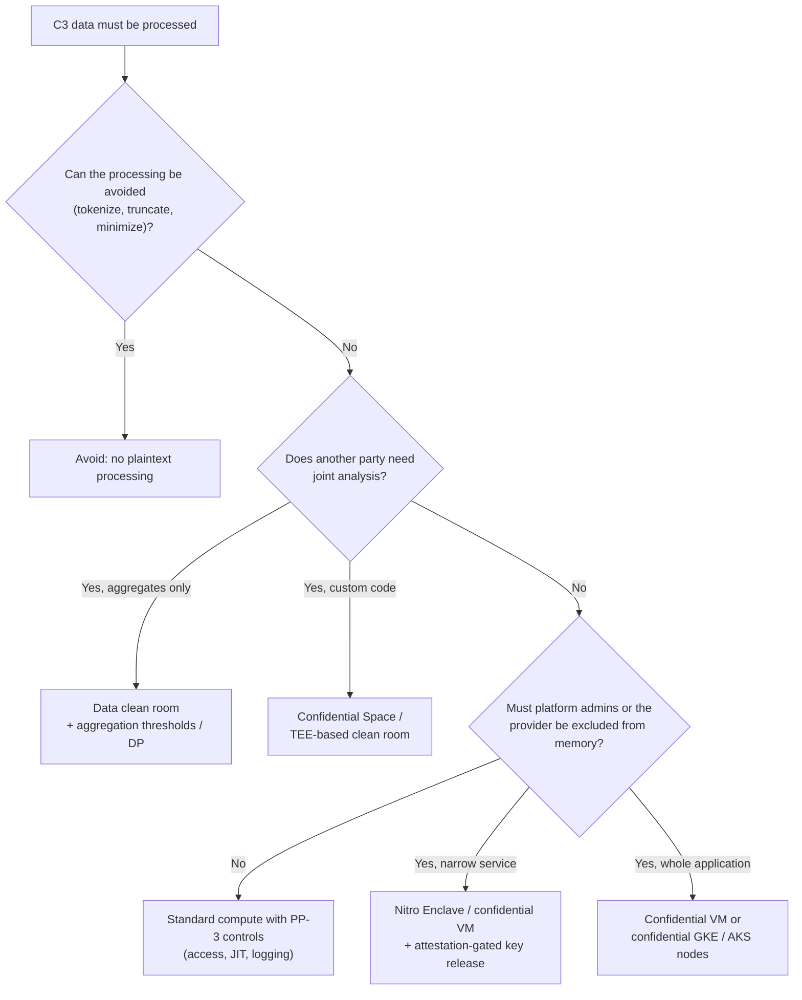

# Data in use and confidential computing
{: .no_toc }

**Phase 5: Transit and in use.** This page covers how the organization protects C3 data while it is being processed, when the operator of the platform, the cloud provider, or a data-sharing partner should not be able to see it.
{: .fs-5 .fw-300 }

## On this page
{: .no_toc .text-delta }

1. TOC
{:toc}

---

## The gap encryption at rest and in transit leaves

To compute on data, a program normally needs it in plaintext in memory. At that point, encryption at rest and TLS no longer help. Anyone who controls the host (a privileged administrator, a compromised hypervisor, a malicious insider at the provider, or malware with root access) can in principle read memory.

For most C2 workloads the organization accepts this risk and relies on access control, hardening, and monitoring. For a small set of C3 processing scenarios, it is worth reducing:

- Decrypting payment data or identity documents in a service where cloud operators or the organization's own platform administrators should not be able to read memory.
- Sharing guest or loyalty data with partners (airlines, card issuers, retail partners) for joint analysis without either party seeing the other's raw records.
- Running analytics or machine learning on special-category data (health, accessibility, allergy) with evidence that only approved code touched it.

Two families of technology address this: **trusted execution environments (TEEs)**, which protect data in use with hardware isolation and attestation, and **privacy-enhancing technologies (PETs)** such as clean rooms, secure multiparty computation, homomorphic encryption, and differential privacy, which limit what can be learned from the data.

## Trusted execution environments

A TEE isolates a workload's memory from the host operating system and hypervisor using CPU features, encrypts memory with keys the host cannot access, and produces a signed **attestation report** that proves which code and configuration is running. A key service can then release decryption keys only to workloads whose attestation matches an approved measurement.

| Technology | Isolation unit | What is protected | Maturity (as of mid-2026) | Notes |
|---|---|---|---|---|
| **AMD SEV-SNP** | Whole VM | VM memory encrypted and integrity-protected from hypervisor | Production in AWS, Azure, and Google Cloud confidential VMs | Lift-and-shift; guest OS is inside the trust boundary |
| **Intel TDX** | Whole VM (trust domain) | Same model as SEV-SNP | Production in Azure and Google Cloud; availability varies by region and instance family (verify) | Lift-and-shift |
| **Intel SGX** | Process-level enclave | Enclave memory only; application must be partitioned | Available on Xeon server CPUs; deprecated on client CPUs | Smaller trusted computing base; significant engineering effort and a history of side-channel research findings |
| **AWS Nitro Enclaves** | Isolated VM carved from an EC2 instance, no network or persistent storage, vsock only | Enclave memory and CPU from parent instance and AWS operators | Production | Attestation integrated with AWS KMS condition keys |
| **Arm CCA (Realms)** | Realm VMs | Memory isolation from hypervisor | Architecture specified; limited hardware and cloud availability (verify) | Relevant for future Arm-based cloud instances |
| **NVIDIA confidential computing (H100 and later)** | GPU with CPU TEE | GPU memory and CPU-GPU transfers | Available in some cloud confidential VM offerings (verify) | Relevant for AI workloads on C3 data |

{: .note }
The AWS Nitro System is designed so that AWS operators have no mechanism to access customer EC2 instance memory, which AWS describes as a property of all Nitro-based instances. Nitro Enclaves add isolation from the organization's own administrators and from the parent instance.

### What a TEE does not solve

- **The code inside the TEE can still leak data.** Attestation proves which code runs, not that the code is correct. Code review and signed builds matter more, not less.
- **Side channels.** TEEs have a long history of published side-channel attacks. Vendors patch them through microcode and firmware; attestation reports include the TCB version so policies can require patched levels.
- **Availability and debugging.** Confidential VMs restrict certain features (live migration on some platforms, memory introspection, some debugging tools). Enclaves have no interactive access by design.
- **Input and output.** Data must still be encrypted on the way in and out. The TEE protects processing, not the pipeline around it.

## Attestation-gated key release

The core pattern is to encrypt C3 data with a key that the key service releases only to an attested TEE.



### AWS: Nitro Enclaves and KMS attestation condition keys

AWS KMS accepts a Nitro Enclave attestation document on `Decrypt`, `GenerateDataKey`, and `GenerateRandom`. When the request includes the attestation document, KMS returns the result encrypted to the enclave's public key, so the parent instance never sees plaintext. Key policies use `kms:RecipientAttestation` condition keys to require a specific enclave image.

```json
{
  "Sid": "AllowDecryptOnlyFromApprovedEnclave",
  "Effect": "Allow",
  "Principal": { "AWS": "arn:aws:iam::111122223333:role/passport-verifier-parent" },
  "Action": "kms:Decrypt",
  "Resource": "*",
  "Condition": {
    "StringEqualsIgnoreCase": {
      "kms:RecipientAttestation:ImageSha384": "<96-hex-character PCR0 value of the approved enclave image>"
    },
    "StringEquals": {
      "kms:EncryptionContext:data-domain": "guest"
    }
  }
}
```

The `ImageSha384` value is PCR0 of the enclave image file (EIF), produced by `nitro-cli build-enclave`. Additional condition keys such as `kms:RecipientAttestation:PCR<n>` pin other measurements (for example PCR8 for the signing certificate of the enclave image). Pinning PCR8 rather than PCR0 lets the organization ship new enclave builds signed with its key without changing the key policy each time.

```bash
# Build the enclave image and record measurements
nitro-cli build-enclave --docker-uri passport-verifier:1.4.2 --output-file passport-verifier.eif \
  --private-key enclave-signing.key --signing-certificate enclave-signing.pem
# Output includes "Measurements": { "PCR0": "...", "PCR1": "...", "PCR2": "...", "PCR8": "..." }

nitro-cli run-enclave --eif-path passport-verifier.eif --cpu-count 2 --memory 2048
```

{: .warning }
Also add a deny statement for `kms:Decrypt` without an attestation document for the same principal, or the parent instance role could call `Decrypt` directly and receive plaintext. The parent role's plain `Decrypt` access must not exist for this key.

### Azure: confidential VMs, confidential containers, and secure key release

| Offering | TEE | Use |
|---|---|---|
| Confidential VMs (DCasv5/ECasv5 and later families with AMD SEV-SNP; DCesv5/ECesv5 families with Intel TDX; verify current families) | SEV-SNP, TDX | Lift-and-shift of C3 processing VMs; confidential OS disk encryption with keys bound to the VM's vTPM |
| Confidential containers on Azure Container Instances | SEV-SNP | Serverless containers with attestation and a confidential computing enforcement (CCE) policy |
| Confidential containers on AKS (Kata-based) | SEV-SNP | Pod-level isolation on AKS (verify GA status) |
| Always Encrypted with secure enclaves (Azure SQL) | VBS enclaves or SGX (varies) | Rich queries on encrypted columns inside an enclave (see [Cloud databases]()) |
| Microsoft Azure Attestation (MAA) | Service | Verifies attestation evidence and issues tokens |
| Secure key release (SKR) | Key Vault Premium / Managed HSM | Releases an exportable key only to a TEE whose MAA token satisfies the key's release policy |

An SKR release policy on a Managed HSM key that requires an SEV-SNP confidential VM attested by the organization's MAA instance:

```json
{
  "version": "1.0.0",
  "anyOf": [
    {
      "authority": "https://sharedweu.weu.attest.azure.net",
      "allOf": [
        { "claim": "x-ms-isolation-tee.x-ms-attestation-type", "equals": "sevsnpvm" },
        { "claim": "x-ms-isolation-tee.x-ms-compliance-status", "equals": "azure-compliant-cvm" }
      ]
    }
  ]
}
```

```bash
az keyvault key create \
  --hsm-name mhsm-restricted-prod-weu \
  --name guest-identity-skr \
  --kty RSA-HSM --size 3072 \
  --exportable true \
  --policy @skr-policy.json \
  --ops wrapKey unwrapKey
```

{: .verify }
Attestation claim names differ between confidential VMs and confidential containers, and between SEV-SNP and TDX. Confirm the claim names and the shared or custom MAA authority URL for the region before deploying a release policy.

### Google Cloud: Confidential VMs and Confidential Space

| Offering | TEE | Use |
|---|---|---|
| Confidential VMs | AMD SEV, SEV-SNP, Intel TDX (by machine series; verify) | Lift-and-shift; enabled with a flag at VM creation |
| Confidential GKE Nodes | Same as Confidential VMs | Kubernetes node pools with memory encryption |
| Confidential Space | Confidential VM running a hardened, Google-maintained image that runs a single signed container | Multi-party data collaboration: each party's Workload Identity Federation pool trusts attestation claims (image digest, signer) before granting access to its KMS key |
| Confidential Dataproc / Dataflow | Confidential VMs for data processing (verify availability) | Batch analytics on C3 data |

```bash
# Confidential VM with AMD SEV-SNP
gcloud compute instances create passport-proc-euw4-01 \
  --zone=europe-west4-a \
  --machine-type=n2d-standard-4 \
  --confidential-compute-type=SEV_SNP \
  --min-cpu-platform="AMD Milan" \
  --maintenance-policy=TERMINATE \
  --image-family=ubuntu-2404-lts-amd64 --image-project=ubuntu-os-cloud \
  --labels=data-classification=restricted,data-domain=guest,protection-profile=pp3
```

In Confidential Space, a data-owning party creates a workload identity pool provider whose attribute condition checks attestation claims, for example that `assertion.submods.container.image_digest` equals the approved digest and that `assertion.swname == 'CONFIDENTIAL_SPACE'`. The party grants `roles/cloudkms.cryptoKeyDecrypter` on its key only to principals from that pool. The workload running in Confidential Space can then decrypt that party's data, and neither the operator of the VM nor the other party can.

### OCI

OCI offers confidential computing for selected AMD-based VM and bare metal shapes with memory encryption (verify current shapes and whether SEV-SNP attestation is exposed). The organization treats OCI confidential computing as an evaluation item rather than a production pattern.

## Hospitality use cases

| Use case | Data | Recommended approach | Why |
|---|---|---|---|
| **Payment processing inside the organization's network** | PAN during authorization or token detokenization | First choice: do not handle PAN (P2PE, hosted payment pages, network tokens). If a detokenization service must exist, run it in Nitro Enclaves or a confidential VM with attestation-gated keys | Reduces the set of people and systems that can observe PAN in memory; PCI scope reduction still comes mainly from not handling PAN |
| **Identity document verification** | Passport scans at check-in, used for police registration in many countries | Confidential VM or enclave that decrypts the image, extracts required fields, submits to authority, re-encrypts, and never exposes raw images to general platform administrators | C3 data processed by a narrow, attested component |
| **Loyalty analytics with partners** | Loyalty member IDs, stay and spend patterns joined with airline or card-partner data | Data clean room (AWS Clean Rooms, Snowflake Data Clean Rooms, BigQuery data clean rooms) with aggregation thresholds; Confidential Space where custom code must run | Neither party exports raw member data; outputs are aggregates |
| **Marketing measurement with media partners** | Hashed email or loyalty IDs for audience matching | Clean room with the partner; no export of match tables | Avoids transferring C2 lists to partners |
| **Health and accessibility data for spa and wellness** | Health questionnaires, allergy and accessibility needs | Application-layer encryption with narrow access; confidential computing only if analytics are required | Access control and minimization first |
| **AI on guest data** | Guest communications, preferences | Confidential GPU VMs where available and justified; otherwise masking and minimization before model access | Emerging; evaluate case by case |

## Data clean rooms

A clean room lets two or more parties run agreed analyses on their combined data without either party seeing the other's row-level data. Controls are typically query restrictions (only approved query templates), aggregation thresholds (minimum group sizes), column restrictions (join keys usable but not selectable), and output controls.

| Product | Model | Encryption option | Notes |
|---|---|---|---|
| **AWS Clean Rooms** | Collaboration with members contributing configured tables from S3/Glue (and other sources); analysis rules (aggregation, list, custom) | Cryptographic Computing for Clean Rooms (C3R) client-side encryption lets parties encrypt join columns and data before contributing | Differential privacy option for custom analyses (verify) and Clean Rooms ML for lookalike modeling |
| **Snowflake Data Clean Rooms** | Native app on Snowflake; provider and consumer accounts; templates restrict queries | Data stays in each party's account; Snowflake secure data sharing | Partners must be on Snowflake (or use managed accounts) |
| **Google BigQuery data clean rooms** | Built on BigQuery sharing (formerly Analytics Hub); analysis rules for aggregation thresholds and join restrictions | Data remains in contributor projects; CMEK supported | Differential privacy analysis rules (verify) |
| **Azure** | Azure Confidential Clean Room (built on confidential containers) (verify status and naming) | TEE-based | Evaluate |

AWS Clean Rooms aggregation analysis rule outline for a loyalty partner collaboration:

```json
{
  "aggregateColumns": [
    { "columnNames": ["nights_stayed", "spend_usd"], "function": "SUM" }
  ],
  "joinColumns": ["hashed_member_email"],
  "joinRequired": "QUERY_RUNNER",
  "dimensionColumns": ["home_region", "tier"],
  "scalarFunctions": ["ROUND"],
  "outputConstraints": [
    { "columnName": "hashed_member_email", "minimum": 100, "type": "COUNT_DISTINCT" }
  ]
}
```

{: .warning }
Hashing email addresses before matching is common in clean rooms, but an unkeyed hash of an email address is reversible by dictionary attack and is still personal data under GDPR. Use the clean room's cryptographic options (for example C3R with a shared secret agreed between the parties) or keyed hashing, and treat hashed identifiers as C2.

## Privacy-enhancing technologies: maturity notes

| Technology | What it does | Maturity for the organization | Realistic use |
|---|---|---|---|
| **Differential privacy** | Adds calibrated noise to query results so that individual records cannot be inferred | Production-ready in clean rooms and some analytics libraries (Google differential privacy library, OpenDP); requires privacy budget management | Aggregate reporting shared with partners; published statistics |
| **Secure multiparty computation (MPC)** | Parties jointly compute a function without revealing inputs | Production for narrow functions (private set intersection for audience matching, some key management products use MPC internally); general-purpose MPC remains slow and specialized | Private set intersection with a partner where a clean room is not acceptable |
| **Fully homomorphic encryption (FHE)** | Computation directly on ciphertext | Libraries exist (Microsoft SEAL, OpenFHE, Zama Concrete); performance is orders of magnitude slower than plaintext for most workloads; standardization in progress | Research and narrow pilots only; not a general answer for guest data analytics |
| **Partially homomorphic / searchable encryption** | Limited operations on ciphertext (equality, range via order-revealing schemes, sums) | Available in products such as AWS Database Encryption SDK beacons, MongoDB Queryable Encryption, Always Encrypted | Structured data search on encrypted fields (see [Structured data protection patterns]()) |
| **Synthetic data** | Generates artificial records with similar statistics | Useful for test data; privacy guarantees vary and are hard to prove without differential privacy | Non-production environments |
| **Federated learning** | Trains models without centralizing raw data | Mature frameworks; still leaks information through model updates without additional controls | Unlikely to be needed at the organization's scale |

The organization's position: use clean rooms with aggregation thresholds and differential privacy where available for partner analytics; use TEEs for narrow C3 processing components; treat FHE and general MPC as research.

## Decision guide



## Good, better, best

| Level | Approach | Trade-offs |
|---|---|---|
| **Good** | Standard compute with PP-2/PP-3 access controls, just-in-time admin access, memory-dump restrictions, logging | Host and provider-level access to memory remains possible |
| **Better** | Confidential VMs for C3 processing hosts; clean rooms with aggregation thresholds for partner analytics | Instance family and region constraints; some features restricted; limited insight into guest OS compromise because the OS is inside the trust boundary |
| **Best** | Narrow enclaves (Nitro Enclaves, Confidential Space) with attestation-gated key release pinned to signed builds; differential privacy on shared outputs | Significant engineering effort; debugging is harder; build pipeline must produce reproducible, signed images; attestation policies must be updated with each release |

## Key takeaways for engineering teams

- Confidential computing is for specific C3 processing, not a default. Minimize and tokenize first.
- The security value comes from attestation-gated key release. A confidential VM that fetches keys like any other VM adds little.
- Pin key release to signing identity (for example PCR8 or image signer) rather than a single image hash, so releases do not require key policy changes.
- Partner analytics on guest or loyalty data goes through a clean room with aggregation thresholds, not a file transfer.
- Hashed emails are still personal data. Use keyed hashing or the clean room's cryptographic join features.

## Related pages

- [Key management architecture]()
- [Key custody: BYOK, HYOK, and external keys]()
- [Payment card data and PCI DSS]()
- [Data lakes and analytics platforms]()
- [Reference architectures]()

## Sources

- AWS Nitro Enclaves and KMS: <https://docs.aws.amazon.com/enclaves/latest/user/kms.html>
- AWS KMS condition keys for Nitro Enclaves: <https://docs.aws.amazon.com/kms/latest/developerguide/conditions-nitro-enclaves.html>
- Azure confidential computing: <https://learn.microsoft.com/azure/confidential-computing/overview>
- Azure secure key release: <https://learn.microsoft.com/azure/confidential-computing/concept-skr-attestation>
- Google Cloud Confidential Computing: <https://cloud.google.com/confidential-computing/docs>
- Google Confidential Space: <https://cloud.google.com/confidential-computing/confidential-space/docs/confidential-space-overview>
- AWS Clean Rooms: <https://docs.aws.amazon.com/clean-rooms/latest/userguide/what-is.html>
- Snowflake Data Clean Rooms: <https://docs.snowflake.com/en/user-guide/cleanrooms/introduction>
- BigQuery data clean rooms: <https://cloud.google.com/bigquery/docs/data-clean-rooms>
- Confidential Computing Consortium: <https://confidentialcomputing.io/>
