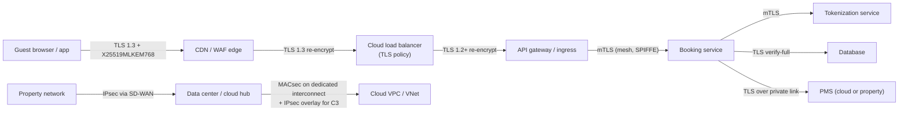

# Encryption in transit
{: .no_toc }

**Phase 5: Transit and in use.** This page specifies how every network hop that carries organization data is encrypted and authenticated, from a guest's phone to a cloud database, and how hybrid post-quantum key exchange is introduced along the way.
{: .fs-5 .fw-300 }

## On this page
{: .no_toc .text-delta }

1. TOC
{:toc}

---

## Scope and principles

Transit encryption covers every path where C1, C2, or C3 data crosses a network: internet-facing booking sites and APIs, the guest mobile app, OTA and GDS connections, payment gateways, links between properties and data centers, links between data centers and clouds, east-west traffic inside clouds and Kubernetes clusters, database connections, and management traffic.

Principles:

1. **Encrypt every hop, not just the edge.** Private networks, VPCs, and MPLS circuits are not trusted transport for C2 or C3 data. Cloud providers encrypt some physical links between their facilities, but the organization does not rely on that for its own traffic.
2. **Authenticate the peer.** Encryption without certificate verification protects against passive observers only. Clients must verify server certificates; for service-to-service C3 traffic, both sides authenticate (mTLS).
3. **TLS 1.3 by default**, TLS 1.2 only with the approved suites from [Cryptographic standards](), nothing lower.
4. **Hybrid PQ key exchange where supported.** Key exchange is the harvest-now-decrypt-later exposure. X25519MLKEM768 is enabled wherever both endpoints support it.
5. **Prefer layered transport encryption for C3.** For example, TLS inside an IPsec tunnel or over a MACsec-protected interconnect, so that a single misconfiguration does not expose data.

PCI DSS v4.0.1 requirement 4.2.1 requires strong cryptography to protect PAN during transmission over open, public networks, and 4.2.1.1 requires an inventory of the trusted keys and certificates used. The organization applies the same standard to internal networks for all cardholder data flows.

## End-to-end view



## TLS 1.3 everywhere

TLS 1.3 removes static RSA key exchange, CBC modes, renegotiation, and compression; encrypts more of the handshake; and always provides forward secrecy. It is also the protocol through which hybrid PQ key exchange is deployed.

| Endpoint class | Minimum | Target | Key exchange groups (preference order) |
|---|---|---|---|
| Public web and mobile APIs | TLS 1.2 (approved suites) | TLS 1.3 | X25519MLKEM768, X25519, secp256r1 |
| Partner B2B APIs (OTA, GDS, payment gateway) | TLS 1.2 | TLS 1.3 | Per partner capability; hybrid where supported |
| Internal service-to-service | TLS 1.2 | TLS 1.3 with mTLS | X25519MLKEM768 where libraries support it |
| Database connections | TLS 1.2 | TLS 1.3 where the engine supports it | Engine-dependent |
| Management plane (SSH, RDP, admin consoles) | TLS 1.2 / SSH per standard | TLS 1.3 / OpenSSH with ML-KEM hybrid | |

### Hybrid PQ TLS readiness

X25519MLKEM768 (TLS codepoint 0x11EC) combines classical X25519 with ML-KEM-768. It is enabled by default in Chrome (since Chrome 131, late 2024), Firefox, and at Cloudflare, and OpenSSL 3.5 (April 2025, LTS) offers it in its default TLS key shares. The main costs are a larger ClientHello (the ML-KEM-768 public key is 1,184 bytes and the ciphertext 1,088 bytes) and occasional interoperability failures with middleboxes that do not handle a ClientHello split across multiple packets.

| Component | Hybrid PQ status (as of mid-2026) | Action |
|---|---|---|
| Browsers (Chrome, Edge, Firefox) | Enabled by default | None; server side determines use |
| Cloudflare edge | Enabled for client-to-edge; origin connections configurable | Enable PQ to origin where origin supports it |
| OpenSSL 3.5+ | Default key share includes X25519MLKEM768 | Upgrade base images; check with `openssl list -kem-algorithms` |
| AWS-LC and s2n-tls | Support ML-KEM hybrid | Used by AWS endpoints (KMS, ACM, Secrets Manager) |
| Cloud load balancers | Varies by provider and policy | See cloud policies below; verify |
| Java (JDK) | ML-KEM added to JDK APIs in JDK 24; hybrid TLS support in the JSSE provider is a later step (verify) | Track JDK release notes |
| Go | `crypto/tls` enables X25519MLKEM768 by default from Go 1.24 | Rebuild services with Go 1.24+ |
| .NET / Windows SChannel | PQC APIs in Windows via SymCrypt; TLS hybrid support in SChannel (verify) | Track Microsoft announcements |
| Service meshes (Envoy, Linkerd) | Depends on the underlying TLS library (BoringSSL for Envoy, rustls for Linkerd) (verify) | Test in non-production |
| Middleboxes (TLS inspection proxies, older firewalls) | Frequent failures on large ClientHello | Test and upgrade; bypass inspection for PQ-tested destinations if necessary |

{: .verify }
Hybrid PQ support in cloud load balancers, service meshes, Java, and Windows was changing rapidly through 2025 and 2026. Confirm current status before depending on it. The organization's approach is to enable it where available and measure negotiation rates through the CBOM scanner rather than to wait for universal support.

Checking negotiation with OpenSSL 3.5:

```bash
openssl list -kem-algorithms | grep -i mlkem

openssl s_client -connect www.example.com:443 -tls1_3 -groups X25519MLKEM768 </dev/null 2>&1 \
  | grep -E "Negotiated TLS1.3 group|Protocol|Cipher"
# Expected when supported:
#   Negotiated TLS1.3 group: X25519MLKEM768
```

## Example server configuration

### nginx with OpenSSL 3.5

```nginx
server {
    listen 443 ssl;
    http2 on;
    server_name api.booking.example.com;

    ssl_certificate     /etc/nginx/tls/booking-api.fullchain.pem;
    ssl_certificate_key /etc/nginx/tls/booking-api.key;

    ssl_protocols TLSv1.3 TLSv1.2;

    # TLS 1.2 suites (approved list); TLS 1.3 suites are controlled by OpenSSL defaults
    ssl_ciphers ECDHE-ECDSA-AES256-GCM-SHA384:ECDHE-RSA-AES256-GCM-SHA384:ECDHE-ECDSA-AES128-GCM-SHA256:ECDHE-RSA-AES128-GCM-SHA256:ECDHE-ECDSA-CHACHA20-POLY1305:ECDHE-RSA-CHACHA20-POLY1305;
    ssl_prefer_server_ciphers off;

    # Key exchange groups: hybrid PQ first (requires nginx built against OpenSSL 3.5+)
    ssl_ecdh_curve X25519MLKEM768:X25519:prime256v1:secp384r1;

    ssl_session_timeout 1d;
    ssl_session_cache shared:TLS:10m;
    ssl_session_tickets off;

    ssl_stapling on;
    ssl_stapling_verify on;

    add_header Strict-Transport-Security "max-age=63072000; includeSubDomains; preload" always;

    location / {
        proxy_pass https://booking-backend;
        # Re-encryption to backend with verification
        proxy_ssl_verify on;
        proxy_ssl_trusted_certificate /etc/nginx/tls/internal-ca-bundle.pem;
        proxy_ssl_protocols TLSv1.3 TLSv1.2;
        proxy_ssl_server_name on;
        proxy_ssl_name booking-backend.guest-booking.svc.example.internal;
    }
}
```

{: .note }
nginx passes the `ssl_ecdh_curve` list to OpenSSL's groups configuration, so hybrid groups are accepted when nginx is linked against OpenSSL 3.5 or later. Confirm with `nginx -V` which OpenSSL version is linked. OCSP stapling is being phased out by some public CAs in favor of CRLs; if the issuing CA no longer provides OCSP, remove the stapling directives.

### OpenSSL system-wide defaults

On hosts where applications use the system OpenSSL, the groups and minimum protocol can be set in `openssl.cnf`:

```ini
openssl_conf = openssl_init

[openssl_init]
ssl_conf = ssl_module

[ssl_module]
system_default = tls_defaults

[tls_defaults]
MinProtocol = TLSv1.2
Groups = X25519MLKEM768:X25519:secp256r1:secp384r1
CipherString = ECDHE+AESGCM:ECDHE+CHACHA20:!aNULL:!eNULL:!SHA1:!CBC
Ciphersuites = TLS_AES_256_GCM_SHA384:TLS_AES_128_GCM_SHA256:TLS_CHACHA20_POLY1305_SHA256
```

## TLS termination patterns

| Pattern | Description | When allowed | Trade-offs |
|---|---|---|---|
| **Edge termination only** | TLS ends at CDN or load balancer; plaintext HTTP to backend | C0 only | Simple; any network observer inside the VPC sees plaintext |
| **Edge termination with re-encryption** | TLS ends at edge for WAF inspection; new TLS session to backend with certificate verification | Default for C1 and C2 | WAF and L7 routing work; edge device sees plaintext; two sets of certificates |
| **TLS passthrough** | Load balancer forwards TCP (NLB, TCP proxy); backend terminates TLS | C3 paths where the edge must not see plaintext | No WAF inspection at the LB; backend handles certificate and DoS load |
| **End-to-end mTLS** | Re-encryption at each hop with client certificates between services | C3 service paths (payment, identity, special-category) | Certificate issuance for every workload; mesh or SPIFFE required |

For PCI flows, the organization's preferred design removes PAN from its own network entirely (hosted payment pages, P2PE terminals, tokenization; see [Payment card data and PCI DSS]()). Where PAN must transit organization systems, TLS is re-established at each hop and the TLS-terminating components are in the cardholder data environment.

## Cloud load balancer TLS policies

### AWS Elastic Load Balancing

AWS publishes predefined security policies for Application and Network Load Balancers. The organization's baseline:

| Use | Policy | Notes |
|---|---|---|
| Default public ALB/NLB | `ELBSecurityPolicy-TLS13-1-2-2021-06` | TLS 1.3 and 1.2; AWS's recommended default |
| TLS 1.3-only endpoints (internal APIs with modern clients) | `ELBSecurityPolicy-TLS13-1-3-2021-06` | Rejects TLS 1.2 |
| Restricted TLS 1.2 suites | `ELBSecurityPolicy-TLS13-1-2-Res-2021-06` | Removes non-GCM TLS 1.2 suites |
| FIPS requirement (PP-3) | `ELBSecurityPolicy-TLS13-1-2-FIPS-2023-04` (and related FIPS policies) | FIPS-validated cryptographic module in the load balancer |
| Hybrid PQ key exchange | PQ-enabled TLS 1.3 policies (names include `PQ`, for example `ELBSecurityPolicy-TLS13-1-2-PQ-2025-09`) | Verify exact names and availability per load balancer type and Region |

```bash
aws elbv2 modify-listener \
  --listener-arn "$LISTENER_ARN" \
  --ssl-policy ELBSecurityPolicy-TLS13-1-2-Res-2021-06

# List available policies, including any PQ policies in the Region
aws elbv2 describe-ssl-policies --query 'SslPolicies[].Name' --output text | tr '\t' '\n' | grep -E 'TLS13|PQ'
```

{: .verify }
AWS announced post-quantum hybrid TLS policies for Elastic Load Balancing in 2025. Confirm the exact policy names and supported load balancer types with `describe-ssl-policies` before standardizing. CloudFront uses its own security policies (for example `TLSv1.2_2021`); confirm CloudFront PQ support separately.

### Azure Application Gateway and Front Door

| Service | Setting | Organization baseline |
|---|---|---|
| Application Gateway v2 | Predefined SSL policy | `AppGwSslPolicy20220101S` (TLS 1.2 minimum, strict cipher list); custom policy (`CustomV2`) with TLS 1.3 and approved TLS 1.2 suites where needed |
| Azure Front Door | Minimum TLS version | TLS 1.2; TLS 1.3 supported (verify cipher configuration options) |
| Azure PaaS (Storage, SQL, App Service, Key Vault) | `minimumTlsVersion` or equivalent | `TLS1_2` or higher, enforced by Azure Policy |

```bash
az network application-gateway ssl-policy set \
  --gateway-name agw-guest-prod-weu \
  --resource-group rg-guest-prod-weu \
  --policy-type Predefined \
  --name AppGwSslPolicy20220101S

# Enforce minimum TLS on a storage account and an App Service
az storage account update -g rg-guest-prod-weu -n stguestprodweu --min-tls-version TLS1_2
az webapp config set -g rg-guest-prod-weu -n app-guest-portal --min-tls-version 1.3
```

### Google Cloud load balancing

Google Cloud SSL policies define a profile and minimum TLS version for external HTTPS and SSL proxy load balancers.

| Profile | Meaning | Organization use |
|---|---|---|
| `COMPATIBLE` | Broadest set of clients | Not used |
| `MODERN` | Modern clients, forward-secret suites | Default for public endpoints, with minimum TLS 1.2 |
| `RESTRICTED` | Stricter suite set intended for compliance requirements | PCI and C3 endpoints |
| `CUSTOM` | Explicit feature list | Only with security architecture approval |

```bash
gcloud compute ssl-policies create tls-restricted-12 \
  --profile RESTRICTED --min-tls-version 1.2

gcloud compute target-https-proxies update booking-https-proxy \
  --ssl-policy tls-restricted-12
```

{: .verify }
Google has deployed hybrid PQ key exchange for its internal ALTS traffic and on Google front ends. Confirm whether and how external Application Load Balancers negotiate X25519MLKEM768 with clients.

### OCI load balancer

OCI Load Balancer uses cipher suites and SSL configuration on listeners and backend sets. Use predefined suites that support TLS 1.2 and 1.3 (for example `oci-modern-ssl-cipher-suite-v1`; verify current names) and enable backend SSL with certificate verification.

## Mutual TLS and service mesh

For east-west traffic inside Kubernetes and between services, a service mesh provides mTLS with automatically issued, short-lived workload certificates. Workload identity and certificate issuance are described in [Certificates and PKI]().

| Option | Model | mTLS behavior | Fit |
|---|---|---|---|
| **Istio (sidecar mode)** | Envoy sidecar per pod | Permissive or strict mTLS via `PeerAuthentication`; authorization policies on SPIFFE identities | Mature; highest feature set; resource overhead per pod |
| **Istio ambient mode** | Per-node ztunnel for L4 mTLS, optional waypoint proxies for L7 | mTLS for all enrolled workloads without sidecars | GA since Istio 1.24 (November 2024); lower overhead; fewer L7 features without waypoints |
| **Linkerd** | Rust micro-proxy sidecar | mTLS on by default between meshed pods | Simple to operate; note that stable releases moved to a vendor distribution model in 2024 (verify licensing) |
| **Cloud-managed meshes** | Cloud Service Mesh (Google), Istio-based add-on for AKS; AWS App Mesh is being discontinued (verify date) | Managed control plane | Reduced operations; provider coupling |
| **SPIFFE without mesh** | Application uses SPIFFE Workload API (go-spiffe, java-spiffe) | Application-level mTLS | Non-Kubernetes workloads, VMs, cross-cloud |

Istio strict mTLS for the payment namespace, plus an authorization policy that only allows the booking service identity to call the tokenization service:

```yaml
apiVersion: security.istio.io/v1
kind: PeerAuthentication
metadata:
  name: strict-mtls
  namespace: payment
spec:
  mtls:
    mode: STRICT
---
apiVersion: security.istio.io/v1
kind: AuthorizationPolicy
metadata:
  name: tokenizer-allow-booking
  namespace: payment
spec:
  selector:
    matchLabels:
      app: tokenizer
  action: ALLOW
  rules:
    - from:
        - source:
            principals:
              - "cluster.local/ns/guest-booking/sa/booking-api"
      to:
        - operation:
            methods: ["POST"]
            paths: ["/v1/tokenize", "/v1/detokenize"]
```

Enrolling a namespace in ambient mode:

```bash
kubectl label namespace guest-booking istio.io/dataplane-mode=ambient
```

## Internal east-west outside Kubernetes

| Traffic | Control |
|---|---|
| VM-to-VM application traffic | TLS with certificates from the internal issuing CA; SPIFFE for identity where possible |
| Message brokers (Kafka, RabbitMQ, cloud queues) | TLS listeners only; mTLS or SASL/OAUTHBEARER with workload identity; cloud queues use HTTPS APIs |
| Caches (Redis, Memcached) | TLS-enabled managed caches (ElastiCache in-transit encryption, Azure Cache for Redis non-TLS port disabled, Memorystore in-transit encryption) |
| File protocols | SMB 3.x with encryption required for C2/C3 shares; NFS with Kerberos `krb5p` or TLS (NFS over TLS where supported) |
| Directory | LDAPS or LDAP with signing and channel binding; no simple binds over cleartext |
| Cloud-internal | AWS Nitro-based instances encrypt traffic between supported instance types automatically; Google encrypts traffic between its facilities; Azure encrypts traffic between its data centers (MACsec). These are defense in depth, not substitutes for application TLS. |

## Database connection encryption

Encryption between application and database is often "available" but not "required", and clients often encrypt without verifying the server. Both must be fixed.

| Engine / service | Force encryption on the server | Client verification |
|---|---|---|
| Amazon RDS for PostgreSQL | Parameter `rds.force_ssl = 1` (default on for newer major versions; verify) | `sslmode=verify-full` with the RDS CA bundle |
| Amazon RDS for MySQL / MariaDB | `require_secure_transport = ON` | `--ssl-mode=VERIFY_IDENTITY` |
| Amazon RDS for SQL Server | Parameter `rds.force_ssl = 1` | `Encrypt=True;TrustServerCertificate=False` |
| Azure SQL Database | Encryption always on; set minimal TLS version to 1.2 or 1.3 | `Encrypt=True` (or `Strict` for TDS 8.0); `TrustServerCertificate=False` |
| Azure Database for PostgreSQL flexible server | `require_secure_transport = ON`; `ssl_min_protocol_version` | `sslmode=verify-full` |
| Cloud SQL | `--ssl-mode=ENCRYPTED_ONLY` or `TRUSTED_CLIENT_CERTIFICATE_REQUIRED` | Cloud SQL connectors or `verify-full` with server CA |
| AlloyDB | SSL required by default (verify) | AlloyDB Auth Proxy or connectors |
| OCI Autonomous Database | TLS required; mTLS wallet or TLS with ACL | Verify server DN |
| SQL Server on-prem | SQL Server Configuration Manager, Force Encryption = Yes; SQL Server 2022 supports TDS 8.0 strict encryption and TLS 1.3 | `Encrypt=Strict` where supported |
| Oracle Database on-prem | `sqlnet.ora`: `SQLNET.ENCRYPTION_SERVER=REQUIRED` (native network encryption) or TCPS with TLS | Prefer TCPS with certificate verification for new deployments |
| PostgreSQL on-prem | `ssl = on`, `hostssl` lines only in `pg_hba.conf`, `ssl_min_protocol_version = 'TLSv1.2'` | `sslmode=verify-full` |

```bash
# AWS: force SSL on RDS PostgreSQL via parameter group
aws rds modify-db-parameter-group \
  --db-parameter-group-name guest-profile-pg16 \
  --parameters "ParameterName=rds.force_ssl,ParameterValue=1,ApplyMethod=immediate"

# Google Cloud SQL: require encrypted connections
gcloud sql instances patch guest-profile-euw1 --ssl-mode=ENCRYPTED_ONLY

# Azure SQL: minimal TLS 1.2
az sql server update -g rg-guest-prod-weu -n sql-guest-prod-weu --minimal-tls-version 1.2
```

A PostgreSQL connection string that verifies the server:

```text
postgresql://booking_app@guest-profile-prod.cluster-xxxx.eu-west-1.rds.amazonaws.com:5432/guest?sslmode=verify-full&sslrootcert=/etc/ssl/certs/rds-global-bundle.pem
```

{: .warning }
`sslmode=require` in PostgreSQL clients encrypts but does not verify the server certificate, so it does not protect against an active interception. Use `verify-full`. The same applies to `TrustServerCertificate=True` in SQL Server clients.

## IPsec and VPN

| Use | Design |
|---|---|
| Site-to-site VPN to clouds (backup path or smaller regions) | IKEv2, AES-256-GCM, SHA-384 PRF, DH group 20 (P-384) or 19, PFS on; AWS Site-to-Site VPN, Azure VPN Gateway, Google Cloud HA VPN, OCI Site-to-Site VPN with custom policies |
| Remote access | Prefer zero trust network access (identity-aware proxy) over full-tunnel VPN; where VPN is used, IKEv2 or TLS-based with MFA and device posture |
| IPsec over private interconnect | For C3 traffic where MACsec is not available, run IPsec over the private connection (for example, AWS Private IP VPN over Direct Connect, Azure VPN over ExpressRoute private peering, HA VPN over Cloud Interconnect) |
| PQ readiness | IKEv2 multiple key exchanges (RFC 9370) with ML-KEM allow hybrid PQ IPsec; track vendor support (verify) |

```bash
# Azure VPN Gateway custom IPsec policy on a connection
az network vpn-connection ipsec-policy add \
  --resource-group rg-network-hub-weu \
  --connection-name cn-dc1-to-hub-weu \
  --ike-encryption GCMAES256 --ike-integrity SHA384 --dh-group ECP384 \
  --ipsec-encryption GCMAES256 --ipsec-integrity GCMAES256 --pfs-group ECP384 \
  --sa-lifetime 27000 --sa-max-size 102400000
```

## MACsec and private interconnect encryption

Private interconnects (AWS Direct Connect, Azure ExpressRoute, Google Cloud Interconnect, OCI FastConnect) are private but not encrypted by default. Options:

| Provider | Link-layer encryption (MACsec) | IP-layer alternative |
|---|---|---|
| AWS Direct Connect | MACsec on supported dedicated connections at higher port speeds (10 Gbps and above; verify locations and speeds) | Site-to-Site VPN over Direct Connect (Private IP VPN) |
| Azure ExpressRoute | MACsec on ExpressRoute Direct ports between customer edge and Microsoft edge | VPN Gateway over ExpressRoute private peering |
| Google Cloud Interconnect | MACsec for Cloud Interconnect on Dedicated Interconnect (and some Partner Interconnect) connections (verify) | HA VPN over Cloud Interconnect |
| OCI FastConnect | MACsec on FastConnect dedicated connections (verify) | IPsec over FastConnect |

{: .verify }
MACsec availability depends on connection type, port speed, and location for every provider. Confirm with the provider and the colocation facility before designing around it. MACsec protects only the link between the organization's router and the provider's edge router; it does not protect traffic inside the provider's network or the organization's network.

Design rule: C2 traffic over a private interconnect requires MACsec or TLS at the application layer. C3 traffic requires TLS at the application layer regardless, plus MACsec or IPsec on the link.

## Property-to-cloud connectivity

Properties connect through SD-WAN appliances to regional hubs (colocation or cloud transit hubs), which connect to the clouds.

| Element | Requirement |
|---|---|
| SD-WAN overlay | IPsec (AES-256-GCM, IKEv2) between property edge and hub, with certificate-based device authentication issued by the property IoT/device issuing CA |
| Underlay | Broadband or MPLS treated as untrusted |
| Segmentation | Separate VRFs or segments for PCI (POS, payment terminals), corporate, guest Wi-Fi, property IoT (door locks, BMS, CCTV), and franchise-owner systems |
| Cloud on-ramp | SD-WAN virtual appliances in cloud transit (AWS Cloud WAN / Transit Gateway Connect, Azure Virtual WAN, Google Network Connectivity Center) |
| Application layer | TLS 1.2+ remains required on all application traffic inside the tunnel |
| PMS and POS vendor links | Vendor cloud services (for example, OPERA Cloud or Simphony cloud) are reached over TLS; vendor remote support uses a brokered access tool, not a permanent VPN |

## Guest Wi-Fi isolation

Guest Wi-Fi is an untrusted network by definition. Controls:

| Control | Detail |
|---|---|
| Network segmentation | Guest SSIDs in their own VLAN/VRF with no route to corporate, PCI, or IoT segments; enforced by firewall, tested by PCI segmentation testing |
| Client isolation | Layer 2 client isolation so guests cannot reach each other's devices |
| Encryption on the air | WPA3-Personal with per-room or per-stay passphrases, or Wi-Fi Enhanced Open (OWE) on open SSIDs so traffic is encrypted even without a password; WPA2 fallback only where device compatibility requires |
| Captive portal | Served over HTTPS with a publicly trusted certificate that renews automatically (SC-081 lifetimes apply) |
| Passpoint / OpenRoaming | Where offered, 802.1X with certificate validation |
| Staff and IoT | Separate SSIDs with WPA3-Enterprise (802.1X, EAP-TLS with device certificates) for staff; IoT on isolated SSIDs or wired segments |

## API gateways

| Control | Implementation |
|---|---|
| TLS termination | TLS 1.2+ with the cloud's TLS policy (Amazon API Gateway security policies, Azure API Management protocol settings, Apigee/API Gateway on Google Cloud, OCI API Gateway) |
| Client authentication for partners | mTLS with partner certificates (Amazon API Gateway mutual TLS with a truststore in S3; Azure API Management client certificates; Apigee mTLS) plus OAuth 2.0 client credentials |
| Backend | Re-encrypt to backend with certificate verification; private integration (VPC link, private endpoints) |
| Message-level protection | For C3 payloads crossing multiple intermediaries, JWE or field-level encryption so intermediaries cannot read them |

```bash
# Azure API Management: disable legacy protocols and ciphers
az apim update -g rg-integration-prod -n apim-partners-prod \
  --set customProperties."Microsoft.WindowsAzure.ApiManagement.Gateway.Security.Protocols.Tls10"=false \
        customProperties."Microsoft.WindowsAzure.ApiManagement.Gateway.Security.Protocols.Tls11"=false \
        customProperties."Microsoft.WindowsAzure.ApiManagement.Gateway.Security.Backend.Protocols.Tls10"=false \
        customProperties."Microsoft.WindowsAzure.ApiManagement.Gateway.Security.Backend.Protocols.Tls11"=false
```

## Enforcement and verification

- **Policy as code:** deny storage accounts, databases, and load balancers that allow TLS below 1.2 (see [Guardrails and policy as code]()). For example, AWS S3 bucket policies with `aws:SecureTransport` false denied and `s3:TlsVersion` below 1.2 denied; Azure Policy built-ins for minimum TLS; GCP organization policy for Cloud SQL SSL.
- **Scanning:** the CBOM scanner in [code/cbom](https://github.com/steven-smith-itnet/data-protection-pqc-security-architecture/tree/main/code/cbom) records protocol, cipher, group (including X25519MLKEM768), and certificate for every endpoint, and the PQ negotiation rate is reported as a KPI.
- **Monitoring:** load balancer and CDN logs record TLS protocol and cipher per connection; alert when legacy protocol use appears.

S3 bucket policy denying non-TLS and pre-1.2 connections:

```json
{
  "Version": "2012-10-17",
  "Statement": [
    {
      "Sid": "DenyInsecureTransport",
      "Effect": "Deny",
      "Principal": "*",
      "Action": "s3:*",
      "Resource": ["arn:aws:s3:::guest-docs-prod-euw1", "arn:aws:s3:::guest-docs-prod-euw1/*"],
      "Condition": { "Bool": { "aws:SecureTransport": "false" } }
    },
    {
      "Sid": "DenyOldTLS",
      "Effect": "Deny",
      "Principal": "*",
      "Action": "s3:*",
      "Resource": ["arn:aws:s3:::guest-docs-prod-euw1", "arn:aws:s3:::guest-docs-prod-euw1/*"],
      "Condition": { "NumericLessThan": { "s3:TlsVersion": "1.2" } }
    }
  ]
}
```

## Good, better, best

| Level | Profile | Transit controls | Trade-offs |
|---|---|---|---|
| **Good** | PP-1 | TLS 1.2+ on all external endpoints; provider-default TLS policies; HTTPS-only storage access; SD-WAN IPsec for properties | Plaintext inside VPCs possible; clients may not verify certificates |
| **Better** | PP-2 | TLS 1.2+ everywhere with 1.3 preferred; restricted load balancer policies; re-encryption to backends; database force-SSL with `verify-full`; hybrid PQ where supported; MACsec or IPsec on interconnects | More certificates to manage; some legacy clients fail; middlebox compatibility testing for PQ |
| **Best** | PP-3 | Better plus strict mTLS for all C3 service paths (mesh or SPIFFE), TLS passthrough where edge must not see plaintext, FIPS load balancer policies, TLS plus link encryption for C3 on private links, message-level encryption across intermediaries | Mesh operations; loss of edge WAF inspection on passthrough paths; higher latency; certificate issuance at scale |

## Key takeaways for engineering teams

- Use the platform's TLS policy, not the provider default. For new endpoints, TLS 1.3 with TLS 1.2 fallback on the restricted suite list.
- Re-encrypt to the backend. Terminating at the load balancer and sending HTTP inside the VPC is only acceptable for C0.
- Database clients must use `verify-full` or `TrustServerCertificate=False`. Requiring encryption without verification is not enough.
- Enable X25519MLKEM768 wherever your TLS library supports it (OpenSSL 3.5+, Go 1.24+, AWS-LC, BoringSSL) and test through any TLS inspection proxies.
- C3 service-to-service traffic uses strict mTLS with workload identities; authorization policies name the calling identity.

## Related pages

- [Cryptographic standards]()
- [Certificates and PKI]()
- [Crypto agility and hybrid designs]()
- [Hands-on PQC lab]()
- [Payment card data and PCI DSS]()
- [Cloud databases]()

## Sources

- RFC 8446 (TLS 1.3): <https://www.rfc-editor.org/rfc/rfc8446>
- IETF draft for ML-KEM hybrid key exchange in TLS: <https://datatracker.ietf.org/doc/draft-ietf-tls-ecdhe-mlkem/>
- OpenSSL 3.5 release notes: <https://www.openssl.org/news/openssl-3.5-notes.html>
- AWS ELB security policies: <https://docs.aws.amazon.com/elasticloadbalancing/latest/application/describe-ssl-policies.html>
- Azure Application Gateway TLS policy: <https://learn.microsoft.com/azure/application-gateway/application-gateway-ssl-policy-overview>
- Google Cloud SSL policies: <https://cloud.google.com/load-balancing/docs/ssl-policies-concepts>
- Istio ambient mode: <https://istio.io/latest/docs/ambient/overview/>
- AWS Direct Connect MACsec: <https://docs.aws.amazon.com/directconnect/latest/UserGuide/MACsec.html>
- Azure ExpressRoute Direct MACsec: <https://learn.microsoft.com/azure/expressroute/expressroute-howto-macsec>
