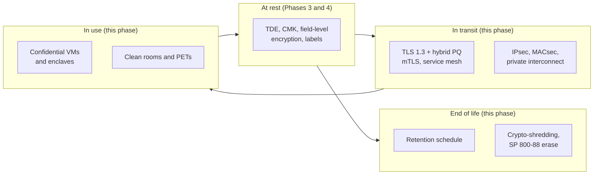

# Phase 5: Transit and in use
{: .no_toc }

**Phase 5: Transit and in use.** This phase closes the gaps that encryption at rest leaves open: data on the wire, data in memory during processing, and data that should no longer exist.
{: .fs-5 .fw-300 }

## On this page
{: .no_toc .text-delta }

1. TOC
{:toc}

---

## Objective

Phases 3 and 4 protect data at rest. But guest data is at rest only part of the time. A reservation moves from an OTA through a channel manager to the CRS, then to the PMS at the property, then to the data lake, CRM, and loyalty platform. A card payment moves from a P2PE terminal through a gateway to an acquirer. Each hop is a place where data can be intercepted, and each processing step decrypts data into memory where a privileged insider or compromised host can read it.

Phase 5 has three objectives:

1. **Encrypt every hop.** TLS 1.3 by default, TLS 1.2 only with approved suites, mutual TLS between services handling C2 and C3 data, encrypted private connectivity to the cloud and between properties and data centers, and hybrid post-quantum key exchange wherever the stack supports it.
2. **Reduce exposure during processing.** Use confidential computing (hardware-based trusted execution environments) and clean rooms where C3 data must be processed by parties or platforms that should not see it in the clear.
3. **Make deletion real.** Apply the retention schedule, honor erasure requests including in backups, and use crypto-shredding so that deletion can be proved even where physical deletion of every copy is impractical.

Indicative timing is months 9 to 24. Encryption in transit work starts earlier where PCI DSS requirement 4.2.1 findings exist. Hybrid PQ TLS is also the first step of Phase 6 and is tracked in both phases.

## Data states and controls

## Entry criteria

| Criterion | Evidence |
|---|---|
| Cryptographic standard published | Approved protocols and cipher suites from [Cryptographic standards]() |
| PKI and certificate automation available | Issuing CAs and ACME or cert-manager from [Certificates and PKI]() |
| Data flows documented | Flow maps from [Data ownership, flows, and lineage]() showing each hop for C2 and C3 data |
| TLS endpoint inventory | CBOM scan results showing protocol versions and key exchange groups per endpoint |
| Retention requirements collected | Legal and privacy input on retention by data class and jurisdiction |

## Exit criteria

| Criterion | Evidence |
|---|---|
| No TLS below 1.2 | CBOM scan shows zero endpoints accepting TLS 1.0/1.1 in scope; exceptions recorded |
| TLS 1.3 and hybrid PQ enabled | Public endpoints and cloud load balancers negotiate TLS 1.3 and, where supported, X25519MLKEM768 |
| mTLS for C3 service paths | Service mesh or SPIFFE mTLS in strict mode for payment, identity, and special-category services |
| Database connections encrypted and verified | Force-SSL parameters set; clients verify server certificates |
| Confidential computing decision made | Use cases evaluated; pilots running where justified |
| Retention schedule enforced | Lifecycle policies on storage, TTLs on databases, retention labels in Microsoft 365 |
| Crypto-shredding in production | At least one C3 data set (for example, guest identity documents) uses per-subject keys with tested erasure |

## Deliverables

| Deliverable | Owner |
|---|---|
| Transport security standard and load balancer / gateway TLS policy baselines per cloud | Security architecture with network engineering |
| Service mesh or SPIFFE mTLS pattern and paved-road configuration | Platform engineering |
| Private connectivity encryption design (IPsec, MACsec, SD-WAN) | Network engineering |
| Confidential computing assessment and pilot report | Security architecture |
| Enterprise retention schedule mapped to `retention-class` tags | Privacy office and legal, with records management |
| Crypto-shredding pattern, library, and erasure evidence process | Security architecture with data platform team |

## Pages in this phase

| Page | What it covers |
|---|---|
| [Encryption in transit]() | TLS 1.3, termination patterns, mTLS and service mesh, IPsec, MACsec, private interconnect encryption, SD-WAN, guest Wi-Fi, database connections, hybrid PQ TLS, and cloud load balancer policies |
| [Data in use and confidential computing]() | TEEs, per-cloud confidential computing, attestation-gated key release, clean rooms, and privacy-enhancing technologies |
| [Retention, deletion, and crypto-shredding]() | Retention schedule, GDPR erasure, crypto-shredding with per-subject keys, backups and immutability conflicts, SP 800-88 cryptographic erase, and legal hold |

## Trade-offs in this phase

{: .important }
"Best" is not always right here either. Re-encrypting to every backend adds latency and certificate management load. Strict mTLS breaks clients that were never enrolled. Confidential computing constrains instance types, debugging, and GPU availability. Per-subject keys multiply key counts and KMS calls. Each control should be applied where the data tier justifies it.

## Key takeaways for engineering teams

- TLS 1.3 is the default for every new endpoint; TLS 1.2 is allowed only with approved suites; nothing lower.
- Terminating TLS at a load balancer is not the end of the path: re-encrypt to the backend for C2 and C3.
- Database clients must verify the server certificate, not just request encryption.
- Confidential computing is a targeted control for specific C3 processing, not a platform default.
- Data past its retention date is a liability. Design deletion, including in backups, before go-live.

## Related pages

- [Phase 2: Standards and keys]()
- [Phase 6: Post-quantum cryptography]()
- [Reference architectures]()
- [Phased roadmap]()
