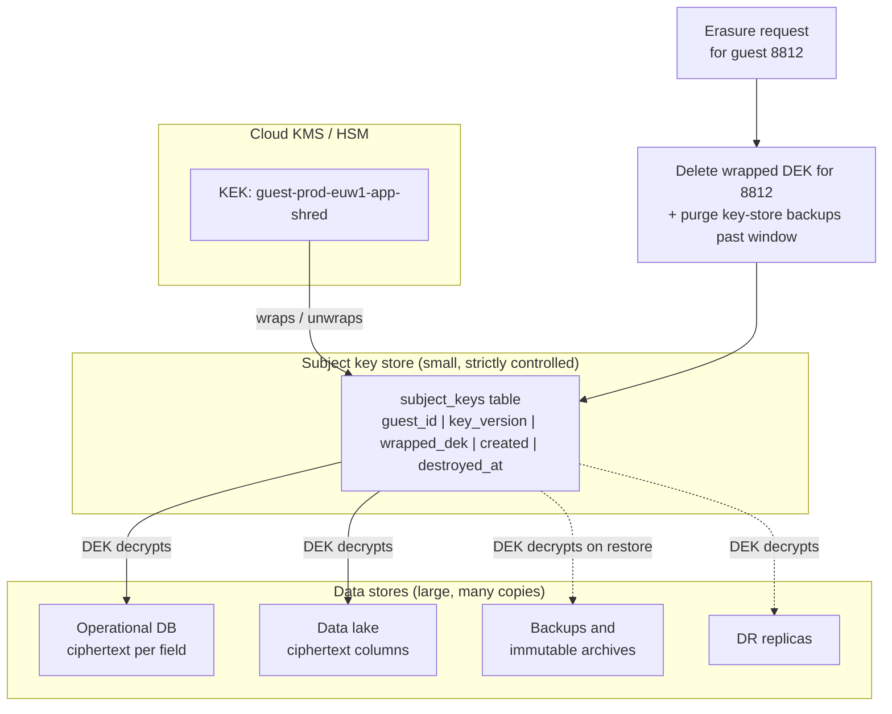
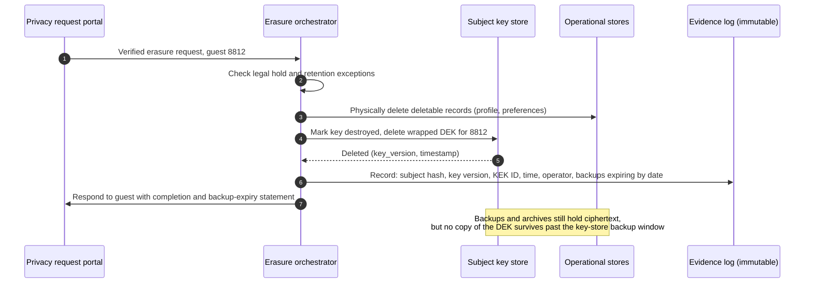

# Retention, deletion, and crypto-shredding
{: .no_toc }

**Phase 5: Transit and in use.** This page defines how long each class of data is kept, how it is deleted when that time ends or when a guest asks, and how the organization proves deletion across databases, lakes, and backups using crypto-shredding.
{: .fs-5 .fw-300 }

## On this page
{: .no_toc .text-delta }

1. TOC
{:toc}

---

## Why deletion is a protection control

Data that no longer exists cannot be breached, subpoenaed, or misused. Hospitality organizations accumulate years of stay history, loyalty activity, identity document scans, and payment references across PMS, CRS, CRM, data lake, and backup systems. Much of it is kept "because storage is cheap". Under GDPR's storage limitation principle (Article 5(1)(e)), CCPA/CPRA, PIPL, LGPD, and India's DPDP Act, keeping personal data longer than necessary is itself a compliance failure, and it enlarges the impact of every breach.

Deletion is hard in practice because data is copied: replicas, caches, analytics extracts, logs, search indexes, and backups. The organization's approach combines three mechanisms:

1. **Retention schedule enforced by metadata.** Every data store carries a `retention-class` tag (`r90d`, `r1y`, `r3y`, `r7y`, `r10y`, `legal-hold`) from the Phase 1 schema, and lifecycle policies act on it.
2. **Physical deletion where it is practical.** Lifecycle rules, TTLs, and scheduled purge jobs.
3. **Crypto-shredding where physical deletion is not practical.** Encrypt each subject's or tenant's data with its own key, and destroy the key to make every copy (including backups and immutable archives) unreadable.

## Retention schedule by data class

The schedule below is the organization's reference schedule. Legal owners confirm country-specific values; where local law requires longer or shorter retention, the local rule wins and is recorded as an override.

| Data | Tier / label | Default retention | Retention class | Main driver | Notes |
|---|---|---|---|---|---|
| Card authentication data (CVV2, full track, PIN block) | C3 `Restricted\PCI` | Must not be stored after authorization | Not stored | PCI DSS v4.0.1 requirement 3.3 | Verified by discovery scans |
| PAN (where stored at all) | C3 `Restricted\PCI` | Only as long as business need (for example, chargeback window) | `r1y` | PCI DSS requirement 3.2.1 (retention limited to need) | Prefer tokens; tokens follow reservation retention |
| Passport and ID scans | C3 `Restricted\Guest-Identity` | Shortest period allowed by local guest registration law | `r90d` or `r1y` by country | Local police/registration laws; GDPR minimization | Many countries require recording ID data but specify retention; confirm per country (verify) |
| Guest registration record (fields required by law) | C2 | As specified by local law | `r1y` to `r3y` | Local law | Kept separately from full scans |
| Reservation and folio | C2 `Confidential\Guest-PII` | 7 years after stay (finance) or country override | `r7y` | Tax and accounting law; varies by country, commonly 6 to 10 years | Guest-identifying fields may be pseudonymized earlier while financial records remain |
| Guest profile and preferences | C2 | 3 years after last activity | `r3y` | Legitimate interest; marketing consent | Refreshed by new stays |
| Loyalty account and points history | C2 | Life of membership plus 3 years | `r3y` after closure | Program terms; disputes | |
| Marketing consent records | C2 | Life of consent plus limitation period | `r7y` | Proof of consent | |
| Health, accessibility, allergy notes | C3 `Restricted\Special-Category` | Duration of stay plus 90 days | `r90d` | GDPR Article 9 minimization | Unless guest opts to keep in profile |
| Spa and wellness health questionnaires | C3 | Per local health records rules | `r1y` to `r10y` (country) | Local health regulation | Confirm per country |
| CCTV footage | C2 | 30 days unless an incident | `r90d` maximum; default 30 days in lifecycle rule | DPA guidance; many regulators expect short retention | Exported clips placed on legal hold |
| Guest Wi-Fi logs | C2 | As required by local telecom retention law, otherwise 90 days | `r90d` | Local law | |
| Employee HR records | C2 `Confidential\Employee` | Employment plus 7 years | `r7y` | Employment and tax law | |
| Security logs | C1/C2 | 1 year online, longer archived | `r1y` / `r3y` | PCI DSS requirement 10.5.1 (at least 12 months, 3 months immediately available) | |
| Financial ledgers | C2 `Confidential\Business` | 10 years | `r10y` | Tax and statutory accounting | |
| Cryptographic key destruction evidence | C1 | 7 years after destruction | `r7y` | Audit | |

{: .note }
Retention periods in this table are organization defaults, not legal advice. Each row has a named legal owner, and country overrides are stored in the records management system and referenced by the `retention-class` value assigned to regional data stores.

## Right to erasure and other deletion triggers

| Trigger | Scope | Deadline | Exceptions |
|---|---|---|---|
| Retention period expires | Records whose retention clock has passed | Next scheduled purge cycle (at least monthly) | Legal hold |
| GDPR Article 17 erasure request (EU/UK) | All personal data about the requester not subject to an exemption | Without undue delay, and within one month of the request (extendable in limited cases) | Legal obligations (for example tax records), establishment or defense of legal claims |
| CCPA/CPRA deletion request | Personal information collected from the consumer | 45 days (extendable) | Statutory exceptions |
| PIPL, LGPD, DPDP requests | Per law | Per law | Per law |
| Loyalty account closure | Program data | Per program terms | Financial records |
| End of partner or franchise agreement | Data shared with or received from the partner | Per contract | |

Erasure rarely means deleting everything. A typical erasure request for an EU guest results in: guest profile and preferences deleted, marketing data deleted, loyalty account closed and deleted after the dispute window, identity scans deleted, and folios retained for the statutory accounting period with identifying fields minimized.

## Crypto-shredding

Crypto-shredding (also called cryptographic erasure at the record level) encrypts data under a key that is specific to one subject, one tenant, or one data set, and then destroys the key. Every copy of the ciphertext, wherever it is, becomes unreadable at once.

It solves the hardest part of deletion: copies the organization cannot practically find or modify, such as backups, immutable archives, replicas in disaster recovery regions, and exported analytics files.

### Key granularity options

| Granularity | Example | Key count | Fit |
|---|---|---|---|
| Per subject (guest) | One DEK per guest ID for identity documents and special-category data | Millions of DEKs, wrapped by one KEK per domain-region | Guest erasure requests |
| Per tenant | One key per franchise owner or corporate client | Hundreds to thousands | End of franchise or client agreement |
| Per data set or time partition | One key per month of CCTV, per year of logs | Tens to hundreds | Retention expiry for bulk data |
| Per property | One key per hotel's local data | Thousands | Property exit (sale, de-flagging) |

Per-subject DEKs are not stored in the KMS as individual KMS keys (that would be expensive and hit service quotas). They are generated through the envelope pattern, wrapped by a domain KEK in the KMS, and stored in a **subject key table**. Destroying a subject's key means deleting the wrapped DEK from that table and from the table's backups.

### Architecture



Key design rules:

- **The subject key store has short backup retention.** If the key store is backed up for 7 years, destroying a key in the live table does not shred anything for 7 years. The key store's backups are kept for the shortest period that supports recovery (for example 35 days), and erasure is considered complete when the last backup containing the key has expired. Document that period in the privacy notice and the erasure response process.
- **The key store is small and separate.** It holds only wrapped DEKs, never data, so it can have a different backup regime from the data stores.
- **Bind the subject to the ciphertext.** Include the subject ID and key version as additional authenticated data so a ciphertext cannot be decrypted with another subject's key.
- **Non-shredded fields stay usable.** Only C3 and erasable C2 fields are encrypted per subject; fields needed for statutory records (for example, folio amounts) use the normal domain key.

### Erasure sequence



The reference implementation in [code/crypto-shredding](https://github.com/steven-smith-itnet/data-protection-pqc-security-architecture/tree/main/code/crypto-shredding) demonstrates per-subject DEKs wrapped under a KEK, encryption of records with AES-256-GCM bound to the subject ID, key destruction, and verification that ciphertext in a "backup" copy can no longer be decrypted.

A minimal Python outline of the pattern (using the `cryptography` library and a KMS client for wrapping):

```python
import os
from cryptography.hazmat.primitives.ciphers.aead import AESGCM

def new_subject_key(kms, kek_id: str, subject_id: str) -> bytes:
    dek = AESGCM.generate_key(bit_length=256)
    wrapped = kms.encrypt(KeyId=kek_id, Plaintext=dek,
                          EncryptionContext={"subject-id": subject_id, "purpose": "shred"})["CiphertextBlob"]
    subject_keys.put(subject_id, wrapped)          # small, short-backup key store
    return dek

def encrypt_field(dek: bytes, subject_id: str, field: str, value: bytes) -> bytes:
    nonce = os.urandom(12)
    aad = f"{subject_id}|{field}".encode()
    return nonce + AESGCM(dek).encrypt(nonce, value, aad)

def shred(subject_id: str) -> None:
    subject_keys.delete(subject_id)                # all ciphertext for the subject is now unrecoverable
    evidence_log.append({"subject": sha256_hex(subject_id), "action": "dek-destroyed"})
```

### Per-tenant and per-partition shredding with KMS keys

For coarse granularity (per franchise owner, per month of CCTV), use a separate KMS key per tenant or partition and schedule its deletion:

```bash
# AWS: destroy the key protecting CCTV footage for one month after the retention period
aws kms schedule-key-deletion --key-id alias/property-iot-prod-euw1-cctv-2026-06 --pending-window-in-days 7

# Google Cloud: destroy a key version (scheduled; irreversible after the scheduled duration)
gcloud kms keys versions destroy 1 --key=cctv-2026-06 --keyring=property-iot-prod --location=europe-west1

# Azure: delete then purge a key (purge protection enforces the retention interval first)
az keyvault key delete --vault-name kv-propiot-prod-weu --name cctv-2026-06
```

{: .warning }
Key deletion is irreversible once the waiting period passes. Shredding keys must be isolated from keys protecting data that must be kept. Never use a shared domain KEK for crypto-shredding, because destroying it would erase every subject in the domain.

## Backups and immutable storage

Backups and immutable storage are designed to prevent deletion, which conflicts directly with erasure.

| Mechanism | Conflict | Resolution |
|---|---|---|
| Database backups and snapshots (RDS, Azure SQL, Cloud SQL, Autonomous DB) | A deleted guest record persists in every snapshot within the retention window | Crypto-shred C3 and erasable fields; keep snapshot retention as short as recovery needs allow; document "beyond use" status per regulator guidance |
| Object lock and immutable blobs (S3 Object Lock compliance mode, Azure immutable blob storage, GCS bucket lock, OCI retention rules) | Objects cannot be deleted before the lock expires, even by the root account | Do not put erasable personal data in compliance-mode locks longer than its retention; encrypt with per-subject or per-partition keys so the locked object can be shredded |
| Backup vaults (AWS Backup Vault Lock, Azure Backup immutable vaults, Google Backup and DR, OCI) | Same | Same; align vault lock periods with retention classes |
| Ransomware-resilient offline copies | Physically hard to modify | Crypto-shredding is the only practical option |
| Log archives | May contain guest data in free text | Minimize personal data in logs at the source; per-partition keys for log archives |

Regulators recognize that erasing data from backups is not always immediately feasible. The UK ICO, for example, has described putting data "beyond use" when immediate deletion from backups is not possible, provided the data is not used and is deleted when the backup is overwritten. Crypto-shredding gives a stronger position than "beyond use" because the data becomes unreadable immediately (once the key-store backup window passes).

## Media sanitization and cryptographic erase (NIST SP 800-88)

NIST SP 800-88 Rev. 1 defines three sanitization levels: **clear**, **purge**, and **destroy**. **Cryptographic erase (CE)** is a purge technique: sanitize the media encryption key so that encrypted data on the media cannot be recovered. It is fast, works on media where overwriting is unreliable (SSDs with wear leveling), and is how cloud providers sanitize storage.

| Environment | Method | Evidence |
|---|---|---|
| Cloud storage (all providers) | Provider performs sanitization per its media handling process; customer relies on provider attestations (SOC 2, ISO 27001) and uses CMK deletion for cryptographic erase under its own control | Provider reports; organization's key destruction records |
| On-prem SSDs and self-encrypting drives (SED, TCG Opal) | Cryptographic erase via ATA Sanitize Crypto Scramble / NVMe Format with Secure Erase Setting = cryptographic erase / TCG revert | Tool output log, drive serial, operator, date |
| On-prem HDDs | Overwrite (clear/purge) or degauss/destroy | Certificate of sanitization |
| Storage arrays with encryption (KMIP-managed keys) | Delete the array or volume key in the key manager | Key manager audit record |
| Property equipment (PMS servers, POS, CCTV recorders) at decommission or property exit | Cryptographic erase where encrypted; otherwise physical destruction by certified vendor | Certificate of destruction with serials |
| Mobile devices (staff phones, digital key encoders) | MDM remote wipe (cryptographic erase on modern iOS/Android) | MDM record |

```bash
# NVMe cryptographic erase of namespace 1 (on-prem hardware decommission)
nvme format /dev/nvme0n1 --ses=2
# ses=2 requests cryptographic erase; confirm the drive reports crypto-erase support first:
nvme id-ctrl /dev/nvme0 -H | grep -i "Crypto Erase"
```

{: .verify }
NIST has been revising SP 800-88. Confirm whether a newer revision (Rev. 2) has superseded Rev. 1 and update terminology and references accordingly.

## Legal hold

A legal hold suspends deletion for data relevant to litigation, investigation, or regulatory inquiry. It must override retention rules and erasure, and it must be targeted.

| Requirement | Implementation |
|---|---|
| Hold overrides deletion | Erasure orchestrator and lifecycle jobs check a hold register before deleting or shredding |
| Targeted scope | Holds apply to named custodians, subjects, properties, or date ranges, not whole systems |
| Tagging | Stores or objects under hold carry `retention-class=legal-hold`; lifecycle rules exclude it |
| Platform features | S3 Object Lock legal hold, Azure immutable storage legal hold, Google Cloud Storage object holds (event-based and temporary), Microsoft Purview eDiscovery holds and retention labels, OCI retention rules |
| Keys under hold | Shredding keys for held subjects or partitions are tagged and protected by policy from deletion |
| Release | When the hold is released, normal retention resumes; overdue data is deleted in the next cycle |

```bash
# S3: place and release a legal hold on an object version
aws s3api put-object-legal-hold --bucket guest-docs-prod-euw1 --key id-scans/8812/passport.jpg.enc \
  --legal-hold Status=ON
aws s3api put-object-legal-hold --bucket guest-docs-prod-euw1 --key id-scans/8812/passport.jpg.enc \
  --legal-hold Status=OFF

# Google Cloud Storage: temporary hold on an object
gcloud storage objects update gs://guest-docs-prod-euw1/id-scans/8812/passport.jpg.enc --temporary-hold
```

## Enforcing retention with metadata

The `retention-class` tag from [Labeling, tagging, and metadata]() drives lifecycle configuration through Terraform modules and policy as code.

| Platform | Mechanism driven by `retention-class` |
|---|---|
| Amazon S3 | Lifecycle expiration rules by prefix or object tag (`retention-class=r90d` expires at 90 days) |
| Azure Blob Storage | Lifecycle management policy with blob index tag filters |
| Google Cloud Storage | Object Lifecycle Management with age and custom time conditions |
| DynamoDB, Cosmos DB, Firestore, Bigtable | TTL attributes / TTL policies / garbage collection |
| Relational databases | Scheduled purge procedures keyed on retention columns |
| BigQuery | Table and partition expiration |
| Microsoft 365 | Purview retention labels and policies |
| OCI Object Storage | Lifecycle policy rules |

An S3 lifecycle rule for objects tagged `retention-class=r90d`:

```json
{
  "Rules": [
    {
      "ID": "expire-r90d",
      "Filter": { "Tag": { "Key": "retention-class", "Value": "r90d" } },
      "Status": "Enabled",
      "Expiration": { "Days": 90 },
      "NoncurrentVersionExpiration": { "NoncurrentDays": 7 }
    }
  ]
}
```

Note `NoncurrentVersionExpiration`: in a versioned bucket, expiring the current version only adds a delete marker. Without a noncurrent-version rule, the data remains.

## Key destruction evidence

Assessors, regulators, and guests may ask the organization to demonstrate that data was deleted. Evidence for crypto-shredding is evidence that the key no longer exists anywhere.

| Evidence item | Source |
|---|---|
| Key identifier and version destroyed | KMS audit log (`ScheduleKeyDeletion` and the eventual `DeleteKey` event in CloudTrail; Key Vault `KeyPurge`; Cloud KMS `DestroyCryptoKeyVersion`; OCI Audit) or subject key store deletion record |
| Timestamp and operator or orchestrator identity | Same logs |
| Approval | Change or erasure ticket reference; dual control for tenant or partition keys |
| Scope statement | Which data sets were encrypted under the key (from the key inventory and blast-radius record) |
| Backup expiry statement | Date by which the last backup of the key store containing the key expires |
| Verification | Automated test that a sample ciphertext fails to decrypt after destruction |
| Retention of evidence | Evidence stored in immutable storage with `retention-class=r7y`, containing no personal data (subject IDs hashed) |

KQL example to extract Key Vault purge evidence for the audit file:

```kusto
AzureDiagnostics
| where ResourceProvider == "MICROSOFT.KEYVAULT"
| where OperationName in ("KeyDelete", "KeyPurge")
| project TimeGenerated, Resource, id_s, OperationName, identity_claim_upn_s, CallerIPAddress, ResultType
| order by TimeGenerated desc
```

## Good, better, best

| Level | Approach | Trade-offs |
|---|---|---|
| **Good** | Retention schedule published; lifecycle rules on object storage and TTLs on databases driven by `retention-class`; manual erasure process with checklist | Backups and archives retain erased data until overwritten; erasure evidence is procedural |
| **Better** | Automated erasure orchestration across systems; per-partition keys for bulk time-series data (CCTV, logs) with scheduled key deletion; backup retention aligned to retention classes; legal hold register integrated | More keys to manage; orchestration must know every system holding guest data (depends on Phase 1 lineage) |
| **Best** | Per-subject crypto-shredding for C3 and erasable C2 fields, short-backup subject key store, automated verification and immutable evidence; per-tenant keys for franchise and corporate client data | Application-layer encryption required (breaks some search and analytics on those fields); higher KMS call volume; key store becomes a critical dependency whose loss is equivalent to deleting all subjects |

## Key takeaways for engineering teams

- Every data store gets a `retention-class` tag, and lifecycle or TTL configuration must match it. Policy as code checks both.
- Versioned buckets need noncurrent-version expiration, or deletion does nothing.
- If your service stores C3 guest data, design for per-subject crypto-shredding from the start; retrofitting it means re-encrypting everything.
- Shredding keys are separate from domain keys. Destroying a domain KEK to erase one guest would erase all of them.
- Deletion jobs must check the legal hold register first.
- Record key destruction evidence without personal data, and keep it for seven years.

## Related pages

- [Key management architecture]()
- [Labeling, tagging, and metadata]()
- [Data ownership, flows, and lineage]()
- [Email, backups, logs, and media]()
- [Cloud object storage]()
- [Compliance mapping]()

## Sources

- GDPR Article 5 and Article 17: <https://eur-lex.europa.eu/eli/reg/2016/679/oj>
- NIST SP 800-88 Rev. 1, Guidelines for Media Sanitization: <https://csrc.nist.gov/pubs/sp/800/88/r1/final>
- NIST SP 800-57 Part 1 Rev. 5 (key destruction and states): <https://csrc.nist.gov/pubs/sp/800/57/pt1/r5/final>
- UK ICO guidance on the right to erasure: <https://ico.org.uk/for-organisations/uk-gdpr-guidance-and-resources/individual-rights/individual-rights/right-to-erasure/>
- Amazon S3 Object Lock: <https://docs.aws.amazon.com/AmazonS3/latest/userguide/object-lock.html>
- Azure immutable blob storage: <https://learn.microsoft.com/azure/storage/blobs/immutable-storage-overview>
- Google Cloud Storage holds: <https://cloud.google.com/storage/docs/object-holds>
- PCI DSS v4.0.1: <https://www.pcisecuritystandards.org/document_library/>
