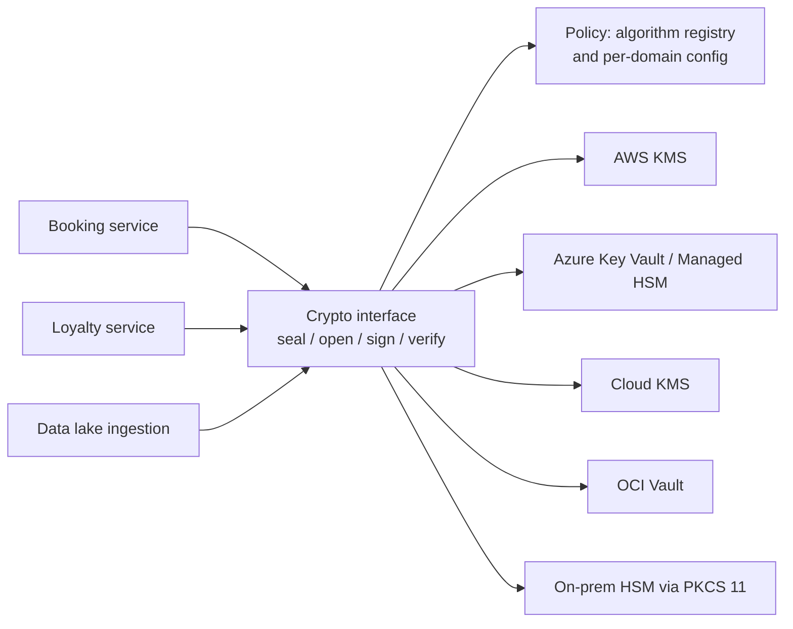
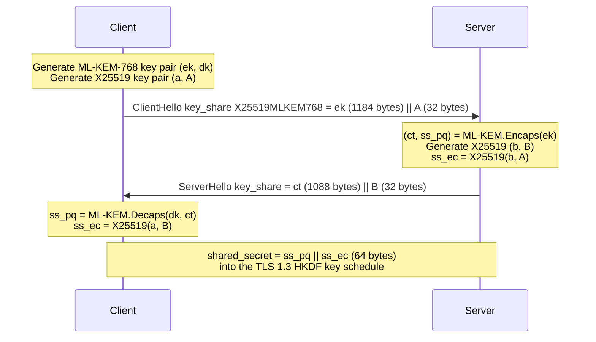

# Crypto agility and hybrid designs
{: .no_toc }

**Phase 6: Post-quantum cryptography.** Gives engineering teams the patterns that let the organization adopt PQC now and change algorithms again later without re-engineering systems.
{: .fs-5 .fw-300 }

## On this page
{: .no_toc .text-delta }

1. TOC
{:toc}

---

## What crypto agility means

Crypto agility is the ability to change the cryptographic algorithms, parameters, keys, and implementations a system uses **without changing its architecture or re-engineering its code**, and to do so quickly, in a controlled way, across the estate.

It has three parts:

| Part | Question it answers | Evidence it exists |
|---|---|---|
| Visibility | Where is each algorithm used? | A maintained CBOM ([Cryptographic inventory (CBOM)]()) |
| Replaceability | Can the algorithm be changed by configuration or a library upgrade? | Algorithm choice lives in configuration or a central service, not in application code |
| Operability | Can the change be rolled out, tested, and rolled back safely? | Feature flags, staged rollout, monitoring of negotiated algorithms |

The PQC transition is the reason to invest now, but it is not the last change. HQC is being standardized as a backup KEM, FN-DSA is in progress, and implementation flaws in new algorithms are likely to be found. The organization builds for the second change, not only the first.

## Architecture patterns

### Pattern 1: Crypto provider abstraction

Applications call a small, organization-approved interface ("encrypt this for data domain X", "sign this with the release key"), not a specific algorithm. The implementation behind the interface is a library or service maintained by the security engineering team.



| Do | Do not |
|---|---|
| Expose operations (`seal`, `open`, `sign`, `verify`) | Expose algorithm names in application APIs |
| Use vetted libraries (AWS Encryption SDK, Tink, platform KMS SDKs) inside the abstraction | Implement cryptographic primitives or combiners |
| Version the interface; support read of old formats indefinitely | Break decryption of stored data when the write algorithm changes |

### Pattern 2: Configuration-driven algorithm selection

Algorithm choices live in configuration keyed by data classification and domain, loaded by the crypto interface and by infrastructure templates. A policy file of this shape is reviewed by security architecture and enforced in CI:

```yaml
# crypto-policy.yaml (illustrative)
version: 2026-09
tls:
  groups_preferred: [X25519MLKEM768, X25519, secp256r1]
  groups_fips:      [SecP256r1MLKEM768, secp256r1]
  min_version: TLSv1.2
  signature_algorithms: [ecdsa_secp256r1_sha256, rsa_pss_rsae_sha256, ed25519]
envelope:
  content_alg: A256GCM
  wrap_alg_by_profile:
    pp1: kms-sym-aes256
    pp2: kms-sym-aes256
    pp3: kms-sym-aes256        # HSM-backed or external key store per PP-3
  read_only_wrap_algs: [rsa-oaep-sha256]
signing:
  code_signing: ML-DSA-65      # with classical co-signature during transition
  firmware_signing: LMS        # HSM-managed state only
deprecations:
  - alg: RSA-2048
    deprecated_after: 2030-12-31
  - alg: ECDSA-P256
    deprecated_after: 2030-12-31
  - alg: [RSA, ECDH, ECDSA, EdDSA]
    disallowed_after: 2035-12-31
```

Guardrails that read the same file are described in [Guardrails and policy as code]().

### Pattern 3: Algorithm identifiers stored with ciphertext

Every stored ciphertext carries a header that identifies the content algorithm, the wrap algorithm, the key identifier, and the format version. Without this, a reader cannot tell which algorithm to use, and changing the write algorithm breaks reads. With it, old and new formats coexist and migration can proceed record by record.

This is standard practice in mature formats: the AWS Encryption SDK message format, Tink's keyset and output prefix, JOSE (`alg` and `enc` header parameters), and CMS all carry algorithm identifiers.

### Pattern 4: Envelope encryption makes re-wrapping cheap

Bulk data is encrypted with a data encryption key (DEK) using AES-256-GCM. The DEK is wrapped by a key encryption key (KEK). Changing the KEK or the wrap algorithm, for example from an RSA-wrapped DEK to a KMS symmetric wrap or a hybrid KEM, means rewriting only the wrapped DEK, typically tens to a few hundred bytes per object, not the data.

| Operation | Cost with envelope encryption | Cost without |
|---|---|---|
| Rotate KEK | Re-wrap each DEK (or rely on KMS key versioning, which re-wraps nothing) | Re-encrypt all data |
| Change wrap algorithm (for example, RSA to PQC-safe) | Re-wrap each DEK | Re-encrypt all data |
| Change content algorithm | Re-encrypt data (rarely needed: AES-256-GCM is not quantum-affected) | Re-encrypt all data |

This is why PQC for data at rest is mostly a key-wrapping project. See [Key management architecture]().

### Pattern 5: Centralized TLS termination

Terminate external TLS at a small number of managed points (CDN, cloud load balancers, API gateways, ingress controllers) and use a service mesh for internal mTLS. Changing the TLS groups on ten managed termination points is feasible in weeks; changing TLS libraries in five hundred applications takes years.

| Termination model | PQC change effort |
|---|---|
| CDN and managed load balancers | Configuration or provider default |
| Service mesh sidecars or ambient proxies | Mesh upgrade and configuration |
| TLS inside each application (embedded libraries) | Per-application upgrade, test, and release |
| Appliances and embedded devices | Vendor firmware or replacement |

### Pattern 6: Short-lived certificates and automated issuance

Automated certificate issuance and renewal (ACME, cloud certificate managers, service mesh CAs) make it possible to switch signature algorithms by changing the issuing profile. The CA/Browser Forum's move to 47-day maximum validity by March 2029 (ballot SC-081) forces this automation for public certificates anyway. Internally, mesh certificates with lifetimes of hours or days can move to ML-DSA as soon as both ends support it, without a large manual reissuance. See [Certificates and PKI]().

### Pattern 7: Negotiation with safe fallback

Protocols that negotiate algorithms (TLS 1.3 supported groups and signature algorithms, IKEv2 transforms, SSH key exchange) allow a server to add a new algorithm while old clients continue to work. The design task is to ensure fallback happens only when the peer lacks support, not when an attacker interferes. TLS 1.3 protects negotiation by including the full handshake transcript in the Finished message, so an attacker cannot silently strip the hybrid group from a client that supports it.

## Hybrid designs

### Why hybrid

A hybrid combines a classical algorithm with a post-quantum algorithm so that the result is secure if **either** component is secure. It hedges two risks at once:

- A CRQC breaks the classical component.
- A cryptanalytic or implementation flaw breaks the new PQC component. This is not hypothetical: SIKE, a fourth-round candidate in the NIST process, was broken with a classical computer in 2022.

Hybrid key exchange is the default in browsers, CDNs, and OpenSSL 3.5. Several European national authorities (for example, ANSSI in France and BSI in Germany) recommend or require hybrid deployment during the transition. NSA's CNSA 2.0 guidance, by contrast, accepts pure ML-KEM-1024 for national security systems.

{: .verify }
National authority positions on hybrid versus pure PQC deployment continue to evolve. Check current ANSSI, BSI, NCSC, and NSA guidance for regional requirements.

### Concatenation KEM combiners

A hybrid key exchange runs both algorithms and combines their shared secrets. TLS 1.3 uses the simplest method, concatenation, specified in the IETF hybrid design draft:

1. The client sends one key share that is the concatenation of an ML-KEM encapsulation key and an ephemeral ECDH public key.
2. The server encapsulates to the ML-KEM key (producing a ciphertext and a secret) and generates its own ECDH share (producing the ECDH secret). It returns the concatenation of the ML-KEM ciphertext and its ECDH public key.
3. Both sides compute `shared_secret = ML-KEM secret || ECDH secret` and feed it into the TLS 1.3 key schedule (HKDF), which already binds the secret to the full transcript.



| Hybrid group | Codepoint | PQ component | Classical component | Order in key share and secret | Use in the organization |
|---|---|---|---|---|---|
| `X25519MLKEM768` | 0x11EC | ML-KEM-768 | X25519 | ML-KEM first, then X25519 | Default everywhere |
| `SecP256r1MLKEM768` | 0x11EB | ML-KEM-768 | ECDH P-256 | P-256 first, then ML-KEM | FIPS-constrained systems where X25519 is not in the validated module |
| `SecP384r1MLKEM1024` | 0x11ED | ML-KEM-1024 | ECDH P-384 | P-384 first, then ML-KEM | High-assurance and CNSA-aligned links |

The lab measured the effect of the larger key shares: the ClientHello grew from 239 bytes with `X25519` to 1,415 bytes with `X25519MLKEM768`, and the ServerHello from 122 to 1,210 bytes. See [Hands-on PQC lab]().

Outside TLS, where there is no transcript-hashing key schedule, a combiner must bind the ciphertexts and public keys into the key derivation (for example, `KDF(ss_pq || ss_ec || ct || ecdh_pub || label)`). NIST SP 800-227 and the IETF drafts for generic hybrid KEMs describe acceptable constructions. **Engineering teams do not write combiners.** They use library-provided hybrid KEMs (for example, OpenSSL 3.5's `X25519MLKEM768` KEM, or HPKE with a hybrid KEM when libraries support it).

### Hybrid and PQC certificates: composite versus dual

For signatures and certificates there are three main approaches.

| Approach | How it works | Advantages | Disadvantages |
|---|---|---|---|
| **Composite certificate** | One certificate with a composite public key (for example, ML-DSA-65 plus ECDSA P-256) and a composite signature; both component signatures must verify | Single object; security holds if either algorithm holds; no protocol changes beyond a new algorithm identifier | Requires every verifier to understand the composite identifier; IETF draft status; larger certificates |
| **Dual certificates** | Two separate certificate chains (one classical, one PQC); the peer chooses based on its capabilities, or both are presented | Each chain uses standard single-algorithm identifiers; classical clients unaffected | Two chains to issue and manage; negotiation logic; the security is only as strong as the chain the client accepts |
| **Pure PQC certificate** | Single ML-DSA or SLH-DSA certificate | Simplest end state; standard identifiers | No hedge against a flaw in the PQC algorithm; only usable where every verifier supports it |
| Related-certificate or chameleon approaches | A PQC certificate references or embeds a classical one (IETF drafts) | Transition aids | Draft status; limited implementation |

The organization's position:

- **Public web PKI:** keep ECDSA certificates with hybrid key exchange until browsers and public CAs support PQC certificates. Key exchange is the HNDL risk; authentication is not.
- **Internal PKI:** build a parallel ML-DSA hierarchy (dual) and pilot it for internal mTLS where both ends are under the organization's control. Evaluate composite certificates once the IETF specification is final and supported by the organization's HSMs and TLS libraries.
- **Firmware and code signing:** dual signatures on artifacts (classical and PQC or hash-based), which is simpler than composite certificates because the verifier is the organization's or vendor's own code.

{: .verify }
Composite signature and composite KEM specifications (draft-ietf-lamps-pq-composite-sigs and draft-ietf-lamps-pq-composite-kem) were Internet-Drafts at the time of writing. Check status before committing to composite formats.

## Algorithm-agile envelope header

The following Python example shows a minimal envelope format with algorithm identifiers stored alongside the ciphertext, a registry of approved algorithms, a read-only list for deprecated algorithms, and a `rewrap` function that changes the KEK and wrap algorithm **without touching the ciphertext**.

The content header (version, content algorithm, nonce, classification) is authenticated as AES-GCM associated data and never changes. The key header (wrap algorithm, KEK identifier, wrapped DEK) is replaceable. Its integrity comes from the wrap algorithm itself: AES key wrap, a KMS decrypt call, and a hybrid KEM with AEAD all fail if the wrapped DEK or the identifier is tampered with.

```python
"""Algorithm-agile envelope format (illustrative).

Layout:
  MAGIC(4) | content_hdr_len(2) | content_hdr | key_hdr_len(2) | key_hdr | ciphertext
"""
import json
import os
import struct

from cryptography.hazmat.primitives.ciphers.aead import AESGCM

MAGIC = b"HENV"
FORMAT_VERSION = 2

# Approved-algorithm registry. Adding an entry is a reviewed code change;
# choosing among entries is configuration.
CONTENT_ALGS = {"A256GCM": 12}                # name -> nonce length
WRAP_ALGS = {
    "kms-sym-aes256",        # cloud KMS symmetric key (AES-256 inside the KMS/HSM)
    "aes256-kw",             # local AES key wrap (RFC 3394)
    "rsa-oaep-sha256",       # legacy, quantum-vulnerable: read-only
    "mlkem768-x25519-hkdf",  # hybrid KEM wrap for keys held outside a symmetric KMS
}
READ_ONLY_WRAP_ALGS = {"rsa-oaep-sha256"}


def _enc(obj: dict) -> bytes:
    return json.dumps(obj, sort_keys=True, separators=(",", ":")).encode()


def _pack(content_hdr: bytes, key_hdr: bytes, ct: bytes) -> bytes:
    return (MAGIC + struct.pack(">H", len(content_hdr)) + content_hdr
            + struct.pack(">H", len(key_hdr)) + key_hdr + ct)


def parse(blob: bytes):
    if blob[:4] != MAGIC:
        raise ValueError("not an envelope")
    (clen,) = struct.unpack(">H", blob[4:6])
    content_raw = blob[6:6 + clen]
    off = 6 + clen
    (klen,) = struct.unpack(">H", blob[off:off + 2])
    key_raw = blob[off + 2:off + 2 + klen]
    return content_raw, json.loads(key_raw), blob[off + 2 + klen:]


def seal(plaintext: bytes, classification: str, wrap_alg: str, kek_id: str, wrap_fn) -> bytes:
    if wrap_alg not in WRAP_ALGS or wrap_alg in READ_ONLY_WRAP_ALGS:
        raise ValueError(f"wrap algorithm not allowed for new data: {wrap_alg}")
    dek = AESGCM.generate_key(bit_length=256)
    nonce = os.urandom(CONTENT_ALGS["A256GCM"])
    content_hdr = _enc({"v": FORMAT_VERSION, "alg": "A256GCM",
                        "nonce": nonce.hex(), "class": classification})
    key_hdr = _enc({"wrap_alg": wrap_alg, "kek_id": kek_id,
                    "wrapped_dek": wrap_fn(dek).hex()})
    ct = AESGCM(dek).encrypt(nonce, plaintext, MAGIC + content_hdr)
    return _pack(content_hdr, key_hdr, ct)


def open_(blob: bytes, unwrap_fns: dict) -> bytes:
    content_raw, key, ct = parse(blob)
    content = json.loads(content_raw)
    if content["alg"] not in CONTENT_ALGS or key["wrap_alg"] not in WRAP_ALGS:
        raise ValueError("unknown algorithm")
    dek = unwrap_fns[key["wrap_alg"]](key["kek_id"], bytes.fromhex(key["wrapped_dek"]))
    return AESGCM(dek).decrypt(bytes.fromhex(content["nonce"]), ct, MAGIC + content_raw)


def rewrap(blob: bytes, unwrap_fns: dict, new_alg: str, new_kek_id: str, wrap_fn) -> bytes:
    """Move the DEK to a new KEK or wrap algorithm. Ciphertext is untouched."""
    content_raw, key, ct = parse(blob)
    dek = unwrap_fns[key["wrap_alg"]](key["kek_id"], bytes.fromhex(key["wrapped_dek"]))
    new_key_hdr = _enc({"wrap_alg": new_alg, "kek_id": new_kek_id,
                        "wrapped_dek": wrap_fn(dek).hex()})
    return _pack(content_raw, new_key_hdr, ct)
```

A short test, using local AES key wrap as a stand-in for a KMS call:

```python
import os
from agile_envelope import seal, open_, rewrap, parse
from cryptography.hazmat.primitives.keywrap import aes_key_wrap, aes_key_unwrap

old_kek, new_kek = os.urandom(32), os.urandom(32)
unwrap = {
    "aes256-kw":      lambda kid, w: aes_key_unwrap(old_kek, w),
    "kms-sym-aes256": lambda kid, w: aes_key_unwrap(new_kek, w),  # stand-in for a KMS call
}
blob = seal(b"passport: X1234567", "restricted", "aes256-kw", "kek-guest-eu-2026",
            lambda dek: aes_key_wrap(old_kek, dek))
print(parse(blob)[1]["wrap_alg"], open_(blob, unwrap))
blob2 = rewrap(blob, unwrap, "kms-sym-aes256", "kek-guest-eu-2027",
               lambda dek: aes_key_wrap(new_kek, dek))
print(parse(blob2)[1]["wrap_alg"], open_(blob2, unwrap))
print("ciphertext unchanged:", parse(blob)[2] == parse(blob2)[2])
try:
    seal(b"x", "restricted", "rsa-oaep-sha256", "legacy", None)
except ValueError as e:
    print("blocked:", e)
```

Output from running it with Python 3 and the `cryptography` package:

```
aes256-kw b'passport: X1234567'
kms-sym-aes256 b'passport: X1234567'
ciphertext unchanged: True
blocked: wrap algorithm not allowed for new data: rsa-oaep-sha256
```

What the example demonstrates:

| Property | Where |
|---|---|
| Algorithm identifiers stored with ciphertext | `content_hdr["alg"]`, `key_hdr["wrap_alg"]` |
| Approved-algorithm registry | `CONTENT_ALGS`, `WRAP_ALGS` |
| Deprecated algorithms still readable but not writable | `READ_ONLY_WRAP_ALGS` checked in `seal` only |
| Header integrity for immutable fields | Content header passed as AES-GCM associated data |
| Cheap re-wrap | `rewrap` replaces only the key header; ciphertext compared byte for byte |
| Unknown algorithms rejected, not guessed | `open_` raises on unregistered identifiers |

The production envelope implementation with AWS KMS, Azure Key Vault, and Google Cloud KMS adapters is in [code/envelope](https://github.com/steven-smith-itnet/data-protection-pqc-security-architecture/tree/main/code/envelope).

{: .note }
The `mlkem768-x25519-hkdf` identifier is a placeholder for a future hybrid KEM wrap when a DEK must be wrapped to a recipient's public key (for example, for offline recipients or cross-organization sharing). For keys held in a cloud KMS, symmetric wrapping inside the KMS is already quantum-safe and is the default.

## Language and library examples

Go 1.24 and later (the `crypto/tls` default includes `X25519MLKEM768` when `CurvePreferences` is not set; set it explicitly only when the list must be controlled):

```go
cfg := &tls.Config{
    MinVersion:       tls.VersionTLS12,
    CurvePreferences: []tls.CurveID{tls.X25519MLKEM768, tls.X25519, tls.CurveP256},
}
```

OpenSSL 3.5 C API (the group list is a string, so it can come from configuration):

```c
SSL_CTX *ctx = SSL_CTX_new(TLS_method());
/* groups_from_config would typically be read from crypto-policy.yaml */
if (SSL_CTX_set1_groups_list(ctx, groups_from_config) != 1) {
    /* fail closed: refuse to start with an invalid crypto configuration */
}
```

{: .verify }
Confirm the Go version in each build image. Go 1.23 used the pre-standard `X25519Kyber768Draft00` by default; Go 1.24 moved to `X25519MLKEM768`. Applications that set `CurvePreferences` explicitly do not get new defaults automatically.

## Anti-patterns

| Anti-pattern | Why it blocks PQC | Fix |
|---|---|---|
| Hard-coded algorithms in application code (`Cipher.getInstance("RSA/ECB/PKCS1Padding")`, `ssl_ecdh_curve prime256v1`) | Every change is a code change and release | Crypto interface plus configuration |
| Pinned certificates or public keys in mobile apps and device firmware | A new certificate or algorithm breaks every pinned client until an app update ships | Pin to an organization-controlled CA set with backup pins, or rely on standard validation plus Certificate Transparency; plan pin rotation with PQC in mind |
| Fixed-size fields for keys, signatures, or certificates (database columns, protocol buffers, HSM slots, device buffers) | ML-DSA signatures are 2.4 to 4.6 KB; ML-KEM ciphertexts 0.8 to 1.6 KB | Variable-length fields; test with PQC sizes |
| Ciphertext with no algorithm identifier | Cannot migrate record by record | Versioned header (above) |
| Explicit classical-only group lists in TLS configuration | Suppresses hybrid even after a library upgrade | Use library defaults or a centrally managed list |
| TLS termination inside every application | Hundreds of upgrades | Centralized termination and mesh |
| Home-grown hybrid combiners or KEM wrappers | Subtle binding errors | Library implementations only |
| Long-lived signing keys without a successor plan | A root trusted past 2035 cannot be replaced in the field | Plan successor keys and field-updatable roots of trust |
| Treating "quantum-safe" as a product label | Vendors may mean QKD, AES-256 only, or proprietary algorithms | Ask for NIST algorithm names, parameter sets, and FIPS 140-3 status |

## Key takeaways for engineering teams

- Put algorithm choices in configuration and behind a small crypto interface; never in application code.
- Store an algorithm identifier and key identifier with every ciphertext so formats can coexist and migrate record by record.
- Use envelope encryption; changing a wrap algorithm then means re-wrapping small DEKs, not re-encrypting data.
- Use `X25519MLKEM768` from the TLS library; do not implement combiners. Keep ECDSA certificates on public endpoints for now and pilot ML-DSA internally.
- Remove certificate pinning, fixed-size crypto fields, and classical-only group lists before they block the transition.

## Related pages

- [PQC migration program]()
- [Key management architecture]()
- [Certificates and PKI]()
- [Encryption in transit]()
- [Guardrails and policy as code]()
- [Reference architectures]()

## Sources

- IETF, Hybrid key exchange in TLS 1.3 (draft-ietf-tls-hybrid-design): <https://datatracker.ietf.org/doc/draft-ietf-tls-hybrid-design/>
- IETF, ECDHE-MLKEM hybrid key agreement for TLS 1.3 (draft-ietf-tls-ecdhe-mlkem): <https://datatracker.ietf.org/doc/draft-ietf-tls-ecdhe-mlkem/>
- IETF, Composite ML-DSA (draft-ietf-lamps-pq-composite-sigs): <https://datatracker.ietf.org/doc/draft-ietf-lamps-pq-composite-sigs/>
- NIST SP 800-227, Recommendations for Key-Encapsulation Mechanisms: <https://csrc.nist.gov/pubs/sp/800/227/final>
- NIST CSWP 39, Considerations for Achieving Cryptographic Agility (verify final status): <https://csrc.nist.gov/publications>
- Go 1.24 release notes (crypto/tls): <https://go.dev/doc/go1.24>
