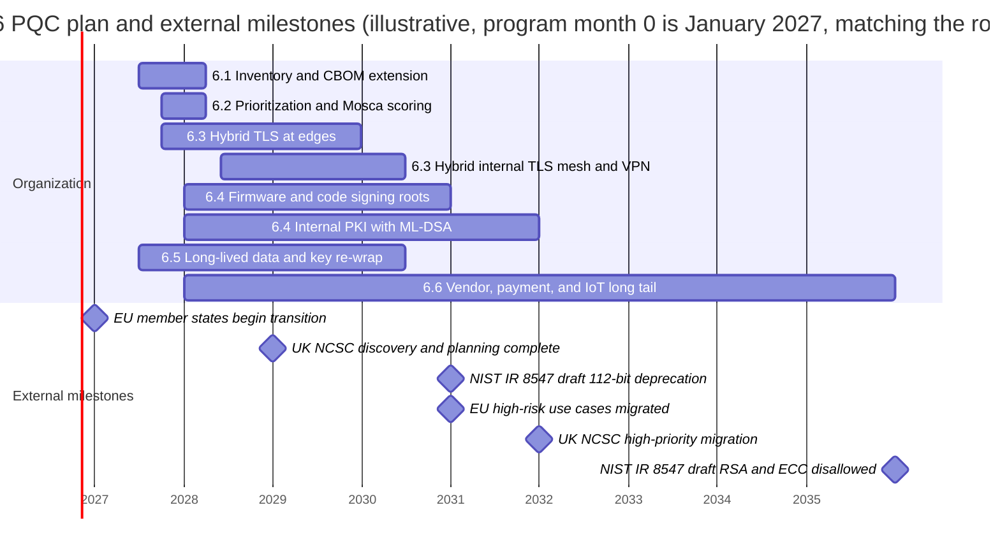

# Phase 6: Post-quantum cryptography
{: .no_toc }

**Phase 6: Post-quantum cryptography.** Replace quantum-vulnerable public-key cryptography across the organization in a risk-ordered sequence, starting with key exchange for long-lived data and finishing by 2035.
{: .fs-5 .fw-300 }

## On this page
{: .no_toc .text-delta }

1. TOC
{:toc}

---

## Why PQC is a data protection problem

Post-quantum cryptography (PQC) is often framed as a future cryptography upgrade. For a data protection program it is a present-day confidentiality problem, for one reason: **ciphertext recorded today can be decrypted later.**

Almost every encrypted channel the organization operates (guest booking traffic, payment gateway connections, PMS-to-CRS APIs, site-to-site VPNs, cloud KMS calls) establishes its session keys with RSA or elliptic-curve Diffie-Hellman (ECDH). A cryptographically relevant quantum computer (CRQC) running Shor's algorithm would recover those session keys from a recorded handshake. An adversary who captures traffic now and stores it ("harvest now, decrypt later", HNDL) can read it once a CRQC exists.

That matters in proportion to how long the data stays sensitive:

| Data | Classification | How long it stays sensitive | HNDL exposure |
|---|---|---|---|
| Passport and national ID scans captured at check-in | C3 `Restricted\Guest-Identity` | Life of the document, often 10 years, and identity data remains useful for fraud after expiry | High |
| Loyalty profiles, stay history, preferences | C2 `Confidential\Guest-PII` | Life of the membership, frequently decades | High |
| M&A, property acquisition, and franchise negotiation data | C3 | Years, until the deal and its aftermath are public | High |
| Health, accessibility, and allergy data (spa, wellness) | C3 `Restricted\Special-Category` | Indefinitely | High |
| Payment card data (PAN) | C3 `Restricted\PCI` | Until card expiry, typically 3 to 5 years | Medium: short shelf life, but high value |
| Published rates, press releases | C0 | None | None |

Signatures are a second, separate problem. A forged signature needs a quantum computer at the time of the attack, so signatures are not exposed to HNDL. The exception is long-lived roots of trust: firmware signing keys for door locks and building controllers with 10 to 15 year service lives, root CA keys, and code signing keys. These must be replaced before a CRQC exists, and the devices that trust them must be able to accept the replacement.

Symmetric cryptography is largely unaffected. AES-256 and SHA-384 remain appropriate. The migration is about RSA, Diffie-Hellman, ECDH, ECDSA, and EdDSA.

{: .important }
The timing of a CRQC is uncertain. No public evidence shows one exists as of mid-2026, and credible estimates range from under a decade to much longer. The plan below does not depend on predicting the date. It depends on the regulator deadlines (NIST deprecation after 2030 and disallowance after 2035), on data shelf life, and on how long migration takes. See [The quantum threat]().

## Objective of this phase

Move the organization from quantum-vulnerable public-key cryptography to NIST-standardized post-quantum algorithms (ML-KEM, ML-DSA, SLH-DSA, and LMS/XMSS for firmware) in an order driven by risk, using hybrid designs during the transition, and complete the migration of in-scope systems by 2035.

## The phased PQC plan

Phase 6 runs from program month 6 to 2035. It consumes the Phase 1 inventory, the Phase 2 standard and PKI, and the Phase 5 TLS architecture.

| Step | Name | Indicative timing | What happens | Exit criterion |
|---|---|---|---|---|
| 6.1 | Inventory | Months 6 to 15 | Extend the Phase 1 CBOM with algorithm, key size, key-exchange group, certificate chain, library, and owner for every endpoint and data store | CBOM covers all C2/C3 systems and all internet-facing endpoints |
| 6.2 | Prioritize | Months 9 to 15 | Score each asset on data shelf life, exposure, and replacement difficulty; apply Mosca's inequality | Ranked backlog approved by the security steering group |
| 6.3 | Hybrid key exchange | Months 9 to 36 | Enable `X25519MLKEM768` on CDN, load balancers, API gateways, then service mesh, internal TLS, and VPN | All internet-facing C2/C3 endpoints negotiate hybrid with supporting clients |
| 6.4 | Signatures and PKI | 2028 to 2031 | LMS/XMSS or ML-DSA for firmware and code signing; ML-DSA internal PKI pilot; public web PKI follows browser and CA/Browser Forum readiness | New long-lived roots of trust are PQC; firmware signing keys are PQC for new devices |
| 6.5 | Long-lived data | 2027 to 2030 | Re-wrap data encryption keys currently wrapped with RSA; move archives and backups to AES-256 with PQC-safe key wrapping | No C3 data key is protected only by RSA or ECC |
| 6.6 | Completion | 2030 to 2035 | Retire 112-bit RSA/ECC by 2030 (NIST IR 8547 draft), migrate vendor and payment dependencies, replace or isolate legacy devices | No quantum-vulnerable algorithm in use for C2/C3 by 2035, exceptions documented |

## Entry criteria

- Phase 1 cryptographic inventory exists in at least draft form. See [Cryptographic inventory (CBOM)]().
- A cryptographic standard (Phase 2) names approved algorithms and states the PQC target algorithms. See [Cryptographic standards]().
- An executive sponsor has accepted that PQC is a multi-year program with a 2035 end date.

## Exit criteria (for 2035)

- No C2 or C3 data is protected in transit by key exchange that is only RSA or ECDH.
- No C3 data key is wrapped only by RSA or ECC.
- All roots of trust with a lifetime beyond 2035 use PQC or hash-based signatures.
- Remaining quantum-vulnerable use is recorded as a time-bound exception with compensating controls.
- The crypto inventory is continuously maintained, and algorithm changes are configuration changes, not re-engineering (crypto agility).

## Deliverables

| Deliverable | Owner | Page |
|---|---|---|
| PQC risk register and prioritized backlog | Security architecture | [PQC migration program]() |
| Vendor PQC questionnaire and tracker | Third-party risk with security architecture | [PQC migration program](#step-4-vendor-and-supplier-questionnaire) |
| Hybrid TLS configuration standard | Platform and network engineering | [Crypto agility and hybrid designs]() |
| Crypto-agile envelope format and library guidance | Security engineering | [Crypto agility and hybrid designs]() |
| Provider readiness matrix, refreshed quarterly | Security architecture | [Vendor and cloud PQC readiness]() |
| Reproducible lab evidence (OpenSSL 3.5) | Security engineering | [Hands-on PQC lab]() |

## Pages in this section

| Page | What it covers |
|---|---|
| [The quantum threat]() | Shor and Grover, what breaks and what does not, HNDL, Mosca's inequality with hospitality examples |
| [PQC standards and timelines]() | FIPS 203, 204, 205, FN-DSA, HQC, SP 800-208, SP 800-227, NIST IR 8547, CNSA 2.0, EU, UK, IETF |
| [PQC migration program]() | Step-by-step program: governance, CBOM, prioritization, vendors, TLS, PKI, HSM, data, payments, IoT, testing, RACI |
| [Crypto agility and hybrid designs]() | Architecture patterns, hybrid KEM combiners, composite and dual certificates, anti-patterns, agile envelope header |
| [Vendor and cloud PQC readiness]() | Cloud providers, CDNs, browsers, TLS libraries, language runtimes, HSMs, and what to ask each |
| [Hands-on PQC lab]() | OpenSSL 3.5 ML-KEM, ML-DSA, SLH-DSA, ML-DSA certificates, and hybrid TLS with real captured output |

## Key takeaways for engineering teams

- Key exchange comes first because of harvest now, decrypt later; signatures come second, except for long-lived roots of trust such as firmware and CA keys.
- Hybrid `X25519MLKEM768` is deployable today at the edge with OpenSSL 3.5, current browsers, and major CDNs, and it fails back to classical key exchange cleanly.
- Symmetric encryption at rest with AES-256 does not need to change; RSA key wrapping of data keys does.
- The program depends on the Phase 1 CBOM; you cannot migrate what you have not inventoried.
- Design for crypto agility now so that the next algorithm change is a configuration change.

## Related pages

- [Cryptographic inventory (CBOM)]()
- [Cryptographic standards]()
- [Certificates and PKI]()
- [Encryption in transit]()
- [Phased roadmap]()
