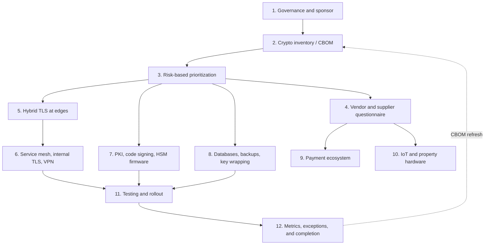

# PQC migration program
{: .no_toc }

**Phase 6: Post-quantum cryptography.** Turns the PQC objective into an executable program: who owns it, what gets inventoried, what moves first, how vendors are held to it, and how progress is measured.
{: .fs-5 .fw-300 }

## On this page
{: .no_toc .text-delta }

1. TOC
{:toc}

---

## Program shape

The migration is a portfolio of changes owned by many teams, not a single project. The security architecture function sets the standard, prioritizes, and measures; platform, application, network, PKI, payments, and property technology teams make the changes; procurement and third-party risk carry the requirement into contracts.



## Step 1: Governance and sponsor

**What:** Establish ownership and decision rights before technical work starts.

| Element | Decision for the organization |
|---|---|
| Executive sponsor | CISO, with the CIO as co-sponsor because most changes land in infrastructure and application teams |
| Program owner | Senior manager, cloud security architecture |
| Steering group | CISO, CIO delegate, heads of platform engineering, network, PKI, payments, property technology, procurement, internal audit; meets quarterly |
| Standard | PQC section of the crypto standard: target algorithms, hybrid requirement, deprecation dates (see [PQC standards and timelines]()) |
| Funding model | Central funding for inventory, tooling, PKI, and edge; business-unit funding for application remediation, folded into normal refresh where possible |
| Policy statement | "New systems and new procurements must support NIST PQC algorithms or provide a committed roadmap; quantum-vulnerable algorithms are not accepted for C3 data key protection after 2030." |
| Board reporting | Annual PQC readiness summary alongside the PCI DSS 12.3.3 cryptography review |

**Why:** PQC migration touches vendor contracts and hardware refresh cycles that security cannot change alone. Without a sponsor and a written policy, the long tail (payment terminals, door locks, franchised properties) never moves.

## Step 2: Cryptographic inventory and CBOM

**What:** Extend the Phase 1 cryptographic inventory so that it answers the PQC questions. The inventory approach, tooling, and CycloneDX CBOM format are described on [Cryptographic inventory (CBOM)](); the repository's scanner is at [code/cbom](https://github.com/steven-smith-itnet/data-protection-pqc-security-architecture/tree/main/code/cbom).

Fields the PQC program needs on every record:

| Field | Example | Why PQC needs it |
|---|---|---|
| Asset and owner | `booking-api`, `guest-platform` | Accountability |
| Data classification and domain | `restricted`, `guest` | Drives shelf life (X in Mosca) |
| Retention class | `r7y` | Shelf life |
| Exposure | internet, partner, internal, property LAN | Likelihood of traffic capture |
| Protocol and version | TLS 1.3, IKEv2, SSH | Determines the migration mechanism |
| Key exchange group or algorithm | `X25519`, `secp256r1`, RSA key transport | Quantum-vulnerable or not |
| Signature algorithm and key size | ECDSA P-256, RSA-2048 | Signature migration and 2030 deprecation |
| Certificate chain and issuing CA | Public CA, internal issuing CA 2 | PKI dependencies |
| Crypto library and version | OpenSSL 3.0.13, BoringSSL, Java 17 JSSE, .NET 8 | Whether hybrid is available by upgrade |
| Key storage | Cloud KMS, HSM, file | Where re-keying happens |
| Key wrapping algorithm | AES-KW, RSA-OAEP | At-rest quantum exposure |
| Vendor dependency | SaaS, appliance, embedded | Replacement difficulty |
| Hardware lifetime | Installed 2024, expected 2036 | Long-lived device risk |
| Migration time estimate | 2 years | Y in Mosca |

Discovery sources: external TLS scanning of every internet-facing hostname, internal TLS scanning, load balancer and CDN configuration export, cloud KMS and certificate manager APIs, HSM audit logs, source code and dependency scanning for crypto APIs, and vendor questionnaires for anything opaque.

```bash
# Quick check of what a single endpoint negotiates today (OpenSSL 3.5 client)
openssl s_client -connect booking.example.com:443 -tls1_3 \
  -groups X25519MLKEM768:X25519 -servername booking.example.com </dev/null 2>/dev/null \
  | grep -E 'Negotiated TLS1.3 group|Peer Temp Key|Peer signature type'
```

If the output shows `Negotiated TLS1.3 group: X25519MLKEM768`, the endpoint supports hybrid. If it shows `Peer Temp Key: X25519`, it does not. The [Hands-on PQC lab](#step-6-hybrid-tls-13-handshake-with-x25519mlkem768) shows both outputs from real runs.

## Step 3: Risk-based prioritization

**What:** Rank every inventoried asset by three factors, then apply Mosca's inequality as a check.

### Scoring factors

| Factor | 1 (low) | 2 | 3 (high) |
|---|---|---|---|
| **Data shelf life (X)** | Under 2 years (session tokens, C0/C1) | 2 to 7 years (payment data, operational C2) | Over 7 years (passport data, loyalty history, health, M&A, keys and roots of trust) |
| **Exposure** | Internal, segmented, no untrusted path | Partner or property WAN, VPN over internet | Internet-facing or crosses third-party networks |
| **Replacement difficulty (drives Y)** | Configuration change or library upgrade | Application change or vendor upgrade with a roadmap | Hardware replacement, embedded firmware, or vendor with no roadmap |

Priority score = shelf life x exposure x replacement difficulty (range 1 to 27).

### Prioritization matrix

| Score | Priority | Target | Typical assets |
|---|---|---|---|
| 18 to 27 | P1 | Start now; complete by end of 2027 or start replacement procurement now | Booking engine and guest app edge; PMS-to-CRS APIs; property VPNs carrying ID scans; door lock firmware roots (procurement) |
| 9 to 17 | P2 | Complete by 2030 | Internal service mesh; data lake ingestion; internal PKI issuing CAs; RSA-wrapped database keys; partner file transfer |
| 4 to 8 | P3 | Complete by 2033 | Internal admin tooling; C1 systems with vendor-dependent upgrades |
| 1 to 3 | P4 | Normal refresh, by 2035 | Short-lived, internal, low-sensitivity |

A high replacement difficulty with low data value is still scheduled, because 2035 disallowance applies regardless of data value, but it is scheduled into normal refresh rather than accelerated.

### Worked example

| Asset | Shelf life | Exposure | Difficulty | Score | Priority |
|---|---|---|---|---|---|
| Guest booking web front end (CDN) | 3 (passport, loyalty) | 3 | 1 (CDN setting) | 9 | P2 by score; promoted to P1 because it is a configuration change with high benefit |
| PMS vendor cloud to CRS integration | 3 | 3 | 2 | 18 | P1 |
| Door lock firmware signing | 3 (12-year trust) | 2 | 3 | 18 | P1 (procurement) |
| Loyalty data lake ingestion | 3 | 2 | 2 | 12 | P2 |
| Azure SQL TDE protector (RSA key in Key Vault) | 3 | 1 | 2 | 6 | P3, promoted to P2 because backups leave the database boundary |
| Internal wiki | 1 | 1 | 1 | 1 | P4 |

Quick wins that are cheap and effective are promoted regardless of score. This is deliberate: early visible progress funds the long tail.

## Step 4: Vendor and supplier questionnaire

**What:** A standard question set sent to every vendor that terminates, originates, or stores C2/C3 data or supplies cryptographic hardware. Answers are recorded in the third-party risk tool and linked to CBOM records.

### Questionnaire

**Section A: Current state**

1. List every public-key algorithm your product uses, by function: TLS key exchange, TLS authentication, VPN, code or firmware signing, key wrapping, token or license signing, and data encryption.
2. Which cryptographic libraries and versions does the product use (for example, OpenSSL, BoringSSL, AWS-LC, Bouncy Castle, wolfSSL, a vendor library)? Are they FIPS 140-3 validated? Give certificate numbers.
3. Can the customer configure TLS groups and signature algorithms, or are they fixed in code?
4. Do you publish a cryptographic bill of materials (CBOM), for example in CycloneDX format?

**Section B: Post-quantum roadmap**

5. Do you support hybrid key exchange `X25519MLKEM768` (or `SecP256r1MLKEM768`) for TLS 1.3 today? If not, on what date and in which release?
6. Do you support ML-KEM (FIPS 203) and ML-DSA (FIPS 204) in the product, and in which parameter sets? Is SLH-DSA (FIPS 205) or LMS/XMSS (SP 800-208) supported for firmware or code signing?
7. Is your PQC implementation included in a FIPS 140-3 validated module, or submitted for validation? Give the CMVP status.
8. What is your plan to meet the NIST IR 8547 proposed dates (deprecation of 112-bit RSA/ECC after 2030; disallowance after 2035)?
9. Do you align to CNSA 2.0? If so, for which product lines?

**Section C: Agility and lifecycle**

10. Can algorithms be changed through configuration or a software update without hardware replacement? If hardware replacement is required, which models are affected?
11. For devices: is the firmware verification public key (root of trust) updatable in the field? What algorithm verifies firmware today? What will verify it after migration?
12. What is the expected service life of the product, and will PQC support be delivered within it at no additional hardware cost?
13. How do you handle larger keys, certificates, and signatures (for example, certificate chains over 10 KB, ClientHello over 1,500 bytes)? Have you tested with PQC certificate chains?
14. Do you store customer data or keys wrapped with RSA or ECC? If so, what is the re-wrap plan?

**Section D: Assurance**

15. Name the accountable owner for your PQC program and the date of your last roadmap update.
16. Will you commit contractually to PQC support dates? Will you notify us of changes to those dates?
17. Provide test evidence (for example, a handshake capture or test report) showing hybrid key exchange working with your product.

### Contract language

New and renewing contracts for in-scope vendors include a clause requiring support for NIST-standardized PQC algorithms for key establishment by a stated date, a CBOM or equivalent disclosure on request, and notification of roadmap changes. Procurement holds the template; security architecture sets the dates per product category.

## Steps 5 to 12

The technical migration steps are on two sub-pages:

| Page | Steps |
|:--|:--|
| [PQC migration: transport and PKI]() | 5 Hybrid TLS at the edge, 6 Internal service mesh, internal TLS, and VPN, 7 PKI, code signing, and HSM firmware |
| [PQC migration: data, payments, devices, and testing]() | 8 Databases, backups, and key wrapping, 9 Payment ecosystem dependencies, 10 IoT, door locks, and property hardware, 11 Testing, 12 Success metrics |

## RACI

R: responsible, A: accountable, C: consulted, I: informed.

| Activity | CISO | Security architecture | PKI and key management | Platform and network engineering | Application teams | Payments | Property technology | Procurement and TPRM | Internal audit |
|---|---|---|---|---|---|---|---|---|---|
| PQC policy and standard | A | R | C | C | I | C | C | I | I |
| CBOM and inventory | I | A | R | R | R | R | R | C | I |
| Prioritization | A | R | C | C | C | C | C | I | I |
| Vendor questionnaire and contracts | I | C | C | I | I | C | C | A/R | I |
| Hybrid TLS at edge | I | C | C | A/R | I | I | I | I | I |
| Service mesh and internal TLS | I | C | C | A/R | R | I | I | I | I |
| VPN | I | C | I | A/R | I | I | C | C | I |
| HSM firmware and PKI | I | C | A/R | C | I | C | I | C | I |
| Firmware signing for devices | I | C | R | I | I | I | A | C | I |
| Key re-wrap for data at rest | I | C | A/R | R | R | C | I | I | I |
| Payment ecosystem | I | C | C | I | I | A/R | I | C | I |
| Exceptions | A | R | C | C | C | C | C | I | I |
| Assurance and testing of claims | I | C | I | I | I | I | I | I | A/R |

## Multi-year plan mapped to program phases

| Period | Organization program phase | PQC work |
|---|---|---|
| Months 0 to 3 (2026) | Phase 0: Mobilize | Sponsor, PQC policy statement, include PQC in charter |
| Months 1 to 9 | Phase 1: Know the data | CBOM fields for PQC; external TLS scan; key wrapping inventory |
| Months 3 to 12 | Phase 2: Standards and keys | PQC section of crypto standard; HSM firmware roadmap; PKI plan; vendor questionnaire issued |
| Months 6 to 24 | Phases 3 and 4 | Identify RSA key wrapping in databases, backups, and file encryption; re-wrap designs |
| Months 9 to 24 | Phase 5: Transit and in use | Hybrid TLS at all edges; outbound client upgrades; mesh pilot |
| 2027 to 2028 | Phase 6 steps 6.3 to 6.5 | Internal TLS and mesh; VPN pilots; LMS/ML-DSA firmware signing for new devices; ML-DSA PKI pilot; re-wrap C3 keys |
| 2029 to 2030 | Phase 6 | Retire 112-bit RSA/ECC in C2/C3 scope; complete C3 key re-wrap; vendor remediation |
| 2031 to 2033 | Phase 6 | PQC internal PKI in production; public PKI transition as ecosystem allows; property hardware refresh |
| 2034 to 2035 | Phase 6 step 6.6 | Close exceptions; decommission remaining quantum-vulnerable algorithms |
| Continuous | Phase 7: Engineering enablement | Design review checks, paved-road TLS configuration, policy as code for allowed groups |

## Key takeaways for engineering teams

- Start with the edge: enabling `X25519MLKEM768` on CDN, load balancers, and gateways is a configuration change with immediate HNDL benefit.
- Check every TLS inspection device and middlebox; a device that does not support the hybrid group silently removes the protection, and some break on large ClientHello messages.
- Symmetric at-rest encryption stays; find and replace RSA wrapping of data keys (TDE protectors, backup certificates, raw RSA keyrings, BYOK import).
- Put PQC requirements into RFPs for any device with a service life past 2035, especially door locks and building systems.
- Record negotiated groups and algorithms in logs and the CBOM so progress can be measured rather than asserted.

## Related pages

- [Cryptographic inventory (CBOM)]()
- [Key management architecture]()
- [Hardware security modules]()
- [Encryption in transit]()
- [Operating model and RACI]()
- [Risks and anti-patterns]()

## Sources

- NIST National Cybersecurity Center of Excellence (NCCoE), Migration to Post-Quantum Cryptography project and SP 1800-38 series: <https://www.nccoe.nist.gov/>
- CISA, NSA, NIST, Quantum-Readiness: Migration to Post-Quantum Cryptography (August 2023): <https://www.cisa.gov/quantum>
- RFC 9370, Multiple Key Exchanges in IKEv2: <https://www.rfc-editor.org/rfc/rfc9370>
- RFC 8784, Mixing Preshared Keys in IKEv2 for Post-quantum Security: <https://www.rfc-editor.org/rfc/rfc8784>
- PCI DSS v4.0.1: <https://www.pcisecuritystandards.org/document_library/>
