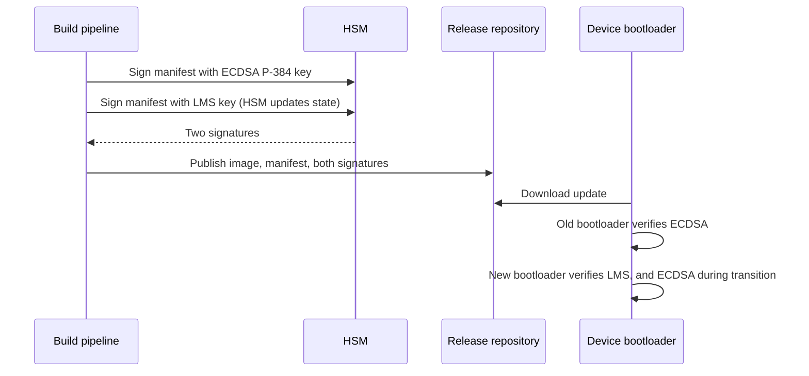

# PQC migration: transport and PKI
{: .no_toc }

**Phase 6: Post-quantum cryptography.** Steps 5 to 7 of the migration: move key exchange to hybrid post-quantum first, then signatures and roots of trust.
{: .fs-5 .fw-300 }

## On this page
{: .no_toc .text-delta }

1. TOC
{:toc}

---

## Step 5: Hybrid TLS at the edge

**What:** Enable `X25519MLKEM768` wherever the organization terminates TLS from the internet: CDN, web application firewall, cloud load balancers, API gateways, and ingress controllers. This protects guest traffic immediately for every modern browser and app that already offers the hybrid group.

**Why first:** It is a configuration change on a small number of chokepoints; browsers (Chrome since version 131, Firefox, and others) already send the hybrid key share; clients that do not support it negotiate classical `X25519` without error; and it covers the highest-exposure traffic.

### Edge inventory and approach

| Termination point | Approach | Notes |
|---|---|---|
| CDN (for example, Cloudflare, Akamai, Fastly) | Enable or confirm PQ key exchange to visitors; then enable PQ to origin | Several CDNs enable visitor-side hybrid by default; origin-side is often separate. See [Vendor and cloud PQC readiness]() |
| AWS (CloudFront, ALB, NLB, API Gateway) | Select a TLS security policy that includes PQ hybrid groups where offered | Check current policy names in AWS documentation |
| Azure (Front Door, Application Gateway, API Management) | Track provider support | Verify |
| Google Cloud (external Application Load Balancer) | Track provider support | Verify |
| OCI (Load Balancer) | Track provider support | Verify |
| Self-managed NGINX, HAProxy, Envoy | Upgrade to OpenSSL 3.5 or a BoringSSL/AWS-LC build; configure groups | Examples below |
| Kubernetes ingress (NGINX ingress, Envoy Gateway, Istio ingress) | Configure groups on the ingress | Depends on the proxy's TLS library |

{: .verify }
Cloud load balancer and CDN PQC support has changed quickly through 2025 and 2026. Before planning a rollout, confirm the current policy names and defaults for each provider. The organization's readiness matrix is on [Vendor and cloud PQC readiness]().

### Configuration examples

NGINX built against OpenSSL 3.5 (the `ssl_ecdh_curve` directive passes the list to OpenSSL):

```nginx
server {
    listen 443 ssl;
    http2 on;
    server_name booking.example.com;

    ssl_certificate     /etc/nginx/tls/booking.crt;   # ECDSA P-256 cert today
    ssl_certificate_key /etc/nginx/tls/booking.key;

    ssl_protocols TLSv1.2 TLSv1.3;
    # Hybrid first, classical fallback. Clients that do not offer the hybrid
    # group negotiate X25519 or P-256 as before.
    ssl_ecdh_curve X25519MLKEM768:X25519:prime256v1;
}
```

HAProxy built against OpenSSL 3.5:

```
frontend fe_booking
    bind :443 ssl crt /etc/haproxy/certs/booking.pem alpn h2,http/1.1 curves X25519MLKEM768:X25519:P-256
    default_backend be_booking
```

System-wide default for OpenSSL 3.5 based services on Linux (for example, in a dedicated `openssl.cnf` referenced by `OPENSSL_CONF`):

```ini
openssl_conf = openssl_init

[openssl_init]
ssl_conf = ssl_module

[ssl_module]
system_default = tls_defaults

[tls_defaults]
MinProtocol = TLSv1.2
Groups = X25519MLKEM768:X25519:P-256
```

{: .note }
OpenSSL 3.5 already includes `X25519MLKEM768` in its default group list and default key shares, so a service that does not override groups gets hybrid automatically after the upgrade. The explicit configuration above is for services whose existing configuration pins a classical list, which would otherwise suppress the hybrid group.

### Verification

```bash
# Hybrid negotiated?
openssl s_client -connect booking.example.com:443 -groups X25519MLKEM768 </dev/null 2>/dev/null \
  | grep 'Negotiated TLS1.3 group'

# Classical clients still work?
openssl s_client -connect booking.example.com:443 -groups X25519 </dev/null 2>/dev/null \
  | grep -E 'Peer Temp Key|Verification'

# curl built with OpenSSL 3.5
curl -sv --curves X25519MLKEM768 https://booking.example.com/ -o /dev/null 2>&1 | grep -i 'SSL connection'
```

## Step 6: Internal service mesh, internal TLS, and VPN

**What:** Extend hybrid key exchange to east-west traffic and site connectivity.

| Area | Approach | Dependency |
|---|---|---|
| Service mesh (Istio, Linkerd, Consul) | Configure the mesh's proxy TLS to offer the hybrid group once the proxy's TLS library supports it; mTLS certificates can stay ECDSA initially | Envoy with BoringSSL or a supported build; Linkerd's Rust TLS stack (verify) |
| Application-to-database TLS | Upgrade client drivers and database TLS libraries | Database vendor support |
| Outbound calls to SaaS and partners | Ensure the organization's clients offer the hybrid group (Go 1.24+, Java with PQ support, OpenSSL 3.5 based runtimes) | Partner must support it for hybrid to be negotiated |
| Cloud KMS and secrets API calls | Use SDKs and endpoints that support hybrid PQ TLS (AWS KMS, ACM, Secrets Manager support it) | Provider and SDK |
| Site-to-site VPN (property to cloud, property to data center) | IKEv2 with additional ML-KEM key exchange (RFC 9370 framework) when the VPN vendor supports it; interim option is a pre-shared key mixed into the key derivation, which some vendors support as a post-quantum pre-shared key (RFC 8784) | VPN appliance vendor |
| Remote access VPN and SASE | Vendor roadmap | SASE vendor |
| SSH (administration) | OpenSSH offers post-quantum hybrid key exchange (`sntrup761x25519-sha512`, and ML-KEM based `mlkem768x25519-sha256` in recent releases) | OpenSSH version on both ends (verify defaults for the version deployed) |

{: .verify }
OpenSSH changed its default key exchange to a post-quantum hybrid in recent releases. Confirm the defaults for the versions on the organization's bastion hosts and network devices.

Example: Envoy (used by Istio) cluster or listener TLS parameters when the Envoy build supports the hybrid group:

```yaml
common_tls_context:
  tls_params:
    tls_minimum_protocol_version: TLSv1_2
    ecdh_curves:
      - X25519MLKEM768
      - X25519
      - P-256
```

{: .verify }
Confirm that the Envoy version in use accepts `X25519MLKEM768` in `ecdh_curves` and that the Istio release exposes the setting through mesh configuration.

## Step 7: PKI, code signing, and HSM firmware

**What:** Plan the signature migration. This is slower than key exchange because every verifier must understand the new algorithm before a signer can use it.

### Order of work

| Order | Item | Approach |
|---|---|---|
| 1 | HSM firmware | Upgrade HSMs to firmware with FIPS 140-3 validated ML-DSA, ML-KEM, and LMS support. Without this nothing else in PKI can move. See [Hardware security modules]() |
| 2 | Firmware and code signing roots | New signing keys using LMS/XMSS (stateful, HSM-managed) or ML-DSA-87/SLH-DSA; dual-sign releases (classical plus PQC) while verifiers update |
| 3 | Internal PKI | Build a parallel ML-DSA root and issuing CA hierarchy (ML-DSA-87 root, ML-DSA-65 issuing); pilot for internal mTLS where both ends support ML-DSA |
| 4 | Private CAs in cloud | Adopt cloud private CA ML-DSA support as providers deliver it (verify per provider) |
| 5 | Public web PKI | Follow CA/Browser Forum and browser root program decisions; keep ECDSA certificates with hybrid key exchange until PQC certificates are supported by public CAs and browsers |
| 6 | Document and email signing (S/MIME, PDF) | Follow vendor support; low priority unless signatures must be verified for decades |

Root CA keys have the longest lifetimes in the organization, often 15 to 20 years. **A root created in 2026 with ECDSA P-384 would be disallowed well before its expiry.** New roots created from now on should be planned with PQC successors, and the certificate lifetime of new classical roots should not extend past 2035.

Details on certificate management, automation, and SC-081 validity reductions are on [Certificates and PKI]().

### Dual signing for firmware



## Related pages

- [PQC migration program](): steps 1 to 4, RACI, multi-year plan
- [PQC migration: data, payments, devices, and testing]()
- [Crypto agility and hybrid designs]()
- [Hands-on PQC lab]()
- [Encryption in transit]()
- [Certificates and PKI]()
