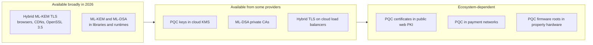

# Vendor and cloud PQC readiness
{: .no_toc }

**Phase 6: Post-quantum cryptography.** Records what the organization's providers and libraries support for PQC as of mid-2026, how confident that record is, and what to ask to confirm it.
{: .fs-5 .fw-300 }

## On this page
{: .no_toc .text-delta }

1. TOC
{:toc}

---

## How to read this page

PQC support is changing month to month. This page is a **dated snapshot, reviewed quarterly**, not a statement of permanent fact. Each row states what is known, the confidence level, and the question the organization asks the provider to confirm it.

| Status value | Meaning |
|---|---|
| **Available** | Documented by the provider as generally available |
| **Preview** | Documented as preview or opt-in beta |
| **Announced** | Publicly committed or roadmap, not yet available |
| **Unconfirmed** | No authoritative public statement found; ask the vendor |

{: .verify }
Every row on this page should be verified against the provider's current documentation before it is used in a design decision, a risk acceptance, or a customer-facing statement. Provider names for policies, SKUs, and features change. Where this page names a specific policy or API, confirm the exact name in the provider's documentation.

## Cloud providers

### Amazon Web Services

| Capability | Status (mid-2026) | Notes |
|---|---|---|
| Hybrid PQ TLS on AWS KMS, ACM, and Secrets Manager endpoints | Available | Moved from pre-standard Kyber to ML-KEM based hybrid in 2025; clients must use an SDK or TLS stack that offers the hybrid group |
| s2n-tls and AWS-LC | Available | AWS-LC's FIPS-validated module includes ML-KEM |
| AWS KMS ML-DSA signing keys | Available | Key specs `ML_DSA_44`, `ML_DSA_65`, `ML_DSA_87` (June 2025) |
| Application Load Balancer and Network Load Balancer hybrid PQ TLS | Available | Opt-in TLS security policies with "PQ" in the name that offer `X25519MLKEM768`, `SecP256r1MLKEM768`, and `SecP384r1MLKEM1024` (announced November 2025), for example `ELBSecurityPolicy-TLS13-1-2-Res-PQ-2025-09` and a FIPS variant |
| AWS Private CA ML-DSA certificates | Available | ML-DSA CAs, certificates, CRLs, and OCSP (announced November 2025) |
| CloudFront and other TLS-terminating services | Announced or rolling out | AWS's published migration plan includes ML-KEM for server-side TLS termination in services such as CloudFront |

What to ask AWS (account team or documentation):

- Which TLS security policy names include hybrid groups for each service in use (ALB, NLB, CloudFront, API Gateway), and are any enabled by default?
- Which SDK versions negotiate hybrid PQ TLS to KMS and Secrets Manager for each language the organization uses?
- Is key import into KMS (BYOK) offered with a post-quantum wrapping algorithm?
- CloudHSM firmware roadmap for ML-KEM, ML-DSA, and LMS, and FIPS 140-3 validation status.

### Microsoft (Azure, Windows, Microsoft 365)

| Capability | Status (mid-2026) | Notes |
|---|---|---|
| SymCrypt ML-KEM and ML-DSA | Available | Microsoft's core cryptographic library; also exposed on Linux through SymCrypt-OpenSSL |
| Windows CNG PQC APIs (ML-KEM, ML-DSA) | Available | Generally available for Windows 11 and Windows Server 2025 from the November 2025 update |
| Windows TLS (Schannel) hybrid key exchange | Available (verify) | Reported to negotiate `X25519MLKEM768` on Windows Server 2025 when both sides support it |
| AD CS issuing ML-DSA certificates | Available (verify) | Microsoft documentation describes ML-DSA certificate templates |
| .NET 10 PQC APIs | Available | `MLKem` stable; `MLDsa`, `SlhDsa`, and composite ML-DSA marked experimental |
| Azure Key Vault and Managed HSM PQC keys | Unconfirmed | No authoritative GA statement found; ask |
| Azure Front Door and Application Gateway hybrid PQ TLS | Unconfirmed | No customer-configurable PQ groups documented at the time of writing; ask |
| Microsoft 365 service endpoints | Unconfirmed | Ask for the Microsoft 365 PQC timeline |
| Program commitment | Announced | Microsoft Quantum Safe Program: early adoption by 2029, transition complete by 2033 |

What to ask Microsoft:

- Dates for hybrid PQ TLS on Front Door, Application Gateway, API Management, and Azure SQL endpoints.
- Key Vault and Managed HSM support for ML-DSA and ML-KEM keys, and whether the Azure SQL TDE protector can use a non-RSA key type.
- Microsoft 365 transport (Exchange Online, SharePoint Online) and Purview label encryption PQC plans, including Double Key Encryption.

### Google Cloud

| Capability | Status (mid-2026) | Notes |
|---|---|---|
| Cloud KMS ML-DSA-65 and SLH-DSA-SHA2-128S signing keys | Available | Announced in preview in February 2025; reported generally available since |
| Cloud KMS ML-KEM-768 and ML-KEM-1024 | Available (verify) | Key encapsulation mechanism support documented in Cloud KMS |
| Application Load Balancer and external proxy Network Load Balancer PQ key exchange | Available (verify) | Release notes describe `X25519MLKEM768` with TLS 1.3 clients |
| Internal traffic (ALTS) | Available | Google reports hybrid PQ key exchange for internal service-to-service traffic |
| Program commitment | Announced (verify) | Reports of a Google Cloud PQC migration target of 2029 |

What to ask Google Cloud:

- Whether PQ key exchange on load balancers is on by default or opt-in, and per load balancer type.
- Cloud HSM protection level support for ML-DSA and ML-KEM keys, and Cloud EKM partner support.
- Certificate Authority Service ML-DSA support.

### Oracle and OCI

| Capability | Status (mid-2026) | Notes |
|---|---|---|
| Oracle Database TLS 1.3 with ML-KEM hybrid | Available (verify) | Oracle documents ML-KEM and hybrid key establishment for Database 19c from Release Update 19.32 and for Oracle AI Database 26ai |
| Oracle JDK ML-KEM and ML-DSA | Available | Through the OpenJDK features below |
| OCI Vault, Dedicated KMS, and External KMS PQC keys | Unconfirmed | Ask |
| OCI Load Balancer and API Gateway hybrid PQ TLS | Unconfirmed | Ask |
| OPERA Cloud and Simphony (hospitality SaaS) endpoints | Unconfirmed | Ask the product teams directly; these carry C2/C3 guest data |

What to ask Oracle: OCI load balancer and API gateway PQ TLS dates; OCI Vault PQC key types; OPERA Cloud and Simphony integration endpoints' hybrid TLS support; Oracle Key Vault TLS and KMIP PQC roadmap.

## CDNs and edge

| Provider | Status (mid-2026) | Notes | Ask |
|---|---|---|---|
| Cloudflare | Available, default | Hybrid `X25519MLKEM768` enabled by default for visitors; PQ connections to origins supported | Origin-side PQ settings; Zero Trust and WARP PQ status |
| Akamai | Available | Opt-in `X25519MLKEM768` for client-to-edge launched September 2025, with default enablement for Enhanced TLS customers planned for Q1 2026; separate PQC-to-origin setting | Confirm default status on the organization's properties; origin-side enablement |
| Fastly | Available (verify) | Measurement studies report `X25519MLKEM768` on Fastly edges | Default or opt-in; origin-side support |

## Browsers and operating systems

| Client | Hybrid ML-KEM key exchange | Notes |
|---|---|---|
| Chrome | Default since Chrome 131 (late 2024) | Earlier versions used pre-standard Kyber |
| Edge | Default since Edge 131 | Chromium-based |
| Firefox | Default on desktop since Firefox 132 (verify); later on Android | |
| Safari and Apple platforms | Default from the 2025 OS releases (Safari 26, iOS 26, macOS 26) (verify) | Apple announced hybrid PQ TLS in URLSession and Network.framework |
| Windows (Schannel) | See Microsoft above | |
| Android apps | Depends on the app's TLS stack (Conscrypt/BoringSSL version, OkHttp, Cronet) | Ask the mobile team to test the guest app |

## TLS and crypto libraries

| Library | PQC status (mid-2026) | Notes |
|---|---|---|
| OpenSSL 3.5 (April 2025, LTS) | ML-KEM, ML-DSA, SLH-DSA in the default provider; `X25519MLKEM768` in default TLS key shares | Verified in the [Hands-on PQC lab]() on 3.5.5. OpenSSL 3.0 LTS has no built-in PQC; it needs the oqs-provider |
| BoringSSL | `X25519MLKEM768` supported | Used by Chrome, Envoy, and many Google products |
| AWS-LC | ML-KEM in the FIPS-validated module; hybrid TLS in s2n-tls | |
| Go `crypto/tls` | `X25519MLKEM768` enabled by default in Go 1.24 when `CurvePreferences` is unset; `crypto/mlkem` package added (verify) | Go 1.23 defaulted to pre-standard `X25519Kyber768Draft00` |
| Java (OpenJDK) | JDK 24: JEP 496 (ML-KEM) and JEP 497 (ML-DSA) in the JCA; hybrid TLS 1.3 key exchange (JEP 527) targeted to a later release (verify) | Applications on Java 17 or 21 LTS need an upgrade or Bouncy Castle |
| .NET 10 | `MLKem`, `MLDsa`, `SlhDsa`, composite ML-DSA; platform support depends on OS (OpenSSL 3.5 on Linux, CNG on Windows) | Check `IsSupported` at runtime; ML-DSA and SLH-DSA marked experimental |
| Bouncy Castle (Java, C#) | ML-KEM, ML-DSA, SLH-DSA, LMS, XMSS, composite experiments | Useful bridge for older Java runtimes; check FIPS edition status |
| liboqs and Open Quantum Safe (oqs-provider) | Research and prototyping library covering standardized and candidate algorithms | Not FIPS validated; not for production C3 protection; useful for testing |
| wolfSSL | ML-KEM, ML-DSA, LMS, XMSS (verify) | Common in embedded devices; ask device vendors |
| OpenSSH | Hybrid PQ key exchange (`sntrup761x25519-sha512`, `mlkem768x25519-sha256`); newer releases default to PQ hybrid (verify) | |

## HSM vendors

| Vendor and product | What to confirm | Why it matters |
|---|---|---|
| Thales Luna HSM, CipherTrust Manager | Firmware version with ML-KEM, ML-DSA, LMS; FIPS 140-3 validation of that firmware | On-prem PKI roots and code signing |
| Entrust nShield | Same | Same |
| Utimaco | Same | Payment and general-purpose HSMs |
| Marvell LiquidSecurity (used by several clouds) | Provider-side; ask the cloud provider | Underlies some cloud HSM services |
| Cloud HSMs (AWS CloudHSM, Azure Managed HSM and Cloud HSM, Google Cloud HSM, OCI Dedicated KMS) | PQC key types and validation | PP-3 keys live here |
| Payment HSMs (Azure Payment HSM, AWS Payment Cryptography, on-prem) | Roadmap for PQC in key exchange (for example, remote key loading) | Payment ecosystem; see [PQC migration program](#step-9-payment-ecosystem-dependencies) |
| Fortanix DSM | PQC key types | Multi-cloud key management |

{: .verify }
Several HSM vendors announced firmware with ML-KEM, ML-DSA, and LMS support during 2024 and 2025. Validation under FIPS 140-3 for the PQC algorithms lags the firmware releases. Record the exact firmware version and CMVP certificate for any HSM used for PQC keys. See [Hardware security modules]().

## Hospitality SaaS and property vendors

| Category | Examples of what to ask | Status |
|---|---|---|
| PMS and CRS SaaS | Hybrid TLS on integration APIs; RSA key wrapping of stored guest data | Unconfirmed; questionnaire |
| Channel managers, GDS and OTA connections | Hybrid TLS on inbound and outbound APIs | Unconfirmed |
| Payment gateways and P2PE providers | Hybrid TLS; remote key loading plan | Unconfirmed |
| Door lock and mobile key vendors | Firmware signature algorithm; field-updatable root of trust; mobile key protocol | Unconfirmed; RFP requirement |
| Building management and CCTV | Firmware signing; TLS library | Unconfirmed |
| CRM, marketing, and loyalty platforms | Hybrid TLS; key management | Unconfirmed |

The full question list is on [PQC migration program](#step-4-vendor-and-supplier-questionnaire).

## Summary matrix

| Area | Hybrid key exchange | PQC keys in KMS or HSM | ML-DSA certificates | Overall |
|---|---|---|---|---|
| AWS | Available on KMS/ACM/Secrets Manager endpoints and ALB/NLB (opt-in) | ML-DSA in KMS | Private CA | Most complete as of mid-2026 (verify) |
| Google Cloud | Available on load balancers (verify); internal ALTS | ML-DSA, SLH-DSA, ML-KEM | Ask | Strong (verify) |
| Microsoft | OS and library level available; managed edge unconfirmed | Ask | AD CS (verify) | Platform ahead of managed services |
| Oracle / OCI | Database TLS available (verify); OCI edge unconfirmed | Ask | Ask | Ask |
| CDNs | Cloudflare default; Akamai and Fastly available | n/a | n/a | Ready for edge rollout |
| Browsers | Default in all major browsers | n/a | Not yet | Key exchange ready |

## Key takeaways for engineering teams

- Hybrid key exchange is ready at the browser, CDN, and library layer; the remaining gaps are specific managed services, which must be checked one by one.
- AWS and Google Cloud offered PQC signing keys in KMS as of mid-2026; Azure Key Vault and OCI Vault status must be confirmed with the providers.
- Upgrade runtimes to versions with PQC support (OpenSSL 3.5, Go 1.24+, JDK 24+ with a later release for hybrid TLS, .NET 10) as part of normal platform lifecycle.
- Do not use liboqs or other research libraries for production C3 data; use FIPS-validated modules.
- Treat every row on this page as a claim to confirm, and record the confirmation date.

## Related pages

- [PQC migration program]()
- [AWS]()
- [Microsoft Azure]()
- [Google Cloud]()
- [Oracle Cloud Infrastructure]()
- [Hardware security modules]()

## Sources

- AWS post-quantum cryptography: <https://aws.amazon.com/security/post-quantum-cryptography/>
- AWS, Application and Network Load Balancers support post-quantum key exchange for TLS (November 2025): <https://aws.amazon.com/about-aws/whats-new/2025/11/network-load-balancers-post-quantum-key-exchange-tls>
- AWS, Private CA post-quantum digital certificates (November 2025): <https://aws.amazon.com/about-aws/whats-new/2025/11/aws-private-ca-post-quantum-digital-certificates/>
- AWS, Security policies for your Application Load Balancer: <https://docs.aws.amazon.com/elasticloadbalancing/latest/application/describe-ssl-policies.html>
- Microsoft, Post-quantum cryptography APIs now generally available on Microsoft platforms: <https://techcommunity.microsoft.com/blog/microsoft-security-blog/post-quantum-cryptography-apis-now-generally-available-on-microsoft-platforms/4469093>
- Microsoft, What's new in .NET libraries for .NET 10: <https://learn.microsoft.com/en-us/dotnet/core/whats-new/dotnet-10/libraries>
- Google Cloud, Cloud KMS key encapsulation mechanisms: <https://docs.cloud.google.com/kms/docs/key-encapsulation-mechanisms>
- Google Cloud, Cloud Load Balancing release notes: <https://docs.cloud.google.com/load-balancing/docs/release-notes>
- Oracle, Post-quantum cryptography in Oracle Database: <https://docs.oracle.com/en/database/oracle/oracle-database/19/dbseg/post-quantum-cryptography-reference.html>
- Akamai, Akamai enables post-quantum cryptography on the edge: <https://www.akamai.com/blog/security/akamai-enables-post-quantum-cryptography-edge>
- OpenSSL 3.5 release notes: <https://openssl-library.org/news/openssl-3.5-notes/>
- OpenJDK JEP 496 (ML-KEM): <https://openjdk.org/jeps/496>; JEP 497 (ML-DSA): <https://openjdk.org/jeps/497>
- Open Quantum Safe: <https://openquantumsafe.org/>
