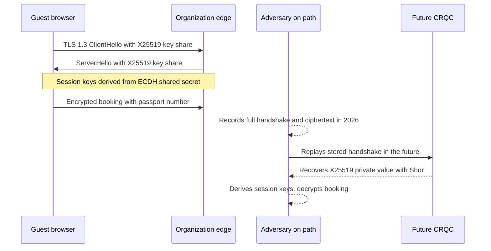
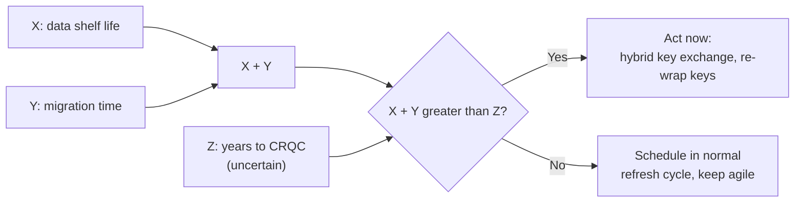

# The quantum threat
{: .no_toc }

**Phase 6: Post-quantum cryptography.** Establishes exactly which cryptography is at risk, why data captured today is already exposed, and how to rank systems by urgency.
{: .fs-5 .fw-300 }

## On this page
{: .no_toc .text-delta }

1. TOC
{:toc}

---

## Summary

A large, fault-tolerant quantum computer would break the public-key algorithms used today for key exchange and digital signatures: RSA, finite-field Diffie-Hellman, elliptic-curve Diffie-Hellman (ECDH, X25519), ECDSA, and EdDSA. It would weaken, but not break, symmetric ciphers and hash functions. The immediate risk is to confidentiality of data recorded today ("harvest now, decrypt later"). The risk to signatures begins only when such a computer exists, which makes long-lived roots of trust the priority for signature migration.

## Two quantum algorithms that matter

### Shor's algorithm

Shor's algorithm (1994) solves integer factorization and discrete logarithms in polynomial time on a quantum computer. Every widely deployed public-key algorithm rests on one of these two problems:

| Algorithm | Hard problem | Effect of Shor |
|---|---|---|
| RSA (encryption, key transport, signatures) | Integer factorization | Broken: private key recovered from public key |
| Finite-field Diffie-Hellman (DH, DHE) | Discrete logarithm mod p | Broken: shared secret recovered from the handshake |
| ECDH, ECDHE, X25519, X448 | Elliptic-curve discrete logarithm | Broken |
| ECDSA (P-256, P-384) | Elliptic-curve discrete logarithm | Broken: signatures can be forged |
| EdDSA (Ed25519, Ed448) | Elliptic-curve discrete logarithm | Broken |
| DSA | Discrete logarithm | Broken |

Increasing key sizes does not help in any meaningful way. The quantum cost of breaking RSA grows only polynomially with key size, so RSA-4096 buys little over RSA-2048 against a quantum attacker. The fix is to replace the algorithm family.

Elliptic-curve keys are expected to fall before RSA keys of comparable classical strength, because the quantum resources needed scale with the smaller key size. Moving from RSA to ECC is not a quantum mitigation.

### Grover's algorithm

Grover's algorithm (1996) searches an unstructured space of size N in about the square root of N steps. Applied to a symmetric key search, it reduces the effective strength of a k-bit key to about k/2 bits in the idealized model. In practice the reduction is smaller, because Grover's iterations are sequential and do not parallelize efficiently: splitting the search across many quantum machines saves far less time than it does classically.

| Primitive | Classical security | Idealized Grover | Status |
|---|---|---|---|
| AES-128 | 128 bits | about 64 bits | NIST still treats AES-128 as the category 1 reference point; CNSA 2.0 requires AES-256 |
| AES-192 | 192 bits | about 96 bits | Acceptable |
| AES-256 | 256 bits | about 128 bits | **Appropriate long term; the organization's standard** |
| SHA-256 (preimage) | 256 bits | about 128 bits | Acceptable for most uses |
| SHA-256 (collision) | 128 bits | Quantum collision search offers little practical gain over classical | Acceptable |
| SHA-384, SHA-512 | 384, 512 bits | about 192, 256 bits | **Required by CNSA 2.0; the organization's default for new signing** |
| HMAC-SHA-256 | 256-bit key | about 128 bits | Acceptable |

The organization's position: AES-256 for all new encryption at rest and in transit, SHA-384 or stronger for new signature and integrity use where the platform allows, and no change programs for AES-256 or SHA-2 already in place. This is consistent with the [Cryptographic standards]() page.

## What does not need to change

This is as important to communicate to engineering teams as what does change, because it bounds the size of the program.

| Control | Why it is not affected | Action |
|---|---|---|
| AES-256-GCM for data at rest (TDE, object storage, disk encryption) | Grover's algorithm leaves about 128-bit security | None |
| AES-256 data encryption keys (DEKs) in envelope encryption | Same | None for the DEK; the key that wraps it may need to change (below) |
| Symmetric key wrapping (AES-KW, AES-GCM wrap by a KMS key) | Symmetric | None, provided the KEK itself is AES-256 |
| HMAC-SHA-256 and HMAC-SHA-384 keyed hashes for PAN surrogates (PCI DSS 3.5.1.1) | Symmetric | None |
| SHA-256/SHA-384 file integrity hashes | Hash functions remain secure at these sizes | None |
| Tokenization vaults | Tokens have no mathematical relationship to the PAN | None for the tokens; protect the vault's own transport and key wrapping |
| Pre-shared symmetric keys (for example, some P2PE and DUKPT schemes) | Symmetric | Check key size; AES-based DUKPT is preferable to TDES-based |

What does change, even inside "symmetric" systems:

- **RSA key wrapping.** A DEK wrapped with an RSA public key (common in BYOK import flows, some backup products, and S/MIME) is only as safe as the RSA key.
- **Key exchange protecting key transport.** A KMS API call over TLS with ECDHE key exchange exposes the wrapped key material in transit to HNDL. Cloud providers are adding hybrid PQ TLS to KMS endpoints for this reason.
- **Signatures on software, firmware, and certificates** that must remain trustworthy after a CRQC exists.

## Cryptographically relevant quantum computer (CRQC)

A CRQC is a quantum computer large and reliable enough to run Shor's algorithm against keys in real use (for example, RSA-2048 or P-256) in a useful amount of time. Two properties matter:

1. **Logical qubits after error correction.** Physical qubits are noisy. Error correction combines many physical qubits into one logical qubit. Public resource estimates for factoring RSA-2048 have fallen over time as algorithms and error-correction techniques improve. A 2019 estimate by Gidney and Ekera required about 20 million noisy physical qubits for about 8 hours; a 2025 estimate by Gidney reduced this to fewer than one million noisy qubits running for less than a week, under stated hardware assumptions.
2. **Gate error rates and runtime stability.** The machine must run a very long computation without errors accumulating.

{: .verify }
Resource estimates are research results that depend on assumptions about hardware error rates, connectivity, and cycle times. They change as research progresses. Check current literature before quoting a figure in a board paper.

### The honest position on timing

No one can say when a CRQC will exist. As of mid-2026 there is no public evidence that one exists, and the machines publicly demonstrated are far from the scale required. Expert surveys produce wide ranges. The organization treats this uncertainty as the core of the risk rather than a reason to wait:

- Regulators have already set dates (NIST IR 8547 draft: 112-bit RSA/ECC deprecated after 2030 and quantum-vulnerable algorithms disallowed after 2035; UK NCSC and EU targets in the same window). These dates bind the organization regardless of quantum progress. See [PQC standards and timelines]().
- A nation-state capability may not be announced. The first practical CRQC may be used quietly.
- Migration takes years. Starting after a CRQC is announced is too late for any data already harvested.

## Harvest now, decrypt later (HNDL)

HNDL is the collection and storage of encrypted traffic or data today for decryption later. It targets key establishment, not signatures.

Where HNDL matters in the organization:

| Channel | What an adversary could record | Mitigation |
|---|---|---|
| Guest web and mobile app traffic to the booking engine | Identity, payment, preferences | Hybrid `X25519MLKEM768` at CDN and edge (modern browsers already offer it) |
| PMS to CRS and channel manager APIs | Reservations, guest profiles | Hybrid TLS on API gateways and outbound clients |
| Property to data center or cloud VPN tunnels | Everything in the tunnel | IKEv2 with ML-KEM additional key exchange when vendors support it (see migration program) |
| Calls from applications to cloud KMS | Wrapped keys, plaintext in `Encrypt` requests | Use SDKs and endpoints with hybrid PQ TLS (AWS KMS supports this; verify for other providers) |
| Email between the organization and partners | M&A documents, contracts | Label-based persistent encryption; TLS to partners; PQC S/MIME not yet practical |
| Backups replicated between regions | Bulk data | Symmetric encryption at rest; ensure the replication channel and any RSA key wrapping are addressed |

HNDL does **not** apply to:

- Data encrypted at rest with AES-256 where the key is never transported under quantum-vulnerable key exchange.
- Signatures, because a signature forged in the future cannot retroactively change what a verifier accepted in the past. The exception is where a signature must still be trusted in the future (firmware updates, long-term archive signatures, root certificates).

## Mosca's inequality

Michele Mosca's framing turns the uncertainty into a decision rule. Let:

- **X** be the shelf life of the data: how long it must stay confidential.
- **Y** be the migration time: how long it takes to move the system to quantum-safe cryptography, including vendor dependency and testing.
- **Z** be the time until a CRQC exists.

If **X + Y > Z**, data will be exposed. Because Z is uncertain, the organization uses a planning assumption and a sensitivity range rather than a point estimate.

### Planning assumption

For prioritization the organization uses three values of Z measured from 2026, not as predictions but as a sensitivity test:

| Scenario | Z (years from 2026) | Rationale |
|---|---|---|
| Aggressive | 8 (2034) | Earlier than regulator end dates; tests whether the plan survives a surprise |
| Planning | 10 (2036) | Roughly aligned with the 2035 regulatory completion target |
| Conservative | 15 (2041) | Slower progress |

A system is "act now" if X + Y exceeds Z under the planning scenario, and "watch" if it exceeds Z only under the aggressive scenario.

### Worked examples

**Example 1: Passport scans captured at check-in.** Several jurisdictions require hotels to record guest identity documents, and the organization stores passport data in the PMS and a document store as C3 `Restricted\Guest-Identity`, retention class `r7y` in some regions. A passport number and scan remain useful to fraudsters for at least the life of the document (commonly 10 years for adults) and the identity attributes (name, date of birth, nationality) remain sensitive indefinitely.

| Variable | Value | Reasoning |
|---|---|---|
| X | 10 years | Document validity; identity attributes stay sensitive longer |
| Y | 3 years | Edge hybrid TLS is fast; PMS vendor connections and property VPNs are slower |
| X + Y | 13 years | |
| Z (planning) | 10 years | |
| Result | **13 > 10: act now** | Passport data in transit is priority one for hybrid key exchange |

**Example 2: Loyalty profiles.** A loyalty profile holds name, contact details, stay history, preferences, and points balance. Members may keep accounts for 20 years or more, and stay history reveals travel patterns.

| Variable | Value |
|---|---|
| X | 15 years (conservatively; profile data is refreshed but history accumulates) |
| Y | 4 years (CRM SaaS, mobile app, data lake integrations, partner airline and card co-brand feeds) |
| X + Y | 19 years |
| Result | **19 > 10 and 19 > 15: act now under every scenario** |

**Example 3: M&A and development data.** Acquisition targets, franchise agreements under negotiation, and property development plans are C3. Much of the value decays once a deal closes, but terms, valuations, and failed-deal information can stay sensitive for years.

| Variable | Value |
|---|---|
| X | 5 years |
| Y | 2 years (mainly Microsoft 365, file transfer, and virtual data rooms, which depend on providers) |
| X + Y | 7 years |
| Result | **7 < 8: watch.** Rely on provider hybrid TLS (Microsoft 365 and data room vendors), apply label-based encryption, and revisit annually. The margin is small; a faster CRQC timeline changes the answer. |

**Example 4: Firmware signing for guest room door locks.** This is a signature example, not an HNDL example. Electronic door locks and their encoders are installed for 10 to 15 years. Their firmware verifies updates against a public key embedded at manufacture. If that key is ECDSA and a CRQC appears during the lock's life, an attacker could sign malicious firmware that the lock accepts.

| Variable | Value | Reasoning |
|---|---|---|
| X (here: required trust lifetime) | 12 years | Service life of locks installed in 2026 |
| Y | 5 years | Depends on lock vendor adding LMS/XMSS or ML-DSA verification to the bootloader, then a hardware refresh cycle across owned, managed, and franchised properties |
| X + Y | 17 years | |
| Result | **17 > 10: act now in procurement.** Devices bought from now on must support a PQC or hash-based firmware signature scheme or a field-updatable root of trust. Existing devices go on the exception register with a replacement plan. |

**Example 5: Payment card data in transit.** PANs sent to the payment gateway are sensitive until the card expires (typically 3 to 5 years).

| Variable | Value |
|---|---|
| X | 4 years |
| Y | 3 years (depends on gateway, acquirer, and card network readiness) |
| X + Y | 7 years |
| Result | **Watch; but P2PE and tokenization already reduce exposure.** Track gateway PQC support through the vendor questionnaire. |

### How the result feeds the program

Mosca scoring is one input to the prioritization matrix on the [PQC migration program](#step-3-risk-based-prioritization) page, alongside exposure (internet-facing, partner, internal) and replacement difficulty (configuration change, vendor-dependent, hardware replacement).

## Threat actors and realistic scenarios

| Actor | Likely HNDL capability | Relevance to the organization |
|---|---|---|
| Nation-state intelligence services | Large-scale collection at network chokepoints; long-term storage | Hospitality holds travel patterns and identity data of government officials, executives, and other targets; hotel networks have been targeted historically |
| Organized crime | Opportunistic; unlikely to store traffic for a decade | Low HNDL relevance; high relevance for classical attacks |
| Insider or supplier with network access | Can capture internal traffic | Internal service mesh and VPN matter, not only the internet edge |

## Common misconceptions

| Misconception | Correction |
|---|---|
| "We use AES-256, so we are quantum-safe." | Data at rest may be; data in transit is protected by session keys from ECDHE, and key wrapping may use RSA. |
| "Quantum computers will break all encryption." | They break public-key algorithms based on factoring and discrete logarithms. Symmetric ciphers and hash functions at adequate sizes remain secure. |
| "We can wait until a CRQC is announced." | Data harvested before the announcement is already exposed, and migration takes years. |
| "Bigger RSA keys solve it." | Shor's algorithm scales polynomially; larger keys give little protection. |
| "Quantum key distribution (QKD) is the answer." | QKD needs dedicated hardware links, does not authenticate on its own, and is not recommended over PQC by NSA, NCSC, or ANSSI for general use. PQC runs on existing networks and software. |
| "PQC algorithms are unproven, so hybrids are unnecessary." | Hybrids exist precisely to hedge against a flaw in new algorithms or implementations; one broken candidate from the NIST process (SIKE) was broken classically in 2022. |

## Key takeaways for engineering teams

- RSA, DH, ECDH, ECDSA, and EdDSA are the targets; larger key sizes do not fix them.
- AES-256, HMAC, and SHA-384 do not need migration; do not start work on them under the PQC banner.
- Key exchange for long-lived C2/C3 data is exposed today to harvest now, decrypt later; enable hybrid key exchange first on channels carrying passport, loyalty, and health data.
- Signatures matter now only where trust must outlast a CRQC: firmware roots in door locks and building systems, CA roots, and code signing.
- Use Mosca's inequality with a sensitivity range for Z, and record the X and Y values in the CBOM so that priorities can be recomputed.

## Related pages

- [PQC standards and timelines]()
- [PQC migration program]()
- [Threats and regulatory drivers]()
- [Hospitality data landscape]()
- [Data classification scheme]()
- [Retention, deletion, and crypto-shredding]()

## Sources

- NIST, Post-Quantum Cryptography project: <https://csrc.nist.gov/projects/post-quantum-cryptography>
- NIST IR 8547 (initial public draft), Transition to Post-Quantum Cryptography Standards: <https://csrc.nist.gov/pubs/ir/8547/ipd>
- NCSC, Timelines for migration to post-quantum cryptography: <https://www.ncsc.gov.uk/guidance/pqc-migration-timelines>
- Global Risk Institute, Quantum Threat Timeline Report (annual expert survey): <https://globalriskinstitute.org/>
- C. Gidney and M. Ekera, "How to factor 2048 bit RSA integers in 8 hours using 20 million noisy qubits" (2019): <https://arxiv.org/abs/1905.09749>
