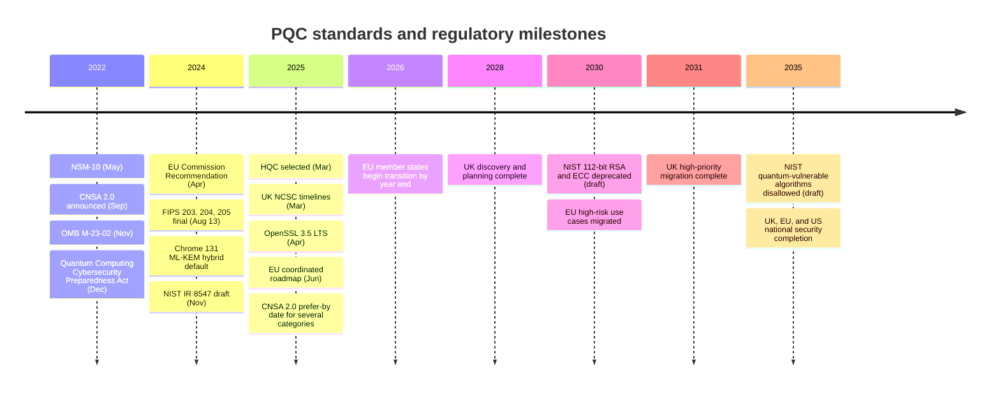

# PQC standards and timelines
{: .no_toc }

**Phase 6: Post-quantum cryptography.** Defines the algorithms the organization will adopt, their parameter sets and sizes, and the external deadlines the program is measured against.
{: .fs-5 .fw-300 }

## On this page
{: .no_toc .text-delta }

1. TOC
{:toc}

---

## The organization's algorithm selections

This is the decision the rest of the page supports. It is also recorded in [Cryptographic standards]().

| Use | Target algorithm | Transition form | Rationale |
|---|---|---|---|
| TLS 1.3 key exchange (external and internal) | ML-KEM-768 | Hybrid `X25519MLKEM768`; `SecP256r1MLKEM768` where a FIPS-approved classical component is required | Broad browser, CDN, and library support; category 3 |
| Key establishment for C3 archives and high-value key wrapping | ML-KEM-1024 | Hybrid with X448 or P-384 where available | Category 5, aligned with CNSA 2.0 |
| General digital signatures (internal PKI, application signing) | ML-DSA-65 | Dual or composite certificates during transition | Balanced size and speed |
| High-assurance signatures (root CAs, CNSA-aligned systems) | ML-DSA-87 | Separate PQC hierarchy | Category 5, CNSA 2.0 |
| Firmware and software signing with long-lived verification keys | LMS or XMSS (SP 800-208), or SLH-DSA | Stateful schemes only in HSMs with state management | Security rests on hash functions only; CNSA 2.0 names LMS/XMSS for firmware |
| Symmetric encryption | AES-256-GCM | No change | Grover's algorithm leaves adequate margin |
| Hashing | SHA-384 or SHA-512 for new designs; SHA-256 acceptable | No change | CNSA 2.0 alignment |

## NIST post-quantum standards

NIST published three Federal Information Processing Standards on **August 13, 2024**.

### FIPS 203: ML-KEM

The Module-Lattice-Based Key-Encapsulation Mechanism, derived from CRYSTALS-Kyber. A KEM is not a drop-in replacement for Diffie-Hellman: one party generates a key pair, the other encapsulates to the public key to produce a ciphertext and a shared secret, and the first party decapsulates the ciphertext to recover the same shared secret. ML-KEM always produces a 32-byte shared secret. Decapsulation of a modified ciphertext does not fail with an error; it returns a pseudorandom value unrelated to the real secret (implicit rejection), which the [Hands-on PQC lab](#step-2-ml-kem-768-encapsulation-and-decapsulation) demonstrates.

| Parameter set | NIST security category | Encapsulation key (public) | Decapsulation key (private) | Ciphertext | Shared secret |
|---|---|---|---|---|---|
| ML-KEM-512 | 1 (comparable to AES-128) | 800 bytes | 1,632 bytes | 768 bytes | 32 bytes |
| ML-KEM-768 | 3 (comparable to AES-192) | 1,184 bytes | 2,400 bytes | 1,088 bytes | 32 bytes |
| ML-KEM-1024 | 5 (comparable to AES-256) | 1,568 bytes | 3,168 bytes | 1,568 bytes | 32 bytes |

The private key can also be stored as a 64-byte seed from which the full decapsulation key is regenerated. Key formats (seed only, expanded only, or both) matter for HSM import and export and for interoperability between libraries.

### FIPS 204: ML-DSA

The Module-Lattice-Based Digital Signature Algorithm, derived from CRYSTALS-Dilithium. It is the general-purpose PQC signature scheme.

| Parameter set | NIST security category | Public key | Private key | Signature |
|---|---|---|---|---|
| ML-DSA-44 | 2 | 1,312 bytes | 2,560 bytes | 2,420 bytes |
| ML-DSA-65 | 3 | 1,952 bytes | 4,032 bytes | 3,309 bytes |
| ML-DSA-87 | 5 | 2,592 bytes | 4,896 bytes | 4,627 bytes |

Points engineering teams need to know:

- ML-DSA signs the message itself (internally hashing it with SHAKE256). FIPS 204 also defines **HashML-DSA**, a pre-hash variant, for cases where the signer only has a digest (for example, an HSM that receives a hash). The two produce different signatures and are not interchangeable; the variant must be recorded.
- FIPS 204 supports an optional **context string** that binds a signature to a purpose. Protocol designers should use it for domain separation.
- Signing can be **hedged** (randomized, the default) or deterministic.
- The private key can be stored as a 32-byte seed.

### FIPS 205: SLH-DSA

The Stateless Hash-Based Digital Signature Algorithm, derived from SPHINCS+. Its security depends only on the properties of hash functions, which makes it a conservative choice that does not share lattice assumptions with ML-KEM and ML-DSA. The cost is large signatures and slow signing.

FIPS 205 defines 12 parameter sets: SHA2 or SHAKE, at security categories 1, 3, and 5, each in a "small" (s) and "fast" (f) variant. Public keys are 32, 48, or 64 bytes.

| Parameter set | Category | Public key | Signature | Character |
|---|---|---|---|---|
| SLH-DSA-SHA2-128s | 1 | 32 bytes | 7,856 bytes | Smaller signatures, slow signing |
| SLH-DSA-SHA2-128f | 1 | 32 bytes | 17,088 bytes | Faster signing, larger signatures |
| SLH-DSA-SHA2-192s | 3 | 48 bytes | 16,224 bytes | |
| SLH-DSA-SHA2-256s | 5 | 64 bytes | 29,792 bytes | |

The lab measured SLH-DSA-SHA2-128s signing at about 0.86 seconds per signature and 128f at about 0.05 seconds on a desktop CPU with OpenSSL 3.5.5. That rules SLH-DSA out for TLS handshakes but makes it acceptable for infrequent, high-value signatures such as firmware releases or root certificate issuance.

### FIPS 206: FN-DSA (draft)

FN-DSA is the standard being developed from Falcon. Falcon offers much smaller signatures than ML-DSA (roughly 666 bytes for Falcon-512 and about 1,280 bytes for Falcon-1024 in the original submission) but relies on floating-point arithmetic that is hard to implement in constant time, which complicates HSM and embedded use.

{: .verify }
FN-DSA (FIPS 206) status: treat as draft as of mid-2026. Confirm publication status, final parameter sets, and sizes on the NIST CSRC site before planning around it. The organization does not select FN-DSA until it is final and validated in FIPS 140-3 modules.

### HQC: backup KEM

In **March 2025** NIST selected HQC (Hamming Quasi-Cyclic), a code-based KEM, as a backup to ML-KEM. The reason is diversity: if a weakness in structured lattices were found, ML-KEM, ML-DSA, and FN-DSA would all be affected. HQC relies on a different mathematical problem.

{: .verify }
NIST indicated a draft HQC standard about a year after selection and a final standard around 2027. Verify current status. The organization does not deploy HQC; crypto agility (see [Crypto agility and hybrid designs]()) is what makes a later switch feasible.

### SP 800-208: stateful hash-based signatures (LMS and XMSS)

NIST SP 800-208 (2020) approves the Leighton-Micali Signature system (LMS, and its multi-tree form HSS, specified in RFC 8554) and the eXtended Merkle Signature Scheme (XMSS and XMSS^MT, RFC 8391). They were standardized before the FIPS 203 to 205 process because their security rests only on hash functions and is well understood.

The critical constraint is **state**. Each one-time signing key may be used once. Reusing a state after a crash, a VM snapshot restore, or an HSM cluster failover can reveal the private key. SP 800-208 therefore requires key generation and signing to be performed in hardware cryptographic modules, and does not allow exporting private keys for backup in a way that could duplicate state.

| Use | Fit |
|---|---|
| Firmware signing (door locks, building management controllers, network appliances, POS terminals) | Good: low signing volume, small verifier code, CNSA 2.0 names LMS/XMSS for this use |
| Code signing for the organization's own software | Possible, but ML-DSA is operationally simpler |
| TLS certificates, general PKI | Not appropriate: signing volume and state management make it unsafe |

### SP 800-227: KEM recommendations

NIST SP 800-227 gives recommendations for using KEMs, including how to derive keys from KEM shared secrets and how to combine a PQC KEM with a classical one. It is the NIST reference for hybrid key combiners.

{: .verify }
SP 800-227 was published as a draft in January 2025 and finalized later in 2025. Confirm the final version and its combiner guidance when writing internal standards.

### NIST IR 8547: transition timeline

NIST IR 8547, *Transition to Post-Quantum Cryptography Standards*, was released as an initial public draft in **November 2024**. It proposes:

| Algorithm class | Example | After 2030 | After 2035 |
|---|---|---|---|
| Quantum-vulnerable at 112-bit security | RSA-2048, P-256 ECDSA and ECDH, DH-2048 | **Deprecated** | **Disallowed** |
| Quantum-vulnerable at 128-bit security and above | RSA-3072, P-384 | Allowed | **Disallowed** |
| ML-KEM, ML-DSA, SLH-DSA, LMS, XMSS | | Allowed | Allowed |

"Deprecated" means use is allowed but the user must accept risk; "disallowed" means the algorithm is no longer approved for federal use. Private-sector organizations are not bound directly, but FIPS-validated products, cloud FedRAMP offerings, and auditors will follow these dates.

{: .verify }
NIST IR 8547 was a draft. Check whether a final version has been published and whether any dates changed.

## Size and performance comparison

The table combines FIPS reference sizes with measurements from the lab (DER encoding adds about 22 bytes to public keys).

| Algorithm | Type | Public key | Ciphertext or signature | Quantum-safe | Notes |
|---|---|---|---|---|---|
| RSA-2048 | KEM (OAEP) or signature | 256 bytes (modulus) | 256 bytes | No | Deprecated after 2030 (IR 8547 draft) |
| RSA-3072 | KEM or signature | 384 bytes | 384 bytes | No | Lab: 422-byte DER public key |
| ECDH P-256 | Key agreement | 65 bytes (uncompressed point) | 65 bytes (peer share) | No | |
| X25519 | Key agreement | 32 bytes | 32 bytes (peer share) | No | Lab: 44-byte DER public key |
| ECDSA P-256 | Signature | 65 bytes | about 70 to 72 bytes (DER) | No | Lab: 72 bytes |
| Ed25519 | Signature | 32 bytes | 64 bytes | No | |
| **ML-KEM-512** | KEM | 800 bytes | 768 bytes | Yes | |
| **ML-KEM-768** | KEM | 1,184 bytes | 1,088 bytes | Yes | Lab confirmed 1,088-byte ciphertext |
| **ML-KEM-1024** | KEM | 1,568 bytes | 1,568 bytes | Yes | |
| **X25519MLKEM768** | Hybrid TLS group | 1,216-byte client key share | 1,120-byte server key share | Yes, if either component holds | Lab: ClientHello grew from 239 to 1,415 bytes |
| **ML-DSA-44** | Signature | 1,312 bytes | 2,420 bytes | Yes | |
| **ML-DSA-65** | Signature | 1,952 bytes | 3,309 bytes | Yes | Lab: self-signed certificate 5,620 bytes vs 482 for ECDSA P-256 |
| **ML-DSA-87** | Signature | 2,592 bytes | 4,627 bytes | Yes | |
| **SLH-DSA-SHA2-128s** | Signature | 32 bytes | 7,856 bytes | Yes | Slow signing |
| **SLH-DSA-SHA2-128f** | Signature | 32 bytes | 17,088 bytes | Yes | |
| LMS / XMSS | Stateful signature | Tens of bytes | A few kilobytes, depending on parameters | Yes | Stateful; HSM only |

The practical consequence: **key exchange grows by about 1 KB in each direction, which networks absorb well. Signatures grow by several kilobytes per signature, and a TLS certificate chain carries several signatures**, which is why PQC certificates in the public web PKI are further away than PQC key exchange.

## Government and regulator timelines

### United States

| Instrument | Date | What it requires |
|---|---|---|
| National Security Memorandum 10 (NSM-10) | May 2022 | Federal policy to migrate to quantum-resistant cryptography, with a goal of mitigating quantum risk by 2035 |
| NSA CNSA 2.0 | September 2022 (announced) | Algorithm suite and timelines for national security systems (below) |
| Quantum Computing Cybersecurity Preparedness Act | December 2022 | Requires federal agencies to inventory and migrate quantum-vulnerable cryptography |
| OMB M-23-02 | November 2022 | Federal agencies submit annual inventories of quantum-vulnerable cryptographic systems |
| NIST FIPS 203, 204, 205 | August 13, 2024 | Final PQC standards |
| NIST IR 8547 (draft) | November 2024 | 2030 deprecation and 2035 disallowance proposal |

### NSA CNSA 2.0

CNSA 2.0 applies to US national security systems, but it is widely used by vendors (HSMs, network equipment, operating systems) as a product roadmap target, so it shapes what the organization can buy.

| Function | CNSA 2.0 algorithm |
|---|---|
| Key establishment | ML-KEM-1024 |
| Digital signatures | ML-DSA-87 |
| Software and firmware signing | LMS or XMSS (SP 800-208) |
| Symmetric encryption | AES-256 |
| Hashing | SHA-384 or SHA-512 |

Timeline: the transition for national security systems is to be complete by **2035**. Several categories, including software and firmware signing, web browsers and servers, and cloud services, are to support and prefer CNSA 2.0 algorithms by **2025**, with exclusive use by **2030 to 2033** depending on the category. The per-category table is in the NSA CNSA 2.0 FAQ; the organization tracks it there rather than restating it.

{: .note }
CNSA 2.0 selects only category 5 parameter sets. The organization uses ML-KEM-768 and ML-DSA-65 for general use because they are what browsers, CDNs, and libraries deploy by default, and category 3 is well within the organization's risk tolerance. ML-KEM-1024 and ML-DSA-87 are reserved for root keys and the longest-lived data.

### European Union

| Instrument | Date | What it says |
|---|---|---|
| Commission Recommendation on a coordinated implementation roadmap for the transition to PQC | April 2024 | Asks member states to develop a coordinated strategy and roadmap |
| Coordinated implementation roadmap (NIS Cooperation Group) | June 2025 | Member states **begin transitioning by end of 2026**; **high-risk use cases by end of 2030**; **as many systems as feasible by 2035** |

For the organization, EU operations and EU guest data fall within these expectations, and national authorities (for example, ANSSI in France and BSI in Germany) publish their own guidance, which in some cases prefers hybrid deployment.

### United Kingdom

The NCSC published migration timelines in **March 2025**:

| Milestone | Target |
|---|---|
| Define migration goals, complete discovery, build an initial plan | By **2028** |
| Complete highest-priority migration activities; refine plan | By **2031** |
| Complete migration to PQC | By **2035** |

The organization's Phase 6 steps 6.1 and 6.2 map to the NCSC 2028 milestone, step 6.3 and 6.5 to the 2031 milestone, and step 6.6 to 2035.

### Other jurisdictions

{: .verify }
Other national authorities have published guidance: for example, the Australian Signals Directorate's Information Security Manual sets an earlier target for ceasing use of traditional asymmetric cryptography (2030), and Canada has published a roadmap for federal systems. Verify current documents before citing them in a regional plan.

### Industry

- **PCI DSS v4.0.1 requirement 12.3.3** requires documenting and reviewing cipher suites and protocols in use at least every 12 months, including a plan to respond to anticipated changes in cryptographic vulnerabilities. This is the most direct compliance hook for PQC planning in the cardholder data environment. See [Payment card data and PCI DSS]().
- **PCI DSS 4.2.1.1** requires an inventory of trusted keys and certificates, which is part of the CBOM.
- **CA/Browser Forum ballot SC-081** reduces maximum public TLS certificate validity to 200 days from March 15, 2026, 100 days from March 15, 2027, and 47 days from March 15, 2029. Shorter lifetimes force automation, which also makes the eventual switch to PQC certificates easier.

## IETF work

Protocol standards determine whether the algorithms can actually be used. Many items were Internet-Drafts at the time of writing; some may have become RFCs.

| Item | Document | What it defines | Status as of mid-2026 |
|---|---|---|---|
| Hybrid key exchange design for TLS 1.3 | draft-ietf-tls-hybrid-design | Framework: concatenate classical and PQC key shares and shared secrets | Draft; verify |
| ECDHE-MLKEM hybrid groups for TLS 1.3 | draft-ietf-tls-ecdhe-mlkem | `X25519MLKEM768` (0x11EC), `SecP256r1MLKEM768` (0x11EB), `SecP384r1MLKEM1024` (0x11ED) | Draft, widely deployed; verify |
| Pure ML-KEM in TLS 1.3 | draft-ietf-tls-mlkem | `MLKEM512`, `MLKEM768`, `MLKEM1024` as standalone groups | Draft; verify |
| ML-DSA in X.509 | draft-ietf-lamps-dilithium-certificates | Algorithm identifiers and key formats for ML-DSA certificates | Approved or published as RFC; verify number |
| SLH-DSA in X.509 | draft-ietf-lamps-x509-slhdsa | Identifiers for SLH-DSA certificates | Verify |
| ML-KEM in X.509 | draft-ietf-lamps-kyber-certificates | ML-KEM public keys in certificates (for KEM-based authentication and CMS) | Verify |
| Composite ML-DSA signatures | draft-ietf-lamps-pq-composite-sigs | A single signature algorithm that combines ML-DSA with RSA or ECDSA | Draft; verify |
| Composite ML-KEM | draft-ietf-lamps-pq-composite-kem | Composite KEM for CMS and similar uses | Draft; verify |
| ML-DSA in TLS 1.3 authentication | draft-ietf-tls-mldsa | `SignatureScheme` values for ML-DSA | Draft; verify |
| IKEv2 additional key exchanges | RFC 9370 | Framework for multiple key exchanges in IKEv2, used to add ML-KEM to IPsec VPNs | RFC |
| ML-KEM in IKEv2 | draft-ietf-ipsecme-ikev2-mlkem | ML-KEM as an IKEv2 key exchange | Draft; verify |
| LMS/HSS | RFC 8554 | Hash-based signatures | RFC |
| XMSS | RFC 8391 | Hash-based signatures | RFC |

{: .verify }
Internet-Draft names and status change as documents advance. Check the IETF Datatracker for each item and record the RFC number where one exists. The TLS codepoints for the hybrid groups are registered in the IANA TLS Supported Groups registry.

A note on byte order: in `X25519MLKEM768` the ML-KEM component comes **first** in both the key share and the concatenated shared secret, while in `SecP256r1MLKEM768` and `SecP384r1MLKEM1024` the ECDH component comes first. This matters only to people implementing the combiner, but it is a common source of interoperability bugs in custom code, which is one reason the organization does not implement TLS combiners itself.

## Timeline at a glance

## Key takeaways for engineering teams

- Use ML-KEM-768 in hybrid `X25519MLKEM768` for TLS now; reserve ML-KEM-1024 and ML-DSA-87 for roots and the longest-lived data.
- Use ML-DSA-65 as the default PQC signature; use LMS/XMSS or SLH-DSA for firmware roots, and never run stateful LMS/XMSS outside an HSM that manages state.
- Record which ML-DSA variant (pure or HashML-DSA) and which private key format (seed or expanded) a system uses; they affect interoperability.
- Plan against 2030 (deprecation of 112-bit RSA/ECC) and 2035 (disallowance), not against a CRQC prediction.
- Treat IETF draft status as a real constraint: PQC key exchange is deployable today; PQC certificates in the public web PKI are not yet.

## Related pages

- [The quantum threat]()
- [PQC migration program]()
- [Cryptographic standards]()
- [Certificates and PKI]()
- [Compliance mapping]()
- [Sources]()

## Sources

- FIPS 203, ML-KEM: <https://csrc.nist.gov/pubs/fips/203/final>
- FIPS 204, ML-DSA: <https://csrc.nist.gov/pubs/fips/204/final>
- FIPS 205, SLH-DSA: <https://csrc.nist.gov/pubs/fips/205/final>
- NIST SP 800-208: <https://csrc.nist.gov/pubs/sp/800/208/final>
- NIST IR 8547 (initial public draft): <https://csrc.nist.gov/pubs/ir/8547/ipd>
- NIST HQC selection announcement (March 2025): <https://www.nist.gov/news-events/news/2025/03/nist-selects-hqc-fifth-algorithm-post-quantum-encryption>
- NSA CNSA 2.0 FAQ and algorithms advisory: <https://media.defense.gov/2022/Sep/07/2003071836/-1/-1/0/CSI_CNSA_2.0_FAQ_.PDF>
- NCSC, Timelines for migration to post-quantum cryptography: <https://www.ncsc.gov.uk/guidance/pqc-migration-timelines>
- European Commission, Shaping Europe's digital future (Recommendation of April 2024 and the June 2025 coordinated implementation roadmap are published here): <https://digital-strategy.ec.europa.eu/>
- IETF Datatracker: <https://datatracker.ietf.org/>
- IANA TLS Supported Groups registry: <https://www.iana.org/assignments/tls-parameters/tls-parameters.xhtml#tls-parameters-8>
