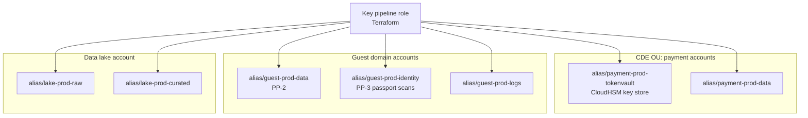

# AWS
{: .no_toc }

**Phases 2 to 5: Standards and keys through transit and in use.** How the organization implements PP-1, PP-2, and PP-3 on AWS, from key hierarchy and guardrails to discovery, service encryption, and evidence.
{: .fs-5 .fw-300 }

## On this page
{: .no_toc .text-delta }

1. TOC
{:toc}

---

## Scope and assumptions

This playbook assumes an AWS Organizations environment with a management account, a security
tooling account, a log archive account, and workload accounts grouped into organizational units
(OUs) by environment. Data domains from the tag schema (`guest`, `payment`, `loyalty`,
`employee`, `finance`, `operations`, `property-iot`, `security`) map to workload accounts or
groups of accounts. The cardholder data environment (CDE) sits in its own OU so that PCI DSS
scope is bounded by account boundaries, not by tags alone.

For deeper, step-by-step key management procedures (key policies, CloudHSM cluster build, XKS
proxy deployment, key import), see the
[AWS KMS and CloudHSM companion guide](https://steven-smith-itnet.github.io/aws-kms-cloudhsm-key-management-guide/).

## 1. Service map and terminology

| Generic concept | AWS service or term | Notes |
|---|---|---|
| Key service | AWS KMS | Regional; keys never leave FIPS 140-3 validated HSMs in plaintext |
| Provider-managed key | AWS owned key, AWS managed key | AWS managed keys appear as `aws/<service>` aliases; policy not editable |
| Customer-managed key | Customer managed KMS key | Full control of key policy, rotation, deletion, tags |
| Single-tenant HSM | AWS CloudHSM | Customer-operated cluster; also usable as a KMS custom key store |
| External key | External key store (XKS) | Key material stays in an external key manager behind an XKS proxy |
| BYOK | Imported key material (`EXTERNAL` origin) | No automatic rotation for imported material; the organization owns durability |
| Envelope encryption SDK | AWS Encryption SDK; AWS Database Encryption SDK | Client-side encryption with KMS as the KEK source |
| Secrets | AWS Secrets Manager | Encrypted with a KMS key; rotation Lambdas |
| Private CA | AWS Private CA | Issues private certificates for mTLS and internal TLS |
| Discovery | Amazon Macie; AWS Glue sensitive data detection | Macie covers S3; Glue covers ETL pipelines |
| Guardrails | SCPs, RCPs, tag policies, declarative policies, AWS Config | SCPs limit principals; RCPs limit resources |
| Confidential computing | Nitro System, Nitro Enclaves, AMD SEV-SNP instances | Enclaves integrate with KMS attestation |
| Payment HSM | AWS Payment Cryptography | Managed payment HSM service for PIN, card, and key exchange functions |
| Audit | AWS CloudTrail | KMS API calls are management events |

## 2. Discovery and classification services

### Amazon Macie

Macie discovers and classifies sensitive data in S3. It provides two modes, and the organization
uses both:

| Mode | What it does | When the organization uses it |
|---|---|---|
| Automated sensitive data discovery | Continuously samples objects across all buckets in scope and produces a sensitivity score per bucket | Always on in every account through the delegated administrator; gives the estate-wide heat map |
| Sensitive data discovery jobs | Full or sampled inspection of selected buckets, one-time or scheduled | Targeted scans of buckets tagged `data-classification=confidential` or `restricted`, and any bucket with a high automated score |

Macie's managed data identifiers cover credit card numbers, passport numbers for many countries,
national identifiers, bank account numbers, and credentials. The organization adds custom data
identifiers for hospitality-specific formats: loyalty member numbers, reservation confirmation
numbers, and internal employee IDs. Allow lists suppress known test card numbers used in
payment testing.

```bash
# Custom data identifier for loyalty member numbers (example format: LY followed by 10 digits)
aws macie2 create-custom-data-identifier \
  --name loyalty-member-number \
  --regex 'LY[0-9]{10}' \
  --keywords '["loyalty","member","membership"]' \
  --maximum-match-distance 50 \
  --description "Loyalty member number, C2 Confidential\\Guest-PII"
```

Macie findings are sent to AWS Security Hub and Amazon EventBridge. An EventBridge rule routes
`SensitiveData:S3Object/Financial` and `SensitiveData:S3Object/Personal` findings to the
classification pipeline, which compares the finding against the bucket's `data-classification`
tag. A mismatch (for example PAN found in a bucket tagged `internal`) opens a ticket to the data
owner and, for PAN, a security incident.

{: .note }
Macie inspects S3 only. It does not scan RDS, DynamoDB, Redshift, EBS, or EFS. For those stores
the organization relies on the enterprise discovery platform described in
[Data asset inventory and discovery](), or on
exporting samples to S3 for Macie inspection.

### AWS Glue sensitive data detection

Glue sensitive data detection runs inside ETL jobs. It identifies PII entity types in columns and
rows as data moves into the lake, and can redact or hash detected values before they land. The
organization uses it in ingestion pipelines for the enterprise data lake so that C3 values
(passport numbers, PAN) are detected and either tokenized or rejected before they reach curated
zones. Detection results can be written as column-level metadata to the Glue Data Catalog,
which Lake Formation then uses for column-level permissions.

### Mapping findings to labels

| Finding type | Canonical label | Profile | Action |
|---|---|---|---|
| Credit card number | `Restricted\PCI` | PP-3 | Incident if outside the CDE; tokenize or delete |
| Passport or national ID | `Restricted\Guest-Identity` | PP-3 | Confirm legal basis and retention; move to PP-3 store |
| Bank account number | `Restricted\Guest-Identity` or `Confidential\Employee` by context | PP-3 or PP-2 | Owner review |
| Email, phone, address, name | `Confidential\Guest-PII` | PP-2 | Confirm CMK and access controls |
| Credentials, private keys | `Restricted\Secrets` | PP-3 | Rotate the secret, remove from S3, move to Secrets Manager |

## 3. Labeling, tagging, and enforcement

### Tag schema on AWS

The site-wide tag schema applies directly: AWS tag keys and values are case-sensitive, so the
lowercase convention is enforced by tag policies. Tags are applied to KMS keys, S3 buckets, RDS
instances, DynamoDB tables, and every other taggable data store.

### Tag policy

A tag policy standardizes allowed values and can enforce compliance on specified resource types.

```json
{
  "tags": {
    "data-classification": {
      "tag_key": { "@@assign": "data-classification" },
      "tag_value": { "@@assign": ["public", "internal", "confidential", "restricted"] },
      "enforced_for": { "@@assign": ["s3:bucket", "kms:key", "dynamodb:table", "rds:db"] }
    },
    "protection-profile": {
      "tag_key": { "@@assign": "protection-profile" },
      "tag_value": { "@@assign": ["pp1", "pp2", "pp3"] }
    }
  }
}
```

{: .warning }
Tag policies prevent non-compliant values on tagging operations for the listed resource types.
They do not force a tag to exist. Mandatory tags are enforced with SCP conditions on
`aws:RequestTag` and with AWS Config rules (`required-tags`) for detection.

### Service control policies (SCPs)

SCPs limit what principals in member accounts can do. The organization uses them for preventive
encryption guardrails:

```json
{
  "Version": "2012-10-17",
  "Statement": [
    {
      "Sid": "DenyKmsKeyWithoutClassificationTag",
      "Effect": "Deny",
      "Action": "kms:CreateKey",
      "Resource": "*",
      "Condition": { "Null": { "aws:RequestTag/data-classification": "true" } }
    },
    {
      "Sid": "DenyUnencryptedRdsInstances",
      "Effect": "Deny",
      "Action": ["rds:CreateDBInstance", "rds:CreateDBCluster"],
      "Resource": "*",
      "Condition": { "Bool": { "rds:StorageEncrypted": "false" } }
    },
    {
      "Sid": "DenyUnencryptedEbsVolumes",
      "Effect": "Deny",
      "Action": "ec2:CreateVolume",
      "Resource": "*",
      "Condition": { "Bool": { "ec2:Encrypted": "false" } }
    },
    {
      "Sid": "ProtectKeyLifecycle",
      "Effect": "Deny",
      "Action": ["kms:ScheduleKeyDeletion", "kms:DisableKey", "kms:PutKeyPolicy"],
      "Resource": "*",
      "Condition": {
        "ArnNotLike": {
          "aws:PrincipalArn": [
            "arn:aws:iam::*:role/platform-key-pipeline",
            "arn:aws:iam::*:role/break-glass-key-admin"
          ]
        }
      }
    }
  ]
}
```

The last statement is the most important one for C2 and C3 data: it limits destructive key
actions to the pipeline role that owns keys as code and to a monitored break-glass role.
Accidental or malicious key deletion is the most likely way to cause a data-loss incident with
customer-managed keys.

### Resource control policies (RCPs)

RCPs apply to resources regardless of which principal calls them, including principals outside
the organization. They close the gap SCPs leave: an SCP cannot stop an external account from
using a misconfigured bucket or key policy. At launch RCPs supported S3, STS, KMS, SQS, and
Secrets Manager; check current documentation for additional services.

```json
{
  "Version": "2012-10-17",
  "Statement": [
    {
      "Sid": "EnforceTlsForS3AndKms",
      "Effect": "Deny",
      "Principal": "*",
      "Action": ["s3:*", "kms:*", "secretsmanager:*"],
      "Resource": "*",
      "Condition": { "BoolIfExists": { "aws:SecureTransport": "false" } }
    },
    {
      "Sid": "EnforceOrgIdentityPerimeter",
      "Effect": "Deny",
      "Principal": "*",
      "Action": ["s3:*", "kms:*", "secretsmanager:*"],
      "Resource": "*",
      "Condition": {
        "StringNotEqualsIfExists": { "aws:PrincipalOrgID": "o-exampleorgid" },
        "BoolIfExists": { "aws:PrincipalIsAWSService": "false" }
      }
    }
  ]
}
```

{: .warning }
The identity perimeter statement must be tested against every legitimate cross-organization
integration first: payment processors, OTA and GDS partners that read from or write to S3,
and vendor support accounts. Roll out RCPs in a test OU, review CloudTrail for `AccessDenied`
events, then promote.

### AWS Config for detection

Preventive controls do not cover every case, so AWS Config conformance packs detect drift. The
managed rules the organization deploys organization-wide include `ENCRYPTED_VOLUMES`,
`RDS_STORAGE_ENCRYPTED`, `S3_BUCKET_SERVER_SIDE_ENCRYPTION_ENABLED`,
`S3_DEFAULT_ENCRYPTION_KMS`, `CMK_BACKING_KEY_ROTATION_ENABLED`,
`KMS_CMK_NOT_SCHEDULED_FOR_DELETION`, `DYNAMODB_TABLE_ENCRYPTED_KMS`, and `REQUIRED_TAGS`
(confirm identifiers against the current AWS Config managed rules list when building the pack).

## 4. Key management tiers

The tables below are the AWS form of PP-1, PP-2, and PP-3.

### Structured data

{: .good }
PP-1 for C0 and C1 structured data: AWS owned or AWS managed keys are acceptable. The data is
encrypted at rest, but key access is governed only by service permissions.

| Tier | Key option | Example services | What it adds | Trade-off |
|---|---|---|---|---|
| Good (PP-1) | AWS owned or AWS managed key | DynamoDB default, RDS with `aws/rds` | Encryption at rest with no operational effort | No key policy control; `aws/rds` snapshots cannot be shared cross-account |
| Better (PP-2) | Customer managed KMS key per data domain and environment, automatic rotation | RDS, Aurora, DynamoDB, Redshift, DocumentDB, OpenSearch | Key policy separation of duties, independent revocation, CloudTrail visibility per key | Key policy and grant management; KMS request cost |
| Best (PP-3) | PP-2 plus AWS Database Encryption SDK or AWS Encryption SDK for C3 fields; keys in CloudHSM key store where justified; tokenization for PAN | DynamoDB with Database Encryption SDK; Aurora with application-encrypted columns | Data is ciphertext to database administrators, backups, and replicas | Loss of range queries and joins on encrypted fields; beacons only support equality and prefix-style patterns; application changes |

### Unstructured data

{: .better }
PP-2 for C2 unstructured data: SSE-KMS with a customer managed key and S3 Bucket Keys enabled,
with SSE-C blocked on the bucket.

| Tier | Key option | Example services | What it adds | Trade-off |
|---|---|---|---|---|
| Good (PP-1) | SSE-S3 (default for all new objects) | S3, EFS with AWS managed key | Always-on encryption | No key-level access control or per-key audit |
| Better (PP-2) | SSE-KMS with customer managed key and S3 Bucket Keys | S3, EFS, FSx, EBS, AWS Backup vaults | Key policy gates decrypt; per-bucket key separation; crypto-shredding by key deletion | KMS quotas and cost without Bucket Keys |
| Best (PP-3) | Client-side encryption with the AWS Encryption SDK before upload, or DSSE-KMS where two layers are mandated; CloudHSM or XKS key store where justified | S3 for passport scans, HR special-category documents | Storage service never sees plaintext (client-side); independent layers (DSSE) | Client key handling, no server-side features on content (for example S3 Object Lambda transforms on plaintext), higher latency and cost |

### In transit

{: .best }
PP-3 in transit: mutual TLS with certificates from AWS Private CA, TLS 1.3 policies on load
balancers, and private connectivity to KMS and data services through VPC endpoints.

| Tier | Control | Example configuration |
|---|---|---|
| Good (PP-1) | TLS 1.2 minimum on public endpoints | ALB policy `ELBSecurityPolicy-TLS13-1-2-2021-06`; CloudFront `TLSv1.2_2021` |
| Better (PP-2) | TLS 1.2+ preferring 1.3, `aws:SecureTransport` enforced by RCP, VPC endpoints for KMS, S3, Secrets Manager | Interface endpoints with endpoint policies restricting to organization principals |
| Best (PP-3) | mTLS between services, hybrid post-quantum TLS where supported, no public data paths | ALB mutual authentication with a trust store from AWS Private CA; VPC Lattice or service mesh mTLS |

### Key hierarchy by data domain



Keys are created in the account that owns the data. Cross-account access (for example, the lake
account reading guest data) is granted explicitly in the key policy with `kms:ViaService` and
`kms:CallerAccount` conditions. The alternative, a central key account, simplifies inventory but
makes every workload depend on cross-account key policies and grants, and some services do not
support cross-account customer managed keys for every operation. The organization centralizes
key *management* (one pipeline, one inventory) and keeps key *resources* in workload accounts.

## 5. Structured data services

| Service | Encryption at rest | Key options | Notes for the organization |
|---|---|---|---|
| Amazon RDS (all engines) | Storage, automated backups, snapshots, read replicas | AWS managed `aws/rds` or customer managed | Must be set at creation; an unencrypted instance is encrypted by snapshot, copy with a KMS key, and restore |
| RDS for Oracle and SQL Server | Storage encryption plus optional native TDE | Native TDE through option groups; storage encryption with KMS | Use storage encryption with CMK as the baseline; native TDE where an application or audit requires it |
| Amazon Aurora | Cluster storage, backups, snapshots | AWS managed or customer managed | Aurora global databases need a key in each Region |
| Amazon DynamoDB | Always encrypted | AWS owned (default), AWS managed, customer managed | Key type can be switched on an existing table; PP-3 attributes use the Database Encryption SDK |
| Amazon Redshift | Cluster or serverless namespace | AWS managed or customer managed | Supports dynamic data masking and column-level grants for non-privileged roles |
| Amazon DocumentDB | Cluster storage | AWS managed or customer managed | Set at creation |
| Amazon OpenSearch Service | Encryption at rest and node-to-node | AWS managed or customer managed | Enable fine-grained access control; indexes of guest search logs are C2 |
| AWS Glue Data Catalog | Catalog metadata and connection passwords | Customer managed | Catalog metadata can reveal schema of C3 tables |
| Amazon Athena | Query results | SSE-S3, SSE-KMS, CSE-KMS | Workgroup setting enforces result encryption; results often contain C2 data |

### PP-3 field-level encryption with the AWS Database Encryption SDK

For DynamoDB tables that hold guest identity documents, the AWS Database Encryption SDK encrypts
and signs attributes on the client before they are written. Configuration defines, per
attribute, whether it is encrypted and signed, signed only, or left in plaintext. Searchable
encryption uses beacons, which are truncated HMAC values stored alongside the ciphertext; they
support equality searches without decrypting. Beacon length is a deliberate trade-off between
query precision and leakage of value frequency, and must be reviewed per attribute.

For non-DynamoDB stores, the AWS Encryption SDK protects individual values:

```python
import aws_encryption_sdk
from aws_encryption_sdk import CommitmentPolicy

KEY_ARN = "arn:aws:kms:eu-west-1:111122223333:key/1234abcd-12ab-34cd-56ef-1234567890ab"

client = aws_encryption_sdk.EncryptionSDKClient(
    commitment_policy=CommitmentPolicy.REQUIRE_ENCRYPT_REQUIRE_DECRYPT
)
provider = aws_encryption_sdk.StrictAwsKmsMasterKeyProvider(key_ids=[KEY_ARN])

ciphertext, _header = client.encrypt(
    source=b"P1234567",                     # passport number, C3
    key_provider=provider,
    encryption_context={
        "data-domain": "guest",
        "field": "passport_number",
        "tenant": "property-eu-0421",
    },
)
```

The encryption context is recorded in CloudTrail for every `GenerateDataKey` and `Decrypt` call,
so the evidence shows which field and which property the operation related to. Key policies can
also require a specific context with the `kms:EncryptionContext:` condition key.

### Payment data

The CDE uses tokenization so that only the token vault holds PAN. AWS Payment Cryptography can
host payment-specific keys (for example, keys exchanged with a processor) where the organization
performs payment cryptographic functions itself. Most hospitality merchants rely on their
payment gateway and P2PE provider and never hold PAN in AWS. See
[Payment card data and PCI DSS]().

## 6. Unstructured data services

| Service | Options | Organization standard |
|---|---|---|
| Amazon S3 | SSE-S3 (default), SSE-KMS, DSSE-KMS, SSE-C | SSE-KMS with CMK and Bucket Keys for C2 and C3; SSE-C blocked; Block Public Access at account level |
| Amazon EBS | Encryption by default per Region, with a default KMS key | Enabled in every Region with a CMK per account |
| Amazon EFS | Encryption at rest set at creation; TLS mount helper for transit | CMK for C2; mount with the `tls` option |
| Amazon FSx | Encryption at rest with AWS managed or customer managed keys | CMK for file shares holding HR or finance data |
| AWS Backup | Vault-level KMS key; some resource types keep the source key | Separate backup key per domain, in a separate backup account; vault lock for immutability |
| Amazon CloudWatch Logs | Optional KMS key per log group | CMK for application logs that may contain C2 data |
| Amazon WorkDocs, SaaS on AWS | Varies | Assess per SaaS; most Marketplace SaaS does not use the organization's keys |

S3 bucket encryption configuration for a C2 bucket:

```bash
aws s3api put-bucket-encryption \
  --bucket guest-prod-documents-eu \
  --server-side-encryption-configuration '{
    "Rules": [{
      "ApplyServerSideEncryptionByDefault": {
        "SSEAlgorithm": "aws:kms",
        "KMSMasterKeyID": "arn:aws:kms:eu-west-1:111122223333:alias/guest-prod-data"
      },
      "BucketKeyEnabled": true,
      "BlockedEncryptionTypes": { "EncryptionType": ["SSE-C"] }
    }]
  }'
```

{: .verify }
The `BlockedEncryptionTypes` setting for blocking SSE-C on general purpose buckets is a recent
addition to the S3 API. Confirm availability in the target Regions and the current default
behavior for new buckets before relying on it.

Bucket policy statement that rejects uploads naming a different KMS key:

```json
{
  "Sid": "DenyWrongKmsKey",
  "Effect": "Deny",
  "Principal": "*",
  "Action": "s3:PutObject",
  "Resource": "arn:aws:s3:::guest-prod-documents-eu/*",
  "Condition": {
    "StringNotEqualsIfExists": {
      "s3:x-amz-server-side-encryption-aws-kms-key-id":
        "arn:aws:kms:eu-west-1:111122223333:key/1234abcd-12ab-34cd-56ef-1234567890ab"
    }
  }
}
```

## 7. Transit and in use

### TLS

- **Load balancers.** Application and Network Load Balancer TLS listeners use predefined security
  policies. The organization standard is a TLS 1.3 capable policy with TLS 1.2 minimum
  (`ELBSecurityPolicy-TLS13-1-2-2021-06` or a newer equivalent). FIPS-specific policies exist
  for workloads that require FIPS endpoints.
- **CloudFront.** Viewer security policy `TLSv1.2_2021` or newer; origin protocol HTTPS only.
- **API Gateway.** TLS 1.2 security policy on custom domains.
- **Service endpoints.** AWS service APIs require TLS; RCPs enforce `aws:SecureTransport` for
  S3, KMS, and Secrets Manager resources.
- **Database connections.** RDS parameter groups enforce TLS (`rds.force_ssl` for PostgreSQL and
  SQL Server, `require_secure_transport` for MySQL).

### Private connectivity

Interface VPC endpoints for KMS, Secrets Manager, and STS, and gateway endpoints for S3 and
DynamoDB, keep key and data traffic on the AWS network. Endpoint policies restrict use to the
organization's principals and resources. Key policies can require `aws:SourceVpce` for PP-3 keys
so that decrypt only succeeds from known endpoints.

### Confidential computing

- **Nitro System.** All current-generation instances run on Nitro, which is designed so that AWS
  operators have no mechanism to access instance memory. This is a baseline property, not an
  opt-in control.
- **Nitro Enclaves.** Isolated compute environments with no persistent storage, no interactive
  access, and no external networking. KMS key policies can require enclave attestation through
  condition keys such as `kms:RecipientAttestation:ImageSha384`, so that a key only decrypts
  inside a specific signed enclave image. The organization uses this pattern for the
  tokenization service's detokenize path.
- **AMD SEV-SNP.** Supported on selected instance families for memory encryption with
  attestation.

See [Data in use and confidential computing]().

## 8. PQC status

{: .verify }
As of mid-2026: AWS KMS, AWS Certificate Manager, and AWS Secrets Manager endpoints support
hybrid post-quantum TLS key exchange, moved to ML-KEM based hybrids during 2025. s2n-tls and
AWS-LC provide the implementation, and the AWS-LC FIPS-validated module includes ML-KEM. AWS KMS
added ML-DSA signing keys (key specs `ML_DSA_44`, `ML_DSA_65`, `ML_DSA_87`) in June 2025.
Post-quantum options for customer-facing load balancer and CloudFront TLS policies should be
confirmed against current AWS documentation before being written into a standard.

Implications for the organization:

- Clients that call KMS and Secrets Manager with an SDK built on a PQ-capable TLS stack gain
  hybrid key exchange on the most sensitive API path: the one carrying data keys.
- ML-DSA keys in KMS allow code signing and firmware signing pilots (for example, property IoT
  firmware) without operating a separate PQC-capable HSM.
- KMS symmetric keys are AES-256, which remains appropriate against Grover's algorithm; no data
  re-encryption is needed for PQC at the storage layer.

See [Vendor and cloud PQC readiness]().

## 9. Landing zone implementation

The steps are ordered. Guardrails come before workloads, and discovery is switched on before
data migration so that findings exist from day one.

### Step 1: Designate delegated administrators

Delegate Macie, Security Hub, and AWS Config aggregation to the security tooling account so that
workload accounts cannot disable them.

```bash
aws organizations enable-aws-service-access --service-principal macie.amazonaws.com
aws macie2 enable-organization-admin-account --admin-account-id 222233334444
```

### Step 2: Create the key hierarchy as code

Keys are created only by the key pipeline. The Terraform module takes the tag schema as input and
derives the alias, key policy, and rotation settings.

```hcl
resource "aws_kms_key" "domain" {
  description             = "guest domain data key, prod, PP-2"
  key_usage               = "ENCRYPT_DECRYPT"
  customer_master_key_spec = "SYMMETRIC_DEFAULT"
  enable_key_rotation     = true
  rotation_period_in_days = 365
  deletion_window_in_days = 30
  policy                  = data.aws_iam_policy_document.guest_data_key.json

  tags = {
    "data-classification" = "confidential"
    "protection-profile"  = "pp2"
    "data-domain"         = "guest"
    "regulatory-scope"    = "gdpr_ccpa"
    "data-residency"      = "eu"
    "data-owner"          = "guest-platform"
    "retention-class"     = "r7y"
  }
}

resource "aws_kms_alias" "domain" {
  name          = "alias/guest-prod-data"
  target_key_id = aws_kms_key.domain.key_id
}

data "aws_iam_policy_document" "guest_data_key" {
  statement {
    sid       = "KeyAdministrationByPipelineOnly"
    actions   = ["kms:Create*", "kms:Describe*", "kms:Enable*", "kms:List*", "kms:Put*",
                 "kms:Update*", "kms:Revoke*", "kms:Disable*", "kms:Get*", "kms:Delete*",
                 "kms:TagResource", "kms:UntagResource", "kms:ScheduleKeyDeletion",
                 "kms:CancelKeyDeletion", "kms:RotateKeyOnDemand"]
    resources = ["*"]
    principals {
      type        = "AWS"
      identifiers = ["arn:aws:iam::111122223333:role/platform-key-pipeline"]
    }
  }
  statement {
    sid       = "UseOnlyThroughS3AndRds"
    actions   = ["kms:Encrypt", "kms:Decrypt", "kms:ReEncrypt*", "kms:GenerateDataKey*",
                 "kms:DescribeKey"]
    resources = ["*"]
    principals {
      type        = "AWS"
      identifiers = ["arn:aws:iam::111122223333:role/guest-app"]
    }
    condition {
      test     = "StringEquals"
      variable = "kms:ViaService"
      values   = ["s3.eu-west-1.amazonaws.com", "rds.eu-west-1.amazonaws.com"]
    }
  }
}
```

{: .important }
Key administrators do not receive `kms:Decrypt`, and key users do not receive key policy
management actions. This is the separation of duties that PP-2 requires and that PCI DSS 3.6
expects for keys protecting cardholder data. The companion guide covers the full key policy,
including the account root statement that prevents lockout.

Equivalent CLI for a one-off key in a sandbox:

```bash
aws kms create-key \
  --description "guest domain data key, sandbox" \
  --key-usage ENCRYPT_DECRYPT \
  --key-spec SYMMETRIC_DEFAULT \
  --tags TagKey=data-classification,TagValue=confidential TagKey=data-domain,TagValue=guest

aws kms create-alias --alias-name alias/guest-sbx-data --target-key-id <key-id>
aws kms enable-key-rotation --key-id <key-id> --rotation-period-in-days 365
```

### Step 3: Attach SCPs, RCPs, and tag policies

```bash
aws organizations create-policy \
  --name encryption-guardrails \
  --type SERVICE_CONTROL_POLICY \
  --description "Deny unencrypted storage and protect KMS key lifecycle" \
  --content file://scp-encryption.json

aws organizations create-policy \
  --name data-perimeter-rcp \
  --type RESOURCE_CONTROL_POLICY \
  --description "Enforce TLS and organization perimeter on S3, KMS, Secrets Manager" \
  --content file://rcp-perimeter.json

aws organizations attach-policy --policy-id p-exampleid --target-id ou-exam-ple12345
```

Attach to a test OU first, observe for at least two weeks, then attach to production OUs.

### Step 4: Enforce default encryption

Run in every account and every enabled Region (through the account vending pipeline):

```bash
aws ec2 enable-ebs-encryption-by-default
aws ec2 modify-ebs-default-kms-key-id --kms-key-id alias/ops-prod-ebs

aws s3control put-public-access-block \
  --account-id 111122223333 \
  --public-access-block-configuration \
  BlockPublicAcls=true,IgnorePublicAcls=true,BlockPublicPolicy=true,RestrictPublicBuckets=true
```

### Step 5: Enforce encryption in transit

1. Attach the RCP from step 3 that denies non-TLS access to S3, KMS, and Secrets Manager.
2. Standardize load balancer listener policies through a Terraform module that only accepts the
   approved policy names.
3. Set `rds.force_ssl` or `require_secure_transport` in the shared parameter group modules.
4. Deploy interface endpoints for KMS, Secrets Manager, and STS in each workload VPC and apply
   endpoint policies.
5. For PP-3 services, issue mTLS certificates from AWS Private CA and configure ALB mutual
   authentication with a trust store.

### Step 6: Turn on discovery

```bash
# In the Macie delegated administrator account
aws macie2 update-automated-discovery-configuration \
  --status ENABLED \
  --auto-enable-organization-members ALL
```

Then create scheduled classification jobs for buckets tagged `confidential` or `restricted`,
with the custom data identifiers from section 2. Route findings to Security Hub and to the
classification pipeline through EventBridge.

### Step 7: Wire logging

```bash
aws cloudtrail create-trail \
  --name org-trail \
  --s3-bucket-name org-cloudtrail-logarchive \
  --is-organization-trail \
  --is-multi-region-trail \
  --enable-log-file-validation \
  --kms-key-id alias/security-prod-cloudtrail
```

{: .note }
KMS cryptographic calls such as
`Decrypt` and `GenerateDataKey` are recorded as read-only management events, so the trail must
not exclude the `kms.amazonaws.com` event source.

Deploy the AWS Config conformance pack from section 3 organization-wide and create EventBridge
rules for high-risk key events (step 10 lists them).

### Step 8: Validate

- Attempt to create an unencrypted EBS volume and an untagged KMS key in a test account; both
  must fail with an explicit SCP deny.
- Attempt a plain HTTP request to a test bucket; it must fail.
- Upload a synthetic file containing test card numbers (not on the allow list) to a test bucket
  and confirm the Macie finding reaches the ticketing system.

## 10. Logging and evidence

| Evidence need | Source | Example query or rule |
|---|---|---|
| Who used a key and for what | CloudTrail `Decrypt`, `GenerateDataKey`, `Encrypt` with `encryptionContext` | Athena or CloudTrail Lake query filtered on key ARN |
| Key lifecycle changes | CloudTrail `ScheduleKeyDeletion`, `DisableKey`, `PutKeyPolicy`, `CreateGrant`, `ImportKeyMaterial` | EventBridge rule to the security operations queue |
| Rotation status | `GetKeyRotationStatus`, `ListKeyRotations`; Config rule `CMK_BACKING_KEY_ROTATION_ENABLED` | Weekly compliance report |
| Encryption posture | AWS Config rules and Security Hub controls | Conformance pack compliance percentage per OU |
| Sensitive data location | Macie findings and automated discovery sensitivity scores | Security Hub findings filtered by product |
| Guardrail denials | CloudTrail `errorCode` `AccessDenied` with SCP or RCP explanation | Trend report during RCP rollout |

EventBridge pattern for destructive key actions:

```json
{
  "source": ["aws.kms"],
  "detail-type": ["AWS API Call via CloudTrail"],
  "detail": {
    "eventSource": ["kms.amazonaws.com"],
    "eventName": ["ScheduleKeyDeletion", "DisableKey", "PutKeyPolicy", "DeleteImportedKeyMaterial"]
  }
}
```

Athena query to show decrypt volume per key and caller over a day (table created from the
CloudTrail logs in the log archive):

```sql
SELECT
  json_extract_scalar(requestparameters, '$.keyId') AS key_id,
  useridentity.arn                                   AS caller,
  count(*)                                           AS decrypts
FROM cloudtrail_logs
WHERE eventsource = 'kms.amazonaws.com'
  AND eventname = 'Decrypt'
  AND from_iso8601_timestamp(eventtime) > current_timestamp - interval '1' day
GROUP BY 1, 2
ORDER BY decrypts DESC
LIMIT 50;
```

{: .note }
For `Decrypt` on symmetric keys, the key ID is often not in the request (KMS reads it from the
ciphertext) and appears in the `resources` array instead. Adjust the query to read the key ARN
from `resources` where `requestparameters` has no key ID.

## 11. Gotchas and limits

| Issue | What happens | Mitigation |
|---|---|---|
| KMS request quotas | Cryptographic operations share a per-account, per-Region request rate quota; the value varies by Region. Exceeding it returns `ThrottlingException` | Enable S3 Bucket Keys; cache data keys in the Encryption SDK where appropriate; request quota increases through Service Quotas ahead of peak events |
| S3 Bucket Keys change the audit trail | With Bucket Keys, the CloudTrail encryption context shows the bucket ARN instead of each object ARN, and KMS calls drop sharply | Accept the coarser audit for PP-2; for PP-3 buckets where per-object decrypt evidence matters, consider leaving Bucket Keys off and sizing the quota |
| AWS managed keys cannot be shared | Snapshots and AMIs encrypted with `aws/rds` or `aws/ebs` cannot be shared cross-account | Use customer managed keys for anything that is copied to backup or DR accounts |
| Encryption set at creation | RDS, Aurora, EFS, DocumentDB cannot be encrypted in place | Snapshot-copy-restore migrations; plan downtime |
| Key deletion is final | After the 7 to 30 day waiting period, data under the key is unrecoverable | SCP from section 3; EventBridge alert on `ScheduleKeyDeletion`; 30-day window for C2 and C3 |
| Imported key material | No automatic rotation; the organization must keep a durable copy; material can expire if an expiration was set | Use imported material only where custody requires it; track expiry; see the companion guide |
| XKS availability | Every decrypt depends on the XKS proxy and the external key manager; failures surface as errors in the calling AWS service | Restrict XKS to named C3 datasets; run the proxy highly available in multiple locations; test failure modes |
| CloudHSM cluster sizing | A single HSM is a single point of failure; custom key stores require at least two active HSMs in different Availability Zones | Minimum two HSMs, three for production CDE workloads; back up cluster regularly |
| Multi-Region keys | Replicas share key material; deleting or disabling is per replica | Use only where cross-Region decryption is needed (for example, DR); document which data may cross residency boundaries |
| Key policy lockout | A key policy that omits all administrators makes the key unmanageable without AWS Support | Keep the account-root statement; lint policies in the pipeline |
| Encryption context mismatches | Decrypt fails if the context differs from the one used at encryption | Treat the context schema as a versioned interface |

## Key takeaways for engineering teams

- Use a customer managed KMS key per data domain and environment for all C2 data; AWS managed
  keys block cross-account backup and sharing patterns.
- Enforce encryption with SCPs, enforce TLS and the data perimeter with RCPs, and detect drift
  with AWS Config.
- Enable S3 Bucket Keys by default, and understand that they coarsen per-object audit evidence.
- For C3 fields, encrypt in the application with the AWS Encryption SDK or the Database
  Encryption SDK; storage encryption alone does not stop privileged database users.
- Reserve CloudHSM key stores and XKS for data with a documented custody requirement, and design
  them for high availability.
- Protect key deletion and key policy changes as the highest-risk actions in the estate.

## Related pages

- [Cloud provider playbooks]()
- [Cross-cloud terminology]()
- [Cloud databases]()
- [Cloud object storage]()
- [Guardrails and policy as code]()
- [Key custody: BYOK, HYOK, and external keys]()
- Companion guide: [AWS KMS and CloudHSM key management guide](https://steven-smith-itnet.github.io/aws-kms-cloudhsm-key-management-guide/)
- Code: [Terraform modules for AWS](https://github.com/steven-smith-itnet/data-protection-pqc-security-architecture/tree/main/code/terraform/aws) and [SCP examples](https://github.com/steven-smith-itnet/data-protection-pqc-security-architecture/tree/main/code/policy/aws-scp)

## Sources

- AWS KMS Developer Guide: <https://docs.aws.amazon.com/kms/latest/developerguide/overview.html>
- AWS KMS quotas: <https://docs.aws.amazon.com/kms/latest/developerguide/limits.html>
- S3 Bucket Keys: <https://docs.aws.amazon.com/AmazonS3/latest/userguide/bucket-key.html>
- Resource control policies: <https://docs.aws.amazon.com/organizations/latest/userguide/orgs_manage_policies_rcps.html>
- Amazon Macie User Guide: <https://docs.aws.amazon.com/macie/latest/user/what-is-macie.html>
- AWS Database Encryption SDK: <https://docs.aws.amazon.com/database-encryption-sdk/latest/devguide/what-is-database-encryption-sdk.html>
- Nitro Enclaves and KMS: <https://docs.aws.amazon.com/enclaves/latest/user/kms.html>
