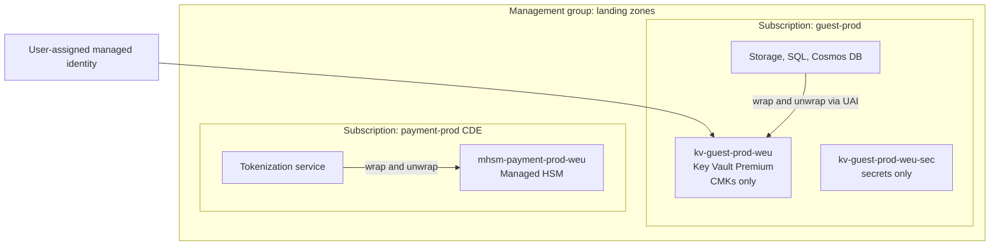

# Microsoft Azure
{: .no_toc }

**Phases 2 to 5: Standards and keys through transit and in use.** How the organization implements PP-1, PP-2, and PP-3 on Azure and Microsoft 365, from key vault layout and Azure Policy to Purview discovery, service encryption, and evidence.
{: .fs-5 .fw-300 }

## On this page
{: .no_toc .text-delta }

1. TOC
{:toc}

---

## Scope and assumptions

This playbook assumes an Azure landing zone built on management groups: a platform management
group (identity, management, connectivity subscriptions) and landing zone management groups for
corporate and online workloads. A dedicated management group holds the cardholder data
environment subscriptions. Microsoft 365 shares the same Entra ID tenant, which is why Purview
labels and Azure data protection are designed together in this playbook.

For detailed key management procedures (RBAC design, Managed HSM activation and security domain
handling, BYOK import, rotation policies), see the
[Azure Key Vault and Managed HSM companion guide](https://steven-smith-itnet.github.io/azure-key-vault-managed-hsm-key-management-guide/).

## 1. Service map and terminology

| Generic concept | Azure service or term | Notes |
|---|---|---|
| Key service | Azure Key Vault | Standard tier: software-protected keys; Premium tier: HSM-protected keys (`RSA-HSM`, `EC-HSM`) |
| Provider-managed key | Microsoft-managed key (platform-managed key) | Default for Azure Storage, SQL TDE, managed disks, Cosmos DB |
| Customer-managed key | Key in Key Vault or Managed HSM referenced by a service | Requires soft delete and purge protection on the vault |
| Single-tenant HSM behind key API | Azure Key Vault Managed HSM | FIPS 140-3 Level 3; local RBAC; security domain controlled by the organization |
| Single-tenant HSM, customer operated | Azure Cloud HSM (successor to Dedicated HSM) | Verify regional availability and status |
| External key | Double Key Encryption (Purview labels only) | No general hold-your-own-key for Azure PaaS services |
| BYOK | Key Vault BYOK with key exchange key | Supported for Key Vault Premium and Managed HSM from supported HSMs |
| Envelope encryption SDK | Azure SDK key clients (`CryptographyClient`), Always Encrypted client drivers | Application-layer wrap and unwrap |
| Secrets | Key Vault secrets | Separate vaults for secrets and CMKs keep throttling and access separate |
| Discovery and labels | Microsoft Purview (Data Map, Information Protection, DLP) | One label taxonomy for M365 and Azure data assets |
| Guardrails | Azure Policy at management group scope | `deny`, `audit`, `modify`, `deployIfNotExists` effects |
| Confidential computing | Confidential VMs (AMD SEV-SNP, Intel TDX), confidential containers | Secure Key Release through Microsoft Azure Attestation |
| Payment HSM | Azure Payment HSM | Dedicated payShield devices for payment processing functions |
| Audit | Key Vault diagnostic logs (`AuditEvent`), Azure Activity Log | Sent to Log Analytics and the SIEM |

## 2. Discovery and classification services

### Microsoft Purview Data Map

Purview Data Map scans registered sources and applies classifications (system and custom) to
columns and files. Relevant sources for the organization include Azure SQL Database, Azure SQL
Managed Instance, Azure Data Lake Storage Gen2, Blob Storage, Azure Synapse, Azure Database for
PostgreSQL, on-prem SQL Server through a self-hosted integration runtime, and Amazon S3 for the
multi-cloud estate. Scan rule sets determine which classifications run; the organization creates
custom classifications for loyalty member numbers and reservation confirmation numbers using
regular expressions and column name patterns.

Classification results feed the Purview Unified Catalog. Where sensitivity labels are extended to
Data Map assets, the same label names (`Confidential\Guest-PII`, `Restricted\PCI`) appear on
tables and files that M365 users see on documents. This is the main reason the site uses the
Purview label taxonomy as the canonical one.

{: .verify }
Purview has been reorganized several times (Data Catalog, Data Map, Unified Catalog, and
data security posture management features). Confirm current feature names, supported sources,
and licensing before committing a design.

### Microsoft Purview Information Protection and DLP

- **Sensitive information types (SITs).** Built-in SITs cover credit card numbers, many
  national passport and ID formats, IBANs, and bank accounts. Custom SITs and exact data match
  (EDM) are used for loyalty numbers and for matching against the actual guest identity table,
  which reduces false positives.
- **Trainable classifiers.** Useful for contracts and HR documents where no pattern exists.
- **Auto-labeling.** Client-side auto-labeling in Office apps and service-side auto-labeling for
  SharePoint, OneDrive, and Exchange apply labels based on SITs.
- **DLP.** Policies across Exchange, SharePoint, OneDrive, Teams, endpoints, and Defender for
  Cloud Apps run in simulation mode first, then in block mode for `Restricted\*` labels.

See [Microsoft 365 and collaboration]() and
[DLP and CASB enforcement]().

### Microsoft Defender for Cloud

Defender CSPM includes data-aware security posture capabilities that identify storage accounts
and databases holding sensitive data and prioritize attack paths that reach them. Defender for
Storage can include sensitive data threat detection, which raises the severity of alerts on
storage accounts that contain sensitive information types. These features overlap with Purview;
the organization uses Purview as the system of record for classification and Defender for
prioritization of security alerts.

### Mapping findings to labels

| Purview classification or SIT | Canonical label | Profile |
|---|---|---|
| Credit card number | `Restricted\PCI` | PP-3 |
| Passport numbers, national ID numbers | `Restricted\Guest-Identity` | PP-3 |
| Health-related trainable classifier; allergy and accessibility fields | `Restricted\Special-Category` | PP-3 |
| Email address, phone number, physical address | `Confidential\Guest-PII` | PP-2 |
| Employee ID with HR context | `Confidential\Employee` | PP-2 |
| Azure storage account key, connection strings | `Restricted\Secrets` | PP-3 |

## 3. Labeling, tagging, and enforcement

### Tags

Azure tag names are case-insensitive and values are case-sensitive. The site-wide schema applies
unchanged. Tags are enforced with Azure Policy:

- Built-in "Require a tag on resources" for `data-classification`, `protection-profile`, and
  `data-domain` on storage accounts, SQL servers, Cosmos DB accounts, and key vaults.
- Built-in "Inherit a tag from the resource group if missing" (`modify` effect) so that resources
  created inside a classified resource group receive its classification.

### Azure Policy for encryption

Azure Policy provides built-in definitions for customer-managed keys across many services, for
example "Storage accounts should use customer-managed key for encryption", "Azure SQL servers
should use customer-managed keys to encrypt data at rest", "Key vaults should have deletion
protection enabled", and "Keys should have a rotation policy ensuring that their rotation is
scheduled within the specified number of days after creation". Several built-ins support only
`Audit`; the organization writes custom `deny` definitions where prevention is required.

{: .verify }
Built-in policy display names and supported effects change over time. Confirm names, versions,
and allowed effects in the Azure Policy built-in definitions list before assignment.

Custom policy: storage accounts tagged `confidential` or `restricted` must use a customer-managed
key and TLS 1.2 minimum.

```json
{
  "mode": "Indexed",
  "policyRule": {
    "if": {
      "allOf": [
        { "field": "type", "equals": "Microsoft.Storage/storageAccounts" },
        { "field": "tags['data-classification']", "in": ["confidential", "restricted"] },
        {
          "anyOf": [
            { "field": "Microsoft.Storage/storageAccounts/encryption.keySource",
              "notEquals": "Microsoft.Keyvault" },
            { "field": "Microsoft.Storage/storageAccounts/minimumTlsVersion",
              "notEquals": "TLS1_2" },
            { "field": "Microsoft.Storage/storageAccounts/supportsHttpsTrafficOnly",
              "notEquals": true }
          ]
        }
      ]
    },
    "then": { "effect": "deny" }
  }
}
```

{: .note }
A storage account is often created first with Microsoft-managed keys and then switched to a
customer-managed key, because the managed identity must exist before it can be granted access to
the key. A `deny` on creation blocks that two-step pattern. The organization's Terraform module
creates a user-assigned managed identity first and passes the CMK at creation, which satisfies
the policy in one step.

Assignment at the landing zone management group:

```bash
az policy definition create \
  --name storage-cmk-tls-by-classification \
  --display-name "Storage: CMK and TLS 1.2 for confidential and restricted data" \
  --rules storage-cmk-tls.json \
  --mode Indexed \
  --management-group lz-corp

az policy assignment create \
  --name storage-cmk-tls \
  --policy "/providers/Microsoft.Management/managementGroups/lz-corp/providers/Microsoft.Authorization/policyDefinitions/storage-cmk-tls-by-classification" \
  --scope "/providers/Microsoft.Management/managementGroups/lz-corp"
```

### Purview labels on Azure data

Sensitivity labels applied to Data Map assets do not change the encryption of the underlying
storage. They are metadata that drives catalog visibility, Purview protection policies where
supported, and reporting. Encryption enforcement comes from Azure Policy and service
configuration. This distinction matters in design reviews: a table labeled `Restricted\PCI` in
Purview is not protected until the label-to-control mapping has been applied to the database.

## 4. Key management tiers

### Structured data

{: .good }
PP-1 for C0 and C1 structured data: service-managed TDE in Azure SQL and platform-managed
encryption in other services.

| Tier | Key option | Example services | What it adds | Trade-off |
|---|---|---|---|---|
| Good (PP-1) | Microsoft-managed keys | Azure SQL TDE (service-managed), Cosmos DB, PostgreSQL flexible server | Encryption at rest with no operational effort | No customer revocation or per-key audit |
| Better (PP-2) | CMK in Key Vault Premium (`RSA-HSM`) per data domain and environment, rotation policy | Azure SQL TDE with CMK, Cosmos DB CMK, PostgreSQL and MySQL flexible server CMK, Synapse, Databricks CMK | Revocation, separation of duties, key audit log | Key Vault availability becomes a database dependency; identity wiring |
| Best (PP-3) | PP-2 keys in Managed HSM, plus Always Encrypted (with secure enclaves where queries need it) or application-layer encryption or tokenization for C3 columns | Azure SQL for guest identity data; tokenization vault for PAN | C3 values are ciphertext to DBAs and to the service; single-tenant key custody | Query limitations; driver and application changes; Managed HSM cost |

### Unstructured data

{: .better }
PP-2 for C2 unstructured data: storage accounts with CMK from Key Vault Premium, infrastructure
encryption for restricted accounts, and Purview labels on documents in M365.

| Tier | Key option | Example services | What it adds | Trade-off |
|---|---|---|---|---|
| Good (PP-1) | Microsoft-managed keys | Blob, Files, managed disks | Always-on encryption | No key control |
| Better (PP-2) | CMK from Key Vault Premium; encryption scopes to separate domains inside shared accounts; Disk Encryption Sets for managed disks | Blob, ADLS Gen2, Files, managed disks, Backup vaults | Key revocation, per-scope key separation | Scope must be set at write time; identity access to vault |
| Best (PP-3) | Managed HSM keys; infrastructure encryption (double encryption); Purview labels with encryption on documents; Double Key Encryption for a narrow set of content | Restricted storage accounts; M365 documents with `Restricted\*` labels | Encryption persists with the file outside Azure (labels); Microsoft cannot decrypt DKE content | Label encryption limits search, eDiscovery, and co-authoring for DKE content; DKE requires operating the key service |

### In transit

{: .best }
PP-3 in transit: Private Endpoints for all data services and key vaults, TLS 1.2 minimum with
TLS 1.3 preferred, and mTLS for service-to-service calls.

| Tier | Control | Example configuration |
|---|---|---|
| Good (PP-1) | TLS 1.2 minimum | Storage `minimumTlsVersion` `TLS1_2`; SQL minimal TLS version 1.2 |
| Better (PP-2) | TLS 1.2+ preferring 1.3; Private Endpoints for data services and Key Vault; public network access disabled | Application Gateway predefined policy `AppGwSslPolicy20220101S`; Front Door minimum TLS 1.2 |
| Best (PP-3) | mTLS; Azure Firewall Premium inspection only where lawful and necessary; confidential computing for processing | Application Gateway mutual authentication; service mesh on AKS |

### Vault layout



Rules applied:

- One vault per data domain, environment, and region for CMKs, separate from secrets vaults.
  Throttling limits and RBAC are per vault, so separation reduces blast radius.
- RBAC authorization model, not access policies. Key administrators hold Key Vault Crypto
  Officer; services hold Key Vault Crypto Service Encryption User on the specific key.
- Soft delete (mandatory in Azure) plus purge protection on every CMK vault.
- Public network access disabled; Private Endpoints; the "allow trusted Microsoft services"
  exception only where a service integration requires it.

## 5. Structured data services

| Service | At-rest encryption | CMK support | Notes |
|---|---|---|---|
| Azure SQL Database and Managed Instance | TDE on by default | Server-level or database-level CMK from Key Vault or Managed HSM | CMK is a TDE protector; revoking it makes databases inaccessible |
| SQL Server on Azure VMs | TDE with Extensible Key Management (EKM) provider for Key Vault | Yes, through the SQL Server Connector for Key Vault | Same pattern as on-prem SQL Server |
| Azure Cosmos DB | Always encrypted | CMK at account level | Confirm whether CMK can be enabled on existing accounts in the target API (verify) |
| Azure Database for PostgreSQL and MySQL flexible server | Always encrypted | CMK set at server creation | Requires user-assigned managed identity |
| Azure Synapse Analytics | TDE for dedicated SQL pools; workspace-level double encryption with CMK | Workspace CMK at creation | Plan at creation time |
| Azure Databricks | Managed services and workspace storage | CMK for managed services, DBFS root, and managed disks | Unity Catalog governs column masks and row filters |
| Microsoft Fabric | Service-managed encryption | Workspace-level CMK features (verify status) | Treat as PP-2 only after confirming CMK coverage |

### Always Encrypted

Always Encrypted keeps selected columns encrypted in the database with keys the database engine
never sees in plaintext. Column master keys live in Key Vault or Managed HSM; column encryption
keys are stored encrypted in the database. Deterministic encryption allows equality lookups;
randomized encryption does not. With secure enclaves (VBS enclaves in Azure SQL Database),
the engine can perform pattern matching, range comparisons, and in-place encryption inside the
enclave, subject to attestation policy.

Use cases in the organization: passport number and national ID columns in the guest identity
store; bank account columns in payroll. Not used for PAN, which is tokenized instead.

```sql
-- Column definition using a column encryption key already provisioned with a Key Vault CMK
CREATE TABLE guest_identity (
    guest_id        UNIQUEIDENTIFIER NOT NULL PRIMARY KEY,
    document_type   NVARCHAR(20)     NOT NULL,
    document_number NVARCHAR(40) COLLATE Latin1_General_BIN2
        ENCRYPTED WITH (
            COLUMN_ENCRYPTION_KEY = CEK_GuestIdentity,
            ENCRYPTION_TYPE = DETERMINISTIC,
            ALGORITHM = 'AEAD_AES_256_CBC_HMAC_SHA_256'
        ) NOT NULL,
    issuing_country CHAR(2)          NOT NULL
);
```

### Dynamic data masking

Dynamic data masking in Azure SQL hides values from non-privileged users at query time. It is a
presentation control, not encryption: users with `UNMASK` or with direct data access see
plaintext, and inference attacks can reveal masked values. The organization uses it for PP-2
reporting roles on C2 columns and never as the only control on C3 data.

### SQL TDE with CMK

```bash
az sql server key create \
  --resource-group rg-guest-prod \
  --server sql-guest-prod-weu \
  --kid "https://kv-guest-prod-weu.vault.azure.net/keys/tde-guest-prod/<version>"

az sql server tde-key set \
  --resource-group rg-guest-prod \
  --server sql-guest-prod-weu \
  --server-key-type AzureKeyVault \
  --kid "https://kv-guest-prod-weu.vault.azure.net/keys/tde-guest-prod/<version>" \
  --auto-rotation-enabled true
```

With auto-rotation enabled, the server picks up new key versions created by the Key Vault
rotation policy. The TDE protector key must be an RSA key, and the vault must have soft delete
and purge protection enabled.

## 6. Unstructured data services

| Service | Options | Organization standard |
|---|---|---|
| Blob Storage and ADLS Gen2 | Microsoft-managed keys; CMK at account level; encryption scopes with their own keys; infrastructure encryption; customer-provided keys per request | Account-level CMK for C2; dedicated account with infrastructure encryption and Managed HSM key for C3 |
| Azure Files | Account-level encryption with CMK | CMK for HR and finance shares; SMB 3.x encryption in transit |
| Managed disks | Platform-managed keys; CMK through Disk Encryption Sets; encryption at host; confidential disk encryption | Disk Encryption Set per domain; encryption at host for temp disks and caches |
| Azure Backup | Recovery Services vault CMK | CMK vault key per domain; immutability and soft delete on vaults |
| Log Analytics | CMK through dedicated clusters | Required only where logs hold C2 or C3 data at scale; dedicated clusters carry a commitment tier cost |
| Microsoft 365 | Service encryption; Customer Key; sensitivity labels with encryption; DKE | Labels with encryption for `Restricted\*`; Customer Key where contractually required; DKE for a narrow set |

{: .verify }
Microsoft has announced the retirement of Azure Disk Encryption (the BitLocker and dm-crypt based
VM extension) in favor of encryption at host and server-side encryption with CMK. Confirm the
retirement date and migration guidance before designing new VM disk encryption.

Storage account with CMK at creation:

```bash
az identity create --name uai-guest-prod-storage --resource-group rg-guest-prod

az storage account create \
  --name stguestprodweu01 \
  --resource-group rg-guest-prod \
  --location westeurope \
  --sku Standard_ZRS \
  --kind StorageV2 \
  --min-tls-version TLS1_2 \
  --https-only true \
  --allow-blob-public-access false \
  --allow-shared-key-access false \
  --require-infrastructure-encryption true \
  --identity-type UserAssigned \
  --user-identity-id "<uai-resource-id>" \
  --encryption-key-source Microsoft.Keyvault \
  --encryption-key-vault "https://kv-guest-prod-weu.vault.azure.net" \
  --encryption-key-name st-guest-prod \
  --key-vault-user-identity-id "<uai-resource-id>" \
  --tags data-classification=confidential protection-profile=pp2 data-domain=guest data-residency=eu
```

Omitting the key version lets the storage account follow the latest version automatically after
rotation. Encryption scopes add a second axis: an encryption scope bound to a different key can
be set as the default for a container, which allows a shared analytics account to keep loyalty
data and employee data under separate keys.

```bash
az storage account encryption-scope create \
  --account-name stlakeprodweu01 \
  --resource-group rg-lake-prod \
  --name es-loyalty \
  --key-source Microsoft.KeyVault \
  --key-uri "https://kv-loyalty-prod-weu.vault.azure.net/keys/es-loyalty"
```

## 7. Transit and in use

### TLS

- **Storage.** `minimumTlsVersion` `TLS1_2` and secure transfer required, enforced by policy.
- **Azure SQL.** Minimal TLS version set to 1.2 at the logical server; connection policy
  "Redirect" inside Azure for performance.
- **Application Gateway.** Predefined policy `AppGwSslPolicy20220101S` (TLS 1.2 minimum, strong
  suites); TLS 1.3 is negotiated when the client supports it.
- **Front Door.** Minimum TLS version 1.2; managed certificates or certificates from Key Vault.
- **Key Vault.** TLS 1.2 minimum on the endpoint; clients must not pin intermediate certificates.

{: .verify }
Azure has been retiring TLS 1.0 and 1.1 across services on service-specific schedules. Confirm
the current state for each service in scope rather than assuming older protocols are still
negotiable or already removed.

### Private connectivity

Private Endpoints for Key Vault, Managed HSM, Storage, SQL, and Cosmos DB, with private DNS zones
in the connectivity subscription. Azure Policy built-ins with `deployIfNotExists` create the DNS
records. Public network access is disabled on CMK vaults; services reach them through the
trusted-services path or Private Endpoints, depending on the integration.

### Confidential computing

- **Confidential VMs** with AMD SEV-SNP or Intel TDX encrypt memory with keys held by the
  processor. Confidential OS disk encryption binds the disk key to the VM's virtual TPM state.
- **Secure Key Release** releases an exportable Key Vault Premium or Managed HSM key only to a
  workload that presents a valid Microsoft Azure Attestation token matching the key's release
  policy.
- **Confidential containers** on AKS and Azure Container Instances for workloads that need
  container packaging with memory isolation.
- **Always Encrypted with secure enclaves** for database-side computation on encrypted columns.

See [Data in use and confidential computing]().

## 8. PQC status

{: .verify }
As of mid-2026: Microsoft added ML-KEM and ML-DSA to SymCrypt, its core cryptographic library,
and made PQC APIs available in Windows and on Linux through SymCrypt-OpenSSL. Microsoft's Quantum
Safe Program targets early adoption by 2029 and completion of its transition by 2033. Support for
post-quantum key types in Azure Key Vault and Managed HSM, and for hybrid post-quantum TLS on
Azure front-door services (Front Door, Application Gateway, API Management), should be confirmed
against current Microsoft documentation before being written into a standard.

Implications for the organization:

- Azure storage and database encryption at rest uses AES-256 data keys, which remain appropriate.
  The quantum-vulnerable component is the RSA-wrapped CMK path and TLS key exchange, not the data
  encryption itself.
- CMKs are RSA keys today. When Key Vault offers post-quantum or hybrid wrapping, the migration
  is a key rotation to a new key type, which the rotation automation in this playbook should be
  able to absorb.
- Windows and .NET estates (including property servers) will gain PQC through operating system
  updates; the cryptographic inventory should track OS versions as a PQC readiness indicator.

See [Vendor and cloud PQC readiness]().

## 9. Landing zone implementation

### Step 1: Assign guardrails at management group scope

1. Assign tag requirement and inheritance policies from section 3.
2. Assign CMK policies in `Audit` mode first, review compliance for two to four weeks, then move
   custom definitions to `deny`.
3. Assign "Key vaults should have deletion protection enabled" and the rotation policy
   requirement.
4. Assign TLS minimum version policies for Storage, SQL, and App Service.

### Step 2: Create the key vault hierarchy

```bash
az keyvault create \
  --name kv-guest-prod-weu \
  --resource-group rg-guest-prod-keys \
  --location westeurope \
  --sku premium \
  --enable-rbac-authorization true \
  --enable-purge-protection true \
  --retention-days 90 \
  --public-network-access Disabled \
  --tags data-classification=confidential protection-profile=pp2 data-domain=guest data-residency=eu

az keyvault key create \
  --vault-name kv-guest-prod-weu \
  --name st-guest-prod \
  --kty RSA-HSM \
  --size 3072 \
  --ops wrapKey unwrapKey
```

Rotation policy (`rotation-policy.json`):

```json
{
  "lifetimeActions": [
    { "trigger": { "timeAfterCreate": "P335D" }, "action": { "type": "Rotate" } },
    { "trigger": { "timeBeforeExpiry": "P30D" }, "action": { "type": "Notify" } }
  ],
  "attributes": { "expiryTime": "P13M" }
}
```

```bash
az keyvault key rotation-policy update \
  --vault-name kv-guest-prod-weu \
  --name st-guest-prod \
  --value rotation-policy.json
```

Terraform equivalent for the pipeline:

```hcl
resource "azurerm_key_vault_key" "storage" {
  name         = "st-guest-prod"
  key_vault_id = azurerm_key_vault.guest_prod.id
  key_type     = "RSA-HSM"
  key_size     = 3072
  key_opts     = ["wrapKey", "unwrapKey"]

  rotation_policy {
    automatic {
      time_after_creation = "P335D"
    }
    expire_after         = "P13M"
    notify_before_expiry = "P30D"
  }

  tags = {
    data-classification = "confidential"
    protection-profile  = "pp2"
    data-domain         = "guest"
  }
}
```

Role assignments, keeping administrators and users separate:

```bash
az role assignment create \
  --assignee "<uai-principal-id>" \
  --role "Key Vault Crypto Service Encryption User" \
  --scope "<key-vault-resource-id>/keys/st-guest-prod"

az role assignment create \
  --assignee "<key-admin-group-object-id>" \
  --role "Key Vault Crypto Officer" \
  --scope "<key-vault-resource-id>"
```

### Step 3: Stand up Managed HSM for PP-3 domains

```bash
az keyvault create \
  --hsm-name mhsm-payment-prod-weu \
  --resource-group rg-payment-prod-keys \
  --location westeurope \
  --administrators "<hsm-admin-group-object-id>" \
  --retention-days 90

# Activate by downloading the security domain, protected by a 2-of-3 quorum of RSA keys
az keyvault security-domain download \
  --hsm-name mhsm-payment-prod-weu \
  --sd-wrapping-keys ./sd-custodian1.cer ./sd-custodian2.cer ./sd-custodian3.cer \
  --sd-quorum 2 \
  --security-domain-file ./mhsm-payment-prod-weu-sd.json
```

{: .warning }
The security domain file and a quorum of the custodian private keys are required to recover a
Managed HSM. Losing them means losing every key in the HSM. Store the custodian keys with
separate custodians, in separate locations, following the dual-control procedures in
[Key custody]().

### Step 4: Enforce CMK on data services

Deploy storage accounts, SQL servers, and Cosmos DB accounts only through modules that create the
user-assigned identity, grant it the key role, and configure the CMK at creation (section 6
command). The custom `deny` policy from section 3 catches anything created outside the modules.

### Step 5: Enforce encryption in transit

Assign TLS minimum version policies, disable public network access on data services and vaults,
deploy Private Endpoints with DNS integration policies, and standardize Application Gateway and
Front Door TLS policies in shared modules.

### Step 6: Turn on discovery

1. Register sources in Purview Data Map by collection (one collection per data domain), using
   managed identity authentication.
2. Create scan rule sets with the custom classifications and schedule weekly scans for C2 and C3
   sources.
3. Enable Defender CSPM data-aware posture and Defender for Storage sensitive data threat
   detection on subscriptions holding C2 and C3 data.
4. Turn on auto-labeling policies in simulation mode for M365, then enforce.

### Step 7: Wire logging

```bash
az monitor diagnostic-settings create \
  --name kv-to-law \
  --resource "<key-vault-resource-id>" \
  --workspace "<log-analytics-workspace-resource-id>" \
  --logs '[{"categoryGroup":"audit","enabled":true}]' \
  --metrics '[{"category":"AllMetrics","enabled":true}]'
```

Deploy the same setting at scale with the built-in `deployIfNotExists` policy for Key Vault and
Managed HSM diagnostic settings.

## 10. Logging and evidence

| Evidence need | Source | Notes |
|---|---|---|
| Key usage (wrap, unwrap, sign, decrypt) | Key Vault and Managed HSM `AuditEvent` logs | Includes caller identity, operation, result |
| Key and vault configuration changes | `AuditEvent` for data plane changes; Azure Activity Log for control plane | Vault deletion and network changes appear in the Activity Log |
| Throttling | Key Vault metrics (`ServiceApiResult` with status 429) | Alert before customers see failures |
| Policy compliance | Azure Policy compliance state; Azure Resource Graph | Export per management group |
| Label and DLP activity | Purview audit log and activity explorer | Evidence for PP-3 unstructured controls |
| Sensitive data location | Purview Data Map classifications; Defender CSPM | Map to the inventory |

KQL for destructive or sensitive key operations (legacy `AzureDiagnostics` schema; adjust for
resource-specific tables if configured):

```kusto
AzureDiagnostics
| where ResourceProvider == "MICROSOFT.KEYVAULT"
| where OperationName in ("KeyDelete", "KeyPurge", "KeyUpdate", "KeyImport", "VaultPatch", "VaultDelete")
| project TimeGenerated, Resource, OperationName, ResultType,
          CallerIPAddress, identity_claim_oid_g, id_s
| order by TimeGenerated desc
```

KQL for unwrap volume per caller:

```kusto
AzureDiagnostics
| where ResourceProvider == "MICROSOFT.KEYVAULT" and OperationName == "KeyUnwrap"
| summarize unwraps = count() by Resource, identity_claim_oid_g, bin(TimeGenerated, 1h)
| order by unwraps desc
```

{: .note }
Column names in `AzureDiagnostics` for Key Vault depend on the claims present in the token.
Validate the projection against a sample of real events before building alert rules.

## 11. Gotchas and limits

| Issue | What happens | Mitigation |
|---|---|---|
| Key Vault throttling | Each vault has documented transaction limits per time window that vary by key type and operation; excess calls return HTTP 429 | Separate vaults per domain; cache data keys in applications; use the service's own caching (Storage and SQL cache unwrapped keys); monitor 429s |
| CMK revocation is an outage | Disabling or deleting a CMK makes storage accounts and databases inaccessible after the service's cache expires | Treat key disable as a change-controlled action; alert on `KeyUpdate` that disables a key |
| Purge protection is permanent | Once enabled, it cannot be turned off, and deleted vaults and keys are retained for the retention period | Intended; plan vault names accordingly |
| Identity must exist first | CMK at creation needs a user-assigned identity with access to the key | Module creates identity and role assignment before the resource |
| Firewall and trusted services | Some services need "allow trusted Microsoft services" to reach a vault with public access disabled | Document each exception; prefer Private Endpoints where the service supports them |
| Infrastructure encryption is creation-time | Cannot be enabled on an existing storage account | Decide at account creation; separate C3 accounts |
| Encryption scope changes | Existing blobs keep their scope; changing a container default does not re-encrypt | Copy data to re-encrypt |
| Managed HSM security domain | Without the security domain and quorum, disaster recovery is impossible | Custodian procedures and periodic recovery tests |
| Managed HSM cost | Billed per pool per hour regardless of usage | Use for PP-3 and payment domains only |
| Log Analytics CMK | Requires a dedicated cluster with a commitment tier | Only where log volume and sensitivity justify it |
| Cross-region DR | Key Vault keys are regional; paired-region failover behavior is Microsoft-managed | Document DR for CMKs; test failover of dependent services |

## Key takeaways for engineering teams

- Use Key Vault Premium HSM-protected keys per data domain, environment, and region for C2 data;
  reserve Managed HSM for C3 and payment domains.
- Use RBAC, purge protection, rotation policies, and separate vaults for keys and secrets.
- Purview labels on data assets are metadata; encryption is enforced by Azure Policy and service
  configuration.
- Always Encrypted and application-layer encryption, not dynamic data masking, protect C3
  columns.
- Disabling a CMK is an outage for every dependent service; control and alert on it.
- Confirm Azure PQC support for Key Vault and TLS front ends before standardizing.

## Related pages

- [Cloud provider playbooks]()
- [Cross-cloud terminology]()
- [Microsoft 365 and collaboration]()
- [Cloud databases]()
- [Guardrails and policy as code]()
- Companion guide: [Azure Key Vault and Managed HSM key management guide](https://steven-smith-itnet.github.io/azure-key-vault-managed-hsm-key-management-guide/)
- Code: [Terraform modules for Azure](https://github.com/steven-smith-itnet/data-protection-pqc-security-architecture/tree/main/code/terraform/azure) and [Azure Policy examples](https://github.com/steven-smith-itnet/data-protection-pqc-security-architecture/tree/main/code/policy/azure-policy)

## Sources

- Azure Key Vault documentation: <https://learn.microsoft.com/azure/key-vault/>
- Azure Key Vault service limits: <https://learn.microsoft.com/azure/key-vault/general/service-limits>
- Managed HSM security domain: <https://learn.microsoft.com/azure/key-vault/managed-hsm/security-domain>
- Azure Storage customer-managed keys: <https://learn.microsoft.com/azure/storage/common/customer-managed-keys-overview>
- Azure SQL TDE with customer-managed keys: <https://learn.microsoft.com/azure/azure-sql/database/transparent-data-encryption-byok-overview>
- Always Encrypted with secure enclaves: <https://learn.microsoft.com/sql/relational-databases/security/encryption/always-encrypted-enclaves>
- Microsoft Purview documentation: <https://learn.microsoft.com/purview/>
