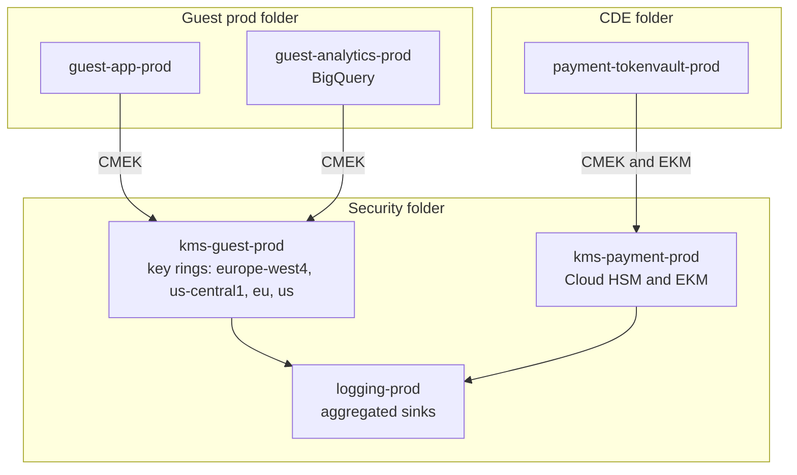

# Google Cloud
{: .no_toc }

**Phases 2 to 5: Standards and keys through transit and in use.** How the organization implements PP-1, PP-2, and PP-3 on Google Cloud, from the key project and CMEK constraints to Sensitive Data Protection, BigQuery column controls, and evidence.
{: .fs-5 .fw-300 }

## On this page
{: .no_toc .text-delta }

1. TOC
{:toc}

---

## Scope and assumptions

This playbook assumes a Google Cloud organization with a folder hierarchy by environment and
business unit, a dedicated folder for the cardholder data environment, and a security folder that
holds key projects, logging projects, and the Sensitive Data Protection service project. Google
Cloud is the organization's main analytics platform in this reference architecture: BigQuery
hosts the enterprise warehouse for revenue management, loyalty analytics, and guest insights.

For detailed key management procedures (key project design, IAM, import jobs, EKM setup, Key
Access Justifications policies), see the
[Google Cloud KMS and HSM companion guide](https://steven-smith-itnet.github.io/gcp-cloud-kms-hsm-key-management-guide/).

## 1. Service map and terminology

| Generic concept | Google Cloud service or term | Notes |
|---|---|---|
| Key service | Cloud KMS | Keys organized in key rings, bound to a location |
| Provider-managed key | Default encryption (Google-owned and Google-managed keys) | Always on for data at rest |
| Customer-managed key | CMEK: a Cloud KMS key used by a Google Cloud service | Service agent needs `roles/cloudkms.cryptoKeyEncrypterDecrypter` |
| Customer-supplied key | CSEK | Cloud Storage and Compute Engine only; the organization supplies raw key material per request |
| HSM-backed key | Cloud HSM (protection level `HSM`) | Same API as software keys |
| External key | Cloud EKM (protection level `EXTERNAL` or `EXTERNAL_VPC`) | Supported partners hold the key; Key Access Justifications add a reason per request |
| Automated CMEK provisioning | Cloud KMS Autokey | Creates keys on demand in a designated key project |
| BYOK | Cloud KMS import jobs | Imported versions cannot be exported |
| Envelope encryption SDK | Tink with Cloud KMS integration | Also BigQuery AEAD functions for SQL-level encryption |
| Secrets | Secret Manager | CMEK supported |
| Private CA | Certificate Authority Service | CA keys in Cloud HSM |
| Discovery and DLP | Sensitive Data Protection (formerly Cloud DLP) | Discovery profiles, inspection, de-identification |
| Catalog and governance | Dataplex Universal Catalog; BigQuery policy tags | Column-level access and dynamic masking |
| Guardrails | Organization Policy Service | Built-in and custom constraints |
| Confidential computing | Confidential VMs, Confidential GKE Nodes, Confidential Space | AMD SEV, SEV-SNP, Intel TDX |
| Audit | Cloud Audit Logs | Cloud KMS Data Access logs must be enabled explicitly |

## 2. Discovery and classification services

### Sensitive Data Protection discovery

Sensitive Data Protection provides discovery that profiles data across an organization, folder,
or project. The organization configures discovery scan configurations for:

- **BigQuery**: table and column data profiles with predicted infoTypes, sensitivity level, and
  data risk level.
- **Cloud SQL**: database table profiles.
- **Cloud Storage**: bucket-level profiles based on sampled files.

Profiles are published to Security Command Center, to Dataplex as tags or aspects, to BigQuery
for analysis, and to Pub/Sub for automation. The organization publishes to all four: Security
Command Center for risk prioritization, Dataplex for the catalog, BigQuery for reporting, and
Pub/Sub for the classification pipeline that compares findings with resource labels.

{: .verify }
Supported discovery targets and publishing destinations have expanded over time. Confirm the
current list, including any multi-cloud sources, before finalizing scope.

### Inspection and de-identification

For pipelines, Sensitive Data Protection inspection jobs and the `content:deidentify` API
detect and transform values in flight. Transformations include masking, redaction, bucketing,
date shifting, cryptographic hashing (keyed), deterministic encryption, and format-preserving
encryption with a Cloud KMS-wrapped key. The organization uses deterministic encryption with a
KMS-wrapped key for loyalty member numbers in analytics, which keeps joins possible across
tables, and redaction for free-text fields such as reservation notes.

{: .warning }
Format-preserving encryption in Sensitive Data Protection is based on FFX modes. Before using it
for regulated data, confirm the underlying mode against the site's FPE standard; NIST SP 800-38G
recommends FF1, and the draft revision withdraws FF3-1. See
[Tokenization, FPE, and masking]().

### Custom infoTypes

Custom infoTypes use regular expressions, dictionaries, or stored infoTypes (large dictionaries
built from BigQuery tables). Loyalty member numbers and reservation confirmation numbers are
regex custom infoTypes; the list of known employee IDs is a stored infoType.

### Mapping findings to labels

| infoType or profile result | Canonical label | Profile |
|---|---|---|
| `CREDIT_CARD_NUMBER` | `Restricted\PCI` | PP-3 |
| `PASSPORT` and country-specific identity infoTypes | `Restricted\Guest-Identity` | PP-3 |
| Medical-related infoTypes, allergy fields | `Restricted\Special-Category` | PP-3 |
| `EMAIL_ADDRESS`, `PHONE_NUMBER`, `STREET_ADDRESS`, `PERSON_NAME` | `Confidential\Guest-PII` | PP-2 |
| `IBAN_CODE` in payroll context | `Confidential\Employee` or `Restricted` by review | PP-2 or PP-3 |
| `AUTH_TOKEN`, `GCP_CREDENTIALS`, `ENCRYPTION_KEY` | `Restricted\Secrets` | PP-3 |

## 3. Labeling, tagging, and enforcement

### Labels and tags

Google Cloud has two metadata mechanisms, and the organization uses both:

| Mechanism | Purpose | Use in this program |
|---|---|---|
| Labels | Key-value metadata on resources; used for billing and filtering | The full tag schema (`data-classification`, `protection-profile`, `data-domain`, and the rest) |
| Tags (Resource Manager tags) | Organization-level key-value resources attached to resources, inheritable, usable in IAM conditions and Organization Policy conditions | `data-classification` only, so that policy can differ by classification |

The site-wide schema already follows Google Cloud label constraints: lowercase, hyphens and
underscores, 63 characters or fewer. Tags are inherited down the resource hierarchy, which lets a
folder tagged `data-classification=restricted` apply stricter Organization Policy to every
project below it.

### Organization Policy constraints for CMEK

Two list constraints enforce CMEK:

| Constraint | What it does |
|---|---|
| `constraints/gcp.restrictNonCmekServices` | For each service in the deny list, resources can only be created with CMEK |
| `constraints/gcp.restrictCmekCryptoKeyProjects` | Restricts which projects may supply Cloud KMS keys for CMEK |

Policy for the guest production folder (applied with `gcloud org-policies set-policy`):

```yaml
# restrict-non-cmek.yaml
name: folders/123456789012/policies/gcp.restrictNonCmekServices
spec:
  rules:
  - values:
      deniedValues:
      - bigquery.googleapis.com
      - storage.googleapis.com
      - sqladmin.googleapis.com
      - compute.googleapis.com
      - pubsub.googleapis.com
      - secretmanager.googleapis.com
```

```yaml
# restrict-cmek-projects.yaml
name: folders/123456789012/policies/gcp.restrictCmekCryptoKeyProjects
spec:
  rules:
  - values:
      allowedValues:
      - under:projects/kms-guest-prod
```

```bash
gcloud org-policies set-policy restrict-non-cmek.yaml
gcloud org-policies set-policy restrict-cmek-projects.yaml
```

{: .important }
`restrictNonCmekServices` only affects resources created after the policy is set. Existing
resources are reported but not changed. Run a CMEK compliance review (Cloud Asset Inventory or
the Cloud KMS key usage tracking views) to find existing non-CMEK resources in scope.

Other constraints used by the program:

| Constraint | Purpose |
|---|---|
| `constraints/gcp.resourceLocations` | Data residency; keeps EU guest data in EU locations |
| `constraints/storage.publicAccessPrevention` | Blocks public buckets |
| `constraints/storage.uniformBucketLevelAccess` | Removes object ACLs so IAM is the only access path |
| `constraints/sql.restrictPublicIp` | No public IP on Cloud SQL |
| `constraints/iam.disableServiceAccountKeyCreation` | No long-lived service account keys (a common secret leak) |
| `constraints/gcp.restrictTLSVersion` | Denies older TLS versions on supported Google Cloud APIs (verify coverage) |
| `constraints/cloudkms.minimumDestroyScheduledDuration` | Sets a minimum scheduled-destruction period for key versions (verify name and availability) |

{: .verify }
Constraint names for TLS version restriction and minimum key destruction duration should be
checked against the current Organization Policy constraints list before assignment.

### Custom constraints

Custom Organization Policy constraints use CEL conditions on resource fields for supported
resource types. For example, a custom constraint can require that Cloud Storage buckets carry a
`data-classification` label value from the allowed list. Coverage varies by service.

```yaml
name: organizations/123456789012/customConstraints/custom.bucketRequiresClassification
resourceTypes:
- storage.googleapis.com/Bucket
methodTypes:
- CREATE
- UPDATE
condition: "resource.labels['data-classification'] in ['public', 'internal', 'confidential', 'restricted']"
actionType: ALLOW
displayName: Buckets must carry a data-classification label
description: Enforces the classification label schema on Cloud Storage buckets.
```

## 4. Key management tiers

### Structured data

{: .good }
PP-1 for C0 and C1 structured data: Google default encryption. No configuration is required.

| Tier | Key option | Example services | What it adds | Trade-off |
|---|---|---|---|---|
| Good (PP-1) | Default encryption | BigQuery, Cloud SQL, Spanner, Firestore | Encryption at rest | No customer revocation or key audit |
| Better (PP-2) | CMEK with Cloud HSM keys in a key project per domain and environment; automatic rotation; enforced by Organization Policy | BigQuery datasets, Cloud SQL, AlloyDB, Spanner, Bigtable | Revocation, separation of duties, Data Access logs per key | Location matching; service agent grants; key version disable affects data availability |
| Best (PP-3) | PP-2 plus field-level encryption (Tink in the application, or BigQuery AEAD functions with KMS-wrapped keysets); Cloud EKM with Key Access Justifications where justified | Guest identity tables; loyalty-to-identity mapping tables | C3 values remain ciphertext to analysts and to Google; external custody | No aggregation on ciphertext; EKM adds latency and an external availability dependency |

### Unstructured data

{: .better }
PP-2 for C2 unstructured data: Cloud Storage buckets with a default CMEK from Cloud HSM, uniform
bucket-level access, and public access prevention.

| Tier | Key option | Example services | What it adds | Trade-off |
|---|---|---|---|---|
| Good (PP-1) | Default encryption | Cloud Storage, Persistent Disk, Filestore | Always-on encryption | No key control |
| Better (PP-2) | Default CMEK on bucket; CMEK on disks, Filestore, and backups | Cloud Storage, Persistent Disk, Hyperdisk, Filestore, Backup and DR | Revocation and key audit | Key location must match resource location |
| Best (PP-3) | Client-side encryption with Tink before upload; Cloud EKM for a narrow set; Workspace client-side encryption for Google Workspace content | Passport scans; HR case files; Workspace documents for restricted teams | Google cannot decrypt content (client-side, EKM) | Loss of server-side processing; key service operations |

### In transit

{: .best }
PP-3 in transit: mTLS between services with certificates from Certificate Authority Service,
RESTRICTED or custom SSL policies on load balancers, and Private Service Connect for Google APIs.

| Tier | Control | Example configuration |
|---|---|---|
| Good (PP-1) | TLS 1.2 minimum on load balancers | SSL policy with `--min-tls-version=1.2` and `MODERN` profile |
| Better (PP-2) | TLS 1.2+ preferring 1.3; private access to Google APIs; Cloud SQL requires SSL | SSL policy `RESTRICTED` profile; Private Service Connect endpoint for Google APIs |
| Best (PP-3) | mTLS for service-to-service; VPC Service Controls perimeter around data projects | Cloud Service Mesh mTLS; load balancer mTLS with trust configs |

### Key project layout



Keys live in dedicated key projects. Workload project service agents receive only
`roles/cloudkms.cryptoKeyEncrypterDecrypter` on specific keys. Key administrators hold
`roles/cloudkms.admin` in the key project and have no role in workload projects.
`restrictCmekCryptoKeyProjects` prevents teams from bypassing the key project.

### Autokey

Autokey automates this layout: when a resource that supports Autokey is created in a folder
enabled for Autokey, Cloud KMS creates a key in the designated key project with a
standardized name, HSM protection level, and rotation, and grants the service agent access.
This removes the most common CMEK adoption blocker (teams waiting for keys) while keeping the
key project model.

```bash
# Designate the key project for a folder (Autokey configuration)
gcloud kms autokey-config update \
  --folder=123456789012 \
  --key-project=kms-guest-prod
```

{: .verify }
Autokey service coverage and the exact `gcloud` surface have evolved since launch. Confirm the
command, supported resource types, and the key granularity Autokey uses (per resource type,
per project, per location) before adopting it as the standard.

Trade-off: Autokey produces keys per project and resource type rather than per data domain as
defined in this program. The organization accepts Autokey for PP-2 workloads and uses
pipeline-created keys for PP-3 and for shared analytics datasets where domain-level key
separation matters for crypto-shredding.

## 5. Structured data services

| Service | Default | CMEK | Notes |
|---|---|---|---|
| BigQuery | Default encryption | Dataset default key, table-level key, query result destination tables | Column-level controls through policy tags; AEAD functions for field encryption |
| Cloud SQL (MySQL, PostgreSQL, SQL Server) | Default encryption | Set at instance creation (`--disk-encryption-key`) | Replicas and backups follow the instance key; cannot switch an existing instance to CMEK in place |
| AlloyDB | Default encryption | Set at cluster creation | Backups can use their own CMEK |
| Spanner | Default encryption | Database-level CMEK; multi-region needs keys per region (verify for current configurations) | Backups can use CMEK |
| Bigtable | Default encryption | Cluster-level CMEK | Set at creation |
| Firestore | Default encryption | CMEK for databases (verify availability and limitations) | Plan at creation |
| Dataproc and Dataflow | Default encryption | CMEK for persistent disks and job state | Pipeline temp buckets must also use CMEK |

### BigQuery column controls

BigQuery provides three layered controls for structured C2 and C3 data:

1. **Policy tags** from a Dataplex taxonomy (for example `guest_pii`, `guest_identity`, `pci`)
   applied to columns. Only principals with Fine-Grained Reader on the tag can read the column.
2. **Dynamic data masking** rules on the same policy tags. Principals with Masked Reader see a
   masked form (nullify, hash, default value, or last-four style rules) instead of an access
   error.
3. **AEAD encryption functions** for field-level encryption in SQL, with keysets wrapped by
   Cloud KMS.

```sql
-- Encrypt passport numbers with a KMS-wrapped keyset during load into the curated table.
-- @wrapped_keyset is a BYTES query parameter holding the keyset wrapped by the Cloud KMS key.
INSERT INTO curated_eu.guest_identity (guest_id, passport_ct, issuing_country)
SELECT
  guest_id,
  AEAD.ENCRYPT(
    KEYS.KEYSET_CHAIN(
      'gcp-kms://projects/kms-guest-prod/locations/eu/keyRings/guest-bq/cryptoKeys/guest-identity-kek',
      @wrapped_keyset),
    passport_number,
    CAST(guest_id AS STRING)  -- additional authenticated data binds ciphertext to the row
  ),
  issuing_country
FROM staging_eu.guest_identity_raw;
```

{: .note }
`KEYS.KEYSET_CHAIN` expects the KMS key path and the wrapped keyset as literals or query
parameters. Only principals with decrypt permission on the Cloud KMS key and read access to the
table can decrypt, which gives two independent controls.

Crypto-shredding per guest is possible with per-subject keysets stored in a separate, tightly
restricted key table and joined at query time, at the cost of a larger key table, more complex
queries, and keysets that are protected by table access rather than by Cloud KMS wrapping. The
organization uses it only for identity documents, where per-subject erasure requests are common,
and keeps the key table in a separate project with its own CMEK. See
[Retention, deletion, and crypto-shredding]().

### Cloud SQL with CMEK

```bash
gcloud sql instances create guest-crm-eu \
  --database-version=POSTGRES_16 \
  --region=europe-west4 \
  --tier=db-custom-4-16384 \
  --disk-encryption-key=projects/kms-guest-prod/locations/europe-west4/keyRings/guest-sql/cryptoKeys/guest-crm \
  --no-assign-ip \
  --network=projects/net-host-prod/global/networks/shared-vpc-prod \
  --ssl-mode=ENCRYPTED_ONLY
```

{: .verify }
`--ssl-mode` replaced the older `--require-ssl` flag for Cloud SQL. Confirm the accepted values
(`ALLOW_UNENCRYPTED_AND_ENCRYPTED`, `ENCRYPTED_ONLY`, `TRUSTED_CLIENT_CERTIFICATE_REQUIRED`) and
the database version in the current `gcloud` release. The Cloud SQL service agent must be granted
access to the key before this command runs.

## 6. Unstructured data services

| Service | Options | Organization standard |
|---|---|---|
| Cloud Storage | Default encryption; bucket default CMEK; per-object CMEK; CSEK | Bucket default CMEK for C2 and C3; CSEK not used (key distribution burden) |
| Persistent Disk and Hyperdisk | Default; CMEK; CSEK | CMEK for all disks in C2 and C3 projects via `restrictNonCmekServices` on `compute.googleapis.com` |
| Filestore | Default; CMEK (tier-dependent) | CMEK for shared file systems holding HR data |
| Backup and DR Service | CMEK on backup vaults (verify) | Separate backup key per domain |
| Pub/Sub | Default; CMEK per topic | CMEK for topics carrying reservation events |
| Google Workspace | Default; Workspace client-side encryption | Client-side encryption for restricted teams; requires an external key service and identity provider |

Bucket with default CMEK:

```bash
gcloud storage service-agent \
  --project=guest-app-prod \
  --authorize-cmek=projects/kms-guest-prod/locations/europe-west4/keyRings/guest-gcs/cryptoKeys/guest-docs

gcloud storage buckets create gs://guest-app-prod-docs-eu \
  --project=guest-app-prod \
  --location=europe-west4 \
  --default-encryption-key=projects/kms-guest-prod/locations/europe-west4/keyRings/guest-gcs/cryptoKeys/guest-docs \
  --uniform-bucket-level-access \
  --public-access-prevention
```

## 7. Transit and in use

### TLS

- **Load balancers.** SSL policies control minimum TLS version and cipher profile. The
  organization uses `RESTRICTED` for PP-2 and PP-3 front ends.

  ```bash
  gcloud compute ssl-policies create tls12-restricted \
    --profile=RESTRICTED \
    --min-tls-version=1.2
  ```

- **Google APIs.** All Google Cloud API traffic is TLS. Private Service Connect endpoints for
  Google APIs keep traffic on internal addresses.
- **VPC Service Controls.** Service perimeters around data projects prevent data exfiltration
  through Google APIs to projects outside the perimeter. This is not encryption, but it is the
  primary control against copying BigQuery or Cloud Storage data to an attacker-controlled
  project with valid credentials.
- **Cloud SQL.** SSL mode set to require encryption; Cloud SQL Auth Proxy or language connectors
  for IAM-based, TLS-encrypted connections.

### Confidential computing

- **Confidential VMs** with AMD SEV, SEV-SNP, or Intel TDX, depending on machine series.
- **Confidential GKE Nodes** for container workloads.
- **Confidential Space** runs a workload in a hardened, attested environment; a workload identity
  pool can grant access to KMS keys only when attestation claims (image digest, signer) match.
  This is the Google Cloud pattern for multi-party analytics, for example sharing guest overlap
  analysis with a co-brand partner without either party seeing the other's raw data.

## 8. PQC status

{: .verify }
As of mid-2026: Cloud KMS announced quantum-safe digital signatures (ML-DSA-65 and
SLH-DSA-SHA2-128S) in preview in February 2025. Later additions, including ML-KEM key
encapsulation in Cloud KMS and any change from preview to general availability, must be confirmed
against current Google Cloud documentation. Google uses hybrid post-quantum key exchange in ALTS
for internal traffic. Post-quantum TLS support on Google Cloud load balancers should be confirmed
before being written into a standard.

Implications for the organization:

- Google Cloud internal service-to-service encryption already uses hybrid PQ key exchange, which
  addresses part of the harvest-now-decrypt-later exposure for traffic inside Google's network.
- Customer-facing TLS termination, client libraries, and CMEK wrapping remain the organization's
  responsibility to track.
- Cloud KMS PQC signing keys enable pilots for signing data exports and software artifacts.

See [Vendor and cloud PQC readiness]().

## 9. Landing zone implementation

### Step 1: Create key projects and key rings

```bash
gcloud projects create kms-guest-prod --folder=223344556677
gcloud services enable cloudkms.googleapis.com --project=kms-guest-prod

gcloud kms keyrings create guest-gcs --location=europe-west4 --project=kms-guest-prod
gcloud kms keyrings create guest-bq  --location=eu           --project=kms-guest-prod
gcloud kms keyrings create guest-sql --location=europe-west4 --project=kms-guest-prod
```

Key ring locations are chosen per resource location: `europe-west4` for regional resources,
`eu` for BigQuery datasets in the EU multi-region.

### Step 2: Create keys with HSM protection and rotation

```bash
gcloud kms keys create guest-docs \
  --project=kms-guest-prod \
  --location=europe-west4 \
  --keyring=guest-gcs \
  --purpose=encryption \
  --protection-level=hsm \
  --rotation-period=90d \
  --next-rotation-time=2026-10-01T00:00:00Z \
  --labels=data-classification=confidential,protection-profile=pp2,data-domain=guest,data-residency=eu
```

Terraform equivalent:

```hcl
resource "google_kms_key_ring" "guest_gcs" {
  project  = "kms-guest-prod"
  name     = "guest-gcs"
  location = "europe-west4"
}

resource "google_kms_crypto_key" "guest_docs" {
  name            = "guest-docs"
  key_ring        = google_kms_key_ring.guest_gcs.id
  purpose         = "ENCRYPT_DECRYPT"
  rotation_period = "7776000s" # 90 days

  version_template {
    algorithm        = "GOOGLE_SYMMETRIC_ENCRYPTION"
    protection_level = "HSM"
  }

  labels = {
    data-classification = "confidential"
    protection-profile  = "pp2"
    data-domain         = "guest"
    data-residency      = "eu"
  }

  lifecycle {
    prevent_destroy = true
  }
}
```

{: .note }
Rotation creates a new primary key version for new encryption. Existing data stays encrypted
under older versions, which must remain enabled until the data is re-encrypted or expires.
Rotation period for CMEK keys is a policy decision recorded in the
[cryptographic standards](); 90 days is shown as an
example, and a year is common for storage CMEKs.

### Step 3: Grant service agents on specific keys

```bash
gcloud kms keys add-iam-policy-binding guest-docs \
  --project=kms-guest-prod \
  --location=europe-west4 \
  --keyring=guest-gcs \
  --member=serviceAccount:service-123456789012@gs-project-accounts.iam.gserviceaccount.com \
  --role=roles/cloudkms.cryptoKeyEncrypterDecrypter
```

### Step 4: Enforce CMEK and residency

Apply `restrictNonCmekServices`, `restrictCmekCryptoKeyProjects`, and `gcp.resourceLocations` at
the folder level (section 3). Terraform form:

```hcl
resource "google_org_policy_policy" "non_cmek" {
  name   = "folders/123456789012/policies/gcp.restrictNonCmekServices"
  parent = "folders/123456789012"

  spec {
    rules {
      values {
        denied_values = [
          "bigquery.googleapis.com",
          "storage.googleapis.com",
          "sqladmin.googleapis.com",
          "compute.googleapis.com",
        ]
      }
    }
  }
}
```

### Step 5: Enforce encryption in transit and the data perimeter

1. Create the `RESTRICTED` SSL policy and require it in the load balancer module.
2. Configure Cloud SQL SSL mode through the database module.
3. Create VPC Service Controls perimeters around guest, payment, and analytics projects, starting
   in dry-run mode, then enforcing.
4. Deploy Private Service Connect endpoints for Google APIs in shared VPC host projects.

### Step 6: Turn on discovery

1. Enable Sensitive Data Protection in the security project.
2. Create an organization-level discovery scan configuration for BigQuery, Cloud SQL, and Cloud
   Storage, with custom infoTypes from section 2.
3. Publish profiles to Security Command Center, Dataplex, a BigQuery reporting dataset, and
   Pub/Sub.
4. Build the label comparison function: on each profile, compare predicted sensitivity with the
   resource's `data-classification` label and open a ticket on mismatch.

### Step 7: Wire logging

Cloud KMS Admin Activity logs are always on. Data Access logs (which record `Encrypt`, `Decrypt`,
and related operations) must be enabled. Add an audit configuration to the IAM policy of the
key projects or the security folder:

```yaml
auditConfigs:
- service: cloudkms.googleapis.com
  auditLogConfigs:
  - logType: ADMIN_READ
  - logType: DATA_READ
  - logType: DATA_WRITE
```

Then create an aggregated sink at the organization level to the logging project:

```bash
gcloud logging sinks create org-kms-audit \
  logging.googleapis.com/projects/logging-prod/locations/global/buckets/security-audit \
  --organization=123456789012 \
  --include-children \
  --log-filter='protoPayload.serviceName="cloudkms.googleapis.com"'
```

{: .warning }
Cloud KMS Data Access logs can be high volume for services with heavy CMEK use, because every
wrap and unwrap is logged. Estimate volume with a pilot and apply log bucket retention by class
rather than disabling the logs.

## 10. Logging and evidence

| Evidence need | Source | Notes |
|---|---|---|
| Key usage | Cloud Audit Logs, Data Access, `cloudkms.googleapis.com` | Includes the calling service agent and key version |
| Key lifecycle | Admin Activity logs: `CreateCryptoKey`, `UpdateCryptoKeyPrimaryVersion`, `DestroyCryptoKeyVersion`, `SetIamPolicy` | Always on, cannot be disabled |
| CMEK coverage | Cloud KMS key usage tracking; Cloud Asset Inventory | Identifies resources protected by each key, and resources without CMEK |
| Guardrail denials | Audit logs with Organization Policy violation details | Trend during rollout |
| Sensitive data location | Sensitive Data Protection profiles in BigQuery and Security Command Center | Joined with labels for mismatch reports |
| EKM access decisions | External key manager logs plus Key Access Justifications reason codes | Held outside Google Cloud |

Logs Explorer query for key version destruction and IAM changes on keys:

```text
protoPayload.serviceName="cloudkms.googleapis.com"
(protoPayload.methodName="DestroyCryptoKeyVersion" OR
 protoPayload.methodName="SetIamPolicy" OR
 protoPayload.methodName="UpdateCryptoKeyPrimaryVersion")
```

BigQuery query over the exported audit logs to count decrypt operations per caller and key:

```sql
SELECT
  protopayload_auditlog.authenticationInfo.principalEmail AS caller,
  protopayload_auditlog.resourceName                      AS key_version,
  COUNT(*)                                                AS decrypts
FROM `logging-prod.security_audit.cloudaudit_googleapis_com_data_access`
WHERE protopayload_auditlog.serviceName = 'cloudkms.googleapis.com'
  AND protopayload_auditlog.methodName = 'Decrypt'
  AND timestamp > TIMESTAMP_SUB(CURRENT_TIMESTAMP(), INTERVAL 1 DAY)
GROUP BY caller, key_version
ORDER BY decrypts DESC;
```

## 11. Gotchas and limits

| Issue | What happens | Mitigation |
|---|---|---|
| Key location must match resource location | A CMEK key must be in a location compatible with the resource: a regional bucket needs a key in the same region; BigQuery datasets in the `EU` multi-region need a key in the `eu` location; Cloud Storage dual- and multi-regions have their own rules | Key ring per location in each key project; module validation that compares locations |
| Key rings and keys cannot be deleted | Names are permanent; only key versions are destroyed | Agree naming before creation; do not create test keys in production key projects |
| Key version destruction | After the scheduled destruction period, data under that version is unrecoverable | Minimum destruction period; alert on `DestroyCryptoKeyVersion` |
| Disabling a key version | CMEK-protected resources become inaccessible; some services take time to reflect the change and some shut down resources | Treat as an outage change; document per service behavior |
| Cloud KMS quotas | Per-project read and cryptographic request quotas; CMEK calls from services count against the key project | Monitor quota usage in the key project; request increases before peak events |
| Service agent grants | Resource creation fails if the service agent lacks access, or if the agent does not exist yet | Use `gcloud storage service-agent` or `gcloud beta services identity create` to create agents first; Autokey handles grants |
| CMEK set at creation | Many services cannot convert existing resources to CMEK | Enforce with Organization Policy before workloads land |
| EKM dependency | Every operation depends on the external key manager and the network path | Use EKM only for named C3 datasets; multi-site key manager deployment |
| CSEK key distribution | Losing a CSEK means losing the data; Google does not store it | Not used in this program |
| Autokey granularity | Keys may not align with data domain boundaries | Pipeline-created keys for PP-3 and shared analytics |

## Key takeaways for engineering teams

- Keep all Cloud KMS keys in dedicated key projects and enforce that with
  `constraints/gcp.restrictCmekCryptoKeyProjects`.
- Enforce CMEK for in-scope services with `constraints/gcp.restrictNonCmekServices` before
  workloads land; it does not remediate existing resources.
- Match key locations to resource locations, including the BigQuery multi-region rules.
- Use BigQuery policy tags and dynamic masking for C2 columns, and AEAD or application-layer
  encryption for C3 fields.
- Enable Cloud KMS Data Access logs; without them there is no evidence of key use.
- Use VPC Service Controls as the exfiltration control that encryption does not provide.

## Related pages

- [Cloud provider playbooks]()
- [Cross-cloud terminology]()
- [Data lakes and analytics platforms]()
- [Cloud object storage]()
- [Guardrails and policy as code]()
- Companion guide: [Google Cloud KMS and HSM key management guide](https://steven-smith-itnet.github.io/gcp-cloud-kms-hsm-key-management-guide/)
- Code: [Terraform modules for Google Cloud](https://github.com/steven-smith-itnet/data-protection-pqc-security-architecture/tree/main/code/terraform/gcp) and [Organization Policy examples](https://github.com/steven-smith-itnet/data-protection-pqc-security-architecture/tree/main/code/policy/gcp-org-policy)

## Sources

- Cloud KMS documentation: <https://cloud.google.com/kms/docs>
- CMEK Organization Policy constraints: <https://cloud.google.com/kms/docs/cmek-org-policy>
- CMEK locations: <https://cloud.google.com/kms/docs/locations>
- Cloud KMS Autokey: <https://cloud.google.com/kms/docs/autokey-overview>
- Sensitive Data Protection discovery: <https://cloud.google.com/sensitive-data-protection/docs/data-profiles>
- BigQuery AEAD encryption concepts: <https://cloud.google.com/bigquery/docs/aead-encryption-concepts>
- Cloud KMS audit logging: <https://cloud.google.com/kms/docs/audit-logging>
