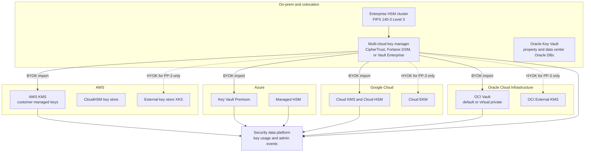

# Cloud provider playbooks
{: .no_toc }

**Phases 2 to 5, applied per provider.** These playbooks translate the organization-wide standards into concrete services, guardrails, and landing zone steps for each cloud and for on-prem key management.
{: .fs-5 .fw-300 }

## On this page
{: .no_toc .text-delta }

1. TOC
{:toc}

---

## Objective

The earlier phases define what must be protected and to what level: the four-tier classification
scheme (C0 to C3), the canonical label taxonomy, the resource tag schema, and the three protection
profiles (PP-1 Baseline, PP-2 Enhanced, PP-3 Maximum). Those definitions are deliberately
provider-neutral. This section answers the next question engineering teams ask: "Which service,
which setting, and which guardrail implements PP-2 in the cloud we are building on?"

Each provider playbook uses the same eleven-part structure so that teams can compare providers
side by side and so that architecture reviews can check a design against a known checklist:

| Section | What it answers |
|---|---|
| 1. Service map and terminology | What the provider calls each generic concept |
| 2. Discovery and classification | Which native services find and classify sensitive data |
| 3. Labeling and enforcement | How the tag schema is enforced and how guardrails block non-compliant resources |
| 4. Key management tiers | Good / Better / Best key options for structured data, unstructured data, and transit |
| 5. Structured data services | How each database and warehouse is encrypted and with what key options |
| 6. Unstructured data services | Object, file, block, and SaaS storage encryption |
| 7. Transit and in use | TLS policies, private connectivity, confidential computing |
| 8. PQC status | Provider post-quantum support, marked for verification |
| 9. Landing zone implementation | Numbered steps with CLI and Terraform |
| 10. Logging and evidence | Which logs prove the controls work |
| 11. Gotchas and limits | Quotas, location rules, and failure modes that cause outages |

## How to use the playbooks

1. **Start from the data, not the provider.** Confirm the data asset has a classification and a
   `protection-profile` tag value from the
   [label-to-control mapping](). The playbook
   does not decide the profile; it implements it.
2. **Read the terminology page first** if the team works across more than one provider. The
   [cross-cloud terminology]() page maps "key ring",
   "vault", "key store", and "custom key store" to one generic vocabulary.
3. **Select the tier in section 4** of the relevant playbook. The Good / Better / Best tables are
   the provider-specific form of PP-1 / PP-2 / PP-3.
4. **Build from section 9.** The landing zone steps are ordered so that guardrails exist before
   workloads arrive. Retrofitting customer-managed keys onto existing storage usually means data
   migration, so the order matters.
5. **Collect evidence from section 10** for design review sign-off and for PCI DSS, GDPR, and
   internal audit.
6. **Check section 11 before go-live.** Most key-management incidents in cloud are quota,
   location, or permission problems, not cryptographic failures.

For key custody decisions that span providers (a single external key manager, BYOK from an
on-prem HSM, or hold-your-own-key), use
[On-prem and multi-cloud key management]().

## Entry and exit criteria

| Criterion | Entry (before using a playbook) | Exit (playbook applied) |
|---|---|---|
| Classification | Data assets classified C0 to C3, owner assigned | Tags applied on every resource that stores the data |
| Standards | [Cryptographic standards]() and [key management architecture]() approved | Provider keys comply with approved algorithms, rotation, and separation of duties |
| Guardrails | Policy-as-code repository exists | Preventive guardrails deny non-compliant storage, keys, and TLS settings |
| Discovery | Discovery scope agreed per provider | Native discovery running with findings routed to the security data platform |
| Evidence | Logging destination agreed | Key usage and administrative events retained and queryable |

## Deliverables

- One landing zone key hierarchy per provider, organized by `data-domain` and environment.
- Preventive guardrails (SCPs and RCPs, Azure Policy, Organization Policy constraints, OCI
  Security Zones and IAM policies) stored in the policy-as-code repository.
- Discovery configurations and a mapping from provider findings to the canonical labels.
- A provider-specific Good / Better / Best decision recorded for each C2 and C3 data store.
- Evidence queries for key usage, key administration, and denied-by-guardrail events.

## Multi-cloud key architecture

The diagram shows the reference layout. Each provider has a native key service that serves most
PP-2 workloads. PP-3 workloads use single-tenant HSMs or external key stores. An optional
multi-cloud key manager provides BYOK lifecycle, inventory, and, where justified, the external key
source for hold-your-own-key patterns. All key events flow to a central security data platform.

The dotted lines are intentionally the exception path. Hold-your-own-key makes every decrypt
depend on an external system and a network path the provider does not control. The playbooks
recommend it only for a small number of C3 datasets where a regulator, contract, or risk
assessment requires that the provider cannot decrypt without the organization's cooperation.

## Good / Better / Best across the four clouds

This matrix is the summary view. Each provider page has the detailed tables for structured data,
unstructured data, and data in transit.

| Tier and profile | AWS | Azure | Google Cloud | OCI |
|---|---|---|---|---|
| **Good (PP-1)**, C0 and C1 | AWS owned or AWS managed keys; S3 SSE-S3 default; TLS 1.2+ | Microsoft-managed keys; storage service encryption on by default; TLS 1.2+ | Google default encryption; TLS 1.2+ | Oracle-managed keys; TLS 1.2+ |
| **Better (PP-2)**, C2 | Customer managed KMS keys per domain and environment; SSE-KMS with S3 Bucket Keys; RDS, Aurora, DynamoDB, Redshift with CMK; automatic rotation | Key Vault Premium (HSM-backed) keys; CMK for Storage, SQL TDE, Cosmos DB, managed disks; rotation policies | Cloud KMS keys with HSM protection level; CMEK enforced by Organization Policy; Autokey where adopted | OCI Vault master encryption keys (HSM protection mode); CMK for Object Storage, Block Volume, Autonomous Database, Base Database TDE |
| **Best (PP-3)**, C3 | PP-2 plus AWS Encryption SDK or AWS Database Encryption SDK for fields; CloudHSM key store; XKS where justified; Nitro Enclaves | PP-2 plus Managed HSM; Always Encrypted with secure enclaves; Purview labels with encryption and DKE where justified; confidential VMs | PP-2 plus Tink or BigQuery AEAD field encryption; Cloud EKM with Key Access Justifications where justified; Confidential VMs and Confidential Space | PP-2 plus virtual private vault or OCI Dedicated KMS; External KMS where justified; application-layer encryption or tokenization |
| **Payment keys** | AWS Payment Cryptography | Azure Payment HSM | Third-party payment HSM (no first-party equivalent) | Third-party payment HSM |
| **Companion guide** | [AWS KMS and CloudHSM guide](https://steven-smith-itnet.github.io/aws-kms-cloudhsm-key-management-guide/) | [Azure Key Vault and Managed HSM guide](https://steven-smith-itnet.github.io/azure-key-vault-managed-hsm-key-management-guide/) | [Google Cloud KMS and HSM guide](https://steven-smith-itnet.github.io/gcp-cloud-kms-hsm-key-management-guide/) | Covered in this site only |

{: .important }
"Best" is not the default. External and single-tenant key options add cost, operational burden,
and availability risk, and field-level encryption removes the ability to search, join, and
aggregate on protected columns. The profile assigned to the data decides the tier. The tier is
never chosen because it is available.

## Child pages

| Page | Summary |
|---|---|
| [Cross-cloud terminology]() | Rosetta stone mapping key management, discovery, guardrail, and confidential computing terms across AWS, Azure, Google Cloud, OCI, and on-prem, plus a glossary of provider jargon |
| [AWS]() | KMS, CloudHSM, XKS, Macie, SCPs and RCPs, S3 Bucket Keys, Database Encryption SDK, Nitro Enclaves, and landing zone steps |
| [Microsoft Azure]() | Key Vault, Managed HSM, Purview, Azure Policy, encryption scopes, Always Encrypted, confidential VMs, and landing zone steps |
| [Google Cloud]() | Cloud KMS, Cloud HSM, Cloud EKM, Autokey, CMEK Organization Policy constraints, Sensitive Data Protection, and landing zone steps |
| [Oracle Cloud Infrastructure]() | OCI Vault, Dedicated KMS, External KMS, Data Safe, Security Zones, and the limits of customer control over OPERA Cloud and Simphony |
| [On-prem and multi-cloud key management]() | Centralized versus federated key management, CipherTrust, Entrust KeyControl, Fortanix DSM, Vault Enterprise, KMIP, and a recommendation |

## Key takeaways for engineering teams

- The playbooks implement the protection profile assigned to the data. They do not replace the
  classification and label-to-control steps.
- Build guardrails and key hierarchies before workloads land; retrofitting customer-managed keys
  usually requires copying data.
- Native cloud KMS with HSM-backed keys is the default for C2 data in every provider.
- External and hold-your-own-key patterns are exceptions that require a documented justification
  and an availability design.
- Every key operation must be logged centrally; evidence is part of the deliverable, not an
  afterthought.

## Related pages

- [Key management architecture]()
- [Key custody: BYOK, HYOK, and external keys]()
- [Hardware security modules]()
- [Guardrails and policy as code]()
- [Vendor and cloud PQC readiness]()
