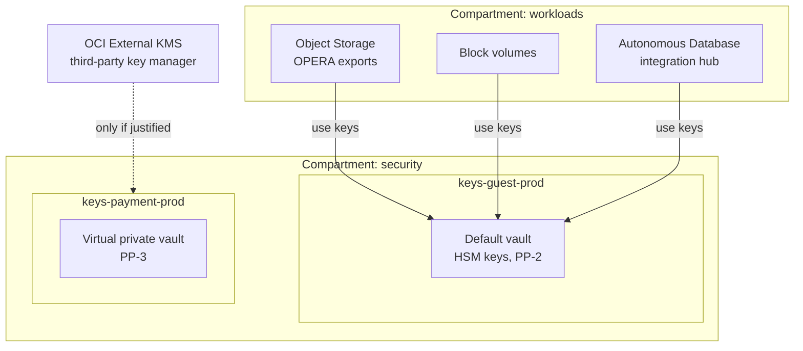
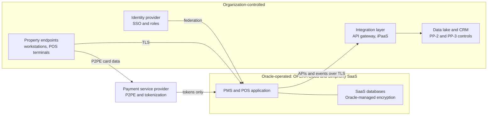

# Oracle Cloud Infrastructure
{: .no_toc }

**Phases 2 to 5: Standards and keys through transit and in use.** How the organization implements PP-1, PP-2, and PP-3 on OCI, and where its control ends for Oracle Hospitality SaaS such as OPERA Cloud and Simphony.
{: .fs-5 .fw-300 }

## On this page
{: .no_toc .text-delta }

1. TOC
{:toc}

---

## Why OCI matters in hospitality

OCI is relevant to a hospitality organization for two different reasons, and they must be kept
apart in every design discussion:

1. **OCI as infrastructure the organization operates.** Oracle databases (Autonomous Database,
   Base Database Service, Exadata Database Service) that host finance, revenue management, or
   integration data; Object Storage for exports and backups; compute for integration services.
   Here the organization controls keys, networks, and guardrails, and this playbook applies in
   full.
2. **Oracle Hospitality SaaS that runs on Oracle's cloud.** Oracle OPERA Cloud (property
   management) and Oracle Simphony (point of sale) are widely used across the industry. As SaaS,
   the organization does not operate the tenancy, the databases, or the keys underneath them.
   Its control is limited to the contract, the configuration options the SaaS exposes, payment
   integration choices, and what happens to data once it leaves the SaaS through integrations.

The second category usually holds far more guest data (profiles, stays, identity documents
where local law requires them, preferences, folios) than the first. The
[OPERA Cloud and Simphony section](#opera-cloud-and-simphony-what-is-and-is-not-customer-controllable)
covers it in detail.

There are no companion guides for OCI; key procedures are covered on this page.

## 1. Service map and terminology

| Generic concept | OCI service or term | Notes |
|---|---|---|
| Key service | OCI Vault (key management) | Vault holds master encryption keys (MEKs) and secrets |
| Provider-managed key | Oracle-managed keys | Default for Object Storage, Block Volume, File Storage, databases |
| Customer-managed key | MEK in a customer vault, referenced by a service | IAM policy must allow the service to `use keys` |
| HSM-backed key | Key with protection mode `HSM` | Software-protected keys (`SOFTWARE`) are cheaper; not used for C2 and above |
| Shared HSM partition | Default vault | Multi-tenant HSM partition |
| Dedicated HSM partition | Virtual private vault | Isolated partition; higher cost; separate limits |
| Single-tenant HSM, customer operated | OCI Dedicated KMS | HSM clusters managed through standard interfaces such as PKCS#11 |
| External key | OCI External KMS (protection mode `EXTERNAL`) | Key material in a supported third-party key manager outside OCI |
| BYOK | Key import (wrapped with the vault's RSA wrapping key) | Supported for AES and RSA keys |
| On-prem Oracle key manager | Oracle Key Vault (OKV) | TDE master keys for on-prem and Exadata Cloud@Customer; KMIP |
| Secrets | OCI Vault secrets | Encrypted by a vault key |
| Certificates | OCI Certificates | Private CA and certificate lifecycle |
| Discovery | Data Safe (Oracle databases) | No first-party discovery service for Object Storage content |
| Guardrails | IAM policies, Security Zones, tag defaults, Cloud Guard | Security Zones are preventive; Cloud Guard is detective with responders |
| Audit | OCI Audit | Records API calls across the tenancy, including Vault operations |

## 2. Discovery and classification services

### Data Safe

Data Safe is the OCI service for Oracle database security. It supports Autonomous Database, Base
Database Service, Exadata Database Service, and on-prem Oracle databases through an on-prem
connector or private endpoint. Features relevant to this program:

| Feature | What it does | Use in the program |
|---|---|---|
| Sensitive data discovery | Scans schemas using predefined and custom sensitive types, producing a sensitive data model | Finds guest PII, payment data, and identity numbers in Oracle databases |
| Data masking | Applies masking formats to copies of production data using the sensitive data model | Masked copies for development and test; required for C2 and C3 in non-production |
| Security assessment | Evaluates database configuration against best practices, including encryption and auditing | Evidence that TDE and network encryption are configured |
| User assessment | Identifies privileged and risky users | Quarterly access review input |
| Activity auditing | Collects and reports database audit records | Evidence for access to C3 columns |
| SQL Firewall | Enforces allow-lists of SQL for database users (supported database versions) | Protects the guest identity database from injection and misuse |

The organization defines custom sensitive types for loyalty member numbers and reservation
confirmation numbers, matching the custom classifiers used in Macie, Purview, and Sensitive Data
Protection, so that findings map to the same labels in every environment.

### Object Storage and other content

OCI does not offer a first-party service equivalent to Macie for scanning Object Storage content.
Options:

- Enterprise discovery platforms (Varonis, BigID, Cyera, Securiti) with OCI connectors, where
  supported.
- Microsoft Purview Data Map, if the organization extends it to non-Azure sources and OCI
  sources are supported (verify).
- Periodic sampling pipelines that copy samples to a scanning environment.

{: .note }
The absence of native content discovery for Object Storage is a design input: buckets holding
OPERA Cloud exports or Simphony reports should be created with a known classification at
creation time and protected at that level, rather than relying on later discovery.

### Mapping findings to labels

| Data Safe sensitive type category | Canonical label | Profile |
|---|---|---|
| Credit card number | `Restricted\PCI` | PP-3 |
| National identifiers, passport numbers | `Restricted\Guest-Identity` | PP-3 |
| Health information types | `Restricted\Special-Category` | PP-3 |
| Personal contact information | `Confidential\Guest-PII` | PP-2 |
| Employment and compensation information | `Confidential\Employee` | PP-2 |

## 3. Labeling, tagging, and enforcement

### Defined tags and tag defaults

OCI has freeform tags and defined tags. Defined tags belong to a tag namespace, can have
enumerated allowed values, and can be protected so that only authorized groups change them. The
organization creates a `data-governance` namespace containing the site-wide schema keys.

```bash
oci iam tag-namespace create \
  --compartment-id "$TENANCY_OCID" \
  --name data-governance \
  --description "Data classification and protection profile tags"

oci iam tag create \
  --tag-namespace-id "$NAMESPACE_OCID" \
  --name data-classification \
  --description "C0 to C3 classification" \
  --validator '{"validatorType":"ENUM","values":["public","internal","confidential","restricted"]}'
```

Tag defaults apply a tag automatically to every new resource in a compartment. With
`--is-required`, the tag default requires the creator to supply a value instead of applying a
fixed one:

```bash
oci iam tag-default create \
  --compartment-id "$GUEST_PROD_COMPARTMENT_OCID" \
  --tag-definition-id "$CLASSIFICATION_TAG_OCID" \
  --value "confidential"

oci iam tag-default create \
  --compartment-id "$GUEST_PROD_COMPARTMENT_OCID" \
  --tag-definition-id "$DATA_OWNER_TAG_OCID" \
  --value "" \
  --is-required true
```

{: .verify }
Confirm how an empty `--value` behaves with `--is-required` in the current CLI; the intent is a
user-applied required value rather than a fixed default.

### IAM policies as guardrails

OCI IAM policy statements are the main enforcement tool. Key administration and key use are
separated with `manage` and `use` verbs, and service principals are granted key use explicitly:

```text
Allow group KeyAdmins-GuestProd to manage vaults in compartment security:keys-guest-prod
Allow group KeyAdmins-GuestProd to manage keys in compartment security:keys-guest-prod
Allow service objectstorage-eu-frankfurt-1 to use keys in compartment security:keys-guest-prod
Allow service blockstorage to use keys in compartment security:keys-guest-prod
Allow dynamic-group guest-autonomous-dbs to use keys in compartment security:keys-guest-prod
Allow group GuestAppOps to use buckets in compartment workloads:guest-prod
```

Key administrators have no data access, and application operators have no key management
permissions. Policies can be narrowed further with conditions such as
`where target.key.id = '<key-ocid>'`.

### Security Zones

A Security Zone binds a compartment to a recipe of preventive policies. When a zone is enforced,
OCI denies actions that would violate a policy in the recipe. Oracle provides a maximum security
recipe; custom recipes select individual policies. Policies relevant to this program include
requirements that Object Storage buckets, block volumes, boot volumes, and file systems use
customer-managed vault keys, that buckets are not public, and that databases are not reachable
from the internet.

The organization creates Security Zones for the guest, payment, and employee production
compartments. Development compartments use Cloud Guard detection instead, because Security Zones
can block routine experimentation.

{: .verify }
Security Zone policy names and the list of available policies change over time. Confirm the
current policy catalog in the OCI Console before building recipes, and test the recipe on a
non-production compartment first.

### Cloud Guard

Cloud Guard detector recipes flag drift, such as buckets without customer-managed keys, public
buckets, or vaults with keys scheduled for deletion. Responder recipes can act automatically (for
example, making a public bucket private). The organization runs detection everywhere and
automatic responders only for public exposure findings.

## 4. Key management tiers

### Structured data

{: .good }
PP-1 for C0 and C1 structured data: Oracle-managed keys, with TDE on by default in Oracle cloud
database services.

| Tier | Key option | Example services | What it adds | Trade-off |
|---|---|---|---|---|
| Good (PP-1) | Oracle-managed keys | Autonomous Database, Base Database Service (TDE on by default) | Encryption at rest | No customer revocation |
| Better (PP-2) | MEK in a default vault with `HSM` protection, per data domain and environment; TDE master key from OCI Vault | Autonomous Database with customer-managed keys; Base Database and Exadata Database Service TDE with Vault keys | Revocation, separation of duties, Audit evidence | Vault availability becomes a database dependency; rotation must follow database procedures |
| Best (PP-3) | Virtual private vault or OCI External KMS; Data Safe masking in non-production; Oracle Data Redaction or application-layer encryption and tokenization for C3 columns | Guest identity or payment-adjacent databases | Dedicated HSM partition or external custody; C3 values hidden from most users | Cost; External KMS availability risk; redaction is a presentation control, not encryption |

### Unstructured data

{: .better }
PP-2 for C2 unstructured data: Object Storage, Block Volume, and File Storage encrypted with an
HSM-protected vault key, enforced by Security Zones in production compartments.

| Tier | Key option | Example services | What it adds | Trade-off |
|---|---|---|---|---|
| Good (PP-1) | Oracle-managed keys | Object Storage, Block Volume, File Storage | Always-on encryption | No key control |
| Better (PP-2) | Vault MEK (`HSM`) per domain | Buckets for OPERA Cloud exports; volumes for integration servers | Revocation and audit | Key IAM policies per service and region |
| Best (PP-3) | Virtual private vault; client-side encryption before upload; SSE-C for narrow cases | Identity document archives; payroll exports | Dedicated partition; OCI never holds plaintext (client-side) | Key distribution; loss of server-side processing |

### In transit

{: .best }
PP-3 in transit: TLS 1.2 minimum with TLS 1.3 preferred on load balancers, private access through
the Service Gateway, FastConnect with MACsec where available, and mTLS between services.

| Tier | Control | Example configuration |
|---|---|---|
| Good (PP-1) | TLS 1.2 minimum | Load balancer SSL cipher suite with TLS 1.2 and 1.3 protocols only |
| Better (PP-2) | Private access to Oracle services; database native network encryption or TLS | Service Gateway for Object Storage; TCPS listeners for databases |
| Best (PP-3) | mTLS; MACsec on FastConnect; private endpoints only | Certificates from OCI Certificates private CA; FastConnect MACsec |

### Vault layout



## 5. Structured data services

| Service | Default | Customer-managed key | Notes |
|---|---|---|---|
| Autonomous Database (serverless) | TDE with Oracle-managed keys | OCI Vault keys; other key sources for specific deployments (verify) | Switching key management is an online operation; audit the switch |
| Autonomous Database on Exadata Cloud@Customer | TDE | OCI Vault or Oracle Key Vault | OKV keeps keys on-prem with the Exadata infrastructure |
| Base Database Service | TDE on by default | OCI Vault keys for the TDE master key | Wallet or Vault-based key management |
| Exadata Database Service | TDE on by default | OCI Vault keys; OKV for Cloud@Customer | Same model as Base Database |
| MySQL HeatWave | Encrypted at rest | Customer-managed keys (verify) | Confirm before assigning PP-2 |
| NoSQL Database | Encrypted at rest | Verify | Treat as PP-1 until confirmed |

### Oracle TDE and key hierarchy

Oracle TDE uses a two-tier hierarchy: a TDE master encryption key protects tablespace and column
keys. When the master key is held in OCI Vault or Oracle Key Vault instead of a local wallet, the
organization controls it with the same IAM, rotation, and audit processes as other keys. Rotating
the master key (a rekey in Oracle terms) re-wraps the tablespace keys without re-encrypting data.

### Data Redaction and masking

- **Oracle Data Redaction** masks column values at query time for non-privileged users. Like
  dynamic data masking in other databases, it is a presentation control: privileged users and
  some query patterns can bypass it.
- **Data Safe masking** permanently replaces values in non-production copies. The organization
  requires it before C2 or C3 data is copied into development or test.
- **Oracle Database Vault** restricts privileged users (including DBAs) from reading application
  schemas. It is the Oracle-native control closest to the goal of field-level encryption for
  keeping DBAs out of C3 data.

## 6. Unstructured data services

| Service | Options | Organization standard |
|---|---|---|
| Object Storage | Oracle-managed keys; Vault MEK; SSE-C (customer-provided keys per request) | Vault MEK for C2 and C3; SSE-C only by exception |
| Block Volume and boot volumes | Oracle-managed keys; Vault MEK; in-transit encryption for paravirtualized attachments | Vault MEK; in-transit encryption enabled |
| File Storage | Oracle-managed keys; Vault MEK; in-transit encryption with TLS | Vault MEK and in-transit encryption for HR shares |
| Backups (database and volume) | Follow source keys or configured keys | Separate key per domain for backup copies where supported |

Bucket with a customer-managed key:

```bash
oci os bucket create \
  --compartment-id "$GUEST_PROD_COMPARTMENT_OCID" \
  --name guest-prod-opera-exports-eu \
  --kms-key-id "$GUEST_PROD_OS_KEY_OCID" \
  --public-access-type NoPublicAccess \
  --defined-tags '{"data-governance":{"data-classification":"confidential","protection-profile":"pp2","data-domain":"guest"}}'
```

## 7. Transit and in use

- **Load balancers.** Cipher suite and protocol configuration per listener; the organization
  allows TLS 1.2 and 1.3 only.
- **Service Gateway.** Private access from VCNs to Object Storage and other Oracle services
  without internet gateways.
- **Databases.** TLS (TCPS) or Oracle native network encryption for client connections; mTLS
  wallets for Autonomous Database, or TLS without wallets where the organization accepts
  one-way TLS with access control lists.
- **FastConnect.** Private connectivity from data centers and properties' regional hubs; MACsec
  encryption where supported on the port type.
- **Confidential computing.** OCI offers confidential computing on selected AMD-based shapes
  using memory encryption. Confirm shapes and attestation capabilities before relying on them.

{: .verify }
Confirm current OCI confidential computing shapes, attestation support, and MACsec availability
for the FastConnect locations in scope.

## 8. PQC status

{: .verify }
As of mid-2026, the organization treats OCI post-quantum support as unconfirmed. Oracle has
published general statements about post-quantum readiness, and Oracle Database and Java releases
have added post-quantum algorithms in some versions, but support in OCI Vault, OCI load balancer
TLS policies, and Oracle Hospitality SaaS endpoints must be confirmed directly with Oracle and
against current documentation before being written into a standard.

Implications:

- Oracle TDE uses AES-256 for data, which remains appropriate. The quantum-vulnerable components
  are TLS key exchange and RSA-based key wrapping.
- Integration traffic between OPERA Cloud and the organization's systems is the most important
  harvest-now-decrypt-later exposure in this area, because it carries guest data continuously
  over public networks. The organization's side of those connections (API gateways, integration
  platforms) should adopt hybrid PQ TLS as soon as the SaaS side supports it.
- PQC readiness is a vendor management question for Oracle Hospitality SaaS: add it to the
  annual vendor review and to contract renewal requirements.

See [Vendor and cloud PQC readiness]().

## OPERA Cloud and Simphony: what is and is not customer-controllable

This section applies to the SaaS editions. Some properties still run on-premises OPERA or
Simphony components, which fall under the on-prem guidance instead.

{: .important }
The statements below reflect the general SaaS shared-responsibility model and publicly available
information. Oracle's specific commitments are defined in the organization's contract, the
service descriptions, and the data processing agreement. Confirm each row with Oracle before
relying on it for a compliance decision.

| Area | Customer-controllable? | What the organization can do |
|---|---|---|
| Infrastructure encryption at rest | No | Rely on Oracle's controls; obtain evidence through audit reports (SOC reports, PCI DSS attestation where applicable) |
| Encryption keys for the SaaS database | Generally no (verify whether any customer-managed key option exists for the contracted edition) | Record as an accepted SaaS risk with compensating controls; request key management descriptions in vendor due diligence |
| Hosting region and data residency | Partly, through contract and region selection at provisioning | Select regions per the residency tag; document cross-border transfers and support access locations |
| Retention and purge of guest data | Partly, through application configuration | Configure purge and anonymization functions offered by the application to meet the retention schedule (verify available functions) |
| User access and roles | Yes | SSO federation with the corporate identity provider, role design, quarterly access review, removal of shared property logins |
| Display masking of sensitive fields | Partly, through application permissions | Restrict roles that can view full identity document numbers or unmasked payment data |
| Payment card data | Partly, through payment integration choice | Use the SaaS payment interface with a payment service provider that supports P2PE and tokenization, so that PAN is not stored in the SaaS (verify with the provider and Oracle) |
| Integrations and APIs | Yes, on the organization's side | Manage OAuth client credentials in the secrets manager; restrict scopes; TLS 1.2+ and, when available, hybrid PQ TLS on the organization's endpoints |
| Data once exported | Yes | Classify and protect exports, reports, and data lake copies under the organization's controls (PP-2 or PP-3) |
| Property endpoints | Yes | Harden workstations, POS terminals, and property networks; separate POS networks from guest Wi-Fi |
| Logs and monitoring | Partly | Obtain the audit logs the SaaS exposes; monitor integration credentials and exports on the organization's side |
| Breach notification and incident cooperation | Through contract | Define notification timelines and cooperation duties in the DPA |



The practical consequence: for OPERA Cloud and Simphony, the organization's strongest levers are
upstream (vendor due diligence and contract), at the edges (identity, property endpoints,
payment integration), and downstream (everything that is exported). The largest avoidable risk
is usually downstream: exports of guest profiles and folios into spreadsheets, shared drives, and
unmanaged analytics copies. Those copies must receive the same classification and protection
profile as the source data.

Vendor due diligence questions for Oracle Hospitality SaaS:

1. Which encryption algorithms and key management model protect data at rest, and who can access
   keys?
2. Is any customer-managed or customer-held key option available for the contracted edition?
3. Which TLS versions and cipher suites do the SaaS endpoints and APIs support, and what is the
   plan for hybrid post-quantum key exchange?
4. Which regions store primary data, backups, and support access?
5. What evidence (SOC reports, PCI DSS AOC, ISO certificates) is available, and for which scope?
6. How are guest data retention, purge, and data subject requests supported?

## 9. Landing zone implementation

### Step 1: Compartments and groups

Create a `security` compartment with child compartments per data domain for keys
(`keys-guest-prod`, `keys-payment-prod`), and workload compartments per domain and environment.
Create groups for key administrators per domain and a group for auditors with `read` access to
vaults and Audit.

### Step 2: Create vaults and keys

```bash
oci kms management vault create \
  --compartment-id "$KEYS_GUEST_PROD_OCID" \
  --display-name vault-guest-prod-fra \
  --vault-type DEFAULT

# The management endpoint is returned in the vault details
oci kms management key create \
  --compartment-id "$KEYS_GUEST_PROD_OCID" \
  --display-name key-guest-prod-objectstorage \
  --key-shape '{"algorithm":"AES","length":32}' \
  --protection-mode HSM \
  --endpoint "$VAULT_MANAGEMENT_ENDPOINT"
```

For PP-3 domains, create the vault with `--vault-type VIRTUAL_PRIVATE`.

Terraform equivalent:

```hcl
resource "oci_kms_vault" "guest_prod" {
  compartment_id = var.keys_guest_prod_ocid
  display_name   = "vault-guest-prod-fra"
  vault_type     = "DEFAULT"
}

resource "oci_kms_key" "guest_objectstorage" {
  compartment_id      = var.keys_guest_prod_ocid
  display_name        = "key-guest-prod-objectstorage"
  management_endpoint = oci_kms_vault.guest_prod.management_endpoint
  protection_mode     = "HSM"

  key_shape {
    algorithm = "AES"
    length    = 32
  }

  defined_tags = {
    "data-governance.data-classification" = "confidential"
    "data-governance.protection-profile"  = "pp2"
    "data-governance.data-domain"         = "guest"
  }
}
```

### Step 3: Rotate keys

Rotation creates a new key version; services use the new version for new encryption while older
versions remain available for decryption.

```bash
oci kms management key-version create \
  --key-id "$GUEST_PROD_OS_KEY_OCID" \
  --endpoint "$VAULT_MANAGEMENT_ENDPOINT"
```

{: .verify }
OCI has added scheduled automatic key rotation for vault keys. Confirm availability for the vault
type and region, and the configuration method, before replacing pipeline-driven rotation.

### Step 4: Grant services and enforce CMK

Write the IAM policies from section 3 for each regional Object Storage service principal, Block
Volume, File Storage, and database dynamic groups. Enforce customer-managed keys with Security
Zones in production compartments and Cloud Guard detectors elsewhere.

### Step 5: Enforce encryption in transit

Standardize load balancer listener cipher suites in a Terraform module, require the Service
Gateway for Object Storage access from VCNs, enable in-transit encryption on block volume
attachments, and require TCPS or native network encryption on database listeners.

### Step 6: Turn on discovery

Register all Oracle databases (cloud and on-prem) in Data Safe, run sensitive data discovery with
the custom sensitive types, run security and user assessments monthly, and enable activity
auditing on databases holding C2 and C3 data.

### Step 7: Wire logging

OCI Audit records Vault management and cryptographic API calls automatically. Use Connector Hub
to route Audit events to Object Storage (for retention) and to the SIEM through Streaming or a
supported integration. Set the Audit retention period in the tenancy configuration.

```bash
oci audit event list \
  --compartment-id "$KEYS_GUEST_PROD_OCID" \
  --start-time 2026-09-29T00:00:00Z \
  --end-time 2026-09-30T00:00:00Z
```

## 10. Logging and evidence

| Evidence need | Source | Notes |
|---|---|---|
| Key usage and key lifecycle | OCI Audit events for the Vault service | Filter on key OCID and event type (for example key disable, schedule deletion) |
| CMK coverage | Cloud Guard problems; resource queries for buckets and volumes without `kmsKeyId` | Weekly compliance report |
| Preventive guardrail denials | Audit events for denied requests in Security Zone compartments | Rollout monitoring |
| Database encryption and configuration | Data Safe security assessments | Monthly evidence snapshot |
| Sensitive data location | Data Safe sensitive data models | Map to inventory |
| SaaS evidence (OPERA Cloud, Simphony) | Vendor audit reports; SaaS-exposed audit logs | Collected through vendor management |

## 11. Gotchas and limits

| Issue | What happens | Mitigation |
|---|---|---|
| Vault types differ in isolation, cost, and limits | Default vaults share an HSM partition; virtual private vaults have a dedicated partition with higher cost and separate key and version limits | Default vault with HSM keys for PP-2; virtual private vault only for PP-3 domains |
| Key version limits | Vaults have limits on keys and key versions; frequent rotation consumes versions | Track counts; request limit increases; delete unused test keys in non-production |
| Service principal names are regional | Object Storage policies name the regional service (`objectstorage-<region>`) | Generate policies per region in the module |
| Disabling or deleting a key | Resources encrypted with the key become inaccessible; deletion is scheduled with a waiting period, then final | Restrict `manage keys`; alert on disable and schedule-deletion events |
| External KMS dependency | Every operation depends on the external key manager | Use only for named C3 datasets; highly available external deployment |
| No native Object Storage content discovery | Sensitive exports may go undetected | Classify at creation; third-party discovery; export controls |
| SaaS key control | The organization cannot rotate, revoke, or hold keys for OPERA Cloud or Simphony data unless a customer-managed key option exists (verify) | Contractual controls; downstream protection; vendor reviews |
| Oracle Data Redaction is not encryption | Privileged users bypass it | Database Vault, least privilege, application encryption for C3 |

## Key takeaways for engineering teams

- Separate OCI infrastructure (fully controllable) from Oracle Hospitality SaaS (controllable
  mainly through contract, configuration, identity, payment integration, and exports).
- Use HSM-protected keys in a default vault for C2 data, and a virtual private vault or External
  KMS only for justified C3 domains.
- Enforce customer-managed keys with Security Zones in production compartments and detect drift
  with Cloud Guard elsewhere.
- Register every Oracle database in Data Safe, and mask C2 and C3 data before it reaches
  non-production.
- Treat exports from OPERA Cloud and Simphony as the main controllable risk and protect them at
  the source data's classification.
- Confirm OCI and Oracle Hospitality PQC status directly with Oracle; add it to vendor reviews.

## Related pages

- [Cloud provider playbooks]()
- [Cross-cloud terminology]()
- [Hospitality data landscape]()
- [On-prem databases]()
- [Payment card data and PCI DSS]()
- [On-prem and multi-cloud key management]()
- Code: [Terraform modules for OCI](https://github.com/steven-smith-itnet/data-protection-pqc-security-architecture/tree/main/code/terraform/oci)

## Sources

- OCI Vault overview: <https://docs.oracle.com/iaas/Content/KeyManagement/Concepts/keyoverview.htm>
- OCI Security Zones: <https://docs.oracle.com/iaas/security-zone/home.htm>
- OCI tag defaults: <https://docs.oracle.com/iaas/Content/Tagging/Tasks/managingtagdefaults.htm>
- Oracle Data Safe: <https://docs.oracle.com/iaas/data-safe/index.html>
- OCI Audit: <https://docs.oracle.com/iaas/Content/Audit/home.htm>
- Oracle Hospitality OPERA Cloud documentation: <https://docs.oracle.com/en/industries/hospitality/opera-cloud/index.html>
