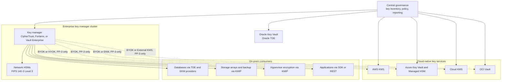
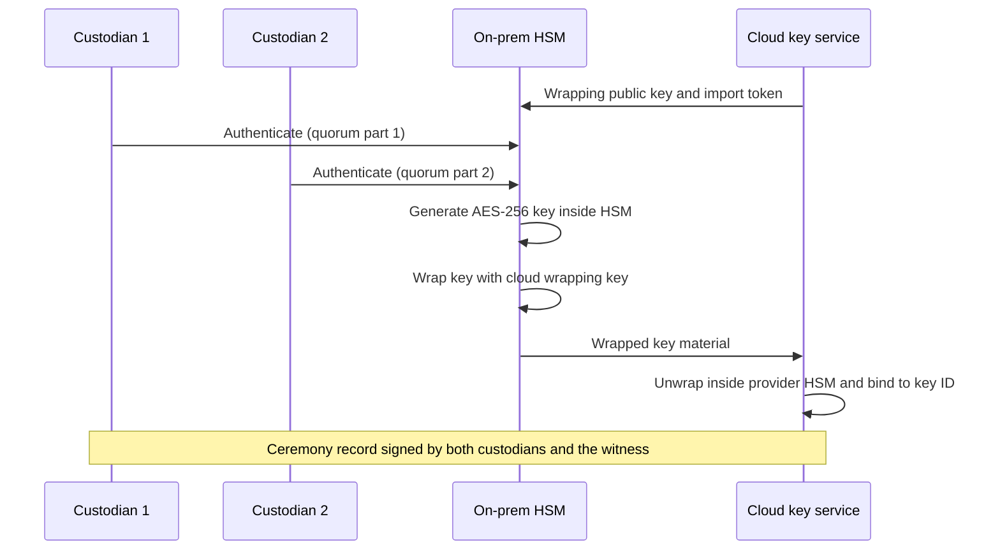

# On-prem and multi-cloud key management
{: .no_toc }

**Phase 2: Standards and keys.** How the organization manages keys across data centers, properties, and four cloud providers, and when a multi-cloud key manager adds value rather than complexity.
{: .fs-5 .fw-300 }

## On this page
{: .no_toc .text-delta }

1. TOC
{:toc}

---

## The problem

The organization holds keys in many places: four cloud key services, HSMs in two data centers,
Oracle Key Vault for Oracle TDE, database-native wallets, storage arrays with self-encrypting
drives, backup appliances, hypervisor encryption, payment HSMs at the processor, and property
systems that range from modern cloud-connected devices to older on-premises servers.

Three questions follow:

1. **Inventory and policy.** Can the organization answer "which keys protect C3 data, where are
   they, who can use them, and when were they last rotated" across all of these?
2. **Custody.** For which data does the organization need key material generated, held, or
   controlled outside the cloud provider?
3. **Operations.** How many key management systems can the organization run well, with the
   staff it has, at the availability its hotels need?

The answer is rarely "one tool for everything". This page sets out the models, the products, and
a recommendation.

## Centralized versus federated key management

| Model | Description | Strengths | Weaknesses |
|---|---|---|---|
| Fully centralized | One enterprise key manager is the source of all keys; clouds receive BYOK keys or call out (HYOK) | Single inventory, policy, and audit; uniform custody | Central system becomes a dependency for every cloud service; BYOK loses cloud-native rotation; HYOK adds latency and outage risk; large operational burden |
| Federated with central governance | Each cloud's native key service manages its own keys; a central inventory and policy layer reads from all of them; a central key manager serves on-prem and selected cloud keys | Uses native integrations and rotation; smaller blast radius; realistic for staff levels | Policy enforced per provider; inventory needs connectors; custody still with providers for most keys |
| Fully federated | Each platform manages its own keys with no central view | Least integration effort | No reliable inventory; inconsistent policy; weak evidence for PCI DSS 3.6 and 12.3.3 |

The organization adopts **federated with central governance**. The rest of this page explains
the product choices within that model.

## What each product category does

### Thales CipherTrust Manager and CipherTrust Cloud Key Manager (CCKM)

CipherTrust Manager is an enterprise key manager available as a virtual or physical appliance,
typically backed by Luna HSMs for root of trust. Relevant capabilities:

- **KMIP server** for storage arrays, backup systems, databases, and hypervisors.
- **Connectors** for database TDE (SQL Server EKM, Oracle TDE), file and volume encryption
  (CipherTrust Transparent Encryption), application encryption, tokenization, and data
  protection gateways, each licensed separately.
- **CCKM** manages keys across cloud providers: it can create keys natively in a cloud key
  service, upload BYOK keys generated in CipherTrust or an HSM, schedule rotation, and report on
  key inventory across accounts, subscriptions, and projects. It also supports hold-your-own-key
  integrations such as AWS XKS and Google Cloud EKM, and is a supported partner for OCI External
  KMS (verify current list of supported integrations and versions).

Where it fits: organizations with significant on-prem estates, existing Thales HSMs, and a need
for one inventory and BYOK lifecycle across clouds.

### Entrust KeyControl and nShield HSMs

Entrust KeyControl is a key manager focused on KMIP-based use cases (notably hypervisor and
virtual machine encryption, storage, and databases), with a vault-oriented model for secrets and
cloud keys in newer versions. Entrust nShield HSMs provide the hardware root of trust and are
widely used for PKI, code signing, and payment adjacent use cases (payment HSMs are a separate
product line).

Where it fits: estates with heavy VMware or KMIP-based storage encryption and existing nShield
HSMs.

{: .verify }
Entrust has reorganized its product naming and cloud key management capabilities several times.
Confirm current KeyControl features for multi-cloud BYOK and HYOK before shortlisting.

### Fortanix Data Security Manager (DSM)

Fortanix DSM is a key management, HSM, and tokenization platform offered as SaaS or on-prem
appliances, built on confidential computing hardware. It provides KMIP, PKCS#11, JCE, CNG, and
REST interfaces, tokenization and format-preserving encryption, and cloud key management
including BYOK and external key integrations for major providers (for example, it is a supported
partner for Google Cloud EKM and AWS XKS; verify current coverage).

Where it fits: organizations that prefer a SaaS-delivered key manager with strong API support and
want tokenization in the same platform.

### HashiCorp Vault Enterprise

HashiCorp Vault is primarily a secrets and identity-based access platform. For key management:

- **Transit secrets engine** (available in Community and Enterprise): encryption as a service;
  applications send plaintext or data keys and receive ciphertext; keys never leave Vault.
- **Transform secrets engine** (Enterprise, Advanced Data Protection): tokenization,
  format-preserving encryption (FF3-1 based in some versions; verify against the organization's
  FPE standard, since NIST's draft revision of SP 800-38G withdraws FF3-1), and masking.
- **KMIP secrets engine** (Enterprise): Vault acts as a KMIP server for storage and databases.
- **Key Management secrets engine** (Enterprise): creates and distributes keys to AWS KMS, Azure
  Key Vault, and Google Cloud KMS, and manages their lifecycle.
- **Managed keys** and seal wrap with HSMs for root of trust.

Where it fits: organizations already standardized on Vault for secrets, with strong platform
engineering skills. Vault is software; FIPS 140-3 assurance for keys at rest depends on HSM
integration and the specific build used.

### Oracle Key Vault

Oracle Key Vault manages TDE master keys, Oracle wallets, Java keystores, and KMIP clients. For an
estate with many Oracle databases (on-prem, Exadata Cloud@Customer, and some OCI deployments),
it is usually simpler to keep Oracle TDE on Oracle Key Vault than to integrate Oracle TDE with a
third-party key manager. OKV can itself be backed by an HSM.

### Comparison

| Capability | CipherTrust Manager + CCKM | Entrust KeyControl | Fortanix DSM | Vault Enterprise | Oracle Key Vault |
|---|---|---|---|---|---|
| KMIP server | Yes | Yes | Yes | Yes (KMIP engine) | Yes |
| Multi-cloud BYOK lifecycle | Yes (CCKM) | Verify | Yes | Yes (Key Management engine; AWS, Azure, GCP) | No |
| HYOK (AWS XKS, Google EKM, OCI External KMS) | Yes (verify per provider) | Verify | Yes for some providers (verify) | Not a primary use case | No |
| Tokenization and FPE | Yes (separate modules) | No (verify) | Yes | Yes (Transform, Enterprise) | No |
| Database TDE integration | SQL Server EKM, Oracle TDE, others | Selected | Selected | Via KMIP or EKM providers where supported | Oracle TDE (native) |
| Delivery model | Appliance, virtual, cloud marketplace | Appliance, virtual | SaaS or appliance | Self-managed or HCP Vault | Appliance or VM |
| Hardware root of trust | Luna HSM integration | nShield integration | Built-in HSM-grade hardware (confidential computing) | HSM via PKCS#11 (seal) | Optional HSM |
| Secrets management | Limited | Newer vault features | Yes | Core strength | Oracle wallets only |

{: .note }
The table records typical capabilities from vendor documentation as of mid-2026. Licensing
modules, supported cloud integrations, and FIPS validation status change between versions.
Validate each "yes" in a proof of concept before selection.

## KMIP and the on-prem integration layer

KMIP (OASIS Key Management Interoperability Protocol) is how most infrastructure products obtain
keys from an external key manager. In a hospitality estate, typical KMIP clients are:

| Consumer | Why it needs keys | Profile |
|---|---|---|
| Storage arrays (self-encrypting drives, controller encryption) | Data-at-rest encryption for file and block storage in data centers | PP-2; not sufficient alone for PAN (PCI DSS 3.5.1.2) |
| Backup appliances and tape libraries | Encrypted backups and tape rotation | PP-2; crypto-shredding by key deletion for retention |
| Hypervisor VM encryption | Encrypted VM disks for C2 and C3 workloads | PP-2 |
| Databases (MySQL Enterprise, MongoDB Enterprise, others) | TDE master keys | PP-2 |

Practical requirements for KMIP deployments:

- Mutual TLS between client and key manager, with client certificates issued from the internal
  PKI and inventoried in the CBOM.
- Key manager clusters in at least two data centers; KMIP clients configured with multiple
  servers.
- Clients cache keys only as long as the product requires; key manager outage behavior tested for
  each product (some storage arrays continue running but cannot reboot without the key manager).
- KMIP profile and version compatibility verified per product.

## On-prem HSM integration

Network HSMs provide the root of trust for the enterprise key manager, PKI (root and issuing CA
keys), code signing, and BYOK key generation for cloud import.

| Use | HSM role | Notes |
|---|---|---|
| Enterprise key manager root of trust | Key manager master key held in HSM | Required for FIPS 140-3 Level 3 assurance on the root |
| PKI | Root CA offline HSM; issuing CA online HSM | See [Certificates and PKI]() |
| BYOK generation | Generate key, wrap with cloud-provided wrapping key, export for import | Key ceremony with dual control for PP-3 |
| Code and firmware signing | Signing keys for property IoT firmware and internal software | Early PQC candidates (LMS, XMSS, ML-DSA) |
| Payment | Payment HSMs (separate product line, often at the processor) | Most hospitality merchants do not operate payment HSMs |

FIPS 140-3 is the current validation program, and FIPS 140-2 certificates move to the historical
list on September 21, 2026. HSM procurement and renewal should require FIPS 140-3 validation. See
[Hardware security modules]().

### BYOK ceremony flow

## Property-level systems

Hotels are not data centers. A property may run a local server for back-office functions,
interfaces to door lock systems, PBX, in-room entertainment, building management, spa software,
and POS components, alongside cloud SaaS. Ownership models complicate this: managed and
franchised properties may be operated by third parties on owner-funded hardware.

| Property system | Typical key and encryption need | Recommended approach |
|---|---|---|
| Local servers (interfaces, back office) | Disk encryption; TLS to cloud services | OS-native full-disk encryption with TPM, recovery keys escrowed centrally (for example BitLocker recovery keys in Entra ID or Active Directory) |
| POS workstations and terminals | P2PE on payment terminals; TLS to POS cloud | Payment keys are managed by the P2PE provider; the organization manages device hardening and network segmentation |
| Door lock and digital key systems | Vendor-managed keys for key cards and mobile keys | Vendor due diligence; confirm key storage, rotation, and PQC plans; network isolation |
| Building management and IoT | Device credentials and firmware signing | Device certificates from the internal PKI where the vendor supports it; firmware signing verification |
| CCTV | Recording encryption and retention | Encrypted storage; retention-based deletion; restricted access |
| Spa and wellness (health data) | Application database encryption | Prefer SaaS with contractual controls; if on-prem, TDE with keys in the enterprise key manager |

{: .important }
The organization should not deploy the enterprise key manager or HSMs at individual properties.
Property systems obtain keys from central services over TLS, or use OS-native or vendor-managed
encryption. Distributed key managers at hundreds of sites cannot be operated to the standard that
PP-3 requires.

For franchised properties, the brand standard defines minimum requirements (encryption,
network segmentation, P2PE) and the franchise agreement defines evidence obligations. The
organization's key management does not extend into franchisee-owned systems unless the brand
provides those systems as a managed service.

## When a multi-cloud key manager adds value, and when it adds complexity

| Situation | Adds value | Adds complexity without value |
|---|---|---|
| Inventory and reporting across four clouds | Yes, if the tool's connectors cover the services in use | If the organization already aggregates cloud key inventory through CSPM or cloud asset inventory tools |
| BYOK for PP-3 data where policy requires key generation outside the provider | Yes | For PP-2 data, where native key generation meets the standard |
| HYOK (XKS, Cloud EKM, OCI External KMS) | Only where a regulator, contract, or risk assessment requires that the provider cannot decrypt without the organization | For general C2 data; HYOK turns every decrypt into an external dependency |
| On-prem KMIP, TDE, and application encryption | Yes: an on-prem key manager is needed regardless | Not applicable |
| Tokenization and FPE across platforms | Yes, if the same product provides tokenization (Fortanix, CipherTrust, Vault Transform) | If a payment provider's tokenization already removes PAN from scope |
| Consistent rotation schedules | Marginal: cloud-native rotation already meets standards for PP-2 | BYOK rotation requires re-import and can break automatic rotation |
| Exit strategy from a cloud provider | Limited: data must still be re-encrypted or exported, and keys alone do not provide portability | Often cited, rarely realized |

## Recommendation

**Adopt federated key management with central governance, and one enterprise key manager for
on-prem and selected PP-3 cloud keys.**

1. **Cloud-native key services for all PP-2 cloud data.** HSM-backed customer-managed keys in AWS
   KMS, Azure Key Vault Premium, Cloud KMS (HSM), and OCI Vault (HSM), created by pipelines,
   rotated by the provider, logged centrally.
2. **One enterprise key manager cluster**, backed by FIPS 140-3 Level 3 HSMs in two data
   centers, for KMIP consumers, on-prem databases (other than Oracle TDE on OKV), application
   encryption, and PP-3 BYOK generation. Select the product in a proof of concept against the
   organization's actual consumers; CipherTrust Manager with CCKM and Fortanix DSM are the most
   likely fits for multi-cloud BYOK and tokenization, and Vault Enterprise is a strong fit where
   Vault is already the secrets platform.
3. **Oracle Key Vault stays** for Oracle TDE on-prem and on Exadata Cloud@Customer.
4. **Single-tenant cloud HSM options** (CloudHSM key stores, Managed HSM, virtual private vaults)
   for PP-3 domains where single-tenant custody in the cloud is sufficient.
5. **HYOK only by exception**, approved through the design review with an availability design,
   for named C3 datasets.
6. **Central key inventory** fed by the cloud key services' APIs and audit logs, the enterprise
   key manager, and OKV, reported against the CBOM.

### Trade-offs of the recommendation

| Trade-off | Consequence | Mitigation |
|---|---|---|
| Custody stays with cloud providers for PP-2 data | Provider could technically be compelled or compromised | Acceptable for C2 under the risk appetite; PP-3 uses stronger custody |
| Policy is implemented four times | Drift between providers | Policy as code with shared test cases; the label-to-control mapping as single source |
| An enterprise key manager is still required | Licensing and operations cost | Scope it to on-prem, PP-3 BYOK, and tokenization; avoid pushing PP-2 cloud keys through it |
| Two on-prem key systems (enterprise key manager and OKV) | More tools to operate | Accept for Oracle; revisit at the next Oracle estate refresh |
| No single pane of glass for key operations | Evidence spread across tools | Central inventory and SIEM correlation of key events |

## Key takeaways for engineering teams

- Use the cloud provider's native key service for PP-2 cloud data; do not route PP-2 keys through
  an external key manager.
- Use one enterprise key manager with HSMs for on-prem KMIP, TDE, application encryption, and
  PP-3 BYOK; keep Oracle TDE on Oracle Key Vault.
- HYOK is an exception with an availability design, not a default for sensitive data.
- Do not place key managers at properties; property systems use central services, OS-native
  encryption, or vendor-managed payment and lock keys.
- Validate every multi-cloud feature claim in a proof of concept; integrations and licensing
  change often.

## Related pages

- [Cloud provider playbooks]()
- [Key management architecture]()
- [Key custody: BYOK, HYOK, and external keys]()
- [Hardware security modules]()
- [On-prem databases]()
- [On-prem file shares and NAS]()
- [Cryptographic inventory (CBOM)]()

## Sources

- OASIS KMIP specifications: <https://www.oasis-open.org/committees/kmip/>
- Thales CipherTrust Cloud Key Manager: <https://cpl.thalesgroup.com/encryption/ciphertrust-cloud-key-manager>
- Fortanix Data Security Manager: <https://www.fortanix.com/platform/data-security-manager>
- HashiCorp Vault Key Management secrets engine: <https://developer.hashicorp.com/vault/docs/secrets/key-management>
- HashiCorp Vault Transform secrets engine: <https://developer.hashicorp.com/vault/docs/secrets/transform>
- Oracle Key Vault: <https://docs.oracle.com/en/database/oracle/key-vault/>
- NIST CMVP (FIPS 140-3): <https://csrc.nist.gov/projects/cryptographic-module-validation-program>
