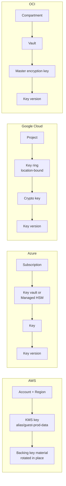

# Cross-cloud terminology
{: .no_toc }

**Phase 2: Standards and keys.** One vocabulary for key management and data protection so that designs, reviews, and evidence mean the same thing in every cloud.
{: .fs-5 .fw-300 }

## On this page
{: .no_toc .text-delta }

1. TOC
{:toc}

---

## Why a shared vocabulary matters

The same concept carries different names in each provider, and the same word means different
things. "Vault" is a secrets and key container in Azure, a key and secret service in OCI, and a
separate product (HashiCorp Vault) on-prem. "Key ring" is a Google Cloud grouping construct with
no access-control meaning of its own beyond IAM inheritance, while an AWS "key store" determines
where key material physically lives. "Customer-managed key" is precise in AWS and Azure, while
Google Cloud uses "CMEK" for the integration pattern and "Cloud KMS key" for the resource.

Architecture reviews in a multi-cloud organization go wrong when a design says "CMK" and the
reviewer assumes HSM-backed, single-tenant, or externally held key material. This page fixes the
generic terms used across the site and maps each to the provider term.

Generic terms used on this site:

| Generic term | Meaning on this site |
|---|---|
| Key service | The provider's multi-tenant key management API (AWS KMS, Azure Key Vault, Cloud KMS, OCI Vault) |
| Provider-managed key | A key the provider creates, owns, and rotates; the organization cannot see or control its policy |
| Customer-managed key (CMK) | A key resource in the organization's account whose policy, rotation, and deletion the organization controls; key material may still be generated by the provider |
| HSM-backed key | Key material that is generated and used only inside a FIPS-validated HSM, even if the HSM is multi-tenant |
| Single-tenant HSM | An HSM or HSM partition dedicated to the organization |
| BYOK | Key material generated outside the provider and imported under a wrapping key |
| HYOK / external key | Key material that stays outside the provider; the provider calls out to an external key manager for each wrap or unwrap |
| KEK and DEK | Key-encryption key held in the key service; data-encryption key generated per object, file, or record and stored wrapped next to the data |
| Envelope encryption | Encrypting data with a DEK and protecting the DEK with a KEK |
| Crypto-shredding | Destroying a key so that all data encrypted under it becomes unrecoverable |

## Rosetta stone: key management

| Concept | AWS | Azure | Google Cloud | OCI | On-prem |
|---|---|---|---|---|---|
| Multi-tenant key service | AWS KMS | Azure Key Vault | Cloud KMS | OCI Vault (key management) | Enterprise key manager (CipherTrust Manager, Entrust KeyControl, Fortanix DSM, HashiCorp Vault) |
| Provider-managed key (no customer control) | AWS owned key | Microsoft-managed key | Google-owned and Google-managed encryption key (default encryption) | Oracle-managed key | Not applicable |
| Provider-managed key visible in the account | AWS managed key (`aws/s3`, `aws/rds`, and similar aliases) | Not a separate category | Not a separate category | Not a separate category | Not applicable |
| Customer-managed key | Customer managed key (KMS key) | Customer-managed key in Key Vault or Managed HSM | CMEK (a Cloud KMS key used by a service) | Master encryption key in a customer vault | Key object in the key manager |
| HSM-backed key in shared service | KMS keys in the default key store (KMS uses FIPS-validated HSMs) | Key Vault Premium HSM-protected keys (`RSA-HSM`, `EC-HSM`) | Cloud HSM (protection level `HSM`) | Key with protection mode `HSM` | Network HSM partition |
| Single-tenant HSM, customer operated | AWS CloudHSM | Azure Cloud HSM (successor to Dedicated HSM; verify status) | Cloud HSM single-tenant option (verify availability) | OCI Dedicated KMS | Luna, nShield, or other network HSM |
| Single-tenant HSM behind the key API | CloudHSM custom key store | Azure Key Vault Managed HSM | Not offered as a separate API (verify) | Virtual private vault (dedicated partition) | Not applicable |
| External key, held outside the provider | External key store (XKS) | Double Key Encryption for Purview labels; no general HYOK for Azure services | Cloud EKM | OCI External KMS | The external key manager itself |
| BYOK import | `ImportKeyMaterial` with wrapping key from `GetParametersForImport` | Key Vault BYOK (key exchange key, `.byok` file) | Cloud KMS import jobs | Key import with RSA-OAEP wrapping | Export from HSM under wrapping key |
| Key container | Account and Region (no container object); aliases group names | Key vault or managed HSM pool | Key ring (regional, cannot be deleted) | Vault, within a compartment | Key manager domain, group, or partition |
| Key version | Key material rotation (key ID stays; backing material versions are internal, visible through `ListKeyRotations`) | Key version (versioned URI) | Key version (numbered, own state) | Key version (OCID per version) | Key version or key instance |
| Automatic rotation | Enable key rotation, configurable period (90 to 2,560 days) plus on-demand rotation | Key rotation policy | Rotation period on the key | Automatic rotation schedule (verify availability per vault type) | Key manager rotation policy |
| Multi-region key | Multi-Region keys (primary and replicas) | Not supported; separate keys per region | Multi-region and global key locations | Cross-region vault replication for virtual private vaults (verify) | Cluster replication |
| Envelope encryption SDK | AWS Encryption SDK; AWS Database Encryption SDK | Azure SDK key client with local crypto; Always Encrypted drivers | Tink with Cloud KMS integration | OCI SDK plus application crypto libraries | Vendor SDKs, PKCS#11, JCE |
| Separation of duties | Key policy plus IAM; key administrators versus key users | RBAC: Key Vault Crypto Officer versus Crypto Service Encryption User; Managed HSM local RBAC | IAM: `roles/cloudkms.admin` versus `roles/cloudkms.cryptoKeyEncrypterDecrypter` | IAM policies: `manage keys` versus `use keys` | Key manager roles, quorum approval |
| Secrets | AWS Secrets Manager; Systems Manager Parameter Store SecureString | Key Vault secrets | Secret Manager | OCI Vault secrets | HashiCorp Vault, CyberArk |
| Private certificate authority | AWS Private CA | No first-party managed private CA as a general service (verify); Key Vault certificate issuance through integrated CAs | Certificate Authority Service | OCI Certificates (private CA) | Microsoft AD CS, EJBCA, Vault PKI |
| Public certificate management | AWS Certificate Manager | App Service certificates, Key Vault certificates, Front Door managed certificates | Certificate Manager | OCI Certificates (imported public certificates) | ACME tooling, commercial CA |
| Payment HSM | AWS Payment Cryptography | Azure Payment HSM | None first-party (third-party HSM) | None first-party (third-party HSM) | Payment HSM (for example Thales payShield) |
| Key usage audit log | AWS CloudTrail (KMS events) | Key Vault or Managed HSM diagnostic logs (`AuditEvent`) to Azure Monitor | Cloud Audit Logs (Data Access logs for Cloud KMS) | OCI Audit | Key manager audit log to syslog or SIEM |
| Attestation for key release | KMS condition keys for Nitro Enclaves attestation (`kms:RecipientAttestation:*`) | Microsoft Azure Attestation with Secure Key Release | Confidential Space attestation with workload identity federation | Not a general first-party feature (verify) | HSM or key manager policy with remote attestation integration |

## Rosetta stone: data protection and governance

| Concept | AWS | Azure | Google Cloud | OCI | On-prem |
|---|---|---|---|---|---|
| Sensitive data discovery (storage) | Amazon Macie (S3) | Microsoft Purview Data Map classification; Defender for Storage sensitive data threat detection | Sensitive Data Protection discovery (BigQuery, Cloud SQL, Cloud Storage) | Data Safe sensitive data discovery (Oracle databases) | Varonis, BigID, Cyera, Securiti, Purview on-prem scanner |
| Sensitive data detection in pipelines | AWS Glue sensitive data detection | Purview scanning of Azure SQL, Synapse, ADLS | Sensitive Data Protection inspection jobs and de-identification | Data Safe; Oracle Data Masking and Subsetting | Protegrity, OpenText Voltage discovery |
| Data catalog and governance | AWS Glue Data Catalog, Amazon DataZone, Lake Formation | Microsoft Purview Unified Catalog | Dataplex Universal Catalog | OCI Data Catalog | Collibra, Alation, Purview |
| DLP for content in motion | No first-party enterprise DLP; Macie is at rest only | Microsoft Purview DLP (M365, endpoints, Defender for Cloud Apps) | Sensitive Data Protection API; Workspace DLP for Google Workspace | None first-party | Network and endpoint DLP |
| Sensitivity labels on documents | None first-party | Purview sensitivity labels | Google Workspace labels (Drive) | None first-party | Purview labels via on-prem scanner |
| Resource tags or labels | Tags | Tags | Labels (and separate IAM tags) | Freeform and defined tags | CMDB attributes |
| Tag enforcement | Tag policies; SCP conditions on `aws:RequestTag` | Azure Policy (`deny`, `modify`, `append`) | Organization Policy custom constraints; IAM tags with conditions | Tag defaults (required values); IAM policies with tag conditions | CMDB workflow |
| Organization guardrail | Service control policies (SCPs); resource control policies (RCPs); declarative policies | Azure Policy at management group scope | Organization Policy constraints | Security Zones; IAM policies; quotas | Group Policy, configuration management |
| Column-level access and masking | Lake Formation column and cell filters; Redshift dynamic data masking | Azure SQL dynamic data masking; Purview policies | BigQuery policy tags, column-level access control, dynamic data masking | Oracle Data Redaction; Data Safe masking | Database-native masking |
| Field-level encryption in the database | AWS Database Encryption SDK (client-side, searchable via beacons) | Always Encrypted (with secure enclaves) | BigQuery AEAD encryption functions; Tink | Oracle column TDE; application encryption | Database-native or third-party column encryption |
| Transparent database encryption | RDS and Aurora storage encryption; RDS for Oracle and SQL Server TDE | Azure SQL TDE with CMK | Cloud SQL CMEK; AlloyDB CMEK | Oracle TDE with OCI Vault | Oracle TDE, SQL Server TDE, with HSM or Oracle Key Vault |
| Confidential computing (VM) | Nitro System isolation; AMD SEV-SNP on selected instance types | Confidential VMs (AMD SEV-SNP, Intel TDX) | Confidential VMs (AMD SEV, SEV-SNP, Intel TDX) | Confidential computing shapes with AMD SEV (verify) | Servers with SEV-SNP or TDX |
| Confidential computing (enclave or container) | Nitro Enclaves | Confidential containers on AKS; SGX-based enclaves | Confidential Space; Confidential GKE Nodes | Not a general first-party feature (verify) | SGX or TDX-based frameworks |
| Private connectivity to key service | VPC interface endpoint for KMS (AWS PrivateLink) | Private Endpoint for Key Vault and Managed HSM | Private Google Access; Private Service Connect | Service Gateway; private endpoints for vaults (verify) | Dedicated network segment for HSMs |
| Default encryption at rest | On for S3, EBS by account setting, most managed services | On for all Azure Storage and most PaaS | On for all Google Cloud data at rest | On for Object Storage, Block Volume, File Storage | Depends on platform |

{: .note }
Rows marked "verify" describe capabilities that have changed recently or where the provider's
documentation is not consistent. Confirm against current official documentation before relying
on them in a design decision.

## How the structures differ

The containers that hold keys drive how the hierarchy is built.

Practical consequences:

- **AWS** keys are account and Region resources. The key ID does not change on rotation, and
  AWS KMS keeps prior backing material so older ciphertext still decrypts. Isolation between data
  domains is achieved with separate keys and, for PP-3, separate accounts.
- **Azure** vaults are the unit of access policy, network restriction, and throttling. One vault
  per data domain per environment keeps blast radius and throttling contained.
- **Google Cloud** key rings and keys cannot be deleted, only their versions can be destroyed.
  Names are therefore permanent, and a naming scheme must be settled before the first key is
  created. Keys are usually placed in a dedicated key project so that key administration is
  separated from workload projects.
- **OCI** vaults sit in compartments, and IAM policy is written against compartments. A dedicated
  security compartment for vaults, with workload compartments granted `use keys` only, mirrors
  the key project pattern in Google Cloud.

## Glossary of provider-specific jargon

### AWS

| Term | Meaning |
|---|---|
| KMS key | Current name for what AWS previously called a customer master key (CMK) |
| AWS owned key | A key AWS owns and uses across many accounts; not visible in the account and not controllable |
| AWS managed key | A key created in the account by an AWS service (alias `aws/<service>`); visible and logged, but its policy cannot be edited and it cannot be used across accounts |
| Customer managed key | A KMS key the organization creates and controls, including its key policy |
| Key policy | The resource policy on a KMS key; every KMS key has exactly one, and it is the primary access control |
| Grant | A delegated, often temporary, permission to use a KMS key, used by services such as EBS and RDS |
| Custom key store | A key store backed by CloudHSM or by an external key manager (XKS) instead of the default KMS HSMs |
| XKS proxy | The customer-operated proxy that translates KMS calls to the external key manager's API |
| S3 Bucket Key | A bucket-level intermediate key that reduces calls from S3 to KMS for SSE-KMS |
| DSSE-KMS | Dual-layer server-side encryption with KMS keys for S3 |
| SSE-C | S3 server-side encryption with a key the client supplies on every request |
| Encryption context | Non-secret key-value pairs bound to a KMS operation as additional authenticated data and recorded in CloudTrail |
| Beacon | A truncated HMAC used by the AWS Database Encryption SDK to support equality search over encrypted attributes |
| RCP | Resource control policy: an AWS Organizations policy that limits permissions on resources, regardless of who calls |

### Azure

| Term | Meaning |
|---|---|
| Key Vault Standard and Premium | Pricing tiers; Standard keys are software-protected, Premium supports HSM-protected keys |
| Managed HSM | A single-tenant, FIPS 140-3 Level 3 validated HSM pool exposed through the Key Vault API family |
| Security domain | The encrypted blob that holds a Managed HSM's credentials; downloaded at activation, protected by a quorum of customer RSA keys, required for disaster recovery |
| Encryption scope | A storage account sub-boundary that allows a different key per container or blob |
| Infrastructure encryption | A second layer of AES-256 encryption at the storage infrastructure level, set at account creation |
| Customer Key | Microsoft 365 service encryption with customer-provided root keys held in Key Vault |
| Double Key Encryption (DKE) | Purview label encryption where one key is held by the organization outside Microsoft; Microsoft cannot decrypt the content |
| Secure Key Release | Releasing an exportable key from Key Vault or Managed HSM only to an attested confidential environment |
| Always Encrypted with secure enclaves | Column encryption in Azure SQL and SQL Server where some computation happens inside a server-side enclave |
| Key Vault references | App Service and Functions settings that resolve secrets from Key Vault at runtime |

### Google Cloud

| Term | Meaning |
|---|---|
| Default encryption | Encryption at rest with Google-owned and Google-managed keys, always on |
| CMEK | Customer-managed encryption keys: a Cloud KMS key the organization controls, used by a Google Cloud service to protect its data |
| CSEK | Customer-supplied encryption keys: raw keys sent with each request (Cloud Storage and Compute Engine only); Google does not store them |
| Cloud HSM | Cloud KMS keys with protection level `HSM`, backed by FIPS 140-validated HSMs |
| Cloud EKM | Keys held in a supported external key manager; Cloud KMS calls out for each operation |
| Key Access Justifications (KAJ) | A reason code attached to each EKM request, which the external key manager can use to approve or deny |
| Autokey | A Cloud KMS feature that creates CMEK keys on demand in a designated key project when a resource is created |
| Key ring | A regional or multi-regional grouping of keys; cannot be deleted |
| Service agent | The Google-managed service account that a service uses to call Cloud KMS for CMEK |
| Policy tag | A Data Catalog or Dataplex taxonomy tag applied to BigQuery columns to enforce column-level access and masking |
| Assured Workloads | A control package that constrains location, personnel access, and key options for regulated workloads |

### OCI

| Term | Meaning |
|---|---|
| Vault | The OCI resource that holds master encryption keys and secrets |
| Default vault | A vault whose keys are stored in a shared HSM partition |
| Virtual private vault | A vault with a dedicated HSM partition, isolated from other tenants, with higher cost and separate limits |
| Master encryption key (MEK) | The customer-managed key in a vault used by OCI services to wrap data encryption keys |
| Protection mode | `HSM`, `SOFTWARE`, or `EXTERNAL`: where the key material resides and where operations occur |
| OCI Dedicated KMS | Single-tenant HSM clusters the organization manages through standard interfaces such as PKCS#11 |
| OCI External KMS | Keys held in a third-party key manager outside OCI, referenced by OCI Vault |
| Data Safe | Oracle database security service for assessment, discovery, masking, and activity auditing |
| Security Zone | A compartment-scoped set of preventive policies (a recipe) that denies non-compliant actions |
| Tag default | A compartment setting that applies a defined tag automatically and can require a value |
| Oracle Key Vault (OKV) | An on-prem or OCI-deployable key manager for Oracle TDE and KMIP clients |

### On-prem and multi-cloud

| Term | Meaning |
|---|---|
| KMIP | OASIS Key Management Interoperability Protocol, used by storage arrays, databases, and hypervisors to fetch keys |
| PKCS#11 | The standard C API for HSM access |
| Split knowledge and dual control | PCI DSS key management controls for manual cleartext key operations |
| Key ceremony | A scripted, witnessed procedure to create or recover root keys |
| CCKM | Thales CipherTrust Cloud Key Manager, which manages BYOK and HYOK keys across cloud providers |
| Transform secrets engine | HashiCorp Vault Enterprise engine for tokenization and format-preserving encryption |

## Key takeaways for engineering teams

- Use the generic terms from this page in design documents, then name the provider service in
  the implementation section.
- "Customer-managed" does not imply single-tenant or HSM-backed; state the protection level
  explicitly.
- Google Cloud key rings and keys are permanent names; agree the naming scheme first.
- Azure vaults and OCI compartments are the unit of isolation and throttling; organize them by
  data domain and environment.
- BYOK and HYOK are different: BYOK imports key material, HYOK keeps it outside the provider and
  adds a runtime dependency.

## Related pages

- [Cloud provider playbooks]()
- [Key management architecture]()
- [Key custody: BYOK, HYOK, and external keys]()
- [Glossary]()
- [Labeling, tagging, and metadata]()

## Sources

- AWS KMS concepts: <https://docs.aws.amazon.com/kms/latest/developerguide/concepts.html>
- Azure Key Vault overview: <https://learn.microsoft.com/azure/key-vault/general/overview>
- Azure Managed HSM overview: <https://learn.microsoft.com/azure/key-vault/managed-hsm/overview>
- Cloud KMS documentation: <https://cloud.google.com/kms/docs>
- OCI Vault overview: <https://docs.oracle.com/iaas/Content/KeyManagement/Concepts/keyoverview.htm>
- OASIS KMIP: <https://www.oasis-open.org/committees/kmip/>
