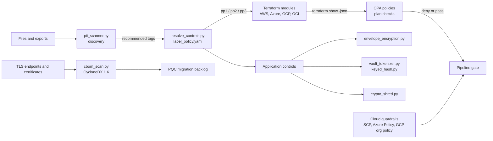

# Code and tooling lab
{: .no_toc }

**Phase 7: Engineering enablement and governance.** This page shows the working code behind the architecture, what each tool proves, and the real output captured when it was run.
{: .fs-5 .fw-300 }

## On this page
{: .no_toc .text-delta }

1. TOC
{:toc}

---

## Purpose of the lab

The rest of this site describes controls. This lab implements a subset of them so that engineering
teams can run, read, and test the logic before they choose a product. Every tool maps to a phase of the
program and to a control in the protection profiles (PP-1 Baseline, PP-2 Enhanced, PP-3 Maximum).

All code is in the repository under
[`code/`](https://github.com/steven-smith-itnet/data-protection-pqc-security-architecture/tree/main/code/).
The [`code/README.md`](https://github.com/steven-smith-itnet/data-protection-pqc-security-architecture/tree/main/code/README.md)
lists setup steps and every command.

{: .important }
All sample data is synthetic. Card numbers are the well-known public test numbers
(4111111111111111, 5555555555554444, 378282246310005, 6011111111111117), email addresses use the
reserved `example.com`, `example.org`, and `example.net` domains, phone numbers use ranges reserved for
fiction, and names such as "Test Guest Alpha" are obviously fake. Do not add real personal data to the
repository, even for testing.

### Rules the lab follows

- Every output on this page was captured from a real run on September 30, 2026. Nothing is
  hand-edited except where an excerpt is marked as shortened.
- Anything that could not be tested locally is stated as untested, with the reason.
- The tag schema (`data-classification`, `protection-profile`, `data-domain`, `regulatory-scope`,
  `data-residency`, `data-owner`, `retention-class`) is the same in the Python policy file, the
  Terraform validation blocks, and the OPA policy. A test fails if they drift apart.

## How the tools fit together



The chain on the top row is the core idea of Phase 1: discovery produces a label, the label resolves
to a protection profile, the profile drives infrastructure, and policy as code checks that the
infrastructure matches the label before it is deployed.

## Tool map

| Tool | Path | Phase | Control it proves | Test status |
|---|---|---|---|---|
| Discovery scanner | [`discovery/`](https://github.com/steven-smith-itnet/data-protection-pqc-security-architecture/tree/main/code/discovery) | 1 | Detection with validation (Luhn, IIN, mod-97) and a recommended label | 31 pytest tests |
| Label-to-control resolver | [`classification/`](https://github.com/steven-smith-itnet/data-protection-pqc-security-architecture/tree/main/code/classification) | 1 | Tags resolve to one control set per data state and per cloud | 21 pytest tests |
| Envelope encryption | [`envelope/`](https://github.com/steven-smith-itnet/data-protection-pqc-security-architecture/tree/main/code/envelope) | 2 | DEK and KEK separation, context binding, KEK rotation without re-encryption, algorithm agility | 18 pytest tests; cloud adapters wiring-only |
| Tokenization and surrogates | [`tokenization/`](https://github.com/steven-smith-itnet/data-protection-pqc-security-architecture/tree/main/code/tokenization) | 3 | PCI scope reduction, keyed hashing, role-checked detokenization | 14 pytest tests |
| Crypto-shredding | [`crypto-shredding/`](https://github.com/steven-smith-itnet/data-protection-pqc-security-architecture/tree/main/code/crypto-shredding) | 5 | Erasure by key destruction, including backups | 6 pytest tests |
| CBOM scanner | [`cbom/`](https://github.com/steven-smith-itnet/data-protection-pqc-security-architecture/tree/main/code/cbom) | 1 and 6 | Cryptographic inventory and quantum-vulnerability flags | 13 pytest tests, including live local TLS servers; output schema-validated |
| Terraform modules | [`terraform/`](https://github.com/steven-smith-itnet/data-protection-pqc-security-architecture/tree/main/code/terraform) | 2 to 4 | Label-driven key and storage configuration | `fmt` and `validate` on all four; offline AWS plan |
| Guardrails | [`policy/`](https://github.com/steven-smith-itnet/data-protection-pqc-security-architecture/tree/main/code/policy) | 7 | Preventive controls in the cloud control plane and in CI | 16 OPA tests; JSON and YAML syntax checks |

## Test suite summary

The pytest suite covers all Python tools. The CBOM tests start real `openssl s_server` processes on
the loopback interface and skip themselves if OpenSSL is older than 3.5.

Environment: Python 3.14.4, pytest 9.1.1, `cryptography` 46.0.5, PyYAML 6.0.3, OpenSSL 3.5.5.

```text
$ python -m pytest tests -v
...
tests/test_tokenization.py::test_short_root_key_rejected PASSED          [100%]

============================= 103 passed in 1.28s ==============================
```

| Test file | Tests | Highlights |
|---|---|---|
| `test_pii_scanner.py` | 31 | Luhn and IIN rules, IBAN mod-97, SSN exclusions, context heuristics, no full PAN anywhere in the report |
| `test_resolve_controls.py` | 21 | Validation errors, profile inheritance, schema consistency with Terraform and OPA |
| `test_envelope.py` | 18 | Round trips, tamper detection, wrong context, KEK rotation, stub-client adapter wiring |
| `test_tokenization.py` | 14 | Token format over 2,500 generated tokens, role check, audit log, no plaintext PAN in the vault file |
| `test_cbom.py` | 13 | Live hybrid PQ and classical handshakes, ML-DSA certificate parsing, CBOM structure |
| `test_crypto_shred.py` | 6 | One subject erased, others readable, backups unreadable, key bytes gone from the file |

## Discovery scanner

**Phase 1: Know the data.** File:
[`discovery/pii_scanner.py`](https://github.com/steven-smith-itnet/data-protection-pqc-security-architecture/tree/main/code/discovery/pii_scanner.py).

### What it proves

A label is only as good as the detection behind it. The scanner shows the validation steps that
separate a real finding from noise, and it shows how findings turn into a tier, a label, a protection
profile, and tag values in one deterministic step.

| Detector | Method | Confidence | Why |
|---|---|---|---|
| Payment card (PAN) | 13 to 19 digits, space or dash grouping, known issuer prefix and length, Luhn | High | Luhn plus IIN removes most order numbers and folio references |
| Email | Pattern | High | Low ambiguity |
| Phone | E.164-style, leading `+`, 8 to 15 digits | Medium | Numbers without a country code are ambiguous |
| IBAN | Structure plus ISO 7064 mod-97 | High | The checksum is strong |
| US SSN | `NNN-NN-NNNN`, excluding area 000, 666, 900 to 999, group 00, serial 0000, and two widely published numbers | High | Range rules remove common test values |
| Passport | Keyword ("passport", "travel document") within 40 characters of a 6 to 9 character token | Low | No universal format; context only |
| Date of birth | Date within 40 characters of a DOB keyword | Medium | Dates alone are not personal data |
| Loyalty number | Configurable regex | Medium | Program formats differ |

Detectors run in a fixed order and a span claimed by one detector is not reported again. For example,
the digits inside an IBAN are never re-read as a card number. CSV and JSON files are flattened to
`column: value` lines so that column headers act as context for the passport and date-of-birth
heuristics.

The mapping from finding to tier follows the classification scheme: PAN, IBAN, SSN, and passport are
C3 (Restricted); email, phone, date of birth, and loyalty number are C2 (Confidential). The highest
tier wins, and the label with the highest priority wins, which is how Purview label priority works.
When the tier is driven only by low-confidence findings, the file is marked `needs_review` for the data
owner.

### Command and captured output

```bash
cd code/discovery
python pii_scanner.py samples --pretty -o sample-output/samples-report.json
```

Excerpt for the payment file (full report:
[`discovery/sample-output/samples-report.json`](https://github.com/steven-smith-itnet/data-protection-pqc-security-architecture/tree/main/code/discovery/sample-output/samples-report.json)):

```json
{
  "path": "samples/payment_capture.json",
  "bytes_scanned": 803,
  "truncated": false,
  "findings": {
    "email": {
      "count": 1,
      "confidence": "high",
      "samples": [
        "p***@example.com"
      ]
    },
    "pan": {
      "count": 4,
      "confidence": "high",
      "samples": [
        "411111******1111",
        "555555******4444",
        "378282*****0005"
      ],
      "brands": {
        "visa": 1,
        "mastercard": 1,
        "amex": 1,
        "discover": 1
      }
    }
  },
  "recommendation": {
    "tier": "C3",
    "label": "Restricted\\PCI",
    "protection_profile": "pp3",
    "rationale": "Tier C3 is driven by: pan. Tier C3 maps to pp3.",
    "needs_review": false,
    "tags": {
      "data-classification": "restricted",
      "protection-profile": "pp3",
      "data-domain": "payment",
      "regulatory-scope": "pci_gdpr"
    }
  }
}
```

The same file contains a 16-digit folio reference that fails Luhn and a 16-digit order number with no
issuer prefix; neither is reported. Masked samples show at most the first six and last four digits, in
line with PCI DSS v4.0.1 requirement 3.4.1. A test asserts that no full test PAN appears anywhere in
the JSON report.

Summary across the four sample files: `{"files_scanned": 4, "files_by_tier": {"C1": 1, "C3": 3}}`. The
published rates file has no findings and is recommended as Internal (C1), not Public: Public requires
an explicit owner decision.

{: .note }
`--fail-on C3` makes the scanner exit with status 2 when any file is Restricted, so it can block a
pipeline that is about to copy a data export into a lower environment.

### Limits

Regular expressions and checksums do not replace the managed discovery services described in
[Data asset inventory and discovery](). Purview,
Macie, Sensitive Data Protection, and Data Safe add trained classifiers, exact data match, document
fingerprinting, and scale. The scanner is useful for pipelines, file drops, and explaining how a
recommendation is reached.

## Label-to-control resolver

**Phase 1: Know the data.** Files:
[`classification/label_policy.yaml`](https://github.com/steven-smith-itnet/data-protection-pqc-security-architecture/tree/main/code/classification/label_policy.yaml)
and
[`classification/resolve_controls.py`](https://github.com/steven-smith-itnet/data-protection-pqc-security-architecture/tree/main/code/classification/resolve_controls.py).

### What it proves

The [label-to-control mapping]() can be a
machine-readable file instead of a table in a document. The YAML holds the tag schema, the four tiers,
the nine labels, the three protection profiles (PP-3 inherits from PP-2), controls per data state (at
rest, in transit, in use), per-cloud implementations (AWS, Azure, Google Cloud, OCI, on-premises), and
overlays for regulatory scope, data domain, and retention class. The resolver validates the tags and
prints the controls a resource must have.

### Command and captured output

```bash
python classification/resolve_controls.py data-classification=restricted data-domain=payment regulatory-scope=pci_gdpr --cloud aws
```

```text
Tags: data-classification=restricted data-domain=payment regulatory-scope=pci_gdpr
WARNING: recommended tag 'data-owner' is missing
WARNING: recommended tag 'data-residency' is missing
WARNING: recommended tag 'retention-class' is missing
Tier: C3   Label: Restricted\PCI   Profile: PP-3 Maximum (pp3, Best)

Common controls
  key_type: customer-managed key in single-tenant HSM, or customer-held/external key where justified
  key_scope: one key per data domain per environment; per-subject DEKs where erasure is required
  key_rotation: automatic, 365 days or less, cryptoperiod set per SP 800-57
  key_admin_user_separation: required
  access_review: quarterly, with just-in-time access for administrators
  logging: key usage logged, SIEM alert on every decrypt outside the owning workload
  pqc_priority: high for long-lived data (harvest now, decrypt later)

Data at rest
  encryption_layer: application-layer or field-level encryption, or tokenization, before data leaves the application, on top of CMK storage encryption
  masking: tokenization or format-preserving encryption; PAN displays show at most BIN and last four
  dlp_action: block
  persistent_file_protection: sensitivity label with encryption (DKE where justified)
  erasure: crypto-shredding by destroying per-subject or per-dataset keys

Data in transit
  tls: TLS 1.2 minimum, prefer TLS 1.3
  mtls: required for service-to-service
  pq_hybrid: required where the platform supports it; track exceptions

Data in use
  control: just-in-time access; confidential computing where feasible

Cloud implementation: aws
  key: KMS key in CloudHSM custom key store or external key store (XKS) where justified
  storage: SSE-KMS or DSSE-KMS plus AWS Encryption SDK
  database: AWS Database Encryption SDK field-level encryption plus KMS
  in_use: Nitro Enclaves where feasible

Overlay regulatory-scope:pci
  - PCI DSS 3.3: sensitive authentication data is not retained after authorization
  - PCI DSS 3.4.1: PAN masked when displayed (BIN and last four maximum)
  - PCI DSS 3.5.1: PAN unreadable wherever stored (tokenization, strong cryptography, or keyed hash)
  - PCI DSS 3.5.1.1: hashes of PAN are keyed (HMAC), never plain SHA-256
  - PCI DSS 3.5.1.2: disk or partition encryption alone is not sufficient except removable media
  - PCI DSS 3.6 and 3.7: key custodians, split knowledge and dual control, defined cryptoperiods
  - PCI DSS 4.2.1 and 4.2.1.1: strong cryptography over public networks; inventory of trusted keys and certificates
  - PCI DSS 12.3.3: review cipher suites and protocols at least every 12 months (CBOM)
  - Scope reduction: prefer P2PE, gateway or network tokens, and hosted payment pages

Overlay regulatory-scope:gdpr
  - Art. 32: encryption and pseudonymization as appropriate technical measures
  - Art. 17: erasure supported (crypto-shredding for backups and immutable stores)
  - Art. 44 onward: transfers outside the EEA assessed; key location recorded

Overlay data-domain:payment
  - Tokenize PAN at capture; downstream systems hold tokens only
  - Detokenization restricted to named service roles with logged justification
```

Invalid tags are rejected with exit status 1:

```text
$ python classification/resolve_controls.py data-classification=confidential data-domain=payment regulatory-scope=pci protection-profile=pp1
ERROR: protection-profile='pp1' is weaker than the pp2 required for data-classification='confidential'
ERROR: regulatory-scope includes pci, which requires data-classification='restricted'
exit 1
```

{: .tip }
Run the resolver in the design review. The engineering team proposes tags, the resolver prints the
control set, and the review discusses gaps against that list instead of starting from a blank page.
See [Security design review process]().

## Envelope encryption

**Phase 2: Standards and keys.** File:
[`envelope/envelope_encryption.py`](https://github.com/steven-smith-itnet/data-protection-pqc-security-architecture/tree/main/code/envelope/envelope_encryption.py).

### What it proves

This is the pattern behind every cloud KMS integration described in
[Key management architecture](): a data encryption key
(DEK) encrypts the data with AES-256-GCM, and a key-encryption key (KEK) that never leaves the KMS or
HSM wraps the DEK. The blob is self-describing, which is what makes algorithm and key changes possible
without a flag day ([Crypto agility and hybrid designs]()).

| Header field | Purpose |
|---|---|
| `v` | Format version; a reader rejects versions it does not know |
| `alg` | Data algorithm id from a registry (`AES-256-GCM`, `CHACHA20-POLY1305`); new algorithms are added to the registry, old blobs still decrypt |
| `kek` | Provider, key id, and wrap algorithm |
| `wdek` | Wrapped DEK |
| `nonce` | 96-bit GCM nonce |
| `ctx` | Encryption context, for example classification, domain, and record id |

The data AAD covers `v`, `alg`, `nonce`, and `ctx`, but not the KEK fields. That is deliberate:
re-wrapping the DEK under a new KEK rewrites only the header, and a test confirms the ciphertext bytes
are identical before and after. Changing the context (for example downgrading `restricted` to
`internal`) or the algorithm id in the header makes decryption fail.

| KEK provider | Wrap call | Context binding | Tested here |
|---|---|---|---|
| `LocalKek` | AES key wrap (RFC 3394) or AES-256-GCM | GCM mode binds the context; AES-KW relies on the data AAD | Yes, demonstration only |
| `AwsKmsKek` | `generate_data_key`, `encrypt`, `decrypt` | `EncryptionContext` | Stub client only |
| `AzureKeyVaultKek` | `CryptographyClient.wrap_key`, `unwrap_key` | Data AAD only (Key Vault wrap takes no AAD) | Stub client only |
| `GcpKmsKek` | `encrypt`, `decrypt` | `additional_authenticated_data` | Stub client only |

{: .warning }
The AWS, Azure, and Google Cloud adapters have not been run against real cloud services. The build
environment has no cloud credentials, and the lab does not call cloud APIs. The tests use stub clients
that check which parameters the adapters pass. Test each adapter in a sandbox account before use.

### Captured output

```text
$ python envelope/envelope_encryption.py
header: {
  "alg": "AES-256-GCM",
  "ctx": {
    "data-classification": "restricted",
    "data-domain": "guest",
    "record-id": "G-0001"
  },
  "kek": {
    "alg": "AES-256-GCM-WRAP",
    "id": "local:kek-guest-v1",
    "provider": "local"
  },
  "nonce": "6DtxKLq4QehZuOQo",
  "v": 1,
  "wdek": "<60 bytes>",
  "ciphertext_bytes": 34
}
decrypted: b'passport=X00000001'
after rewrap, kek: {'alg': 'AES-256-GCM-WRAP', 'id': 'local:kek-guest-v2', 'provider': 'local'} ciphertext unchanged: True
decrypted with v2: b'passport=X00000001'
```

The nonce and keys are random, so those values differ on every run.

## Tokenization and keyed-hash surrogates

**Phase 3: Structured data.** Files:
[`tokenization/vault_tokenizer.py`](https://github.com/steven-smith-itnet/data-protection-pqc-security-architecture/tree/main/code/tokenization/vault_tokenizer.py)
and
[`tokenization/keyed_hash.py`](https://github.com/steven-smith-itnet/data-protection-pqc-security-architecture/tree/main/code/tokenization/keyed_hash.py).

### What it proves

[Tokenization, FPE, and masking]() explains
why tokens reduce PCI scope. The vault tokenizer shows the properties that matter:

| Property | How it is achieved | How it is tested |
|---|---|---|
| No mathematical link to the PAN | Every digit except the last four comes from a CSPRNG | By construction; no key or function maps token to PAN |
| Looks like a card number to downstream systems | Same length, same last four, no leading zero | 500 tokens per test PAN checked |
| Never mistaken for a real PAN | One digit is adjusted so the token fails Luhn; any single-digit change always changes the Luhn sum | Discovery scanner finds zero PANs in a list of tokens |
| Consistent token per PAN | Lookup by HMAC-SHA-256 of the PAN (PCI DSS 3.5.1.1), not a plain hash | Same token with spaces, dashes, or none |
| PAN protected in the vault | AES-256-GCM with the token as AAD | Raw SQLite file does not contain the PAN |
| Controlled detokenization | Role allow list; every attempt audited | Denied role raises and is logged |

Keyed-hash surrogates serve a different need: joining guest records across PMS, CRS, loyalty, and CRM
feeds in the data lake without exposing the identifier. Per-purpose keys are derived with HKDF, so
marketing analytics can join its own datasets but cannot join them to fraud analytics. Surrogates are
pseudonymous personal data under GDPR, not anonymous data, because the key holder can recompute them.

### Captured output

```text
$ python tokenization/vault_tokenizer.py
411111******1111 -> 8569177969251111  token_luhn_valid=False
555555******4444 -> 1005451729034444  token_luhn_valid=False
378282*****0005 -> 599137038900005  token_luhn_valid=False
same PAN, same token: True
detokenize as payment-settlement: 1111 (last four shown)
detokenize as marketing-analyst: role 'marketing-analyst' is not authorized to detokenize

$ python tokenization/keyed_hash.py
PMS feed : v1_ddf2179f7dc5436facfd41186bc2c35a
CRM feed : v1_ddf2179f7dc5436facfd41186bc2c35a (joins: True )
fraud    : v1_f050ea05dd0154b9f7603c0733a73217 (joins with marketing: False )
```

Tokens and surrogates are random or key-dependent, so the values change on each run.

{: .note }
The demo holds keys in memory and checks a role string. A production vault runs as an isolated
service with its keys in a KMS or HSM and makes the role decision in IAM. Commercial options are listed
in [Tokenization, FPE, and masking]().

## Crypto-shredding

**Phase 5: Transit and in use.** File:
[`crypto-shredding/crypto_shred.py`](https://github.com/steven-smith-itnet/data-protection-pqc-security-architecture/tree/main/code/crypto-shredding/crypto_shred.py).

### What it proves

A guest erasure request must reach backups and immutable copies that cannot be edited. With one DEK
per data subject, destroying that subject's wrapped DEK makes every copy of their ciphertext
unreadable, while other subjects stay readable
([Retention, deletion, and crypto-shredding]()).

The demo keeps keys and data in separate SQLite databases to mirror separate stores with separate
backup policies. `PRAGMA secure_delete` is on in the key store, and a test confirms that the wrapped
DEK bytes are no longer present in the database file after shredding. A shredded subject cannot be
silently recreated with a new key; the store raises an error instead.

### Captured output

```text
$ python crypto-shredding/crypto_shred.py
before: b'Test Guest Alpha, room 1204, allergy: peanuts'
shred : {'subject_id': 'guest-0001', 'key_destroyed': True, 'ciphertext_rows_now_unreadable': 2}
backup stay-1 (guest-0001): unreadable -> subject guest-0001 was crypto-shredded at 2026-09-30T22:45:26.196815+00:00
backup stay-2 (guest-0001): unreadable -> subject guest-0001 was crypto-shredded at 2026-09-30T22:45:26.196815+00:00
backup stay-3 (guest-0002): b'Test Guest Bravo, room 0311'
```

{: .warning }
Crypto-shredding counts as erasure only if the key store is not backed up alongside the data (or its
backups expire within the erasure deadline) and no plaintext copies exist in caches, exports, or logs.
Record both conditions in the design review.

## CBOM scanner

**Phase 1 and Phase 6.** Files:
[`cbom/cbom_scan.py`](https://github.com/steven-smith-itnet/data-protection-pqc-security-architecture/tree/main/code/cbom/cbom_scan.py),
[`cbom/run_local_demo.sh`](https://github.com/steven-smith-itnet/data-protection-pqc-security-architecture/tree/main/code/cbom/run_local_demo.sh),
and
[`cbom/sample-output/`](https://github.com/steven-smith-itnet/data-protection-pqc-security-architecture/tree/main/code/cbom/sample-output).

### What it proves

The [cryptographic inventory]() can be generated
from live endpoints in a standard format. The scanner calls `openssl s_client` (OpenSSL 3.5 is needed to
negotiate and report ML-KEM hybrid groups), parses the protocol, cipher suite, negotiated group,
handshake signature scheme, and certificate chain, and parses certificates with `openssl x509`, which
understands ML-DSA keys. It writes CycloneDX 1.6 JSON with `cryptographic-asset` components and
`cryptoProperties` of asset types `algorithm`, `protocol`, `certificate`, and `related-crypto-material`.

Quantum-vulnerable assets get `nistQuantumSecurityLevel` 0 and a `cbom:quantum-vulnerable` property.
Findings carry a priority that follows the harvest-now-decrypt-later logic in
[The quantum threat]():

| Finding | Priority | Reason |
|---|---|---|
| Classical key exchange (X25519, ECDHE, finite-field DH) | High | Recorded traffic can be decrypted later |
| Endpoint does not negotiate `X25519MLKEM768` when it is the only group offered (`--probe-pq`) | High | No hybrid PQ support |
| Classical signature on a long-lived self-signed root | High | Roots of trust live for years |
| Classical handshake or certificate signature | Medium | Forgery needs a quantum computer at the time of attack |
| TLS 1.2 negotiated | Medium | Hybrid ML-KEM groups are defined for TLS 1.3 |

### How it was tested

[`run_local_demo.sh`](https://github.com/steven-smith-itnet/data-protection-pqc-security-architecture/tree/main/code/cbom/run_local_demo.sh)
creates throwaway keys in a temporary directory (deleted on exit), starts four local `openssl s_server`
instances, and scans each one:

| Port | Server certificate | Server configuration | Result |
|---|---|---|---|
| 14433 | ECDSA P-256 | `-groups X25519MLKEM768` | Negotiated `X25519MLKEM768`; only signature findings |
| 14434 | ECDSA P-256 | `-groups X25519` | Negotiated `X25519`; PQ-only offer refused |
| 14435 | ML-DSA-65 | `-groups X25519MLKEM768` | PQ key exchange and PQ signatures; no findings |
| 14436 | RSA-3072, 3,650-day self-signed | `-no_tls1_3` | TLS 1.2, `X25519`; PQ-only offer fell back to finite-field DH |

```text
$ openssl version
OpenSSL 3.5.5 27 Jan 2026 (Library: OpenSSL 3.5.5 27 Jan 2026)

== cbom-hybrid-pq
[medium] 127.0.0.1:14433 ecdsa_secp256r1_sha256: Quantum-vulnerable signature (ECDSA) used for TLS handshake signature.
[medium] 127.0.0.1:14433 ecdsa-with-SHA256: Quantum-vulnerable signature (ECDSA) used for certificate signature.
== cbom-classical-x25519
[high] 127.0.0.1:14434 X25519: Classical key exchange: recorded sessions are exposed to harvest now, decrypt later.
[medium] 127.0.0.1:14434 ecdsa_secp256r1_sha256: Quantum-vulnerable signature (ECDSA) used for TLS handshake signature.
[medium] 127.0.0.1:14434 ecdsa-with-SHA256: Quantum-vulnerable signature (ECDSA) used for certificate signature.
[high] 127.0.0.1:14434 X25519MLKEM768: Offered only X25519MLKEM768; endpoint refused the handshake.
== cbom-mldsa-cert
== cbom-legacy-tls12
[medium] 127.0.0.1:14436 TLS 1.2: TLS 1.3 not negotiated.
[high] 127.0.0.1:14436 X25519: Classical key exchange: recorded sessions are exposed to harvest now, decrypt later.
[medium] 127.0.0.1:14436 rsa_pss_rsae_sha256: Quantum-vulnerable signature (RSA) used for TLS handshake signature.
[high] 127.0.0.1:14436 sha256WithRSAEncryption: Quantum-vulnerable signature (RSA) used for certificate signature.
[high] 127.0.0.1:14436 X25519MLKEM768: Offered only X25519MLKEM768; endpoint negotiated DH instead.
== cbom-local-certs
[high] rsa-root.pem sha256WithRSAEncryption: Quantum-vulnerable signature (RSA) used for certificate signature.
```

The ML-DSA server produced no findings, as expected. Excerpt of the hybrid PQ key exchange component
and the protocol component from
[`cbom-hybrid-pq.json`](https://github.com/steven-smith-itnet/data-protection-pqc-security-architecture/tree/main/code/cbom/sample-output/cbom-hybrid-pq.json):

```json
{
  "type": "cryptographic-asset",
  "name": "X25519MLKEM768",
  "cryptoProperties": {
    "assetType": "algorithm",
    "algorithmProperties": {
      "primitive": "kem",
      "executionEnvironment": "software-plain-ram",
      "cryptoFunctions": ["keygen", "encapsulate", "decapsulate"],
      "classicalSecurityLevel": 128,
      "nistQuantumSecurityLevel": 3
    }
  },
  "properties": [
    {"name": "cbom:quantum-vulnerable", "value": "false"},
    {"name": "cbom:hybrid", "value": "X25519 + ML-KEM-768"},
    {"name": "cbom:tls-codepoint", "value": "0x11EC"},
    {"name": "cbom:role", "value": "key-exchange"}
  ],
  "bom-ref": "crypto/algorithm/X25519MLKEM768"
}
```

```json
{
  "type": "cryptographic-asset",
  "name": "TLS 1.3 at 127.0.0.1:14433",
  "cryptoProperties": {
    "assetType": "protocol",
    "protocolProperties": {
      "type": "tls",
      "version": "1.3",
      "cipherSuites": [
        {
          "name": "TLS_AES_256_GCM_SHA384",
          "algorithms": ["crypto/algorithm/AES-256-GCM", "crypto/algorithm/SHA-384"],
          "identifiers": ["0x13,0x02"]
        }
      ],
      "cryptoRefArray": [
        "crypto/algorithm/X25519MLKEM768",
        "crypto/algorithm/ecdsa_secp256r1_sha256",
        "crypto/algorithm/AES-256-GCM",
        "crypto/algorithm/SHA-384",
        "crypto/certificate/66571e50285a5116"
      ]
    }
  },
  "properties": [
    {"name": "cbom:endpoint", "value": "127.0.0.1:14433"},
    {"name": "cbom:negotiated-group", "value": "X25519MLKEM768"},
    {"name": "cbom:hybrid-pq-negotiated", "value": "true"},
    {"name": "cbom:hybrid-pq-supported", "value": "true"},
    {"name": "cbom:probe-command", "value": "openssl s_client -connect 127.0.0.1:14433 -showcerts -servername pms-api.example.test"}
  ],
  "bom-ref": "crypto/protocol/tls/127.0.0.1:14433"
}
```

The JSON above is re-indented for the page; the content is unchanged from the captured file. All five
sample files were checked against the official CycloneDX 1.6 JSON schema with
[`cbom/validate_cbom.py`](https://github.com/steven-smith-itnet/data-protection-pqc-security-architecture/tree/main/code/cbom/validate_cbom.py):

```text
cbom-classical-x25519.json: VALID against CycloneDX bom-1.6.schema.json
cbom-hybrid-pq.json: VALID against CycloneDX bom-1.6.schema.json
cbom-legacy-tls12.json: VALID against CycloneDX bom-1.6.schema.json
cbom-local-certs.json: VALID against CycloneDX bom-1.6.schema.json
cbom-mldsa-cert.json: VALID against CycloneDX bom-1.6.schema.json
```

A deliberately broken copy (an invalid `primitive` value) was rejected by the same validator, which
confirms the check is not vacuous.

{: .note }
The scanner sees one handshake per probe: the group and suite the server chose for the client's offer.
A full inventory also needs the server's complete supported list, which requires probing with each
group and suite in turn. Only scan endpoints the organization owns or is authorized to test. The
hands-on OpenSSL walkthrough is in the [Hands-on PQC lab]().

## Terraform modules

**Phases 2 to 4.** Path:
[`terraform/`](https://github.com/steven-smith-itnet/data-protection-pqc-security-architecture/tree/main/code/terraform).

### What they prove

Labels can drive infrastructure. Each module takes a `datasets` map whose values carry the tag schema.
Validation blocks reject any value outside the schema, reject `pci` on data that is not restricted,
and reject a protection profile weaker than the classification requires. The module then derives the
profile and chooses the encryption:

| Profile | AWS | Azure | Google Cloud | OCI |
|---|---|---|---|---|
| pp1 | SSE-S3 | Microsoft-managed keys | Google default encryption | Oracle-managed keys |
| pp2 | SSE-KMS with the domain KMS key, S3 Bucket Keys, other keys denied in bucket policy | CMK (RSA-HSM, Key Vault Premium) through a user-assigned identity | CMEK, HSM protection level | Vault key, HSM protection mode |
| pp3 | pp2, key in CloudHSM or XKS custom key store when configured, SSE-KMS header required | pp2 plus infrastructure encryption | pp2 plus object versioning | pp2 in a virtual private vault, versioning |

Common to all four: one customer-managed key per data domain, automatic rotation (365 days by
default), a deletion window or soft-delete period, separate admin and user permissions, no public
access, and the full tag set on every bucket or account. On AWS the key policy grants key
administration without encrypt or decrypt, key use only through S3 in the same account, and
`kms:ScheduleKeyDeletion` only to the break-glass role that the SCP also exempts.

Provider versions are pinned: `hashicorp/aws ~> 6.67`, `hashicorp/azurerm ~> 5.7`,
`hashicorp/google ~> 8.5`, `oracle/oci ~> 9.8`.

### Captured output

Terraform 1.16.4 was downloaded from releases.hashicorp.com (SHA-256 checked against the published
SHA256SUMS file). Providers resolved: aws v6.67.0, azurerm v5.7.0, google v8.5.0, oci v9.8.0.

```text
$ terraform fmt -check -recursive code/terraform
exit code 0
$ (cd code/terraform/aws && terraform init -backend=false && terraform validate)
Terraform has been successfully initialized!
Success! The configuration is valid.
$ (cd code/terraform/azure && terraform init -backend=false && terraform validate)
Terraform has been successfully initialized!
Success! The configuration is valid.
$ (cd code/terraform/gcp && terraform init -backend=false && terraform validate)
Terraform has been successfully initialized!
Success! The configuration is valid.
$ (cd code/terraform/oci && terraform init -backend=false && terraform validate)
Terraform has been successfully initialized!
Success! The configuration is valid.
$ (cd code/terraform/aws/examples/offline-plan && terraform init -backend=false && terraform validate)
Terraform has been successfully initialized!
Success! The configuration is valid.
$ (cd code/terraform/aws/examples/noncompliant-plan && terraform init -backend=false && terraform validate)
Terraform has been successfully initialized!
Success! The configuration is valid.
```

The AWS example in `examples/offline-plan` plans without an AWS account (placeholder credentials and
every AWS call skipped). With three datasets (restricted payment, confidential guest, public
operations) the plan was `Plan: 22 to add, 0 to change, 0 to destroy.`

The validation blocks were also exercised: a plan with `regulatory_scope = "gdpr_hipaa"`, `pci_gdpr`
on a confidential dataset, and `data_residency = "mars"` failed with three `Invalid value for variable`
errors, including:

```text
regulatory_scope must be none, or one or more of pci, gdpr, ccpa, pipl, lgpd
joined by '_' (for example pci_gdpr).
```

{: .warning }
`terraform validate` checks syntax, types, and provider schemas. It does not prove that `apply`
succeeds: IAM permissions, service quotas, name collisions, and region support are only checked by
the cloud at apply time. The modules have not been applied to real accounts. Verify availability of
features such as OCI virtual private vaults and AWS external key stores in the target regions.

## Guardrails and policy as code

**Phase 7.** Path:
[`policy/`](https://github.com/steven-smith-itnet/data-protection-pqc-security-architecture/tree/main/code/policy).
Background: [Guardrails and policy as code]().

### Cloud control plane guardrails

| File | Platform | Effect |
|---|---|---|
| `aws-scp/deny-s3-put-without-sse-kms.json` | AWS Organizations | Deny `s3:PutObject` unless the SSE header is `aws:kms` or `aws:kms:dsse` |
| `aws-scp/deny-rds-unencrypted.json` | AWS Organizations | Deny `rds:CreateDBInstance` and `rds:CreateDBCluster` with `rds:StorageEncrypted` false |
| `aws-scp/deny-kms-key-deletion.json` | AWS Organizations | Deny `kms:ScheduleKeyDeletion` and `kms:DeleteImportedKeyMaterial` except for the break-glass role |
| `aws-scp/require-data-classification-tag.json` | AWS Organizations | Deny creates without a valid `data-classification` request tag; deny removing it |
| `azure-policy/storage-cmk-for-confidential-and-restricted.json` | Azure Policy | Confidential and restricted storage accounts must use `Microsoft.Keyvault` key source |
| `azure-policy/storage-minimum-tls.json` | Azure Policy | Minimum TLS version must be set and at least TLS 1.2 |
| `azure-policy/storage-deny-public-blob-access.json` | Azure Policy | Deny public blob access |
| `azure-policy/require-data-tags.json` | Azure Policy | Require a valid `data-classification` and a `data-owner` tag |
| `gcp-org-policy/restrict-non-cmek-services.yaml` | Organization Policy | `gcp.restrictNonCmekServices` for Storage, BigQuery, Cloud SQL, Spanner, Compute, Pub/Sub |
| `gcp-org-policy/restrict-cmek-crypto-key-projects.yaml` | Organization Policy | CMEK keys only from the central key project |
| `gcp-org-policy/storage-public-access-prevention.yaml` | Organization Policy | Enforce public access prevention |
| `gcp-org-policy/storage-uniform-bucket-level-access.yaml` | Organization Policy | Enforce uniform bucket-level access |
| `gcp-org-policy/resource-locations-eu.yaml` | Organization Policy | EU folder limited to `in:eu-locations` |
| `gcp-org-policy/restrict-tls-version.yaml` | Organization Policy | Deny TLS 1.0 and 1.1 where supported |

Checks that were run:

```text
python -m json.tool aws-scp/deny-kms-key-deletion.json: OK
python -m json.tool aws-scp/deny-rds-unencrypted.json: OK
python -m json.tool aws-scp/deny-s3-put-without-sse-kms.json: OK
python -m json.tool aws-scp/require-data-classification-tag.json: OK
python -m json.tool azure-policy/require-data-tags.json: OK
python -m json.tool azure-policy/storage-cmk-for-confidential-and-restricted.json: OK
python -m json.tool azure-policy/storage-deny-public-blob-access.json: OK
python -m json.tool azure-policy/storage-minimum-tls.json: OK
```

In addition, each Azure `policyRule` validated against Microsoft's published policy definition schema
(`schemas/2020-10-01/policyDefinition.json`), and each Google Cloud file parsed as YAML with a
`name` and `spec.rules`. None of these policies were deployed; syntax checks do not prove that a
condition key or alias behaves as intended in a live organization.

{: .verify }
Before enforcing, confirm in current provider documentation (as of mid-2026): which AWS create actions
support `aws:RequestTag` (S3 buckets are covered by OPA and AWS Config here instead), the behavior of
`rds:StorageEncrypted` when the parameter is omitted, and the services and values supported by
`gcp.restrictTLSVersion`. The S3 SCP also denies uploads that rely on default bucket encryption
without sending the header, so client libraries must set it.

### OPA policies over Terraform plans

[`policy/opa/data_protection.rego`](https://github.com/steven-smith-itnet/data-protection-pqc-security-architecture/tree/main/code/policy/opa/data_protection.rego)
evaluates `terraform show -json` output. Rules: classification tag present and valid; restricted
requires `pp3`; confidential and restricted storage uses a customer-managed key (AWS, Azure, Google
Cloud); no public buckets (public access block, public ACLs, public access prevention, nested public
access); KMS key rotation on.

The fixtures are real plans, not hand-written JSON: `fixtures/aws_compliant/plan.json` comes from the
module example, and `fixtures/aws_noncompliant/plan.json` comes from
`terraform/aws/examples/noncompliant-plan`, a configuration written to break every rule.

```text
$ opa version
Version: 1.21.1
$ opa test . -v
...
PASS: 16/16
```

Denials for the non-compliant plan:

```text
$ opa eval -d data_protection.rego -i fixtures/aws_noncompliant/plan.json data.terraform.data_protection.deny
[
  "aws_kms_key.unrotated: automatic key rotation must be enabled",
  "aws_kms_key.unrotated: missing or invalid data-classification tag (found \"\")",
  "aws_s3_bucket.cards: data-classification=restricted requires protection-profile=pp3 (found \"pp2\")",
  "aws_s3_bucket.cards: public access block setting block_public_acls is not true",
  "aws_s3_bucket.cards: public access block setting block_public_policy is not true",
  "aws_s3_bucket.cards: public access block setting ignore_public_acls is not true",
  "aws_s3_bucket.cards: public access block setting restrict_public_buckets is not true",
  "aws_s3_bucket.cards: restricted data must use SSE-KMS or DSSE-KMS with a customer managed KMS key",
  "aws_s3_bucket.untagged: missing or invalid data-classification tag (found \"\")",
  "aws_s3_bucket.untagged: no S3 public access block",
  "aws_s3_bucket_acl.untagged: public ACL \"public-read\" is not allowed"
]
```

The compliant plan produces an empty list. The Azure and Google Cloud rules are covered by small
inline test inputs only, because no offline plan was generated for those providers.

{: .note }
The AWS rules link an encryption configuration or public access block to its bucket by module
address, resource name, and index, which is the convention the module uses. A confidential or
restricted bucket with no linked encryption resource is denied, so the policy fails closed if a
different naming convention is used.

## What was not tested, and why

| Item | Status | Reason |
|---|---|---|
| AWS KMS, Azure Key Vault, Google Cloud KMS envelope adapters | Wiring tested with stub clients only | No cloud credentials; the lab never calls cloud APIs |
| `terraform apply` for any module | Not run | No cloud accounts; `validate` and an offline AWS plan only |
| Azure, Google Cloud, OCI plans | Not attempted | The azurerm provider expects a subscription and credentials when planning, and the Google Cloud and OCI modules read data sources that call the cloud |
| SCPs, Azure Policy, organization policies in a live tenant | Not deployed | Syntax and schema checks only |
| CBOM scan of internet endpoints | Not included | Captured samples use local servers only |

## Key takeaways for engineering teams

- Start from the tags. The same seven tag keys drive the scanner output, the resolver, the Terraform
  validation, and the OPA checks, and a test keeps them identical.
- Use envelope encryption with a versioned header and an encryption context. It makes KEK rotation a
  header rewrite and makes algorithm changes possible without re-encrypting everything at once.
- Tokens that keep the last four digits must never pass Luhn, or they will be treated as card numbers
  by people, DLP rules, and scanners.
- Plan crypto-shredding with the backup design. It only counts as erasure when key backups expire
  within the erasure deadline.
- Generate the cryptographic inventory from live handshakes and certificates in CycloneDX format, and
  treat classical key exchange as the first PQC priority.
- Treat `terraform validate` and JSON syntax checks as the minimum. Test policies against real plan
  output, and test the cloud adapters in a sandbox account before production use.

## Related pages

- [Data asset inventory and discovery]()
- [Label-to-control mapping]()
- [Cryptographic inventory (CBOM)]()
- [Key management architecture]()
- [Tokenization, FPE, and masking]()
- [Retention, deletion, and crypto-shredding]()
- [Hands-on PQC lab]()
- [Guardrails and policy as code]()

## Sources

- CycloneDX 1.6 specification and JSON schema: https://cyclonedx.org/specification/overview/ and https://github.com/CycloneDX/specification
- OpenSSL 3.5 documentation: https://docs.openssl.org/3.5/
- Terraform `validate` command: https://developer.hashicorp.com/terraform/cli/commands/validate
- Open Policy Agent policy testing: https://www.openpolicyagent.org/docs/policy-testing
- PCI DSS v4.0.1 document library: https://www.pcisecuritystandards.org/document_library/
- NIST SP 800-88 Rev. 1, Guidelines for Media Sanitization: https://csrc.nist.gov/pubs/sp/800/88/r1/final
